# 奇绩大模型日报（11月 18日）

> 来源：[https://miracleplus.feishu.cn/docx/OMiVdpDBvoeIpMxptEpcc6IGn9f](https://miracleplus.feishu.cn/docx/OMiVdpDBvoeIpMxptEpcc6IGn9f)

# 资讯

### DIffusion As a Model Of eNvironment Dreams

https://mp.weixin.qq.com/s/_y25jjsP2jjJcN7N6MtiRw

环境生成模型（Generative Models of Environments），又称世界模型（World Model），是通用智能体规划和推理环境中的核心技术，与传统强化学习相比具备更高的采样效率。然而，这类模型多通过操作离散潜在变量来模拟环境动态，这种压缩的表征可能会忽略强化学习中的关键视觉细节。

DIAMOND模型概述

**日内瓦大学和爱丁堡大学的研究团队提出了DIA**MOND（DIffusion As a Model Of eNvironment Dreams），通过引入扩散模型解决上述问题并优化智能体性能：

1.  **核心技术**：

+   **扩散模型**：借助逐步逆转加噪过程，生成高质量视觉内容。

+   **U-Net架构**：适用于图像数据，捕捉复杂视觉模式，结合自适应组归一化稳定处理不同噪声水平。

+   **欧拉方法**：用于高效预测环境状态，降低计算成本。

1.  **训练流程**：

+   使用历史数据训练条件生成模型，预测下一个状态（部分可观察马尔可夫决策过程，POMDP）。

+   两阶段管道：低分辨率动态预测降低成本，高分辨率上采样提升视觉生成质量。

+   在训练中加入噪声，模拟环境不确定性。

性能表现

+   **Atari 100k基准测试**：DIAMOND达成1.46的平均人类归一化得分（HNS），在11个游戏中超过人类水平，成为完全基于世界模型训练的最佳智能体。

+   **扩展案例**：在CS环境中训练智能体，使用87小时的玩家数据，通过381M参数的扩散模型，成功实现高质量动态预测。

特性与优势

1.  **增强视觉细节**：扩散模型的高保真视觉生成能力提升智能体在细节捕捉上的表现。

1.  **即插即用**：可作为环境的模块化替代方案，便于深入研究世界模型与智能体行为。

1.  **高效性**：在RTX 4090上12天完成训练，并可在RTX 3090上以10 FPS实时运行。

局限与改进方向

尽管DIAMOND在多个任务中表现卓越，但在部分场景下，模拟精度不足，模型的扩展与优化仍需进一步研究。

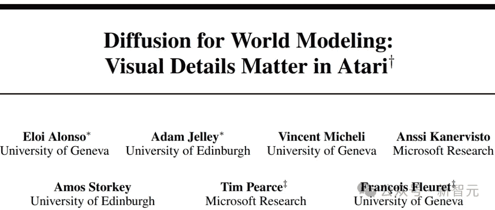

### 有鹿将发布LPLM2.4

https://mp.weixin.qq.com/s/kn_2odOmgiJ_tHyDc-vxDw

有鹿即将发布LPLM 2.4版本，在国际人工智能顶级竞赛中获得8项冠军，击败NVIDIA、Google、Meta、三星等国际科技巨头。全系产品将在2025年Q1通过OTA升级至该版本，推动机器人技术实现革命性突破。

LPLM模型采用端到端大模型的技术路线，不仅突破了传统GPS定位算法和SLAM算法的局限，还能够解决定位导航、紧急避障等问题，同时实现动态博弈式的三维空间路径规划与控制。这一模型让机器人具备理解物理世界和语言世界关系的能力，迈入通用智能时代。

LPLM模型创新设计了“三维纹理占用网格序列即语义”的tokenizer技术，并结合超级标签对齐，构建了一种全新的物理世界描述语言体系，即Large Physics Language Model，简称LPLM。通过多模态切割方法，模型在分割任务中的鲁棒性和完整性得到了全面提升。

在国际竞赛中，LPLM模型分别在以下领域获得冠军：nuScenes lidar semantic segmentation、ScanNetV2 3D Object Detection、Road Estimation Evaluation、KITTI Instance Segmentation、KITTI Depth Completion、KITTI Road Estimation、Argoverse 2 Scene Flow Challenge以及Talk2Car Referring Expression Comprehension。

实际应用中，LPLM模型在室外低密度点云场景（如锥桶）中，结合图像信息可精准回溯目标；在室内长尾类别识别（如垃圾桶）方面，利用预训练的2D视觉encoder提高识别能力。机器人在窄道通行和道路分割等任务中表现出色，提升了导航精度与效率。

LPLM模型的核心是对物理世界的描述语言，其出色的prompt适配能力和3D grounding特性，将持续推动机器人技术发展，为行业带来新一轮技术革新。

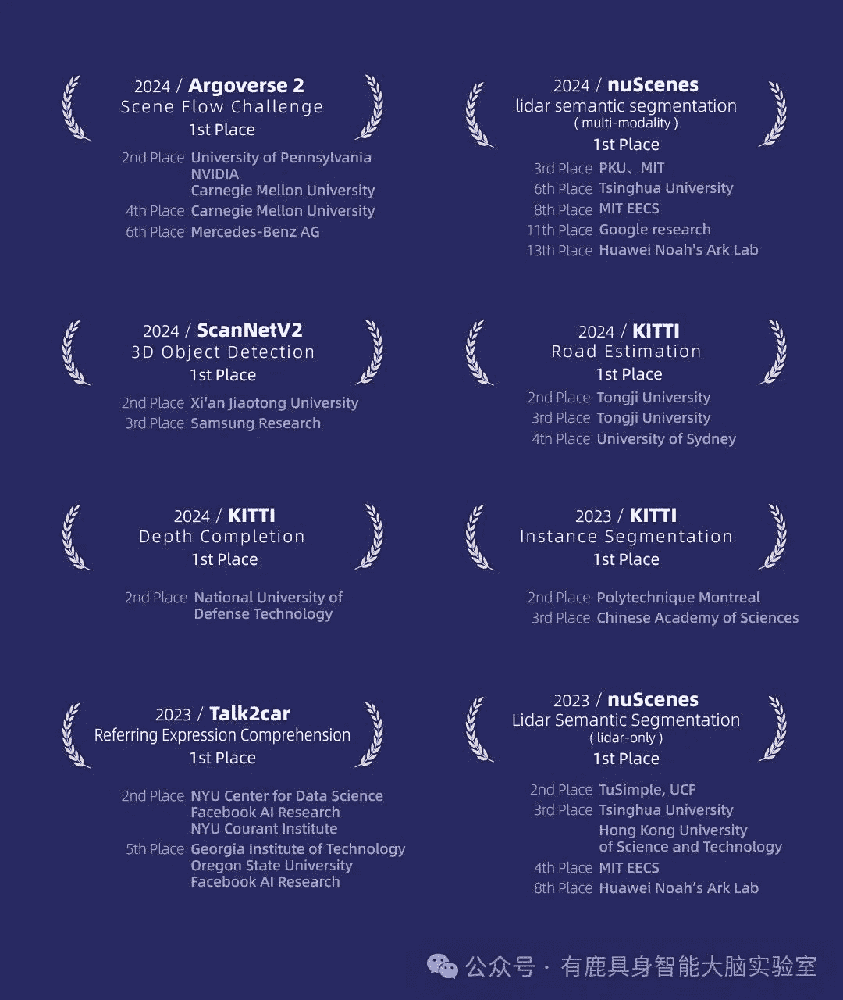

### MassiveFold出于AlphaFold而胜于AlphaFold3

https://mp.weixin.qq.com/s/50MudmLd1k8cqwzNGpj82w

蛋白质结构预测正迎来变革期，AlphaFold 已使单链及复杂组装的建模成为可能，但其高计算需求和耗时限制了实际应用。法国里尔大学与瑞典林雪平大学的研究人员提出了 MassiveFold，这一优化版 AlphaFold 大幅缩短预测时间，从数月减至数小时。

MassiveFold 通过并行化设计和改进采样方法，在保持预测精度的同时显著降低计算成本，适用于从单机到大型 GPU 集群的多种硬件环境。其整合了 AFsample 的增强采样和 ColabFold 的附加功能，支持 AlphaFold 所有版本的神经网络模型。研究表明，MassiveFold 在 CASP15 靶标测试中性能优越，为大多数目标生成了高质量模型，有时甚至优于 AlphaFold3。

技术亮点包括：

1.  **并行处理**：计算任务分布于 CPU 和 GPU，包括比对计算、批量推断和后处理，有效提高硬件利用率。

1.  **高效采样**：调整采样参数、回收和 dropout 增强预测多样性与置信度，适应复杂蛋白质组装。

1.  **模块化设计**：支持多种结构预测引擎，未来可集成 AlphaFold3。

1.  **易用性**：通过简单命令行和 JSON 参数配置，快速部署和运行。

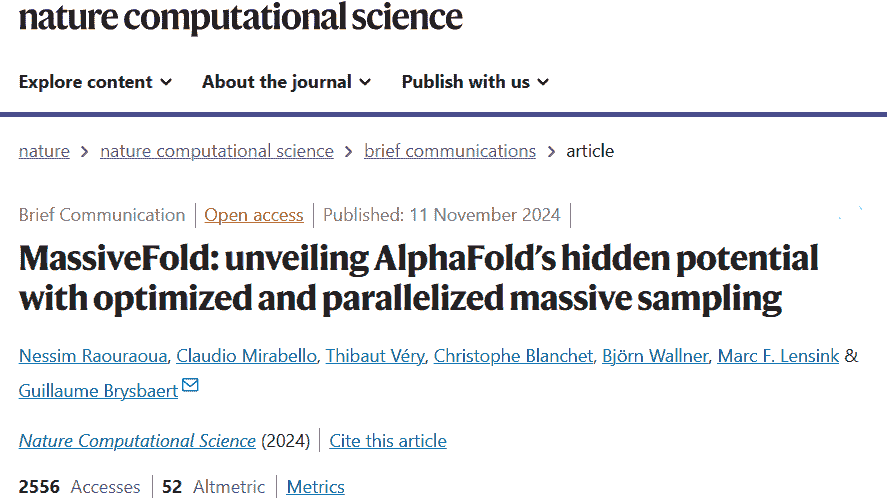

### AAAI 2025 第二届AI4Research研讨会

https://sites.google.com/view/ai4research2024/home

AI4Research 2024 将于 2025 年 3 月 4 日在美国费城举行，是 AAAI 2025 工作坊的一部分。本次会议聚焦 AI 辅助科学研究全生命周期，旨在探索人工智能如何从文献综述、假设生成到实验规划、结果分析等各阶段增强科研能力，尤其关注“科学领域中的沉睡美女现象”（Sleeping Beauties）及其解释性和可用性问题。

**核心议题**

1.  **自动化科研的挑战与解决方案**

+   AI 如何生成科学研究全流程中的准确代码或结果？

+   如何有效利用有限的高质量科学数据？

+   研发统一的基础模型以整合领域知识和多媒体信息。

1.  **尖端算法开发**

+   构建贯穿科学研究流程的端到端方法。

+   使用结构化和非结构化知识提高解释性。

+   模拟科学研究流程的框架研发。

1.  **科研平台的无缝集成与协作**

+   将 AI 集成至现有平台（如 PubMed、Google Scholar）。

+   为科学家设计更友好的人机交互界面。

1.  **社会影响与伦理考量**

+   关注事实性、抄袭、同行评审压力与隐私问题。

+   探讨 AI 工具对弱势群体及新兴研究方向的影响。

**其他亮点**

+   **数据集与评估标准**

+   引入数据集赛道以支持 AI4Research 新任务研究。

+   接受针对科学假设生成、自动化评审等不同阶段的评估方法研究。

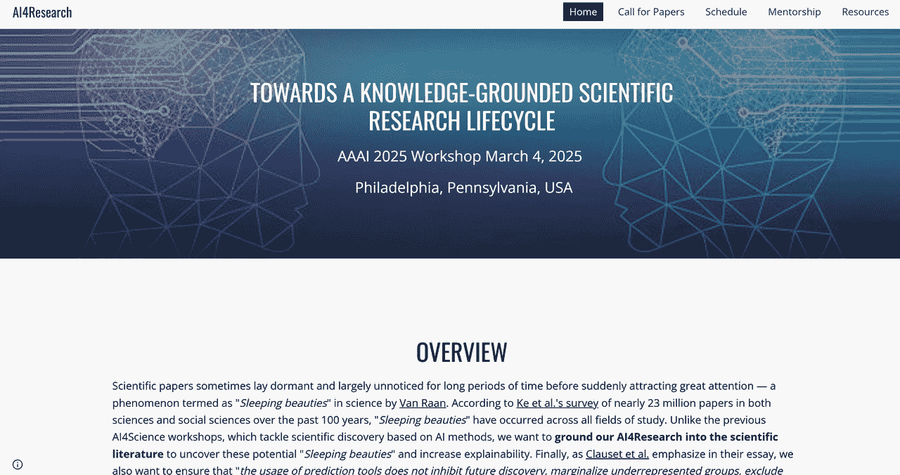

# 推特

### LLaVA-o1：首个具备自发性和系统性推理能力的视觉语言模型

贡献人：

https://x.com/Kevin_GuoweiXu/status/1858338565463421244

🚀 推出 LLaVA-o1：首个具备自发性和系统性推理能力的视觉语言模型，类似于 GPT-o1！🔍

🎯 我们的 11B 模型超越了 Gemini-1.5-pro、GPT-4o-mini 和 Llama-3.2-90B-Vision-Instruct！

🔑 核心在于基于结构化数据的训练以及一种新颖的推理时间扩展方法——阶段级束搜索。✨

📄 论文地址：https://arxiv.org/abs/2411.10440/

🔗 GitHub：https://github.com/PKU-YuanGroup/LLaVA-o1

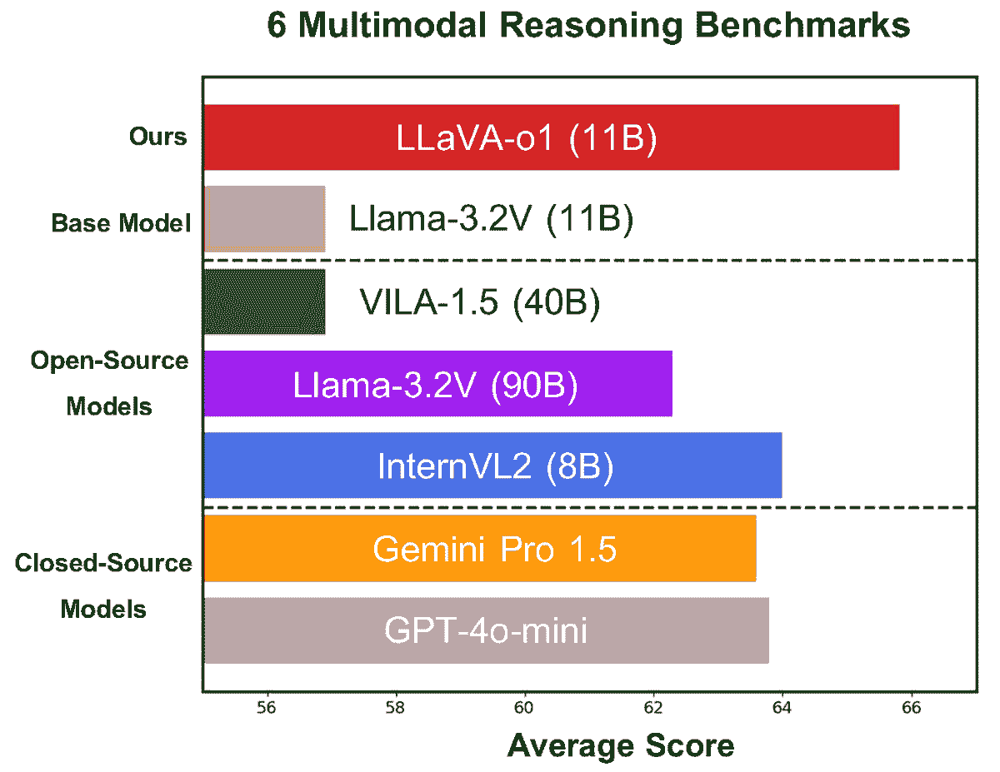

### 快速获得3Blue1Brown教学动画？Archie分享：使用 Manim 引擎和 GPT-4o 将自然语言转换为数学动画

贡献人：

https://x.com/archiexzzz/status/1858122612825538885

我非常喜欢 3Blue1Brown 的数学动画。

因此，我开发了一款工具，可以使用 Manim 引擎和 GPT-4o 将自然语言转换为数学动画。

现在你也可以创建自己的数学动画了！点击下面的链接试试看吧。

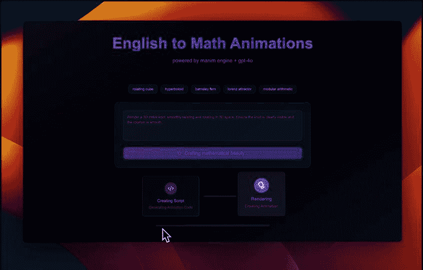

[_SHTp1tdLRTI0BKB.mp4](https://internal-api-drive-stream.feishu.cn/space/api/box/stream/download/all/XcXbbCuz8oAbQrxDF4mcMJBdnQ5)

### Boltz-1：开源可商用模型，能够在生物分子结构预测中达到 AlphaFold3 的准确水平

贡献人：

https://x.com/GabriCorso/status/1858180097016250815

很高兴宣布推出 Boltz-1，这是首个开源且商用的模型，能够在生物分子结构预测中达到 AlphaFold3 的准确水平！这是与 @jeremyWohlwend、@pas_saro 以及 MIT 和 Genesis Therapeutics 的优秀团队合作完成的一项令人兴奋的成果。详情请看下方线程！

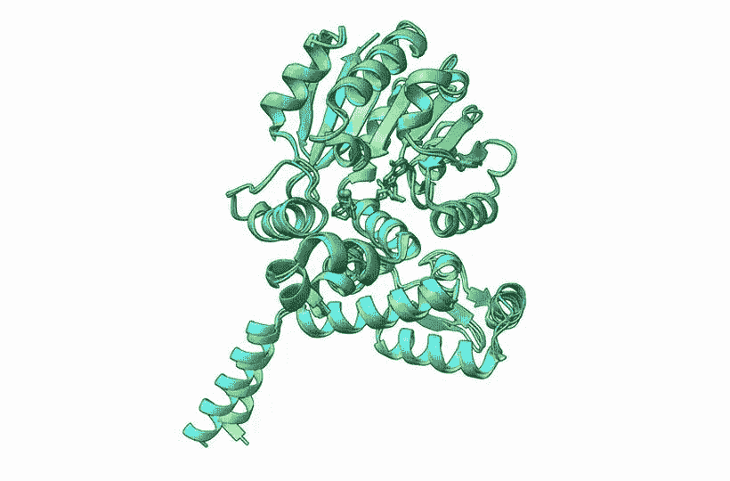

[GabriCorso - 1858180097016250815.mp4](https://internal-api-drive-stream.feishu.cn/space/api/box/stream/download/all/AhYbbIgl7oyJ0rxQJNkcqBL5npe)

### Cj分享使用感受：v0，Cursor，Bolt.new，Replit Agent，Gptengineer，Windsurf IDE

贡献人：

https://x.com/cj_zZZz/status/1858172065423257612

我每天用 AI 编码 7-8 个小时，一周 6 天。

我测试过 AI 技术领域的所有主流工具：

• v0

• Cursor

• Bolt.new

• Replit Agent

• Gptengineer

• Windsurf IDE

以下是我最新的排名：

**过去14天进步最快的项目：**

**Bolt.new - 8/10**

我对 Bolt 的输出质量感到印象深刻。

仅仅两周前，它还像个半成品。现在它逐渐成型，变得不错了。

非常适合制作着陆页和小型 SaaS 项目（4-5页）。

**最全能的项目：**

Replit Agent - 7/10

在 Replit 引入了 React + Vite 后，现在可以构建带有酷炫 UI 的应用程序。

仍然有点慢，有点复杂过头了，但方向是对的。

我在 v0 中设计的一个现代化着陆页，通过 Replit 一次就实现了。

**领域最佳：**

• **Cursor：** 专注编码

• **v0：** 前端设计

**半成品项目：**

Windsurf IDE - 4/10

输出让我失望，每次到第5步就崩了。

**仍需改进：**

GPTengineer - 4/10

想法很酷，但竞争现在非常激烈。

Bolt 的发展速度非常快，v0 改进了上下文缓存功能，而 GPTengineer 还在一条消息里实现单个编辑。

**我目前的技术栈：**

• **ChatGPT Search** 用于研究

• **o1 模型** 用于文档处理

• **v0** 用于前端设计

• **Claude AI** 作为“编码大脑”

• **Cursor** 用于代码实现

• **Replit** 用于项目部署

我感觉现在用这套技术栈，5-7天就能完成任何 Web 应用的开发。

接下来几天，我会分享一些很酷的实验，敬请期待！

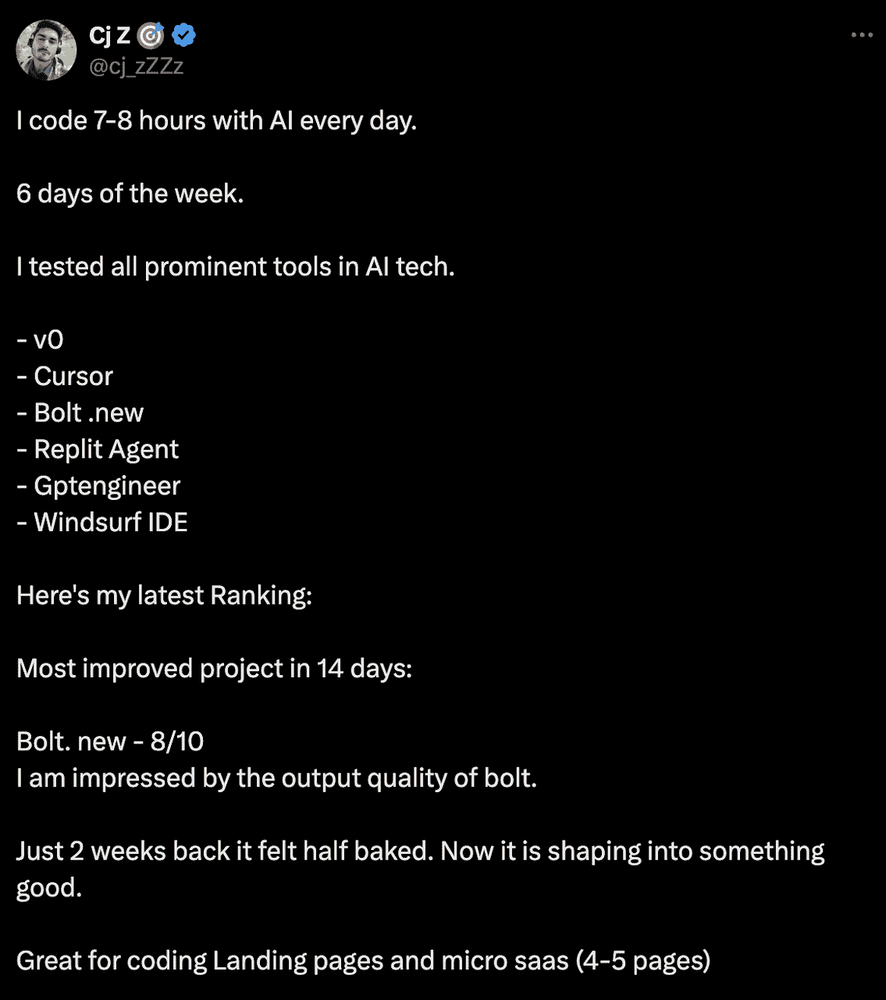

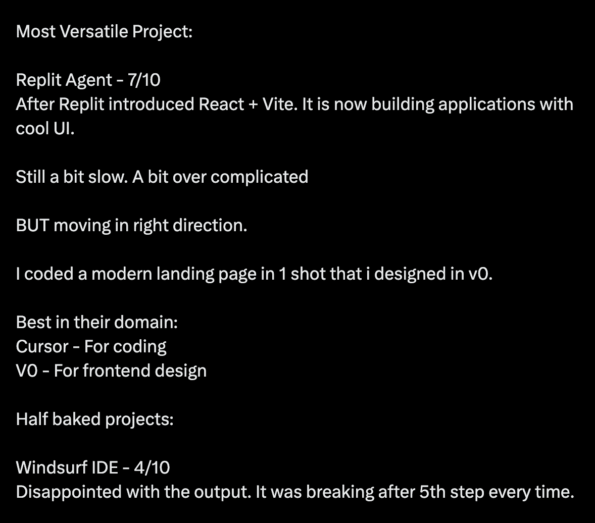

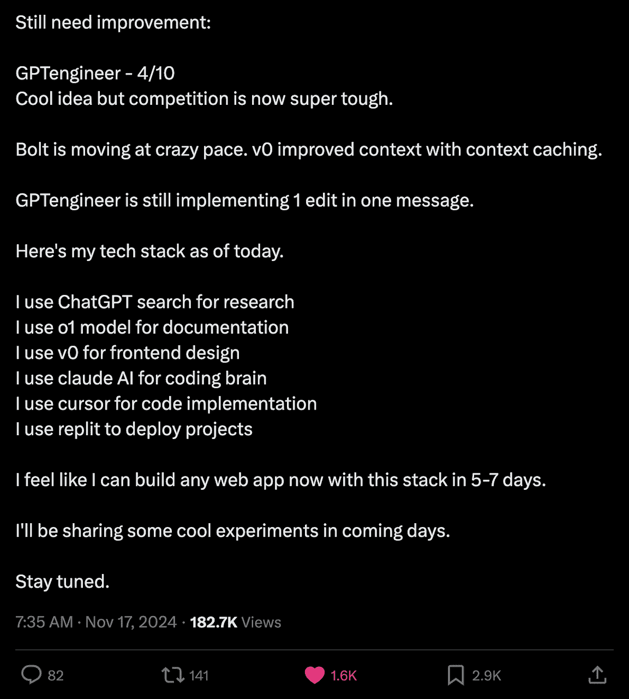

### Habryka分享：OpenAI 邮件档案（来自 Musk 诉 Altman 案件）

贡献人：

https://x.com/amasad/status/1857882040898826444

关于 Elon 和 OpenAI 的文章非常有趣，以下是全文。

有趣的花絮：Elon 通常会在几分钟内用一个单词或一句话回复，即使是长邮件，比如审查微软交易时，他发现了一条不好的条款，并促使他们修复了它。

---

OpenAI 邮件档案（来自 Musk 诉 Altman 案件）

在 Elon Musk 和 Sam Altman 的诉讼过程中，大量来自 Elon、Sam Altman、Ilya Sutskever 和 Greg Brockman 的电子邮件被公开。

我发现阅读这些邮件非常有价值，但尚未找到一个简单易读的在线来源来汇总所有内容。因此，我创建了一个。

我最初使用了一些 AI 工具生成内容，然后逐一仔细检查了每封邮件以发现任何差异。我很确定捕捉到了所有的不同，但可能仍有一些非常小的排版错误遗漏。

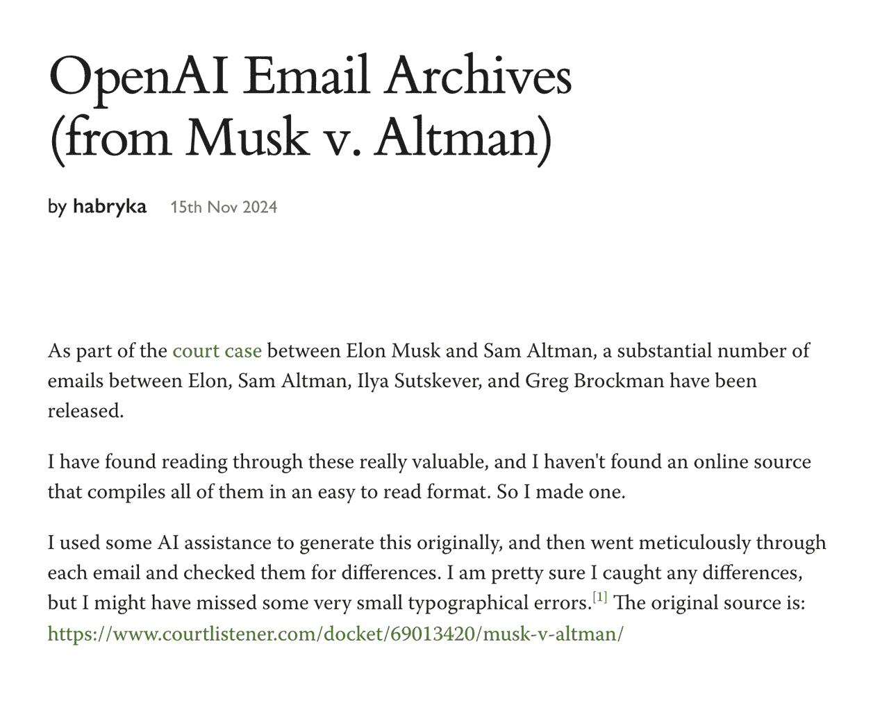

# 信号

### The Semantic Hub Hypothesis: Language Models Share Semantic Representations Across Languages and Modalities

贡献人：

原文链接：https://arxiv.org/pdf/2411.04986

学术分析报告：https://rflow.ai/flow/9b9511ec-a624-4dc1-b0de-dcd5ae16e26e

这篇文章提出了“语义中心假说”，探讨了现代语言模型如何通过学习跨不同语言和模态的共享表示空间来处理多样化的输入。研究表明，模型在中间层对不同语言中语义等价的输入具有相似的表示，并且这种空间可以通过模型的主要预训练语言进行解释。此外，文章还发现在一种数据类型中对共享表示空间的干预会可预测地影响其他数据类型的模型输出，表明共享表示空间在模型处理输入时被积极利用。

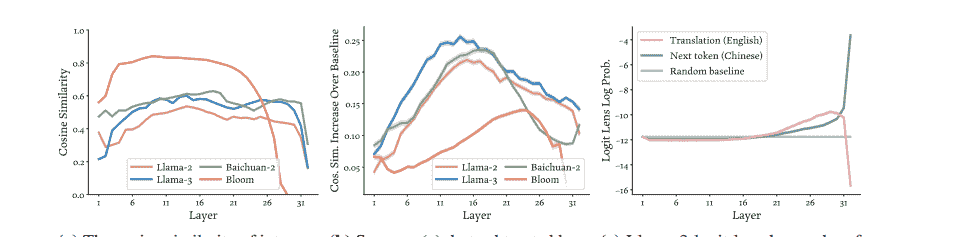

### LLaMA-Mesh: Unifying 3D Mesh Generation with Language Models

贡献人：

原文链接：https://arxiv.org/abs/2411.09595

学术分析报告：https://rflow.ai/flow/26cef11b-6216-4c83-ad36-e3e803d699d2

这篇文章探讨了如何扩展大型语言模型（LLMs）的能力，使其能够从文本预训练扩展到生成3D网格模型。文章提出了两个主要优势：一是利用LLMs从文本源（如3D教程）中嵌入的空间知识；二是实现对话式的3D生成和网格理解。面临的主要挑战是将3D网格数据有效地标记化为LLMs可以无缝处理的离散标记。为了解决这个问题，文章介绍了LLaMA-Mesh，这是一种新颖的方法，它将3D网格的顶点坐标和面定义表示为纯文本，允许直接与LLMs集成而无需扩展词汇表。文章构建了一个监督式微调（SFT）数据集，使预训练的LLMs能够：（1）从文本提示生成3D网格；（2）按需产生交错的文本和3D网格输出；（3）理解和解释3D网格。这项工作首次证明了LLMs可以通过微调来获取复杂的空间知识，以文本格式进行3D网格生成，有效地统一了3D和文本模态。LLaMA-Mesh在保持强大的文本生成性能的同时，实现了与从头开始训练的模型相当的网格生成质量。

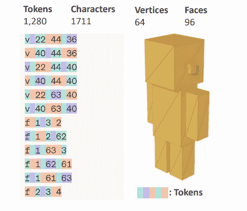

# 产品

### Momen

贡献人：

https://momen.app

Momen 是一个全栈无代码网页应用构建平台，集成了AI代理开发框架，帮助用户快速构建和部署MVP，减少上市时间，并支持无缝迭代和扩展。该平台特别适合非技术背景的创始人，使他们能够轻松将创意推向市场。

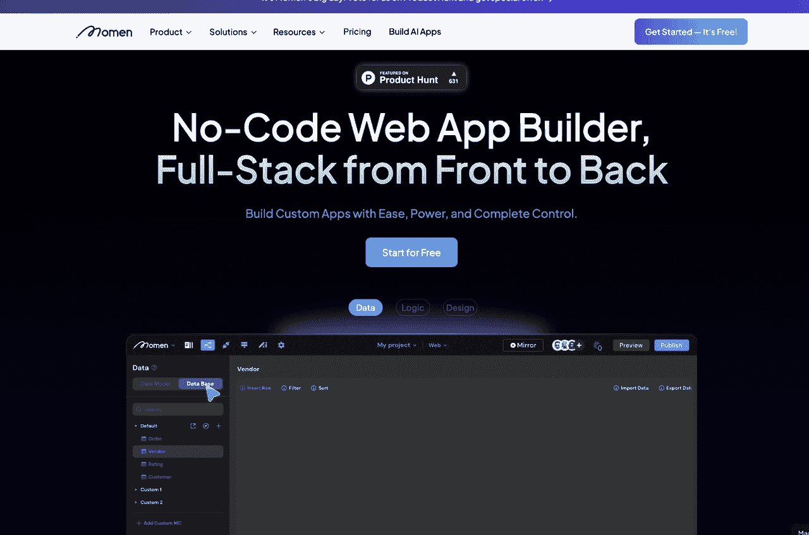

### AI Game Master

贡献人：

https://www.aigamemaster.app/

AI Game Master 是一款沉浸式文字角色扮演手机游戏，灵感来自D&D（龙与地下城），由AI驱动。玩家可以创建独特的角色，探索惊险的任务，招募忠诚的伙伴，并通过AI生成的图像和回合制战斗体验史诗般的冒险。这款游戏不仅仅是另一个文字RPG，它是一个充满无限可能的奇幻世界。

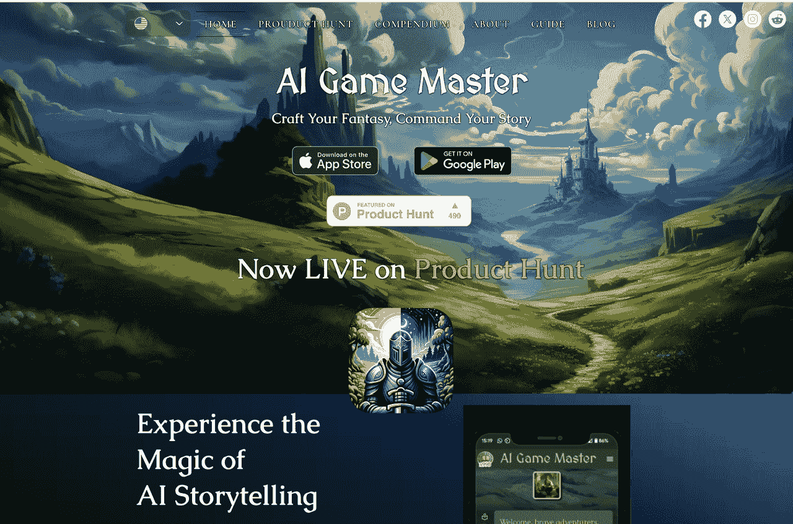

# HuggingFace&Github

### NarratoAI

贡献人：

https://github.com/linyqh/NarratoAI

NarratoAI 是一个自动化影视解说工具，基于LLM实现文案撰写、自动化视频剪辑、配音和字幕生成的一站式流程，助力高效内容创作。

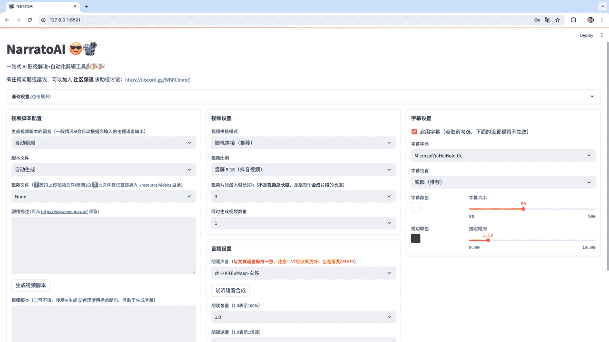

### promptbook

贡献人：

https://github.com/webgptorg/promptbook

Promptbook 是一个用于构建基于大型语言模型（LLM）的应用程序的开源工具，希望实现负责任、可控和透明的开发。它通过引入一种名为“Book”的新语言，将提示工程与编程分离，使非技术人员也能轻松定义和管理复杂的提示流程。Promptbook 支持多种

# 投融资

### 银河通用完成12亿元融资，缔造具身大模型赛道新纪录

贡献人：

https://news.pedaily.cn/202411/543070.shtml

银河通用自2023年5月成立以来，迅速成为具身智能领域的焦点。公司刚成立便完成种子轮融资，随后在今年6月宣布完成总计7亿元人民币的天使轮融资，而近日再次完成5亿元人民币战略轮融资，总融资额达12亿元人民币，成为具身大模型赛道迄今为止最大融资项目。

投资方阵容豪华，包括经纬创投、蓝驰创投、IDG资本、源码资本、美团战投、深创投、上汽恒旭投资、北京人工智能产业基金、香港投资公司等多家顶级机构与产业基金。银河通用更吸引了北京、上海、深圳、香港等四地政府背景基金的支持，显示其在全国范围内的战略价值。

银河通用由北大90后教授王鹤创立，聚焦于具身多模态大模型的研发与通用机器人产品的量产化。其首款产品Galbot G1已实现对复杂物体抓取和多场景泛化操作能力，成功应用于药房无人值守和工业生产线等场景，并与美团、奔驰、极氪等头部企业达成合作。

公司官网：https://www.galbot.com/

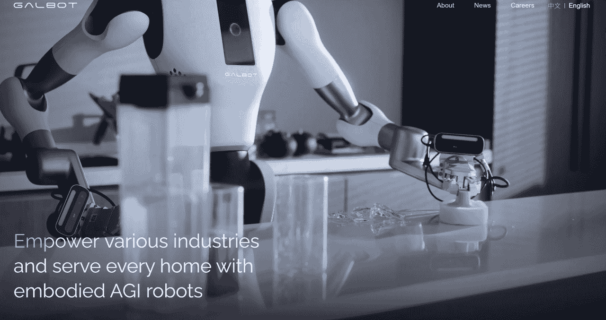

### 戴盟机器人完成两轮亿元天使+轮融资，聚焦光学触觉传感器研发

https://36kr.com/p/2990834468563720

戴盟机器人近期完成两轮亿元级天使+轮融资，投资方包括金鼎资本、国中资本、联想创投及头部银行系投资机构。本轮融资将用于研发光学触觉传感器、触觉灵巧手及多模态感知操作模型等产品，助推技术迭代与商业化落地。

戴盟机器人由香港科技大学机器人研究院创始院长王煜教授及段江哗博士联合创立。公司专注于研发毫米级厚度的视触觉传感器，该技术显著提升了机器人对三维力觉、动觉及滑觉等触觉信息的感知能力。其光学触觉传感器的触觉分辨率达到像素级别，远超传统阵列式触觉传感器，支持更复杂的精细操作。

此外，戴盟机器人通过整合触觉、视觉与动作数据，建立视觉-触觉-动作-语言模型，大幅减少训练数据需求，同时提升机器人操作任务的效率和成功率。

目前，戴盟机器人的光学触觉传感器已实现小批量量产，适用于人形机器人、手术机器人、智能座舱及柔性材料加工装配等场景。其数据收集外骨骼也投入实际使用，为操作模型优化提供高效数据采集方案。

+   **金鼎资本**表示，戴盟机器人的技术创新和场景协同能力为具身智能领域创造了持续价值。

+   **国中资本**强调触觉技术在提升机器人智能化水平和应用场景中的重要性。

+   **联想创投**指出触觉传感器技术已具备商业化基础，并将为戴盟机器人提供全方位赋能，助力产业化落地。

### 3D AI公司「SEELE」完成千万美元Pre-A轮融资，专注游戏内容生成

https://news.pedaily.cn/202411/543068.shtml

SEELE AI宣布完成千万美元Pre-A轮融资，本轮由美图投资和富坤创投领投，老股东Webtime Information S&T持续加码支持。SEELE成立于2022年底，是一家致力于多模态大模型和3D游戏AIGC技术的创新公司。

公司专注于通过自研多模态大模型，为3D游戏生成提供高效的内容平台，极大简化了游戏开发流程。用户仅需通过文字描述，系统即可生成精美的3D场景、互动动画和引人入胜的游戏玩法。这一技术突破使SEELE成为全球少有的快速实现大模型训练和应用落地的团队。

SEELE的产品在短短半年内已经积累了近百万海外用户，受到专业游戏从业者和MMD/VRChat创作者的青睐，展现出强大的自然增长能力和用户粘性。

SEELE由前网易云音乐创始人王诗沐领导，核心团队来自腾讯、字节跳动和阿里巴巴等顶级企业，成员包括多位大模型和图形学领域的专家。融资后，公司计划进一步升级游戏多模态大模型技术，打造全新的游戏AIGC引擎，吸纳更多全球顶尖人才，突破互动娱乐的边界，为游戏玩家创造更丰富的体验。

公司官网：https://www.seeles.ai/discover

### Robust AI推出Carter Pro机器人，强化人机协作

https://techcrunch.com/2024/11/17/robust-ais-carter-pro-robot-is-designed-to-work-with-and-be-moved-by-humans/

Robust AI公司发布了一款名为Carter Pro的机器人，专为与人类协同工作而设计。这款机器人能感知人类施加的力并调整自身行动，支持手动移动操作，是人机交互的典范。这一设计让Carter Pro在安全性和灵活性方面取得了显著突破，适合在复杂的仓储和物流环境中部署。

Robust AI与全球物流巨头DHL达成合作，DHL成为首批大客户之一。然而，为避免客户单一化带来的风险，公司正积极拓展更广泛的客户基础。此外，Robust AI强调其策略是在稳健发展的同时，不局限于单一领域，以确保未来的市场韧性。

Carter Pro使用摄像头替代传统的激光雷达（Lidar）作为感知设备，这种设计更适合仓库环境并降低成本。该机器人还配备了模块化设计，能轻松融入现有仓储布局。目前，多个合作伙伴已测试早期版本，生产型产品刚刚下线。

CTO Rodney Brooks曾创立Rethink Robotics，专注人机交互技术，使Carter Pro在协作理念上表现出色。公司希望通过优化人机协作安全性和提升效率，进一步拓展仓储、物流等领域的市场。

公司官网：https://www.robust.ai/

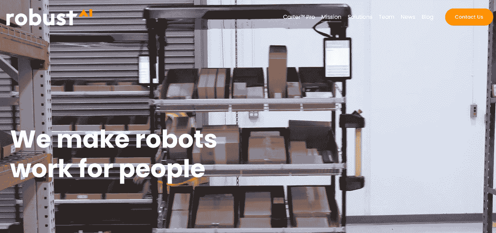

### 挪威初创公司Factiverse利用AI对抗虚假信息

https://techcrunch.com/2024/11/17/norwegian-startup-factiverse-wants-to-fight-disinformation-with-ai/

随着2024年美国总统大选的结束，虚假信息在线上呈惊人速度传播，引发公众对候选人以及公共健康、气候变化、移民等话题的认知偏差。挪威初创公司Factiverse正致力于用AI技术应对此类挑战。

Factiverse成立于2020年，目前处于早期阶段，已完成约145万美元的种子轮融资。其商业模式主要面向企业，提供文本、视频和音频的实时事实核查工具，以节省研究时间并降低声誉或法律风险。此外，Factiverse计划在2025年启动下一轮融资，并寻求更多投资者支持其全球扩张。

Factiverse由Maria Amelie和Vinay Setty共同创立，后者是斯塔万格大学的机器学习副教授。其AI模型基于高质量、可信赖的数据进行训练，而非通用生成式AI依赖的“垃圾数据”。目前，该模型支持114种语言，准确率达80%，并且在可信来源的推荐和事实验证方面表现优于GPT-4和Mistral 7-b等先进模型。

Factiverse的工具已应用于美国总统辩论的实时事实核查，并与挪威主要银行及多家媒体建立合作关系。未来，该公司希望进一步提升模型性能，并通过新客户和投资者扩展其市场规模。

公司官网：https://www.factiverse.ai/

# 学习

### 分布式训练基础：DDP 和 FSDP 初学者指南

https://medium.com/@davechirav/distributed-training-demystified-a-beginners-guide-to-ddp-fsdp-4c7f12973108

本文简要介绍了分布式数据并行训练（DDP）和全分片数据并行训练（FSDP）的核心技术与应用场景，重点阐述其在提升训练效率和处理大型模型中的作用。

---

**DDP：分布式数据并行训练**

1.  **基本原理**
DDP通过将数据分片分配到多块GPU，实现批次并行处理，显著加快训练过程。例如，将包含4个批次的数据分配到4块GPU，所有批次可在一次迭代中完成处理。

1.  **适用场景**
DDP适合小型模型且设备具备多个GPU的场景，模型需完整加载到单个GPU的显存中。

1.  **工作流程**

+   **前向传播**：每块GPU处理不同数据批次，并计算局部损失。

+   **反向传播**：每块GPU根据局部损失独立计算梯度，并通过AllReduce操作同步所有GPU的梯度，确保模型权重一致。

---

**FSDP：全分片数据并行训练**

1.  **基本原理**
FSDP在DDP基础上进一步优化，通过模型分片技术将模型拆分为更小的单元，分布到各块GPU。这不仅实现了数据并行，还提高了显存利用率，可处理无法在单块GPU加载的大型模型。

1.  **适用场景**
适用于多GPU环境，且模型超出单GPU显存容量的情况。

1.  **模型分片**
模型可按层、块或参数数量分片。例如，对于两层各包含100个神经元的模型，每层分为50个神经元分别加载到两个GPU。

1.  **工作流程**

+   **前向传播**：各GPU通过AllGather操作组装模型单元（FSDP单元），完成数据计算后返回激活值。

+   **反向传播**：GPU按反向顺序组装单元计算梯度，并通过ReduceScatter操作同步梯度，每块GPU更新其负责的分片权重。

---

**技术要点与优化建议**

1.  **通信与同步**
无论是DDP的AllReduce还是FSDP的AllGather/ReduceScatter，通信性能对训练效率影响显著。

1.  **模型适配与基础设施设计**
FSDP适合处理更大规模模型，但对模型分片策略和硬件通信架构有更高要求。

1.  **应用价值**
这些技术为大语言模型训练提供了高效解决方案，但需要精心设计和优化以避免瓶颈。

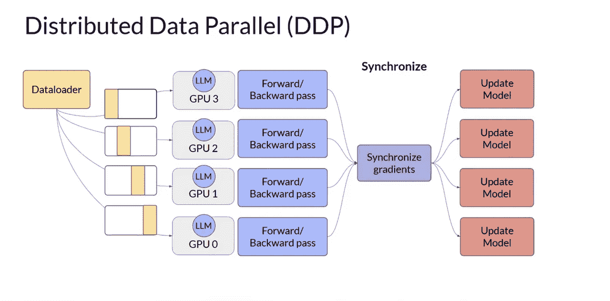

### RoboFlamingo、OpenVLA、GR-1/2和π0的网络模型分析

贡献人：

https://zhuanlan.zhihu.com/p/7365856975

近期具身操作领域的研究集中在三个主要方向：训练方法、网络模型和数据。训练方法方面，基本都是采用模仿学习的思路，主要区别在于是否使用视频数据或异构本体数据进行预训练，损失函数本身创新有限。数据层面，主要依赖本体数据集和人类操作视频或其他机器人数据，这一部分的技术突破不多，但数据的质量和多样性对模型能力有显著提升。相比之下，网络模型成为研究的核心领域。

在网络模型的研究中，技术重点集中在视觉-语言特征提取、动作预测方式、历史信息的使用以及动作分布建模上。这些方向的模型主要分为两大类：基于观测信息编码的动作预测模型和基于自回归方式的动作预测模型。

基于观测信息编码的动作预测模型，如RoboFlamingo和π0，通常通过多模态预训练模型提取图像和文本的特征，将观测信息映射到一个统一的高维空间。动作预测可以采用MLP、LSTM、GPT或扩散模型等方法，其中扩散模型能够更好地建模多模态分布，但需要更多的数据和更大的模型支持。例如，π0模型通过扩散模型建模动作分布，具有较强的分布建模能力和训练稳定性，但数据需求较高。

基于自回归方式的动作预测模型，如OpenVLA和GR-1/2，则通过自回归预测动作嵌入，再利用策略头解码出具体动作。输入的token包括当前步的图像、文本、本体信息和动作信息，GR-1还额外预测未来图像token，进一步增强模型能力。步长设计上，OpenVLA采用一步自回归，简洁高效；GR-1则使用多步回归（10步），能够更充分利用历史和未来信息，但计算复杂度更高。

代表性模型有RoboFlamingo、OpenVLA、GR-1/2和π0。RoboFlamingo利用多模态预训练模型提取视觉-语言特征，扩散模型建模动作分布；OpenVLA采用高效的一步自回归方式；GR-1通过多步回归强化历史信息的利用；π0在动作分布建模上依赖扩散模型的多模态能力。数据和训练方法趋于成熟，网络模型的创新将成为未来研究的核心。下一步可能的突破点包括优化特征提取方法、提升历史信息建模能力、降低大模型计算成本，并探索更高效的动作分布建模技术。

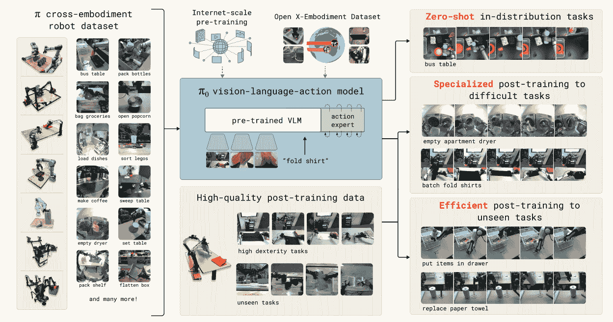

### 投机采样系列-EAGLE

https://zhuanlan.zhihu.com/p/7290666130

投机采样是一种通过特定策略优化大模型推理过程的技术，能够在提升推理速度的同时保持生成精度。EAGLE是近期提出的一种创新性方案，通过轻量化设计实现候选token的高效生成和验证。

投机采样技术目前已有多种实现路径，包括自投机方法、基于DataStore的方案、Draft Model方案、上下文方案以及Fine-tune方案。EAGLE属于Fine-tune范畴，其主要目标是提升候选token生成速度，同时保持生成质量，解决传统方法中速度与精度之间的矛盾。

EAGLE的核心思想是通过引入一层EA Layer（包含全连接层和解码层），利用base model输出的hidden states和LM Head的logits生成候选tokens。EA Layer的简化结构显著降低了推理计算复杂度，同时通过优化策略保证生成质量。EAGLE训练和推理过程的关键如下：

在训练阶段，EAGLE将模型划分为embedding、base model和LM Head三部分。EA Layer专注于学习base model的hidden states和LM Head的输出特征，输入为当前token和前一个token的hidden states，通过全连接层计算出下一步特征。为了增强生成的鲁棒性，引入了噪声扰动和hidden states的拼接处理。

在推理阶段，EAGLE生成候选tokens的流程包括从base model获取上一token的hidden states，与当前token的embedding拼接后通过EA Layer处理，最终通过原始LM Head输出topK候选tokens。EAGLE的验证过程通过树结构实现。EAGLE-v1使用固定深度和宽度的静态树对候选tokens进行验证，EAGLE-v2引入动态树设计，通过累积概率筛选候选tokens，进一步提高验证效率和精度。

EAGLE的实现细节表明仅用一层EA Layer便能拟合多层分布，这种轻量化设计有效缩短了推理时间。EA Layer通过全连接层对拼接的hidden states进行计算，并结合Decoder Layer生成下一步输出。其核心实现代码展示了从嵌入层到解码层的高效推理过程。

EAGLE的主要优势在于其轻量化设计显著提升了推理效率，并通过引入树结构验证增强生成精度。实验表明，Fine-tune单层EA Layer能够在多层特征分布上取得较好拟合效果，证明了其在投机采样中的可行性。

EAGLE的潜在局限性主要体现在小型验证集的精度稳定性和对采样参数的敏感性上。虽然拒绝采样在大规模数据分布上已证明误差极低，但在垂直领域的小型验证集上仍需要进一步验证实验效果。此外，采样参数的变化对推理结果的影响较大，未来需要更稳健的参数调优策略。

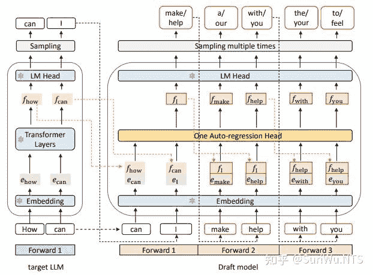

### 训练数据合成(二)

https://zhuanlan.zhihu.com/p/7391887897

Self-instruct 是一种经典的大模型指令数据合成方法，目标是以低成本获取大量用于微调的高质量指令数据。其流程包括指令生成、任务分类、实例生成以及过滤后处理。

1.  指令生成通过初始的人类编写数据构建任务池，结合few-shot示例生成新指令。模型使用开放式prompt生成多个任务描述，如最多生成到Task 16。

1.  任务分类阶段判断任务是分类任务还是非分类任务，使用few-shot示例提示模型完成分类任务的标识。

1.  实例生成阶段基于指令和任务类型生成输入输出实例。为提高多样性，few-shot示例尽量来自不同任务类别，生成顺序也可灵活调整以避免偏差。

1.  过滤和后处理通过相似度计算去除重复数据，并移除无法执行或无效的任务，如涉及多媒体处理的任务。

Evol-instruct 则专注于提高现有指令数据的多样性和复杂度，分为指令进化、响应生成以及进化淘汰三个步骤。其关键在于通过大模型进化现有指令来增加任务难度或覆盖更多领域。

1.  深度进化旨在逐步提升指令难度，涉及增加约束、深化问题、具体化概念、增加推理步骤等。

1.  广度进化则侧重拓展数据集主题范围，通过生成全新但同领域的任务描述提升多样性。

1.  生成的响应经过过滤，确保生成质量，移除无信息增益、不合规或难以生成响应的任务。

MAmmoTH2 是从Web数据构建指令数据的框架，更偏向于数据抽取而非合成。其流程包括文档召回、Q-A对抽取和质量优化。关键在于利用LLM从网页提取干净的问答内容，并对不完整或不清晰的数据进行补全和改写。

GENIE 聚焦于长文本问答、摘要等内容驱动任务的数据合成，主要通过从结构化文档生成任务相关数据，并利用NLI模型和奖励模型进行质量检查，保证问答或摘要内容与原文档一致。

Orca-Math 则专注于生成多样化的小学数学应用题。其方法是以种子问题为基础，利用大模型扩展生成新问题，并通过“Suggester & Editor”机制提高问题难度。

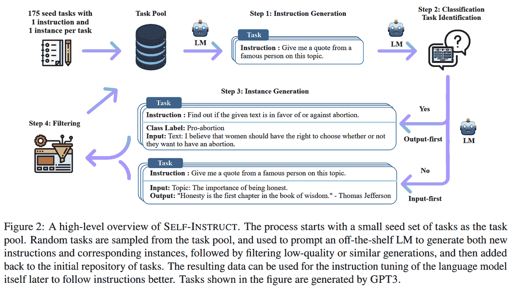

### 微软RAG研究的四个层次

https://cobusgreyling.medium.com/four-levels-of-rag-research-from-microsoft-fdc54388f0ff

**RAG的四个层次**

1.  **显性事实查询（Level 1: Ex**plicit Fact Queries）

+   用户直接提出具体问题，模型从预处理数据中提取明确答案。

+   任务简单，主要集中于信息定位和提取，例如“某国的首都是哪里？”

1.  **隐性事实查询（Level 2: Im**plicit Fact Queries）

+   涉及间接问题，需要结合常识和基本逻辑推理得出答案。

+   信息可能分散于多个片段中，例如“堪培拉所在国家目前的执政党是哪个？”需要结合堪培拉在澳大利亚这一事实。

1.  **可解释性推理查询（Level 3: Interpretabl**e Rationale Queries）

+   聚焦于推理过程的理解，要求结合领域知识进行逻辑分析。

+   例如财务审计中，模型需遵循合规指南来判断财务报表是否符合标准。

1.  **隐性推理查询（Level 4: Hidde**n Rationale Queries）

+   需要更深层次的背景推理，推断隐藏含义或潜在影响。

+   如IT运维中，根据过往案例分析问题解决策略；软件开发中，通过调试历史推断有效解决方法。

---

**核心研究方向**

+   **用户意图识别**
系统需准确识别用户的主要目标，将复杂任务分解为独立技能以优化表现。

+   **上下文处理**
理解对话背景，包括用户历史输入、当前任务和环境信息，以提供一致且个性化的响应。

+   **多文档综合**
应对复杂多部分查询，需要从多种文档中提取信息并生成完整回答。

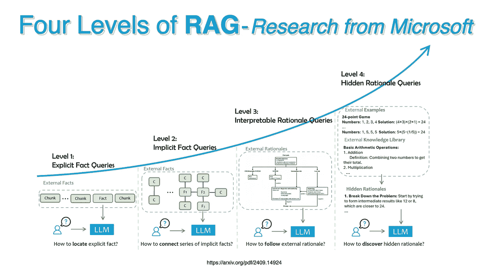

### KAIST CS492(D)：扩散模型及其应用课程

https://mhsung.github.io/kaist-cs492d-fall-2024/

课程简介

KAIST CS492(D) “扩散模型及其应用”聚焦于生成式人工智能（Generative AI）的最新技术突破，特别是扩散模型（Diffusion Models）。扩散模型因其卓越的生成质量和多样化的应用（如条件生成、个性化生成、零样本操作、知识蒸馏等）成为当代生成模型的主流技术。本课程兼顾理论与实践，学生将通过编程作业和项目深入理解和运用扩散模型解决实际问题。

课程设置

+   **时间**：每周一、三下午1:00-2:15（韩国标准时间）。

+   **地点**：Zoom在线/N1楼201室。

+   **重点内容**：

+   生成模型基础（GAN、VAE）；

+   关键扩散模型如DDPM、DDIM；

+   条件生成（CFG）和潜变量扩散模型（Latent Diffusion）；

+   高级应用如零样本生成和逆问题求解。

技术细节

+   **模型基础**：课程从最基础的扩散过程开始，深入探讨去噪扩散概率模型（DDPM）及其改进（如DDIM）和条件生成技术（CFG）。

+   **高级主题**：包括控制生成（ControlNet）、参数高效调节（LoRA）、概率流ODE求解器和DPM求解器。

+   **实战项目**：以解决实际问题为导向，涵盖扩散模型的同步化、逆问题求解以及未来生成模型的应用前景。

+   **客座讲座**：邀请领域内专家分享最前沿的研究成果。

参考资料

+   SIGGRAPH 2024课程《视觉内容生成的扩散模型》。

+   CVPR 2023教程《去噪扩散模型：生成学习大爆炸》。

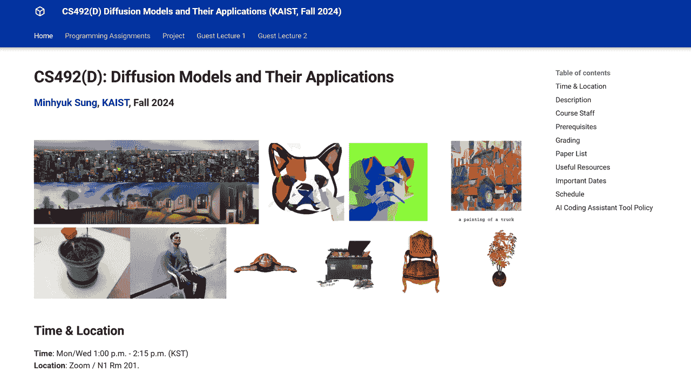

# 声明

本文档仅供学习交流使用，版权归原作者所有，若涉侵权，请联系Jack Jin 15101136166

##

（欢迎在下方反馈您宝贵的意见！整理不易，觉得有用给AI日报小组点个赞👍吧！）

ChatGPT；Angela；Zijia Liu；Alex；Zeqi Tan；Tiezhen（HuggingFace）；Naixu；Lizhi；Peter；Suoman；Jack

学术分析报告：ResearchFlow -- 奇绩F23校友的开发的深度研究产品，PC端进入RFlow的分析报告，可直接点击节点右侧的小数字展开节点，登录后可在节点上直接“询问AI”，进一步探索深度信息

如果你有大模型相关的创业想法，欢迎来找我们聊聊～微信：15101136166

> 快邀请你的小伙伴们一起来读大模型日报吧！

> **【日报****知识库****】**这里是近期日报内容的汇总,欢迎大家查阅

> [大模型日报知识库(分享版)](https://miracleplus.feishu.cn/wiki/KapVwXfkriOBiskB0B2cUHxjnTh)

>

> 欢迎大家多多帮我们分享,转发~~

> 如果大家有任何的建议或者吐槽,欢迎随时找我聊天~

