# 奇绩大模型日报（11月 16-17日）

> 来源：[https://miracleplus.feishu.cn/docx/Op4gdlYx4okNpixAQMPcGyQ5ntg](https://miracleplus.feishu.cn/docx/Op4gdlYx4okNpixAQMPcGyQ5ntg)

## 资讯

### MIT在虚拟环境中训练出机器狗

https://mp.weixin.qq.com/s/0iFs8N9OkLdAArTL1-AS8Q

机器人学习的核心瓶颈在于数据不足。相比于图片和文本数据，机器人学习所需的高质量、真实场景数据收集成本高昂且过程繁琐。现有方法依赖物理仿真环境，但要实现与真实世界接近的多样性仍面临诸多挑战：

1. **渲染成本高**：生成逼真场景需要细致的手工制作。

2. **迁移脆弱性**：模拟训练的机器人在现实中表现有限。

3. **场景多样性不足**：缺乏高质量多样化内容限制了性能提升。

LucidSim解决方案：

MIT团队提出LucidSim框架创新性地使用生成模型为机器人学习提供虚拟训练数据，并通过以下关键技术提升机器人学习的效率与泛化能力：

1. **生成数据作为训练源**：利用生成模型生成多样化的场景，替代传统手动收集的物理数据。

2. **物理与几何一致性**：通过增强的ControlNet模型引导生成场景，与物理引擎MuJoCo保持几何一致性，从而实现精准的sim-to-real（模拟到现实）迁移。

3. **视觉策略训练**：分两个阶段优化策略：

+ **预训练**：使用特权教师策略引导初始模型。

+ **后训练**：通过on-policy数据增强闭环训练，提高策略稳健性。

4. **视频生成与动态一致性**：引入Dreams In Motion（DIM）技术，以计算光流扭曲生成的帧，快速生成时间一致的视觉序列，支持机器人运动规划。

实验与结果：

团队在机器人视觉跑酷场景中测试LucidSim，通过以下指标验证其效果：

1. **模拟性能**：LucidSim优于传统域随机化方法，特别是在复杂场景（如障碍攀爬）中表现显著。

2. **现实迁移**：在现实场景中，LucidSim能识别多种目标物体，表现出色。

3. **训练效率**：DIM加速生成速度，显著减少数据准备时间，性能仍保持一致。

4. **数据多样性权衡**：优化了生成图像的几何准确性和细节丰富度，在动态一致性和多样性之间取得平衡。

技术潜力与展望：

LucidSim展示了生成模型在机器人学习领域的巨大潜力，解决了传统物理仿真方法的多样性和迁移挑战。未来，该方法有望拓展至更多应用场景，如复杂的具身智能任务和现实世界的操作控制，为通用机器人学习奠定基础。

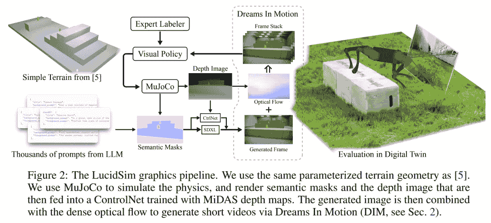

### 首个自主机器学习AI工程师，刚问世就秒了OpenAI o1

https://mp.weixin.qq.com/s/h1firXC07eOvcTyuzh2Tqg

近日，一家名为NEO的创业公司发布了首个完全自动化的机器学习工程师AI系统，震撼了AI社区。NEO以26%的奖牌率在50场Kaggle竞赛中表现卓越，超越了OpenAI最新的o1模型，展现了其在机器学习工程中的卓越能力。

技术亮点与突破：

1. **多智能体架构**：NEO采用多智能体系统，将机器学习工程复杂流程拆解为多个独立部分，由专门优化的子模型分别处理。这种模块化设计显著提高了流程效率。

2. **自动化全流程**：从数据准备到模型选择，再到部署和监控，NEO可实现全自动化。通过结构化的计划、编码、执行和调试循环，它持续优化每一步骤，显著减少开发人员的手动工作。

3. **高效数据处理**：NEO在数据预处理阶段表现突出，自动完成缺失值处理、异常值修复和格式标准化，为模型训练提供高质量数据输入。

4. **强大任务适应性**：NEO展示了其在多任务场景中的适应能力，如自动构建信用卡欺诈检测系统和优化协同过滤书籍推荐模型的数据管道。

5. **卓越竞赛表现**：在MLE-bench基准测试中，NEO通过在50场实际Kaggle竞赛中测试，26%的奖牌率大幅领先o1的16.9%，达到了堪比Kaggle特级大师的水平。

6. **与人类协作**：NEO并非取代人类工程师，而是作为辅助工具简化繁琐任务。通过自动化，开发者可以将数周的工作浓缩到数小时完成。

实际意义与影响：

+ **对行业的改变**：NEO的多智能体架构为AI辅助的机器学习工程开创了新标准，为企业节省大量时间和人力成本。

+ **模型性能提升**：NEO不仅快速交付模型，还保持了较高的准确性和鲁棒性，适用于真实世界任务。

+ **潜在争议**：尽管NEO的表现引发期待，但业内对其实际效果仍存疑，需通过用户测试验证其全面能力。

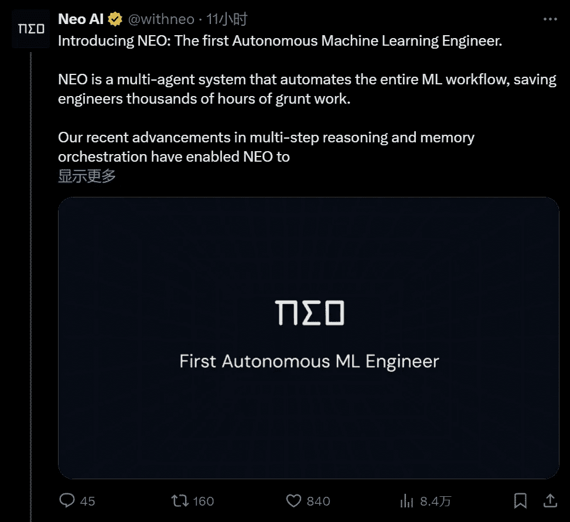

### 基于预训练视觉特征，看一眼任务就能零样本规划

https://mp.weixin.qq.com/s/2wYS7bC0RsKqvqvkp9SbPA

Yann LeCun团队近日发布了基于预训练视觉特征的世界模型DINO-WM，展示了该模型在零样本规划任务中的潜力。这一研究提出了一种无需专家演示、奖励建模或逆向模型的新方法，通过动态建模隐藏空间中的世界状态，实现了高效视觉规划。

DINO-WM的核心技术亮点包括：

1. **基于DINOv2的嵌入特征**：该模型采用预训练视觉特征，将环境动态建模为隐藏空间中的紧凑嵌入。这种方法避免了直接处理高维像素空间，提高了模型的稳健性和一致性。

2. **高效轨迹预测**：通过ViT架构，DINO-WM能够预测未来隐藏状态，并在测试时通过模型预测控制（MPC）优化动作序列，直接实现目标状态，无需额外信息。

3. **零样本规划能力**：实验表明，DINO-WM在Wall和PointMaze等简单任务中表现与最先进的DreamerV3模型相当，而在需要复杂接触信息和物体动态的操纵任务中显著优于传统方法。

4. **优异的泛化能力**：DINO-WM在从未见过的环境配置中表现出色。例如，在墙壁随机布局任务中，模型有效学习了墙壁和门的通用概念，并成功将粒子聚集到目标位置。

5. **对比生成式模型的优势**：与基于扩散的视频生成模型相比，DINO-WM预测物理合理性更高，能够准确实现目标状态，表现出更优的任务执行能力。

DINO-WM为任务无关的世界建模和控制提供了新的方向，其通过预训练表征和隐藏空间建模，有效填补了推理与控制之间的空白。该研究为通用智能体的世界建模和实际应用铺平了道路。

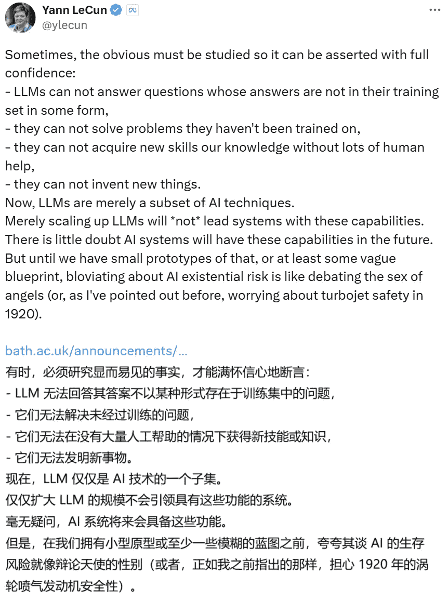

### 杨植麟发布Kimi新模型：数学对标o1

https://mp.weixin.qq.com/s/2dIhRjkp9KRsTn9TsvgvmA

在Kimi开放一周年之际，其创始人杨植麟推出了新模型k0-math，专注数学领域，瞄准OpenAI o1系列并主打深入思考能力。在数学领域的四项基准测试（MATH、中考、高考、考研）中，k0-math均超越o1-mini和o1-preview，展现了卓越的能力。模型的特色在于全面展示解题过程，无论简单还是复杂的题目，它都会进行深入探索和验证。这种反复尝试的方式虽然提高了推理准确性，但也引发了思考效率的挑战。

k0-math的核心创新点包括深入思考能力的培养以及强化学习在Scaling Law上的应用。例如，在回答简单的“1+1”等问题时，k0-math会先进行可视化、验证和多次确认，以确保答案的可靠性。在强化学习技术的支持下，模型优化了意图增强、信源分析和链式思考等推理能力。其中，意图增强可以将抽象问题具体化，信源分析提升答案的权威性与溯源能力，链式思考则通过分解复杂问题来逐步推导高质量答案。

在未来发展方向上，k0-math的优化重点包括提升模型的自我判断能力，使其能动态调整思考深度，从而避免在简单问题上浪费算力。同时，通过强化学习范式的引入，模型将突破静态数据的限制，利用少量标注数据杠杆化AI的自主学习能力，以实现更大规模的性能提升。此外，Kimi团队还在多模态领域推进研发，内测了多模态交互能力，旨在扩展模型的适用场景。

杨植麟表示，AI未来的核心在于“思考决定上限，交互为必要条件”，强调高质量数据与优化算法的结合。k0-math的发布不仅展示了Kimi团队在AI研发中的实力，也为深入思考与强化学习领域的结合开辟了新路径。未来几周，k0-math将逐步上线Kimi的网页版和智能助手APP，用户可期待更智能的搜索与解题体验。

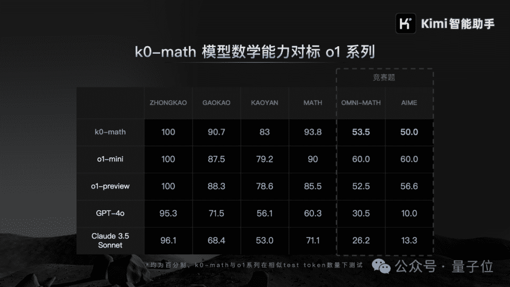

### 基建狂魔马斯克122天交付10万卡超算，对手大恐慌派间谍飞机侦查

https://mp.weixin.qq.com/s/B5iyo9PN5KcHi65KLKEi_A

马斯克以122天建成全球领先的超算集群Colossus，其速度和规模震撼了行业。Colossus整合了10万块英伟达H100 GPU，是Meta等科技巨头超算规模的数倍，而传统流程通常需3-4年完成。马斯克采用了一系列激进策略，包括省略传统电力供应审批、引入移动式燃气涡轮机作为临时电源、在未完成合规测试前直接投入使用。这种颠覆传统的工程思路与其在特斯拉和SpaceX的成功实践如出一辙。

马斯克的项目迅速推进得益于他对资源调配和工程效率的独特理解。孟菲斯数据中心的改造由一座旧工厂完成，过程跳过了诸多标准流程，专注于快速安装高耗能GPU服务器和液冷系统。当地官员全力配合，也为项目提供了行政便利。此外，英伟达CEO黄仁勋对其盛赞，称其在工程和系统设计上的能力无可比拟。

这场超算竞赛加剧了OpenAI、微软等对手的焦虑。OpenAI因对微软建造数据中心速度的不满，已转向初创公司合作，并计划在德州建设自己的10万GPU集群。竞争态势使得整个行业都在缩短建设周期，Meta、谷歌等也在加速扩展数据中心。然而，这种速度带来的挑战包括电力供应瓶颈和工程可靠性问题。

马斯克的“马斯克速度”不仅让对手倍感压力，也推动了行业对超算建设效率和方法的反思。正如业内所言，“超算领域，谁能先建成，谁就掌握主动权。”

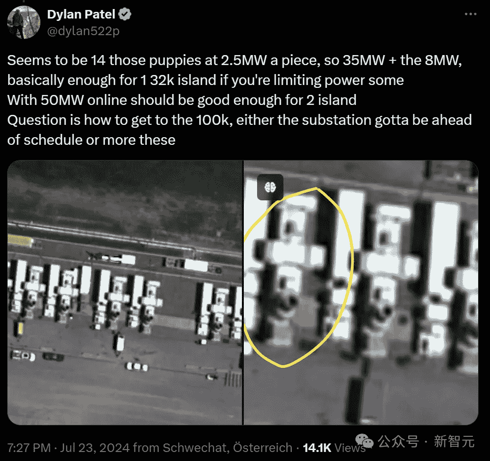

## 推特

### Karpathy分享：如今课本主要为大型语言模型编写，压缩成模型权重，产生的解决方案可以服务于人类或自动化

贡献人：

https://x.com/karpathy/status/1857584163140030710

还记得课本里的练习页面吗？如今，在各个知识领域对这些内容的大规模收集已经推动了数十亿美元的市场。课本主要为大型语言模型（LLM）编写，压缩成模型权重，产生的解决方案可以服务于人类，或者（随着时间的推移）直接用于实现自动化。

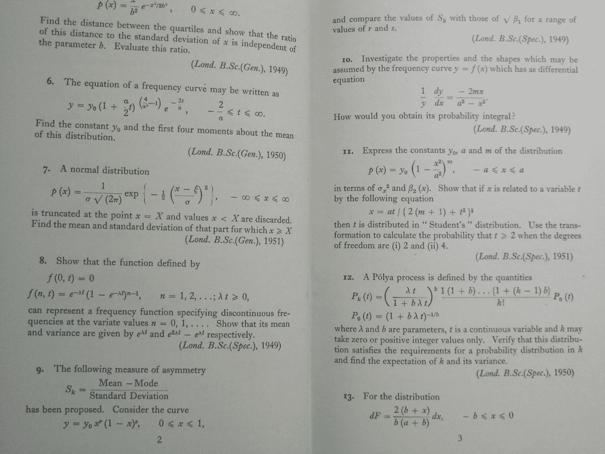

### Anthropic文档功能更新：现在可以所有文档以单个纯文本文件的形式访问，并直接输入大语言模型中

贡献人：

https://x.com/alexalbert__/status/1857457290917589509

周五文档功能更新：

您现在可以将我们的所有文档以单个纯文本文件的形式访问，并直接输入到任何大型语言模型（LLM）中。

以下是网址路径：

`http://docs.anthropic.com/llms-full.txt`

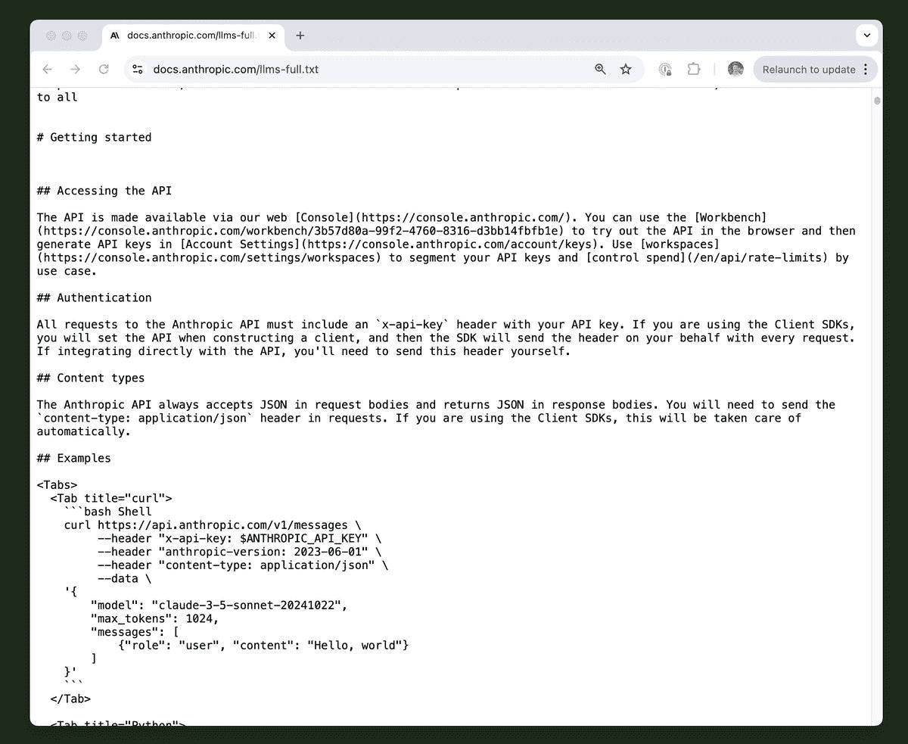

### Gemini-exp-1114 现已通过 Gemini API 提供

贡献人：

https://x.com/OfficialLoganK/status/1857535825895993366

Gemini-exp-1114 现已通过 Gemini API 提供，祝您构建/测试愉快！周一将带来更多更新 🚢

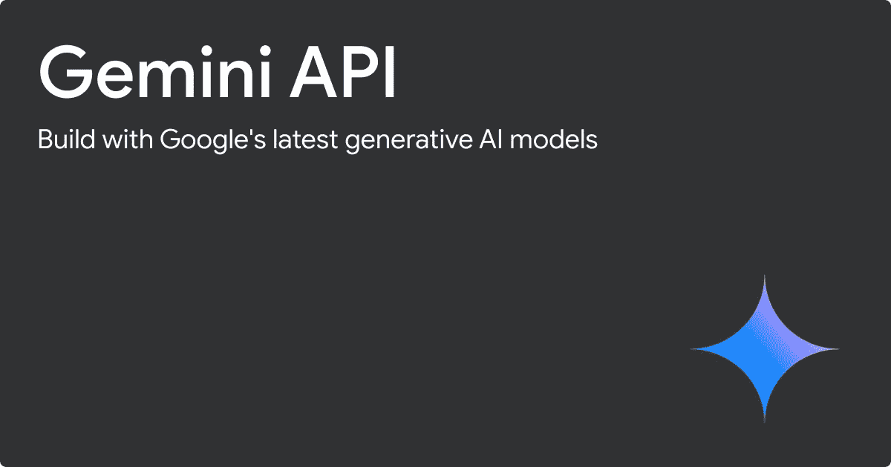

### Physical Intelligence分享demo：物理智能

贡献人：

https://x.com/physical_int/status/1857441249378410611

@Astribot_Inc 🤝 物理智能 (π)

[QhngBGQK3y4-MXvi.mp4](https://internal-api-drive-stream.feishu.cn/space/api/box/stream/download/all/TvQ0bbTx2oo57txsKBdcevtQnRc)

### ExtendHQ分享：处理91页的扫描PDF文档，提取了10,400个数据点，准确率达到100%

贡献人：

https://x.com/kushalbyatnal/status/1857501330438344933

我们刚刚在文档处理方面达到了一个里程碑 —— 处理了一份91页的扫描PDF文档，包含嵌套表格、手写内容和复杂布局。

提取了10,400个数据点，准确率达到100%。

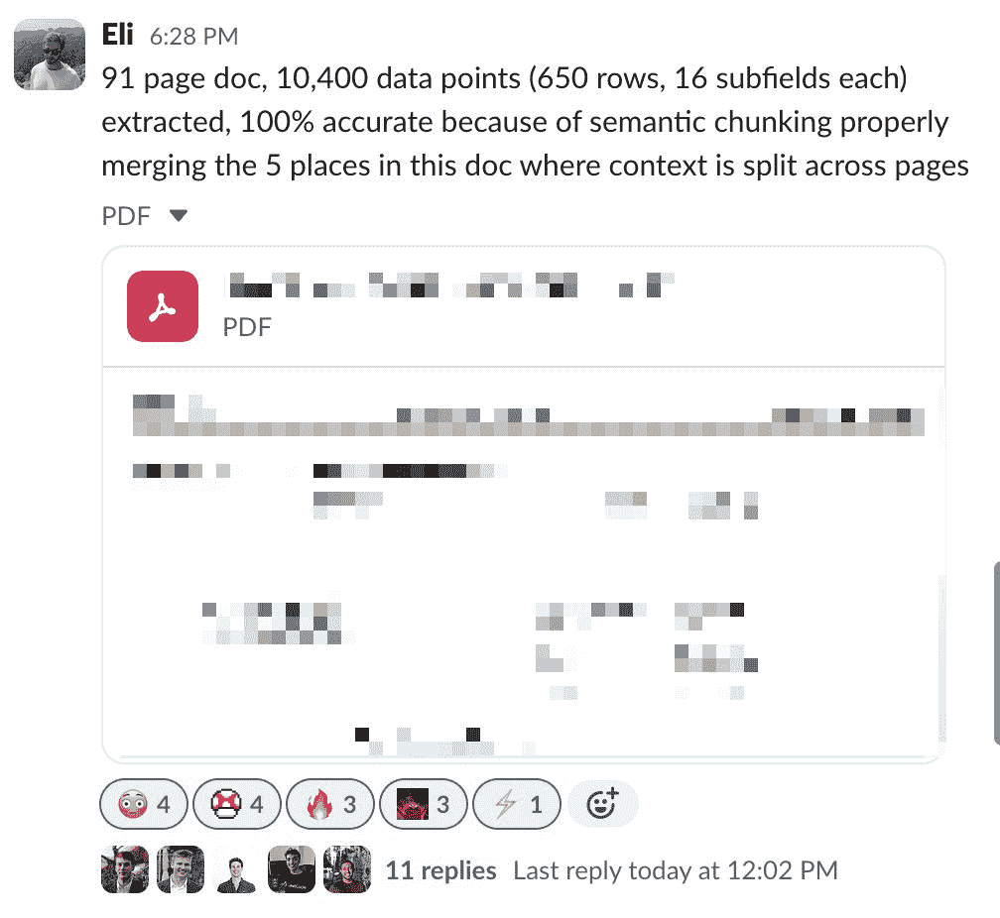

### OmniVision-968M：面向边缘设备的新型本地视觉语言模型

贡献人：

https://x.com/mervenoyann/status/1857930538381881353

OmniVision-968M：一款面向边缘设备的新型本地视觉语言模型（VLM），快速、小巧且性能卓越 👏

基于 SigLIP-so-400M 和 Qwen-2.5-0.5B

💨 图像标记数量减少 9 倍，超级高效

📖 与 SFT 和 DPO 对齐，以减少幻觉生成

🔥 使用 Apache 2.0 许可证

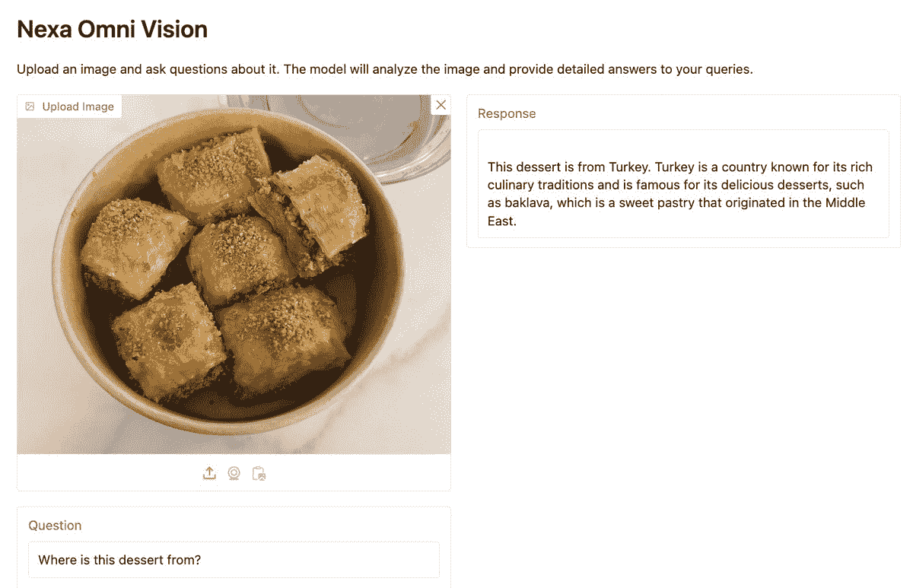

## 信号

### Cut Your Losses in Large-Vocabulary Language Models

贡献人：

原文链接：https://arxiv.org/abs/2411.09009

学术分析报告：https://rflow.ai/flow/5dfc845c-2338-45c4-9a40-0ca1cd683aa6

我们提出了 Cut Cross-Entropy (CCE)，这是一种计算交叉熵损失的方法，无需将所有标记的逻辑实现到全局内存中。相反，CCE 只计算正确标记的逻辑，并动态评估所有逻辑的对数和指数。我们还实现了一个自定义内核，它在闪存中对词汇表执行矩阵乘法和对数和指数缩减，使交叉熵计算的全局内存消耗可以忽略不计。这产生了显著的效果。以 Gemma 2 (2B) 模型为例，CCE 将损失计算的内存占用从 24 GB 减少到 1 MB，将分类器头的总训练时间内存消耗从 28 GB 减少到 1 GB。为了提高 CCE 的吞吐量，我们利用 softmax 固有的稀疏性，并建议跳过对梯度贡献可忽略不计（即低于数值精度）的梯度计算元素。实验表明，在不牺牲训练速度或收敛性的情况下，内存消耗大幅减少。

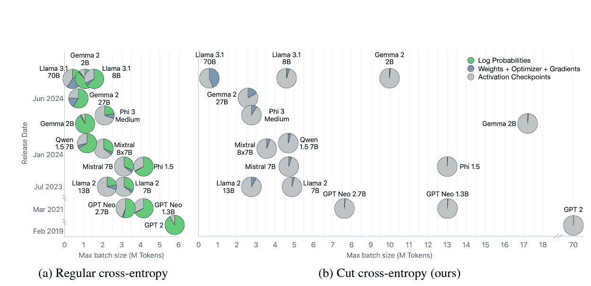

### Adaptive Decoding via Latent Preference Optimization

贡献人：

原文链接：https://arxiv.org/abs/2411.09661

学术分析报告：https://rflow.ai/flow/e98b29aa-37be-4e1f-a1f3-0feaf4e7b1ea

在这项工作中，我们引入了自适应解码，这是添加到模型中的一层，用于在推理时在标记或示例级别动态选择采样温度，以优化性能。为了学习它的参数，我们引入了潜在偏好优化 (LPO)，这是一种训练离散潜在变量（例如温度选择）的通用方法。我们的方法在一系列需要不同温度的任务中优于所有固定解码温度，包括 UltraFeedback、Creative Story Writing 和 GSM8K。

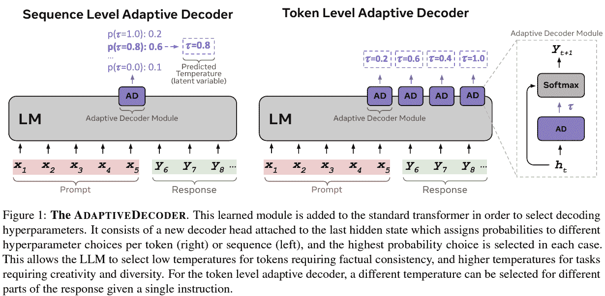

### KALIE: Fine-Tuning Vision-Language Models for Open-World Manipulation without Robot Data

贡献人：

原文链接：https://arxiv.org/abs/2409.14066

学术分析报告：https://rflow.ai/flow/249763c3-0918-4458-b0ab-511488dd65dc

受大型预训练模型的进步启发，我们提出了从想象环境中进行关键点可供性学习 (KALIE)，它以可扩展的方式调整预训练的视觉语言模型 (VLM) 以进行机器人控制。KALIE 不是直接产生运动命令，而是通过基于自然语言指令和对场景的视觉观察预测基于点的可供性表示来控制机器人。VLM 在具有人类标记的可供性的 2D 图像上进行训练，从而无需在机器人系统上收集训练数据。通过可供性感知数据合成管道，KALIE 可以根据人类手动收集的有限示例数据自动创建大量高质量训练数据。我们证明，仅给出 50 个示例数据点，KALIE 就可以学会稳健地解决带有看不见物体的新操作任务。与使用预训练 VLM 的基线相比，我们的方法始终实现卓越的性能。

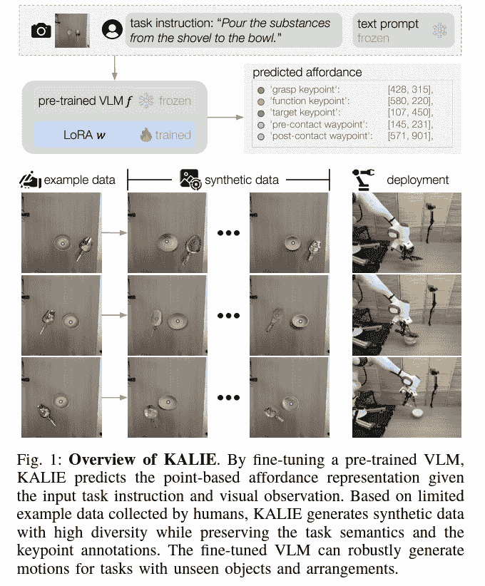

## 产品

### Quantera.ai

贡献人：

https://www.quantera.ai/

### SideSpace

贡献人：

https://www.sidespace.app/

Side Space 是一款 AI 驱动的垂直标签管理器，希望可以提升目前的浏览体验。它提供一个优雅的侧边面板，将标签以垂直方式排列，配有智能分组功能，根据内容自动整理标签。此外，用户可以通过云同步功能在多个设备间无缝访问已保存的标签空间，支持拖放管理和个性化定制。整体设计简洁，灵活性高，可以帮助用户更高效地管理浏览工作区。

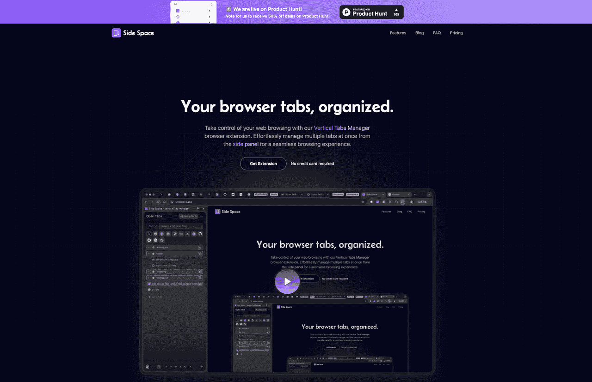

# HuggingFace&Github

## LLaMA-Mesh

贡献人：

https://github.com/nv-tlabs/LLaMA-Mesh

该项目提出了一种名为"LLaMA-Mesh"的方法,希望将大型语言模型(LLMs)的能力扩展到3D网格生成。该方法通过将3D网格数据表示为纯文本,实现了文本和3D网格的统一。这样可以利用LLMs已经从文本资源中学习到的空间知识,并支持基于文本的3D网格生成和理解。

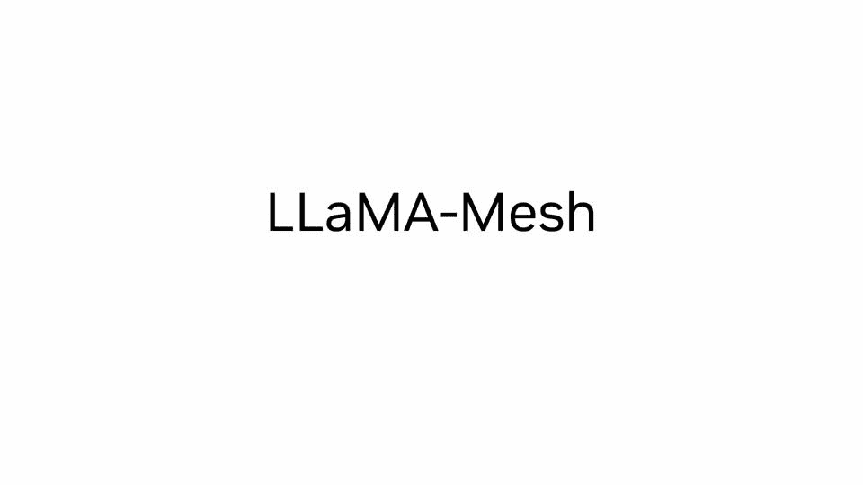

[386024172-11291517-6309-453c-9e7d-087198a8bd87.mp4](https://internal-api-drive-stream.feishu.cn/space/api/box/stream/download/all/SVlBbbbr2o4t8WxmJJjcu9cvnKh)

## comfyui_LLM_party

贡献人：

https://github.com/heshengtao/comfyui_LLM_party

ComfyUI LLM Party 是一个基于 ComfyUI 的 LLM 工作流构建框架。它允许用户快速方便地构建自己的 LLM 工作流,并轻松地将其集成到现有的图像工作流中。

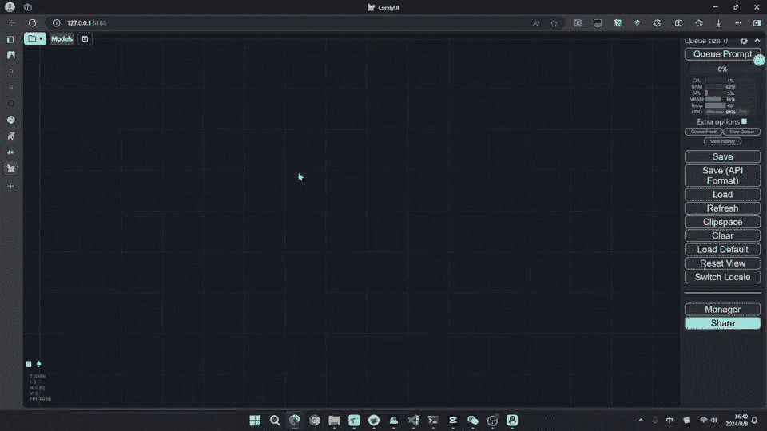

[356205575-945493c0-92b3-4244-ba8f-0c4b2ad4eba6.mp4](https://internal-api-drive-stream.feishu.cn/space/api/box/stream/download/all/WQI1bqyn2oKuY5xW83AcCZxenIc)

# 投融资

## 2024年筹资超1亿美元的美国AI初创公司完整名单

https://techcrunch.com/2024/11/15/heres-the-full-list-of-44-us-ai-startups-that-have-raised-100m-or-more-in-2024/

根据TechCrunch报道，2024年第三季度AI初创企业在风险投资市场表现强劲，共筹集了189亿美元，占全部风险投资的28%。以下是2024年筹资超1亿美元的44家美国AI初创公司及其关键动态：

1. OpenAI创历史筹资记录：10月，OpenAI完成66亿美元的融资，创下历史最大单笔风险投资，估值达1570亿美元。

1. 重点领域多元化：这些公司涵盖AI芯片、自动化、法律科技、药物研发等领域。例如，物理计算公司Lightmatter筹资4亿美元，法律科技公司EvenUp完成1.35亿美元融资。

1. 多轮投资持续：部分企业如Magic、Glean等多次获得融资，展现了AI技术领域的持续吸引力。

1. 挑战与机遇并存：尽管资金充裕，但一些公司面临单一客户依赖等潜在风险。

部分代表性公司：

+ Sierra（企业AI聊天机器人）：10月筹资1.75亿美元，估值达45亿美元。

+ Nimble Robotics（自动化仓储）：筹资1.06亿美元，迈入独角兽行列。

+ KoBold Metals（金属勘探AI）：筹资4.91亿美元，用于AI金属开采技术。

## Agility Robotics宣布与舍弗勒集团达成战略合作

https://agilityrobotics.com/content/agility-robotics-announces-strategic-investment-and-agreement-with-motiontechnology-company-schaeffler-group

Agility Robotics近期在全球科技大会Web Summit上宣布，舍弗勒集团（Schaeffler）对其进行了少量股权投资，并签署战略协议。根据协议，舍弗勒计划从Agility Robotics采购双足移动操作机器人（MMR）DigitⓇ，用于其全球工厂网络。这标志着舍弗勒在制造和物流领域的机器人应用将迈向新阶段。

1. 重大投资与采购协议：舍弗勒的投资不仅强化了双方合作，还展示了对机器人技术在工业领域应用的信心。

1. 行业首创商业化部署：Agility Robotics此前已与全球最大合同物流供应商GXO签署多年协议，成为首个商业化部署人形机器人的公司，并开创了“机器人即服务”（RaaS）的新模式。

1. 技术与未来展望：Agility Robotics致力于开发能够安全与人类协作的人形机器人，预计在未来24个月内推出新一代产品，进一步推动制造和物流行业的智能化升级。

公司官网：https://agilityrobotics.com/

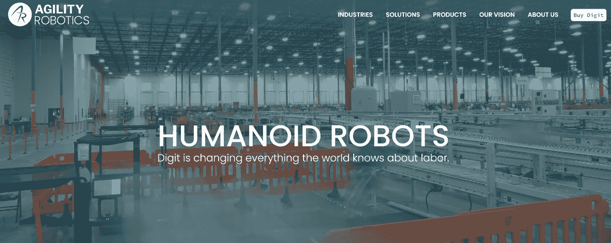

## OpenAI曾考虑收购AI芯片公司Cerebras

https://techcrunch.com/2024/11/15/openai-at-one-point-considered-acquiring-ai-chip-startup-cerebras/

根据最新的法律文件显示，OpenAI曾在2017年考虑收购AI芯片公司Cerebras。这一潜在收购计划始于Cerebras成立一年后，当时Elon Musk在OpenAI有财务投入并对其发展方向具有一定影响。文件显示，OpenAI联合创始人Ilya Sutskever提出通过Tesla收购Cerebras的想法，但同时担心Tesla的股东利益与OpenAI的使命可能不一致。尽管OpenAI与Cerebras进行了包括谈判和尽职调查在内的初步接触，但最终交易未能达成。

Cerebras专注于开发用于AI模型训练和运行的定制硬件，声称其芯片性能优于Nvidia的旗舰产品。尽管其已获得7.15亿美元的风投资金并寻求通过IPO将估值翻倍至80亿美元，但面临诸多挑战，包括过于依赖单一客户阿布扎比公司G42（贡献87%的收入）以及该公司的历史性中资关联问题。

如果收购成功，OpenAI可能会减少对Nvidia芯片的依赖，同时获得成本控制上的优势。然而，该计划被搁置后，OpenAI选择与Broadcom和台积电合作开发定制AI芯片，预计最快于2026年推出。

这一事件凸显了AI领域对硬件自主权的竞争激烈，以及企业间战略合作可能对技术创新和市场布局的深远影响。

公司官网：https://cerebras.ai/

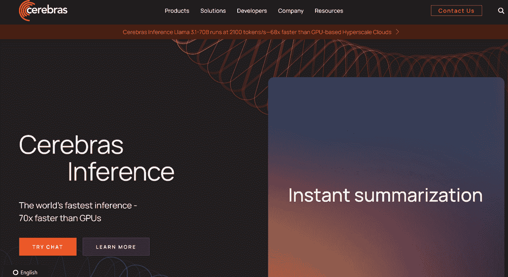

# 学习

## 【学习笔记】CPU访存单元设计（1）

https://zhuanlan.zhihu.com/p/683190726

1. 访存单元概述

访存单元（LSU）是CPU逻辑中最复杂的模块，负责高效执行`Load`和`Store`指令。其主要挑战包括乱序执行、投机行为引发的缓存控制复杂度、高功耗问题，以及对具有`barrier`属性指令的支持。LSU的设计直接影响芯片性能、功耗和面积（PPA），是高性能CPU设计的关键。

1. 内存模型

x86采用强序（Strong Order），`Store`指令严格按编程顺序完成；ARM采用弱序（Weakly Order），允许灵活调整`Store`顺序以提升性能。x86注重软件一致性，ARM更重硬件执行效率，但需软件适配以保障正确性。

1. 内存类型

ARM内存分为Normal和Device两类：

+ Normal内存可投机访问，根据`Cacheable`和`Shareable`属性分为`nCnS`、`nCS`、`CnS`、`CS`四种类型，性能从低到高。

+ Device内存不可投机访问，按`Gather`、`Reorder`和`EWA`属性分为`nGnRnE`、`nGnRE`、`nGRE`和`GRE`四类。这些属性间存在制约关系，需根据需求权衡选择。

1. 内存格式

+ `Size`：数据位宽最大64字节，支持多种粒度（如Byte、Word、Double Word）。

+ `Alignment`：保证数据地址对齐以提高访问效率。

+ `Endian`：支持Little和Big Endian，可针对数据元素和整体分别设定存储顺序。

1. 内存访问顺序

+ `Single-Copy Atomicity`：确保单核内存访问顺序一致。

+ `Multi-Copy Atomicity`：确保多核全局访问顺序一致，避免违背ARM一致性协议的情况。

1. 内存指令

+ `基础Load/Store`：基础指令，用于数据传递。

+ `Load Acquire/Store Release`：具`barrier`属性，确保内存访问顺序。

+ `Exclusive指令`：用于多核抢锁，适合小规模多核，核数增加后性能下降。

+ `Atomic指令`：弥补`Exclusive`的性能瓶颈，通过循环重试提升锁竞争性能，适合大规模多核场景。

1. 设计启示

内存架构模型是LSU设计的基础，设计必须遵循Strong/Weak Order架构的约束。掌握内存模型是LSU设计与验证的核心技能，直接影响芯片设计成败。

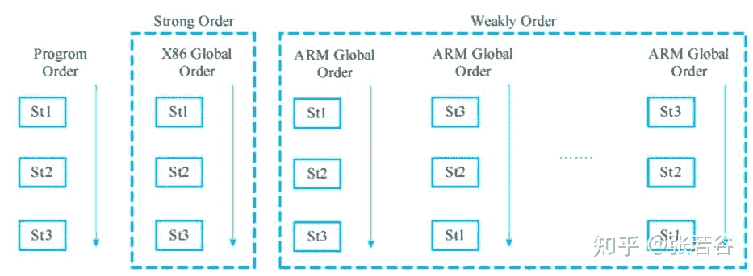

## 通过KV稀疏对`vLLM`实现1.5倍的推理加速

https://zhuanlan.zhihu.com/p/2511255815

随着KV稀疏相关技术的快速发展，其在实际应用中是否能对如`vLLM`等框架实现推理加速成为重要问题。目前，`vLLM`采用`PagedAttention`等优化技术，传统KV稀疏算法在性能与兼容性上存在不足。本文结合KV稀疏算法与`vLLM`的优化特性，通过分层稀疏策略，实现了约1.5倍的推理加速，具有重要的实际应用价值。

---

1. LLM的Massive Activations特性

LLM中的Massive Activations特性表明少量token在激活值上显著高于其他token。以Llama3为例，其激活特性随层级变化：

+ Lower层：激活值分布均匀。

+ Middle层：局部化注意力显著。

+ Upper层：呈现Massive Activations特性。

分层稀疏利用这一特性，在不同层淘汰低分KV以提升推理效率。

---

1. 分层稀疏实现

分层稀疏通过调整KV缓存策略减少内存与计算开销：

+ `Full Cache`：保留所有KV，用于Lower层以保证信息完整性。

+ `Sliding Window`：淘汰低分或远距离KV，用于Upper层以节省资源。

为此，`vLLM`框架的内存管理机制被改造为支持不同层级的独立缓存策略。

---

1. 推理性能测试

在RTX4090显卡上测试输入/输出长度为4000/500的常见场景：

+ **实验组**：`PPIO Sparse0.5.1`（基于`vLLM` 0.5.1的KV稀疏改造版本）。

+ **对照组**：`vLLM` 0.6.1.p2。

结果显示：

+ 在TTFT（首Token延迟）稳定的情况下，`PPIO Sparse0.5.1`的吞吐量提升约1.58倍。

+ 在高并发场景（`Batch Size=20`）下，稀疏版本在性能稳定性上表现更优。

---

1. 模型精度评测

KV稀疏作为有损压缩技术，对模型精度影响较小：

+ 在Llama3-8B的mmlu测试中，精度损失低于3%。

+ 在长文本（7k-30k）QA任务中，压缩比控制为10倍以上，精度损失约10%。

---

1. 核心技术优化

（1）分层稀疏

+ 修改内存管理机制，实现不同层独立缓存策略。

+ 前三层采用`Full Cache`，三层以上通过`Sliding Window`淘汰低分KV，最大化稀疏效果与内存节省。

（2）Attention模块优化

+ `FlashAttention`优化：增加`rowmax/ℓ`输出，并通过`Online Softmax`减少一次`Pass`循环，用于计算KV稀疏分数。

+ `GPU通信优化`：调整循环顺序与计算范围，避免跨卡通信，提升计算效率。

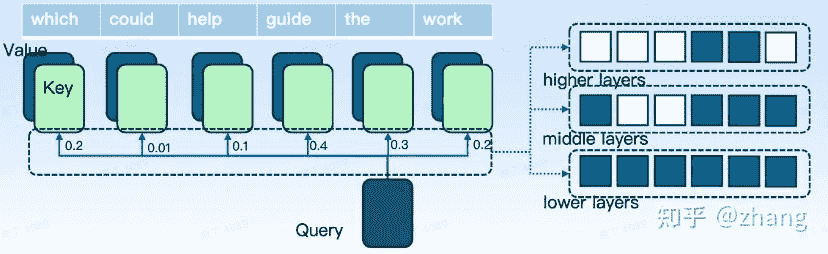

## 多智能体workflow技术之`Multi-Agent Debate`，`Acc-Debate`，`DebateTune`，`ChatEval`，`COEVOL`，`GroupDebate`，`CMD`等

https://zhuanlan.zhihu.com/p/2201031718

1. `Agent Debate` 的工作流程

现有的 `Agent Debate` 策略通常包括以下三个步骤：

1. **问题解决**：每个智能体生成初步的解决方案。

1. **多轮讨论**：智能体之间进行多轮辩论，相互质疑和补充。

1. **投票表决**：基于讨论结果通过投票达成最终答案。

此策略依赖于 LLM 的角色扮演、多轮对话、长序列指令遵循等能力。通过对上述能力的训练，`Agent Debate` 不仅可以用于减少幻觉（hallucinations）、事实校验，还可以提升生成数据的质量，优化监督微调（如 `Debatetune`、`DebateGPT`）。

---

2. `MAD`（`Multi-Agent Debate`）的技术优势

与单智能体相比，多智能体辩论具有以下显著优点：

1. **多样化视角**：通过互动引入多种观点，提升问题解决的全面性。

1. **增强推理**：智能体间挑战假设，建立更有力的论据，优化推理过程。

1. **错误更正**：辩论过程中识别并纠正错误结论或不一致性。

1. **性能提升**：群体智慧带来的协作性提升，超越单一智能体。

注意的是，在某些强提示（strong prompt）下，单智能体的表现也可与 `MAD` 相当（如 `CMD` 研究结论）。但在 few-shot 场景中，`MAD` 通常表现更优。

---

3. `MAD` 策略的优化探索

**3.1 `Debate` 策略**

+ 分组辩论（`Group Debate`）：将智能体划分为多个小组，组内辩论后再进行组间交流，降低 token 消耗。

+ `DebUnc`：智能体通过不确定性估计提供置信度指标，辅助决策过程。

+ 引入仲裁机制（`CMD`）：在平局情况下通过秘书角色进行最终裁定。

+ 稀疏通信拓扑：通过减少通信连接，优化辩论效率（如 `Sparse MAD`）。

**3.2 数据生成与训练**

+ `Debatetune` 与 `DEBATUNE`：基于多轮辩论生成高质量数据集，通过微调提升模型的可控性和生成质量。

+ `ACC-Debate`：采用 `Actor-Critic` 框架，联合训练“参与者-评论家”智能体团队，实现协作式问题解决。

**3.3 知识注入**

+ `RAG` 辩论：通过引入检索增强生成（`RAG`）知识，打破智能体的认知孤岛。

---

4. **`Debate` 应用场景**

1. **减少幻觉与事实性错误**：通过 `MAD` 策略提升回答的准确性。

1. **对抗性攻击防御**：增强模型在面对恶意提示时的鲁棒性。

1. **复杂场景模拟**：用于竞技辩论、人类交互模拟等复杂场景。

1. **教育与训练**：促进用户学习辩证思维，提升全面分析问题的能力。

---

5. **未来优化方向**

1. **Token 消耗优化**：如分组辩论和稀疏通信拓扑。

1. **讨论与投票策略改进**：提升决策效率与准确性。

1. **基于 `Debate` 的训练**：构造优质数据集，进一步增强模型能力。

尽管 `MAD` 展示了显著的优势，但其仍存在局限性，如：

+ 智能体可能放弃正确答案或无法识别错误。

+ 在大规模模型和非问答任务中的适用性仍需验证。

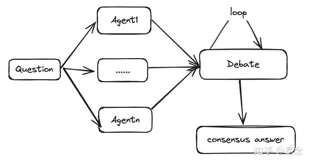

## 大模型推理：第一次优化`CUDA`函数

https://zhuanlan.zhihu.com/p/6502406147

`FusedAddRMSNormKernel`函数优化主要解决`FP16`到`FP32`转换导致的精度损失问题。函数在初始阶段使用`FP32`计算中间结果，但存储时转换回`FP16`，随后再转回`FP32`时已丢失精度，最终表现为计算误差。

优化分为三个阶段。第一版通过显存复用，将`FP32`中间结果拆分为高低16位，分别存储到`input`和`residual`，计算时还原为`FP32`。这一方法显著提升精度到1e-3，但性能有所下降。第二版引入`CUDA`共享内存，将`FP32`中间结果直接存储在共享内存中，避免频繁使用全局显存，同时保持精度在1e-3，性能略低于第一版，但实现更为通用。第三版进一步优化共享内存操作，利用向量化批量读写减少内存访问次数，同时通过`CUDA`的`warp`内高效归约函数优化归约计算。这一版本性能接近原始实现，同时保持1e-3精度，是最终推荐方案。

基准测试显示，性能表现依次为原始版本>第三版>第一版>第二版，而第三版在精度与性能间实现最佳平衡。此外，通过日志调试精确定位问题，并结合基准测试验证优化效果，为`CUDA`函数的性能调优提供了可靠经验。这一优化过程显著提升了函数的应用价值，为类似问题的解决提供了借鉴。

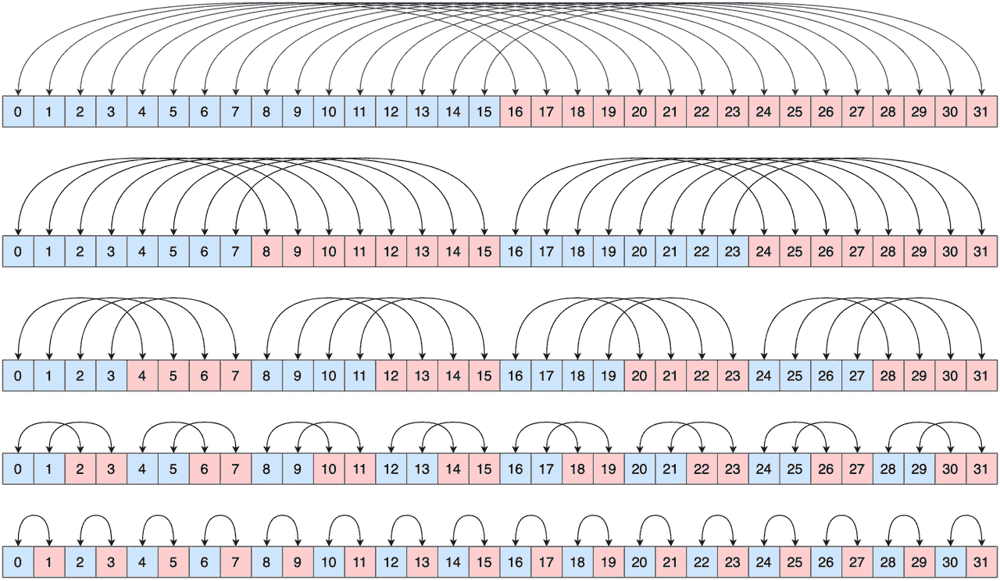

## 扩散策略算法归纳整理（一）：优势与挑战

https://zhuanlan.zhihu.com/p/6223910015

扩散策略（`Diffusion Policy`）近年来在强化学习（`RL`）和具身智能领域受到广泛关注，其优势主要体现在策略多样性、刷榜性能、解决多峰问题的能力、人类行为复杂性建模以及与扩散模型无缝结合等方面。然而，这些优势需要辩证地看待，其对特定任务的适用性并非绝对。比如“多样性”并非所有任务的核心需求，且传统高斯策略在某些场景下也可达到类似效果。

扩散策略的核心挑战包括两个关键问题：似然估计和采样效率。扩散模型拟合的是一阶导数（`score function`）而非显式似然，因此传统`RL`算法如`PPO`、`REINFORCE`等无法直接应用，需设计新理论框架。目前`Offline RL`在该问题上的解决方案较成熟，包括引导采样、重采样和监督训练等方法，而`Online RL`中的探索和效率问题仍未完全解决。此外，多步采样过程带来的控制频率下降和训练不稳定问题也是扩散策略的显著瓶颈。特别是，训练阶段`Q函数`的高效优化和采样误差传递问题尚待深入研究。

采样效率方面，主流改进方法包括减少采样步数、蒸馏策略和近似采样技术，但每种方法均存在理论或实际的局限性。例如，强行减少采样步数虽提升效率但缺乏采样精度保证，而蒸馏可能损失策略多样性。控制任务中多步采样还限制了梯度反传优化方法的应用，使得梯度爆炸成为实际问题。

扩散策略的优化算法逐渐形成了以`Forward KL`和`Reverse KL`为核心的两条理论路径，但其对`RL`多样性和探索的独特贡献仍有待进一步量化研究。对于`Online RL`和策略蒸馏等关键问题，理论与应用间仍存在显著差距，是当前研究的重要方向。未来需重点探索能平衡效率、精度和策略多样性的创新方法，以及从算法层面提升采样和训练效率的新框架。

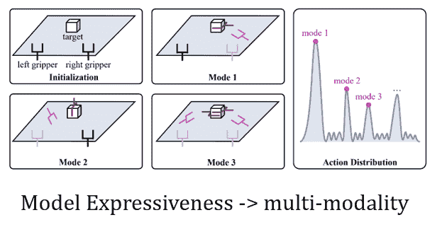

## CCF-第七届AIOps国际挑战赛-季军方案分享|北航-`EasyRAG`

https://zhuanlan.zhihu.com/p/7272025344

经过4个月的探索与实践，我们团队在`AI`运维领域的私域知识问答比赛中，基于`EasyRAG`框架获得了决赛季军。我们的目标是在不微调模型的前提下，设计高效、准确、实用的`RAG`（检索增强生成）系统，并围绕以下三个核心维度展开了技术攻关：

1. 准确性提升。我们通过路径解析提取文件和知识路径，结合多模态技术处理图像内容。改进分块策略，优化分块参数与元数据存储，增强检索稳定性。利用`GLM4V`模型提取图像内容，通过过滤规则（如纯英文过滤、关键词过滤）提升图像的有效利用率。在检索和排序优化中，双路稀疏检索结合`BM25`对文档与路径进行初排，密集检索采用`GTE-Qwen2-7B-instruct`模型，配合向量数据库`Qdrant`。重排序利用基于`LLM`的`Reranker`（如`BGE`模型），结合路径信息提升排序质量。通过两轮生成流程，让模型逐步关注关键信息，实现答案精炼。

2. 高效性优化。在稀疏检索中引入`BM25S`库显著减少检索时延至可忽略不计。在重排模型中设计基于最大相似度阈值的动态层早退机制，将重排时延降低超过2秒。采用基于`BM25`的抽取式方法对上下文进行压缩，减少`LLM`推理所需`token`，同时降低推理时间1.5秒以上。

3. 实用性增强。在`A800`环境下支持8并发，将平均推理时延从16秒降至7.5秒。通过简单命令或`Docker`配置实现`Web`应用的快速部署。在《四大名著》语料上测试框架，证明其对多种垂直领域的适用性。

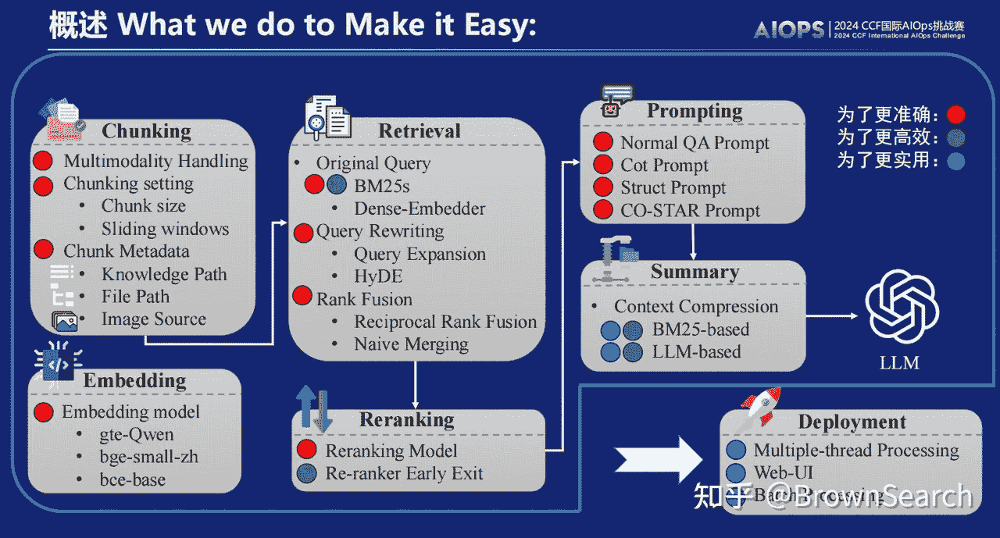

# 招聘公告

---

**奇绩创坛**由陆奇博士于2019年创立，使命是在源头最大化驱动创新。奇绩研究组将研究模型理论、到投研战略分析、市场策划等不同背景的同学聚在一起，搭建`GenAI`时代独特的跨界人才社群。

### 🚀`F24`实习岗位

- [行研-学术科研人才交流组实习生](https://miracleplus.feishu.cn/docx/Yn6rdf2iOoY2Rcx8yVNcUBYRnch#part-QkMcdeJmuob9uvxvV3qcLSzHn8g)
- 行研-`GenAI`研究岗位-战略分析（偏产品）
- `Web` / `AI` 全栈开发工程师实习生

### 火热开放中🚀

- 行研-`GenAI`研究岗位-前沿学术探索
- 行研-`GenAI`研究岗位-战略分析（偏咨询）
- 创新活动产品运营（大模型系列活动产品运营）

> **点击**相关岗位可查看对应**岗位需求【`JD】**；**相关岗位投递请**扫描二维码

> 欢迎**推荐/自荐**

> 期待在**奇绩创坛**遇见更好的你

---

# 声明

本文档仅供学习交流使用，版权归原作者所有，若涉侵权，请联系Jack Jin 15101136166

（欢迎在下方反馈您宝贵的意见！整理不易，觉得有用给`AI`日报小组点个赞👍吧！）

`ChatGPT`；Angela；Zijia Liu；Alex；Zeqi Tan；Tiezhen（`HuggingFace`）；Naixu；Lizhi；Peter；Suoman；Jack

学术分析报告：`ResearchFlow` -- 奇绩`F23`校友的开发的深度研究产品，`PC`端进入`RFlow`的分析报告，可直接点击节点右侧的小数字展开节点，登录后可在节点上直接“询问`AI`”，进一步探索深度信息

如果你有大模型相关的创业想法，欢迎来找我们聊聊～🛰️：15101136166

> 快邀请你的小伙伴们一起来读大模型日报吧！

> **【日报知识库】**这里是近期日报内容的汇总,欢迎大家查阅

> [`大模型日报知识库(分享版)`](https://miracleplus.feishu.cn/wiki/KapVwXfkriOBiskB0B2cUHxjnTh)

>

> 欢迎大家多多帮我们分享,转发~~

> 如果大家有任何的建议或者吐槽,欢迎随时找我聊天~

