# 奇绩大模型日报（11月 15日）

> 来源：[https://miracleplus.feishu.cn/docx/VgRodkP2Coft4ixZQPocL6O4nih](https://miracleplus.feishu.cn/docx/VgRodkP2Coft4ixZQPocL6O4nih)

# 资讯

### EMNLP'24最佳论文

https://mp.weixin.qq.com/s/SBZsOi2OyZsvsVagcbY-7A

EMNLP 2024最佳论文奖揭晓，共有五篇获奖，其中三篇由华人学者参与。奖项突出创新性和跨学科的研究成果，以下是五篇获奖论文的简要概述：

1.  **An** image speaks a thousand words, but can everyone listen? On image transcreation for cultural relevance
这篇来自CMU的论文研究图像的跨文化再创作。针对多模态翻译中的图像处理，提出了三种基于生成模型的管道，并探索如何通过LLM和检索技术改进现有图像编辑模型的文化相关性。

1.  **Towards Robust Speech Representa**tion Learning for Thousands of Languages
由CMU、上海交大等联合完成，这篇论文介绍了XEUS模型，一种针对多语言和不同声学环境的语音编码器，使用了超过100万小时的语音数据。XEUS在多种语音任务中表现优异，特别是在自动语音识别方面，成为SOTA模型。

1.  **Backward Lens: Projecting Language M**odel Gradients into the Vocabulary Space
以色列理工学院和特拉维夫大学的团队提出了一种新的方法，通过将语言模型的梯度投射到词汇空间来揭示信息流动的机制，从而进一步推进了模型的可解释性。

1.  **Pr**etraining Data Detection for Large Language Models: A Divergence-based Calibration Method
该论文由中科院大学等机构的学者完成，提出了一种基于散度的校准方法，用于检测文本是否属于大语言模型的预训练数据。这一方法在多种基准数据集上表现出色，优于传统的检测方法。

1.  **C**oGen: Learning from Feedback with Coupled Comprehension and Generation
康奈尔大学的研究团队提出了CoGen框架，结合了语言理解和生成，利用人机交互收集反馈以提升模型性能。该方法在提高生成准确性和理解准确性方面表现显著。

此外，EMNLP 2024还揭晓了20篇杰出论文。华人学者在其中的贡献也非常突出，特别是加州大学洛杉矶分校的Nanyun Peng教授团队，其指导的三篇论文均获奖，研究内容聚焦于大语言模型在创意叙事生成方面的能力。

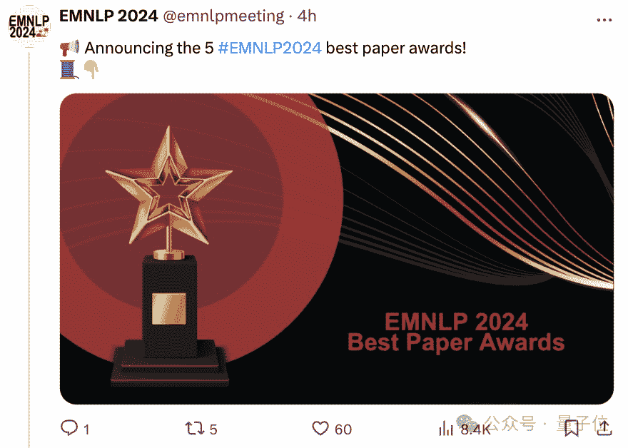

### 新版Gemini跑分超o1登顶第一

https://mp.weixin.qq.com/s/p9yjJcgvN9yfEAynU-JE3g

谷歌的新版Gemini模型（Exp 1114）在最近的竞技场测试中表现出色，成功超越了OpenAI的O1模型，登顶总榜第一。根据6000多名网友的投票，Gemini不仅在数学领域与O1不相上下，还在复杂提示处理、创意写作、指令遵循、长查询处理、多轮对话等五个单项中获得第一。值得注意的是，Gemini的数学能力与O1并无明显差距，尽管O1被OpenAI描述为具备无需专门训练即可轻松应对数学奥赛问题的能力。Gemini在多个领域的胜率也表现强劲，尤其在与O1预览版和Claude-3.5的对决中，分别获得56%和62%的胜率。

Gemini-Exp 1114在风格控制、编码和写代码方面的表现相对较弱，未能跻身前三，且在风格控制功能上未能超越自家的Gemini 1.5 Pro。此外，尽管在视觉能力方面超过了GPT-4o，Gemini仍未完全解决编码和风格控制等问题。

Gemini的最大亮点之一是其32k上下文窗口的能力，比起之前的Gemini 1.5的200万上下文窗口，性能有所下降，引发了一些网友的不满。尽管如此，谷歌表示正在修复这一问题。Gemini-Exp 1114还引入了思维链（chain-of-thought）技术，提升了推理过程的透明度，使其在复杂问题上能逐步思考并给出答案。在测试中，Gemini成功回答了2024美国数学奥林匹克预选赛的题目，但也有错误发生，特别是在处理物理问题和一些基础数学题时。

目前，Gemini-Exp 1114已经可以在谷歌AI Studio体验，未来还计划提供API接口。虽然有部分网友猜测这可能是谷歌推迟推出更强大模型（如Gemini 2）的策略，早期发布一个测试版，但整体来看，Gemini-Exp 1114的表现已让不少人对谷歌的AI技术感到惊讶。

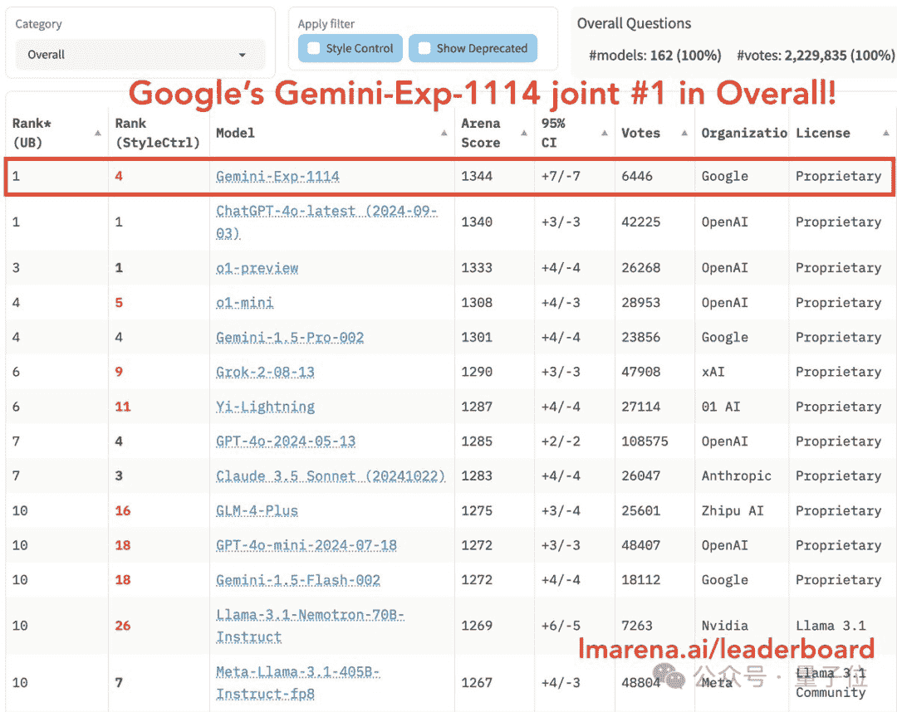

### 陶哲轩：计算机通用方法，往往比深奥的纯数学更能解决问题

https://mp.weixin.qq.com/s/RLCy2FnJ0J7UFSNa-foiuQ

著名数学家陶哲轩在最近的社交媒体帖子中提出了关于数学应用和问题解决的重要思考，强调了在系统设计和数学应用中找到“适度”平衡的重要性。他指出，过度简化或过度复杂化都会带来负面影响。对于大多数任务，使用相对简单但通用的数学方法往往比专门设计的复杂算法更有效。

陶哲轩以网络安全为例，阐述了过度优化的风险。密码安全的要求越复杂，可能会导致用户和服务提供商绕过这些要求，从而反而降低系统的安全性。他指出，安全设计应注重综合平衡，而不仅仅是优化单一指标，引用了“古德哈特定律”来说明过度优化单一指标可能带来的问题。比如，增强前门锁的安全性如果忽视了窗户的防护，反而会产生虚假的安全感。

在人工智能领域，陶哲轩提到强化学习的“苦涩教训”——大多数任务使用简单而通用的方法（如梯度下降和反向传播）往往效果更好。与专门设计的算法相比，通用方法依赖大量数据和计算资源，能够在多种任务中取得更大的进展。陶哲轩举例说明，在传感器网络中，使用神经网络设计模数转换器（ADC）比传统基于领域知识的电气工程方法更为高效。

此外，陶哲轩还强调在纯数学中，忽略某些看似重要的信息，进行适度的抽象，有助于问题的简化与求解。以数论为例，许多进展是通过将复杂的数学对象转化为简单、结构较少的形式来实现的。这种抽象可以帮助找到新的解决思路，但过度抽象会丧失关键信息。因此，找到合适的抽象层次至关重要。

陶哲轩总结道，应用数学家往往只需要掌握每本数学教材的前两章，后续的章节更多是为了完善和深化前面的知识。他的这些见解提醒我们，在解决问题时要简化细节，抓住问题的核心结构，避免过度复杂化或过度抽象。

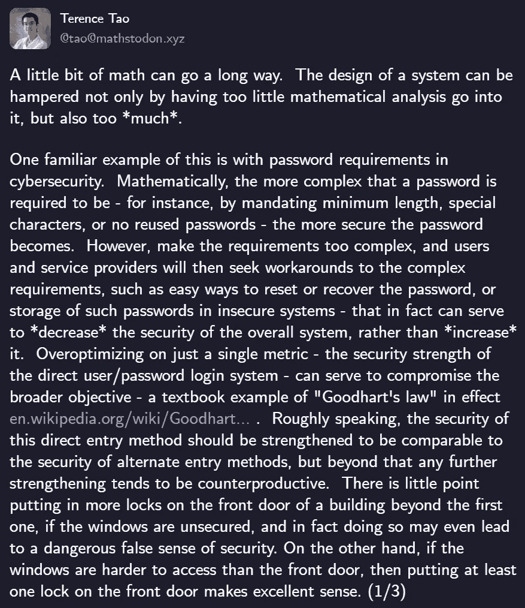

### 通义灵码 SWE-GPT：从 静态代码建模 迈向 软件开发过程长链推理

https://mp.weixin.qq.com/s/lRff6cv0HR4A3eapZxwaVQ

1.  背景与挑战

随着Devin发布，AI程序员在全球范围内迅速发展。大多数现有的AI程序员依赖闭源LLM模型（如GPT-4），而这些模型虽然强大，但其技术不具备可访问性，且存在数据隐私问题。此外，现有模型多基于静态代码数据训练，缺乏对软件开发过程中动态交互与迭代过程的理解，这影响了其在复杂任务中的实用性。为此，Lingma SWE-GPT系列通过整合软件开发过程数据进行训练，能够模拟开发者的认知过程，解决这些问题。

1.  Lingma SWE-GPT 方法

Lingma SWE-GPT的训练方法包括三个关键阶段：

+   **问题数据收集**：使用GitHub的issue和pull request (PR)数据进行训练，确保数据的高质量与多样性。选择有一定社区活跃度的仓库，并通过API获取与问题相关的PR，确保训练数据反映真实的开发场景。

+   **开发过程数据合成**：引入SWESynInfer流程，模拟开发者的认知过程，包括仓库理解、故障定位和补丁生成。通过仿真工具如仓库结构工具、代码压缩工具等，增强模型对软件开发动态特性的理解。

+   **模型训练**：采用课程学习方法进行迭代训练，并通过拒绝采样确保合成数据的质量。数据实例根据故障定位准确性和补丁相似性进行筛选，保证训练数据符合真实开发实践。

1.  实验结果与对比

Lingma SWE-GPT在多个基准测试中表现优异，尤其在SWE-bench Verified上，Lingma SWE-GPT 72B成功解决了30.20%的问题，接近闭源模型GPT-4的31.80%。相较于Llama 3.1 405B，Lingma SWE-GPT 72B的性能提高了22.76%。即便是较小的Lingma SWE-GPT 7B也表现出了相对于Llama 3.1 70B的优势，解决了18.20%的问题。

1.  故障定位能力

Lingma SWE-GPT在故障定位（识别代码中的问题位置）方面表现出色。通过与其他模型（如Claude 3.5 Sonnet）的对比，Lingma SWE-GPT在代码块、函数和文件级别的定位准确率显著更高，进一步证明了其在真实开发场景中的有效性。

1.  后续工作与扩展

未来，Lingma SWE-GPT将扩展对更多编程语言的支持，如Java、JavaScript和TypeScript，以适应更广泛的软件开发场景。同时，团队还计划增加对更多端到端软件工程任务的支持，以提升模型的通用性和实用性。

### 对话 OpenCV 之父 Gary Bradski：灾难性遗忘和持续学习是尚未解决的两大挑战

https://mp.weixin.qq.com/s/GlV9hHJt7h5i72Tcu4w5rQ

**Gary 的精彩观点摘录：**

+   睡眠可能在生物的学习过程中扮演着“清理”外部噪音的作用，从而帮助组织和结构化知识。

+   你在睡梦中身处一个世界，醒来后，梦并未结束，而你连接了外部的数据源，世界模型正是通过输入并匹配外部感知而形成的。

+   人类还会建模世界的因果关系，换句话说，即“世界的物理法则”。所以不仅仅是“是什么”（WHAT）和“在哪里”（WHERE），还会有“为什么”（WHY）的系统。我将 AI 模型与 3D 系统结合，让摄像头拍摄的图像不仅能识别“是什么”，还能判断“在哪里”。

+   现阶段大多数模型的成功模式是基于大型语言模型的微调，重构一个全新的更接近生物学习机制的AI系统可以尝试SLAM（同步定位与地图构建）：实现同步定位与地图构建，让机器人在探索环境的同时适应环境中的变化，遇到移动的物体时作出相应变化，实现不断的学习。

+   从安全角度来看，建立一个统一的数据库，记录每辆自动驾驶汽车在运行中遇到的异常情况，每次更新软件时，车企必须在模拟环境中经过所有已知和新记录的情境测试，确保在一百万英里内无事故才能在真实环境中部署新软件。

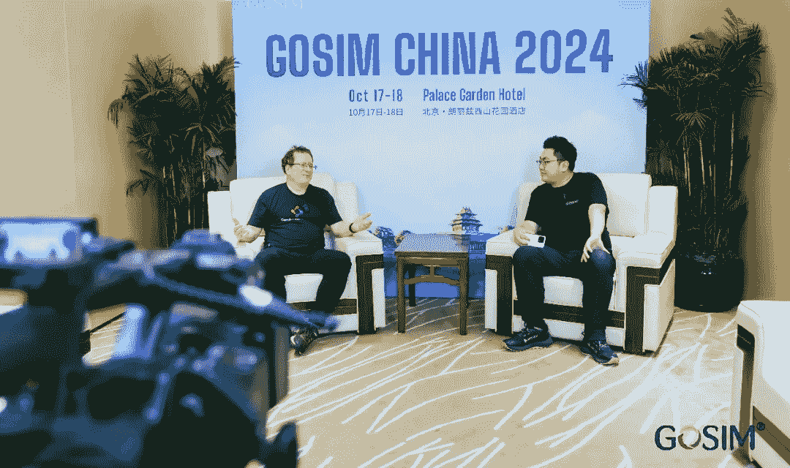

# 推特

### Anthropic Console新增提示优化器功能：只需输入一个现有的提示，Claude将自动运用提示工程技术对其进行优化和改进

贡献人：

https://x.com/AnthropicAI/status/1857108263042502701

我们在Anthropic Console中新增了一个提示优化器功能。

只需输入一个现有的提示，Claude将自动运用提示工程技术（如链式思维推理）对其进行优化和改进。

[bbsVWKwWxRkZd85Y.mp4](https://internal-api-drive-stream.feishu.cn/space/api/box/stream/download/all/T57wb8fzjo2Yl4xxgRWcOYnmn4f)

### ChatGPT桌面版应用程序现已向所有Windows用户开放

贡献人：

https://x.com/OpenAI/status/1857121721175998692

ChatGPT桌面版应用程序现已向所有Windows用户开放 🖥️

通过快捷键 Alt + Space 更快访问 ChatGPT，并使用高级语音模式与电脑对话，在工作时轻松实现免提回答。

https://openai.com/chatgpt/desktop

### 吴恩达分享趋势：LLMs向代理化优化转型推动性能跃升

贡献人：

https://x.com/AndrewYNg/status/1857117382378164267

大型语言模型（LLMs）通常被优化用于回答人们的问题，但如今有一个趋势是将模型优化为适配代理化工作流程。这将大大提升代理性能！

在ChatGPT因回答问题的巨大成功而走红后，大量LLM的开发重点放在提供良好的用户体验上。因此，LLMs被调优以回答问题（如“莎士比亚为什么写《麦克白》？”）或遵循人类提供的指令（如“解释莎士比亚为什么写《麦克白》”）。大部分用于指令调优的数据集都引导模型为人类提出的问题和指令提供更有帮助的回答，这些问题和指令往往是面向消费者的LLM所会遇到的，比如ChatGPT、Claude或Gemini等通过网页界面提供的服务。

然而，代理化工作负载需要不同的行为模式。与直接为消费者生成回应不同，AI软件在代理化工作流中可能会使用模型参与迭代流程，以反思其自身输出、使用工具、制定计划，并在多代理环境中协作。如今，各大模型开发者正越来越多地优化模型，使其能够更好地用于AI代理。

以工具使用（或函数调用）为例。如果一个LLM被问到当前的天气情况，它无法从其训练数据中推导出所需信息。这时，它可能会生成一个API调用请求以获取相关信息。在GPT-4原生支持函数调用之前，应用程序开发者已经通过编写更复杂的提示（如ReAct提示的变体）来让LLMs生成函数调用字符串，然后由一个独立的软件程序（可能通过正则表达式）解析这些字符串，决定是否需要调用某个函数。

在GPT-4以及其他许多模型原生支持函数调用后，生成这些调用变得更加可靠。如今，LLMs可以调用函数来搜索信息以增强生成（RAG）、执行代码、发送电子邮件、在线下单等。

最近，Anthropic发布了一款能够使用电脑的模型，它可以通过鼠标点击和键盘输入操作电脑（通常是虚拟机）。我很享受测试这一功能的过程。尽管其他团队已经通过提示LLMs使用电脑来开发新一代的RPA（机器人流程自动化）应用，但由主要LLM提供商推出的原生电脑使用支持是一个重大进步，这将帮助许多开发者！

随着代理化工作流的成熟，我观察到以下趋势：

1. 首先，许多开发者通过提示LLMs来实现所需的代理化行为。这种方式允许快速而丰富的探索！

2. 在少数情况下，那些从事高价值应用的开发者会微调LLMs，使其更可靠地执行特定的代理化功能。例如，即使许多LLMs原生支持函数调用，它们仍需要输入可用函数的描述，然后（希望能）生成正确的输出令牌以请求适当的函数调用。对于生成正确函数调用至关重要的任务关键型应用，通过微调模型以适配应用特定的函数调用，可以显著提高可靠性。（但请避免过早优化！目前我仍然看到很多团队在还没有花足够时间完善提示时就过早地转向微调。）

3. 最后，当某种功能（如工具使用或电脑使用）对许多开发者显得有价值时，主要的LLM提供商会将这些功能直接内置到他们的模型中。尽管OpenAI的o1-preview模型的高级推理能力对消费者有帮助，但我预计它在代理化推理和规划中会更加有用。

大多数LLMs主要被优化用于回答问题，以提供良好的消费者体验，而我们已经能够通过“嫁接”的方式将它们引入复杂的代理化工作流中以构建有价值的应用。未来，原生支持代理操作的LLMs趋势将显著提升代理性能。我相信，未来几年代理性能将在这一方向上取得巨大进展。

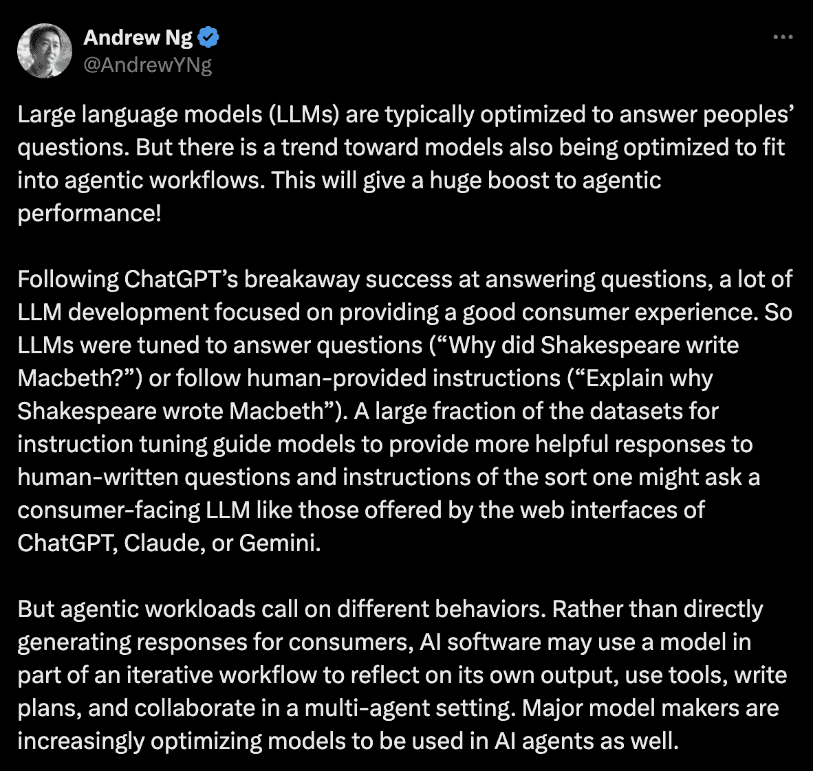

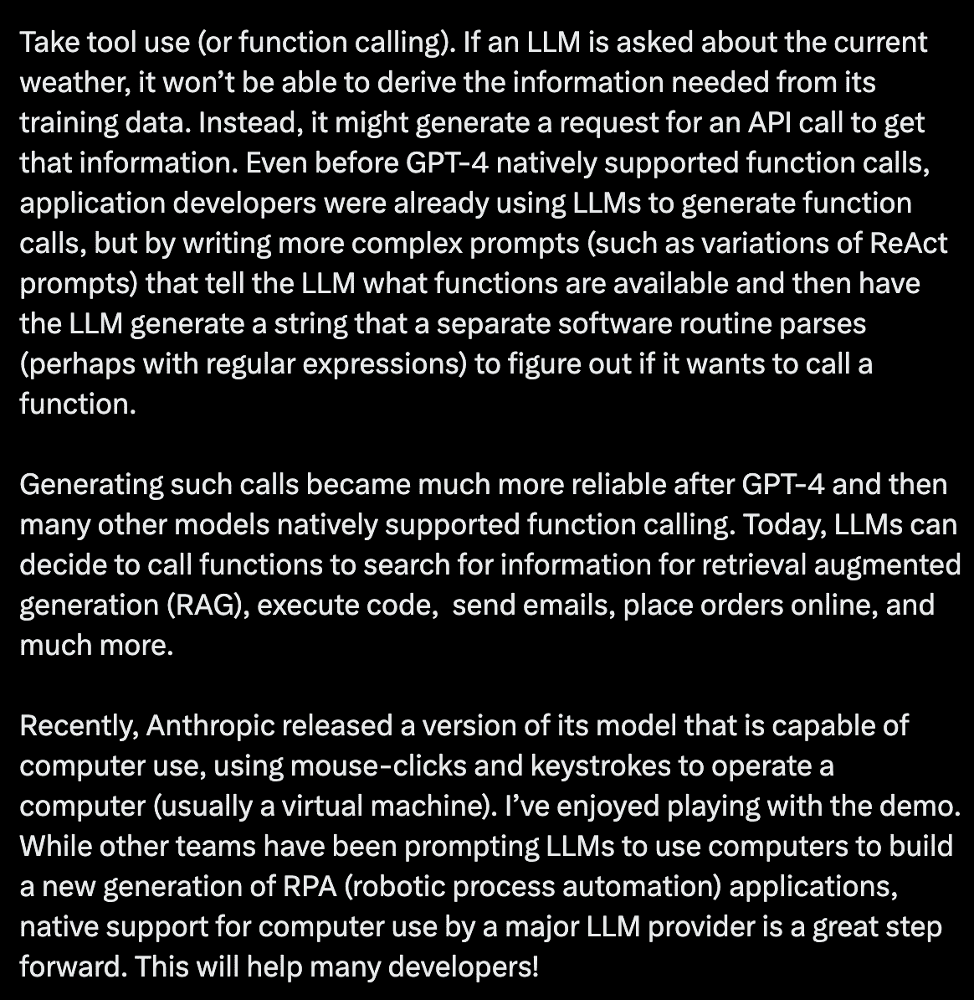

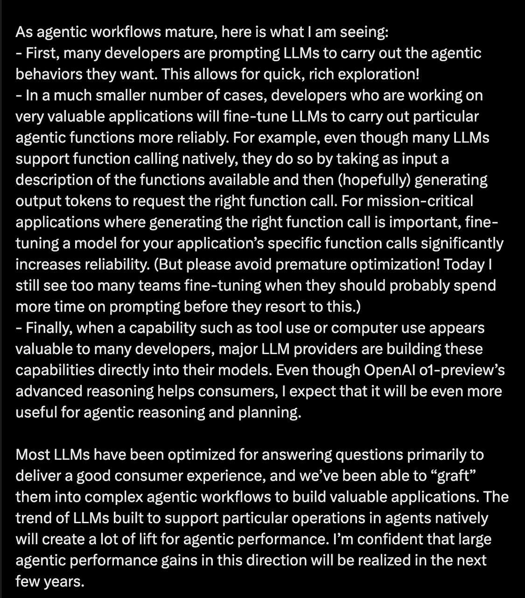

### Runwayml分享：Jeremy Higgins导演的《迁徙》

贡献人：

https://x.com/runwayml/status/1857072173631885586

推出杰里米·希金斯（Jeremy Higgins）导演的《迁徙》（Migration）。

这是一部动画短片，将第三代 Alpha 技术融入杰里米的传统动画制作流程。

这是“The Hundred Film Fund”发布的首个项目。

[Z1wSoEgv26EzUKxt.mp4](https://internal-api-drive-stream.feishu.cn/space/api/box/stream/download/all/VYa4b7PyuoiAecxyAstcrNYpnmc)

### Packer分享：AI代理托管/服务整理

贡献人：

https://x.com/charlespacker/status/1857105467031630220

新前沿：AI代理托管/服务 👾🛸

AI/LLM代理的技术栈与标准LLM技术栈有显著区别。两者的关键差异在于状态管理：LLM服务平台通常是无状态的，而代理服务平台需要具备有状态性（在服务器端保留代理状态）。

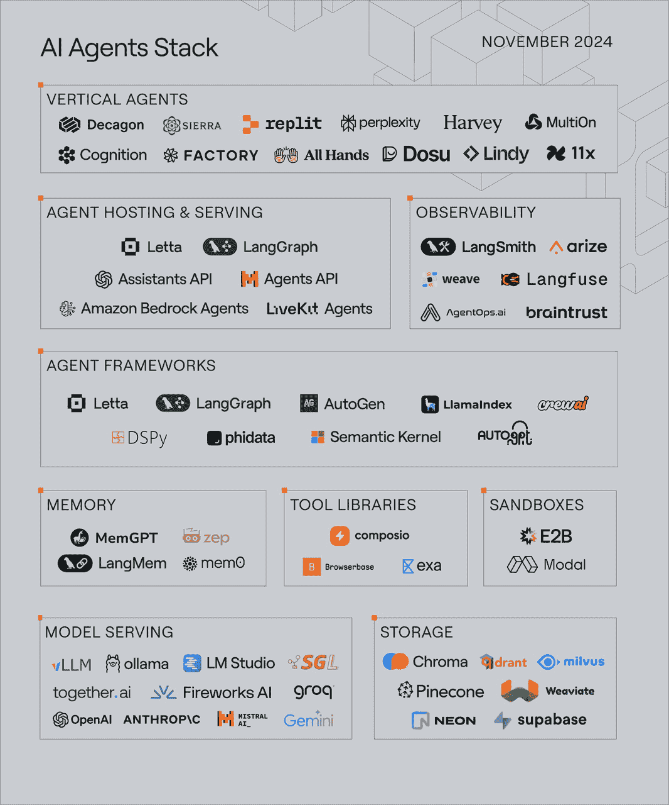

### Unitree发布升级：L2 4D激光雷达性能提升200%，售价$419

贡献人：

https://x.com/UnitreeRobotics/status/1856986819038253396

新升级发布：L2 4D激光雷达性能提升200%，售价$419 🥳

•  点速率：64000点/秒

•  距离分辨率：4.5毫米

•  视场角（FOV）：360°x96°

•  扫描距离：30米

•  性能提升200%

开源地址：[h](https://github.com/unitreerobotics/point_lio_unilidar)ttps://github.com/unitreerobotics/point_lio_unilidar

#Unitree #4DLiDAR #360LiDAR #超广角 #激光雷达 #AI #移动机器人 #四足机器人 #机器狗 #新生产力

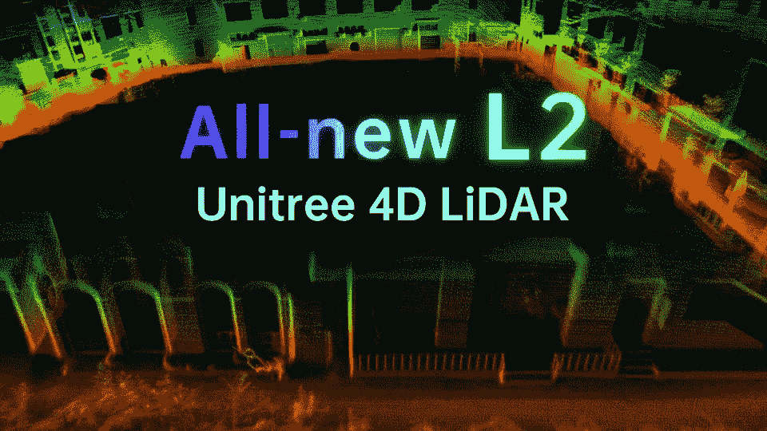

[bWASESqADuCft4Uq.mp4](https://internal-api-drive-stream.feishu.cn/space/api/box/stream/download/all/PKuvbRe1vocOcLxPYsfcwmBsnJc)

# 信号

### LLM2CLIP: Powerful Language Model Unlocks Richer Visual Representation

贡献人：

推特链接：https://x.com/rohanpaul_ai/status/1857176763912348122

原文链接：https://arxiv.org/abs/2411.04997

Researchflow：https://rflow.ai/flow/d5164a2e-2148-4ffd-b039-d86652a6f4b5（pc端打开更佳）

在本文中，我们提出了 LLM2CLIP，这是一种利用 LLM 的力量来释放 CLIP 潜力的新颖方法。通过使用对比学习对标题空间中的 LLM  进行微调，我们将其文本功能提取到输出嵌入中，显着提高了输出层的文本辨别能力。然后，我们设计了一个高效的培训流程，其中经过微调的LLM充当 CLIP 视觉编码器的强大老师。由于 LLM 的存在，我们现在可以合并更长、更复杂的字幕，而不受普通 CLIP  文本编码器的上下文窗口和能力限制的限制。我们的实验表明，这种方法给跨模式任务带来了实质性的改进。

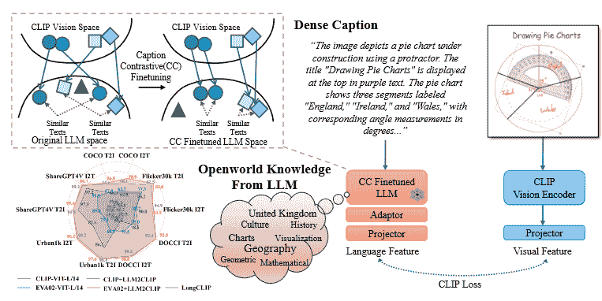

### VPTQ: Extreme Low-bit Vector Post-Training Quantization for Large Language Models

贡献人：

推特链接：https://x.com/rohanpaul_ai/status/1857183009759227921

原文链接：https://arxiv.org/abs/2409.17066

Researchflow：https://rflow.ai/flow/22a8bcb4-5cef-456b-a147-0ee1ae683a7d（pc端打开更佳）

在本文中，我们介绍了用于 LLM 极低比特量化的矢量训练后量化 (VPTQ)。我们使用二阶优化来制定LLM  VQ问题，并通过求解优化来指导我们的量化算法设计。我们使用与通道无关的二阶优化来进一步细化权重，以实现粒度  VQ。此外，通过分解优化问题，我们提出了一种简单有效的码本初始化算法。我们还扩展了 VPTQ  以支持残差和异常值量化，从而提高了模型精度并进一步压缩了模型。

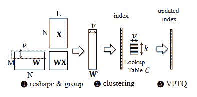

### Learning the language of DNA

贡献人：

推特链接：https://x.com/ScienceMagazine/status/1857137706112864541

原文链接：https://www.openread.academy/zh/paper/reading?corpusId=512946492

DNA 语言仅包含四个核苷酸的词汇，它编码了协调细胞中从 DNA 到 RNA 和蛋白质的所有调控层所需的基本信息。这些指令指导每个细胞的功能并在世代之间传递信息。基因组序列的变化推动进化，使生物体能够通过有利 DNA 序列的自然选择来适应环境。因此，比较进化上多样化的基因组中的 DNA 序列可以使大型语言模型能够学习 DNA 语法，而这已经避开了在单一基因组上训练的模型 (1)。在本期第 746 页，Nguyen 等人。 (2) 介绍 Evo，这是一个基于 2700 万个进化多样化的原核生物和噬菌体基因组进行训练的基础模型。学习了基因组逻辑后，Evo 可以解码自然基因组；支持 DNA、RNA 和蛋白质的预测和设计任务；并在全基因组规模上生成 DNA。

# 产品

### ZEPIC

贡献人：

https://www.zepic.com/

ZEPIC 是一款全新的客户数据和互动平台，可以帮助企业整合数据，创建个性化的客户体验。它允许营销人员独立设置和管理各种数据，利用内置的 AI 引擎 ZENIE 快速生成个性化的 WhatsApp 和电子邮件活动。ZEPIC 强调隐私和安全，确保符合 ISO、SOC 2 和 GDPR 标准，并提供实时分析工具，帮助团队优化营销策略。

### BuildShip V2

贡献人：

https://buildship.com/

BuildShip V2 是一款全新的可视化开发工具，可以简化 API 和 AI 工作流的创建。新版本引入了无限画布、实时触发器、增强的测试与错误报告等企业级功能，支持灵活的信用计费模式。用户可以在更大的范围内探索创意，并享受透明的使用报告。

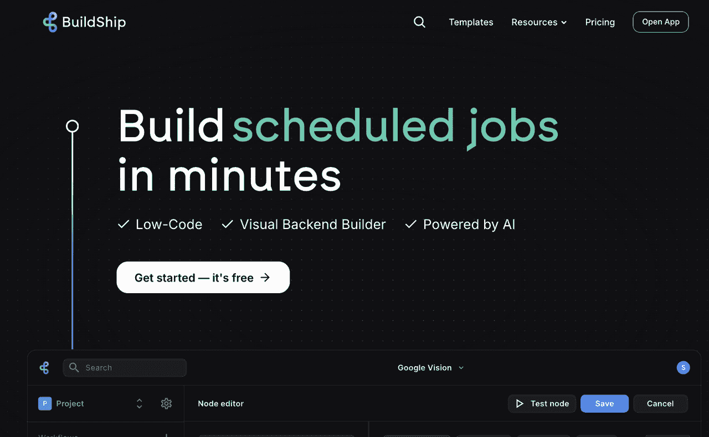

# HuggingFace&Github

### eliza

贡献人：

https://github.com/ai16z/eliza

Eliza 是一个功能丰富的对话式聊天机器人，支持 Discord、Twitter 和 Telegram 等多种平台。它可以轻松地摄取和与文档进行交互，并提供可检索的内存和文档存储。Eliza 是高度可扩展的，用户可以创建自己的动作和客户端来扩展其功能。它支持多种模型，包括本地 Llama、OpenAI、Anthropic、Groq 等。

### VideoLingo

贡献人：

https://github.com/Huanshere/VideoLingo

VideoLingo 是一站式视频翻译本地化配音工具，能够一键生成 Netflix 级别的高质量字幕，告别生硬机翻，告别多行字幕，还能加上高质量的配音，让全世界的知识能够跨越语言的障碍共享。

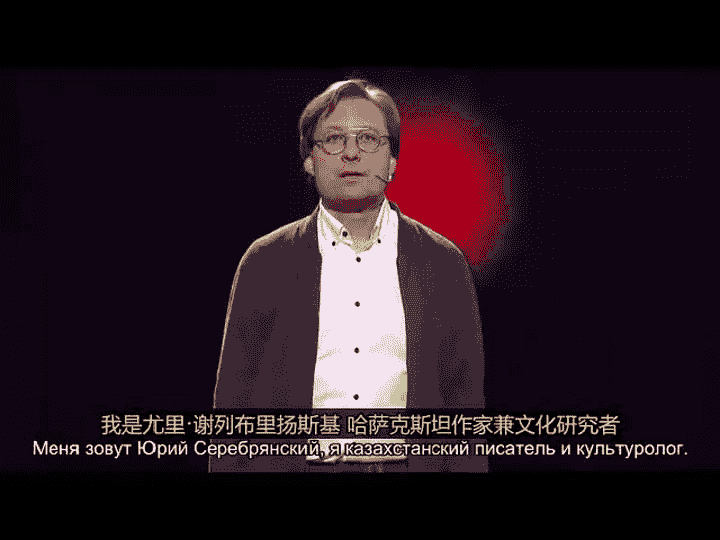

[366768196-25264b5b-6931-4d39-948c-5a1e4ce42fa7.mp4](https://internal-api-drive-stream.feishu.cn/space/api/box/stream/download/all/MYc9bi7rJoqQUUx3DPcc9eW3ngf)

# 投融资

### Tessl完成1.25亿美元融资，估值达到5亿美元，致力于打造AI编写维护代码平台

贡献人：

https://techcrunch.com/2024/11/14/tessl-raises-125m-at-at-500m-valuation-to-build-ai-that-writes-and-maintains-code/

Tessl是一家位于伦敦的初创公司，旨在通过人工智能帮助开发者创建和维护软件。公司于2024年11月完成了1.25亿美元的融资，分为种子轮和A轮融资，估值已突破5亿美元，具体为7.5亿美元。此次融资由Index Ventures主导，Accel、GV（谷歌风险投资）和Boldstart参与。GV和Boldstart共同主导了种子轮。

Tessl的创始人兼首席执行官Guy Podjarny，曾创办并领导了网络安全公司Snyk，并在Akamai担任CTO。他的经验和背景吸引了顶级投资者的关注。Tessl的目标是开发一个“AI原生”平台，允许开发团队通过自然语言或代码提供需求，AI将自动生成和维护代码。该平台还支持在沙箱环境中进行测试，以便开发者能够发现问题并进行修复。

尽管Tessl尚未正式推出其产品，计划在明年初发布，但它的融资和高估值已经显示出市场对其理念的强烈兴趣。Podjarny提到，Tessl的起步并不会涉及复杂的应用，初期将聚焦于相对简单的软件开发，并计划逐步扩展至更多的应用场景。

Tessl的核心价值在于其自动化代码维护能力，投资者认为，随着AI生成代码的普及，代码的维护和更新将变得更加重要。Podjarny表示，Tessl将支持多种编程语言，并计划与其他AI编程助手平台合作，进一步拓展其生态系统。

公司官网：https://www.tessl.io/

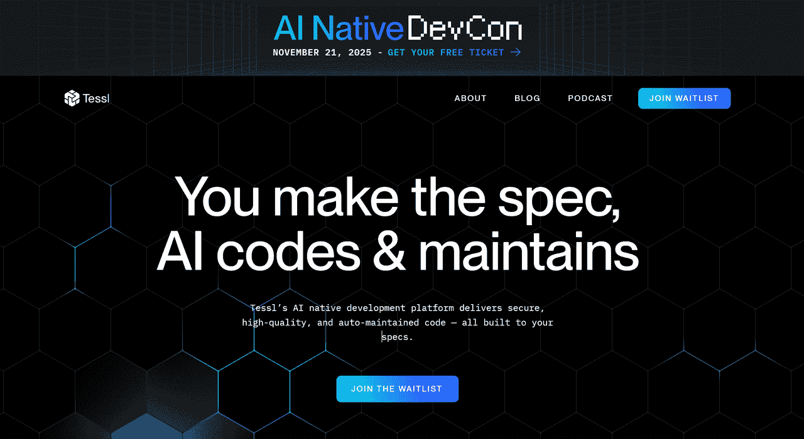

### Tiger Global支持的InVideo推出基于生成AI的视频创作功能

https://techcrunch.com/2024/11/14/tiger-global-backed-invideo-introduces-gen-ai-based-video-creation/

印度视频编辑平台InVideo宣布推出其生成AI驱动的视频创作功能，该功能使用户能够通过文本提示生成视频剪辑。此功能被称为InVideo v3.0，支持多种风格的视频制作，包括真人、动画或动漫，并且生成的视频可以导出为适用于YouTube、Shorts/Reels和LinkedIn等平台的格式。用户还可以通过修改提示来编辑这些视频，调整视频的某些部分。

InVideo并未开发自己的生成模型，而是采用了多个不同的模型组合来处理提示并生成视频。InVideo的共同创始人兼首席执行官Sanket Shah表示，理论上生成的视频长度没有上限，但用户的生成次数会受到账户余额的限制。目前，平台没有提供免费的使用层级。

为支持这一新功能，公司推出了一个新的付费计划——“生成计划”，用户每月支付120美元即可生成15分钟的视频。此外，用户还可以按每分钟8到10美元的价格购买额外的生成时间。

InVideo的目标用户群体为个人、创作者和小型企业，而不像一些竞争对手（如Captions、D-ID和Lightricks）那样专注于电影制作人、广告公司和销售团队。Shah表示，与其他视频编辑工具相比，InVideo在创建AI生成视频时具有更简单的界面。

InVideo的前景看似光明，目前公司拥有400万月活跃用户，在过去30天内生成了700万个视频。该公司在2021年完成了一轮3500万美元的融资，投资方包括Greenoaks、Tiger Global和Peak XV，目前公司仍有2500万美元的现金储备，并表示“烧钱”情况较轻。

Shah还透露，InVideo预计今年的营收将达到5000万美元，并计划在未来几个月内寻找合适的合作伙伴。

公司官网：https://invideo.io/

### Mach9获得1200万美元种子轮融资，推出AI驱动的基础设施数据分析工具

https://techcrunch.com/2024/11/14/mach9-is-equipping-infrastructure-operators-with-better-information/

Mach9是一家致力于利用AI改善基础设施维护和管理的初创公司，近日宣布完成1200万美元的种子轮融资。此次融资由Quiet Capital主导，Overmatch Ventures以及一系列知名投资者，包括Cruise创始人Kyle Vogt、前Autodesk CEO Amar Hanspal、Adobe首席产品官Scott Belsky及前DoorDash高管Gokul Rajaram等参与。

Mach9的核心产品——Digital Surveyor，能够通过移动激光雷达（LiDAR）扫描技术，自动转换和分析2D与3D工程模型。该工具显著降低了基础设施公司在进行设施勘测和管理时的成本和时间。通过AI技术，Digital Surveyor能够自动识别20多种基础设施特征，如电力杆、交通信号灯和道路标识，且比传统人工勘测方法更高效。

目前，Mach9的客户包括美国和加拿大的多家知名基础设施公司与工程服务公司，如Michael Baker International、POWER Engineers、Langan和Fibersmith等。公司创始人兼CEO Alexander Baikovitz表示，借助更精确的地理空间数据和地图，基础设施运营商能够及时发现问题并进行改进，尤其是在极端天气事件后，能够快速获取关键信息。

Mach9最初计划通过硬件解决方案来收集地理空间数据，但在与客户交流后，决定将重点转向如何将庞大的数据转化为有价值的见解，进而推动其软件Digital Surveyor的发展。该工具大大提高了勘测效率，用户能够在不到10分钟的时间内，审核和确认每英里道路上的基础设施数据，极大缩短了传统人工识别所需的几天时间。

公司计划利用这笔资金扩大其14人的团队，进一步完善产品，并逐步增加可识别的基础设施特征，从目前的20多种扩展到未来的数百种。

公司官网：https://www.mach9.io/

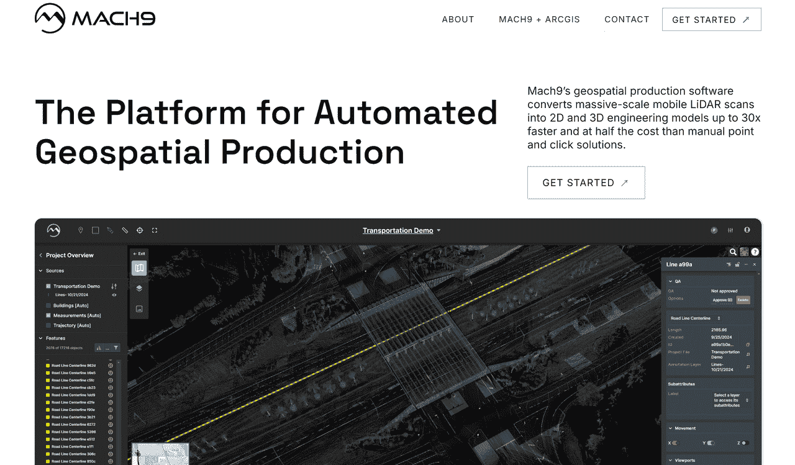

# 学习

### The AI agents stack

贡献人：

https://www.letta.com/blog/ai-agents-stack

AI代理的技术栈在2024年已发生重大变化，主要包括三个层次：模型服务、代理框架和存储。代理与传统的LLM聊天机器人不同，需要管理状态（如对话历史、长期记忆）并执行工具操作。代理堆栈的核心是LLM，通过推理引擎提供服务，常见的服务商有OpenAI、Anthropic等，同时也有本地推理引擎如vLLM和Ollama。

存储是代理的重要组成部分，尤其是向量数据库如Chroma和Weaviate被用于存储代理的外部记忆。工具执行方面，代理需要通过LLM生成结构化输出（如JSON），调用外部工具，确保安全执行。框架方面，现有的代理框架如LangChain和Letta提供了状态管理、上下文窗口结构以及多代理通信的支持。

代理的未来方向是将其作为服务进行托管，通过REST API进行调用，面临更高的工程挑战，特别是在状态管理和工具执行的安全性上。随着代理堆栈的不断发展，预计将会出现更强大的框架和托管服务。

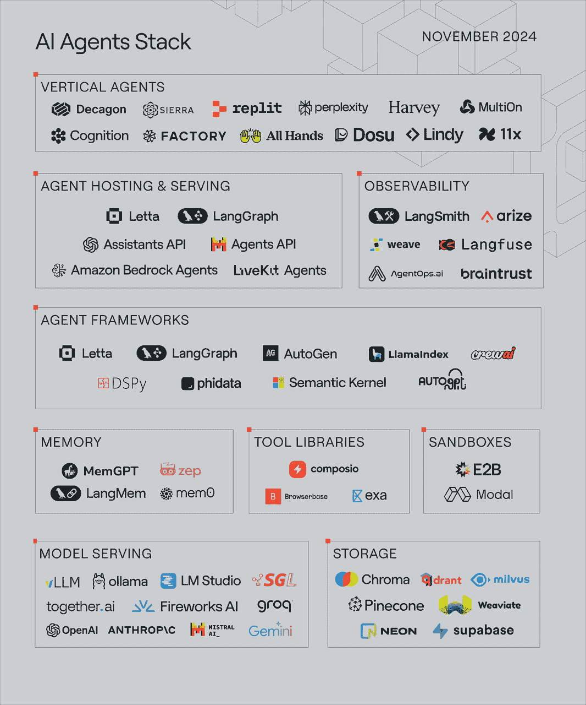

### 一文详解 LLM & 推荐 混合专家模型-MoE 发展史

https://zhuanlan.zhihu.com/p/4191555928

MoE（Mixture of Experts，混合专家模型）在NLP、CV、多模态及推荐系统等领域的应用日益增多，其中推荐系统的MoE与NLP中的MoE有所区别。推荐系统中的MoE主要关注多任务处理，是一种Dense MoE（即每个任务使用多个专家），而NLP中的MoE则侧重于模型的规模扩展（Scaling Law），采用Sparse MoE（即仅激活部分专家）。以下为这两种MoE的关键差异：

LLM与推荐中的MoE对比：

+   **模型类型**：NLP采用Sparse MoE（大多数专家不参与计算），推荐系统采用Dense MoE（多个专家参与任务分配）。

+   **发展目标**：NLP的目标是通过扩大训练参数来提升模型性能，同时保持推理效率；推荐系统则集中在如何合理分配专家到各个任务上。

+   **主要问题**：NLP关注负载均衡、专家并行等技术细节；推荐系统则解决如何将专家分配给不同任务，并在专家间进行高效交互。

MoE的工作原理：

MoE通常通过将Transformer中的FFN层替换为多个专家（expert）来实现。每个专家有独立的参数，输入token由路由器（router）分配给一个或多个专家进行处理。不同的路由策略（如Top1或TopK）决定哪些专家处理哪些token。

MoE的路由策略：

+   **Sparse MoE**：通常采用Top1或TopK策略，即每个token路由到一个或多个专家。例如，Switch Transformer中采用Top1路由，减少了计算量。

+   **Dense MoE**：推荐系统中通常使用按比例分配的路由策略，以保证专家在多个任务之间均匀负载。

MoE的技术挑战：

1.  负载均衡（Load Balancing）：为了防止某些专家过载，而其他专家负载不足，引入了负载均衡损失（Load Balancing Loss）。这个辅助损失函数鼓励均匀分配tokens到专家，避免不均衡的计算资源消耗。

1.  专家并行（Expert Parallelism）：MoE的专家层需要高效的并行化策略，包括数据并行、模型并行和专家并行。例如，通过将不同专家分配到不同GPU，减少了通信开销，提高了计算效率。

训练与推理：

+   **冷启动与热启动**：冷启动从头开始训练模型，热启动则在已有模型基础上继续训练，适用于大规模模型的迁移学习。Mixtral模型就采用了热启动方法，通过将训练好的基础模型的FFN层替换为多个专家层来提升性能。

其他优化与技术：

1.  选择性精度（Selective Precision）：在路由操作中使用更高精度（如FP32），其他部分使用低精度（如BF16），以提高训练稳定性。

1.  **负载均衡与随机路由**：GShard等模型通过Top2路由和随机路由策略进一步优化计算资源的利用效率，并解决了训练过程中的不稳定性问题。

1.  **正则化技巧**：例如，Dropout策略和特异正则化在MoE的训练中被广泛应用，帮助模型在下游任务中更好地泛化。

Mixtral与LLM的MoE应用：

Mixtral 8*7B是一个代表性的MoE模型，其通过热启动方式，在已有基础模型上实现专家层的替换，并通过MoE技术超越了传统大规模模型（如LLaMA 2 70B）。Mixtral通过合理的路由机制和高效的计算策略，展示了MoE在大规模语言模型中的优势。

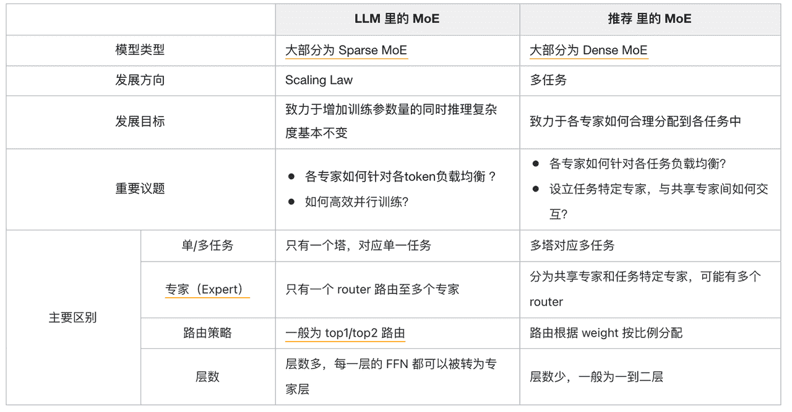

### GPGPU-sim改造计划之背景篇（一）

https://zhuanlan.zhihu.com/p/6782499856

计算机架构经历了从全能型的CPU到专门加速任务的GPU的演变。早期的CPU是全能型的处理器，擅长控制流操作，能够处理复杂的控制和计算任务。随着软件程序的复杂性增加，单纯依赖晶体管制程升级已无法提升性能，因此开发出了多种技术加速单核CPU性能，包括乱序执行、VLIW、多发射、超长流水线等，旨在提高指令级并行度（ILP）。然而，随着AI等计算密集型任务的需求增加，传统单核CPU已无法满足需求，因此开发了众核CPU，尝试通过并行计算来提升性能。

**GPGPU（通用计算GPU）**

为了应对复杂的并行计算需求，GPU被改造为GPGPU，结合了GPU的并行计算优势和CPU的控制流能力，形成了异构计算系统。GPGPU通过大量轻量级的线程并行处理数据密集型任务，能大幅加速数据计算，而CPU则负责处理逻辑复杂的串行任务。GPGPU系统的核心是SIMT（单指令多线程），每个线程处理一个数据元素，且线程束（warp）内的所有线程执行相同的指令，只有数据不同，这种方式对数据一致的任务尤其高效。

**硬件与执行模型**

GPGPU的执行模型采用SIMT，并通过硬件中的流水线提高并行度。每个线程束中的线程锁步执行，若遇到分支指令，则各线程根据路径执行，可能导致执行效率下降。GPU的编程模型包括了灵活的线程层次结构和内存层次结构，程序员可以根据需要调整线程和内存的使用方式。GPGPU编程时，合理的内存和线程调度非常关键，尤其是利用寄存器、共享内存等硬件资源来优化性能。

**存储资源与内存层次结构**

GPGPU编程中，内存的高效使用是性能优化的关键。内存包括寄存器、本地内存、共享内存、常量内存、全局内存等，每种内存具有不同的访问速度和作用域。例如，寄存器速度最快，但容量有限；共享内存用于同一线程块中的线程协作；全局内存则存储着全局数据，但访问延迟较高。在编程时，合理分配数据存储位置，减少不必要的数据传输，能有效提升GPU利用率。

**GPU利用率与算子优化**

GPGPU的性能受到多个因素的影响，其中算子优化（如线程数量、访存模式、数据传输次数等）是关键。优化GPU算子的执行，合理设置线程数，减少访存冲突，能显著提升GPU的利用率。

**计算机模拟器与硬件验证**

计算机模拟器主要用于验证硬件架构设计的性能。模拟器可以分为系统级、指令级和微架构级。微架构级模拟器关注硬件内部结构，适用于精密性能分析，而系统级模拟器更适合整体性能评估。CPU和GPU的模拟器通常通过C/C++语言编写，模拟硬件的操作与结构，帮助硬件设计者进行早期验证和优化。例如，RISC-V CPU模拟器模拟了从取指、译码到执行、访存和写回的五级流水线，通过软件实现硬件的工作流。

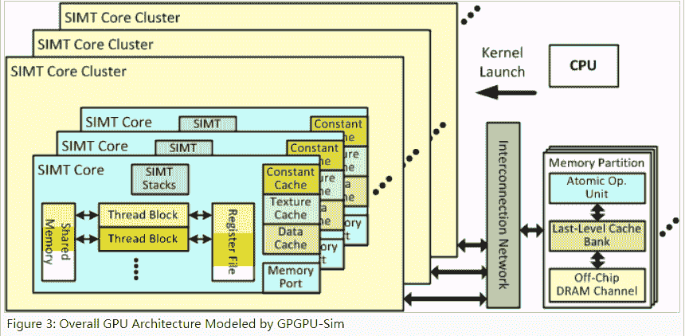

### 2025年美国国家人工智能科学院院士榜单名单出炉

https://zhuanlan.zhihu.com/p/6632829527

近日，美国国家人工智能科学院2025年院士名单正式对外公布。本次公布的终身院士名单共有86人，其中有27名华人，中国国籍科学家不完全统计约不到10位。

美国国家人工智能科学院于2024年3月初在美国科罗拉多州丹佛成立。作为一个致力于推动人工智能领域发展、加强学术交流与合作、提升公众对人工智能理解与认知的权威机构，该科学院汇集了众多在人工智能领域取得杰出成就的科学家和工程师，旨在通过研究、教育、政策建议和公共服务等多种方式，引领和推动人工智能技术的创新与应用。

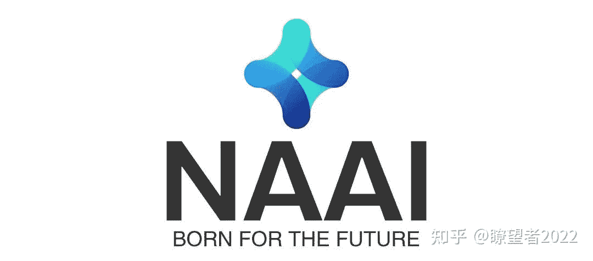

### 卡内基梅隆石冠亚：打造灵活智能的通用机器人技术路线图

https://zhuanlan.zhihu.com/p/6465072631

石冠亚博士提出，理想的通用机器人应当具备两个主要特征：“广度”和“深度”。广度是指机器人能够应对的任务种类和适应环境的多样性，比如在不同的厨房或各种地形上作业；而深度则强调的是任务执行的质量，包括速度、灵巧性、精确度和可靠性等。尽管在某些领域已经取得了一些进展，但是要完全实现这种兼具广度与深度的能力，依然存在许多挑战。

为了解决这些挑战，石博士提出了两个关键思路：一是更好地利用物理/动力学知识，将基于模型的控制与物理原理结合起来，以实现结构化的扩展；二是更有效地利用扩展的优势，通过离线学习加上在线适应、规划和优化等方式，来提高机器人的性能。

具体来说，在研究实践中，石博士和他的团队正在探索如何超越传统的仿真到现实（sim2real）强化学习方法的局限性。尽管这种方法在一些情况下取得了成功，但它也面临着训练环境敏感性高、仿真与现实差距大、需要繁琐的奖励/课程/领域随机化调优等问题。因此，团队正在研究如何将学习与控制结合，从三个不同的层面入手：动态层面，从真实世界中学习动态规律；策略/动作层面，设计结构化和层次化的强化学习与控制；程序层面，利用学习来改进模型预测控制（MPC）。例如，在动态层面，研究团队通过收集真实数据并使用深度神经网络来近似未知的动力学模型，然后设计非线性控制器来确保系统的稳定性。而在策略层面，则采用分层强化学习和控制，确保机器人在学习过程中保持安全。在程序层面，研究团队利用学习方法改进模型预测控制，使得机器人能够在复杂的环境中快速做出决策。

石教授及其团队的工作展示了未来机器人技术的一个可能发展方向，即通过结合学习与控制的方法，使机器人具备更高的泛用性和灵活性。这不仅仅是学术上的突破，更是朝着实用化和商业化迈进的重要一步。随着研究的不断深入，我们期待看到更多能够在实际应用中展现强大能力的通用机器人出现。

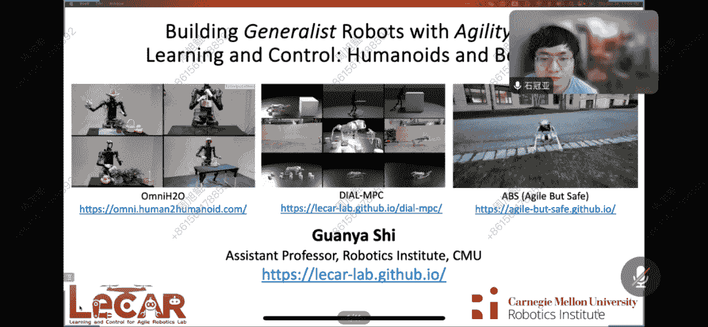

### 马维英｜AI for Science

https://zhuanlan.zhihu.com/p/6467273986

马维英教授在《AI for Science》讲座中，系统探讨了AI与科学结合的巨大潜力，特别是在生成式AI和大模型的应用前景方面。首先，他回顾了AI的发展历程，强调AI不仅改变了传统的科学研究方法，还推动了“新科学”的诞生。这一新阶段的特征是AI在科学领域的深度应用，尤其是结合生物学、化学、材料科学等领域解决复杂问题，如蛋白质设计和药物研发。

马教授提出，AI可以通过“token化”物质世界的元素，借鉴语言模型的成功经验，构建“原子级的ChatGPT”，从而实现与自然界的“对话”。他举例说明，ESM3模型通过AI成功生成了全新的荧光蛋白，这一突破展示了AI在蛋白质设计方面的巨大潜力。此外，AI对“新科学”有着重要影响，特别是通过帮助科学家理解复杂的结构和数据，推动科学研究进入一个新的发展阶段。

讲座还重点介绍了多个领域中的具体应用。AI在生物制药领域，通过如GeoBFN和MolCRAFT等新方法，显著提升了分子生成效率，支持精准药物设计；在抗体设计方面，采用图学习方法提升了效率和准确性；在材料设计上，AI正帮助研究人员优化材料的功能结构，推动OLED和钙钛矿材料的研究进展。

挑战方面，马教授指出，几何图生成、符号数据处理等问题依然是AI在科学中的应用瓶颈，尤其是在多模态数据和几何对称性方面。为此，AI for Science领域正积极推动新算法和模型的研究，如扩散模型在分子生成中的应用，展示了AI如何提高生成效率。

展望未来，马教授提到，AI for Science的下一步将推动“AI for Science基础计算设施”的建设，催生新的产业形态，并且对教育模式产生深远影响，高校需要适应AI时代，培养跨学科合作的能力。此外，AI for Science还将促使科学研究实现干湿闭环，即AI与自动化实验室的紧密结合，推动实验过程的迭代和优化，提升科学发现的效率。

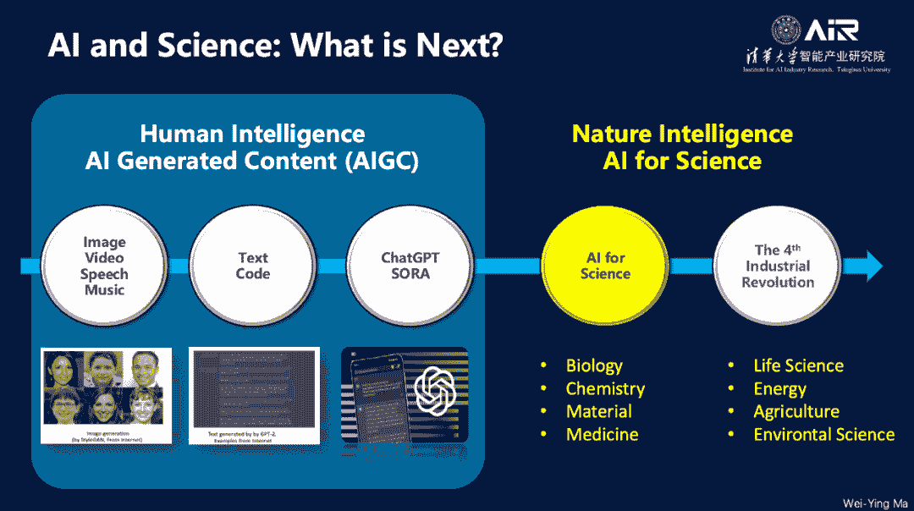

### 智能驾驶芯片：NOA起量+国产替代

https://mp.weixin.qq.com/s/JDNSwlNM4UwriSwcZpj1tA

**NOA功能带动算力需求提升**

随着L1-L2级别向NOA等高阶智驾功能的过渡，尤其是针对中低端车型（10-25万元）的高速NOA，预计未来三年该价格段的芯片出货量将显著增长。NOA技术逐步成熟，成本压缩至2000-5000元，使其能够在大众市场上大规模渗透。而城市NOA对算力、传感器冗余要求更高，当前技术仍在探索阶段，成本难以压缩至大众市场。

**国产芯片替代加速**

随着国内芯片厂商（如地平线、黑芝麻智能、华为等）逐步实现低到中高算力芯片的量产，国产芯片的性价比和本土化服务优势凸显，国产替代进程加速。尤其是在低算力领域，国产芯片已经验证了其量产能力并逐步扩大市场份额，地平线的前视一体机出货量已达到167万套，2024年预计继续增长。

**智能驾驶产业链分工不明晰**

智能驾驶产业链涉及感知、决策与执行等多个环节，目前主机厂在智能驾驶领域的话语权持续提升，主机厂与供应商的合作呈现出“黑盒”、“白盒”和“灰盒”模式的多样化。主机厂通过“灰盒”模式加强自主研发，同时与供应商合作，以定制化满足不同需求，这为芯片厂商提供了从硬件到算法的全套解决方案机会，提升了其价值量。

**智能驾驶算力需求的升级**

预计随着NOA等功能的普及，芯片的算力需求将进一步增长，尤其是中高算力芯片（10-150TOPS）将成为市场增长的主要动力。预计到2025年，智能驾驶SoC市场将达到27.9亿美元，2030年将突破67亿美元。

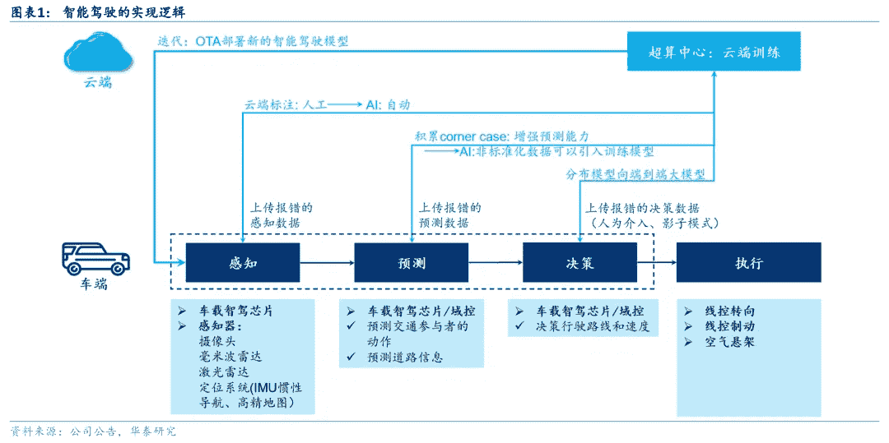

# 招聘公告

---

**奇绩创坛****由陆奇博士**于2019年创立，使命是在源头最大化驱动创新。奇绩研究组将研究模型理论、到投研战略分析、市场策划等不同背景的同学聚在一起，搭建GenAI时代独特的跨界人才社群。

## 🚀F**24实习岗位**

##### [行研-学术科研人才交流组实习生](https://miracleplus.feishu.cn/docx/Yn6rdf2iOoY2Rcx8yVNcUBYRnch#part-QkMcdeJmuob9uvxvV3qcLSzHn8g)

##### 行研-GenAI研究岗位-战略分析（偏产品）

##### Web / AI 全栈开发工程师实习生

## **火热开放中🚀**

##### 行研-GenAI研究岗位-前沿学术探索

##### 行研-GenAI研究岗位-战略分析（偏咨询）

##### 创新活动产品运营 （大模型系列活动产品运营）

> **点击**相关岗位可查看对应**岗位需求【JD】；**相关岗位投递请**扫描二维码**

> 欢迎**推荐/自荐**

> 期待在**奇绩创坛**遇见更好的你

---

# 声明

本文档仅供学习交流使用，版权归原作者所有，若涉侵权，请联系Jack Jin 15101136166

##

（欢迎在下方反馈您宝贵的意见！整理不易，觉得有用给AI日报小组点个赞👍吧！）

ChatGPT；Angela；Zijia Liu；Alex；Zeqi Tan；Tiezhen（HuggingFace）；Naixu；Lizhi；Peter；Suoman；Jack

学术分析报告：ResearchFlow -- 奇绩F23校友的开发的深度研究产品，PC端进入RFlow的分析报告，可直接点击节点右侧的小数字展开节点，登录后可在节点上直接“询问AI”，进一步探索深度信息

如果你有大模型相关的创业想法，欢迎来找我们聊聊～🛰️：15101136166

> 快邀请你的小伙伴们一起来读大模型日报吧！

> **【日报****知识库****】**这里是近期日报内容的汇总,欢迎大家查阅

> [大模型日报知识库(分享版)](https://miracleplus.feishu.cn/wiki/KapVwXfkriOBiskB0B2cUHxjnTh)

>

> 欢迎大家多多帮我们分享,转发~~

> 如果大家有任何的建议或者吐槽,欢迎随时找我聊天~

