# 奇绩大模型日报（11月 14日）

> 来源：[https://miracleplus.feishu.cn/docx/APe6dVZ1nocQR4xulVac8RAPnRg](https://miracleplus.feishu.cn/docx/APe6dVZ1nocQR4xulVac8RAPnRg)

# 资讯

### 谷歌2024博士奖学金公布

https://mp.weixin.qq.com/s/5L39BdG6XWmL4Nl-pwM6kQ

2024年谷歌博士奖学金（Google PhD Fellowship）获奖名单已公布。今年共授予85名年轻学者该奖项，覆盖13个领域，包括算法与理论、分布式系统、健康与生物科学、人机交互、机器智能等。该奖学金旨在支持博士生的研究并提供与谷歌研究导师合作的机会。

**主要获奖领域及人数：**

+   **算法与理论**：8人

+   **分布式系统与并行计算**：1人

+   **健康与生物科学**：11人

+   **人机交互与可视化**：7人

+   **机器智能**：22人

+   **机器感知**：6人

+   **自然语言处理**：12人

+   **安全、隐私与防止滥用**：6人

+   **语音处理**：5人

+   **硅芯片研究**：1人

以下是部分华人获奖博士生介绍：

+   **算法与理论**：

+   **Sun Yan**，新加坡国立大学，研究机器学习中的算法及其应用。

+   **吕欣**，加州大学伯克利分校，研究伪随机性、计算复杂度及差分隐私。

+   **健康与生物科学**：

+   **Chang Kao Jung**，阳明交通大学，研究大数据、AI与基因遗传学。

+   **Jason Yang**，加州理工学院，研究蛋白质工程与机器学习。

+   **人机交互与可视化**：

+   **Erzhen Hu**，弗吉尼亚大学，研究多模态智能体增强人机交互。

+   **Kara Liu**，斯坦福大学，研究机器学习在医疗保健中的应用。

+   **机器智能**：

+   **曹宇舟**，南洋理工大学，研究统计学习与可信机器学习。

+   **Eric Zhao**，加州大学伯克利分校，研究多目标机器学习。

+   **自然语言处理**：

+   **David Wan**，北卡罗来纳大学，研究自然语言处理。

+   **马欣尹**，新加坡国立大学，研究高效训练模型。

+   **语音处理**：

+   **杨书文**，台湾大学，研究语音处理与自监督学习。

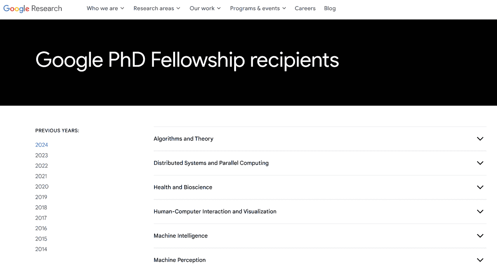

### 今年Station F“未来40强”中的34家初创企业使用人工智能

https://techcrunch.com/2024/11/13/34-startup-out-of-this-years-top-40-startups-at-station-f-use-ai/

每年，超过1000家初创企业加入位于巴黎的著名创业园区Station F。在这其中，Station F挑选出了40家最具潜力的公司，这些被称为“未来40强”的初创企业都在各种领域进行了创新，其中人工智能的应用几乎无处不在。今年的“未来40强”中，34家初创企业采用了人工智能技术。

这些创业公司已经成功筹集了近9300万欧元（接近1亿美元），涉及的行业包括AI芯片、材料研究、能源优化等领域。例如，Arago公司正在开发基于光学技术的AI芯片，旨在提升运算速度；EXXA则致力于优化AI推理，降低每个令牌的计算成本；Altrove和Entalpic等公司则借助AI加速材料研究，推动可持续发展。

此外，一些关注能源效率的企业也涌现，如Optimmo通过远程技术帮助房主进行高效节能改造，Orus Energy则通过软件帮助企业在非高峰时段调节能源使用，减少碳排放。

可以看出，AI已成为未来创业公司发展的核心工具，几乎所有新兴的初创企业都在某种程度上整合了人工智能技术。随着AI模型开发创新放缓，越来越多的初创公司正在集中精力优化AI工作负载。

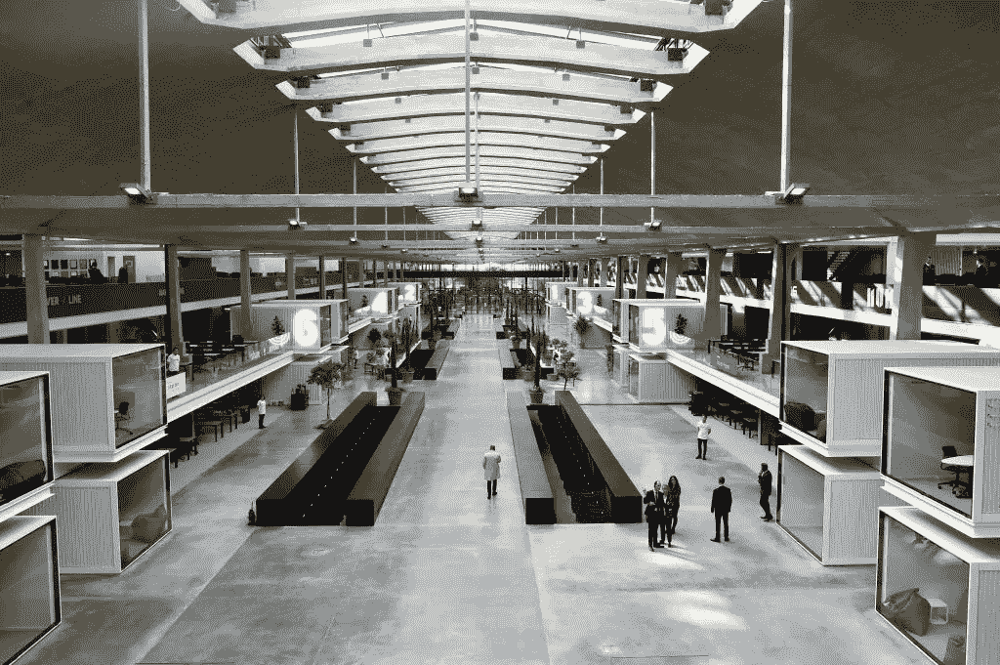

### OpenAI将推出“Operator”

https://mp.weixin.qq.com/s/FsfLWAy1vWNHE3z2V9ei5Q

彭博今日报道，OpenAI计划推出一款名为“Operator”的全新AI Agent产品，预计将在2025年1月发布。该产品能够自动执行复杂任务，包括编写代码、预订旅行、自动购物等，并且计划为开发者开放API接口。这一消息标志着AI Agent技术的发展，OpenAI希望通过“Operator”进一步推动智能体的普及和应用。

OpenAI正在进行多个与智能体相关的研究项目，其中最接近完成的是一个能够在网络浏览器中执行任务的通用工具。这一计划与行业趋势相符，近期微软、谷歌和Anthropic等公司也发布了强大的AI Agent。例如，Anthropic的“Computer Use”功能使得AI像人类一样使用计算机，包括控制鼠标、键盘，查看屏幕，移动光标、点击按钮、输入文本等，开发者可以通过API指令让Claude（Anthropic的AI）执行一系列操作，如填写表格、搜索网页信息、操作软件等。

“Computer Use”通过解析开发者发送的自然语言指令，并根据预训练模型映射相应的计算机操作。这种能力让AI可以自动执行重复性任务，协助开发者提升工作效率。OpenAI的“Operator”预计会在此基础上进行创新，简化操作流程，扩展AI Agent的应用范围，进一步提升其在多个领域的实用性和便捷性。

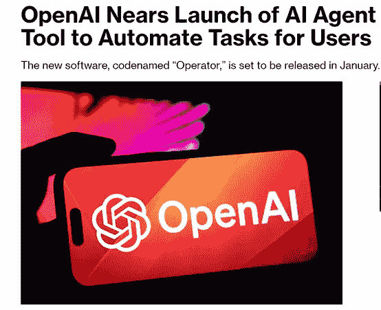

### AMD裁员4% 聚焦未来增长机会

https://techcrunch.com/2024/11/13/amd-lays-off-4-of-its-workforce/

美国半导体巨头AMD近日确认，将裁员4%的员工，以更好地聚焦其“重大增长机会”。目前尚不清楚裁员具体影响了多少员工以及哪些部门，但根据AMD去年提交的年度报告，公司的员工总数大约为26,000人，因此裁员人数预计约为1,000人。

AMD的发言人表示，此次裁员是为了将资源集中于最具增长潜力的领域，并承诺将尊重并帮助受到影响的员工度过过渡期。此前，AMD公布了2024年第三季度的财报，尽管公司整体收入和利润有所增长，但其游戏部门却出现了69%的同比下滑，并且对当前季度的预测未能达到分析师的预期。

此外，AMD在与竞争对手Nvidia的AI芯片销售竞争中也面临挑战。由于库存短缺，预计今年AMD将出货224,000个GPU，尽管数量较大，但仍无法满足像微软和Meta这样的主要客户需求。AMD的AI芯片在关键的AI训练工作负载上未能超越Nvidia的产品，但AMD将其产品定位为在AI推理任务中更具优势。

尽管面临压力，AMD CEO苏姿丰在Q3财报发布会上表示，公司未来的芯片将具备与Nvidia竞争的能力，尤其是计划于2025年下半年发布的MI350系列芯片，预计会带来有史以来最大的AI性能提升。

然而，AMD的前景依然充满挑战。2025年，AMD的收入预计将达到326亿美元，而Nvidia的季度收入则预计达到330亿美元，几乎全部来自于AI芯片销售。AMD的股票今年已下跌约4%。

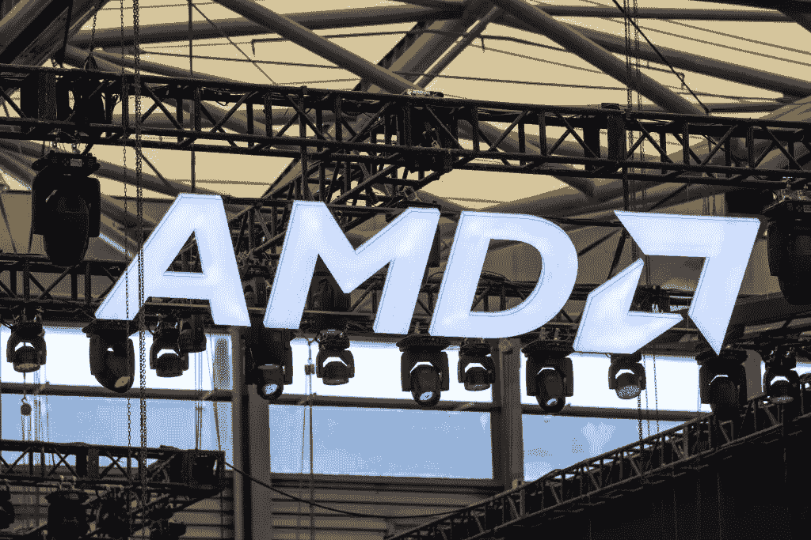

### Keras之父，离职谷歌

https://mp.weixin.qq.com/s/Ag92B3WqNbHh73DhKLkm9g

谷歌官方宣布，Keras之父François Chollet正式离职，结束了在谷歌近九年的工作生涯。谷歌高层在公告中高度评价了Keras的贡献，强调其已经成为人工智能领域的重要基石，用户超过200万，并广泛应用于自动驾驶、推荐系统等领域。尽管离职，Chollet承诺继续支持Keras的发展，并与谷歌团队和开源社区保持合作。

Keras是Chollet于2015年发布的开源深度学习库，旨在简化神经网络的构建和实验过程，降低深度学习的门槛。最初，Keras支持Theano、CNTK和TensorFlow等多个底层计算引擎，采用模块化设计，用户可以通过组合不同层快速搭建模型。2017年，Keras成为TensorFlow的官方高级API，并在2019年完全整合入TensorFlow中，提升了性能和可扩展性。

然而，随着PyTorch的崛起，TensorFlow的市场份额逐渐下滑，部分开发者认为Keras的前景不再乐观。尽管Keras在功能上不断进化，支持TensorFlow、PyTorch和JAX作为后端，部分业内人士仍对其多后端支持的可行性表示担忧，认为这可能会导致兼容性和调试问题。

Chollet的离职引发了广泛讨论，部分人猜测他可能会加入其他AI公司，如Anthropic。Chollet除了在深度学习领域的贡献外，还提出了AGI（人工通用智能）竞赛，并设立了百万美元奖金，推动更高效的AGI研究。

Chollet的下一步动向尚未公布，但他的离开标志着一个时代的结束，也引发了关于深度学习框架未来发展的讨论。

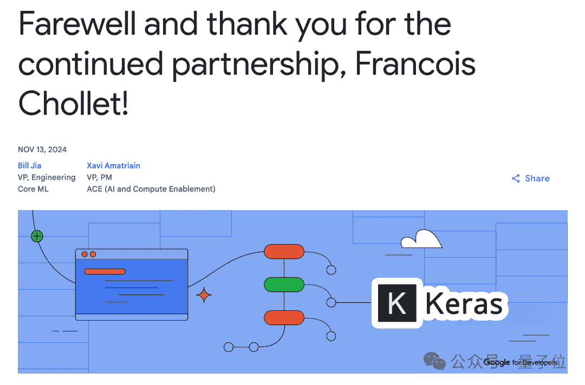

# 推特

### Hassan预告：免费开源 logo 生成器将在 24 小时内上线

贡献人：

https://x.com/nutlope/status/1856759538809987553

Hassan：我的免费开源 logo 生成器将在 24 小时内上线！

使用Flux和Togerther AI制作

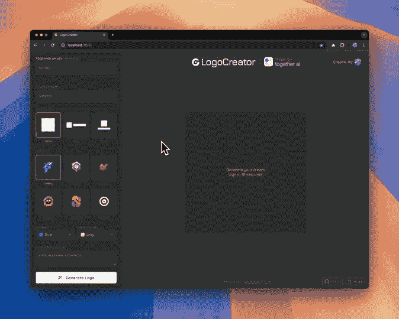

[SB9WhQViYq4csAxZ.mp4](https://internal-api-drive-stream.feishu.cn/space/api/box/stream/download/all/C8ZmbkA8moMwPzxStyAcNeCbnte)

### a16z：我们认为 AI 将会自动化运营，并吞并 RPA 领域

贡献人：

https://x.com/kimberlywtan/status/1856746731989619072

📢 新的 @a16z 论点：我们认为 AI 将会自动化运营，并吞并 RPA 领域 🤖

历史上，大多数运营工作无法实现自动化，因为它们过于定制化，缺乏本地集成或 API，因此只能手动完成或使用不完美的 RPA 解决方案。

随着生成式 AI 的发展，通过 AI 代理实现智能自动化现在成为可能。我们的看法如下 👇

2/ 每家公司都有运营工作，例如数据录入、文档提取、信息传输等，这些工作对实现业务目标（如成功签约客户）至关重要，但却极其枯燥、重复，并且不是最合理的员工时间利用方式。

尽管一些公司尝试使用机器人流程自动化（RPA），但由于技术尚不成熟，RPA 的效果并不理想。

3/ 得益于 AI，现在运营工作可以真正被产品化。我们相信，未来 AI 代理可以接收最终目标（如预约），并具备适当的工具和上下文去完成这些操作。它们将能够适应各种数据输入，并处理流程变化。由于这种灵活性，它们比传统的 RPA 系统更易于实施和维护，使公司更容易使用。

4/ 这是一个巨大的市场。运营支出远远超过传统软件支出，并且是一个全新领域（没有传统的运营软件巨头），这对初创公司来说尤其有吸引力！

5/ 我们认为这一代智能自动化公司有两大新兴轴心：垂直自动化解决方案和水平 AI 赋能者。

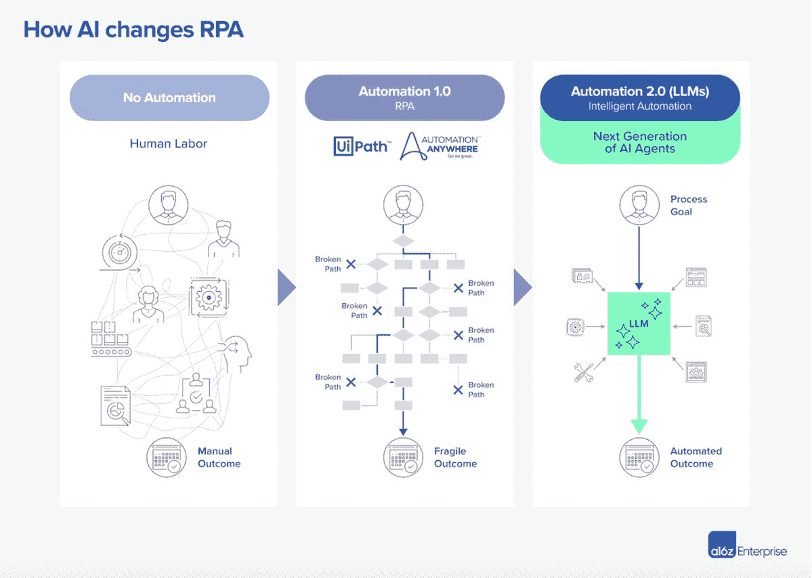

更多在原帖中～

### NousResearch推出Forge Reasoning API Beta：推理时间扩展的一项进步，可应用于任何模型或一组模型

贡献人：

https://x.com/NousResearch/status/1856417883934601246

今天我们推出了 Forge Reasoning API Beta，这是推理时间扩展的一项进步，可应用于任何模型或一组模型，现开放给我们社区中的一部分人。

https://nousresearch.com/introducing-the-forge-reasoning-api-beta-and-nous-chat-an-evolution-in-llm-inference/

Forge Reasoning 引擎能够显著提升 Hermes 70B 的性能，使其在某些类别上达到与 OpenAI 的 o1（完整版）相当的水平，但需要更多推理计算资源。

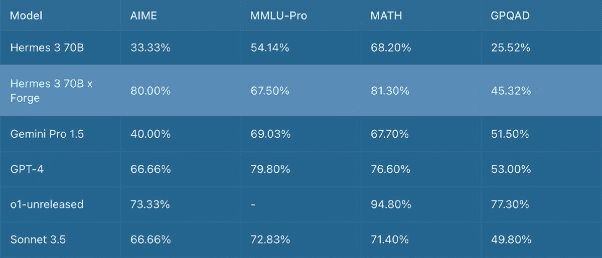

### Windsurf已支持Mac、Windows 和 Linux 下载：首款具有智能代理功能的集成开发环境

贡献人：

https://x.com/kevinhou22/status/1856760156899729611

Windsurf，首款具有智能代理功能的集成开发环境（IDE），现已支持 Mac、Windows 和 Linux 下载 🚀

在你进行输入、自动补全和代码库导航时，Windsurf 会预测你的意图，并利用这种隐式规划来驱动自动补全、多光标编辑（Supercomplete）、全仓库的代理编辑（Cascade）等多项强大功能。你甚至可以开始构建一个功能，然后告诉代理“继续我的工作”，它会自动完成你的 PR。

结合最前沿的 LLM、定制基础架构、升级的上下文引擎，以及革命性产品体验，Windsurf 为你提供市场上其他产品无法比拟的超级能力。

不相信？亲自试试吧。#windsurf

[I2l9GJ0A57KiH3xE.mp4](https://internal-api-drive-stream.feishu.cn/space/api/box/stream/download/all/BCzBbJWZnooygMxVe4lcMYndn1g)

### Meta AI发表NeuralFeels：将视觉与触觉传感结合在多指机器人手上，用于在手中操作时估计未知物体的姿态和形状

贡献人：

https://x.com/AIatMeta/status/1856798670592905398

这篇论文提出了一种名为 NeuralFeels 的方法，将视觉与触觉传感结合在多指机器人手上，用于在手中操作时估计未知物体的姿态和形状。

实验结果显示，NeuralFeels 在模拟和现实测试中达到了平均重建 F-score 81% 和平均姿态漂移 4.7 毫米。与仅依赖视觉的基准相比，NeuralFeels 在模拟中重建效果提升了 15.3%，姿态跟踪提升了 21.3%；在现实测试中重建效果提升了 14.6%，姿态跟踪提升了 26.6%。在严重遮挡的情况下，作者观察到触觉传感使姿态跟踪性能提高了多达 94%。

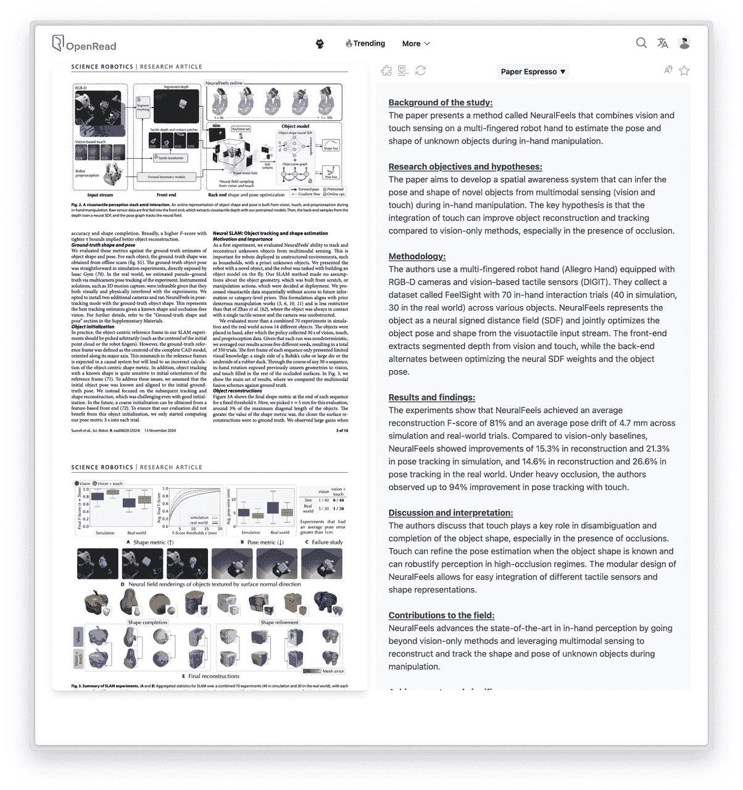

# 信号

### Problem-Oriented Segmentation and Retrieval: Case Study on Tutoring Conversations

贡献人：

原文链接：https://arxiv.org/abs/2411.07598

学术分析报告：https://rflow.ai/flow/d15ca192-2ffd-45ce-9ad6-79681b48c03b（PC端食用更佳）

许多开放式对话（例如，辅导课程或商务会议）都围绕预定义的参考资料展开，例如工作表或会议要点。为了提供一个研究此类对话结构的框架，我们引入了面向问题的分段和检索（POSR），即将联合将对话分解为多个部分并将每个部分链接到相关的参考项目。作为一个案例研究，我们将 POSR 应用于教育，其中围绕问题有效地构建课程至关重要但很困难。我们推出了 LessonLink，这是第一个真实世界辅导课程的数据集，具有 3,500 个片段，跨越 24,300 分钟的教学时间，并与 116 道 SAT 数学题相关联。我们定义并评估了 POSR 的几种联合和独立方法，包括分割（例如 TextTiling）、检索（例如 ColBERT）和大型语言模型（LLMs）方法。我们的结果强调，将 POSR 建模为一项联合任务至关重要： POSR 方法在联合指标上比独立分割和检索管道高出 +76%，在细分指标上比传统细分方法高出 +78%。我们展示了 POSR 对下游教育应用的实际影响，对现实世界课程结构中的语言和时间使用得出新的见解。

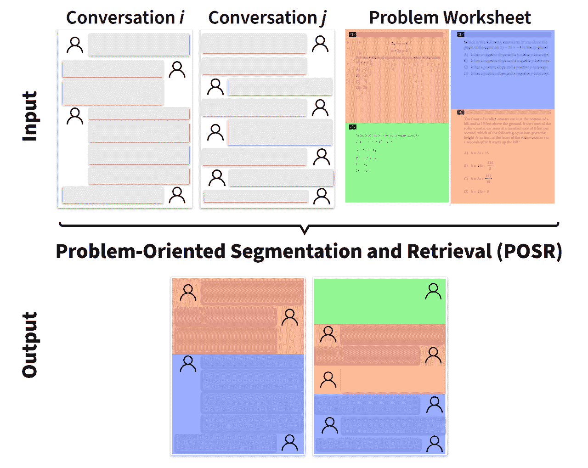

### Long Term Memory: The Foundation of AI Self-Evolution

贡献人：

https://arxiv.org/abs/2410.15665

像 GPT 这样的大型语言模型 （LLMs） 在庞大的数据集上进行了训练，在语言理解、推理和规划方面表现出了令人印象深刻的能力，在各种任务中实现了人类水平的表现。大多数研究都侧重于通过在越来越大的数据集上进行训练来构建更强大的基础模型来增强这些模型。虽然训练更强大的模型很重要，但使模型能够在推理过程中进化也同样重要，我们称之为 AI 自我进化。与大规模训练不同，自我进化可能依赖于有限的数据或交互。受人类大脑皮层柱状组织的启发，我们假设 AI 模型可以通过与环境的迭代交互来发展认知能力并构建内部表征。为此，模型需要长期记忆 （LTM） 来存储和管理已处理的交互数据。LTM 通过表示跨环境和代理的不同体验来支持自我进化。在本报告中，我们探讨了 AI 自我进化及其在推理过程中增强模型的潜力。我们研究了 LTM 在终身学习中的作用，允许模型根据积累的交互进行发展。我们概述了 LTM 的结构以及有效数据保留和表示所需的系统。我们还对使用 LTM 数据构建个性化模型的方法进行了分类，并展示了这些模型如何通过交互实现自我进化。使用 LTM，我们的多智能体框架 OMNE 在 GAIA 基准测试中获得了第一名，展示了 LTM 在 AI 自我进化方面的潜力。最后，我们提出了未来研究的路线图，强调了 LTM 对于推进 AI 技术及其实际应用的重要性。

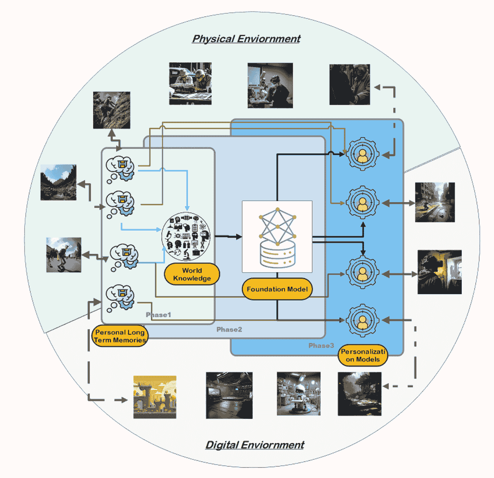

# 产品

### fieldmobi-ai

贡献人：

https://www.fieldmobi.com/fieldmobi-ai

**Fieldmobi.ai** 是一款基于人工智能的移动优先 ERP 解决方案，可以帮助企业快速、经济地实施定制化的 ERP 系统。它提供多种功能模块，支持无代码自定义，并且用户可以在几分钟内完成部署。

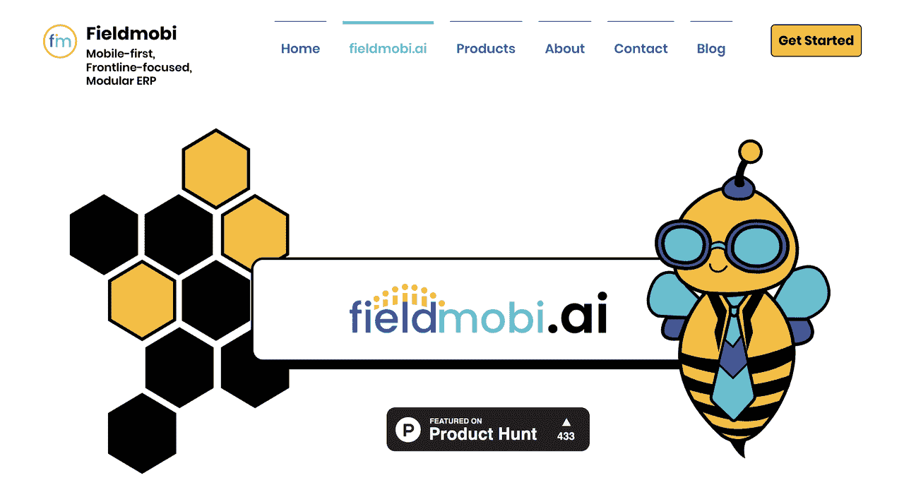

### PearAI

贡献人：

https://trypear.ai/

**PearAI** 是一款基于人工智能的数据处理工具，可以通过智能数据分析、自然语言处理和个性化推荐，帮助用户高效地处理信息和自动化工作流程。其目标是简化用户的工作，提高决策质量和效率。

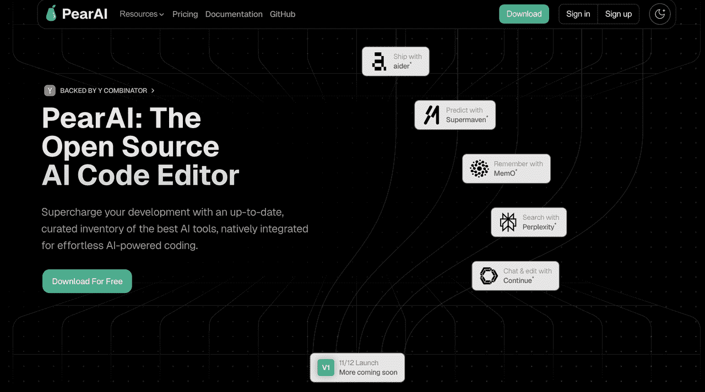

# HuggingFace&Github

### TinyTroupe

贡献人：

https://github.com/microsoft/TinyTroupe

TinyTroupe 是一个基于 Python 的实验性库，允许模拟具有特定性格、兴趣和目标的人工智能代理（TinyPersons），利用大型语言模型（如 GPT-4）生成逼真的模拟行为。这个项目希望可以增强人类的想象力，并为业务洞察力提供支持，包括广告评估、软件测试、数据生成和产品管理等应用场景。

# 投融资

### Odyssey初创公司：将相机绑在背后，推动生成式AI创新

https://techcrunch.com/2024/11/13/this-generative-ai-startup-is-strapping-cameras-to-peoples-backs/

Odyssey是一家初创公司，致力于开发先进的生成式AI技术，目标是为创作者提供更加精确、丰富的虚拟世界构建工具。该公司由自动驾驶领域的先驱奥利弗·卡梅隆（Oliver Cameron）和杰夫·霍克（Jeff Hawke）创立，卡梅隆曾是Cruise的产品副总裁。

Odyssey的创新之处在于其独特的数据收集方法：公司开发了一种重约25磅的“高级相机捕捉系统”，该系统由六个相机、两个激光雷达传感器（LiDAR）和一个惯性测量单元组成。用户将这套系统背负在身上，能够捕捉360度的周围环境，提供3.5K分辨率的高清图像，并附带精确的深度信息。

该数据系统的核心目的是捕捉现实世界中的细节，为生成虚拟世界提供数据支持。Odyssey通过将这些数据输入到算法中，生成类似Meta Hyperscape项目的数字重建场景——这些场景包括森林、洞穴、冰川、城市等自然和人工环境。

尽管目前尚不清楚这些虚拟场景如何直接推动创作者工具的进步，Odyssey已开发了多个生成式AI模型，这些模型能够创建图形的几何形状、光照和运动等视觉细节，并将这些信息整合成一个完整的虚拟“世界”，帮助创作者实现他们的场景构建需求。

为了推进这一技术，Odyssey近日宣布完成了由EQT Ventures领投的1800万美元A轮融资，GV和Air Street Capital也参与了此次投资。这笔资金将用于扩大Odyssey在加利福尼亚的采集操作，并计划在未来将数据采集扩展到其他州和国家。此举的目的是为生成式AI模型提供更丰富的现实世界3D数据，进而推动影视、游戏等领域的创作变革。

公司官网：https://odyssey.systems/

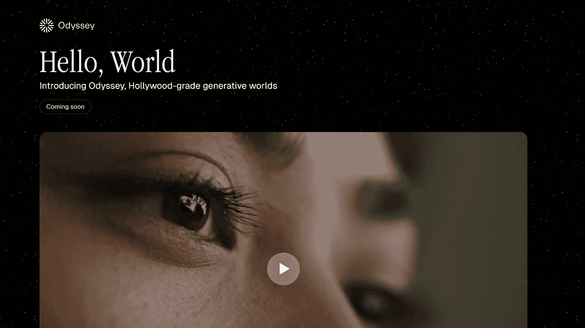

# 学习

### Scikit-LLM

https://medium.com/@tubelwj/scikit-llm-a-new-companion-for-machine-learning-75fb82fc6807

Scikit-LLM是一个开源的Python库，专为将大型语言模型（LLM）集成到scikit-learn工作流中而设计。它通过提供统一的接口，帮助用户轻松将LLM应用于多种机器学习任务，包括文本分类、文本生成和文本嵌入等。

Scikit-LLM的工作原理

Scikit-LLM通过封装LLM的API和功能，提供与scikit-learn兼容的接口，使得用户能够像使用其他scikit-learn模型一样使用LLM。它支持包括GPT-3、BERT和RoBERTa在内的多种大型语言模型，适用于各种自然语言处理（NLP）任务。

常见应用场景包括：

+   **文本分类**：利用LLM进行特征提取，再使用scikit-learn的分类器进行文本分类。

+   **文本生成**：使用LLM生成文本，如自动摘要或对话生成。

+   **文本嵌入**：将文本转化为嵌入向量，用于下游任务，如文本聚类和分类。

核心功能

1.  **零-shot分类**：通过ZeroShotGPTClassifier，Scikit-LLM允许用户直接提供候选标签（如“正面”、“负面”），模型会根据输入文本自动选择最合适的标签，而不需要预先训练数据集。

1.  **多标签分类**：MultiLabelZeroShotGPTClassifier支持为每个文本分配多个标签，适用于复杂的多维数据。

1.  **文本向量化**：GPTVectorizer类可以将文本转化为固定维度的向量，适合用于聚类或分类任务。

安装与使用

安装Scikit-LLM非常简单，只需通过pip执行以下命令：

bash

复制代码

pip install scikit-llm

此外，Scikit-LLM依赖于transformers、torch和scikit-learn等库，用户可以一并安装。

示例应用：文本分类

用户可以通过Scikit-LLM轻松实现文本分类。首先，使用LLM提取特征，然后利用scikit-learn的分类器进行训练和预测。此过程可以帮助用户快速建立基于大规模语言模型的机器学习模型。

高级用法

Scikit-LLM支持多种LLM和任务，用户可以根据具体需求自由选择和组合：

+   **使用不同的LLM**：例如，可以选择GPT-3或BERT进行分类任务。

+   **文本生成任务**：使用LLM生成文本或摘要。

+   **文本嵌入任务**：将文本转化为嵌入向量，供下游任务使用。

Scikit-LLM的优势

1.  **统一接口**：提供简洁一致的接口，简化了LLM与机器学习流程的集成。

1.  **多种LLM支持**：支持多个主流的大型语言模型，适应不同的任务需求。

1.  **灵活性**：允许用户根据具体应用场景选择和组合不同的LLM与任务。

### 大模型异构训练的机遇与挑战

贡献人：

https://zhuanlan.zhihu.com/p/6135379261

随着深度学习模型规模的不断扩展以及新一代GPU的发布，异构集群的分布式训练需求日益增长。通过有效利用性能差异较大的低端GPU，并降低高端GPU的采购成本，异构训练成为提高训练效率的关键。然而，异构集群的训练面临多个技术挑战，尤其是在如何自动优化训练策略方面。

1.  **背景与挑战**

在传统的大规模集群训练中，用户通常会将模型提交到集群，设置并行策略及其他训练参数。然而，随着集群硬件的多样化，尤其是在我国自主研发集群中，显卡的型号、计算能力、存储和通信带宽存在显著差异。这种异构设备的存在，增加了训练策略配置的难度。具体挑战包括：

+   同构集群策略无法直接适用于异构集群；

+   不同设备的计算与存储能力差异，缺乏有效的负载均衡机制；

+   异构集群的搜索空间庞大，导致策略搜索时间长，效率低。

1.  **Metis系统设计**

为了解决异构集群训练中的上述挑战，Metis 提出了自动并行策略搜索的新框架。Metis 包含了以下几个模块：

+   **Profiling模块**：用于收集各GPU的性能数据，帮助策略优化；

+   **Planner模块**：负责生成并评估不同的训练并行方案；

+   **运行时模块**：执行已选择的训练策略。

在Metis的设计中，解决了以下几个问题：

+   **策略剪枝**：通过剪除不合理或重复的配置，减少profiling时间。例如，对于不均衡的配置或重复计算的方案，Metis能够智能跳过，优化搜索效率。

+   **负载均衡**：根据各设备的计算和存储能力，合理分配任务负载，确保各GPU的负载均衡，避免性能瓶颈。

+   **策略优化**：Metis优先采用数据并行（DP）策略，而在内存溢出（OOM）情况下，切换为张量并行（TP）。通过这种策略选择，Metis最大限度地提升了训练吞吐量。

1.  **Metis的核心优势**

Metis相较于传统方法，有显著的优势：

+   **高效的搜索空间剪枝**：Metis在搜索过程中能够高效地剪去不必要的配置，避免了无谓的性能评估，减少了搜索时间。

+   **更优的负载分配**：通过分析GPU的能力，Metis在训练过程中合理分配负载，最大化资源利用率。

+   Transformer Layer优化：针对大模型中重复的Transformer Layer，Metis通过分析单个Layer的性能，推测并扩展到整个模型，从而加速了profiling过程。

1.  **实验与结果**

Metis在多个大规模模型（如GPT-3、MoE、Wide-Resnet）上的实验表明，相比传统方法，Metis能够在不同型号的GPU组合上找到更优的并行策略，提升了1.05至8.43倍的训练速度。同时，Metis显著减少了profiling和搜索开销，相较于理想的并行规划，Metis能够接近最优结果。

1.  **结论与展望**

Metis系统是第一个针对异构集群自动并行策略搜索的解决方案，具有较高的实用价值和前瞻性。尽管当前方法相对简化，后续可能会有更多研究推动该领域的发展，特别是在提高搜索效率、扩展更多硬件支持和优化策略方面。

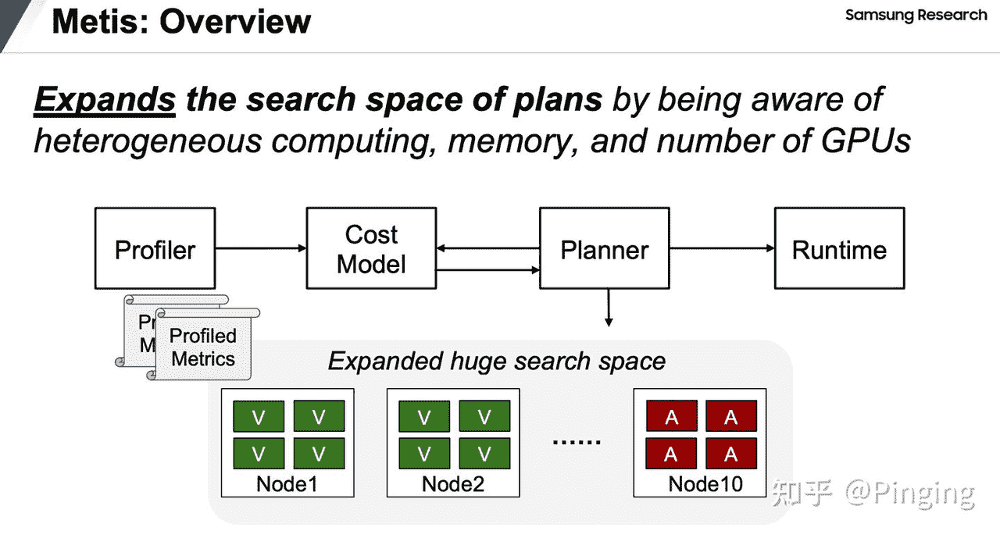

### 深入理解分支预测原理，揭开AMD Zen 5的高性能秘诀

https://zhuanlan.zhihu.com/p/6292959378

**背景与目标：**

Zen 5架构相较于Zen 4在性能上有显著提升，尤其在IPC（每时钟周期指令数）上提升了16%。这些性能提升的背后，分支预测器的优化起了重要作用，特别是引入了“2-ahead分支预测”。本文重点分析了Zen 5在分支预测方面的技术细节，帮助理解其性能提升的关键。

**分支预测的基本原理：**

分支预测主要分为两部分：分支方向预测和分支目的地址预测。本文关注的是分支方向预测。分支指令会导致CPU流水线的停顿，分支预测技术通过猜测程序的分支行为来避免这种停顿，从而提升处理器性能。分支预测分为静态预测和动态预测。

+   **静态预测**：通过预设规则预测，如“Always Taken”或“Backward Taken, Forward Not Taken”。

+   **动态预测**：根据分支历史做预测。基于前一次分支结果，或使用更复杂的历史表（如PHT）来预测。

**动态分支预测策略：**

动态分支预测使用历史信息来提高预测准确性。两种常见的优化策略包括：

+   **两位饱和计数器**：此方法减少了对分支方向变化的敏感性，通过用2位来存储预测状态，避免错误预测的影响。

+   **局部与全局历史**：局部历史方法通过记录某个分支的历史行为来提高预测精度，全局历史方法则考虑多个相关分支的历史，进一步提高预测的准确性。

**TAGE分支预测算法：**

TAGE（TAgged GEometric history length）是目前最先进的分支预测算法之一，它能够通过采用不同长度的分支历史来优化不同难度的分支预测问题。TAGE结合了基于全局和局部历史的预测，提供高准确率和较小的硬件开销，是现代高性能处理器的核心分支预测机制。它通过“tag”机制避免了分支冲突，并且在多个分支历史长度的匹配下，能够有效提升预测精度。

Zen 5的2-ahead分支预测：

Zen 5的分支预测最重要的创新是引入了“2-ahead分支预测器”。传统的分支预测器每周期只能预测一个分支跳转，而2-ahead预测能够预测连续两个分支跳转，不依赖于前一个分支的结果。此机制在理论上可以显著提高每周期的分支预测能力，尤其适用于具有多个分支的程序。

+   该技术源自1996年的研究，通过允许CPU在每周期处理两个跳转分支，显著提升了多分支程序的性能。

+   这一创新要求硬件支持每周期获取两个基本块，并且需要双端口存储结构支持。

为何2-ahead直到Zen 5才实现？

尽管2-ahead分支预测算法在90年代提出，但直到Zen 5才成为商业化产品。主要原因包括：

+   **硬件支持问题**：早期处理器的设计并不支持每周期获取多个基本块，而Zen 5架构提供了所需的硬件支持。

+   **设计优先级变化**：早期多核CPU的发展使得更多的关注集中在多核性能上，直到最近单核性能重新成为设计重点，像2-ahead这样的传统优化才得以复兴。

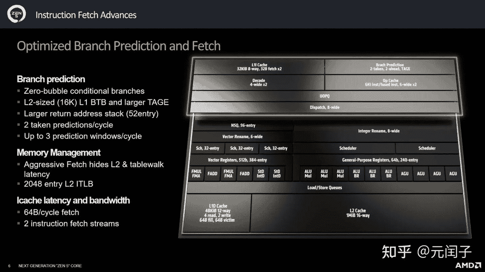

### 踩坑AMD之异步拷贝

https://zhuanlan.zhihu.com/p/6452256379

1.  异步拷贝概述
在Nvidia架构中，异步拷贝允许计算核心和存储管线独立工作，从而减少寄存器文件的开销，缓解计算压力。而AMD的异步拷贝则将这一过程拆分为两个独立部分：

+   异步加载数据（从Global Memory到寄存器，或寄存器到Shared Memory）

+   使用同步原语同步执行

在AMD中，Global Memory通常称为GDS（Global Data Share），Shared Memory称为LDS（Local Data Share）。

1.  等待指令
AMD汇编中使用 lgkmcnt 和 vmcnt 控制同步：

+   lgkmcnt 控制对Shared Memory和Global Memory数据加载的等待，允许指定最多等待几个内存加载操作完成。

+   vmcnt 专门控制显存加载操作的等待。

这与Nvidia的 cp.async.wait_group 指令相似，用于同步内存操作。

1.  Bypass寄存器文件
AMD的异步拷贝早已存在，但MI300架构首次引入了 "Bypass Register Files" 特性，允许数据直接从Global Memory拷贝到Shared Memory，避免经过寄存器文件。这减少了寄存器压力，特别适合寄存器占用高的应用，如Flash Attention。
然而，这个指令（buffer_load_dword）仅支持加载一个double word（4字节），而理想的带宽利用应为16字节，这限制了性能。使用该指令的Flash Attention Kernel正是典型应用。
此外，这一特性需要与其他指令（如 lgkmcnt、vmcnt 和 M0寄存器）配合使用，管理数据的内存访问和偏移。

1.  M0寄存器
M0寄存器是特殊寄存器，管理内存访问的地址偏移，用于优化共享内存访问。它的使用让每个线程可以访问共享内存中的不同位置，提供灵活的数据处理方式。

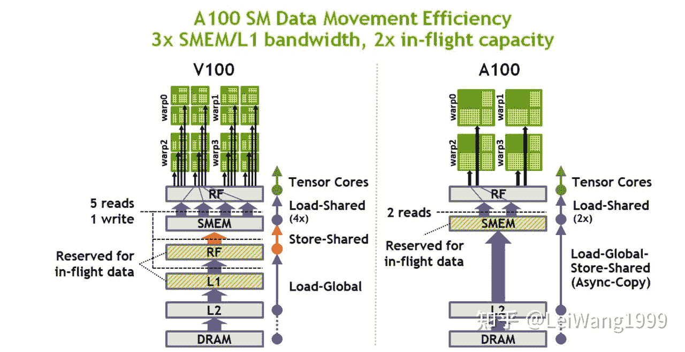

### （详解）DPO为什么会让大语言模型输出变长

https://zhuanlan.zhihu.com/p/5830338806

本文探讨了DPO（Direct Preference Optimization）算法中出现的“长度爆炸”现象，分析了其产生原因，并介绍了当前的一些解决方法。

DPO算法常用于大模型的偏好对齐阶段，尤其在人类偏好训练中。然而，DPO训练后，模型的输出长度往往比传统的SFT（Supervised Fine-Tuning）模型要长，且随着多轮DPO的进行，输出长度会逐渐增加。这一现象可能导致输出冗长，推理成本增加，从而影响用户体验。因此，长度控制在DPO训练中变得至关重要。

相关工作方面，首先是R-DPO，该方法提出在loss中加入长度正则化项，从而避免模型对长度的过度拟合。实验表明，R-DPO能够有效控制输出长度的增长，但在某些情况下可能会导致性能损失。其次，SimPO通过长度归一化来简化训练过程，虽然它在偏好训练上表现良好，但并未显著解决长度控制问题。第三，SamPO提出通过token级别下采样来减少长度差异，从而避免长度差异带来的reward偏差。该方法在实验中能有效控制长度，但训练稳定性较差，且可能导致信息丢失。最后，LD-DPO通过解耦长度的影响来控制输出长度，实验证明该方法能有效控制长度增长并提升性能。

DPO导致输出变长的根本原因有几个方面。首先，Reward Model（RM）和评测模型（如GPT-4）普遍存在长度偏好，倾向于给更长的答案更高的评分，这在训练数据中反映为chosen的长度通常比rejected长。其次，训练数据本身的长度分布不均衡，训练过程中RM的长度偏好进一步加剧了这一问题。最后，DPO算法的梯度优化对长度差异敏感，较长的答案在训练过程中往往会被优先选择，从而导致模型偏向输出较长的答案。

针对这些问题，解决方法可以从多个层面进行。首先是优化RM，通过减少RM对输出长度的偏好来平衡训练数据中的长度分布，从而减轻长度问题。其次是数据优化，通过长度归一化或限制长度差异等方式调整数据，减少长度差异对训练的影响。最后是算法优化，例如LD-DPO通过对长度进行解耦、降权等方式有效控制输出长度，同时不损害模型性能。

在个人实验方面，R-DPO通过正则项控制长度，效果较好，但会有一定性能损失；SimPO简化训练过程，但并未实现显著的长度控制；SamPO通过下采样控制长度，但性能不稳定；LD-DPO通过解耦和降权处理，效果最好，不仅控制了长度，还提升了性能。

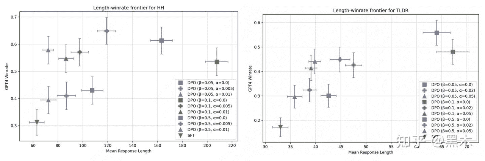

### 王鹤：合成数据对推动具身智能至关重要

https://zhuanlan.zhihu.com/p/6650450076

王鹤教授在蚂蚁科技奖沙龙上分享了他对具身智能的深入见解，重点强调了通用机器人发展的关键技术及商业化路径。他提出，通用机器人与人形机器人不同，其目标是实现多任务的柔性生产和智能化操作，能够在制造业等行业提供更高效、更灵活的解决方案。王鹤认为，合成数据对训练具身智能至关重要，他的团队通过大规模合成数据进行训练，提升了机器人在复杂场景下的泛化能力，特别是在抓取、分拣和操作等任务中表现突出。

王鹤还展示了银河通用的机器人在多个应用场景中的表现，包括汽车制造中的柔性生产线和零售业的自动补货系统。通过高精度的视觉与3D建图技术，机器人能够在没有预设编码的情况下，通过自然语言理解和任务执行，实现场景中与人类的无缝协作。通过强化学习和大规模仿真数据的积累，机器人不仅能适应不同物体，还能在复杂、动态的环境中自如操作。

总结来说，具身智能的实现依赖于三大核心能力：空间智能、交互智能和硬件智能。王鹤团队在这一领域的研究突破，使得机器人能够在未知环境中理解空间关系并执行任务，推动了机器人从工业应用到商业和家庭场景的广泛应用。

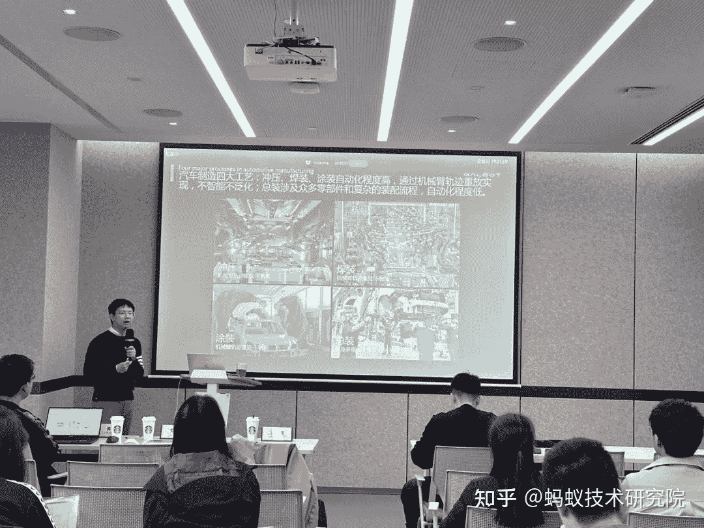

### 白话大语言模型运行的计算实现细节

https://zhuanlan.zhihu.com/p/5409241313

1.  **模型架构**
大多数当前的大语言模型都基于Transformer的Decoder结构。本文以GPT-2为例，介绍其结构。GPT-2模型的计算过程包括三个主要部分：

+   **输入和位置编码**：输入是通过嵌入层（embedding layer）获得的词向量，再加上位置编码向量，生成加和后的输入表示。

+   **中间计算**：该部分包含多层的注意力机制和Feed Forward网络，重复执行多次。每一层包括层归一化（Layer Normalization）、多头注意力机制（Masked Multi-Head Attention）和前馈网络（Feed Forward Network）等步骤。

+   **输出计算**：最后经过一系列计算后，模型生成输出，即预测的下一个token的ID。

1.  **计算过程**
GPT-2的计算过程可以分为几个步骤，逐步实现从输入到输出的转化：

+   **嵌入（Embedding）**：每个token都对应一个向量，模型通过查表获得词向量。然后，将词向量与位置向量按元素相加，得到最终的输入表示。

+   层归一化（Layer Normalization）：标准化处理输入，减小训练过程中的波动，帮助模型更好地收敛。

+   **多头注意力机制（Masked M**ulti-Head Attention）：这是GPT-2的核心，利用多个注意力头（12个头）来关注不同的输入特征。通过Query、Key、Value矩阵进行计算，注意力权重通过Softmax进行归一化，进而加权求和生成输出。

+   **升维操作**：输入矩阵经过线性变换后，升维到更高的维度（如从768维到2304维），然后再通过另一个线性层降维回原来的维度。

+   **Feed Forward网络**：该网络是一个简单的两层全连接神经网络，负责对经过注意力机制处理后的信息进行进一步的处理。包含激活函数（如GELU）和线性变换。

1.  **计算示例**
以GPT-2 Cerebras GPT 111M模型为例，描述了一个计算过程：

+   输入句子“The meaning of life”被切分成四个token，分别是"The"、"meaning"、"of"和"life"，每个token对应一个768维的词向量。

+   然后，词向量与位置向量相加，得到输入矩阵。接着，经过层归一化处理。

+   随后，经过升维操作，将矩阵从768维升到2304维。接下来，通过多头注意力机制计算注意力权重，并生成相应的加权和。

+   该过程重复进行，经过多层计算后，生成最终的预测结果，即下一个token的ID，最终通过查表转换回token并生成文字。

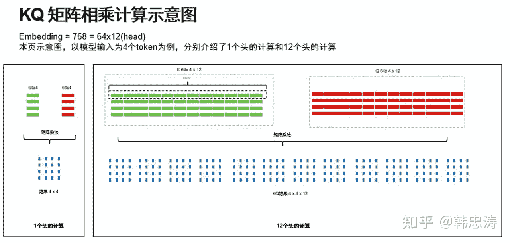

# 招聘公告

---

**奇绩创坛****由陆奇博士**于2019年创立，使命是在源头最大化驱动创新。奇绩研究组将研究模型理论、到投研战略分析、市场策划等不同背景的同学聚在一起，搭建GenAI时代独特的跨界人才社群。

## 🚀F**24实习岗位**

##### [行研-学术科研人才交流组实习生](https://miracleplus.feishu.cn/docx/Yn6rdf2iOoY2Rcx8yVNcUBYRnch#part-QkMcdeJmuob9uvxvV3qcLSzHn8g)

##### 行研-GenAI研究岗位-战略分析（偏产品）

##### Web / AI 全栈开发工程师实习生

## **火热开放中🚀**

##### 行研-GenAI研究岗位-前沿学术探索

##### 行研-GenAI研究岗位-战略分析（偏咨询）

##### 创新活动产品运营 （大模型系列活动产品运营）

> **点击**相关岗位可查看对应**岗位需求【JD】；**相关岗位投递请**扫描二维码**

> 欢迎**推荐/自荐**

> 期待在**奇绩创坛**遇见更好的你

---

# 声明

本文档仅供学习交流使用，版权归原作者所有，若涉侵权，请联系Jack Jin 15101136166

（欢迎在下方反馈您宝贵的意见！整理不易，觉得有用给AI日报小组点个赞👍吧！）

ChatGPT；Angela；Zijia Liu；Alex；Zeqi Tan；Tiezhen（HuggingFace）；Naixu；Lizhi；Peter；Suoman；Jack

学术分析报告：ResearchFlow -- 奇绩F23校友的开发的深度研究产品，PC端进入RFlow的分析报告，可直接点击节点右侧的小数字展开节点，登录后可在节点上直接“询问AI”，进一步探索深度信息

如果你有大模型相关的创业想法，欢迎来找我们聊聊～🛰️：15101136166

> 快邀请你的小伙伴们一起来读大模型日报吧！

> **【日报****知识库****】**这里是近期日报内容的汇总,欢迎大家查阅

> [大模型日报知识库(分享版)](https://miracleplus.feishu.cn/wiki/KapVwXfkriOBiskB0B2cUHxjnTh)

>

> 欢迎大家多多帮我们分享,转发~~

> 如果大家有任何的建议或者吐槽,欢迎随时找我聊天~

