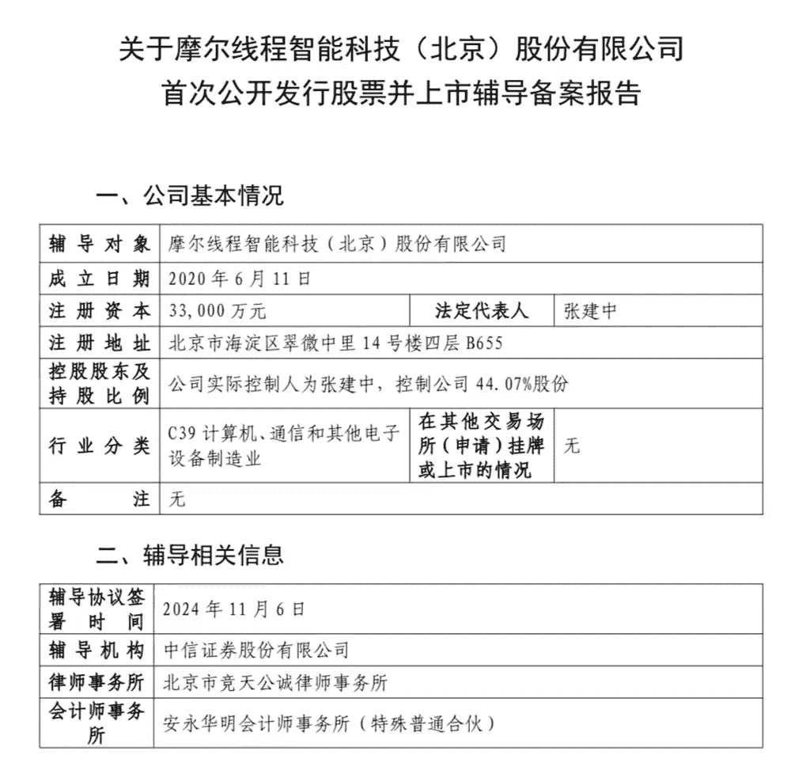
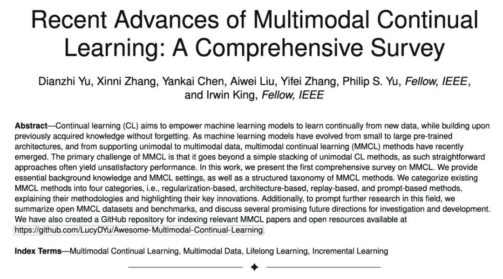
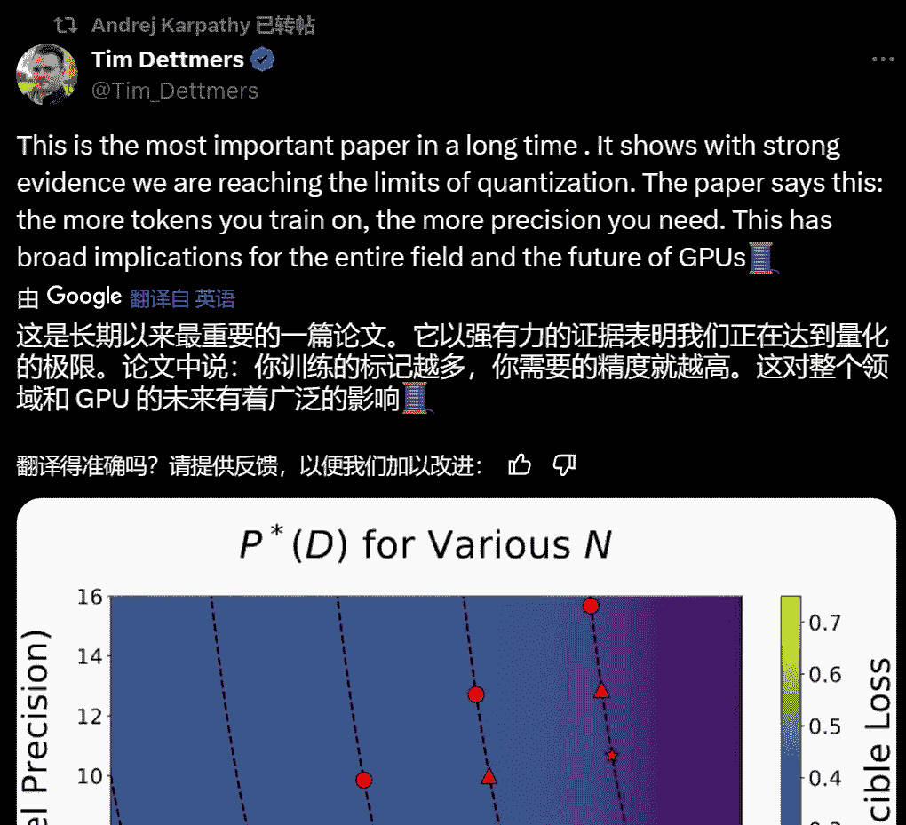
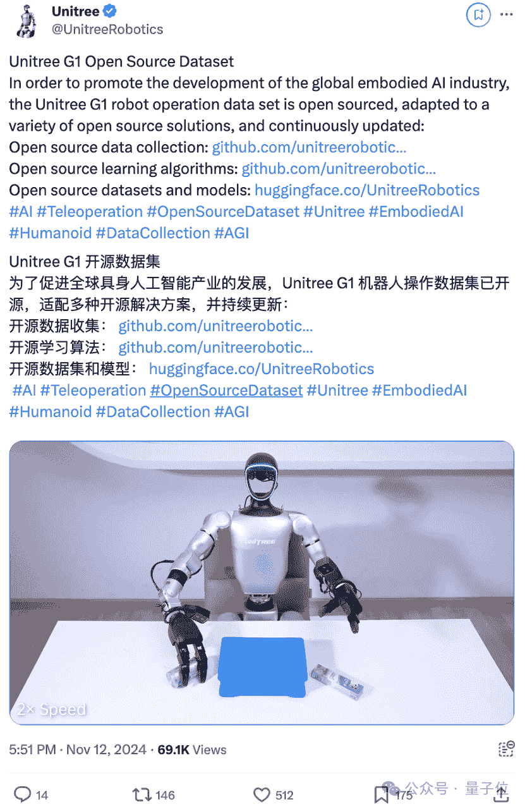
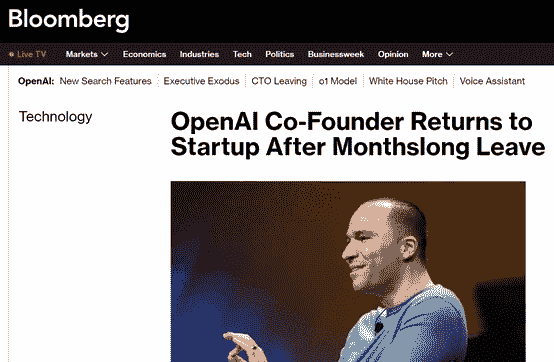
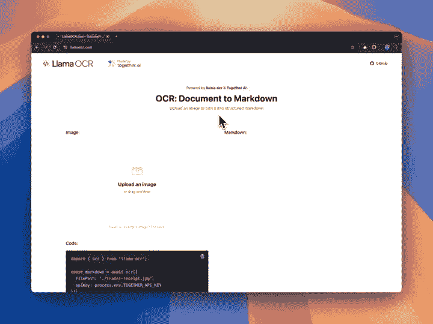
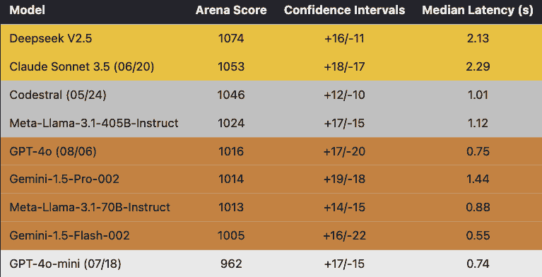
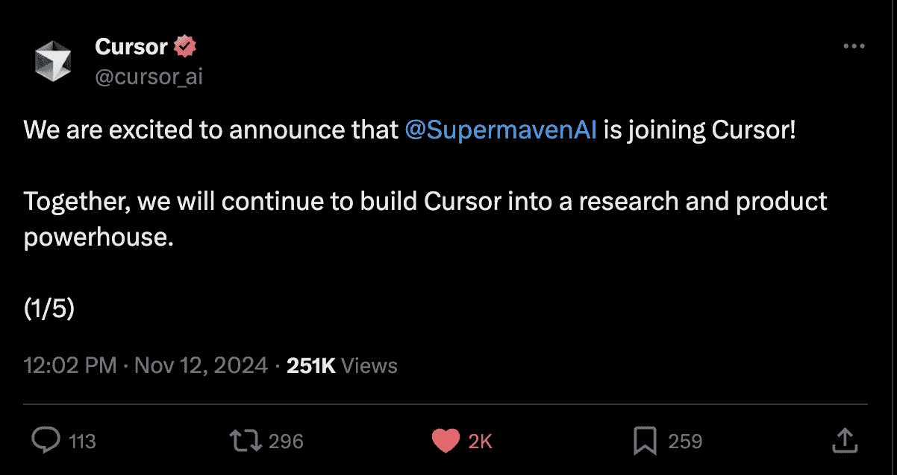

# 奇绩大模型日报（11月 13日）

> 来源：[https://miracleplus.feishu.cn/docx/ObJPd1G0toeWLqxdTjEc7dOknMh](https://miracleplus.feishu.cn/docx/ObJPd1G0toeWLqxdTjEc7dOknMh)

# 资讯

### 国产GPU独角兽摩尔线程启动IPO

https://mp.weixin.qq.com/s/AD5rvxtpHhwirJxQ6AEQcA

11月13日，中国证监会官网公布，国内全功能GPU独角兽企业摩尔线程智能科技（北京）股份有限公司（简称“摩尔线程”）已在北京证监局办理辅导备案登记，正式启动A股上市进程。辅导机构为中信证券。摩尔线程成立于2020年6月，注册资本33000万元，实际控制人为张建中，持股44.07%。

摩尔线程专注于全功能GPU，致力于为全球提供加速计算基础设施及一站式解决方案，推动各行各业的数智化转型。该公司目标是成为国际竞争力的GPU领军企业，打造先进的加速计算平台，特别是融合AI与数字孪生的数智世界。摩尔线程是国内少数同时布局B端和C端的国产GPU企业，采用自研MUSA架构，集成了AI计算加速、图形渲染、视频编解码、物理仿真和科学计算四大引擎。其产品包括10款硬件、大模型预训练平台和AI大模型训推一体机等。

在AI大模型训练方面，摩尔线程推出了全国产的千卡智算集群，并提供自有的万卡集群方案，跻身国内AI芯片第一梯队。2022年，摩尔线程发布了国产游戏显卡MTT S80，被誉为“国产游戏第一卡”，是国内唯一支持DirectX 12的消费级显卡。其客户包括头部运营商、大型国有银行和大模型创业公司等。

在IPO之前，摩尔线程已完成多轮融资，融资额累计数十亿元，投资方包括中国移动、深创投、红杉资本等知名机构。根据胡润研究院的《2024全球独角兽榜》，摩尔线程估值255亿元，排名第261位。此外，截至2024年10月，摩尔线程已获得425项授权专利，在国内GPU企业中专利数量位居前列。

### 多模态连续学习综述

https://mp.weixin.qq.com/s/2ONfTfOtAJXtjMsg2f2baQ

本文综述了多模态连续学习（MMCL）的最新进展，讨论了该领域的关键挑战、方法以及未来的研究方向。连续学习（CL）的目标是使机器学习模型能够在不重新训练所有旧数据的情况下，从新数据中不断学习。然而，CL面临灾难性遗忘问题，即新任务的训练会干扰旧任务的性能。尽管已有显著进展，传统的CL方法主要关注单一数据模态，如视觉、语言等，而现实世界则是多模态的，这导致了多模态连续学习（MMCL）的兴起。

MMCL系统需要有效整合和处理来自不同模态（如视觉、语言、音频等）的数据，同时还要应对灾难性遗忘。与传统CL相比，MMCL面临四个主要挑战：

1.  **模态失衡**：不同模态的数据可用性和处理能力可能存在显著差异，导致训练过程中出现模态不平衡。这可能影响学习速度和效率。

1.  **复杂模态交互**：模态间的交互，例如模态对齐和模态融合，带来新的挑战。在连续学习过程中，模态的特征可能会出现空间紊乱，从而导致性能下降。

1.  **高计算成本**：引入多种模态增加了计算开销，尤其是当使用预训练的多模态模型时，可能需要更多计算资源来微调这些模型。

1.  **预训练零样本能力退化**：尽管多模态预训练模型在零样本学习中表现出色，但在连续学习过程中，其零样本能力可能会减弱，导致未来任务的性能下降。

针对这些挑战，作者总结了四类主要的MMCL方法：

1.  **基于正则化的方法**：通过对模型参数施加约束，减少灾难性遗忘。这类方法的缺点是容易受到任务间干扰。

1.  **基于架构的方法**：为不同任务引入专门的模型组件，减少任务间的干扰，从而提高任务学习效果。

1.  **基于重放的方法**：利用情节记忆缓冲区保存历史任务的实例，避免灾难性遗忘。

1.  **基于提示的方法**：利用少量调整的提示参数对预训练模型进行微调，减少计算开销，同时保持原有知识的稳定性。

MMCL方法主要集中在视觉和语言模态，但也有针对其他模态如图像、音频的研究。未来的研究方向包括：

+   **提高模态的数量与质量**：除了视觉和语言模态，研究者可以探索更多模态的整合，如生物传感器和基因组学数据。

+   **更好的模态交互策略**：深入研究模态间的相互影响，以优化模态融合和对齐过程。

+   **参数高效微调**：利用参数高效微调（PEFT）方法来降低MMCL的训练成本，并探索新的PEFT方法。

+   **更好的预训练知识维护**：防止在连续学习过程中遗忘预训练模型的知识，以保证任务性能。

+   **可信赖的MMCL**：随着隐私保护和法规的日益严格，研究者可以探索如何将联邦学习（FL）方法与MMCL结合，增强模型的可信赖性。

### Scaling Laws终结，量化无用，AI大佬都在审视这篇论文

近日，AI 社区热议一篇名为《Scaling Laws for Precision》的论文，该研究指出大模型量化面临的挑战，并提出了一些前所未有的见解。哈佛大学的 Tanishq Kumar 和他的团队，深入探讨了低精度训练和推理对大语言模型（如 Llama）性能的影响，提出了一种全新的“精度感知扩展定律”。

1.  **训练后量化的难度**： 研究表明，当大模型在大量数据上过度训练后，进行训练后量化变得非常困难。尤其是在预训练期间使用不同精度来处理权重、激活或注意力的效果是可预测的，且偏向于高精度（如 BF16）或未来精度（如 FP4）。这种量化对模型性能的影响是可量化和可预测的。

1.  **低精度训练的挑战**： 低精度训练（如 FP4）虽然可以减少计算资源，但会导致模型的有效参数数量下降，从而影响训练效果。论文提出了一种新的扩展定律，预测在不同精度下训练和推理的性能下降，具体来说，训练一个较大模型时，以低精度进行训练可能是计算上最优的选择。

1.  **数据与精度的关系**： 该研究还揭示了一个关键发现：训练时间和预训练期间的数据量与量化损失退化呈幂律关系。也就是说，更多的预训练数据会导致模型对量化的敏感度增加，进而导致性能损失。尤其是模型训练期间看到的数据与参数比值的增加，可能对模型性能带来负面影响。

研究团队预训练了465个语言模型，精度范围从3位到16位不等，并对每个模型进行了训练后量化。他们提出了一种统一的“精度感知”扩展定律，可以预测不同精度下的训练损失和推理损失。

此外，研究还探讨了量化感知训练（仅针对权重量化）与低精度训练对模型性能的影响。通过将模型分解为权重、激活和 KV 缓存等部分，研究发现，虽然权重可以低精度训练而不影响太大，但激活和 KV 缓存对精度的敏感性较高，降低其精度可能会带来更大损失。

该研究的扩展定律为低精度训练和量化提供了新的视角，尤其是在大模型的训练和推理过程中。作者认为，低精度预训练虽然在某些情况下能优化计算，但其对训练后量化的提升效果低于预期。未来的研究可以进一步探索如何平衡低精度训练与大规模数据的需求，尤其是如何在不牺牲性能的前提下提升计算效率。

该论文为大模型量化技术提供了理论支持，揭示了当前精度扩展面临的瓶颈，指出未来可能的技术路线：如通过扩大数据中心规模、动态路由到更小模型或通过知识提炼来优化计算资源的使用。

### 宇树也来玩开源了：机器人操作数据集，采用抱抱脸LeRobot训练测试

https://mp.weixin.qq.com/s/fZnVBgLvYSG7DV1SyZxdRg

宇树科技最近开源了Unitree G1机器人操作数据集，并表示将持续更新该数据集，内容包括数据采集、学习算法、数据集和模型等。此次开源的亮点在于，它基于抱抱脸（LeRobot）开源框架进行训练和测试，这一框架得到了抱抱脸联合创始人兼CEO的支持，并通过社交媒体分享，强调了LeRobot、huggingface等开源技术在机器人领域的崛起。

宇树开源的数据集包括五个具体操作任务，分别为：拧瓶盖倒水、叠三色积木、将摄像头放入包装盒、收集物品并存储、双臂抓取红色木块并放入黑色容器中。这些任务均由配备三指灵巧手的Unitree G1人形机器人进行采集。每张图像的分辨率为640x480，图像数据中包含了每个手臂及灵巧手的7维动作状态。

数据采集方面，宇树使用苹果Vision Pro对G1进行遥操作控制，并开源了遥操作控制的代码教程、硬件配置图、物料清单和安装说明等，帮助开发者复现和使用这些数据。训练方法基于LeRobot框架，数据被转换为适合该框架的格式，支持深度强化学习等训练方法。

虽然数据集已开源，但模型本身尚未公开。数据集由G1机器人收集，涵盖多个任务和操作数据集，记录了机器人的各种动作和手部控制。Unitree G1是一款高性能人形机器人，售价9.9万元起，已经实现量产。G1配备三指力控灵巧手，能够进行精细操作，如拧瓶盖、砸核桃等，此外还配备了Intel RealSense D435视觉传感器和LIVOX-MID360 3D激光雷达，支持360°的环境感知。G1还具备较强的运动能力，如单腿跳跃、原地360度转身等。

G1的训练和升级基于端到端深度强化学习和仿真训练，支持快速迭代和性能提升。此次开源数据集的发布标志着宇树在推动机器人研究和开源生态方面的重要一步，为学术界和开发者提供了宝贵的操作数据，预计将加速机器人的自主学习和技术进步。随着G1的量产和数据集的不断更新，宇树的机器人有望在更多领域得到应用，尤其是在实际工作场景中。

### Greg重返OpenAI，主抓重大技术创新

https://mp.weixin.qq.com/s/TA3fIo6hYEkCAqzBuAjL5Q

今天凌晨5点，OpenAI联合创始人兼总裁Greg Brockman宣布结束数月的长假，正式回归OpenAI工作。此时，OpenAI正面临高管离职潮，包括首席科学家Ilya Sutskever、首席技术官Mira Murati、安全团队负责人Lilian Weng等核心人物的相继离开。因此，Greg的回归被视为在公司最艰难时刻的关键复职，他的到来也被期待能稳住公司技术创新的核心竞争力。

Greg在给员工的内部备忘录中表示，他与CEO Sam Altman共同商议后，为自己设立了一个新职位，专注于推动重大技术创新和解决挑战。这意味着Greg的回归不仅是为了填补管理层的空缺，更是为了确保OpenAI在技术方面继续走在前沿。

Greg Brockman是OpenAI的创始团队成员之一，曾在Stripe担任CTO，帮助公司从4人小团队扩展至250人。他与Sam Altman、Ilya Sutskever、Mira Murati并称为OpenAI“四大天王”，共同推动了GPT系列模型的开发，包括GPT-1至GPT-4以及GPT-4o等重要技术突破。他的技术领导地位曾被《时代》周刊评选为全球100位AI领导者之一。

Greg的回归引发了网友的热烈讨论，许多人认为他能为OpenAI带来新的视角和技术突破，尤其是在AGI（通用人工智能）方面的进展，期待他为OpenAI的使命注入新的动力和创新。

# 推特

### llama-ocr：免费且开源的OCR工具，可以处理文档并以markdown格式输出

贡献人：

https://x.com/nutlope/status/1856402928086725020

宣布发布 llama-ocr – 一个免费且开源的OCR工具！

它可以处理文档（目前支持图片），并以markdown格式输出，尤其在复杂收据、带表格/图表的PDF等场景下表现出色…

由Llama 3.2 vision提供支持，现已在npm上推出！

[fNplSbQ_XXSwDdL6.mp4](https://internal-api-drive-stream.feishu.cn/space/api/box/stream/download/all/YxXFbOEQIoRJcTx8hEOc2fjInXd)

### Copilot Arena排行榜发布：哪个模型最适合编程？Imarena分享过去一个月的数据和发现

贡献人：

https://x.com/lmarena_ai/status/1856444009323082093

哪个模型最适合编程？

@CopilotArena 排行榜已发布！

我们的代码补全排行榜包含了过去一个月收集的数据，共完成了超过10万次代码补全，并获得了超过1万次投票！

以下是我们目前的主要发现🧵：

•  在我们的提示方法下，Sonnet-3.5能够与专为代码设计的模型（如Deepseek V2.5）在代码补全上竞争。

•  在同一层级内，随着更多投票的累积，我们仍观察到轻微波动。

•  我们发现GPT-4o-mini的表现远低于其他所有模型。

当前大多数Copilot Arena用户主要使用Python进行编码，其次是JavaScript/TypeScript、HTML/Markdown和C++。

平均上下文长度为1002个token，中位数为560个token，远超现有静态基准测试中的任务长度。例如，Human Eval的中位长度约为100个token。

用户倾向于接受排名靠前的推荐，但他们平均会花费7秒钟仔细选择，表明这种偏向并非出于本能。令人意外的是，位置偏差并不会对所有模型产生相同影响！更多分析将在未来的帖子中公布。

我们没有强迫聊天模型以与其训练不符的格式（例如FiM）输出代码，而是让模型自然生成代码片段，然后再将其后处理为FiM补全。这种方法简单却非常有效。

### Elevenlabs改进Projects工具：多角色对话，播放速度，重新生成部分内容等

贡献人：

https://x.com/elevenlabsio/status/1856425044530082210

我们正在改进Projects工具，这是我们的长篇音频叙述工具。

创作者、出版商和企业可以使用Projects将书籍转为有声书，将剧本转为旁白，或将任何文本转为高质量的多角色对话。

https://elevenlabs.io/projects?utm_source=twitter&utm_medium=organic_social&utm_campaign=projects-2-0

在一个段落中分配多个声音，创建多角色对话。

可以在多个段落中调整声音设置，或者仅对部分对话进行调整，以增加强调或创造独特的表达效果。

还可以调整播放速度，以2倍速进行质量检查。

现在还可以更高效地逐节精炼内容。

通过生成历史对比和恢复之前的版本。并在调整到理想状态后锁定每个部分，以便跟踪并保障你的进度。

最后，针对你的反馈——现在可以重新生成句子的部分内容，甚至单个词语，以便更好地微调输出。

### Tilde：在运用可解释性来解锁模型的深层推理和控制能力，推动人机交互的下一代发展

贡献人：

https://x.com/tilderesearch/status/1856404543808131334

我们很高兴推出Tilde。

我们正在运用可解释性来解锁模型的深层推理和控制能力，推动人机交互的下一代发展。

通过理解模型的内部机制，我们可以提升其可靠性和性能——突破传统微调等技术的限制。

了解Tilde的强大功能吧。

[ppBpmJa-Iw7tRmRR.mp4](https://internal-api-drive-stream.feishu.cn/space/api/box/stream/download/all/B1Xeb8p8OouCtWxK0EAcXVjOnsb)

### Supermaven AI加入Cursor：合并自定义Tab模型的智能与Supermaven的速度和代码库理解能力

贡献人：

https://x.com/cursor_ai/status/1856427424927625679

我们很高兴宣布 @SupermavenAI 加入 Cursor！我们将合并自定义Tab模型的智能与Supermaven的速度和代码库理解能力，共同将Cursor打造成集研究与产品于一体的强大平台。Supermaven带来了在长上下文理解方面的研究专长，即使大型实验室也难以企及。未来，编程中的新范式将需要创新的想法、一流的研究团队，以及对界面的全面控制。阅读更多内容：https://cursor.com/blog/supermaven

# 信号

### SPOT: SE(3) Pose Trajectory Diffusion for Object-Centric Manipulation

https://arxiv.org/abs/2411.00965

推荐人：

信号源：Xiaolong Wang

研究节点：模型体系-具身智能

**这篇文章**介绍了一个基**于对象的**模仿学**习框架，**称为SPOT。其主要思路是通过对象中心的表示来捕捉每个任务，具体来说是相对于目标的 SE(3) 对象姿态轨迹。该方法将 执行动作 与 感知输入 解耦，使其能够从多种类型的示范中学习，包括基于动作和无动作的人类手部示范，同时支持跨实体的泛化。

此外，对象姿态轨迹天然地从示范中捕捉规划约束，而无需手动制定规则。为了指导机**器人执行任务，SPOT ****使用对象轨迹**来调节扩散策略。实验结果表明，SPOT 在 RLBench 模拟任务 中相较于现有工作有显著改进。在真实环境中，仅使用八个由 iPhone 拍摄的示范，SPOT 完全符合任务约束地完成了所有任务。

### Edify 3D: Scalable High-Quality 3D Asset Generation

https://arxiv.org/abs/2411.07135

推荐人：

信号源：NVIDIA AI Developer

研究节点：模型体系-多模态

这篇文章介绍了**Edify 3D**，一种用于高质量 3D 资产生成的先进解决方案。其方法首先**通过扩散模型**生成目**标物体在多**个视角下的 RGB 图像 和 表面法线图。然后使**用这些多视**角观测来重建物体的形状、纹理和 PBR 材质。Edify 3D 能在 2 分钟内 生成具有精细几何结构、干净拓扑、高分辨率纹理和材质的高质量 3D 资产。

### SWE-bench Multimodal: Do AI Systems Generalize to Visual Software Domains?

https://www.swebench.com/multimodal

推荐人：

信号源：Ofir Press

研究节点：模型体系-评估体系；模型体系-多模态

这篇文章提出了 S**WE-bench **Multimodal (SWE-bench M)，用于评估自主软件工程系统在修复视觉、用户界面相关的 JavaScript 软件中的 bug 的能力。虽然现有的系统普遍在 SWE-bench（仅包含 Python 仓库，问题陈述以文本形式呈现，缺乏视觉元素）上进行评估，但这种单一覆盖范围促使我们研究这些系统在其他未被代表的软件工程领域（如前端、游戏开发、DevOps）中的表现。

**SWE-bench M** 包含 617 个任务实例，来自 17 个用于网页界面设计、图表、数据可视化、语法高亮和交互式地图的 JavaScript** 库。每个任务实例中至**少包含一个图像在问题陈述或单元测试中。分析发现，许多在原 SWE-bench 中表现良好的系统在 SWE-bench M 中表现不佳，揭示了它们在视觉问题解决和跨语言泛化方面的局限性

最后，研究表明，**SWE-agent** 的语言无关特性使其在 **SWE-bench M** 上的表现明显优于其他系统，成功解决了 12% 的任务实例，而次佳系统仅解决了 6%。

### From Medprompt to o1: Exploration of Run-Time Strategies for Medical Challenge Problems and Beyond

https://arxiv.org/abs/2411.03590v1

推荐人：

信号源: Carlos E. Perez

研究节点：应用体系-AI4Science

**这篇文章研究了运行**时引导策略（如Medprompt）在指导大**型语言模型（LLM**s）在复杂任务中实现顶尖表现的价值，特别是在医学领域。Medprompt 通过提示来引导通用 LLM 进行链式推理和集成，从而在医学等专业领域中达到最先进的性能。

OpenAI 的 **o1-preview** 模型代表了一种新的范式，旨在在生成最终响应之前进行运行时**推理。本文在多个医学****基准上系统地评估了 **o1-previ**ew 的表**现，结果表明，即便没有提示工程，o1-preview 也大大超越了 GPT-**4 **系列结合 Medprompt 的表现。此外，我们对经典提示工程（如 Medprompt）在新型推理模型中的有效性进行了系统研究，发现少样本提示反而降低了 o1 的性能，这表明上下文学习可能不再是推理原生模型的有效引导方式。虽然集成仍然是可行的方法，但它对资源的要求较高，需要进行成本与性能的权衡。

**在运行时策略的成本**和准确性**分析中，我们**识别出 Pareto 前沿，其**中 GPT-4o 提****供了更具性价比的选择****，而 o1-pre**vie**w 则在较高****成本下实现了最先进的**性能。尽管 o1-preview 提供了顶尖的表现，但在某些特定情况下，结合 Medprompt 的 GPT-4o 依然具有价值。此外，我们注意到 o1-preview 在许多现有的医学基准上已接近性能饱和，强调了开发新的、更具挑战性的基准测试的必要性。

最后，文章对 LLM 在推理时的计算策略进行了反思，探讨了未来研究的方向。

### FasterCache: Training-Free Video Diffusion Model Acceleration with High Quality

https://arxiv.org/abs/2410.19355

推荐人：

信号源: Chenyang Si

研究节点：模型体系-多模态

这篇文章介绍了 FasterCache，一种无需训练的新策略，旨在加速视频扩散模型的推理过程，同时保持高质量的生成效果。在对现有的缓存方法进行分析时，作者发现直接复用相邻步长的特征会因为细微变化的丢失而降低视频质量。基于此，文章进一步研究了无分类器引导（CFG）的加速潜力，揭示了同一时间步内条件特征与无条件特征之间存在显著冗余。

基于这些观察，FasterCache通过以下两大创新显著加速基于扩散的视频生成：(1) 提出了一种动态特征复用策略，既能保持特征的区别性，也能维护时间上的连续性；(2) 提出 CFG-Cache，优化条件和无条件输出的复用，以在不影响视频质量的前提下提升推理速度。

实验评估表明，FasterCache在最近的视**频扩散模型上显著提高了生**成速度，例如在 Vchitect-2.0 上实现了 1.67× 加速，同时保持视频质量与基准模型相当，并且在推理速度和视频质量方面始终优于现有方法。

# 产品

### EarlyAI

贡献人：

https://www.startearly.ai/

EarlyAI 是一款智能开发工具，通过自动生成高覆盖率的单元测试来提升代码质量，帮助开发者专注于创新应用。它提供自动测试生成、易于导航的界面、文档建议和 Pull Request 测试等功能，用户已生成超过 50,000 个测试，显著提升了代码覆盖率和开发效率。

### ToolJet

贡献人：

https://tooljet.com

ToolJet 是一个开源低代码开发平台，可以帮助用户通过可视化界面快速构建和部署应用程序。它支持多种数据源和 API 集成，允许用户通过拖放组件轻松设计界面，适合希望快速开发原型或小型应用的团队和个人。

# HuggingFace&Github

### OmniEdit

贡献人：

https://tiger-ai-lab.github.io/OmniEdit/

OMNI-EDIT 是一种多功能图像编辑器，可以解决现有图像编辑方法在实际应用中的局限性。OMNI-EDIT 通过利用七个专业模型的监督训练，采用基于大型多模态模型评分的重采样方法提高数据质量，提出了新的编辑架构 EditNet 来提升编辑成功率，并提供不同纵横比的图像以增强模型的通用性。经过自动和人工评估，OMNI-EDIT 显著优于现有模型，具备处理多种图像编辑任务的能力。相关代码、数据集和模型将公开发布。

# 投融资

### Red Hat收购AI优化初创公司Neural Magic

贡献人：

https://techcrunch.com/2024/11/12/red-hat-acquires-ai-optimization-startup-neural-magic/

IBM旗下的开源软件公司Red Hat宣布收购了AI优化初创公司Neural Magic。该公司专注于优化AI模型，使其能够在普通处理器和GPU上更高效地运行，速度达到类似专用AI芯片（如TPU）的水平。Neural Magic的目标是通过其软件平台，利用常见处理器的内存优势，提升AI工作负载的处理效率。

Neural Magic成立于2018年，由麻省理工学院的研究员Alex Matveev和Nir Shavit创立。该公司至今已获得来自Andreessen Horowitz、New Enterprise Associates、Amdocs、Comcast Ventures、Pillar VC及Ridgeline Ventures等投资者的5000万美元风险投资。

此次收购对Red Hat而言意义重大。Red Hat CEO Matt Hicks表示，Neural Magic在开源项目vLLM（用于模型部署）方面的贡献，使其成为公司收购的关键因素。通过这项收购，Red Hat将能够向客户提供一个“企业级”的AI优化堆栈，进一步增强其混合云解决方案的能力，尤其是在跨云环境中优化和部署AI模型的能力。

此举不仅强化了Red Hat在AI领域的布局，还使其在云计算和AI基础设施优化领域进一步巩固了市场地位。随着AI技术的需求激增，大型科技公司纷纷收购那些能够帮助优化AI算法的公司，类似的收购行动正在成为行业趋势。

公司官网：https://neuralmagic.com/

### General Catalyst 和 Khosla Ventures 投资数据映射初创公司 Lume

https://techcrunch.com/2024/11/12/general-catalyst-and-khosla-ventures-back-data-mapping-startup-lume/

数据集成是许多工作流程中的关键环节，但许多企业在处理数据时面临繁琐的手动操作。Lume 致力于利用 AI 自动化数据映射，解决这一问题。通过其系统，Lume 能够提取来自不同数据库的信息，将其“标准化”以便更轻松地进行集成或迁移，且在数据集成出现故障时，Lume 还能自动通知并尝试修复问题。Lume 专注于复杂的嵌套数据格式（如 JSON），并非仅仅局限于电子表格或 PDF 文件的提取，因此能够帮助公司更加高效地处理复杂的数据任务。

Lume 成立于2023年，由斯坦福大学的三位计算机科学专业的创始人创建。公司于同年推出了首个产品，并通过了 Y Combinator 的 W23 批次。Lume 最近完成了一轮420万美元的种子融资，由 General Catalyst 领投，Khosla Ventures、Floodgate 和 Y Combinator 参与，此外还有一些天使投资者的支持。

此次融资将用于扩展团队，Lume计划将员工人数从5人增加至10人，并继续推进技术研发。Lume的目标是成为数据系统之间的“胶水”，使数据流动变得更加顺畅。

与Lume竞争的公司包括SnapLogic和Osmos等，但创始人对竞争并不担忧，认为Lume的算法和其API的整合能力使其能够脱颖而出。

公司官网：https://lume.ai/

### 生成式AI初创公司Writer完成2亿美元融资，估值达到19亿美元

https://techcrunch.com/2024/11/12/generative-ai-startup-writer-raises-200m-at-a-1-9b-valuation/

生成式AI初创公司Writer宣布完成了一轮2亿美元的C轮融资，此轮融资将用于扩大其面向企业的生成式AI平台。融资由Premji Invest、Radical Ventures和ICONIQ Growth联合领投，Salesforce Ventures、Adobe Ventures、B Capital、Citi Ventures、IBM Ventures和Workday Ventures等也参与了此次投资。

Writer创始人兼CEO May Habib表示，本轮融资将帮助公司加速产品开发，并进一步巩固其在企业级生成式AI领域的领导地位。Habib指出，Writer不仅仅是在创建能够执行任务的AI模型，而是在开发能够为企业提供关键任务支持的先进AI系统。

Writer成立于2020年，由May Habib和Waseem AlShikh创办。两位创始人此前共同推出了Qordoba，帮助公司进行产品本地化。Writer目前已经发展成一个全面的生成式AI平台，产品可以根据不同的企业需求进行定制。

2023年，Writer推出了自家开发的文本生成模型Palmyra，并且引入了能够将企业数据源与其模型连接的功能。2024年10月，Writer发布了基于合成数据训练的Palmyra X 004模型，开发成本仅为70万美元，相较于同等规模的OpenAI模型（成本约460万美元），成本大大降低。

尽管生成式AI市场竞争激烈，Writer已经吸引了包括Mars、Ally Bank、Qualcomm、Salesforce、Uber、Accenture、L’Oréal和Intuit等在内的大量客户。Salesforce的产品营销高管Patrick Stokes表示，Writer提供的AI解决方案非常有效且易于部署，已经在加速Salesforce的工作流程。

此外，Accenture、Balderton、Insight Partners和Vanguard等也参与了Writer的C轮融资。这一轮融资进一步展示了风险投资界对生成式AI的热情未减，随着生成式AI市场预计将在未来十年内突破1万亿美元的收入，尽管面临隐私、版权等挑战，该市场仍然具有巨大的增长潜力。

公司官网：https://writer.com/

### Anysphere收购AI编码助手Supermaven，增强Cursor产品

https://techcrunch.com/2024/11/12/anysphere-acquires-supermaven-to-beef-up-cursor/

Anysphere公司宣布收购AI编码助手Supermaven，收购金额未披露。Anysphere是AI驱动的代码编辑器Cursor的开发公司，收购Supermaven旨在提升其产品的性能，尤其是在处理长代码序列时，借助Supermaven的AI技术增强其Tab AI模型的智能和响应速度。

Supermaven成立于2022年，由Jacob Jackson创办，他曾是Tabnine的共同创始人。Supermaven的生成性AI模型Babble在低延迟的架构支持下，能够同时理解大量代码。Supermaven的用户基础也在增长，2023年9月已有超过35,000名开发者注册。此前，Supermaven从Bessemer Venture Partners、OpenAI联合创始人John Schulman以及Perplexity联合创始人Denis Yarats等投资者处筹集了1200万美元资金。

尽管Supermaven并未计划出售公司，但在与Anysphere团队接触并了解后，创始人Jackson认为双方的合作能够更快速地打造出更有价值的产品。收购后，Supermaven团队将与Cursor团队一起设计产品的编辑器UI，进一步推动技术创新。

此次收购的背景是，Anysphere的估值已达到高达25亿美元，并且收到了来自Benchmark、Index Ventures和Andreessen Horowitz等公司的收购意向。随着AI编码工具市场的快速增长，Anysphere的产品Cursor在业内逐渐受到广泛关注。预计到2032年，AI编码工具市场的规模将达到271.7亿美元，而GitHub最新调查显示，绝大多数开发者已采用某种形式的AI工具。

公司官网：https://supermaven.com/

# 学习

### 简要介绍推测解码（Speculative Decoding）的实现原理

贡献人：

https://zhuanlan.zhihu.com/p/973328241

推测解码（Speculative Decoding）是一种旨在加速大型语言模型（LLM）推理过程的新兴技术，能够在不牺牲解码质量的情况下显著提高推理速度。其核心思想是“先推测后验证”（Draft-then-Verify），即使用一个小型的草稿模型（Draft Model）快速生成多个可能的token，然后通过目标LLM（Target LLM）并行验证这些推测结果的正确性。

在传统的自回归解码过程中，LLM需要逐个生成token，且由于其自回归性质，无法进行并行计算，从而限制了解码速度。推测解码则通过引入草稿模型，首先快速预测多个候选token。例如，输入为“t1 t2”，目标输出为“t3 t4 t5”。草稿模型可以迅速生成这些候选token，而后通过目标LLM并行验证每个候选token的准确性，从而加速整个解码过程。通过这种方式，解码速度可接近原来的三倍。

推测解码的关键要素包括草稿模型的质量和效率。草稿模型需要与目标LLM在行为上尽可能一致，确保生成的token与目标LLM的实际输出相符。如果草稿模型的推测与目标LLM差异较大，会影响解码速度和准确性。举例来说，如果草稿模型在某个token位置推测错误，最终的解码速度可能仅是原速度的两倍，甚至低于原速度。为确保推测过程的高效性，草稿模型的生成速度需要极快，且通常选择比目标LLM小得多的模型。这样可以确保草稿模型推测的时间几乎可以忽略不计。例如，某些草稿模型的参数量只有目标LLM的二十分之一，因而能够快速提供多个候选token。

常见的草稿模型包括小型化的LLM、搜索引擎作为草稿模型和集成多个草稿模型。小型化的LLM是与目标LLM结构相同但参数量较小的模型，这种设计可以确保草稿模型在生成token时具备一定的准确性，并且推测速度更快。对于某些生成任务，可以利用搜索引擎检索相关文本片段，作为候选token进行验证。这种方法常见于基于检索的生成任务（如RAG模型），能够进一步提升推测准确性。另外，在“SpecInfer”系统中，采用了集成多个草稿模型的策略，通过集成学习提高输出的多样性和准确性，这种方法结合了多个小型推测模型的结果，从而更好地预测目标LLM的输出。

推测解码通过引入一个小型的草稿模型生成候选token，并利用目标LLM并行验证其正确性，从而实现解码过程的加速。关键在于草稿模型的准确性、效率以及并行验证的高效性。常见的草稿模型包括小型化的目标LLM、基于搜索引擎的推测模型，以及集成多个推测模型的组合。这种技术能够在保持解码质量的同时，显著提升大型语言模型的推理速度。

### AI编译器前瞻

https://zhuanlan.zhihu.com/p/6592871919

本文对当前主流的AI编译器进行了详细分析，并探讨了它们面临的主要挑战及未来发展方向。文章首先通过《The Deep Learning Compiler: A Comprehensive Survey》中的调研，横向对比了五个主要AI编译器（TVM、nGraph、XLA、TC和Glow），并总结了它们的关键技术细节。

业界主流 AI 编译器

**TVM** 是一个开源的深度学习编译器，旨在通过端到端优化提升模型在多种硬件平台（包括CPU、GPU、FPGA、TPU等）上的执行效率。TVM包括Relay和TVM两层，Relay层负责全局优化，支持多种前端框架（如TensorFlow、PyTorch、MXNet等），而TVM层则专注于算子的底层优化，通过调度（Schedule）和计算逻辑（Compute）的分离，支持高效的硬件利用。

**XLA** 是Google针对TensorFlow设计的编译器，主要优化线性代数运算，自动优化计算图，生成针对特定硬件的高效代码。其关键特点是通过HLO（High-Level Optimizer）和LLVM等工具链进行优化，避免修改现有代码，增强了TensorFlow的计算性能。

**nGraph** 由Intel开发，支持跨平台的高效计算。它在推理和训练过程中通过优化计算图，在硬件适配方面表现出色，尤其在大规模推理时，能够保证低延迟和高吞吐量。

TC (Tensor Comprehensions) 由Meta公司开发，专注于深度学习计算的自动化优化。TC通过领域特定语言（DSL）简化模型的开发，并支持JIT编译生成高效的GPU代码。其关键技术是基于Polyhedral模型的自动调度，减少了人工调优的复杂性。

**Glow** 是Meta开源的深度学习推理框架，支持多平台部署，并提供内存预分配、异步执行等优化手段，增强了推理性能，尤其适用于嵌入式设备、云端和边缘计算。

AI 编译器面临的挑战

1.  **动态Shape问题**：当前大多数AI编译器更适合静态形状的数据，动态输入数据（如NLP任务中的变长序列）使得编译过程复杂。编译器需要处理不确定的计算图结构，难以像静态图那样进行全面优化。

1.  **Python静态化**：由于Python是动态语言，AI编译器需要将其转换为静态类型的语言以提高性能。常见的静态化方法有基于跟踪（Tracing Based）和抽象语法树转换（AST Transform）。然而，这些方法仍面临类型推导、控制流表达和数据类型转换等问题，且JIT编译的性能优化和静态化的兼容性仍是挑战。

1.  **硬件性能发挥**：AI编译器需有效适配不同硬件（如CPU、GPU、FPGA等），以最大化硬件性能。当前的优化策略包括图算融合优化和多维并行策略（如数据并行、张量并行）。但随着硬件复杂度增加，通用优化难度加大，专有优化需要定制化开发。

1.  **特殊算法优化**：大规模AI模型训练时，AI编译器需要处理内存和性能瓶颈，依赖自动并行化技术。Scale Out（扩展规模）和Scale Up（提升性能）面临切分策略和效率墙的问题，编译器需要智能化地配置并行策略以提升训练效率。

1.  **易用性与性能平衡**：AI编译器面临在易用性和性能优化之间的取舍。编译器往往需要用户提供较高层次的抽象，但现有的抽象层级可能无法完全适应新的硬件架构，导致开发负担较重。编译器的开销和性能提升之间的权衡也是一个重要问题。

### Language Models as Semantic Indexers, ICML`24

https://zhuanlan.zhihu.com/p/6617100867

这篇文章总结了《Language Models as Semantic Indexers》这篇论文的技术细节，论文提出了一种新的 Learnable Numeric Indexer（数字化语义索引器）方案，旨在从文档中直接生成“语义ID”而非传统的两阶段索引方法（如TIGER、VQ-VAE）。本文的技术创新体现在模型结构、训练方式及其优化目标上。

论文的设计目标是将文档的语义信息压缩为一组离散的语义ID，这些ID能够准确表达文档的粗粒度语义并具备逐步细化的结构。相较于传统的两阶段方案，论文的模型通过直接生成语义ID并进行自监督学习，避免了信息损失及语义ID与编码空间不一致的问题。

论文提出的模型分为两个主要部分：

+   生成语义ID：使用基于T5架构的编码器-解码器模型，输入为文档的Token序列，输出为对应的语义ID。解码器的每一步使用不同的codebook（编码词典）。

+   重建文档：将生成的语义ID作为输入，通过一个随机初始化的Transformer解码器进行文档重建，使用类似BERT的Masked Token Prediction任务进行训练。

模型的解码器为非自回归结构，采用单层Transformer Encoder来处理语义ID，使用未mask的Token作为key和value。该设计降低了解码的计算量，并增强信息压缩的质量，尤其在训练时不注重解码质量，而是优化语义ID的表达。

训练过程中，模型采用逐步更新的方式，每一位的语义ID仅更新当前位的相关参数，早期位的参数保持不变。这种逐步训练方式有助于实现从粗到细的语义ID设计。为了避免语义ID的碰撞，模型设计了对比学习损失，鼓励不同文档在共享相同语义ID前缀时具有不同的后续ID。此外，通过承诺损失保证每一位的Latent输出靠近codebook中的某个嵌入向量。

在优化过程中，为了避免解码器和编码器部分的退化，模型引入了训练过程中的“Warmup”策略。通过先训练一个未离散化的模型，然后再训练离散化后的模型，有效防止了codebook坍塌的问题。

论文通过一种创新的、逐步更新的训练方式以及非自回归解码器设计，成功地展示了从文档中生成高质量语义ID的可行性。尽管如此，模型设计仍有一些值得改进的地方，尤其在解码器的设计上，语义ID与解码器输出之间的联系可能较为间接，且上下文信息的依赖性较大。

### RL学习笔记：Actor-Critic架构下的DRL算法

https://zhuanlan.zhihu.com/p/6299633426

这篇内容主要讨论了基于价值和基于策略的强化学习算法，具体包括DQN、PG、Reinforce、Actor-Critic及其变种（如A2C、A3C、PPO）。首先，基于价值的DQN使用神经网络拟合Q函数，通过ε-greedy策略进行动作选择，优化过程中通过最小化预测Q值与目标Q值之间的MSE损失。然而，DQN存在策略缺乏随机性的问题。为了解决这一问题，基于策略的PG方法通过神经网络直接输出动作的概率分布，利用策略梯度进行优化。

Reinforce方法是PG的一种应用，但由于使用蒙特卡洛方法，G值的波动性较大，影响收敛速度。为提高稳定性，引入了Actor-Critic架构，其中Actor负责策略更新，Critic通过Q值评估动作的好坏。A2C进一步改进了Actor-Critic，通过引入优势函数（Advantage Function）来加速收敛，而A3C则在A2C的基础上通过多线程异步更新加速训练过程。

PPO作为一种现代的策略优化方法，通过引入重要性采样和GAE（泛化优势估计）来提高数据利用效率，并通过CLIP剪裁方法平衡更新步长，确保稳定性和高效性。PPO的优点在于其稳健性和对超参数的较低敏感性，广泛应用于强化学习任务中。

### MICRO2024计算机体系结构

https://zhuanlan.zhihu.com/p/6445974209

Micro2024会议综述：CPU微架构领域的技术进展

Micro2024会议作为计算机体系结构领域的重点活动，涵盖了多个领域的最新研究，包括虚拟内存、加速器、GPU微架构、CPU微架构等。本篇重点总结了CPU微架构相关的论文，特别是分支预测、虚拟内存优化和Cache改进方面的技术细节。

1.  **分支预测器：The Last-Le**vel Branch Predictor 分支预测在现代处理器中的优化一直是一个瓶颈问题。现有的TAGE-SC-L预测器在64KB容量下的预测错误率约为9.2%。论文提出了一种基于TAGE的优化方法，通过增加预测器的容量至128KB来提升准确率，但该方案会导致MPKI（每千条指令的分支缺失数）增加6.4%。然而，简单增加容量并未明显改善性能。

论文进一步分析指出，长历史的分支通常会跨越多个程序上下文，尤其是函数调用。为了提升预测准确性，论文提出了"Last-Level Branch Predictor"（LLBP）方案，利用上下文信息来本地化分支预测。当程序上下文发生变化时，LLBP能够预测即将到来的上下文，并将相关分支元数据预取到一个小型的缓冲区中，显著提高了难预测分支的预测精度。实验结果显示，LLBP相较于传统的TAGE预测器，MPKI降低了0.5%到25.9%，平均降低了8.9%。

1.  虚拟内存优化：Elastic Translations 虚拟内存管理是提升系统性能的重要领域。当前的CPU架构已经实现了对大页的支持，但因操作系统对大页的管理不够精细，未能充分发挥其优势。论文提出了一种名为Elastic Translations的新方案，旨在更高效地管理虚拟内存的翻译过程。该方案通过支持多种不同大小的翻译页来减少虚拟内存的开销，并允许操作系统动态选择最适合的翻译页大小。这种方法不仅优化了虚拟内存的管理，还提高了硬件与软件的协同效应，有望为下一代架构提供支持。

1.  **Cache优化：Weeding out Front-End Stalls **with Uneven Block Size Instruction Cache 现代服务器处理器面临的一个主要问题是指令缓存的存储效率低。论文指出，当前指令缓存块的大小是固定的，导致大量未被访问的数据被提前驱逐，造成了存储空间的浪费。研究表明，约60%的缓存字节在被驱逐之前并未被访问，显示了缓存设计中的低效性。为了提高缓存效率，论文提出了不均匀块大小（Uneven Block Size，UBS）指令缓存的概念，该方法能够根据指令流的空间局部性调整缓存块的大小，从而提升存储效率和前端处理性能。

### Triton 入门指南 | isin算子性能优化

https://mp.weixin.qq.com/s/n6i_aA6rX4H4mpyfMyeuVw

Triton 是一个面向数据块编程的框架，帮助开发者屏蔽大部分硬件细节，使其可以专注于数据块划分和算法设计。通过适当的算法优化，Triton 实现的算子在性能上有望超越 PyTorch 的 CUDA 实现。本文展示了基于 Triton 的 isin 算子实现，并对两种算法进行了比较和优化。

isin 算子的功能和接口如下：

def isin(in0, in1, *, assume_unique: bool = False, invert: bool = False) -> torch.Tensor

该算子用于判断 in0 的每个元素是否出现在 in1 中，返回一个与 in0 形状相同的布尔型 Tensor。参数 assume_unique 假设输入唯一化，而 invert 则对结果取反。

小尺寸实现：

对于小数据，ATen 算法直接展平 in0 和 in1，逐点比较是否相等，结果归约为 in0.shape。在 Triton 中，该算法将展平的比较和规约结合为一个核函数。核函数代码中的 BLOCK_M 和 BLOCK_N 控制块的维度，并通过并行调度提升性能。

大尺寸实现：

对大数据，ATen 使用 unique/sort 算子和相邻相等判别。Triton 进一步优化了此方法，通过对 in1 排序并对 in0 的元素进行二分查找来判断是否存在。在 Triton 中实现的二分查找过程中，每个 BLOCK_M 行数据并发在目标列上查找，从而显著提高效率。

性能测试结果表明，Triton 的 isin 算子性能显著超越了 PyTorch 原生实现，尤其是在数据重复率较低的稀疏情形中，加速比可达 1.7 甚至更高。

# 招聘公告

---

**奇绩创坛****由陆奇博士**于2019年创立，使命是在源头最大化驱动创新。奇绩研究组将研究模型理论、到投研战略分析、市场策划等不同背景的同学聚在一起，搭建GenAI时代独特的跨界人才社群。

## 🚀F**24实习岗位**

##### [行研-学术科研人才交流组实习生](https://miracleplus.feishu.cn/docx/Yn6rdf2iOoY2Rcx8yVNcUBYRnch#part-QkMcdeJmuob9uvxvV3qcLSzHn8g)

##### 行研-GenAI研究岗位-战略分析（偏产品）

##### Web / AI 全栈开发工程师实习生

## **火热开放中🚀**

##### 行研-GenAI研究岗位-前沿学术探索

##### 行研-GenAI研究岗位-战略分析（偏咨询）

##### 创新活动产品运营 （大模型系列活动产品运营）

> **点击**相关岗位可查看对应**岗位需求【JD】；**相关岗位投递请**扫描二维码**

> 欢迎**推荐/自荐**

> 期待在**奇绩创坛**遇见更好的你

---

# 声明

本文档仅供学习交流使用，版权归原作者所有，若涉侵权，请联系Jack Jin 15101136166

##

（欢迎在下方反馈您宝贵的意见！整理不易，觉得有用给AI日报小组点个赞👍吧！）

ChatGPT；Angela；Zijia Liu；Alex；Zeqi Tan；Tiezhen（HuggingFace）；Naixu；Lizhi；Peter；Suoman；Jack

学术分析报告：ResearchFlow -- 奇绩F23校友的开发的深度研究产品，PC端进入RFlow的分析报告，可直接点击节点右侧的小数字展开节点，登录后可在节点上直接“询问AI”，进一步探索深度信息

如果你有大模型相关的创业想法，欢迎来找我们聊聊～🛰️：15101136166

> 快邀请你的小伙伴们一起来读大模型日报吧！

> **【日报****知识库****】**这里是近期日报内容的汇总,欢迎大家查阅

> [大模型日报知识库(分享版)](https://miracleplus.feishu.cn/wiki/KapVwXfkriOBiskB0B2cUHxjnTh)

>

> 欢迎大家多多帮我们分享,转发~~

> 如果大家有任何的建议或者吐槽,欢迎随时找我聊天~

