# 奇绩大模型日报（11月 12日）

> 来源：[https://miracleplus.feishu.cn/docx/ZXN4drBS8oRyHwxji0DchIoGnbh](https://miracleplus.feishu.cn/docx/ZXN4drBS8oRyHwxji0DchIoGnbh)

# 资讯

### 完全开源的代码大模型OpenCoder

https://mp.weixin.qq.com/s/qu-g7S_bWhtQXeqRob_gFQ

墨尔本大学黄思明与复旦大学程天豪在 CoRL 2024 中合作开发了 OpenCoder，一个高质量、开源的代码大语言模型（CodeLLM），旨在缩小开源社区与工业界间的差距。OpenCoder 在 INF 团队主导、M-A-P 项目协助下开发，提供了全方位的开源数据、训练流程和模型权重，帮助研究者深入了解 CodeLLM 的构建细节。

1.  **数据集构建**：团队提出了 RefineCode 数据集，包含 9600 亿标记，覆盖 607 种编程语言，通过 GitHub 和网页数据源收集代码。数据清理流程包含去重、过滤与数据重配比等复杂处理，确保高数据质量和多样性。

1.  **训练策略**：OpenCoder 采用 WSD 学习率调度策略，分为初期预热、稳定和退火阶段，结合高质量合成数据优化模型的代码理解能力。退火阶段增加算法相关语料和代码教科书数据，进一步增强模型的逻辑能力。

1.  **指令微调**：采用两阶段训练策略，首先通过广泛用户指令数据进行通用编程任务微调，再在高质量代码特定数据上进行微调，提高模型的任务适应性。

1.  **消融分析**：验证了 file-level 去重优于 repo-level 去重，合成数据对性能提升至关重要，同时发现 GitHub 星级作为数据筛选标准会降低数据多样性。两阶段 SFT 微调在 Benchmark 和真实应用的 Code Arena 测试中都表现出色。

1.  **模型性能**：OpenCoder 在 HumanEval、MBPP 和多语言基准（如 MultiPL-E）上超越现有开源模型，展示了顶尖性能。在实际应用测试中，生成的代码准确实现了 prompt 指定的功能，表现出极高的生成质量。

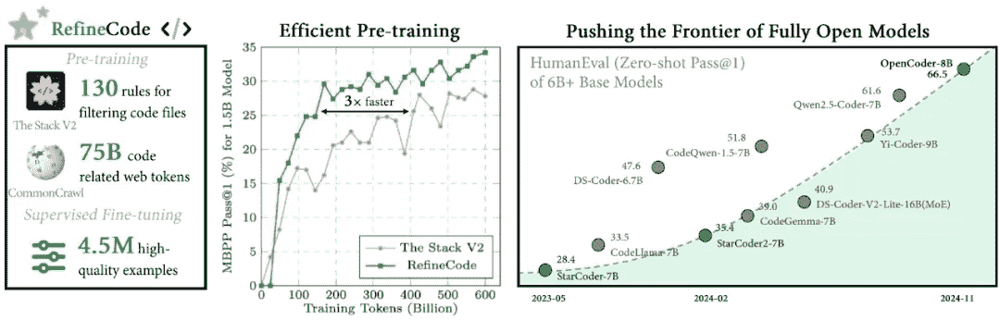

### MIT新研究：在测试时训练，模型推理能力最高升至5.8倍

https://mp.weixin.qq.com/s/sRv-BswlDOn-CFtR-rRqDQ

MIT 的最新研究提出了一种创新推理方法，通过在测试阶段对大模型进行训练（Test-Time Training，TTT），显著提升了模型在复杂推理任务上的表现。在挑战高难度的 ARC 任务时，TTT 使模型准确率最高提升至原来的 5.83 倍，甚至超越了 GPT-4 和 Claude 等模型。TTT 通过在推理过程中利用测试样本自身的信息，对模型参数进行快速调整，打破了传统“训练-测试”分离的推理方式。

TTT 包含三个关键阶段：数据生成、模型适应以及推理策略。首先，研究团队通过“留一法”生成训练数据：每个任务中将一个样本保留为测试，其余用于训练。通过多种几何变换和数据扩充，生成了结构一致但内容互补的数据集，极大扩展了训练数据量。训练时，研究人员使用参数高效的 LoRA（Low-Rank Adaptation）调节每一层模型参数，附加于基础模型以实现灵活适应性。此外，模型还会在多种长度的演示样本上计算损失，以便提取抽象规律，增强鲁棒性。

在推理阶段，团队引入数据增强和分层投票策略。输入数据通过旋转、翻转等变换生成等价视角的输入变体，再利用 LoRA 调整的模型进行并行预测。预测结果经过分层投票融合：首先在每种变换内选出置信度最高的前 3 名预测，再在所有变换的前 3 名预测中选出最终的前 2 名输出。这一结构化的组合大幅提高了预测准确性。

测试显示，TTT 对小模型（如 1B 参数的 GPT-3）提升尤其明显，使准确率接近调整前的 6 倍。此外，将 TTT 与表现出色的 BARC 方法结合使用后，研究团队在 ARC 任务上取得了 61.9% 的准确率，已超越人类平均水平。这一成果表明，大规模计算并非提升推理性能的唯一途径，为未来的模型优化提供了新的思路。

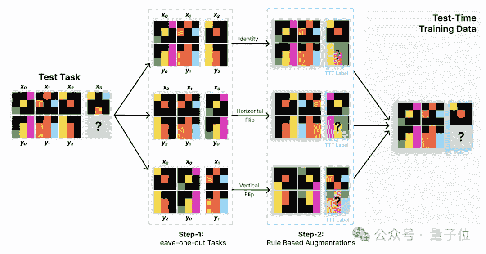

### 清华大学获X-Embodiment最佳论文奖

https://mp.weixin.qq.com/s/EryJFT8bfcYrAjUkVc_OOg

清华大学高阳团队在 CoRL 2024 的 X-Embodiment Workshop 中凭借论文《Data Scaling Laws in Imitation Learning for Robotic Manipulation》荣获最佳论文奖，探讨了在机器人操作中的模仿学习如何通过数据规模来实现零样本泛化。他们使用手持夹持器收集了 40,000 次演示及 15,000 多次机器人测试，通过扩散策略对数据建模，探索策略泛化与训练环境数量、物体数量及演示数量的关系。研究发现，策略的泛化性能主要依赖于环境和对象的多样性而非单纯的演示数量。

实验中，团队在倒水、鼠标移动、叠毛巾和拔掉充电器等任务上验证了策略在新环境和新对象中的泛化表现。结果表明，增加训练环境和物体数量显著提升了策略的泛化能力，其中，策略在未见过物体上的表现当训练物体数达到 32 时超过 0.9。此外，实验展示了策略符合幂律分布，当环境和物体数同时增加时，泛化效果尤佳。

高效的数据收集方案是该研究的一大亮点，四名采集者仅用一下午便获得了足够数据，使策略在新环境中任务成功率达到 90%。高阳团队进一步测试了模型在野外环境中的适应性，包括火锅店、电梯、喷泉等场所，展现出超出预期的强泛化能力。

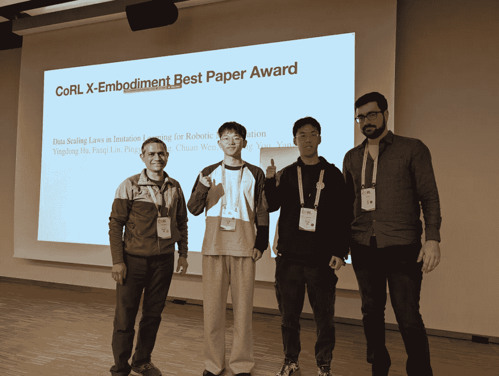

### 伯克利罗剑岚：机器人的范式革命，藏在真实世界中

https://mp.weixin.qq.com/s/nIDq3126Yl8dlQwQs1J7ag

HIL-SERL，是伯克利大学 Sergey Levine 团队近期推出的强化学习框架，通过结合人类的示范与纠正，在现实环境中实现机器人高效学习并完成复杂任务。与前代方法相比，HIL-SERL 显著提升了策略从错误中学习的能力，使得机器人能在短时间（1-2小时）内，完成如组装主板、插入 U 盘等操作，成功率高达100%，甚至在人为干扰下表现稳定。这标志着强化学习从实验室走向真实世界的巨大进步，解决了长期以来强化学习难以直接应用于真实物理环境的问题。

HIL-SERL 的核心在于通过人类纠正提升强化学习的样本效率和策略优化速度，而此前的 SERL 仅依赖示范。罗剑岚团队在 SERL 中率先实现了基于真实视觉信息的操作策略学习，仅用20分钟完成精密装配任务，成功率几乎完美。HIL-SERL 进一步扩展了该框架的能力，适用于更复杂的动态操作任务，并攻克双臂协调问题，展示了极高的鲁棒性和恢复能力。

罗剑岚认为仿真训练虽便捷，但无法完全替代真实环境的数据，其局限性使得在复杂任务中的表现不如真实数据的支持。他提倡从现实环境中采集机器人训练数据，这种方法虽然初期数据稀缺，但一旦规模扩大，将产生长期优势。SERL 和 HIL-SERL 的研究展示了机器人真实强化学习的巨大潜力，有望推动机器人在工业领域中的灵活性和效率提升。

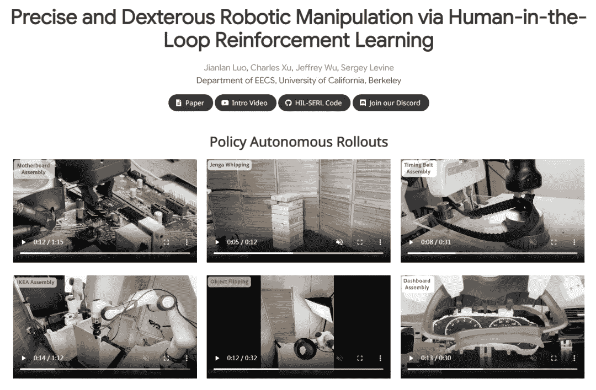

# 推特

### Qwen 2.5 coder模型推出上线Ollama，在代码生成、代码推理和代码修复方面进行了显著改进

贡献人：

https://x.com/ollama/status/1856051733513797929

**Qwen** **2.5 **c**oder** 模型在代码生成、代码推理和代码修复方面进行了显著改进。

其中，32B 模型的性能可与 OpenAI 的 GPT-4o 相媲美。

32B：ollama run qwen2.5-coder:32b

14B：ollama run qwen2.5-coder:14b

7B：ollama run qwen2.5-coder:7b

3B：ollama run qwen2.5-coder:3b

1.5B：ollama run qwen2.5-coder:1.5b

0.5B：ollama run qwen2.5-coder:0.5b

https://ollama.com/library/qwen2.5-coder

### Brodeur-Urbas分享创建由 Claude 驱动的收据机器人，自动检测任何包含发票的邮件

贡献人：

https://x.com/MaxBrodeurUrbas/status/1856039187243511880

上个月，我在一次 15 分钟的演示电话中构建了一个由 Claude 驱动的收据机器人。客户反馈说，自那以来，它已经处理了他们业务中的 1200 份发票。

它会自动检测任何包含发票的邮件：

• 重命名并将附件上传至 Google Drive

• 分类并提取所有信息到 Google Sheets

• 发送短信通知

这是一个可以直接运行的匿名化流程版本：

https://gumloop.com/pipeline?workbook_id=mQngPPBW9fFHR4MxFs9SH2

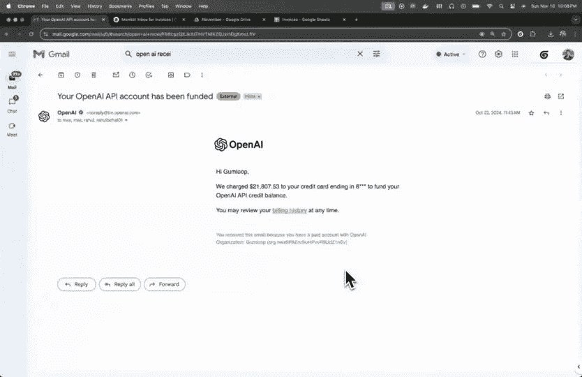

[GcFWDXZb0AAbLzb.mp4](https://internal-api-drive-stream.feishu.cn/space/api/box/stream/download/all/Mn9Mb0rChoP8cqxVA6CcZ5DXnxB)

### Zeroth-01 机器人：世界上最小的开源端到端仿人机器人，起售价仅为 $350

贡献人：

https://x.com/JingxiangMo/status/1856148967819751817

介绍 Zeroth-01 机器人：世界上最小的开源端到端仿人机器人，起售价仅为 $350！

完全开源，包括硬件、SDK、模拟环境等。Zeroth-01 是迄今为止最具可玩性和可定制性的仿人机器人！

加入我们，共同塑造人人可及的机器人未来 ⬇️

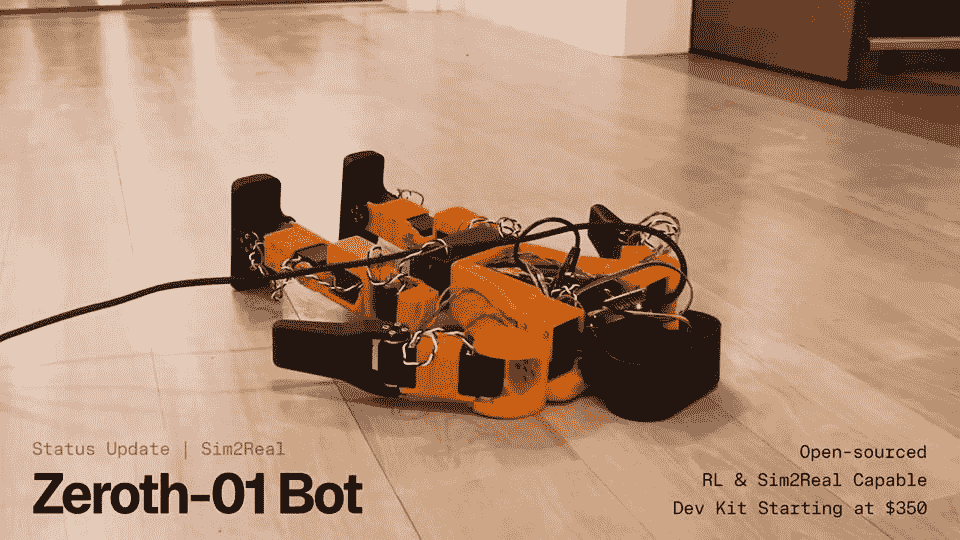

[wXjamjb0IZRlPpca.mp4](https://internal-api-drive-stream.feishu.cn/space/api/box/stream/download/all/IaoAblIapop8HfxtzszcONnMnVf)

### Davis分享：慢慢在制作一个基于几何节点的道路，只有一个面和一条曲线，含坡度

贡献人：

https://x.com/EthDavis_/status/1855343270592737651

慢慢在制作一个基于几何节点的道路。只有一个面和一条曲线，还包含坡度！

#b3d #CGI #3d #blender

[jZuewuNje7jco4Mv.mp4](https://internal-api-drive-stream.feishu.cn/space/api/box/stream/download/all/F7aobZbkjo8xhxxNOFlc6OZ3nHb)

### Flora：最简单的途径来试用最强大的工具，同时体验 Runway、Luma、Hailuo 和 Kling

贡献人：

https://x.com/florafaunaai/status/1856047561536086293

时机已到。

一张静态图片，四个令人惊叹的视频。从今天起，在 FLORA 中体验 Runway、Luma、Hailuo 和 Kling 的卓越清晰度、连续性和控制力。

FLORA 提供最简单的途径来试用最强大的工具。立即使用我们全新的“图片转视频”节点免费尝试吧！

[6nAbj0MJDXjTlFLR.mp4](https://internal-api-drive-stream.feishu.cn/space/api/box/stream/download/all/NYHcb4nGvoFIp9xIeecc6ttyn5P)

# 信号

### MMoE: Enhancing Multimodal Models with Mixtures of Multimodal Interaction Experts

贡献人：

推文链接：[https://x.com/pliang279/status](https://x.com/pliang279/status/1856046089184461010)/1856046089184461010

原文链接：https://arxiv.org/abs/2311.09580

ResearchFlow：https://rflow.ai/flow/3839b694-aa61-41ef-9a74-326aedb355f0

信号源：Leena Mathur

节点：应用体系-多模态模型

这篇文章提出了一种增强多模态模型的新方法，称为多模态专家混合（MMoE），旨在通过训练不同类型的专家模型来处理各种多模态交互（如讽刺和幽默），这些交互包含多模态冗余、单模态独特性以及模态融合带来的协同效应。在讽刺检测（MUStARD）和幽默检测（URFUNNY）任务上，MMoE实现了新的最佳效果，并展示出适用于多种模型类型的提升潜力。

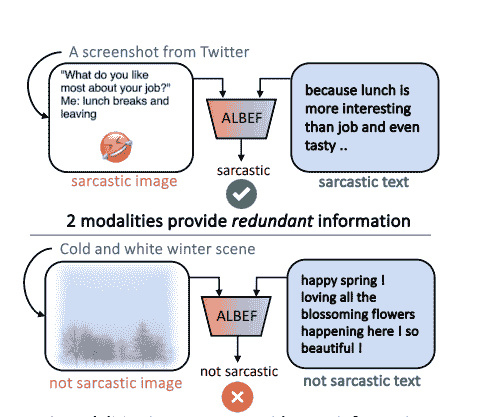

### Why think step by step? Reasoning emerges from the locality of experience

贡献人：

推文链接：[h](https://x.com/IntuitMachine/status/1855951681214640281)ttps://x.com/IntuitMachine/status/1855951681214640281

原文链接：[https://proceedings.neurips.cc/paper_files/paper/202](https://proceedings.neurips.cc/paper_files/paper/2023/file/e0af79ad53a336b4c4b4f7e2a68eb609-Paper-Conference.pdf)3/file/e0af79ad53a336b4c4b4f7e2a68eb609-Paper-Conference.pdf

ResearchFlow：https://rflow.ai/flow/775ede65-2f61-4acb-b127-5c7b1940e2b3

信号源：Carlos E. Perez

节点：模型体系-推理体系

这篇文章探讨了大语言模型中的链式推理（chain-of-thought reasoning）如何在训练数据具备局部统计结构时提升推理效果。作者提出，当训练数据包含相互强烈影响的局部变量簇时，通过推理中间步骤可以更准确地推断未见过的变量关系。理论证明和实验结果表明，使用局部结构化的观测数据并逐步进行推理，比直接训练所有变量的数据效率更高，揭示了逐步推理有效性的统计根源。

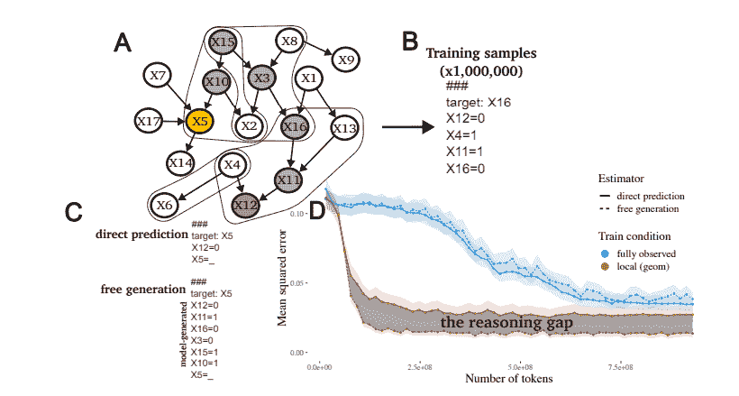

### Dreaming Out Loud: A Self-Synthesis Approach For Training Vision-Language Models With Developmentally Plausible Data

贡献人：

推文链接：[https://x.com/bkhmsi/status](https://x.com/bkhmsi/status/1855940304236392512)/1855940304236392512

原文链接：https://arxiv.org/abs/2411.00828

ResearchFlow：https://rflow.ai/flow/f1b0065a-8e54-444f-92c3-6177773972d6

信号源：Badr AlKhamissi

节点：模型体系-多模态

这篇文章提出了一种从人类认知发展中获得灵感的“自我生成”训练方法，用于在有限数据条件下训练多模态模型。方法分为四个阶段：第一阶段从小语料库中训练基础语言能力，第二阶段将语言与视觉环境关联，通过视觉编码器生成图像描述，第三阶段生成未标注图像的描述并用合成文本继续训练语言能力，第四阶段训练模型在视觉问答和推理等任务中发展高级认知技能。该方法证明了在合理数据量下训练多模态模型的可行性。

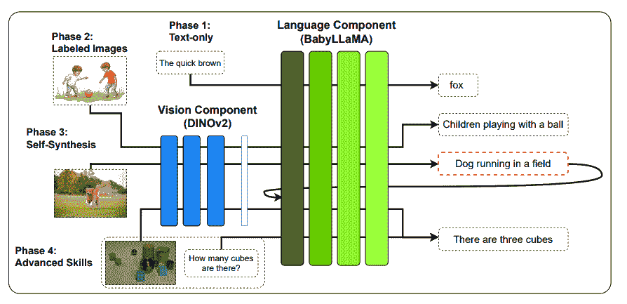

# 产品

### Spiky

贡献人：

https://spiky.ai/

Spiky 是一个实时 AI 助手，专为客户团队设计，帮助他们在销售过程中提高效率。它提供通话动态洞察、实时沟通指标和销售手册执行反馈，可以加速交易、提升团队表现，并节省时间，让团队专注于创造收入的活动。

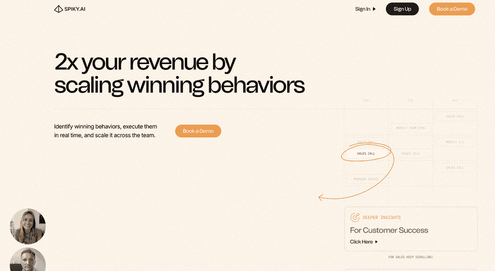

### Lamatic.ai

贡献人：

https://lamatic.ai/

Lamatic 是一个低代码平台，可以帮助团队快速构建和部署高性能的生成式 AI 应用。它提供可视化构建工具、向量数据库和多种集成功能，促进开发者与非技术团队之间的协作，简化工作流程并加速应用开发。

# HuggingFace&Github

### AI Code Review Mentor

贡献人：

https://github.com/Gijela/CR-Mentor

CR-Mentor 是一个基于知识库和大语言模型（LLM）的智能代码审查助手。它不仅支持所有编程语言的代码审查，还可以根据知识库中积累的最佳实践定制审查标准和重点领域。通过不断积累知识库和对 LLM 的深度学习，CR-Mentor 可以有效地提高团队的代码质量，显著降低审查时间和错误率（约 50%）。

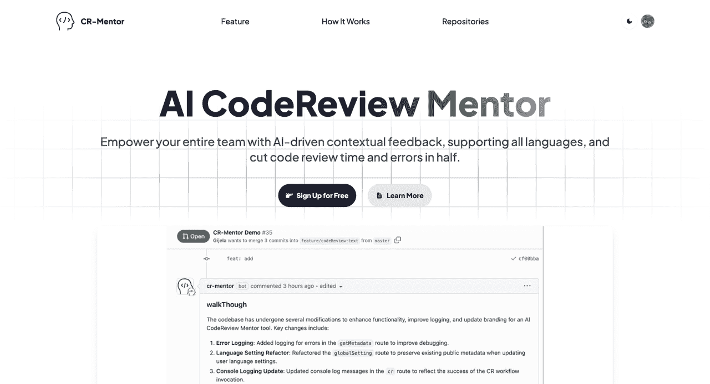

# 投融资

### Cogna创始人筹集1500万美元，用于AI自动生成企业软件

https://techcrunch.com/2024/11/11/from-self-driving-cars-to-ai-that-writes-enterprise-software-cogna-founder-raises-15m/

前自动驾驶企业FiveAI的联合创始人Ben Peters成立了英国初创公司Cogna，专注于通过AI自动生成企业资源计划（ERP）软件。Cogna近日完成了1500万美元的A轮融资，由Notion Capital领投，Hoxton Ventures和Chalfen Ventures参投。今年早些时候，Cogna还获得了475万美元的种子轮融资，投资人包括FiveAI的联合创始人Stan Boland和Acorn Software的创始人Herman Hauser。

**投融资亮点：**

Cogna此轮融资主要用于开发基于生成式AI的定制化ERP解决方案，通过AI平台替代传统ERP系统，使企业能够更高效地完成供应链、库存管理、财务等流程。Cogna当前已吸引英国天然气分销公司Cadent Gas和公用事业服务提供商Network Plus成为客户。投资方Hoxton Ventures的联合创始人Hussein Kanji表示，Cogna的技术类似OpenAI支持的Anysphere等项目，展示了生成式AI在企业软件市场的巨大潜力。

Cogna将进一步挑战Wipro、CapGemini等传统IT咨询公司，为企业提供自动生成、量身定制的ERP解决方案。这一创新模式不仅让企业在传统ERP的基础上拥有更个性化的工作流，同时降低了对SAP等传统系统的依赖。

公司官网：https://www.cogna.co/

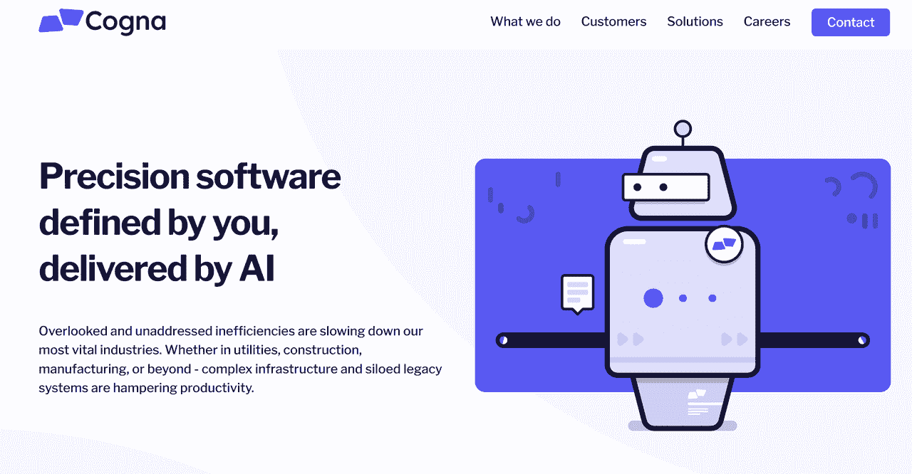

### Ecosia与Qwant合作开发欧洲自主搜索引擎索引以减少对大科技依赖

https://techcrunch.com/2024/11/11/ecosia-and-qwant-two-european-search-engines-join-forces-on-building-an-index-to-shrink-reliance-on-big-tech/

法国隐私导向的搜索引擎Qwant和德国的非营利搜索引擎Ecosia宣布合作，共同开发一个欧洲自主的搜索引擎索引，旨在减少对微软（Bing）和谷歌等大科技公司的依赖，同时应对API成本上涨的压力。这一举措将帮助两家公司降低运营成本，并推动生成式人工智能等技术在其搜索引擎中的进一步创新应用。

该项目由Qwant与Ecosia共同出资设立的合资公司“European Search Perspective”（EUP）主导，双方持股比例为50:50。目前双方股东已表示支持，未来可能还会通过EUP引入外部投资来加速项目开发。Qwant的现有工程团队将整体转移至新公司，并由Qwant CEO Olivier Abecassis兼任新公司的首席执行官。

EUP预计在2025年底前拓展至德国，并逐步覆盖其他欧洲国家。该索引系统未来还将提供API授权，开放给其他欧洲企业使用，以增强欧洲技术栈的自主性。

# 学习

### Qwen2.5-Coder 全系列来咯！强大、多样、实用

https://zhuanlan.zhihu.com/p/6300359507

Qwen2.5-Coder 系列模型的开源为代码生成大模型领域带来了新进展。其32B-Instruct模型在代码生成、代码修复和代码推理等多项任务中表现卓越，与GPT-4o达到了相似的水准，并支持40多种编程语言，尤其在McEval和MdEval基准测试上表现出色。此外，Qwen2.5-Coder 在模型多样性上开创了新标准，涵盖0.5B至32B的六种尺寸，以满足不同开发者的需求，且所有模型均开源。

1.  **SOTA性能**：Qwen2.5-Coder-32B在EvalPlus、LiveCodeBench等代码生成基准上表现最优，代码修复测试Aider得分73.7，且在McEval和MdEval测试上多语言代码修复能力突出，进一步增强了其应用广度。

1.  **模型多样性**：模型家族包含0.5B到32B六个尺寸，Base模型适用于进一步微调，Instruct模型则对齐人类偏好，适合直接应用。

1.  代码助手和Artifacts场景应用：在Cursor和Artifacts应用中，Qwen2.5-Coder展示了代码补全和生成可视化作品的能力。在Humaneval-Infilling等5个评测集上均取得了优异表现。

1.  **许可和开放性**：大部分模型采用Apache 2.0许可证，部分模型为“Research Only”许可，进一步推动开源社区和工业界的应用探索。

### **大模型时代的数据中心真相**

https://freedium.cfd/https://medium.com/@houssem.benbraiek/llm-agents-underscore-one-truth-data-is-the-real-differentiator-2a9a0325c546

Peter Norvig的数据至上论

机器学习领域中，数据质量的重要性已被Peter Norvig在2011年提出的"数据的超凡效果"一文中明确指出。然而，尽管数据驱动的视角被证实为机器学习的核心，许多从业者仍沿用算法为中心的思维。这种偏差源自早期机器学习工程师们接受的以模型为中心的训练方式，使得社区长期以来更重视算法创新，而非数据准备。

**现实世界中的数据桥梁**

在实际应用中，数据质量决定了模型在生产环境的表现。低质量或有偏的数据不仅会使模型偏离正确目标，甚至会导致失败的应用案例。例如，一些SaaS机器学习平台虽然承诺"轻松使用"，但因忽视数据的准备和质量，导致生产中模型效果不佳。对于复杂任务如视觉检测，一个优秀的系统需要专业的相机设置、高质量图像输入以及合理的数据增强策略，才能确保模型的稳健性。

**数据为王：ChatGPT的成功**

ChatGPT作为历史上增长最快的AI产品，其成功在于高质量的用户数据驱动。虽然Transformer和GPT模型已存在多年，但OpenAI通过用户反馈对ChatGPT进行行为校准，使其具备了强大的自然语言理解和人性化互动能力。预训练大模型和成品AI的兴起表明数据是核心竞争优势。尽管众多模型结构公开共享，但在实际应用中，拥有大量优质数据的组织可以在市场上占据主导地位。

从披萨店的视觉检测案例看数据准备

与SaaS平台相对照的是可即用的视觉模型，它不仅具有更好的初始效果，还能基于实际数据改进。在现实中，"即用"并不只意味着易部署，更代表模型能够从第一天开始有效工作，并随着实际数据积累逐步优化。正因如此，Meta发布的“Segment Anything”模型通过支持多场景下的分割任务，展示了数据驱动的ML模型的民主化潜力。

数据的优势：大规模优质数据的潜力

在大模型应用领域，数据的优势成为核心竞争力。许多新兴的大模型在离线测试中优于GPT模型，但在实际使用中不如ChatGPT，因为OpenAI持续利用大量用户生成的数据优化模型，填补离线测试与在线生产的表现差距。数据将继续成为决胜因素，这是不可否认的事实。

### 对话罗剑岚：强化学习+真机操作可以很Work

https://zhuanlan.zhihu.com/p/6329634561

传统上，机器人强化学习（RL）多在仿真环境中完成，但这一方法在复杂操作任务上存在Sim2Real Gap问题，即仿真结果难以直接应用于真实机器人操作。罗剑岚博士专注于“真机+强化学习”的研究，采用视觉感知和强化学习算法直接在真实机器人上进行训练，成功实现了高效且稳定的机器人操作。

罗剑岚的研究包括SERL和Hil-SERL两大工作。这些方法通过在人类演示的基础上，使用强化学习算法快速调整机器人的策略，使机器人能在物理交互场景中完成如装配和动态操控等复杂任务，且成功率接近100%。与传统方法不同，Hil-SERL不依赖仿真训练，而是在真实环境中通过少量示范和在线人类反馈实现高效学习。

Hil-SERL 的系统采用精细的数据采样和稀疏奖励机制，以高效、可扩展的方式执行复杂操作。其设计理念是让机器在真实环境中自适应性地学习，避免了仿真器的局限性。Hil-SERL 项目完全开源，MIT 许可便于广泛使用，且对操作控制和机器学习进行端到端集成，极大推动了真实环境中机器人强化学习的发展。

Hil-SERL展示了真实数据对机器人操作强化学习的核心作用，为未来大规模机器人部署及高效数据采集提供了新方向，也为该领域的研究者提供了可靠的研究工具。

### Walk Through SGLang / VLLM Worker

https://zhuanlan.zhihu.com/p/6363614076

为在 SGLang 中支持 OpenRLHF，系统需要实现 init_process_group 和 update_weights 两个接口，并封装于 VLLM Worker Wrap 内。以下是实现概要：

WorkerWrap 实现

WorkerWrap类扩展自 VLLM 的 Worker类，并添加两个接口：

1.  init_process_group：初始化用于权重更新的分布式组，用于多GPU场景下同步权重。采用torch.distributed库，通过指定地址、端口、组名和后端（如nccl）来设置通信。

1.  update_weights：从主GPU广播权重，使所有 VLLM worker 能共享一致的模型参数。该方法通过分布式广播实现，并应用到模型的特定权重。

VLLM 核心组件解析

VLLM 的架构从单GPU到多GPU层级架构，包括以下组件：

1.  Worker：负责单GPU的KV缓存、模型推理、LoRA模块、状态保存和性能分析。

1.  ExecutorBase：是管理不同GPU执行器的抽象基类，支持单GPU、多进程或Ray分布式模式。

1.  LLMEngine：为用户提供核心的任务调度，包括请求处理、调度、资源管理和结果跟踪。

SGLang 扩展

在 SGLang 中，TpModelWorker管理单GPU上的模型，主要负责分布式初始化、内存管理和模型执行。模型执行由ModelRunner执行，实现更模块化的结构。

此外，TpModelWorkerClient使用多线程优化数据传输和计算任务，提高吞吐量。

多GPU控制器

DataParallelController统一管理TP和DP架构，分配独立的GPU资源，支持多种负载均衡策略，使用ZMQ实现进程间通信。

TokenizerManager 和 DetokenizerManager

TokenizerManager处理文本预处理、权重更新和多进程通信，是整个推理系统的前端。

DetokenizerManager负责增量解码和批处理解码，用于将模型输出的token ids转换为文本。

引擎与Runtime

Engine是无HTTP的纯推理引擎，集成各组件，直接通过进程间通信实现低延迟推理。

Runtime在 Engine 基础上增加 HTTP 服务层，通过 FastAPI 提供同步和异步接口及流式输出支持，适合独立服务部署。

整体架构从 GPU 资源管理到分布式并行控制，提供了模块化、扩展性强的多层接口，为 OpenRLHF 和更复杂的推理需求提供了有力支持。

### LLM之模型评估：情感评估/EQ评估/幻觉评估等

https://zhuanlan.zhihu.com/p/4130091274

本文列举了一些LLM的评估方法，从各方面评估了模型的能力。

但是这些都只适用于通用模型的能力。对于下游任务模型来说，还是需要根据任务特点和任务数据收集测试数据进行评测。

模型评估存在的几个问题：

1、如何设计一个好的prompt，使得评估的能力完全符合任务要求？

2、如何保证judge模型评估准确？

这两个问题不可能完全解决，只能尽量使模型评估的结果接近任务所需。

# 招聘公告

---

**奇绩创坛****由陆奇博士**于2019年创立，使命是在源头最大化驱动创新。奇绩研究组将研究模型理论、到投研战略分析、市场策划等不同背景的同学聚在一起，搭建GenAI时代独特的跨界人才社群。

## 🚀F**24实习岗位**

##### [行研-学术科研人才交流组实习生](https://miracleplus.feishu.cn/docx/Yn6rdf2iOoY2Rcx8yVNcUBYRnch#part-QkMcdeJmuob9uvxvV3qcLSzHn8g)

##### 行研-GenAI研究岗位-战略分析（偏产品）

##### Web / AI 全栈开发工程师实习生

## **火热开放中🚀**

##### 行研-GenAI研究岗位-前沿学术探索

##### 行研-GenAI研究岗位-战略分析（偏咨询）

##### 创新活动产品运营 （大模型系列活动产品运营）

> **点击**相关岗位可查看对应**岗位需求【JD】；**相关岗位投递请**扫描二维码**

> 欢迎**推荐/自荐**

> 期待在**奇绩创坛**遇见更好的你

---

# 声明

本文档仅供学习交流使用，版权归原作者所有，若涉侵权，请联系Jack Jin 15101136166

##

（欢迎在下方反馈您宝贵的意见！整理不易，觉得有用给AI日报小组点个赞👍吧！）

ChatGPT；Angela；Zijia Liu；Alex；Zeqi Tan；Tiezhen（HuggingFace）；Naixu；Lizhi；Peter；Suoman；Jack

学术分析报告：ResearchFlow -- 奇绩F23校友的开发的深度研究产品，PC端进入RFlow的分析报告，可直接点击节点右侧的小数字展开节点，登录后可在节点上直接“询问AI”，进一步探索深度信息

如果你有大模型相关的创业想法，欢迎来找我们聊聊～微信：15101136166

> 快邀请你的小伙伴们一起来读大模型日报吧！

> **【日报****知识库****】**这里是近期日报内容的汇总,欢迎大家查阅

> [大模型日报知识库(分享版)](https://miracleplus.feishu.cn/wiki/KapVwXfkriOBiskB0B2cUHxjnTh)

>

> 欢迎大家多多帮我们分享,转发~~

> 如果大家有任何的建议或者吐槽,欢迎随时找我聊天~

