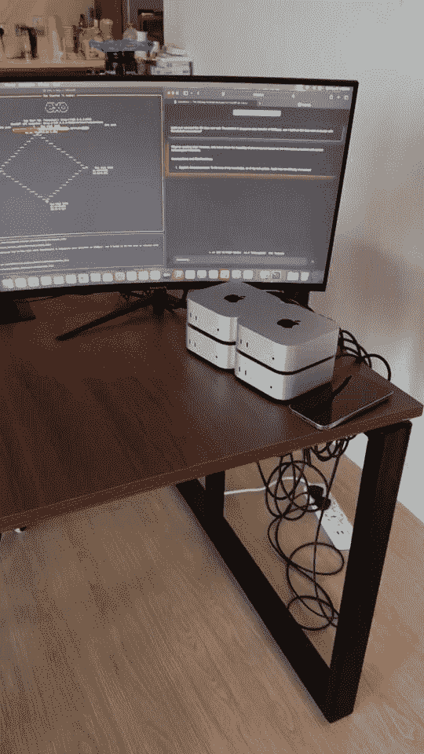
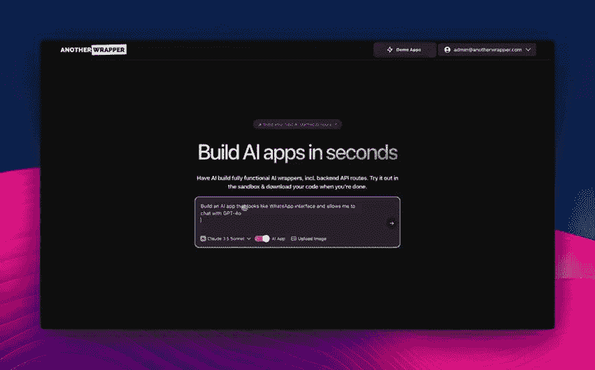
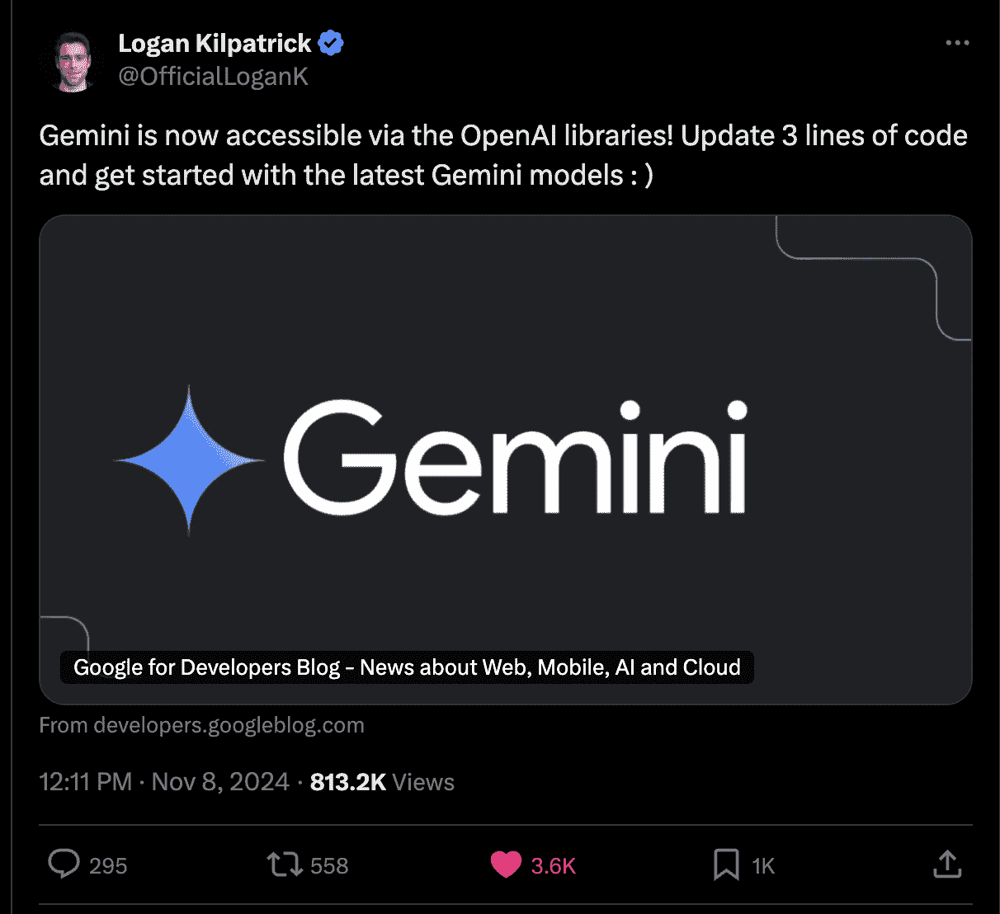
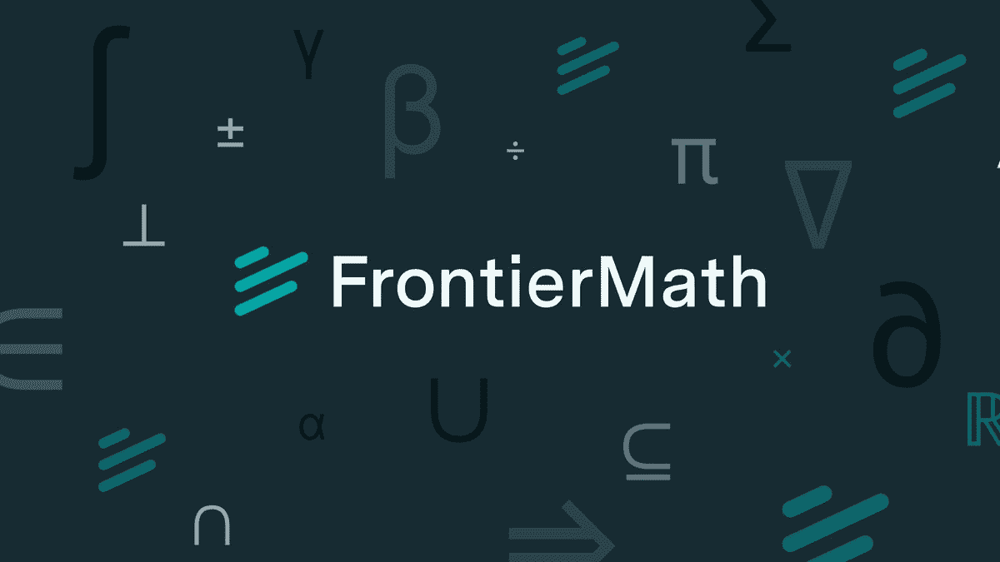
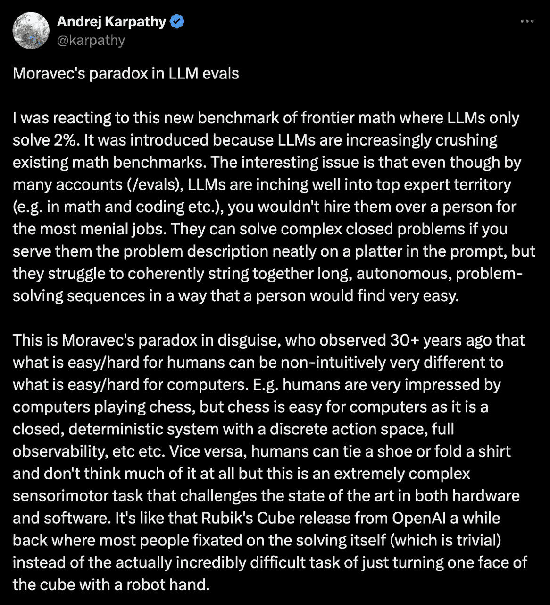
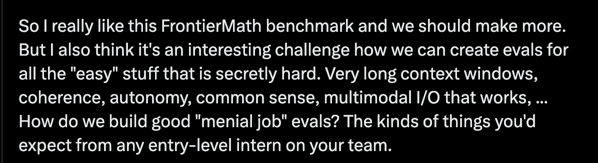
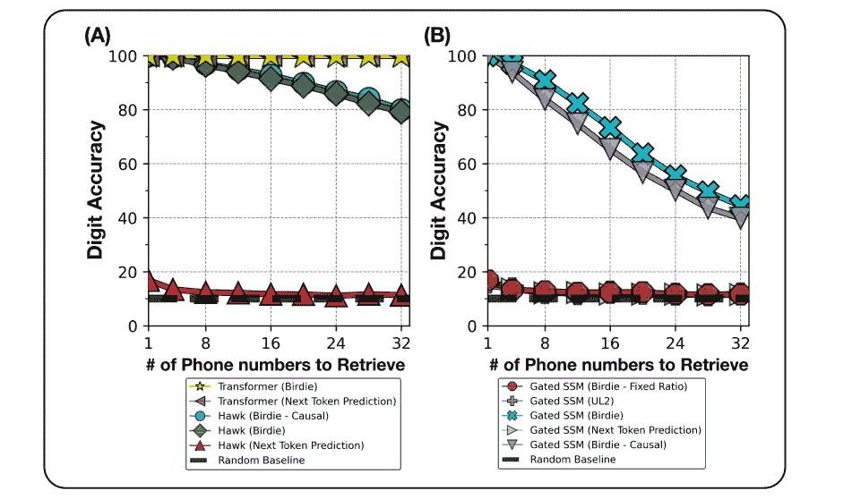
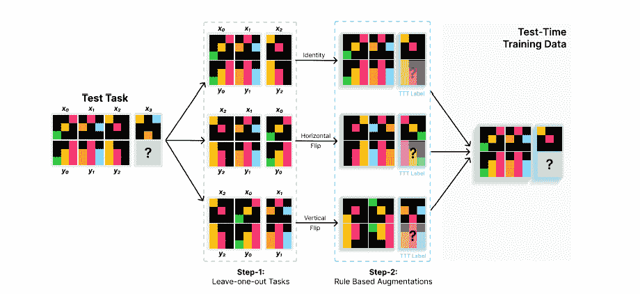
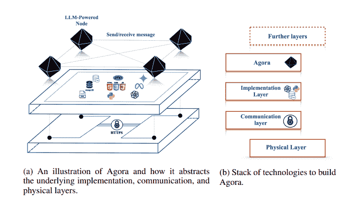

# 奇绩大模型日报（11月 11日）

> 来源：[https://miracleplus.feishu.cn/docx/XHMEdfBwmoMc0JxDTWuc0pWcnAb](https://miracleplus.feishu.cn/docx/XHMEdfBwmoMc0JxDTWuc0pWcnAb)

# 推特

### M4 Mac Mini AI 集群：仅仅两个苹果手机大小，目前运行 Nemotron 70B，速度为每秒 8 个 token，并且可以扩展到 Llama 405B

贡献人：

https://x.com/alexocheema/status/1855238474917441972

M4 Mac Mini AI 集群

使用 @exolabs 和 Thunderbolt 5 互连（80Gbps），将 LLM 分布在 4 台 M4 Pro Mac Mini 上运行。

这个集群很小（iPhone 作为参考）。目前运行 Nemotron 70B，速度为每秒 8 个 token，并且可以扩展到 Llama 405B（基准测试即将发布）。

[X1XhesYs8XZvcbY6.mp4](https://internal-api-drive-stream.feishu.cn/space/api/box/stream/download/all/F6wDbWTCeoXxTMx3qu7c4ONFnDo)

### 构建AI封装器的AI封装器？Fekri分享AI应用创建器，生成完整的 Next.js AI 应用

贡献人：

https://x.com/fekdaoui/status/1855522108618748222

8周前我开发了一个AI封装器，它可以……构建AI封装器 🤯

•  生成完整的 Next.js AI 应用（包括后端 API 路由！）

•  可以构建文本、图像、视觉、聊天或转录应用

•  100% 免费且可导出

•  在沙盒中运行

今天我在 ProductHunt 上发布——期待你的支持 🙏🏽

[-kBt31Gzzt1ESgLP.mp4](https://internal-api-drive-stream.feishu.cn/space/api/box/stream/download/all/JDc9bFGLioxOSYxdlv5cESMrnFR)

### Gemini现可通过OpenAI库访问，三行代码使用最新Gemini模型

贡献人：

https://x.com/OfficialLoganK/status/1854980006927298577

Gemini 现在可以通过 OpenAI 库访问了！更新 3 行代码即可开始使用最新的 Gemini 模型 :)

---

从今天开始，开发者可以通过 OpenAI 库和 REST API 访问最新的 Gemini 模型，这使得使用 Gemini 变得更加便捷。我们最初将支持聊天完成 API 和嵌入 API，未来几周和几个月内还会增加更多的兼容性。你可以在 Gemini API 文档中了解更多信息。如果你尚未使用 OpenAI 库，我们建议直接调用 Gemini API。

### Karpathy强推FrontierMath：用于评估 AI 在高级数学推理方面表现的基准

贡献人：

https://x.com/EpochAIResearch/status/1854993676524831046

今天我们发布了 FrontierMath，这是一个用于评估 AI 在高级数学推理方面表现的基准。我们与60多位顶尖数学家合作，创建了数百道原创且极具挑战性的数学题目，目前的 AI 系统解题率不到 2%。现有的数学基准测试如 GSM8K 和 MATH 正在接近饱和，AI 模型在这些基准上得分超过90%，部分原因是数据污染。FrontierMath 大大提高了难度。我们的题目通常需要专家级数学家花费数小时甚至数天才能解决。我们评估了六个领先的模型，包括 Claude 3.5 Sonnet、GPT-4o 和 Gemini 1.5 Pro。即使给模型扩展了思考时间（10,000 tokens）、提供了 Python 访问权限并允许进行实验，成功率仍低于 2%，相比之下传统基准测试的成功率超过 90%。我们发布了带有详细解答的示例题目、专家评论和我们的研究论文（https://epochai.org/frontiermath）。

https://x.com/karpathy/status/1855659091877937385

Karpathy评论：Moravec 悖论在 LLM 评估中的体现

我对一个新的前沿数学基准产生了兴趣，其中LLM只能解决2%的问题。这个基准的引入是因为LLM在现有的数学基准上表现越来越优异。一个有趣的问题是，尽管根据许多评估（如在数学和编程领域），LLM逐渐接近顶尖专家的水平，但如果是最基础的工作，你仍然不会选择它们而不是人类。LLM可以在提示中提供清晰的问题描述时解决复杂的封闭问题，但它们在连贯地串联长时间的自主解决问题的序列方面表现挣扎，而这是人类很容易做到的。

这是Moravec悖论的伪装形式。Moravec在30多年前观察到，对人类来说简单或困难的任务，对计算机而言可能非直观地截然相反。比如，人类对计算机下棋的表现印象深刻，但下棋对计算机来说很简单，因为它是一个封闭的、确定性的系统，具有离散的动作空间和完全的可观测性。反过来，人类系鞋带或叠衣服时不会觉得复杂，但这是一个极其复杂的传感运动任务，对最先进的硬件和软件来说都是挑战。这有点像OpenAI之前发布的机器人手解魔方的项目，大多数人都关注解题本身（这其实很简单），而忽略了用机器人手转动魔方一个面的极高难度。

因此，我非常喜欢这个FrontierMath基准，我们应该创造更多类似的基准。但我也认为这是一个有趣的挑战：如何为那些“看似简单但实际上很难”的任务创建评估。比如，长时间的上下文处理、一致性、自主性、常识、多模态I/O的有效工作……我们如何构建出良好的“基础工作”评估？就像你希望团队中任何入门级实习生具备的能力那样。

### Perplexity CEO分享构建产品的方式：“我们不做产品评测。”

贡献人：

https://x.com/petergyang/status/1855634165976498249

“我们不做产品评测。”

在这个片段中，@AravSrinivas（Perplexity的CEO）分享了他如何通过以用户而非CEO的身份提供反馈，来帮助团队更快地发布产品。

Aravind 给我深入展示了 Perplexity 构建产品的方式，包括：

• Perplexity惊人的发布速度

• 他们达到1亿+查询次数的路径及未来展望

• 比传统十条蓝色链接更优质的搜索广告

我也很喜欢他对想要成就一番事业的年轻人给出的真诚建议。

📌 立即观看我们的完整访谈：https://youtu.be/X1oxHy03ZF0

[V2XELpirrZH6H2eC.mp4](https://internal-api-drive-stream.feishu.cn/space/api/box/stream/download/all/AffCbVPWRoaS1ExKV4PcElfFnjd)

# 信号

### Birdie: Advancing State Space Models with Reward-Driven Objectives and Curricula

贡献人：

推文链接：https://x.com/jimmysmith1919/status/1855777477848695060

原文链接：https://arxiv.org/abs/2411.01030

ResearchFlow：https://rflow.ai/flow/caaf8f0e-52be-4e22-99bb-61310913fd6b

信号源：Songlin Yang

节点：模型体系 - 架构体系

这篇文章介绍了一种名为Birdie的新训练程序，它显著提高了状态空间模型（SSMs）在上下文检索任务中的性能，例如长文本复制、联想回忆和长文本问答，而无需改变其架构。Birdie结合了双向输入处理和专门的预训练目标的动态混合，通过强化学习进行优化。文章还介绍了一种新的双向SSM架构，它能够从双向上下文处理无缝过渡到因果生成。实验评估表明，Birdie在检索密集型任务上的性能显著提高，缩小了与Transformers的性能差距，同时保持了计算效率。文章强调了训练程序在利用SSMs固定状态容量中的重要性，并为提高其能力提供了新的方向。所有代码和预训练模型都在提供的URL上可用，支持JAX和PyTorch。

### The Surprising Effectiveness of Test-Time Training for Abstract Reasoning

贡献人：

推文链接：https://x.com/akyurekekin/status/1855680785715478546

原文链接：https://ekinakyurek.github.io/papers/ttt.pdf

ResearchFlow：https://rflow.ai/flow/8aae3d98-be9a-4e8d-bcc5-b3dae57b61c7

信号源：Songlin Yang

节点：模型体系-推理体系

这篇文章探讨了在测试时训练（Test-Time Training,  TTT）作为一种提高模型推理能力的机制的有效性。作者使用抽象和推理语料库（Abstraction and Reasoning Corpus,  ARC）作为基准，通过系统实验确定了成功的TTT三个关键组成部分：（1）在类似任务上的初始微调；（2）辅助任务格式和增强；（3）每个实例的训练。TTT显著提高了ARC任务的性能，与基础微调模型相比，准确度提高了6倍；在8B参数的语言模型上应用TTT，ARC公共验证集的准确率达到53%，比公开的纯神经方法提高了近25%。通过将TTT方法与最近的程序生成方法相结合，达到了61.9%的公共验证准确率，与人类平均得分相匹配。这些发现表明，显式的符号搜索并不是提高神经语言模型抽象推理能力的唯一途径；在少量样本上继续训练的额外测试时间也非常有效。

### A SCALABLE COMMUNICATION PROTOCOL FOR NETWORKS OF LARGE LANGUAGE MODELS

贡献人：

推文链接：https://x.com/IntuitMachine/status/1855649114182308303

原文链接：https://arxiv.org/pdf/2410.11905

ResearchFlow：https://rflow.ai/flow/5c1c0dfb-b04c-42ca-9d69-794ca6141047

信号源：Carlos E. Perez

节点：开发体系-Agent

这篇文章介绍了一个名为Agora的元协议，它利用现有的通信标准，使由大型语言模型（LLM）支持的智能代理能够高效地解决复杂问题。在Agora中，代理通常使用标准化的例程进行频繁通信，使用自然语言进行罕见通信，并使用LLM编写的例程处理两者之间的所有事务。Agora规避了智能代理通信的三难困境，能够稳健地处理接口和成员的变化，允许在完全去中心化和最小人类干预的情况下实现前所未有的可扩展性。在大型Agora网络上，观察到自我组织、完全自动化的协议的出现，这些协议在没有人类干预的情况下实现复杂目标。

# 资讯

### AI 发展遇到瓶颈：大模型扩展的技术挑战与突破方向

https://mp.weixin.qq.com/s/0SXPOvFPFo4f7rphxbUuwA

近期，关于大型语言模型（LLM）扩展潜力是否达到瓶颈的讨论引发了广泛关注。根据一项研究预测，2028年左右，人类生成的数据将被耗尽，届时基于大数据的LLM发展或将放缓甚至停滞。论文《Will we run out of data? Limits of LLM scaling based on human-generated data》探讨了这一问题，并揭示了AI行业正在寻找新途径以应对这一挑战。

1.  数据和扩展定律的限制

OpenAI内部的研究者和知情人士透露，GPT模型的改进速度正在放缓，主要原因是高质量训练数据的供应减少。模型训练所需的文本数据源（如网站和书籍）已接近被全面利用。为此，OpenAI成立了一个专门的基础团队，研究如何延续模型扩展定律的有效性。

**数据稀缺应对**：为弥补数据不足，Orion模型部分采用了AI生成的数据进行训练。这种策略虽能增加数据量，但存在模型与早期版本趋同的风险，影响性能多样性。

1.  新技术探索：推理时间计算和强化学习

**为了克服当前扩**展定律的限制，AI研究者正在探索训练后优化模型的新策略。推理时间计算（test-time computation）成为一种潜在解决方案，通过在模型回答问题时增加计算资源，提升输出质量。OpenAI的o1推理模型便是这种尝试的实例。此模型虽能提高推理质量，但因其计算成本是传统非推理模型的六倍，目前客户使用有限。

**强化学习与人类反馈（RLHF）**：在训练后，AI模型通过学习大量已正确解决的问题进一步优化。人类评估员对模型在特定任务上的表现进行评分，指导研究者调整模型回答，如代码生成或复杂问题求解。

1.  性能瓶颈与新的扩展方向

一些专家和投资者质疑LLM的性能是否已趋于平稳。风险投资人Ben Horowitz指出，即便增加了训练GPU的数量，智能提升并未达到预期效果。尽管如此，许多业内人士，如Meta和OpenAI的领导者，强调仍有空间探索创新，如多步骤任务处理和多任务整合等新功能。

**推理时间计算的优势**：在TEDAI会议上，研究科学家Noam Brown指出，通过增加每次查询的计算预算，模型性能可持续提升。这一策略开辟了在数据和训练瓶颈之外提升模型性能的新维度。

1.  合成数据的局限性

尽管合成数据可以补充训练数据缺口，但在涉及常识推理等任务时，其效果有限。Databricks联合创始人Ion Stoica指出，LLM在解决复杂问题上有所进步，但在分析文本情感或解释医学症状等常规任务上仍进展缓慢。他强调，合成数据不足以弥补事实数据的需求。

**技术突破的未来**：尽管AI扩展面临挑战，技术专家和开发者正尝试突破现有瓶颈，通过创新推理策略和数据处理方法推动LLM继续发展。

### 微调技术：LoRA与完全微调的技术差异及挑战

https://mp.weixin.qq.com/s/Xxh-MrSfkRlRz7reE-fkzA

微调技术在大语言模型应用中极为重要，其中低秩自适应（LoRA）和完全微调是两种主要方法。近期，麻省理工学院的研究深入探讨了两者在微调效果和模型行为上的差异，尤其是在面对不同任务时的表现。

1.  奇异值分解分析与侵入维度

研究通过奇异值分解（SVD）分析微调后的权重矩阵，揭示了LoRA和完全微调在权重结构上的显著差异：

+   **侵入维度**：LoRA 微调中出现了新的高秩奇异向量，称为“侵入维度”，这些维度与预训练模型的奇异向量几乎正交。这些侵入维度使LoRA模型在任务之外的泛化能力较差。而完全微调不会产生此类维度，权重矩阵在光谱结构上与预训练模型保持一致。

+   **实验结果**：研究表明，随着LoRA秩增加到某个阈值（如r = 2048），侵入维度逐渐消失，LoRA变得接近完全微调的表现。然而，在较低秩（如r ≤ 8）时，侵入维度仍然明显存在。

1.  模型行为与遗忘效应

在连续学习环境中，研究进一步比较了LoRA与完全微调在多个任务上的适应能力：

+   **遗忘现象**：低秩LoRA模型在训练新任务时表现出更显著的遗忘现象，即会丢失对之前任务的记忆。而完全微调在此方面表现得更加稳健。

+   **任务顺序实验**：在一系列下游任务中（如MNLI、QQP等），随着训练任务的推进，低秩LoRA的表现逐渐下降，尤其是当r = 1时，其性能甚至低于预训练基线。提高LoRA秩至r = 64或更高可以减轻这种遗忘，但过高的秩（如r = 768）又会导致过度拟合。

1.  最佳秩选择与稳定性

研究指出，**选择合适的秩**是维持模型平衡的重要因素：

+   **U形趋势**：在持续学习中，LoRA的表现呈现U形趋势，过低或过高的秩都会导致更多遗忘，而中间值（如r = 64）则效果最佳。

+   **伪损失分数**：分析表明，当r = 8和r = 64时，LoRA的遗忘少于完全微调，但极低（r = 1）和极高（r = 768）会使遗忘增加。

1.  实用启示

+   **侵入维度的影响**：LoRA在低秩时虽能实现较好的任务表现，但其侵入维度导致模型在预训练分布外的泛化能力下降。

+   **参数化的权衡**：尽管LoRA能以更少的可训练参数实现良好效果，高秩参数化在提升泛化和稳定性上更为优越，但需保持秩稳定以避免过度拟合。

### 田渊栋专访：兼职小说家的AI科学家，讲述信息时代人类命运

https://mp.weixin.qq.com/s/MBbRTvZU9o5390h9EwM-Eg

《破晓之钟》通过细腻的笔触展示了高强度的科研日常及技术细节。故事围绕顶尖实验室的博士生科研经历展开，描写了从实验结果无法复现引发的怀疑到对代码、实验设计及理论等多个环节的深究。这些情节凸显了真实科研中的挑战与不确定性，揭示科学家们在创新过程中的反复试验和探索。

田渊栋在他的职业生涯中曾专注于多领域技术研究，从自动驾驶到深度学习，再到强化学习与大型语言模型（LLM）的优化。他在Meta FAIR实验室中的工作突出体现了技术细节，例如通过单个GPU实现OpenGo的推理，超越专业围棋选手，及在强化学习和神经网络中的系统优化。特别是在优化神经网络推理效率、研究稀疏化注意力机制、结合深度学习和决策优化方面，田渊栋探索了如何将理论研究成果高效应用于复杂问题的解决。

他还提出了链式思维（CoT）在推理中的局限性，认为其过长时训练难度增加，无法高效解决复杂问题。这与现实中的算法和模型优化息息相关，如研究梯度下降如何自动发现数据中的代数结构并在网络权重中体现。田渊栋的研究工作不仅揭示了深度学习的潜力，也探索了其“涌现”能力的机制。

此外，他通过科幻创作如《破晓之钟》表达对未来智能技术的反思，将科幻与技术结合，探讨在AI时代中人类价值、信息时代的外星文明冲突及社会动力。这类小说在描绘纳米机器人、外星生物等概念的同时，融入其对人工智能和研究经历的深刻思考，提供了对人类与技术关系的启示。

### 微软开源MoE新路径

https://mp.weixin.qq.com/s/pt-AlH_z4e3PNiKC9Iyz7A

1.  **创新训练方法：** GRIN MoE采用了新一代SparseMixer来优化专家路由梯度估计，解决了传统MoE训练中仅使用门控梯度代替路由梯度的问题。具体来说，SparseMixer-v2通过随机采样替代TopK函数，并应用Heun's third order method近似计算梯度，提供更精确的专家路由梯度估计。相比于传统的GShard方法，SparseMixer-v2在训练后期显示出更好的性能。

1.  **计算并行策略：** 与传统专家并行策略不同，GRIN MoE舍弃了专家并行，转而采用数据、pipeline和张量并行组合进行训练。这一调整避免了传统专家并行中的token丢弃问题，提升了训练效率。通过Megablocks库的grouped_GEMM内核等工程优化，该模型在训练效率上实现了比密集模型高出80%的提升。

1.  **性能表现：** GRIN MoE的总参数量约42B，但推理时激活的参数仅6.6B，显示出极高的参数利用效率。其在GSM-8K数学测试中得分90.4，在HumanEval编码任务中取得74.4分，MMLU测试中得分79.4，超越了Mixtral和Phi-3.5等同类架构，甚至在某些任务上优于14B级别的Phi-3。

1.  **并行扩展和负载均衡：** GRIN MoE通过结合pipeline和张量并行扩展专家数量至52个（132B参数），而不使用专家并行，以实现更大规模的模型划分。此外，通过全局计算负载均衡损失，进一步优化专家间的负载分配，虽然带来一定通信开销，但可通过计算重叠降低延迟。

1.  **应用示例：** GRIN MoE在中国的高考数学测试中表现出色，展示了其卓越的数学推理能力，验证了模型在复杂实际问题中的应用潜力。这一性能验证表明该模型在严苛标准下的高效性和鲁棒性。

# 产品

### Genbler

贡献人：

https://www.genbler.com/

Genbler 是一个综合性的 AI 平台，可以为内容创作者提供强大且易用的工具，帮助他们快速制作高质量内容。其主要功能包括面部替换、背景更换、图像增强、文本转动漫视频等，适用于艺术家、营销人员和教育工作者等多种用户。Genbler 的使命是打破传统创作的限制，让所有创作者都能轻松实现他们的创意，推动无限的创造力。

# HuggingFace&Github

### ai-chatbot

贡献人：

https://github.com/vercel/ai-chatbot

这是一个基于 Next.js 和 Vercel AI SDK 构建的开源 AI 聊天机器人模板。它提供了丰富的功能，包括基于 Next.js App Router 的高级路由、React Server Components （RSCs） 和 Server Actions 的服务器端渲染、支持多种 AI 模型提供商（如 OpenAI、Anthropic、Cohere 等）、数据持久化、身份验证等。

### MoneyPrinterTurbo

贡献人：

https://github.com/harry0703/MoneyPrinterTurbo

MoneyPrinterTurbo 是一款基于 AI 大模型的视频生成工具，用户只需提供主题或关键词，即可全自动生成视频文案、素材、字幕和背景音乐，最终合成高清短视频。该项目采用完整的 MVC 架构，代码结构清晰且易于维护，支持 API 和 Web 界面。

### Letta

贡献人：

https://github.com/letta-ai/letta

Letta 是一个开源框架，用于构建具有高级推理能力和透明长期记忆的有状态 LLM 应用程序。该框架是白盒且模型无关的。

# 投融资

### 「可栗口语」完成数百万元天使轮融资，打造AI个性化口语学习平台

https://36kr.com/p/3027441691125252

近日，AI口语学习平台「可栗口语」宣布完成数百万元天使轮融资，投资方为嘉程资本和源合资本，本轮融资及后续融资由源合资本独家担任财务顾问。融资资金将用于团队扩展、核心技术研发及市场推广。

可栗口语创立于2023年，旨在通过AI提供个性化学习方案，提升用户的英语口语水平。创始人兼CEO周树帆具备深厚的技术背景，曾任职于微软互联网工程院，专注于深度学习、自然语言处理及多语言模型开发。团队核心成员在教育领域同样拥有丰富经验。

在全球化趋势下，成人英语学习需求不断增加，市场规模于2023年已达1.3万亿元。现有产品未完全满足用户的碎片化和场景化学习需求。可栗口语通过其“AI情景课”填补这一市场空白，课程涵盖职场、旅游等多种应用场景，共有2000多节课程，涵盖1.5万个高频词汇及3万个例句。用户可通过虚拟情景对话与AI互动，获得实时反馈，跟踪学习进展。

该平台依托深度学习和AI大模型，提供动态分析用户学习进度并推荐相应内容，实现高度个性化的学习体验。用户仅需每天投入短时间即可获得显著进步，逐步培养长期稳定的学习习惯。周树帆表示，未来将持续优化AI能力，扩展用户群体，并打造UGC生态系统，以提升用户学习体验与数据积累。

公司官网：https://www.oral-craft.com/

### Crypto-AI 初创公司 Pond 完成750万美元种子融资

https://www.theblock.co/post/325044/crypto-ai-startup-pond-seed-funding

Pond 是一家致力于开发面向加密货币领域的去中心化 AI 模型平台的初创公司，近期完成了750万美元的种子轮融资。本轮融资由 Archetype 领投，参与的投资者包括 Coinbase Ventures、Near Foundation、Cyber Fund 和 Delphi Ventures。著名的天使投资人如 Near Protocol 联合创始人 Illia Polosukhin、Plume Network 联合创始人 Chris Yin 以及 Matrixport 的联合创始人 Cynthia Wu 等也参与其中。

此次融资始于2023年4月，并于7月顺利完成。该轮融资采用了“未来股权简单协议（SAFE）”形式，并附带代币权证。尽管公司未公开此轮融资后的估值，Pond 表示，这笔资金将用于支持其建设一个涵盖数据、模型计算、训练和推理的完整 AI 模型生态系统，推动区块链数据在安全、推荐及 DeFi 等应用中的创新发展。

公司官网：https://cryptopond.xyz/

### 具身智能企业「千寻智能」完成天使+轮融资

https://mp.weixin.qq.com/s/cgG_cQlauDC4yKtnzpENow

近日，具身智能企业「千寻智能」完成了由柏睿资本独家注资的天使+轮融资，自成立半年多以来已实现三轮融资。本次融资将用于引进人才和推动产品在商业场景下的迭代及业务拓展。投资方柏睿资本由宁德时代天使投资人李平创办。此前，顺为在2024年领投千寻的种子轮并参与天使轮。

千寻智能以全栈技术能力见长，专注于打造通用人形机器人和具身大模型，支持多场景泛化应用。今年9月，该公司展示了通用机器人在非结构化环境下完成复杂任务的技术突破，标志着多任务泛化能力的提升。创始人兼CEO韩峰涛表示，依托伯克利的AI技术与硬件实力，千寻计划在2025年实现数百台具身智能产品的交付，形成物理数据飞轮闭环，加速模型和算法的迭代。

联合创始人高阳具备深厚的科研背景，在机器人跨模态交互与强化学习领域具有突出贡献，与知名学者如Pieter Abbeel和Sergey Levine展开了深入合作。他的研究强调数据质量对模型的核心作用，启发了高质量数据的广泛应用和“data scaling laws”的发现。这一研究推动了机器人零样本泛化能力的实现，提升了千寻在多场景作业中的竞争力。

千寻智能通过多维协同和商业化团队的高效运作，已在国内外市场开展80+场景调研，并在新能源、物流、餐饮等领域初显成果，奠定了稳健的发展路径。公司将继续深化其技术和商业布局，以引领具身智能技术的全球化普及。

# 学习

### 早停法+复用KV缓存+并行推理，实现推理效率提升几十倍

贡献人:

https://zhuanlan.zhihu.com/p/5838444410

当前AI项目中，判别式任务在推理和训练场景中应用需求仍然很大，涵盖RAG检索问答、大模型数据清洗、强化训练等。技术细节如下：

在RAG检索问答中，意图判别技术用于识别用户问题是否需联网检索或依赖模型回答，检索路由判别决定使用哪个向量库回答特定问题，主题标签生成通过预先打标签提升召回效果。在大模型数据清洗中，通过判别标签过滤低质量文本（如有害内容）以提高训练数据质量。大模型强化训练涉及合成数据的结果监督（偏好标注）和细化到回答步骤的过程监督，以便进行基于过程的监督学习。

推理优化中，三个关键技术是并行推理、KV缓存复用、早停法。并行推理通过批量处理实现，提升推理效率，时间复杂度从O(n)降至O(1)，增加显存来换取时间；KV缓存复用在生成序列中储存注意力机制中的Key和Value张量，避免重复计算，通过扩展（expand）操作进行缓存复制以支持并行推理，不增加显存占用。早停法将原本逐步生成token的过程简化为只验证候选答案第一个token的概率，减少时间和空间复杂度至O(1)。此方法假设第一个token的概率分布能反映整个候选答案序列的分布，适用于候选答案第一个token不同的情况。

结合这三种方法可实现显著的推理加速。实验显示，串行模式单任务推理耗时约8秒，而早停法、KV缓存复用和并行推理结合应用后，耗时压缩至0.15秒，显存占用量略微增加，实现几十倍加速。该方法在处理同一篇文本或图片时尤为有效，适合多任务并行。

这套方法还适用于VLM架构的多模态模型，由于图片KV缓存涉及更多tokens，因此有较大优化潜力。完整实验脚本和实现细节可在GitHub上获取，展示了如何通过这些技术实现推理效率的大幅提升。

### 理解RLHF中的Reward Hacking

https://zhuanlan.zhihu.com/p/6082362466

在强化学习特别是RLHF中，Reward Hacking指的是模型利用奖励系统的缺陷获取高奖励但未实现预期目标。这一问题存在于两个层面：Reward Model（RM）训练和RL训练。即便是好的RM，在训练LLM过程中也可能面临Reward Hacking。

Reward Model的技术细节：

1.  **Dense Reward**：奖励在更细力度上进行，比如句子或token级别，以增强奖励的细粒度和有效性。

1.  Multi-attribute Reward Models：结合多个维度的信号建模，在推理中进行加权。该方法可以延伸到基于规则的奖励（RbR），如OpenAI所提出的使用Hinge Loss来训练每个特征的权重。进一步扩展则是多个模型的集成，如NVDA的Nemotron。

1.  Generative Reward Model：生成式模型用于更灵活的奖励机制。

1.  Pair-wise Reward Model：采用两个候选响应进行比较打分，推荐使用具有双向注意力机制的Bert类模型以避免因单向注意力（Casual Attention）导致的不对称问题。

1.  Label Smoothing & Margin：通过经典的Label Smoothing和Margin方法提升RM的泛化性，尤其是Adaptive Margin，依据样本相似性调整Margin大小，在SimPO和RRHF中应用广泛。

RL训练中的Reward Hacking问题：

1.  **数据量不足**：样本量小容易导致偏见和过拟合。

1.  **Prompt分布问题**：包括Length Bias和Special Token带来的偏差，均会引发奖励机制偏差。

1.  **奖励信号稀疏**：信号不足会使模型难以有效学习。

1.  缺少Reward Normalization and Clipping：奖励信号未经过规范化与剪裁，可能导致不稳定训练。

### MIT 6.5940 EfficientML 第二讲学习笔记

https://zhuanlan.zhihu.com/p/6038797542

**基本术语**：神经网络的参数被称为“突触”“权重”或“参数”，计算结果称为“神经元”“特征”或“激活层”。模型宽度是隐藏层的维度，宽浅模型计算效率更高，但窄深模型通常精度更高，需要折中考虑。

**全连接层**：对输入进行加权求和并加偏置项，是基本的神经网络层。

**卷积层（2D卷积）**：用于图像处理等任务，以有效提取空间特征。

**性能指标**：

+   **延迟（Latency）**：完成任务所需时间，受计算和内存时间影响，内存操作能量消耗远高于计算操作。

+   **吞吐量（Throughput）**：单位时间内可处理的数据量。高延迟模型能通过批处理提高吞吐量，移动设备偏向低延迟，高性能设备重视高吞吐量。

+   **参数量**：不同层参数量的计算方式有所不同，是模型规模的重要组成。

+   **模型大小**：取决于参数量和参数字长。

+   **激活层总量与峰值**：推理过程中，激活层峰值决定最大内存消耗，通常是瓶颈。训练时，激活层大小远超参数量。

**MAC操作**：

+   MAC（Multiply-Accumulate）：乘加操作，GPU上可作为单指令。矩阵-向量乘法（MV）中，每个结果需进行次数为 nnn 的 MAC 操作；通用矩阵乘法（GEMM）中，每个结果需 n×mn \times mn×m 次 MAC 操作。

**FLOP与OP**：

+   FLOP（Floating Point Operations）：一个MAC操作相当于两个FLOP。

+   **FLOPs**：每秒浮点计算次数。

+   **OP（Operations）**：非浮点数表示与计算称为OP，使用时称为OPs。

### 如何选择最佳 GPU 用于 LLM 推理：基准测试技术要点

https://medium.com/@marketing_novita.ai/how-to-select-the-best-gpu-for-llm-inference-benchmarking-insights-83970559552f

随着大规模模型推理的普及，其高昂的成本和速度限制仍是主要挑战。本文详细探讨了如何选择最具成本效益的 GPU 来进行大模型推理，并提供了一套标准化的评估方法及关键技术指标。

技术评估方法

1.  **定义性能指标**：

+   延迟（Time To First Token, TTFT）：用户发送请求到收到第一个返回令牌的等待时间。

+   吞吐量（Tokens Per Second, TPS）：从第一个令牌之后每秒接收的平均令牌数量。

1.  **成本分析**：

+   采用**百万令牌成本（Dollars Per 1M tokens）**作为评估标准，用于比较不同硬件的推理成本。

1.  **测试流程**：

+   使用固定的请求输入/输出长度和批处理大小，进行数轮测试来收集关键性能指标（如 P50, P90, P99）。

+   选择 Llama 3.1 系列模型和主流 GPU（H100、A100、RTX 4090）进行实测，分析各设备的性能表现和单位成本。

主要发现

+   **性能比较**：H100 在 TTFT 和 TPS 上均表现最佳，其次为 A100 和 RTX 4090。在较大的批处理量下，RTX 4090 的延迟显著增加，影响性能稳定性。

+   **模型量化**：FP8 版本比 BF16 版本大幅提升了系统效率，降低了延迟并提高了吞吐量，表现约为后者的 1.4 倍。

+   **成本效益比**：绘制成本与性能的二维图，标识出“领导者”、“跟随者”、“挑战者”和“淘汰者”四个象限。H100 和 FP8 量化版本在性能和成本上均表现为最佳选择。

### SGLang Performance Optimization

https://zhuanlan.zhihu.com/p/6061399149

最近在 GPU MODE 分享了 SGLang Performance Optimization 的三个重要进展：

首先是 lianmin 完成了 CPU Overlap 的重构与支持。SGLang 一直以 low CPU overhead 著称，这次优化预计还能带来 10%-20% 的性能提升，具体 benchmark 数据将在新版本中发布。

其次，FlashInfer 在易用性和可扩展性方面取得了显著进展，新增了 JIT 支持、FA3 功能（包含 paged KV Cache），并实现了高效的 Stream K Scheduler。作为 FlashInfer 的紧密合作伙伴，SGLang 已提前完成集成和性能验证，效果非常惊艳，相关特性也将很快发布。

第三点是 SGLang 正计划集成上海 AI Lab 的 TurboMind，以提升量化性能。值得一提的是，TurboMind 的 GEMM 优化采用了一种非常巧妙优雅的方案：不同于 Marlin 专门为 Tensor Core Layout 设计 weights layout 的方式，TurboMind GEMM 采用了更加通用的方法，可以更好地适配不同架构和 Tensor Core 指令。

### 高效微调大型语言模型：深入理解 LoRA 和 QLoRA 及其技术挑战

https://medium.com/@abhilashkrish/efficient-fine-tuning-of-large-language-models-understanding-lora-qlora-and-key-challenges-23171a4fdf2d

本文探讨了在有限资源条件下对大型语言模型（LLM）进行高效微调的技术，重点介绍了 LoRA 和 QLoRA 两种方法及其在实际应用中的挑战。

1. **LoRA（低秩适配）技术细节**

+   **核心机制**：LoRA 在模型的每一层插入两个小型的可训练矩阵 A 和 B，这些矩阵用于修改输出而无需改变原始权重。

+   **参数减少**：通过将权重矩阵分解为低秩形式，LoRA 仅更新 A 和 B，显著减少了训练参数量，降低了内存和计算需求。

+   **梯度更新**：反向传播时仅更新 A 和 B 的参数，保留了原模型的知识，适用于有限 GPU 资源的设备。

2. QLoRA（量化的 LoRA）技术

+   **量化优势**：QLoRA 通过将主模型权重量化为 4 位实现更小的内存占用，同时保持关键性能。

+   **兼容性**：可在量化模型上应用 LoRA，使得在内存受限的 GPU 上也能进行高效微调，适用于边缘设备。

+   **资源效率**：结合了低秩适配和模型量化，QLoRA 在内存和计算资源受限的环境中实现了高效微调。

3. **挑战与应对策略**

+   **资源需求**：微调大型模型需大量计算力和内存，需采用分布式训练或梯度检查点等优化技术来降低内存负担。

+   **过拟合**：小规模数据集可能导致模型过度专注于特定任务，策略包括数据增强和正则化技术。

+   **灾难性遗忘**：模型在新任务微调时可能丢失原有知识，解决方案如权重保护和使用 LoRA 避免修改原始权重。

4. **实践技巧**

+   **优化矩阵秩与量化级别**：根据资源限制选择最佳秩与量化位数。

+   **任务数据匹配**：使用与应用目标紧密对齐的数据提高微调效果。

+   **冻结参数**：QLoRA 中冻结低层参数减少内存使用，聚焦于高层适配。

### 看ROS技术如何照进机器人产业现实（实战篇）

https://mp.weixin.qq.com/s/b-aXjNMI1DXwa2UkcM5W7g

**仿真与数字孪生技术**

+   案例：OpenLoong人形机器人系统
OpenLoong利用ROS 2的强大通信和模块化设计，为人形机器人开发提供了灵活的框架，支持环境感知、决策和任务执行。ROS 2的高效架构帮助实现了复杂功能如自主行走和避障，展现了其在人形机器人系统中的潜力。

+   案例：NVIDIA Isaac机器人仿真平台
NVIDIA的Isaac平台结合ROS 2提供高保真物理仿真环境，支持感知、规划和控制的开发。利用GPU加速的仿真环境，开发者能在虚拟环境中测试复杂功能，如计算机视觉和导航，大幅减少实物测试的需求，提高开发效率和系统可靠性。

1.  **智能边缘计算与实时数据处理**

+   **案例：地瓜机器人RDK**
地瓜机器人的RDK平台采用自研TROS系统，通过边缘计算设备运行AI模型，实现实时数据处理与决策。其BPU架构支持复杂的视觉和深度学习计算，确保低延迟环境下的实时响应。这展示了边缘计算在独立处理和自适应机器人行为中的应用潜力。

1.  **ROS 2的生态化与产业应用**

+   **案例：Autoware自动驾驶**
Autoware是基于ROS开发的开源自动驾驶软件栈，用于实现车辆的感知、定位、规划与控制功能。应用场景如北京渡众机器人公司在港口物流中的自动化小车，实现了自主搬运和智能调度。ROS 2的模块化设计为快速构建高效的自动驾驶系统提供了支持。

+   **案例：宇树机器狗**
宇树科技利用ROS 2赋予机器狗高灵活性和智能性，满足科研教育、安防巡检等任务需求。ROS 2的通信机制在复杂环境中保证了其灵活操作和智能行为，展现出在多领域机器人应用中的强大能力。

1.  **多机器人协作与群体智能**

+   案例：阿木实验室集群编队解决方案
阿木实验室的方案将ROS 2与无人机集群技术结合，用于科研教育、工业巡检等场景。ROS 2在此作为通信和控制平台，提供了稳定的多机协同能力，提高了无人机编队的开发效率和灵活性。

# 招聘公告

---

**奇绩创坛****由陆奇博士**于2019年创立，使命是在源头最大化驱动创新。奇绩研究组将研究模型理论、到投研战略分析、市场策划等不同背景的同学聚在一起，搭建GenAI时代独特的跨界人才社群。

## 🚀F**24实习岗位**

##### [行研-学术科研人才交流组实习生](https://miracleplus.feishu.cn/docx/Yn6rdf2iOoY2Rcx8yVNcUBYRnch#part-QkMcdeJmuob9uvxvV3qcLSzHn8g)

##### 行研-GenAI研究岗位-战略分析（偏产品）

##### Web / AI 全栈开发工程师实习生

## **火热开放中🚀**

##### 行研-GenAI研究岗位-前沿学术探索

##### 行研-GenAI研究岗位-战略分析（偏咨询）

##### 创新活动产品运营 （大模型系列活动产品运营）

> **点击**相关岗位可查看对应**岗位需求【JD】；**相关岗位投递请**扫描二维码**

> 欢迎**推荐/自荐**

> 期待在**奇绩创坛**遇见更好的你

---

# 声明

本文档仅供学习交流使用，版权归原作者所有，若涉侵权，请联系Jack Jin 15101136166

（欢迎在下方反馈您宝贵的意见！整理不易，觉得有用给AI日报小组点个赞👍吧！）

ChatGPT；Angela；Zijia Liu；Alex；Zeqi Tan；Tiezhen（HuggingFace）；Naixu；Lizhi；Peter；Suoman；Jack

学术分析报告：ResearchFlow -- 奇绩F23校友的开发的深度研究产品，PC端进入RFlow的分析报告，可直接点击节点右侧的小数字展开节点，登录后可在节点上直接“询问AI”，进一步探索深度信息

如果你有大模型相关的创业想法，欢迎来找我们聊聊～微信：15101136166

> 快邀请你的小伙伴们一起来读大模型日报吧！

> **【日报****知识库****】**这里是近期日报内容的汇总,欢迎大家查阅

> [大模型日报知识库(分享版)](https://miracleplus.feishu.cn/wiki/KapVwXfkriOBiskB0B2cUHxjnTh)

>

> 欢迎大家多多帮我们分享,转发~~

> 如果大家有任何的建议或者吐槽,欢迎随时找我聊天~

