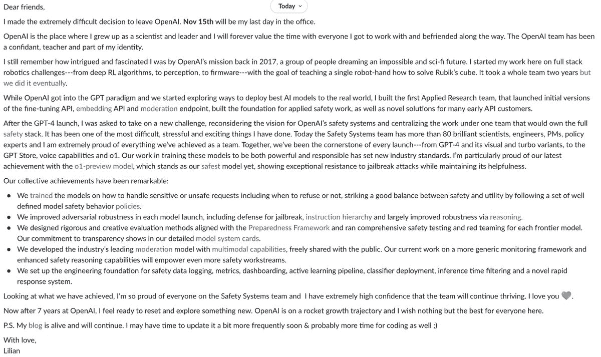
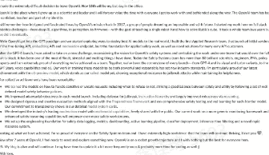
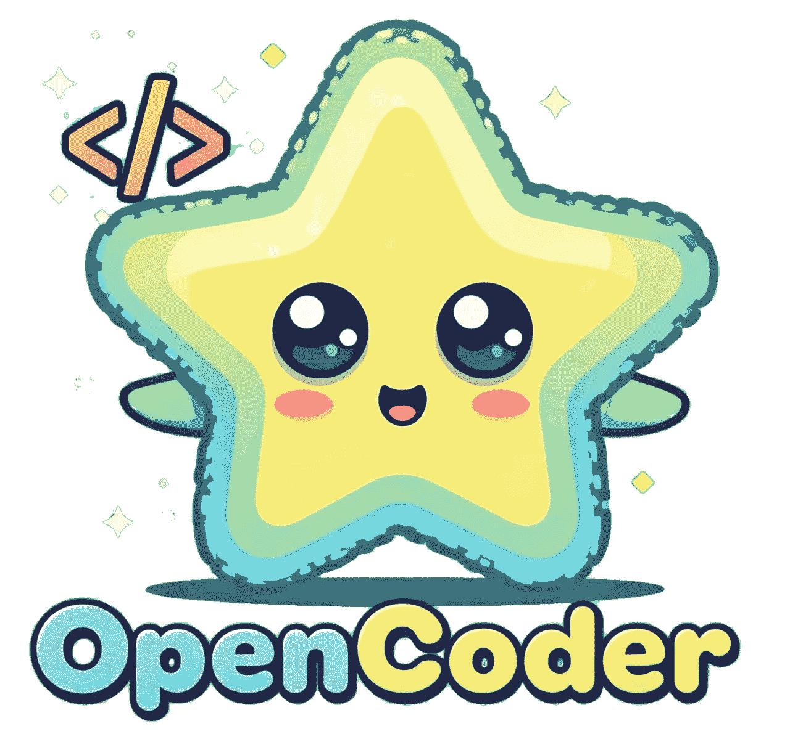
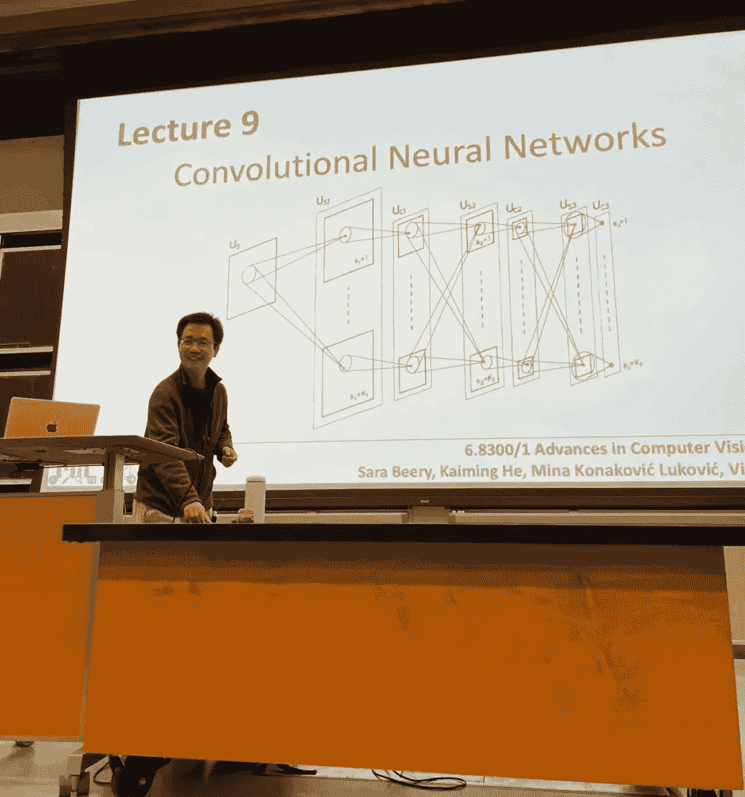
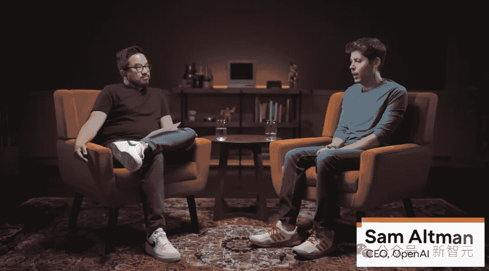
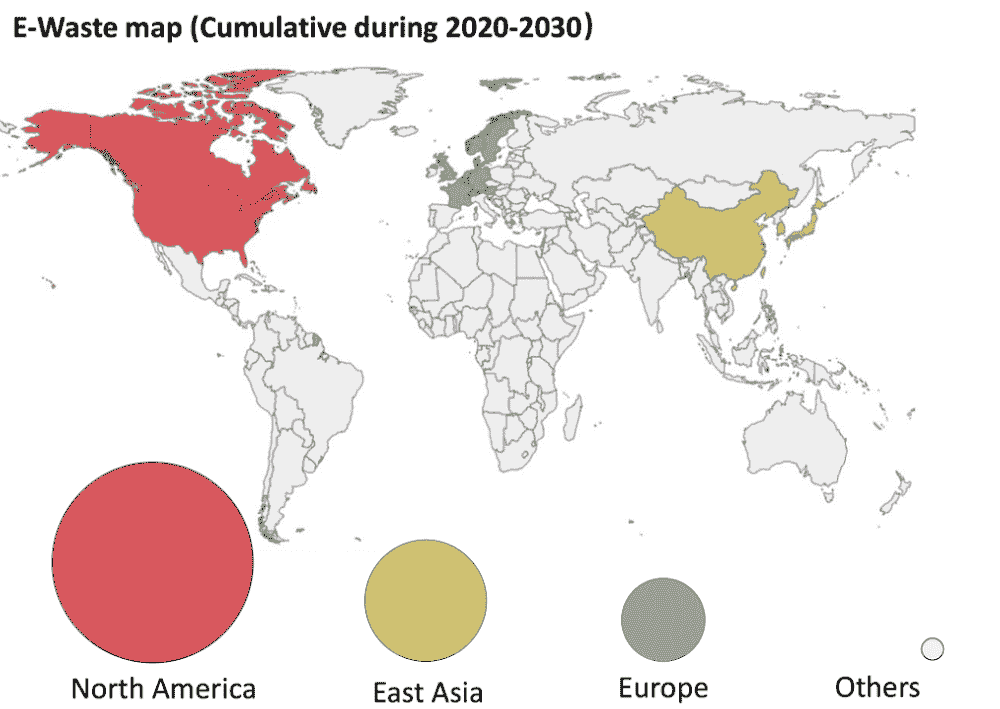

# 奇绩大模型日报（11月 9-10日）

> 来源：[https://miracleplus.feishu.cn/docx/Wck0dS1Z6oEDioxdVzGcp6J2nrh](https://miracleplus.feishu.cn/docx/Wck0dS1Z6oEDioxdVzGcp6J2nrh)

# 推特

### Lilian Weng宣布离开OpenAI，分享给团队的留言

贡献人：

https://x.com/lilianweng/status/1855031273690984623

在 OpenAI 工作了将近 7 年之后，我决定离开。在这里学到了很多，现在我已经准备好重新开始，去探索一些新的事物。

这是我刚刚和团队分享的留言。🩵

---

**亲爱的朋友们，**

我做出了一个非常艰难的决定，将在11月15日离开OpenAI，届时将是我在公司上班的最后一天。

OpenAI是我作为科学家和领导者成长的地方，我将永远珍惜与我一起工作的每个人以及一路上结识的朋友。OpenAI团队一直是我可以信任的伙伴、导师，也是我身份的重要组成部分。

我仍然记得2017年刚加入OpenAI时的好奇与着迷。那时的OpenAI正在向一个充满不可能与科幻色彩的未来努力，一群人怀揣着梦想。我最开始的工作是全栈机器人挑战——从深度强化学习算法到感知，再到固件——目标是教授一个单独的机器人如何从零学会解魔方。这是一个需要整个团队共同努力才能完成的任务，花了两年时间，但我们最终做到了。

在OpenAI转向GPT的范式并开始探索如何将最佳AI模型应用于现实世界时，我建立了第一个应用研究团队，推出了初始版本的微调API、嵌入API和审核端点，为应用安全工作打下了基础，同时为许多早期API客户提供了创新的解决方案。

GPT-4发布后，我被要求接受一个新挑战，重新构想OpenAI的安全系统愿景，并将所有相关工作集中到一个团队，该团队将负责整个安全体系。这是我经历过的最具挑战性和最激动人心的事情之一。如今，安全系统团队已拥有超过80名出色的科学家、工程师、项目经理、政策专家。作为一个团队，我为我们取得的成果感到无比自豪。我们一起成为了每次发布的基石——从GPT-4及其视觉和Turbo变体，到GPT商店、语音功能和o1。我们在训练这些既强大又负责的模型方面设定了新的行业标准。我尤其为我们最新的o1-preview模型感到自豪，该模型是我们最安全的模型，在保持有用性的同时，展示了对绕过攻击的卓越抗性。

我们的集体成就令人瞩目：

• 我们训练了模型，教会它们如何处理敏感或不安全的请求，包括何时拒绝或不响应，通过一系列明确定义的模型安全行为政策，在安全性与实用性之间取得了良好的平衡。

• 我们在每次模型发布中改进了对抗性鲁棒性，包括防御绕过攻击、指令层级并通过推理大幅提高了鲁棒性。

• 我们设计了严谨而有创造力的评估方法，与应急框架保持一致，并为每个前沿模型进行了全面的安全测试和红队攻防测试。

• 我们对透明度的承诺体现在我们详细的模型系统卡片中。

• 我们开发了业内领先的带有多模式功能的审核模型，并公开分享给公众。我们当前的工作是一个更通用的监控框架，并增强了安全推理能力，使更多安全工作流变得更为高效。

• 我们为安全数据记录、指标、仪表盘、主动学习管道、分类器部署、推理时间过滤和一个新颖的快速响应系统建立了工程基础。

看到我们取得的成就，我为安全系统团队的每一个人感到骄傲，并对团队未来的持续繁荣充满极大的信心。我爱你们💜。

现在，在OpenAI工作了7年后，我准备重置自己，探索新的领域。OpenAI正处于快速增长的轨道上，我衷心祝愿这里的每个人一切顺利。

P.S. 我的博客仍然会继续存在，我可能会有更多时间更新它了，或许也会有更多时间编程 ;)

**爱你们的，**

**Lilian**

### Suno预告：v4 即将推出，分享Demo

贡献人：

https://x.com/sunomusic/status/1854961069300613176

v4 即将推出 🎧

[JFFDhLm1PGV4YWjU.mp4](https://internal-api-drive-stream.feishu.cn/space/api/box/stream/download/all/D9OPbtf9to2Gy6xeNPzc3k68nZg)

### Vercel开源Blocks/Artifacts/Canvas 类 AI 聊天体验的 UI 基础设施

贡献人：

https://x.com/rauchg/status/1854996293996949959

我们已开源用于 Blocks/Artifacts/Canvas 类 AI 聊天体验的 UI 基础设施。可自带模型。

我认为将这种用户体验模式引入新的领域有巨大的潜力：生产力、金融、旅行、健康、法律、物流……

祝大家开发愉快 🤘

---

Next.js AI 聊天机器人模板 3.0

• 全新设计

• 模型切换器

• 灵活的并排聊天和输出界面

• 使用 Next.js 15、React 19 和 Auth.js 的 next-auth 测试版

https://vercel.com/changelog/next-js-ai-chatbot-template-3-0

[busECXCj2s3oKgF8.mp4](https://internal-api-drive-stream.feishu.cn/space/api/box/stream/download/all/YC2MbVrAjoMmm7xuNwbcQ1Czn8f)

### Ollama现支持OpenCoder：提供 1.5B 和 8B 模型

贡献人：

https://x.com/ollama/status/1855352515229053111

运行命令：ollama run opencoder

OpenCoder 提供 1.5B 和 8B 模型。

###

### Ekenstam分享prompt引热议：“基于你对我的了解，画一幅你认为我当前生活样子的图画。”

贡献人：

https://x.com/LinusEkenstam/status/1854996067852460170

问 ChatGPT：

“基于你对我的了解，画一幅你认为我当前生活样子的图画。”

把你的回复粘贴在下面。

再次感谢 @mreflow 和 @danshipper

# 资讯

### 教授何恺明在MIT的第二门课——《深度生成模型》

https://mp.weixin.qq.com/s/t8S7cXVAXDWhS0ypzMXiCg

何恺明自今年2月起开始担任MIT副教授，并于3月7日完成了人生中的第一堂课。2024年9月，他的第二门课程《深度生成模型》（6.S978: Deep Generative Models）正式开始授课，目标受众为有深度生成模型研究背景的研究生。课程内容涵盖计算机视觉、机器人技术、生物学、材料科学等领域的深度生成模型应用，重点介绍变分自编码器（VAE）、自回归模型、生成对抗网络（GAN）、扩散模型等核心技术。

这门课程为研讨会形式，包括讲师讲座、客座讲座及学生研讨会，要求学生参与讲座、完成习题集、提交论文并进行项目演示。课程周期为15周，已经进入第10周，内容涵盖了从基础到前沿的深度生成模型理论与应用。例如，讲座包括VAE、GAN、扩散模型、流匹配等技术，后续将涉及视频、3D建模、机器人学、材料科学等领域的应用。

课程的难度较高，适合有较为扎实学术背景的学生，特别是准备教授计算机视觉和深度学习的学者。讲座资料和课件已公开，感兴趣的人可以通过MIT课程网站进行访问。

### 奥特曼专访自曝OpenAI掌握AGI密钥，2025年降临！1人1万块GPU缔造十亿独角兽

https://mp.weixin.qq.com/s/0ZbSRxUz26ILyHI5UOXt5Q

OpenAI的CEO Sam Altman最近在访谈中分享了关于人工智能（AGI）未来的看法，提出了激动人心的预测：ASI（超人工智能）将在几千天内降临，深度学习和AGI的进展将导致人类迈入一个全新的时代。他强调，现在是创办科技公司的最佳时机，尤其是在AI领域。Altman认为，随着技术的迅速发展，未来将能够解决诸如气候变化、太空殖民和能源问题等全球性挑战，进入一个富足时代。

Altman还提到，OpenAI目前的研究路径相当清晰，从基础设施到产品开发，都在稳步推进。他认为，AI技术正在突破，未来将实现更高级别的智能体（如创新者级别AGI），并且这一过程将加速创新和创业。Altman预测，未来可能是“个人+10000个GPU”就能打造数十亿美元的公司，企业的速度和灵活性是创业公司的最大优势。

对于OpenAI的未来，他表示，第三级AGI已经接近实现，即能够与人类协同工作并完成长期任务；第四级创新者将能够探索和理解复杂的现象；第五级将引领全局变革，带来整个社会的巨大变革。他强调，尽管面临挑战，但OpenAI在扩展模型规模方面的成功表明，规模本身是推动AI进步的重要因素。

Altman也分享了个人创业经历，包括如何加入YC（Y Combinator），以及在创建OpenAI时的坚持和信念。他认为，成功的关键在于快速迭代和坚定的技术乐观主义，并强调尽管AI技术优势重要，但商业成功仍需遵循基本的商业规则。

未来，OpenAI将发布更强大的模型，例如满血版o1和Sora，预示着AI推理和创造力将迎来新的突破。同时，尽管Orion模型的改进幅度相对较小，但OpenAI依然在通过增加计算资源和新训练策略来提升模型性能。

### 生成式AI，一年或造50万吨垃圾

https://mp.weixin.qq.com/s/ZRgOK1gK0gFeWsudzthtcA

近日，中国科学院、美国加州大学和以色列莱赫曼大学的研究人员在《自然-计算科学》期刊发表了一项研究，预测2020年到2030年间，生成式AI可能产生最高达500万吨电子垃圾，约为250亿部iPhone 16 Pro的重量。生成式AI电子垃圾主要来源于数据中心的高性能计算硬件（如GPU、CPU），其中北美地区将占最大比例（58%），其次是东亚（25%）和西欧（14%）。

生成式AI的快速发展推动了对计算硬件的高需求，许多AI企业因技术进步而频繁更换设备，以维持竞争力。这导致了大量计算设备的退役，增加了电子垃圾的产生。同时，贸易禁令可能使一些地区只能使用较落后的设备，进而加剧电子垃圾问题，研究预测，这将使生成式AI相关的电子垃圾增加39%。

目前，全球每年产生的电子垃圾超过6000万吨，生成式AI虽然占比较小，但已成为全球电子垃圾问题的重要因素。此外，数据中心的冷却设备等配套设施也会带来额外的垃圾。

研究指出，延长服务器使用寿命是减少电子垃圾的有效策略，可以减少最多58%的电子垃圾；而对废弃服务器进行模块再利用，则可减少21%的垃圾。尽管如此，全球电子垃圾回收率仅为22%，许多电子垃圾通过非正式渠道回收，导致环境污染。

随着生成式AI的快速发展，环境问题逐渐成为隐忧。尽管许多科技公司设定了减碳目标，但AI的快速发展使得其碳足迹和电子垃圾问题加剧。例如，谷歌和微软已承认其碳排放量大幅增加。随着AI硬件的更新换代，生成式AI造成的电子垃圾问题将成为必须面对的挑战。

### OpenAI安全副总裁、北大校友Lilian Weng宣布离职

https://mp.weixin.qq.com/s/QrkrYZ8NDQTW_GUvSzZ9kA

自Sam Altman重新执掌OpenAI以来，公司的高管离职潮持续不断。近日，OpenAI安全系统团队负责人翁荔（Lilian Weng）宣布将离开已经工作了近7年的公司。她在社交平台上发布了离职消息，并公开了发给团队的离职信，但未透露未来的职业计划。许多业内人士，包括OpenAI首席信息安全官Dane Stuckey、著名研究科学家Noam Brown等人，为她送上祝福。

Lilian Weng在OpenAI的主要贡献包括领导安全系统团队，推动模型的安全性、可靠性和实用性，尤其在GPT-4及其衍生版本、o1等项目中取得了显著成就。她回顾了在OpenAI的工作经历，提到自己曾参与解决机器人难题并构建应用研究团队，推出了微调API、嵌入API等，为应用安全奠定了基础。她特别自豪于安全系统团队的工作，如模型对抗稳健性的提升、越狱攻击防御、以及开发多模态审核模型等。

Lilian Weng的离职信中表达了对团队的感激，并表示自己将探索新的机会。她在OpenAI的7年期间，也积极分享关于AI的见解，她的博客成为许多AI研究者的重要参考资料。

Lilian Weng是OpenAI的华人科学家，2018年加入公司，在多项关键项目中扮演了重要角色，包括GPT-4的预训练和模型安全等。她本科毕业于北京大学，并获得印第安纳大学博士学位。在加入OpenAI之前，她曾在Facebook和Dropbox从事软件工程与数据科学工作。她的学术论文被广泛引用，影响力显著。

# 信号

### SVDQunat: Absorbing Outliers by Low-Rank Components for 4-Bit Diffusion Models

https://arxiv.org/abs/2411.05007

研究节点：算力体系-MLSys

ResearchFlow链接：https://rflow.ai/flow/b376a677-8293-4e38-9ff5-5156a9acf642

SVDQuant是一种新颖的方法，旨在通过将扩散模型的权重和激活量化为4位来提高其效率。这种激进的量化通常会导致由于权重和激活对异常值的敏感性而显著降低质量。为了解决这个问题，SVDQuant引入了一个低秩组件，吸收这些异常值，而不是像传统方法那样重新分配它们。该过程涉及将异常值从激活迁移到权重，然后应用奇异值分解（SVD）来有效管理这些权重。通过创建一个以更高精度（16位）运行的低秩分支，SVDQuant允许仅将残差量化为4位，从而最小化异常值的影响，并在推理过程中保持模型性能。

### FrontierMath: A Benchmark for Evaluating Advanced Mathematical Reasoning in AI

https://arxiv.org/abs/2411.04872

研究节点：模型体系-评估体系

ResearchFlow链接：https://rflow.ai/flow/c26029b3-bb4b-4b55-8770-86d492b54d27

FrontierMath是一项新推出的基准，旨在评估人工智能在高级数学推理方面的能力。该基准包含数百个原创且极具挑战性的数学问题，这些问题由专家数学家设计和审核，涵盖现代数学的多个主要分支，如数论、实分析、代数几何和范畴理论。解决这些问题通常需要研究者花费数小时甚至数天的时间。FrontierMath使用新颖且未发表的问题，并通过自动验证来确保评估的可靠性，同时最小化数据污染的风险。目前，最先进的人工智能模型在这些问题上的解决率不足2%，显示出AI能力与人类数学家之间存在显著差距。随着人工智能系统向专家级数学能力的发展，FrontierMath为量化其进步提供了一个严格的测试平台。

### Mixture-of-Transformers: A Sparse and Scalable Architecture for Multi-Modal Foundation Models

https://arxiv.org/abs/2411.04996

研究节点：模型体系-架构体系

ResearchFlow链接：https://rflow.ai/flow/67afbf08-78ff-493e-bf92-955854b8421d

Mixture-of-Transformers (MoT) 是一种新型的稀疏多模态变换器架构，旨在高效处理文本、图像和语音等多种数据模态。该论文提出MoT以解决大型语言模型（LLMs）在训练过程中面临的计算资源和数据集规模挑战。MoT通过按模态解耦非嵌入参数（如前馈网络、注意力矩阵和层归一化），实现了模态特定的处理，同时在全输入序列上进行全局自注意力计算。评估结果显示，在Chameleon 7B设置下，MoT仅使用55.8%的计算量（FLOPs）就能匹配密集基线的性能；当扩展到语音时，MoT以37.2%的FLOPs达到与密集基线相当的语音性能。此外，在不同目标训练文本和图像的Transfusion设置中，7B MoT模型在图像模态性能上与密集基线相当，而760M MoT模型在关键图像生成指标上超越了1.4B的密集基线。这些结果表明，MoT在计算效率和时间上具有显著优势。

# 产品

### Invofox Custom Documents

贡献人：

https://www.invofox.com/en/custom-docs

Invofox Custom Documents 可以允许用户快速处理和验证各种类型的文档，支持多种格式，并能在 30 秒内将文件转换为结构化数据，极大提升操作效率，同时可无缝集成到现有产品中。

### Diaflow.io

贡献人：

https://www.diaflow.io/

Diaflow.io 是一个可以提升个人和团队工作效率的平台，提供强大的自动化和应用程序功能。它能够将非结构化数据转换为结构化格式，支持工作流管理和内部应用构建，并利用 AI 生成可操作的商业见解。该平台与传统系统无缝集成，方便企业升级，适合希望提高生产力的企业和团队。

# HuggingFace&Github

### CogVideo

贡献人：

https://github.com/THUDM/CogVideo

CogVideoX 是一个由清影团队开发的开源视频生成模型，能够根据文本提示生成视频，并支持图像到视频和视频续作等功能。该项目提供多个版本的模型（如CogVideoX-2B和CogVideoX-5B），并配有详细的使用指南和示例代码，方便开发者上手。其技术栈基于Transformer的大规模预训练模型，使用3D Causal VAE进行视频重建，并支持多种推理精度（如FP16、BF16和INT8），可根据硬件环境选择。

[361438156-fe0a78e6-b669-4800-8cf0-b5f9b5145b52.mp4](https://internal-api-drive-stream.feishu.cn/space/api/box/stream/download/all/Nf2PbVISbo5c9GxgeBOchPisnFd)

# 投融资

### UnifyApps获ICONIQ Growth投资2000万美元，推动AI应用集成平台发展

https://techcrunch.com/2024/11/08/unifyapps-ai-powered-app-integration-platform-grabs-20m-from-iconiq-growth/

UnifyApps，一家专注于AI驱动的应用集成平台的初创公司，宣布已完成2000万美元的A轮融资。本轮融资由ICONIQ Growth领投，距该公司不到六个月前完成1100万美元的种子轮融资。这笔资金将帮助UnifyApps进一步拓展其AI应用集成解决方案，吸引更多企业客户并优化其产品。

UnifyApps的核心技术是通过连接企业的SaaS应用程序和数据，帮助公司构建和部署自定义AI聊天机器人，以便在这些信息上进行交互。这一方法旨在减少AI错误输出，或称为“AI幻觉”，使得其解决方案在企业环境中更具可信度。

该公司目前已经吸引了20多个客户，包括全球最大的银行之一和一家大型电信公司。UnifyApps的创始人Pavitar Singh曾在Sprinklr担任首席技术官，具有丰富的企业技术背景，并表示通过该平台，企业能够在HR、销售、营销、法律和财务等多个领域构建AI代理。

ICONIQ Growth之所以对UnifyApps产生兴趣，部分原因是Singh在Sprinklr的成功经验。ICONIQ此前也曾投资Sprinklr，并对Singh的技术实力和创新能力深信不疑，最终决定投资UnifyApps。

UnifyApps目前在印度、迪拜和纽约设有办公室，团队人数已达到150人。Singh表示，公司的目标是确保其产品的完美性，以便大企业能够安全地采用这一AI解决方案。

公司官网：https://www.unifyapps.com/

# 学习

### 解耦多模态大模型中的视觉语义压缩与视觉语义摘要

https://zhuanlan.zhihu.com/p/5230752191

本文探讨了多模态大模型中视觉连接器的作用，尤其是视觉语义压缩与语义摘要的解耦。多模态大模型（MLLM）通常包括视觉编码器（如ViT）、视觉连接器和底座LLM（如LLaMA）。视觉连接器负责将视觉特征转换为与文本相关的表示，分为非压缩型和压缩型两种类型。非压缩型连接器（如LLaVA）仅进行维度映射，而压缩型连接器（如BLIP2的Q-Former）则同时压缩视觉令牌数量并进行语义抽取。

**作者**提出，视觉连接器可以分为两部**分：**压缩（compression）和摘要（abstraction）。压缩减少视觉令牌的数量，摘要则提取视觉语义（如属性、实体）。压缩型连接器在进行信息压缩的同时，还试图进行语义抽取，这导致了信息折损，即压缩和摘要的双重处理可能引入冗余和有效信息的丢失。

通过分析Q-Former的表现，作者得出结论：底座LLM本身有能力从视觉特征中提取语义，因此视觉连接器应专注于压缩视觉信息，而不是同时进行语义提取。为此，作者提出使用简单的自适应平均池化（AvgPool）作为视觉连接器，避免了双重摘要问题。与Q-Former相比，平均池化仅进行信息压缩，允许底座LLM专注于语义提取，实验结果表明这种设计在多个基准测试中表现更优。

进一步的实验显示，随着压缩率的增加，模型性能逐渐下降，但在适中的压缩率下，性能最优。平均池化在高压缩率下表现尤为突出，验证了其优越性。

### LLVM 后端代码生成

https://zhuanlan.zhihu.com/p/5764173668

**指令选择**：将 LLVM IR 转换为适合目标平台的 SelectionDAG（选择有向无环图）节点，进而生成目标机器指令。这个阶段的核心任务是高效地进行指令选择，利用模式匹配算法来优化这一过程。

**指令调度**：通过调整指令顺序，优化程序性能。包括前寄存器分配调度和后寄存器分配调度。前调度阶段旨在提高并行度，避免数据和控制冒险；后调度阶段则聚焦于优化寄存器使用，消除流水线停顿，充分利用硬件资源。

**寄存器分配**：将虚拟寄存器映射到物理寄存器上。寄存器分配算法（如贪心算法、迭代合并、图着色法）用于减少内存访问，提高性能。溢出处理机制（spill）确保当寄存器资源不足时，内容会转储到内存中并在需要时加载。

代码生成（Code Emission）：最终将优化后的指令转化为目标机器的汇编代码或机器码。这一阶段通过指令选择器、调度器和寄存器分配器等模块协同工作，确保生成高效、正确的目标代码。

**优化技术**：包括延迟槽填充、指令融合和启发式优化等。通过这些技术，LLVM 在生成目标代码时进一步提高执行效率。此外，Profile-Guided Optimization（PGO）通过收集运行时性能数据，指导编译器优化决策。

**代码输出组件**：LLVM 的后端涉及多个组件，如指令选择器、指令调度器、寄存器分配器和汇编生成器等，共同完成从中间表示到目标机器码的转换。

### xDiT优化Mochi：单卡L40完成推理，多卡性能提升3.54倍！

https://zhuanlan.zhihu.com/p/5775345309

2024年，文生视频成为AIGC领域的热门话题，众多优秀产品如Sora、PixelDance等涌现，开源模型如Latte和CogVideoX也备受关注。特别是在模型规模和视频质量方面，CogVideoX-5B因其巨大参数和优异性能引起广泛关注。此时，Genmo团队发布了Mochi，一个开源的文生视频模型，拥有10B参数，极大提升了对提示词的理解和物理细节的还原，但也带来了高昂的推理成本。Mochi推理需要四张H100 GPU，个人用户和企业级部署均面临挑战。

为此，研究团队对Mochi进行了显存优化，并采用xDiT框架为其提供了多维并行推理能力，从而降低了推理延迟，并使其能够在单张L40卡上运行。xDiT框架基于Mochi的核心网络结构DiT（Diffusion Transformer），通过多GPU并行化推理，支持稳定扩散模型、Flux、CogVideoX等主流生成模型，且提供标准API，方便用户快速实现推理过程的并行化。

优化工作包括以下几个方面：

1.  **显存优化**：通过将参数精度调整为16位浮点数、改进VAE解码过程并减少不必要的GPU缓存，显著降低了显存需求，使Mochi能在L40卡上运行。

1.  **并行化改造**：xDiT支持多种并行方式，如序列并行、流水线并行、数据并行等，结合Mochi的推理特性，采用了序列并行和CFG并行来加速推理过程。通过将推理过程分割并分布到不同的GPU卡上，显著提高了效率。

1.  **性能提升**：xDiT改造后的Mochi推理延迟较Baseline提升了3.54倍，尤其在多卡配置下表现更加突出。通过优化通信策略，xDiT在多GPU环境下能够根据硬件差异性灵活选择并行方式，获得更高的加速效果。

### Megatron-LM TP/SP & DeepSpeed-Ulysses

https://zhuanlan.zhihu.com/p/5750410146

Megatron-LM的序列并行技术结合了张量并行（Tensor Parallelism）和序列并行（Sequence Parallelism）。张量并行主要通过对Transformers模型中的Self Attention和MLP模块进行张量分割，将计算负载和模型权重分配到多个GPU上。对于MLP，通过对权重矩阵A列切分、B行切分，可以分担计算量并通过All-Reduce操作同步结果。而在Self Attention中，每个Attention头（Head）计算是独立的，因此可以将每个头分配给不同的GPU进行并行计算。序列并行则针对序列长度较长的场景，通过对LayerNorm和Dropout等操作进行序列维度并行化，减少显存占用。这样做的关键是将每层的激活值分摊到多个GPU上，从而缓解显存瓶颈。

在通信方式上，Megatron-LM的张量并行需要两次All-Reduce操作，而结合序列并行后，需要执行两次All-Gather和两次Reduce-Scatter操作，通信量相当，但对显存占用有显著改善。

DeepSpeed-Ulysses提供了一种不同的序列并行实现，不需要和张量并行一起使用，适合没有NVLink的机器。其核心思路是在每个GPU上切分输入矩阵，然后通过All-To-All通信操作确保每个GPU持有完整的Q、K、V矩阵的部分数据，以便并行计算Attention得分。计算完成后，通过第二次All-To-All操作将结果重新分配，进入下一层计算。DeepSpeed-Ulysses的设计通过两个All-To-All操作实现了高效的序列并行，且通信量较低。

# 招聘公告

---

**奇绩创坛****由陆奇博士**于2019年创立，使命是在源头最大化驱动创新。奇绩研究组将研究模型理论、到投研战略分析、市场策划等不同背景的同学聚在一起，搭建GenAI时代独特的跨界人才社群。

## 🚀F**24实习岗位**

##### [行研-学术科研人才交流组实习生](https://miracleplus.feishu.cn/docx/Yn6rdf2iOoY2Rcx8yVNcUBYRnch#part-QkMcdeJmuob9uvxvV3qcLSzHn8g)

##### 行研-GenAI研究岗位-战略分析（偏产品）

##### Web / AI 全栈开发工程师实习生

## **火热开放中🚀**

##### 行研-GenAI研究岗位-前沿学术探索

##### 行研-GenAI研究岗位-战略分析（偏咨询）

##### 创新活动产品运营 （大模型系列活动产品运营）

> **点击**相关岗位可查看对应**岗位需求【JD】；**相关岗位投递请**扫描二维码**

> 欢迎**推荐/自荐**

> 期待在**奇绩创坛**遇见更好的你

---

# 声明

本文档仅供学习交流使用，版权归原作者所有，若涉侵权，请联系Jack Jin 15101136166

##

（欢迎在下方反馈您宝贵的意见！整理不易，觉得有用给AI日报小组点个赞👍吧！）

ChatGPT；Angela；Zijia Liu；Alex；Zeqi Tan；Tiezhen（HuggingFace）；Naixu；Lizhi；Peter；Suoman；Jack

学术分析报告：ResearchFlow -- 奇绩F23校友的开发的深度研究产品，PC端进入RFlow的分析报告，可直接点击节点右侧的小数字展开节点，登录后可在节点上直接“询问AI”，进一步探索深度信息

如果你有大模型相关的创业想法，欢迎来找我们聊聊～微信：15101136166

> 快邀请你的小伙伴们一起来读大模型日报吧！

> **【日报****知识库****】**这里是近期日报内容的汇总,欢迎大家查阅

> [大模型日报知识库(分享版)](https://miracleplus.feishu.cn/wiki/KapVwXfkriOBiskB0B2cUHxjnTh)

>

> 欢迎大家多多帮我们分享,转发~~

> 如果大家有任何的建议或者吐槽,欢迎随时找我聊天~

