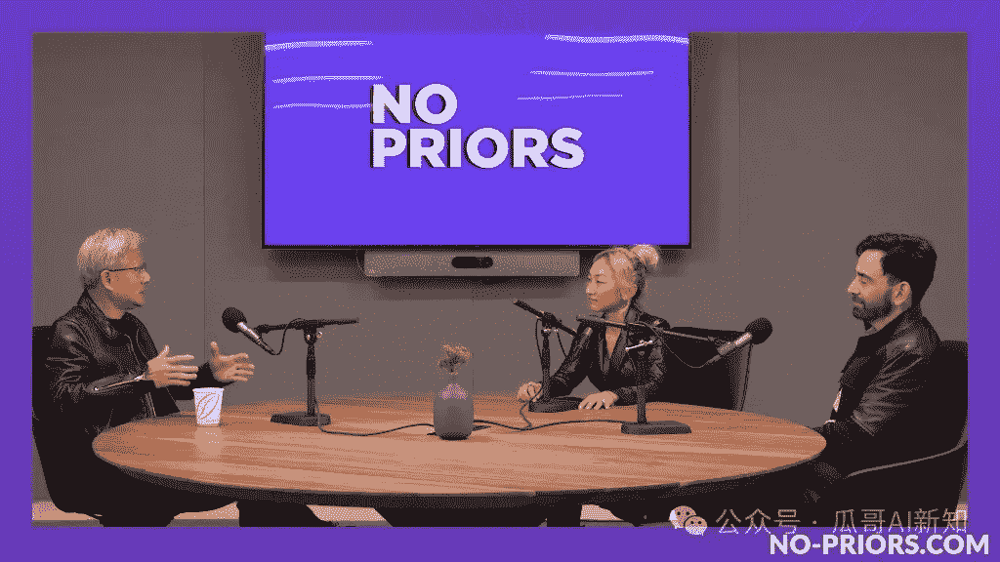
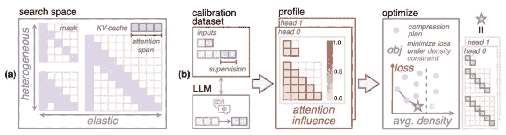
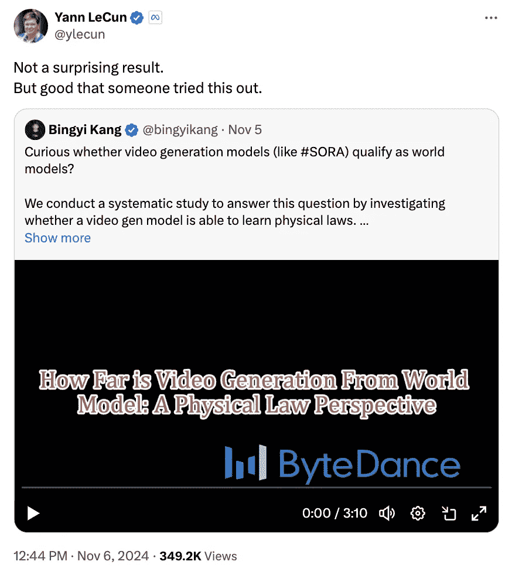
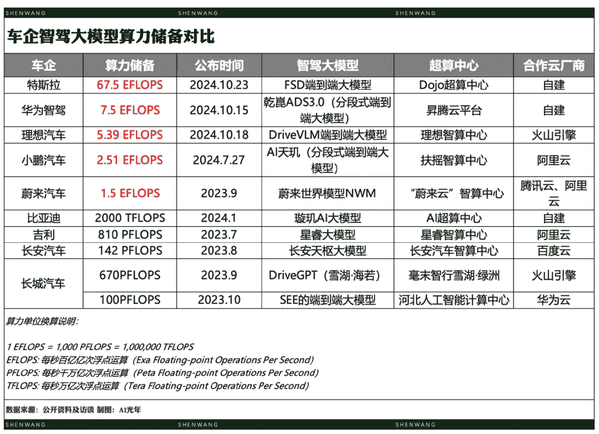
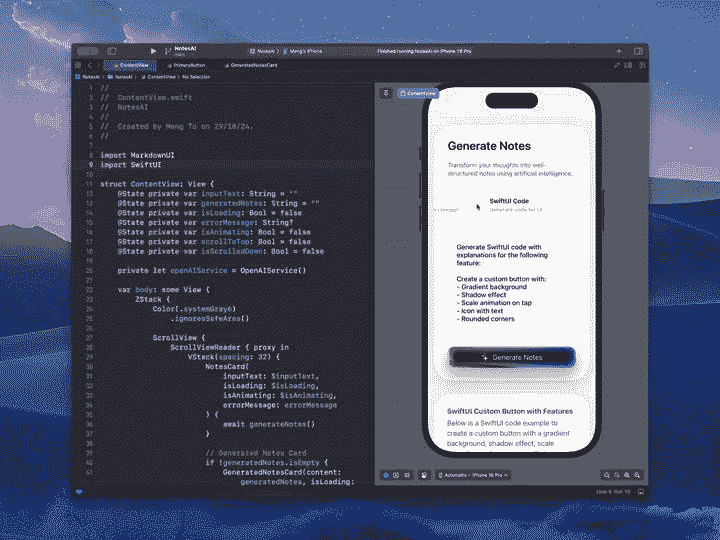
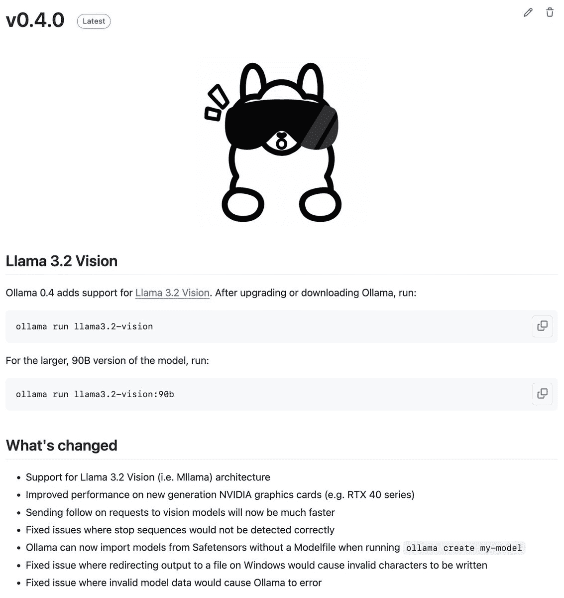
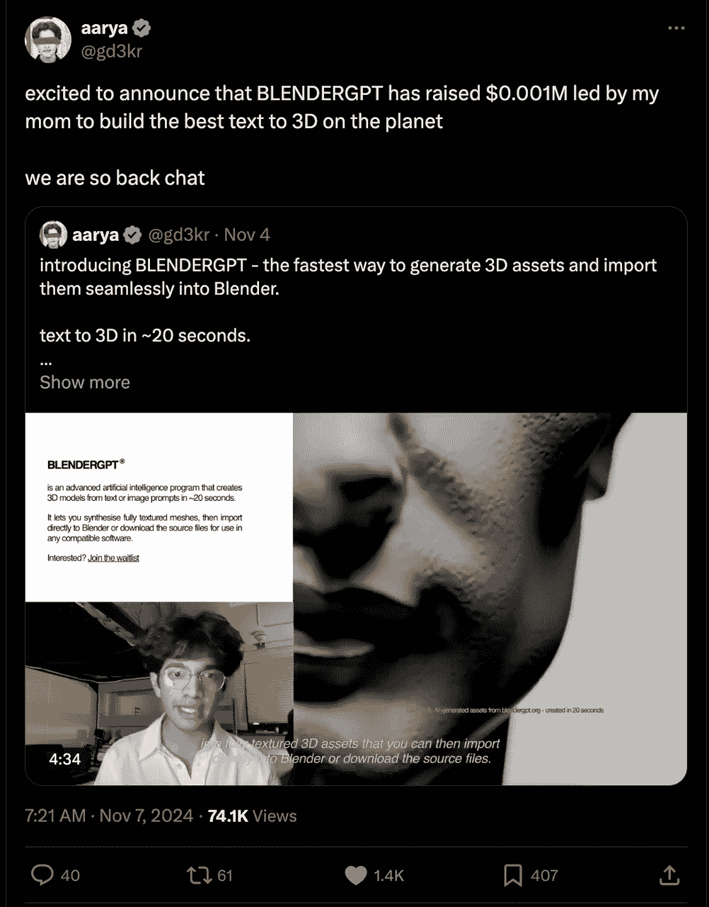

# 奇绩大模型日报（11月 8日）

> 来源：[https://miracleplus.feishu.cn/docx/HVOCdkw9yoUFkWxrXjFcisVXnBh](https://miracleplus.feishu.cn/docx/HVOCdkw9yoUFkWxrXjFcisVXnBh)

# 🔉潜空间活动报名

> 本期活动将在**11月9日** **10:00**开始，我们邀请到的嘉宾是**鱼哲**，Le**pton AI 创始成员，曾在阿里云担任高性能 AI** 平台产品负责人，专注于 AI 在多个行业的落地及应用。Lepton AI 致力于建立高效可用的AI 基础设施，让团队更关注于应用构建及落地。在本次分享中鱼哲将带来关于AI产品相关的思考，分享主题《Beyond Infra, what matters?—— 不同AI产品形态对团队的挑战》。

> 除嘉宾分享外，每期设置了【匹配合伙人 Cofounder Matching】环节。你可以和 GenAI 时代最有活力的创业者和研究者线下面对面交流，将有机会找到志同道合、有共同创业梦想的小伙伴。

> 报名通道已开启，欢迎扫描下方二维码报名。

# 资讯

### 交付“开箱即用”的AI数据中心、租用AI芯片设计师为自己工作

https://mp.weixin.qq.com/s/Qy740uAj1sm4Xb8wp_dVdQ

**计算的指数级增长:**  NVIDIA的目标是在未来十年内，每年将计算性能（以数据中心规模衡量）翻倍或三倍，同时将成本和能耗降低一半或三分之一。这将导致一种“超摩尔定律”的增长曲线。 实现这一目标的关键在于协同设计（co-design）和数据中心规模的计算。

**协同设计和全栈方法:**  为了实现指数级增长，NVIDIA 采用协同设计方法，即同时优化算法和架构。这包括在不同精度级别（FP64到FP4）之间进行切换，以及将网络作为计算结构的一部分。

**数据中心规模的计算:**  NVIDIA 将网络视为计算结构，并通过技术如NVLink，将数百个GPU整合为一个虚拟GPU，从而实现极低的延迟和高吞吐量，平衡了这两个通常相互冲突的需求。 他们将数据中心视为计算的基本单元，并构建了全面的、垂直整合的数据中心解决方案。

**训练和推理基础设施的可互换性:**  为训练构建的基础设施同样适用于推理。 大型模型用于训练和知识蒸馏，从而产生更小、更高效的模型，用于特定任务。

**CUDA生态系统和软件生产力:**  CUDA提供了稳定的基础，允许在软件层面上快速迭代。NVIDIA致力于维护其软件，确保其在不同硬件和平台上的兼容性，从而最大限度地提高软件开发者的生产力。

**快速部署大型AI集群的能力:**  NVIDIA展示了其为xAI快速部署一个拥有10万个GPU的超级集群的能力，这得益于其在供应链、软件集成和数字孪生方面的预先规划和准备工作。

**未来超级集群的挑战:**  构建更大规模的超级集群（例如，20万、50万甚至100万个GPU）将面临能源、供应链和资本等多重挑战。然而，NVIDIA 认为这些挑战并非不可克服。

**AI对科学和工程的影响:**  AI和机器学习正在彻底改变各个科学和工程领域，从芯片设计到材料科学、生物技术等。NVIDIA认为AI正成为这些领域中发现和创新的基础。

**AI芯片设计:**  AI已经成为芯片设计的关键工具，能够探索比人工设计更大的设计空间，并找到更好的局部最优解。

NVIDIA的未来：从电脑到工厂:  NVIDIA已经从简单的电脑制造商转型为构建“AI工厂”的企业，生产用于各种应用的“智能”——无论是机器人、软件还是其他形式的智能。 这种转型将对各个行业产生深远的影响。

**AI的具身化:**  NVIDIA 认为，AI和机器人技术即将融合，创造出例如自动驾驶汽车和具身机器人等应用，并最终实现更广泛的AI具身化。

**AI员工的出现:**  未来，AI将成为各种角色的“员工”，协助人类工作，从营销到供应链管理等各个领域。这些观点共同描绘了NVIDIA对未来AI和计算的愿景，强调了指数级增长、协同设计、数据中心规模计算、以及AI对各个行业和科学领域变革性影响的重要性。

### 无问芯穹提出混合稀疏注意力方案MoA

https://mp.weixin.qq.com/s/rjGAJfusY_CHSx3Q0SHVmg

随着长文本需求增加，大语言模型的注意力机制面临高计算成本和内存压力。传统稀疏注意力采用统一的稀疏模式，但难以适应各注意力头的不同需求，影响长文本处理效果。清华大学等团队提出的混合稀疏注意力（MoA）创新性地为不同注意力头配置独特稀疏模式，在保持25%注意力密度下实现接近100%上下文记忆力，大幅优化内存和计算资源利用。

MoA通过自动搜索最优稀疏策略，提高长文本信息检索的准确性和效率，相较基线方法，其在同等注意力密度下性能下降小于5%。MoA在Vicuna-7B和Llama-3-8B等模型上提高了检索和理解长文本的精度达1.5至7.1倍。其异质弹性规则的动态适配增强了长文本泛化能力，在12K输入长度下的压缩方案可延伸至256K长文本上，高效且精准。

MoA也显著提高运行效率，配合CUDA优化后，相较FlashAttention2和vLLM，MoA在7B和13B模型的解码吞吐量提升达6.6-8.2倍和1.7-1.9倍。

### 类Sora模型能否理解物理规律？

https://mp.weixin.qq.com/s/mwm6UgJByVOdnZHIgcMngA

字节豆包大模型团队的一项系统性研究，针对视频生成模型是否理解物理规律进行了深入实验。该研究通过基于DiT架构的视频生成模型，分析了模型是否能抽象出并泛化物理规则。实验发现，尽管扩大模型参数和数据量会在分布内泛化（ID）中有所改进，但模型依然无法理解并应用物理定律，尤其在分布外泛化（OOD）场景中表现较差。

实验原理与设计

实验中，团队利用物理引擎生成了匀速直线运动、弹性碰撞和抛物线运动等经典物理场景，用于训练视频生成模型，并验证其生成视频是否符合经典物理学定律。模型的泛化能力在三种场景中得到测试：分布内泛化（ID）、分布外泛化（OOD）和组合泛化（Combinatorial Generalization）。

1.  **分布内泛化（ID）**：模型学习了与训练数据相同的物理场景，能够较好生成符合物理规律的视频，随着模型规模和数据量增加，生成结果与物理规律越来越接近。

1.  **分布外泛化（OOD）**：当模型遇到从未见过的新场景时，生成的视频无法遵循物理定律，且扩展数据量和模型规模的影响有限，表明模型在推理新的物理场景时缺乏能力。

1.  **组合泛化**：在包含多个物体和交互的复杂场景中，随着训练模板数目的增加，模型的泛化能力提升，生成视频的质量和物理一致性也得到改善。

关键发现

+   **记忆和模仿依赖**：模型的行为主要依赖于记忆和对训练数据中的类似场景的模仿，而非抽象理解物理规律。特别是在速度和方向等属性上，模型倾向于模仿训练集中出现的情境，而非理解物理法则。

+   **组合泛化能力**：尽管模型可以处理不同物体间的组合与交互，但其能力仍受限于对底层物理规律的理解。扩展数据集和训练模板可以提升组合泛化，但仅依赖于这些方法并不能确保生成符合物理规律的视频。

+   **视频表征局限性**：模型在生成细粒度物理行为时存在误差，特别是在物体尺寸非常接近像素级别时，模型的判断能力受到视觉模糊性的影响，无法准确预测物理交互。

### 汽车厂商“批量生产”大模型

https://mp.weixin.qq.com/s/XvLYi1fgBneO4qsFQ3K-vg

汽车行业正处于电动化向智能化转型的关键阶段，纷纷涉足大模型技术，试图提升竞争力。然而，目前车企大模型的应用场景有限，难以达到互联网公司级别的Token使用量。以抖音等大模型公司为例，其每日Token使用量远超车企，显示出大模型在汽车行业的需求尚未充分释放。

当前，智能化的核心在于车内智能座舱和自动驾驶，两者对算力需求高。特斯拉引领算力布局，其100 EFLOPS的目标超越大多数车企的总算力。国内车企如比亚迪、蔚小理等也在积极扩充算力，部分依赖于云服务商如阿里云和火山引擎，后者在与车企合作中迅速崛起。

智能化发展中，AI人才的匮乏和算力的高要求使车企大多采取“双腿”策略，既自研又借力成熟供应商，如华为、百度、商汤等。在智能座舱方面，合作对象包括OpenAI、亚马逊Alexa等。

车企智能化是必答题，智能座舱和智驾将成为未来差异化竞争的放大器。然而实现智能化仍需数年，并存在技术门槛高、算力资源紧缺的问题。

### Mistral推出内容审查API，加强文本内容安全管理

https://techcrunch.com/2024/11/07/mistral-launches-a-moderation-api/

AI初创公司Mistral发布了一个新的内容审查API，用于识别和分类可能包含不良内容的文本。该API基于Mistral的聊天平台Le Chat的内容审核技术，可以根据不同应用的需求和安全标准进行定制。API采用了微调模型Ministral 8B，支持多语言（如英语、法语和德语）文本分类，可识别九种类别：性内容、仇恨和歧视、暴力和威胁、危险和犯罪内容、自残、健康、金融、法律及个人身份信息。

主要特性和优势

+   **灵活适配**：支持原始文本和对话文本的审核。

+   **安全策略导向**：分类标准根据当前最相关的政策类别设定，确保模型安全。

+   **异步处理模式**：支持批量API调用，减少25%的模型服务成本。

# 推特

### Meng To分享用 Cursor 和 Xcode 在 SwiftUI 中制作项目体验，新手友好

贡献人：

https://x.com/MengTo/status/1854522978652058081

我用 Cursor 和 Xcode 在 SwiftUI 中做了这个项目。

Claude AI 在 iOS 开发上表现真的很好。在 Cursor 中输入提示词，然后在 Xcode 中预览/构建。SwiftUI 让自定义样式和动画的应用变得非常简单。

如果你是新手，这真的很有趣。不需要安装任何库，也不需要运行服务器。Apple 提供了一切所需的工具。

[RrGo9edPq-ISqwVo.mp4](https://internal-api-drive-stream.feishu.cn/space/api/box/stream/download/all/FyDubXRoSoFo7Uxx4nBcdOgRnSe)

### 字节跳动发布X-Portrait 2：AI 唇同步工具，捕捉到与情感完美契合的自然面部表情

贡献人：

https://x.com/EHuanglu/status/1854543663785005439

介绍 X-Portrait 2：字节跳动的下一代 AI 唇同步工具

它将唇同步技术提升到了一个全新的水平！

不仅能够呈现出极其逼真的唇部动作，还能够捕捉到与情感完美契合的自然面部表情。

即使是快速讲话或侧脸也毫无问题！

[egfO3kv86h82GUP5.mp4](https://internal-api-drive-stream.feishu.cn/space/api/box/stream/download/all/FSDvbVFKtogW95xNvJRcmxWfnwf)

### 是否可以成为下一代树莓派？Pamir AI正在制作能承载3B模型的小芯片

贡献人：

https://x.com/fdotinc/status/1854574327783624728

介绍下一代树莓派：

一个可以在信用卡大小设备上运行的 AI 模型。

[bJYH_3bc6AsIGAYN.mp4](https://internal-api-drive-stream.feishu.cn/space/api/box/stream/download/all/FwS0bZzfLoeGlMx1pLXcCABnngf)

### Ollama 0.4 发布：支持 Meta 的 Llama 3.2 Vision 模型

贡献人：

https://x.com/ollama/status/1854269461144174764

Ollama 0.4 已发布，支持 Meta 的 Llama 3.2 Vision 模型（11B 和 90B）。

看看它的功能吧：👇👇👇

https://ollama.com/blog/llama3.2-vision

### BlenderGPT创始人宣布获得来自他妈妈领投的1000刀融资引热议

贡献人：

https://x.com/gd3kr/status/1854544826345152889

很高兴宣布，BLENDERGPT 获得了我妈妈领投的0.001百万美元（1000美元）融资，用于打造全球最好的文本到3D转换工具。

我们回来了，大家聊起来吧！

# 信号

### From Decoding to Meta-Generation: Inference-time Algorithms for Large Language Models

推荐人：

推特链接：https://x.com/srush_nlp/status/1854541184133480590

原文链接：https://arxiv.org/abs/2406.16838

ResearchFlow：https://rflow.ai/flow/c4c978f8-fbcc-43e5-8375-31a7d926dfb5（PC端食用更佳）

信号源：[Sasha Rush](https://x.com/srush_nlp)

研究节点：后训练

现代大型语言模型 (LLM)  研究中最引人注目的发现之一是，在训练过程中扩大计算规模可以带来更好的结果。然而，很少有人关注推理过程中扩展计算的好处。本次调查重点关注这些推理时间方法。我们在统一的数学形式主义下探索三个领域：令牌级生成算法、元生成算法和高效生成。令牌级生成算法（通常称为解码算法）通过一次采样单个令牌或构建令牌级搜索空间然后选择输出来进行操作。这些方法通常假设可以访问语言模型的逻辑、下一个标记分布或概率分数。元生成算法适用于部分或完整序列，结合领域知识，实现回溯并集成外部信息。高效的生成方法旨在降低代币成本并提高生成速度。我们的调查统一了三个研究团体的观点：传统自然语言处理、现代法学硕士和机器学习系统。

### Self-Consistency Preference Optimization

贡献人：

推特链接：https://x.com/jaseweston/status/1854532624116547710

原文链接：https://arxiv.org/abs/2411.04109

ResearchFlow：https://rflow.ai/flow/9eb6909e-3e1f-4d3c-bb15-7602941d9086（PC端食用更佳）

信号源：[Jason Weston](https://x.com/jaseweston)

研究节点：后训练

自对准是一个快速发展的研究领域，模型可以在没有人工注释的情况下学习自我改进。然而，由于难以分配正确的奖励，现有技术往往无法改善复杂的推理任务。已知可以提高正确性的正交方法是自一致性，这是一种在基于多重采样的推理时应用的方法，以便找到最一致的答案。在这项工作中，我们扩展了自我一致性概念来帮助训练模型。因此，我们引入了自一致性偏好优化（ScPO），它迭代地训练一致的答案，在无监督的新问题上优先于不一致的答案。我们表明，ScPO 在推理任务（例如 GSM8K 和 MATH）上比传统奖励模型训练有很大改进，缩小了与黄金答案或偏好的监督训练的差距，并且将 ScPO 与标准监督学习相结合可以进一步改善结果。在 ZebraLogic 上，ScPO 对 Llama-3 8B 进行了微调，使其优于 Llama-3 70B、Gemma-2 27B 和 Claude-3 Haiku。

### LoRA vs Full Fine-tuning: An Illusion of Equivalence

贡献人：

推特链接：https://x.com/emollick/status/1854648003715551641

原文链接：https://arxiv.org/abs/2410.21228v1

ResearchFlow：https://rflow.ai/flow/6c475c2a-5c20-4b9f-bb86-0ce9e6d60346（PC端食用更佳）

信号源：[Ethan Mollick](https://x.com/emollick)

研究节点：后训练

微调是使预训练的大型语言模型适应下游任务的关键范例。最近，低秩适应（LoRA）等方法已被证明可以与各种任务上完全微调的模型的性能相匹配，同时大大减少可训练参数的数量。我们通过从模型的光谱属性角度分析模型的权重矩阵，研究不同的微调方法如何改变预训练的模型。我们发现完全微调和 LoRA 产生的权重矩阵的奇异值分解表现出非常不同的结构；此外，在适应任务分布之外进行测试时，微调模型本身表现出明显的泛化行为。更具体地说，我们首先证明用 LoRA 训练的权重矩阵具有新的、高阶奇异向量，我们称之为{入侵者维度}。在完全微调期间不会出现入侵者尺寸。其次，我们表明，具有入侵者维度的 LoRA 模型尽管在目标任务上实现了与完全微调相似的性能，但预训练分布的模型变得更差，并且对顺序的多个任务的适应能力较差。即使在相同任务上的性能与较低等级的 LoRA 模型相当，较高等级、等级稳定的 LoRA 模型也能紧密反映完整的微调。这些结果表明，使用 LoRA 和完全微调更新的模型可以访问参数空间的不同部分，即使它们在微调分布上表现相同。我们通过研究为什么入侵维度出现在 LoRA 微调模型中、为什么它们是不受欢迎的以及如何将其影响最小化来得出结论。

# 产品

### Commerce Pro by CapCut

贡献人：

https://commercepro.capcut.com/

Commerce Pro by CapCut 是字节跳动推出的 AI 驱动的内容创作平台，可以让市场和社交媒体无缝集成。用户可以通过简单的产品链接生成可购物的视频广告、产品图片和社交媒体内容。该平台希望可以提升电商内容创作的效率，鼓励用户尝试并提供反馈，以便不断优化用户体验。

### CopilotKit

贡献人：

https://www.copilotkit.ai

CopilotKit 是一个开源框架，可以帮助开发者轻松将 AI 助手和代理集成到 React 应用中。它提供即时集成、上下文感知功能、100% 开源和可定制的 UI，降低了 AI 开发的复杂性。新推出的 CoAgents 功能允许嵌入专用 AI 代理，进一步增强应用的智能化能力。

# HuggingFace&Github

### LLM-engineer-handbook

贡献人：

https://github.com/SylphAI-Inc/LLM-engineer-handbook

这个项目是一个关于大型语言模型（LLM）的综合资源库，涵盖模型训练、部署、微调和应用开发等方面。它提供多种 LLM 应用开发框架，如聊天机器人和智能代理，收集大量相关数据集、基准测试和论文资源，并整理训练和部署的最佳实践。

### askrepo

贡献人：

https://github.com/laiso/askrepo

这个项目是一个源代码阅读助手，使用谷歌生成式 AI 模型，能够从 Git 管理的文本文件中提取信息并根据用户问题生成答案。主要功能包括从指定目录获取 Git 跟踪的文本文件、使用谷歌生成式 AI 模型回答问题，并提供命令行界面供用户指定目录、模型和问题。

### WebRL

贡献人：

https://github.com/THUDM/WebRL

WebRL 是一个基于自我进化在线课程强化学习的框架，用于训练 Web 代理，采用 AutoGLM 中的技术，专门针对 WebArena 环境进行训练，目的是构建开放式的 LLM Web 代理。该项目发布了两个预训练模型 checkpoint：WebRL-GLM-4-9B 和 WebRL-LLaMA-3.1-8B。

# 学习

### Robotics Diffusion Transformer 机器人基模型

贡献人：

https://zhuanlan.zhihu.com/p/5407629214

近年来，扩散模型在机器人操作领域展现出极大的潜力，尤其是为通用机器人的发展提供了重要支持。本文介绍了基于扩散模型的通用机器人模型RDT（Robotics Diffusion Transformer），展示了其在处理多模态、多任务环境中的优势。RDT-1B作为代表性模型，通过大量多模态数据预训练，并在特定任务上精调，实现了在复杂场景中执行多样化任务的能力。

RDT采用Diffusion Transformer架构，并通过域随机化、多模态编码、傅里叶特征映射等技术提升模型在复杂任务中的泛化能力。在编码过程中，低维物理量通过傅里叶特征映射，高维图像信息由预训练视觉编码器处理，语言信息则由基于T5-XXL的语言模型处理。同时，RDT引入Alternating Condition Injection (ACI) 交替注入策略，以防止不同模态间的信息损失。

实验表明，RDT在双臂机器人的任务上表现优越，尤其是在零样本、少样本场景中能够实现出色的泛化能力，如未见过的物体和新场景任务的处理。消融实验进一步验证了预训练和扩散模型的关键作用。此外，RDT创新性地设计了统一的动作空间，使其适用于不同机器人结构的数据集，展现出高效的多机器人控制能力。

RDT的成功展示了生成式模型在具身智能中的广阔应用前景，推动了具备通用交互能力的机器人基础模型的发展。

### 零基础怎么学机器人运动控制?

https://www.zhihu.com/question/554304300/answer/25513786705

本文介绍了四足机器人在复杂地形中的运动控制挑战，强调利用高保真仿真器和深度强化学习（RL）优化机器人策略，并在现实环境中实现无缝部署。以NVIDIA Isaac Lab和波士顿动力Spot机器人为例，展示了仿真与现实之间的差距如何通过高保真物理仿真、域随机化等技术来缩小，从而将虚拟训练的模型直接应用于物理机器人中。

首先，在安全环境下进行复杂的运动控制任务，如楼梯行走，通过Isaac Sim仿真器实现。仿真器结合GPU并行物理模拟，可大规模并行训练策略，显著加速训练。在Isaac Lab环境中，设计基于RSL-rl的多层感知器（MLP）神经网络，通过PPO优化算法进行强化学习训练。在4096个环境中进行训练，以NVIDIA RTX GPU在4小时内实现85,000到95,000帧每秒（FPS）的速度。

Isaac Lab支持域随机化，通过动态调整物理参数提高模型的鲁棒性，确保仿真模型能够适应现实场景。部署至物理机器人Spot时，采用高性能的Jetson AGX Orin以确保低延迟推理，使得策略模型能够快速响应现实环境中的状态变化。

部署流程进一步简化了仿真和现实环境的无缝衔接，开发者可以利用强化学习研究套件创建自定义任务，增加新的机器人模型、环境及奖励函数，以满足特定应用需求。

### 大家能分享一下当前博士就业的情况吗？

https://www.zhihu.com/question/559157484/answer/25240942309

以音乐生成方向为例，作者分享了自己从音乐人工智能方向博士毕业后，选择加入字节跳动Seed团队的过程，并描述了这个领域博士毕业生在高校和业界的主流出路。学术界虽然有机会从事前沿研究，但资源有限，而工业界则在算力和资源上更为充足，尤其是大模型研究的推动下，工业界的支持优势更加明显。

作者在找工作时，通过积累的行业联系获得了多个工作机会，并最终选择了字节跳动的Seed团队，原因包括团队的方向匹配、丰厚的薪资待遇、充足的计算资源，以及较强的科研支持环境。字节的Seed团队在音乐生成领域产出丰富，具备科研和技术转化的闭环能力，支持多个产品应用，如海绵音乐App。

作者提到字节的工作强度较高，但考虑到行业整体的高压力状态，他认为在职业上升期仍愿意接受挑战。

### Multi-Agent 多智能体系统可观测性研究

https://zhuanlan.zhihu.com/p/4691812521

本文研究了多智能体系统 (Multi-Agent Systems) 的可观测性问题，以提升智能体间的协作与管理效率。利用 OpenAI Swarm 框架，通过代码增强展示如何提升可观测性。为此，模拟了快递行业的多智能体系统，涉及多个智能体（如客服、订单处理系统、客户端 App、快递员、中转场等）以及它们间的调用关系。Swarm 的智能体间调用基于上下文决策，无需提前定义具体路由，利用函数调用链展示智能体之间的交互过程。

技术上，通过 Swarm 的 Agent 类为每个智能体定义功能，日志记录函数调用细节，并在 Swarm 的 debug 模式下观测中间数据，增加可观测性。本文还展示了如何保存运行结果，并通过 JSON 文件记录多智能体执行日志，为后续重放或分析提供数据。

为实现全面的可观测性，进一步建议保存 Swarm 运行结果，包含所有 function_call 和 tool_calls 详情，并利用 context_variables 记录函数调用日志。改进后的 Swarm 代码通过新增日志功能，实现了对多智能体交互的结构化可视化，包括角色划分、函数调用链和返回结果等。

### 推理规模化定律：LLM 求解问题的计算-最优推理实证分析

https://zhuanlan.zhihu.com/p/1466084440

本文探讨了大型语言模型 (LLM) 在推理阶段的最佳配置，重点分析推理策略和计算资源的权衡。研究涵盖贪婪搜索、多数投票、n 选一、加权投票和两种树搜索算法，比较不同模型大小及其在相同计算预算下的性能表现。实验表明，小模型（如 Llemma-7B）配合先进的推理策略，在成本和性能上更优。例如，带新型树搜索的 Llemma-7B 在 MATH基准测试中超过Llemma-34B，多数投票策略。

进一步引入了过程奖励模型 (PRM)，使模型对中间步骤进行奖励，有效选择低错误率的解答路径。在推理中，探索如何以最小的 FLOPs 达到最优性能（准确性），主要策略包括采样与树搜索。REBASE作为新提出的树搜索方法，通过PRM估计节点质量，相比 MCTS 计算更低，且在性能上可比或更优。

实验基于 MATH 和 GSM8K 数据集，测试多种模型大小和推理策略，尤其使用Pythia和数学专用的Llemma模型。此外，在MetaMath数据集上使用Llemma-34B作为奖励模型。推理配置中，通过不同的候选解采样和多次重复试验减少随机性影响，确保结果的稳健性。

### NV Switch 深度解析

https://zhuanlan.zhihu.com/p/5308258434

随着单一GPU计算能力接近极限，多GPU协同成为趋势。NVIDIA的NVLink技术为GPU间提供了高达PCIe 10倍的带宽，使得8个GPU在单服务器中可构建高速互联的立方体网格结构，从而避免CPU调度延迟，允许直接访问其他GPU的HBM2内存。NVSwitch则更进一步，支持全互联GPU系统，通过更丰富的NVLink接口，实现完全无阻塞的多GPU通信。

NVSwitch的进化

NVLink最早在Pascal架构中实现，后在Volta架构中伴随NVSwitch问世。Volta使GPU间通信速率达到300GB/s，而到Hopper架构，这一速率增至900GB/s，NVLink接口数从6扩展至18，极大优化了数据流通。DGX服务器平台展示了NVSwitch在高性能GPU集群中的应用，例如DGX-1 P100使用4条NVLink链路连接8个GPU，组成cube mesh结构；DGX-2引入6个NVSwitch，实现所有GPU全连接的直接通信，大幅提升性能。

DGX-A100则应用第二代NVSwitch，提供更高的带宽和更低的延迟，支持第三代NVLink链路，实现8块GPU的全连接。DGX-H100中则引入第三代NVSwitch，配合第四代NVLink，每张GPU卡支持18条链路，总带宽达3.6TB/s。

NVSwitch的技术架构

初代NVSwitch通过支持18个NVLink接口，为16个GPU的全互联提供支持，使每对GPU间实现50GB/s的双向带宽，利用率最高达80%。NVSwitch基于台积电12nm FinFET工艺制造，集成2亿晶体管，在仅100W功率下运行。通过GPU XBAR，NVSwitch提供非阻塞数据流，同时保持高带宽连接。

NVSwitch使用物理地址进行通信，减少了地址转换延迟，提升了数据访问效率。NVSwitch的多链路架构允许扩展到大规模GPU集群，每个GPU之间均可实现300GB/s的双向带宽通信，形成无阻塞、全互联的高效系统拓扑。

第三代NVSwitch的创新特性

第三代NVSwitch采用台积电4N工艺，提供64个NVLink 4端口，支持3.2TB/s全双工带宽，同时支持50 Gbaud PAM4信号技术，保证高速低延迟的信号传输。新引入的SHARP模块和NVLink模块进一步提升了集群通信和数据安全性。SHARP模块支持多种数据操作（如all_gather、reduce_scatter），并支持FP16和BF16格式，为AI和机器学习任务提供加速。新NVLink模块增强了安全性和灵活性，支持OSFP电缆，并具备前向纠错（FEC）和扩展遥测功能，提高了数据传输的可靠性和系统稳定性。

NVSwitch在系统构建中的作用

NVSwitch不仅大幅提升多GPU系统的扩展性，还简化了系统构建。每个GPU可通过多个NVSwitch互连，支持无阻塞数据传输和高带宽通信。其全双向带宽和交叉开关结构使数据传输具有唯一的无干扰路径，优化了大型集群的数据流动性和系统可靠性，适合高性能计算和AI加速器系统的构建需求。

通过NVLink与NVSwitch的协同设计，NVIDIA GPU可实现更高效的大规模并行计算，使其在AI和深度学习领域继续保持领先地位。

### Tensor Core 架构演进

https://zhuanlan.zhihu.com/p/5274320227

从NVIDIA的Volta架构开始，**其GPU架构针**对**深度学习进行了大**幅优化。Volta架构（2017年）首次引入Tensor Core，通过加速**矩阵乘法和累加操**作，将深度学习训练和推理性能提高3倍。紧接着的Turing架构（2018年）进一步增强Tensor Core功能，支持多精度整数计算（如INT8、INT4），提升吞吐量至Pascal架构的32倍，另引入了光线追踪技术。Ampere架构（2020年）新增TF32和BF16格式，并支持稀疏矩阵计算，大幅提升深度学习效率，引入NVLink技术提升GPU间数据传输效率。

**Hopper架构**（2022年）专注深度学习计算，推出FP8张量核心，并添加Tra**nsformer引擎，**去除RT Core，增强了Transformer模型性能。Blackwell架构（2024年）进一步支持生成式AI，GB200 Superchip在LLM推理上实现30倍性能提升，加入第二代Transformer引擎，支持FP4、FP6低精度计算，显著减少内存带宽需求，并引入MX Format以微缩量化提升计算效率。

从Volta到Blackwell，NVIDIA在每代架构中强化了深度学习硬件的创新，尤其是Tensor Core技术的迭代发展，使其对AI训练和推理的支持不断增强，推动深度学习技术的持续进步。

# 招聘公告

---

**奇绩创坛****由陆奇博士**于2019年创立，使命是在源头最大化驱动创新。奇绩研究组将研究模型理论、到投研战略分析、市场策划等不同背景的同学聚在一起，搭建GenAI时代独特的跨界人才社群。

## 🚀F**24实习岗位**

##### [行研-学术科研人才交流组实习生](https://miracleplus.feishu.cn/docx/Yn6rdf2iOoY2Rcx8yVNcUBYRnch#part-QkMcdeJmuob9uvxvV3qcLSzHn8g)

##### 行研-GenAI研究岗位-战略分析（偏产品）

##### Web / AI 全栈开发工程师实习生

## **火热开放中🚀**

##### 行研-GenAI研究岗位-前沿学术探索

##### 行研-GenAI研究岗位-战略分析（偏咨询）

##### 创新活动产品运营 （大模型系列活动产品运营）

> **点击**相关岗位可查看对应**岗位需求【JD】；**相关岗位投递请**扫描二维码**

> 欢迎**推荐/自荐**

> 期待在**奇绩创坛**遇见更好的你

---

# 声明

本文档仅供学习交流使用，版权归原作者所有，若涉侵权，请联系Jack Jin 15101136166

##

（欢迎在下方反馈您宝贵的意见！整理不易，觉得有用给AI日报小组点个赞👍吧！）

ChatGPT；Angela；Zijia Liu；Alex；Zeqi Tan；Tiezhen（HuggingFace）；Naixu；Lizhi；Peter；Suoman；Jack

学术分析报告：ResearchFlow -- 奇绩F23校友的开发的深度研究产品，PC端进入RFlow的分析报告，可直接点击节点右侧的小数字展开节点，登录后可在节点上直接“询问AI”，进一步探索深度信息

如果你有大模型相关的创业想法，欢迎来找我们聊聊～微信：15101136166

> 快邀请你的小伙伴们一起来读大模型日报吧！

> **【日报****知识库****】**这里是近期日报内容的汇总,欢迎大家查阅

> [大模型日报知识库(分享版)](https://miracleplus.feishu.cn/wiki/KapVwXfkriOBiskB0B2cUHxjnTh)

>

> 欢迎大家多多帮我们分享,转发~~

> 如果大家有任何的建议或者吐槽,欢迎随时找我聊天~

