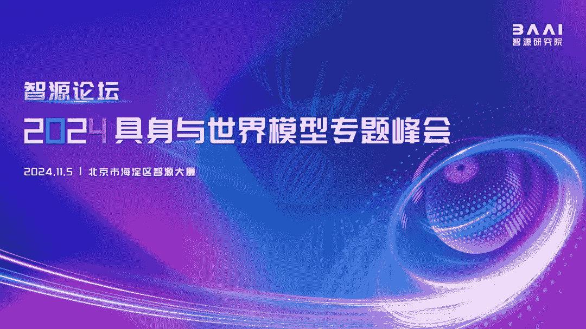
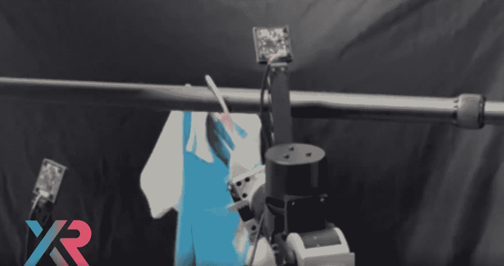
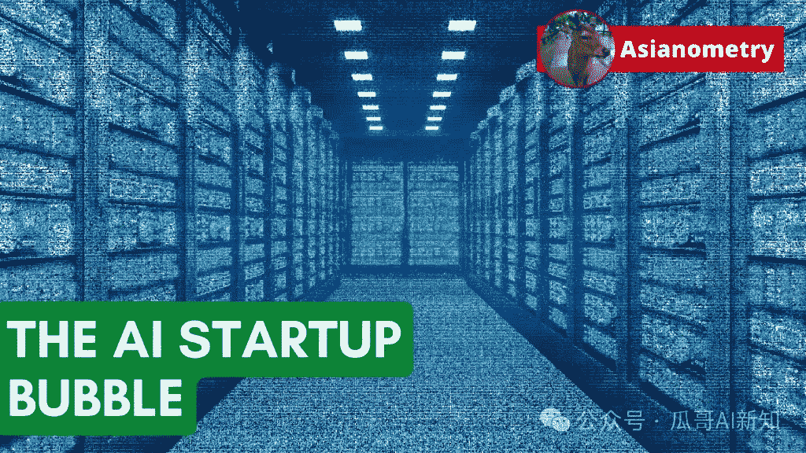
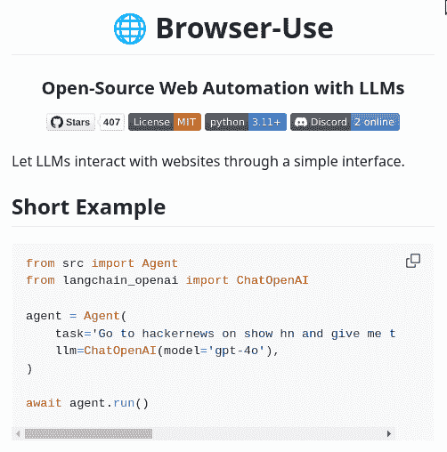

# 奇绩大模型日报（11月 7日）

> 来源：[https://miracleplus.feishu.cn/docx/M4midzQDxolSxoxSBiPcxVDnn3b](https://miracleplus.feishu.cn/docx/M4midzQDxolSxoxSBiPcxVDnn3b)

## 🔉潜空间活动报名

> 本期活动将在**11月9日** **10:00**开始，我们邀请到的嘉宾是**鱼哲**，Lepton AI 创始成员，曾在阿里云担任高性能 AI 平台产品负责人，专注于 AI 在多个行业的落地及应用。Lepton AI 致力于建立高效可用的 AI 基础设施，让团队更关注于应用构建及落地。在本次分享中鱼哲将带来关于AI产品相关的思考，分享主题《Beyond Infra, what matters?—— 不同AI产品形态对团队的挑战》。

> 除嘉宾分享外，每期设置了【匹配合伙人 Cofounder Matching】环节。你可以和 GenAI 时代最有活力的创业者和研究者线下面对面交流，将有机会找到志同道合、有共同创业梦想的小伙伴。

> 报名通道已开启，欢迎扫描下方二维码报名。


## 资讯

### Perplexity AI被起诉：AI搜索与创作者权益的平衡

`https://mp.weixin.qq.com/s/MnrWKRJzorLMEW7S7js-Hg`

News Corp 对 Perplexity AI 提起诉讼，指控其未经授权使用其内容，涉嫌侵犯版权。争议的核心是 AI 搜索引擎的未来，这些引擎能够从互联网上提取并总结信息，可能会取代传统的搜索引擎。像 Perplexity、Google 的 Gemini 和 OpenAI 的 SearchGPT 等 AI 搜索工具，能够更好地理解用户意图并汇总信息，但也可能威胁到数字经济，尤其是通过剥夺内容创作者的流量和曝光。

现行的版权法可能难以应对 AI 搜索带来的冲击，因为它们通常不保护“事实性”内容。各国政府可能会出台新法律来规范平台如何分享和补偿内容，如澳大利亚和加拿大的媒体议价法。然而，这些法律存在缺陷，主要针对传统媒体，忽视了其他内容创作者的权益。随着 AI 搜索的崛起，建立一个公平的数字内容市场变得愈发迫切，需要确保创作者根据其为 AI 平台提供的价值得到合理的回报。

目前，AI 公司已开始与出版商达成协议，但这些协议多偏向大公司。为了避免未来的监管，行业应当尽早构建一个更加公平的体系，让创作者获得应得的收益。如果这一问题得不到解决，AI 公司可能会继续偏向低成本的内容，从而进一步巩固少数巨头的主导地位，削弱互联网信息的多样性和质量。

### 智源论坛 2024 具身与世界模型专题

`https://mp.weixin.qq.com/s/Ahai0QE_2p-N2w_iLXVmqw`

在2024智源论坛上，学术界和产业界的专家们围绕具身智能和世界模型展开了深入讨论。会议重点关注以下几个问题：

1. Scaling Law 在机器人领域的应用：参数规模越大，模型性能越强的“Scaling Law”已在大模型领域得到了验证。如何将这一原则有效应用到机器人领域，是产业面临的挑战。智源研究院的院长王仲远介绍了多模态大模型Emu3，证明了Scaling Law在多模态大模型中的可行性。仉尚航也展示了基于Scaling Law的多模态大模型，如RoboMamba和MR-MLLM，致力于通过构建更强的泛化能力和推理能力，推动机器人技术的进步。

2. **4D世界模型的探索**：具身智能面临的最大问题之一是缺乏足够有效的数据，如何为机器人提供有用的数据成为关键。王鹤教授提出，合成数据和4D数据或许是解决方案。4D数据的使用可以提高机器人的深度感知能力，从而更好地适应复杂的任务。与此同时，谷歌和DeepMind推出的Open X-Embodiment数据集为机器人的ImageNet时刻铺平了道路，RT-1和RT-2模型在此基础上不断取得突破。

3. **机器人的感知与决策问题**：尽管机器人已经能够执行许多复杂任务，但在实际操作中，机器人往往缺乏判断能力。清华大学赵明国教授展示的机器人足球赛中，机器人无法在空门面前判断是否进球，暴露了机器人在灵活决策和动作执行中的短板。解决这一问题的关键在于设计和训练机器人能够根据不同的任务和功能进行有效的协调。

4. **触觉感知在机器人中的应用**：乐聚机器人创始人冷晓琨表示，工业场景中的机器人需求已经足够支撑一个新的产业，而触觉感知技术对于机器人的精准操作至关重要。例如，在装配任务中，机器人需要通过触觉感知来判断螺栓的紧固程度。王煜教授团队在高动态触觉传感器领域的突破，正为机器人的精确操作提供新的支持。

5. 硬件、数据、算法、芯片的协同进化：具身智能的进步不仅依赖于数据、算法和算力，硬件的革新也是推动该领域发展的关键。智源研究院副院长林咏华在圆桌讨论中提出，尽管每个要素面临挑战，但数据的开放性和标准化尤为重要。学术界和产业界需更多合作，建立低成本且易于复制的数据平台，以促进具身智能的快速发展。



### 专访自变量机器人团队

`https://mp.weixin.qq.com/s/Mwt-NuGPUcsLSNPxxapdAA`

WALL-A：端到端统一具身大模型

WALL-A被自变量机器人定义为“全球最大规模的端到端统一具身大模型”。其核心优势体现在两个方面：首先，它能处理极为复杂的任务，如拉拉链、整理衣物等，这些任务通常涉及到复杂的物理拓扑结构和大量的随机性。其次，WALL-A具备出色的泛化能力，能在极少的样本下完成任务迁移，适应不同物理环境和动作模式，体现出与传统机器人系统的根本不同。

**大统一模型的优势**

自变量机器人强调，WALL-A并不仅仅是一个传统意义上的大模型，它采用了“端到端”和“统一模型”的设计理念。端到端的设计意味着从原始的视频和传感器信号到最终的动作控制，所有步骤都由同一个模型完成，避免了分层方法带来的噪声和不一致。统一模型则意味着所有的任务都在同一个模型中进行训练和推理，不需要针对每个任务设计不同的系统或模型，这一方法与传统的机器人技术大为不同。

这与PI的策略非常相似，而这种“端到端”和“统一模型”的设计路线，正是自变量机器人区别于其他竞争者的关键所在。王潜（自变量机器人创始人）指出，这一模型的创新不仅仅是规模上的突破，更是在机器人任务的通用性和泛化能力上的革命。

**团队背景与技术探索**

自变量机器人的技术团队由一批资深的AI和机器人领域专家组成。王潜，创始人兼CEO，是清华大学的校友，并且是全球最早在神经网络中引入注意力机制的学者之一。他在机器人学习方面的多项前沿研究为公司技术路线的奠定提供了深厚的理论基础。与他一起工作的是联合创始人兼CTO王昊，他在大模型和多模态技术方面具有深厚的背景，并领导了中国首个百亿级大语言模型的研发。

这支团队的优势在于深刻理解机器人技术的瓶颈和挑战，特别是在数据获取和机器人操作领域的困难。自变量机器人从成立之初便致力于推动端到端的统一大模型这一方向，正是因为他们看清了机器人领域发展面临的天花板，认为只有这一方向才能突破现有的技术局限。

Scaling Law：数据质量和规模的挑战

团队对机器人领域的“Scaling Law”也有独特见解。王潜和王昊认为，在大模型的发展过程中，数据的质量比数据量更加关键。尽管大规模数据在某些情况下有助于提升模型的表现，但最终决定模型效果的关键是数据的质量，特别是在机器人任务中，训练数据的多样性和质量比单纯的数据量更为重要。

这种数据质量的关键性在自变量机器人的实践中得到了验证，尤其是在进行大规模训练时，模型在质量较高的数据集上表现出了极大的提升，而在低质量数据集上则表现不佳。这一点与传统理解中的“规模决定一切”有着本质的区别。

**通用机器人与具身智能的未来**

自变量机器人认为，具身智能的核心是通过与物理环境的互动来实现学习，这种方式能够突破语言模型和视觉模型在理解现实世界中的局限性。他们认为，具身智能模型的普及将为AI领域带来革命性的变化，使得机器人不仅能完成单一的任务，而是能够广泛适应复杂的物理世界中的多种任务，具备更高的通用性和灵活性。

目前，虽然全球有多家初创公司都在开发类似的端到端大模型，国内的自变量机器人却依然是唯一一个完全专注于这一技术路线的公司。他们的目标是通过不断迭代和优化WALL-A模型，最终实现类似“ChatGPT”在机器人领域的突破。



### OpenAI收购`Chat.com`

`https://techcrunch.com/2024/11/06/openai-acquired-chat-com/`

OpenAI已收购域名`Chat.com`，并将其重定向至其AI聊天机器人ChatGPT页面。根据OpenAI发言人确认的消息，Chat.com是互联网上较早的域名之一，于1996年注册。去年，HubSpot的联合创始人兼CTO Dharmesh Shah以1550万美元购买了该域名，成为历史上第二高的公开域名交易。

去年3月，Shah宣布他已经将`Chat.com`卖给了一个未透露姓名的买家。直到今天，Shah在X平台发布消息确认OpenAI是买家，并暗示交易可能以OpenAI股票支付。然而，尽管OpenAI收购了该域名，但并未改变其运营，表明OpenAI并未将ChatGPT托管在`Chat.com`上，因此这次收购并不意味着品牌的重大变化。


### 油管大V Asianometry直击AI创业泡沫

`https://mp.weixin.qq.com/s/Gq5P7iRshhaxbdiPI0071w`

**AI创业公司估值过高**

许多AI创业公司目前的融资估值远高于其实际收入。例如，Sierra公司以40亿美元估值融资，然而其收入与估值不符，市销率高达200倍。类似的高估值还存在于Perplexity AI、Imbue和Glean等公司，这些公司的市销率普遍高达80倍以上，远高于OpenAI的42倍市销率。作者质疑，这些公司是否能为投资者带来相应回报。

**名人驱动型融资**

很多AI初创公司的高估值与创始人的“AI名人”身份有关，而不仅仅是基于公司商业基本面。像Brett Taylor、Ilya Satskover等著名人物的背景成为吸引投资者的重要因素。作者将其与流媒体泡沫时期的名人效应作对比，认为这种依赖名人的融资方式并不一定代表公司本身的价值。

**高昂的成本与竞争压力**

AI应用的经济效益具有挑战性，尤其是训练和运营成本较高。此外，AI技术更新速度快且容易被竞争对手复制，使得早期的技术优势难以维持。作者将其与硬盘驱动器行业的兴衰进行对比，认为AI初创公司面临类似的生存压力。

**大型科技公司持续投资**

尽管创业公司面临泡沫，大型科技公司（如亚马逊、微软、谷歌、台积电）仍在积极投资AI基础设施。这表明，尽管创业公司可能面临困境，但整体AI市场仍然有巨大的发展潜力。

**经验丰富的投资者应对泡沫**

经验丰富的风险投资者能够管理风险，即便部分投资失败，他们也能通过其他策略实现软着陆。例如，Inflection AI虽未成功挑战GPT，但与微软的协议帮助其员工和投资者减少损失。

**泡沫的积极意义**

作者将AI创业公司泡沫视为推动技术创新和市场检验的积极过程。即使很多公司会失败，但这些实验和资本的流入最终会促进更大的发展，少数成功公司将改变行业格局。



## 推特

### Composio SWE-Kit：专为编码代理设计的开源工具包和无头IDE，适合希望在企业环境中或个人项目中部署自定义编码代理的开发者

贡献人：

`https://x.com/KaranVaidya6/status/1854216864874025359`

今天，我们很高兴宣布推出 Composio SWE-Kit，这是一款专为编码代理设计的开源工具包和无头IDE！🛠️✨

我们也自豪地分享，使用 SWE-Kit 构建的编码代理已在 SWE Bench 排行榜上实现了最先进的性能，树立了新的标准！

作为开发者，我们深知每位开发者都非常看重灵活性和透明度。因此，我们设计了 SWE-Kit，使其完全可定制，支持100多种应用（如 GitHub、Slack 和 Linear），并兼容所有主流的代理框架和大型语言模型（LLMs）。

这款工具非常适合希望在企业环境中或个人项目中部署自定义编码代理的开发者。

查看我们在 @LangChainAI (LangGraph) 上的最先进代理→ `https://composio.dev/swe-kit/`

在 @Replit 上查看我们的代理 → `https://replit.com/@soham16/Composio-SWE-Agen`


[0M-RYyjnQyrJW8fb.mp4](https://internal-api-drive-stream.feishu.cn/space/api/box/stream/download/all/DtRYbV5rjo5zOnxJUg6cwmp2n0e)

### 3DTopia AI：文本到3D模型，能在几分钟内创建完整的电影场景

贡献人：

`https://x.com/EHuanglu/status/1854185357333741872`

3DTopia AI：这个文本到3D模型能在几分钟内创建完整的电影场景！

3D AI 正在前所未有的速度进步！

我坚信，AI驱动的3D将成为AI电影制作的终极工具。我们终于能够在保持一致性的前提下实现完全的创意控制。

虽然还没完全实现，但我们每天都在不断接近这个目标。


[njvZyHdt89rBeeCh.mp4](https://internal-api-drive-stream.feishu.cn/space/api/box/stream/download/all/My2abZQuvoIZyuxg129cUjY1nvc)

### FLUX1.1 [pro]现已新增高分辨率功能：功能扩展至支持4倍更高的图像分辨率

贡献人：

`https://x.com/bfl_ml/status/1854187828923531558`

今天，我们很高兴分享 FLUX1.1 [pro] 现已新增高分辨率功能。其功能扩展至支持4倍更高的图像分辨率（最高达4MP），同时每个样本的生成时间仅需10秒，保持令人印象深刻的效率。


贡献人：

`https://x.com/tom_doerr/status/1854219509382651991`

“开源的网页自动化库，适用于任何大型语言模型（LLM）。”

---

“浏览器使用

开源网页自动化与LLM集成

通过简单的界面，让LLM与网站进行交互。”



### Midjourney分享超酷用例：3D爱好者Moonlitmaverick的作品示例

贡献人：

`https://x.com/midjourney/status/1854247177100628132`

我们看到许多非常酷的创意工作流程正在使用我们的重新纹理功能和3D建模软件。来看一下3D爱好者Moonlitmaverick的这些作品示例，他使用Zbrush和Midjourney来构想外星世界的生物。


## 信号

### Vocal Sandbox: Continual Learning and Adaptation for Situated Human-Robot Collaboration

推荐人：

推文链接：`https://x.com/siddkaramcheti/status/1854057772897157288`

原文链接：`https://arxiv.org/abs/2411.02599`

信号源：percyliang

研究节点：具身

我们推出了 Vocal Sandbox，这是一个用于在特定环境中实现无缝人机协作的框架。我们框架中的系统的特点是能够适应并在多个抽象层次上从不同的教学模式（例如口头对话、对象关键点和动觉演示）中持续学习。为了实现这种适应，我们设计了轻量级且可解释的学习算法，使用户能够在机器人教授新行为时实时理解并共同适应机器人的能力。例如，在演示了“跟踪”物体的新低级技能后，当用户被要求跟踪新物体时，系统会向用户提供机器人预期运动的轨迹可视化。同样，用户通过口语对话教授高级规划行为，使用预先训练的语言模型来合成诸如“收拾物体”之类的行为作为低级技能的组合——可以重复使用和构建的概念。


### Embodied Agent Interface: Benchmarking LLMs for Embodied Agents

推荐人：

推文链接：`https://x.com/ManlingLi_/status/1854041025146404897`

原文链接：`https://embodied-agent-interface.github.io/`

信号源：percyliang

研究节点：具身

我们提出了一个通用接口（Embodied Agent Interface），它支持各种类型任务的形式化和基于LLM的模块的输入输出规范。具体来说，它使我们能够统一 1) 涉及状态和时间扩展目标的广泛的具体决策任务，2) 四种常用的基于 LLM 的决策模块：目标解释、子目标分解、行动排序和过渡建模，3）一系列细粒度指标，将评估分解为各种类型的错误，例如幻觉错误、可供性错误、各种类型的规划错误等。总的来说，我们的基准提供了对LLM的全面评估不同子任务的性能，查明LLM驱动的具体人工智能系统的优势和劣势，并为在具体决策中有效和选择性地使用LLM提供见解


# 产品

## Sona

贡献人：

https://sona.wtf/

Sona 是一款基于人工智能的转录和总结工具，能够将面对面的对话转化为高精度的文本记录，支持 99 种以上语言。它提供智能总结、实时更新和便捷分享功能，提高用户的生产力，适用于会议、讲座和访谈等场合。


## Video Ocean

贡献人：

https://video-ocean.com/

Video Ocean 是一款快速将文本和图像转化为视频的工具，可以简化视频制作过程。用户只需输入文本或上传图像，便可轻松生成专业级视频，适用于社交媒体、宣传材料和个人项目等。


# HuggingFace&Github

## chat nio

贡献人：

https://github.com/zmh-program/chatnio

Chat Nio 是一个功能强大的 AIGC 一站式商业解决方案，结合了强大的 `API` 分发系统和美观的用户界面，满足 B 端和 C 端用户需求。它支持多种 AI 模型（如 `OpenAI` 和 `Midjourney`），提供完整的 `Markdown` 和 `LaTeX` 支持，具备文本到图像转换、对话同步、文件解析等功能，并支持多主题切换和国际化。


# 投融资

## Miros成功获得600万欧元融资，重塑视觉搜索技术

https://miros.ai/miros-raises-e6m-to-reimagine-visual-search-technology/

Miros，一家领先的视觉人工智能电子商务搜索解决方案公司，近日宣布完成600万欧元的Pre-Series A融资。此次融资由`EBRD Venture Capital`和`Tera Ventures`领投，爱沙尼亚前总统托马斯·亨德里克·伊尔韦斯（`Toomas Hendrik Ilves`）等天使投资人参与。

Miros致力于解决全球电子商务中由于顾客无法找到所需商品而导致的巨大销售损失——这一问题规模达到2万亿美元。借助Miros的视觉AI技术，用户可以在不到60秒的时间内通过视觉搜索快速找到商品。Miros的客户包括`Carousell`（新加坡）、`momox fashion`（德国）、`Jomashop`和`Revolve`（美国）以及`Hepsiburada`（土耳其）。

这笔资金将用于增强研发、进一步开发技术并扩大市场影响力。Miros计划通过其创新的视觉搜索技术，帮助零售商提供更直观的购物体验，提升产品发现和转化率，从而提高销售业绩和客户忠诚度。

公司官网：https://miros.ai/


# 学习

## vLLM推理加速与参数配置

贡献人：

https://zhuanlan.zhihu.com/p/3722264996

### 一、背景介绍

大模型推理引擎是加速大型AI模型响应、降低计算资源消耗的关键工具，具备优化模型计算图、支持多硬件平台、提供模型压缩和知识蒸馏技术等特点。主要推理引擎有`TGI`、`vLLM`、`SG-Lang`和`lmdeploy`。

+ `TGI`：由`Hugging Face`开发，存在CPU和GPU调度串行问题，导致GPU闲置、吞吐量下降。社区活跃度低，更新慢。

+ `vLLM`：开源推理加速框架，利用`PagedAttention`高效管理缓存张量，实现快速部署。但功能过多，代码复杂，二次开发困难。`v0.6.0`之前CPU和GPU调度串行。

+ `SG-Lang`：基于图结构的推理引擎，擅长处理图数据和知识图谱，吞吐性能最佳，便于二次开发。社区活跃度较低，核心团队来自交大。

+ `lmdeploy`：推理性能是`vLLM`的1.8倍，CPU调度策略最优，对国内GPU硬件支持好。社区活跃度不如`vLLM`。

**小结**：若不具备二次开发能力，需快速部署，`vLLM`是最佳选择。

### 补充问题

1. Ollama是大模型推理引擎吗？

   不是。`Ollama`旨在简化本地运行`LLM`，适合个人或小规模使用，不专注于推理加速和资源优化。

1. Xinference是什么？为何与`vLLM`组合使用？

   `Xinference`是高性能大模型分布式推理平台，将大模型变成可通过`API`访问的服务。支持多种推理引擎，如`vLLM`、`SG-Lang`等。若需处理多种模型和任务，`Xinference`更适合；若专注于大型语言模型推理且GPU资源受限，`vLLM`优化更好。

---

### 二、vLLM介绍

#### 1. `vLLM`为何能加速推理？

核心是`PagedAttention`技术，使`KV`缓存无需连续存储，解决内存瓶颈。结合连续批处理、`CUDA Graphs`、模型量化、模型并行、前缀缓存、推测解码等技术，大幅提升推理速度和资源利用率。

#### 2. 安装要求

+ **版本**：`v0.6.3.post1`

+ **CUDA**：`12.0`及以上

+ **Python**：`3.8 – 3.12`

+ **依赖**：对`PyTorch`和`CUDA`版本有强依赖

#### 3. 安装方式

+ `pip`安装：`pip install vllm`（推荐）

+ `Docker`安装：官方镜像`vllm/vllm-openai`

+ 不推荐`conda`安装：存在`NCCL`库加载问题

#### 4. `vLLM 0.6`提升

`v0.6`版本吞吐量提升1.8至2.7倍，主要优化了阻塞GPU执行的CPU开销。

---

### 三、vLLM参数配置

#### 1. `tensor_parallel_size`分布式推理

+ **单卡**：无分布式推理

+ **单机多卡（张量并行）**：将模型参数分割到多个GPU上，如4卡设置`tensor_parallel_size=4`

+ 多机多卡（张量并行+流水线并行）：结合张量并行和流水线并行，如2节点各8卡，设置`tensor_parallel_size=8`，`pipeline_parallel_size=2`

**小结**：根据GPU数量和硬件配置选择合适的并行策略。

#### 2. 量化（Quantization）

支持多种量化方法，如`AWQ`、`GPTQ`等，需根据模型和`vLLM`版本选择。

```python
llm = LLM(model="TheBloke/Llama-2-7b-Chat-AWQ", quantization="AWQ")
```

**小结**：根据模型和需求选择适当的量化方法。

#### 3. `enforce_eager`参数

控制是否始终使用`PyTorch`的`eager`模式。默认`False`，使用`eager`和`CUDA Graph`混合模式。

+ **启用（`True`）**：减少内存需求，但可能降低性能

+ **禁用（`False`）**：提高性能，但占用更多显存

**小结**：根据模型大小和性能需求决定是否启用`enforce_eager`。

#### 4. `gpu_memory_utilization`

控制GPU显存使用比例，默认`0.9`。设置过高可能导致显存不足，过低则未充分利用。

#### 5. `max_model_len`

控制模型的上下文长度，应小于模型的`max_position_embedding`，并根据显存需求调整。增大上下文长度会增加显存占用。

**补充**：输出长度通过`max_tokens`控制，应不超过上下文长度限制。

#### 6. `OOM`问题解决

+ 调整`max_model_len`：减小值以减少显存需求

+ 调整`gpu_memory_utilization`：降低显存占用

+ 启用`enforce_eager`：减少显存，但可能影响性能

+ 使用`tensor_parallel_size`：通过张量并行分布模型，降低单卡显存压力


## SOSP 2024 论文评述 Day 1 Session 3 Deep Learning and Training

https://zhuanlan.zhihu.com/p/5103979653

**`Reducing Energy Bloat in Large Model Training`**：提出了`Perseus`框架，通过动态调整每个GPU的运行频率，以降低训练大型模型时的能量膨胀。论文将能量膨胀分为“内在膨胀”（由GPU间计算不平衡引起）和“外在膨胀”（由多个管道并行速度不一致引起）。`Perseus`通过有向无环图（`DAG`）表示训练过程，在线进行能量调度。测试显示，`Perseus`对`GPT-3`和`Bloom`训练节省了30%的能耗。

**`Uncovering Nested Data Parallelism and Data Reuse in DNN Computation with FractalTensor`**：`FractalTensor`框架针对`DAG`模型抽象的局限性，提出使用嵌套的多维数据流图（`ETDG`）来表示深度神经网络（`DNN`）的复杂依赖关系，提升并行性。测试显示，`FractalTensor`在`RNN`等模型中性能提升达5.45倍。

**`Enabling Parallelism Hot Switching for Efficient Training of Large Language Models`**：`HotSpa`系统实现了大模型训练过程中根据序列长度动态切换并行策略，降低了长序列对短序列训练的影响。设计了统一表示和图编译器，支持不同并行策略的热切换。测试表明，与传统静态并行相比，`HotSpa`在`LLaMA2`模型上的训练速度最高提升2.99倍。

**`Tenplex: Dynamic Parallelism for Deep Learning using Parallelizable Tensor Collections`**：`Tenplex`系统利用可并行张量集合（`PTC`）实现了深度学习任务的动态GPU调整。`PTC`确保任务状态的一致性和低开销的多维并行性扩展。实验显示，`Tenplex`能够在资源动态变化中高效调整GPU资源。

**`ReCycle: Resilient Training of Large DNNs using Pipeline Adaptation`**：`ReCycle`系统利用流水线中的“气泡”隐藏节点故障开销，提出了自适应调度、分离式反传和交错式优化器。测试表明，在节点故障情况下，`ReCycle`吞吐比`Oobleck`高46%，比`Bamboo`高64%。


## LLM实践--拒绝采样

https://zhuanlan.zhihu.com/p/4547529049

拒绝采样是一种常用的蒙特卡罗方法，用于在目标分布难以直接采样的情况下，通过建议分布生成样本。拒绝采样的前提是原始分布已知，且需要找到一个易于采样的建议分布 `q(x)` 和常数 `C`，确保对于任何样本 `x`，`p(x) ≤ C q(x)`。样本从建议分布生成后，以 `p(x) / (C q(x))` 的概率保留，构成目标分布 `p(x)` 的样本。

相比于重要性采样，拒绝采样的目标是生成服从目标分布的样本，而非用于估算期望值。

具体例子：设已知目标分布为 `p(x)`，其密度函数复杂，直接采样困难。通过定义 `q(x)` 为正态分布并选择 `C` 值，即最大值满足 `p(x) ≤ C q(x)`。这样从正态分布中生成样本，再以 `p(x) / (C q(x))` 的概率筛选即可。在代码实现上，正态分布 `q(x)` 被定义为建议分布，通过求解 `C` 来确保分布条件满足后进行采样。测试显示采样结果与目标分布匹配，验证了拒绝采样的有效性。

应用场景：在大语言模型（`LLM`）领域，拒绝采样被用于生成符合特定分布的训练数据。例如在无原始数据的情况下，可以用现有数据上的模型概率加拒绝采样来估算预训练数据分布。这种方法可以为模型生成符合目标分布的数据。实验中，`Qwen`模型应用此方法，通过拒绝采样观察各数据集偏差，利用开放的`Qwen`模型对不同版本的数据进行分布拟合。

拒绝采样训练：拒绝采样也被应用于强化学习中的生成模型训练（如`PPO`），使用一个奖励模型筛选生成的样本，并替换训练数据中的低质量答案。需要注意的是，奖励模型的`OOD`（Out-of-distribution）问题可能导致不良样本权重过高，从而降低模型效果。

对比`SFT`、`DPO`和`PPO`：在生成模型训练中，`SFT`通过next token loss优化联合概率 `P(x_1, x_2, ..., x_t)`，适合生成模型。`DPO`则通过判别loss选择较优样本，但不适合生成模型。`PPO`继承了拒绝采样优点，通过`reward`模型引导生成，稳定性增强，但需要频繁裁剪loss以应对不连续变量带来的波动。


## CoRL 2024收录情况

https://zhuanlan.zhihu.com/p/4811260834

在手部触觉方面，展示了基于人工智能的灵巧操作、拟人化机器人手的远程操作、手持物体旋转技术以及视觉和触觉结合的精细操作等。特别是在开源灵巧机器人手上，展示了人类学习的应用，以及利用声学振动进行物体感知等创新技术。

在移动操作方面，会议介绍了长视距移动操作和零样本部署策略，展示了边缘设备上实时的3D映射、导航和语义分割应用，并探讨了开源全向移动机器人在机器人学习中的应用。

运动控制方面，展示了基于离线数据集的实时腿部运动控制、四足机器人的安全跳跃、以及人形机器人在复杂地形上的适应性训练等技术进展。

人机交互方面，会议展示了多功能仿生机器人头部在沉浸式人机交互中的应用，而远程操作领域则展示了利用增强现实和运动学重定向算法提升的远程操作体验。

许多与机器人学习和规划相关的论文引起关注，如基于大规模视觉-语言模型的开放世界抓取、多任务学习策略以及基于模拟和强化学习的操控技能提升。特别是在机器人操作和导航方面，有多个论文提出了新的方法和框架，如基于语言优化的少样本模仿学习，以及自主的指令跟随能力。

此外，会议还展示了在机器人操作、感知和自主驾驶等领域的最新研究，包括通过视觉-语言系统进行战略抓取、基于`LiDAR`的3D场景理解等。自动驾驶领域的应用也受到关注，提出了针对随机环境的运动规划方法和大规模视觉语言模型的融合应用。


## 技术笔记-LLM的格式化输出和工具调用

https://zhuanlan.zhihu.com/p/4411059840

调用外部工具是`Agent`与`LLM`的一个重要区别。实现这一功能的核心步骤包括：选择合适的工具以及传递正确的参数。选择工具需要通过模型推理来判断，传递参数则需要保证格式正确，通常是`JSON`等结构化数据。

第一种方法是使用文本提示（`Text Prompt`）和少量示例（`Few-shot`）来进行格式化输出。通过给定一个合适的`role`，让模型知道输出应该遵循的格式。例如，用户输入“提醒我晚上跑步”，模型生成格式化后的`JSON`结果。

第二种方法是使用`OpenAI`的`response_format`参数来指定输出格式为`JSON`对象。这种方式在测试中表现出一定的改进，但仍存在格式错误，如`JSON`数组转换为对象等问题，尤其在早期版本的`API`中更为明显。

第三种方法是利用`OpenAI API`中的`tool`功能，提前定义好工具（如日程编辑、查询等），并将其与模型结合。模型通过选择合适的工具，并将正确的参数传递给工具来完成任务。虽然这种方法简化了外部工具调用的流程，但仍存在工具调用失败和参数错误的问题。

`LangChain`是另一种选择，它封装了多个`LLM`并提供统一的接口，可以简化外部工具调用的实现。通过`LangChain`，可以快速构建智能体，并减少代码复杂度。然而，这种方法的实际应用可能没有显著提高调试效率。

最后，若场景比较简单且固定，自己实现工具调用（如`ReWoo`/`ReAct`）可以提供更高的灵活性和控制权。通过手动处理参数解析和异常管理，可以更精细地调试和优化调用过程。总之，选择合适的工具和方法取决于模型能力、任务需求以及实际使用场景。


## [CoRL2024] 利用对比模仿学习优化语言驱动的多任务机械臂操作

https://zhuanlan.zhihu.com/p/3823011339

在即将于`CoRL 2024`上分享的工作中，我们提出了一种自然语言驱动的多任务机械臂操作方法，称为“对比模仿学习框架”，并已开源代码。该方法解决了机器人在多任务场景中，根据自然语言指令和视觉观察执行多种操作任务的难题。

具体方法中，`Σ-agent`框架引入了对比学习模块，将视觉和语言特征进行优化分离，使机器人更好地识别和区分不同任务。`Σ-agent`的设计特点包括：

1. **对比模仿学习策略（`Contrastive Imitation Learning`, `CIL`）**：通过对比学习增强视觉-语言与当前-未来状态的关联，使得机器人在训练中更准确地区分不同任务指令，提升任务执行准确性并加快收敛。

1. 多视图查询Transformer（`MVQ-Former`）：基于`RVT`结构，引入了一种更高效的Transformer模型结构，通过减少token数量优化特征聚合，显著提高对比学习的效率。

1. **性能提升**：在`RLBench`任务上，`Σ-agent`在10个和100个示范训练下，分别超越`SOTA`方法5.2%和5.9%；在5项实机实验的操作任务中实现了62%的平均成功率。

此外，为扩展机械臂的适应能力，我们提出了基于大模型微调的affordance推理框架。该框架支持open-vocabulary的操作方式，让机器人在开放场景下根据语言指令推理物体和交互点。实验演示了机器人能实时根据指令抓取物体、辨别相似物体、并通过动作推断如何使用工具。这一研究旨在提升机器人在实际场景中的智能化水平。


# Anthropic：Contextual Retrieval中的BM25和Chunking

https://zhuanlan.zhihu.com/p/721412623

Anthropic在介绍Contextual Retrieval的方案中提出了六大结论，强调了对TF-IDF（BM25）的重视，并提出了Contextual chunking方案。总结如下：

1. 检索流程：方案的流程为先进行Contextual chunking，然后在粗排阶段使用TF-IDF（BM25）和语义embedding并行检索，接着通过rank fusion将粗排结果合并去重后，送入reranker进行最后的精排。这种多层次的检索方法提升了整体的检索效果。

2. 性能提升：通过组合Reranked Contextual Embedding和Contextual BM25，在前20个chunk的检索中，检索失败率降低了67%。

+ TF-IDF和BM25的改进：TF-IDF利用词频（TF）和逆文档频率（IDF）来衡量词语在文档中的重要性，但在处理长文档和高频词加权时存在局限性。BM25改进了TF-IDF，通过参数`k1`实现非线性词频调整，并通过参数`b`对长文档进行惩罚，提升了泛化性和检索效果。

+ Contextual Chunking原理：在上下文检索中，为每个chunk添加特定的上下文信息，以确保chunk能够更好地匹配搜索查询。例如，通过在每个chunk开头添加关联信息（如所属文档或缺失的上下文概念），增强了检索时对目标内容的识别。

## Contextual Chunking实现

Anthropic提供了通用的prompt模板，可以根据不同业务场景进行定制化。模板示例如下：

```
<document> {{WHOLE_DOCUMENT}} </document> Here is the chunk we want to situate within the whole document <chunk> {{CHUNK_CONTENT}} </chunk> Please give a short succinct context to situate this chunk within the overall document for the purposes of improving search retrieval of the chunk. Answer only with the succinct context and nothing else.
```


## 招聘公告

---


奇绩创坛由陆奇博士于2019年创立，使命是在源头最大化驱动创新。奇绩研究组将研究模型理论、到投研战略分析、市场策划等不同背景的同学聚在一起，搭建GenAI时代独特的跨界人才社群。

### 🚀F24实习岗位

#### [行研-学术科研人才交流组实习生](https://miracleplus.feishu.cn/docx/Yn6rdf2iOoY2Rcx8yVNcUBYRnch#part-QkMcdeJmuob9uvxvV3qcLSzHn8g)

#### 行研-GenAI研究岗位-战略分析（偏产品）

#### Web / AI 全栈开发工程师实习生

### 火热开放中🚀

#### 行研-GenAI研究岗位-前沿学术探索

#### 行研-GenAI研究岗位-战略分析（偏咨询）

#### 创新活动产品运营 （大模型系列活动产品运营）

> 点击相关岗位可查看对应岗位需求【JD】；相关岗位投递请扫描二维码


> 欢迎推荐/自荐

> 期待在奇绩创坛遇见更好的你

---

## 声明

本文档仅供学习交流使用，版权归原作者所有，若涉侵权，请联系Jack Jin 15101136166

（欢迎在下方反馈您宝贵的意见！整理不易，觉得有用给AI日报小组点个赞👍吧！）

ChatGPT；Angela；Zijia Liu；Alex；Zeqi Tan；Tiezhen（HuggingFace）；Naixu；Lizhi；Peter；Suoman；Jack

封面生成——右脑科技

如果你有大模型相关的创业想法，欢迎来找我们聊聊～🛰️：15101136166

> 快邀请你的小伙伴们一起来读大模型日报吧！

> 【日报知识库】这里是近期日报内容的汇总,欢迎大家查阅

> [大模型日报知识库(分享版)](https://miracleplus.feishu.cn/wiki/KapVwXfkriOBiskB0B2cUHxjnTh)

> 欢迎大家多多帮我们分享,转发

> 如果大家有任何的建议或者吐槽,欢迎随时找我聊天~


