# 奇绩大模型日报（11月 6日）

> 来源：[https://miracleplus.feishu.cn/docx/TJ5rduDkAowCakxhbW4cDzhAnSh](https://miracleplus.feishu.cn/docx/TJ5rduDkAowCakxhbW4cDzhAnSh)

# 🔉潜空间活动报名

> 本期活动将在**11月9日** **10:00**开始，我们邀请到的嘉宾是**鱼哲**，Le**pton AI 创始成员，曾在阿里云担任高性能 AI** 平台产品负责人，专注于 AI 在多个行业的落地及应用。Lepton AI 致力于建立高效可用的AI 基础设施，让团队更关注于应用构建及落地。在本次分享中鱼哲将带来关于AI产品相关的思考，分享主题《Beyond Infra, what matters?—— 不同AI产品形态对团队的挑战》。

> 除嘉宾分享外，每期设置了【匹配合伙人 Cofounder Matching】环节。你可以和 GenAI 时代最有活力的创业者和研究者线下面对面交流，将有机会找到志同道合、有共同创业梦想的小伙伴。

> 报名通道已开启，欢迎扫描下方二维码报名。

# 推特

### AnthropicAI Builder Day Hackathon项目一览：防验证码系统，自动优化产品需求文档等

贡献人：

https://x.com/AlexReibman/status/1853726329256198464

Anthropic邀请了200多位顶级黑客到他们在旧金山的总部，探索Claude的潜力。

以下是我们在@AnthropicAI x @MenloVentures 的Builder Day Hackathon上的见闻（🧵）：

1/ China Town Mafia - 🥈第二名

新一代防验证码系统，检测Claude驱动的AI代理解决验证谜题的行为

2/ Plan Prism - 🥉第三名

AI代理自动优化产品需求文档，通过多代理协作讨论改进文件

3/ Robot Use - 🥇第一名

将Claude计算能力与机器人手臂结合，让LLM执行现实中的操作，仅需上传说明手册即可控制亚马逊机器人

4/ Yap to App

只用语音和Claude工具控制电脑，用语音操控Mac电脑

5/ RAGs to Riches

回答CalFresh福利（加州食品券）问题的短信代理

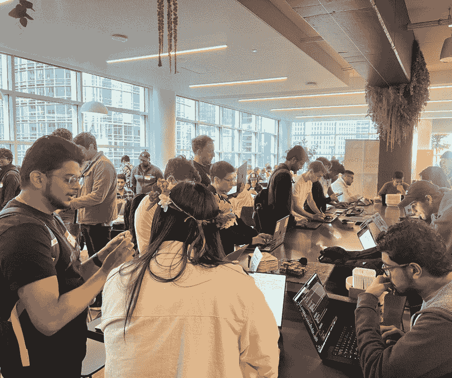

### OpenAI推出预测输出功能：通过提供参考字符串，大幅降低 gpt-4o 和 gpt-4o-mini 的延迟

贡献人：

https://x.com/OpenAIDevs/status/1853564730872607229

推出预测输出功能——通过提供参考字符串，大幅降低 gpt-4o 和 gpt-4o-mini 的延迟。详情请见：https://platform.openai.com/docs/guides/latency-optimization#use-predicted-outputs

加速以下操作：

•   在文档中更新博客文章

•   基于之前的回答进行迭代

•   在现有文件中重写代码，例如 @exponent_run 的用例

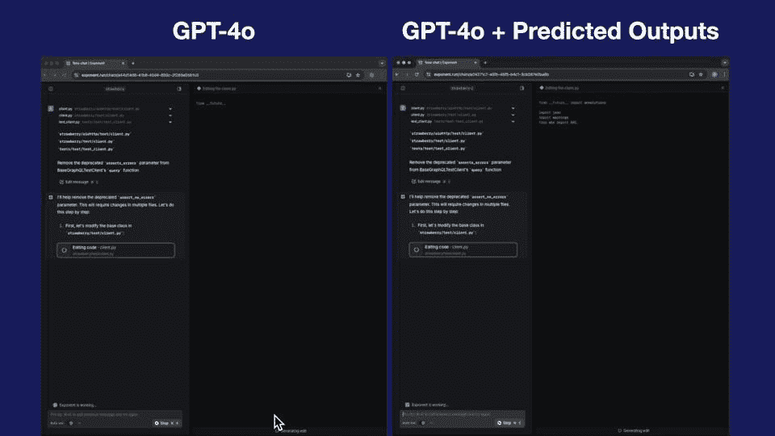

[9kony3qa0sVXlqDy.mp4](https://internal-api-drive-stream.feishu.cn/space/api/box/stream/download/all/RvYbbXZQcoptkwxESA5cyrelnJh)

### Scale AI推出Defense Llama：专为美国国家安全打造的大型语言模型

贡献人：

https://x.com/alexandr_wang/status/1853853829336559790

Scale AI 自豪地宣布推出 Defense Llama 🇺🇸：一款专为美国国家安全打造的大型语言模型 (LLM)。

这是 @Meta、Scale 和国防专家合作的成果，现在已可集成到美国的国防系统中。

详细信息请见下方👇

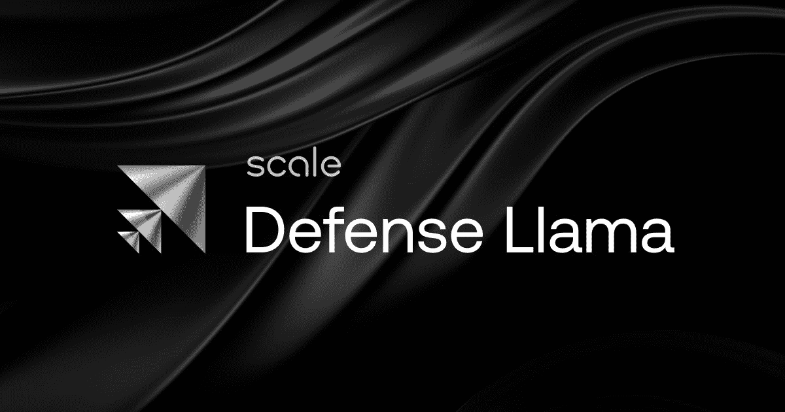

### 图形设计生成器：简化制作设计

贡献人：

https://x.com/recraftai/status/1853862493019328934

我们称这个功能为图形设计生成器。要制作自己的设计，只需设置一个框架，将文本和元素放置在您想要的位置，输入提示词，然后点击“重制”。Voilà——您的设计就完成了！在这里试试吧：https://go.recraft.ai/QfAhTA

[yKf76La-GLiwp00E.mp4](https://internal-api-drive-stream.feishu.cn/space/api/box/stream/download/all/XFEPbiBIUoBVKIxNa0ecjAdYn3d)

### Zach Morris Wilson分享LLM工程师手册：帮助顺利入门LLM

贡献人：

https://x.com/EcZachly/status/1853554277048000607

大型语言模型（LLM）领域非常复杂！我和 @panda_liyin 一起创建了一个开源仓库，为您提供所有必要的信息，让您了解LLM领域的需求！

---

LLM工程师手册

🔥 大型语言模型（LLM）已席卷NLP和AI社区乃至全球。LLM领域相当复杂！这个仓库提供了一个精心整理的清单，帮助您顺利入门，包括LLM框架和教程合集，涵盖模型训练、部署、微调以及LLM应用构建。

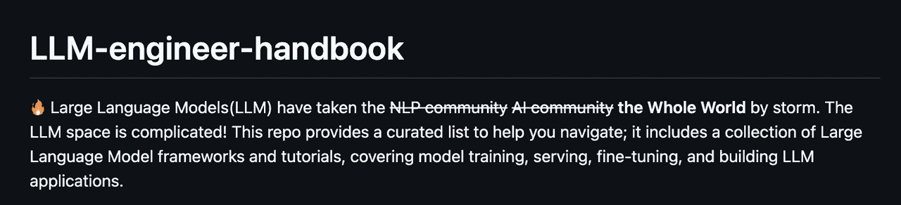

### Humanoid Hub分享Physical Intelligence的π₀模型：AI能够胜任多样化物理任务！

贡献人：

https://x.com/TheHumanoidHub/status/1853712720547225963

对于AI是否能胜任多样化物理任务持怀疑态度的人，应该看看这个。

Physical Intelligence的π₀模型展示：

18分钟内，双臂机器人自主完成复杂而灵巧的工作。

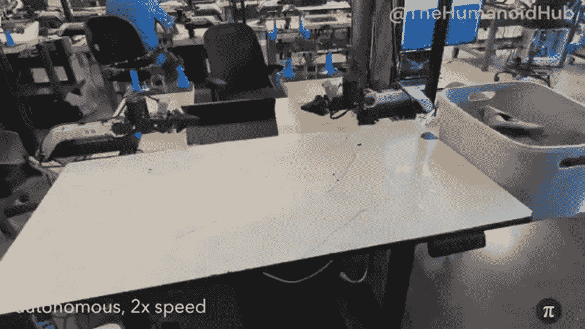

[Y3EIdkXKEZNZRb1r.mp4](https://internal-api-drive-stream.feishu.cn/space/api/box/stream/download/all/N0qCbgHNSod1JbxT8q3cQsj7nvg)

# 资讯

### 王慧文回归，担当美团AI“小队长”

https://mp.weixin.qq.com/s/gWfH-oj_Z-aiISSybzxSjg

《智能涌现》从多个独立信源处独家获悉，原美团联合创始人、光年之外创始人王慧文如今已经回归，在美团带队探索AI应用。

王慧文所在的美团AI团队被称为GN06。在公开的招聘需求上显示，GN06目前的主要业务方向包括情感陪伴、聊天机器人等，团队为候选人提供“没有边界的AI尝试机会”。产品和运营角色，则由王慧文面试把关。

一位接近美团的人士对《智能涌现》表示，GN0**6**由王慧文直管，并不归属任何一个事业群。GN06在美团中的状态相对独立，专注于探索主营业务之外的方向，和美团已有的大模型团队、各业务条线中的AI团队也是相互独立。

### 英伟达成为全球市值最大公司：AI浪潮推动的崛起

https://techcrunch.com/2024/11/05/nvidia-just-became-the-worlds-largest-company-amid-ai-boom/

2024年11月5日，英伟达超越苹果，成为全球市值最高的公司，市值达到3.43万亿美元。这一成就得益于全球人工智能（AI）产业的快速发展。自2022年底以来，英伟达的市值增长了惊人的850%。与苹果的市值差距仅为5000亿美元，尽管两家公司在过去曾多次交换领先地位，英伟达的突破性增长仍然令人瞩目。

苹果虽然也推出了自己的AI产品——Apple Intelligence，但英伟达仍是全球大型语言模型的核心基础设施供应商，继续占据着AI领域的主导地位。此外，OpenAI正在与博通合作开发自有的AI硬件，暗示未来AI市场将可能出现更多竞争者。

英伟达的成功是AI技术应用不断扩展的结果，尤其是在数据中心、自动化、机器人以及生成式AI的广泛应用中，英伟达的GPU芯片扮演了重要角色。随着AI产业的进一步爆发，英伟达的市场地位似乎还将进一步巩固。

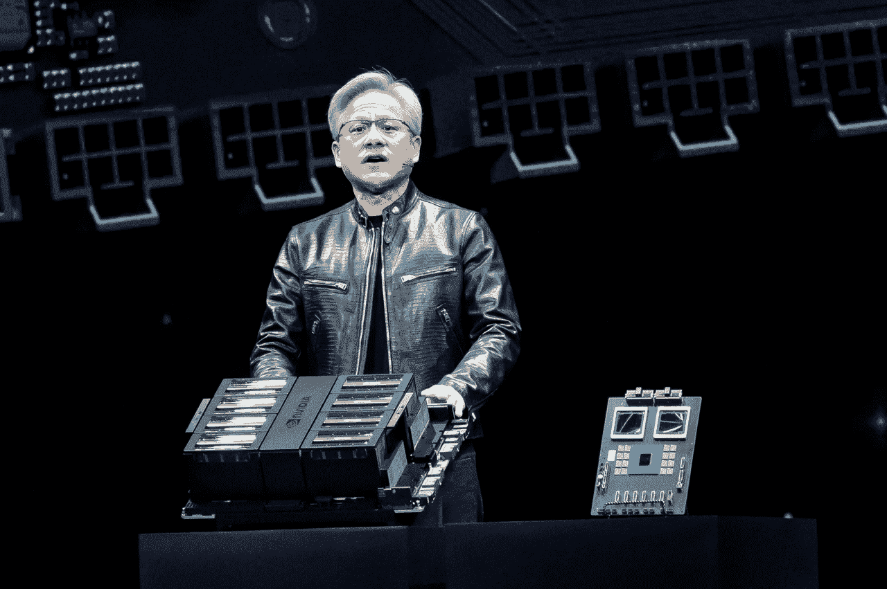

### 大语言模型在算法设计中的应用：系统综述

https://mp.weixin.qq.com/s/hfDzIBcw5HTxtSzpS_694g

本文回顾了大语言模型（LLMs）在算法设计（LLM4AD）中的应用，并提出了四个核心维度：LLMs的作用、搜索技术、提示策略和应用领域。通过对近180篇相关研究的分析，本文总结了LLM4AD的现状、挑战和未来方向，为该领域的研究人员提供了宝贵的资源。

1.  LLM4AD的四种范式

LLM4AD研究中，大语言模型的应用可以分为四个主要范式：

+   **LLMaO（优化算子）**：将LLMs作为优化工具，利用其生成复杂模式的能力，但缺乏可解释性。

+   **LLMaP（结果预测）**：LLMs作为代理模型，用于预测算法结果，优于传统模型，尤其在处理复杂数据时。

+   **LLMaE（特征提取）**：利用LLMs提取问题或算法中的嵌入特征，帮助解决新问题。

+   **LLMaD（算法设计）**：直接用LLMs生成新的算法或其组件，加速算法设计过程，减少人力需求。

1.  搜索方法

在LLM4AD的研究中，单独使用LLMs往往无法应对复杂任务，因此通过搜索方法框架提高了设计效率。常见的搜索方法包括：

+   基于采样的方法

+   单点迭代的搜索方法

+   基于种群的搜索方法

+   基于不确定性的搜索方法

1.  提示策略

提示工程在LLM4AD中至关重要。研究表明，80%以上的工作使用预训练的LLMs，且常采用零样本、少样本、思维链等策略，以优化模型在算法设计中的表现。GPT-4和GPT-3.5是最常用的LLMs，Llama-2则是最受欢迎的开源选择。

1.  应用领域

LLMs在算法设计中主要应用于优化、机器学习、科学发现和工业等领域。在这些领域，LLMs被用来生成优化策略、设计新的学习算法，甚至发现科学问题中的潜在规律。

1.  持续挑战与未来方向

尽管LLM4AD展现出巨大潜力，但仍面临一些挑战，尤其是在生成新算法思想和实现全自动算法设计方面。未来的研究应关注以下方向：

+   **领域特定的LLMs**：专为特定领域训练的LLMs有助于提升效率并降低资源消耗。

+   **多模态LLMs**：融合文本、代码和其他模态的能力，以增强LLMs在算法设计中的应用。

+   **人与LLM的交互**：提高LLM与人类专家之间的协作效率，以促进共同设计和评估算法。

+   **算法评估**：开发基于LLM的自动算法评估机制，帮助更好地衡量设计效果。

1.  总结

LLMs为算法设计带来了革命性的进展，自动化程度提高，设计效率和创新性也得到显著提升。尽管如此，LLM4AD仍需解决一些关键问题，特别是如何开发专门的领域LLMs和实现全面自动化的算法设计。未来的研究将在推动这一领域发展的同时，进一步释放LLM在算法创新中的巨大潜力。

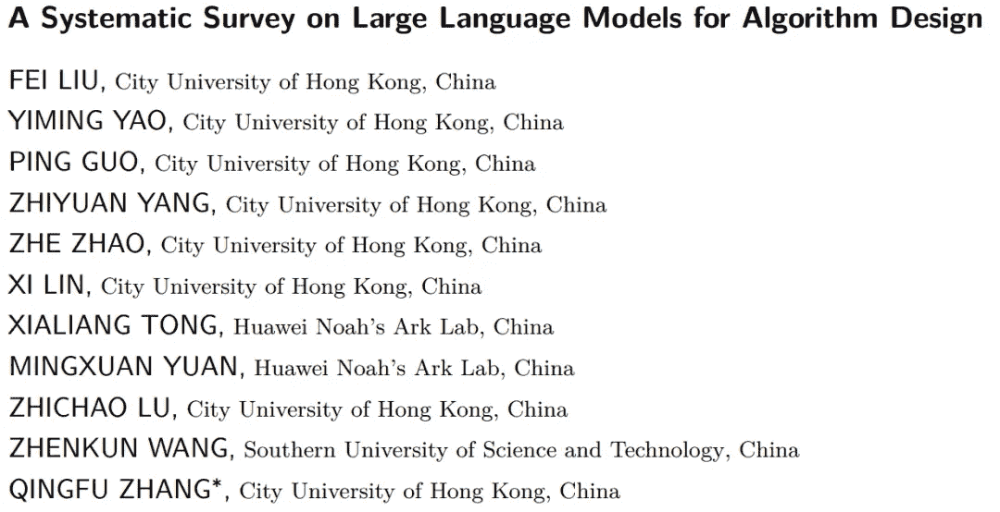

### AI决战美国大选

https://mp.weixin.qq.com/s/xLIRkFsmTMsolToCyftrLg

2024年美国大选即将进入最终阶段，唐纳德·特朗普和卡玛拉·哈里斯将展开激烈角逐。全国民意调查显示，双方支持率接近，硅谷的政治分裂可能成为关键因素。长期以来被视为“左翼堡垒”的硅谷，近年来出现了亲特朗普的技术领袖。埃隆·马斯克积极支持特朗普，并通过捐赠和筹款活动助力共和党选举。马斯克表示，若特朗普当选，可能参与新政府，但由于涉及公司股权的税收条款，其能否任职仍存争议。

特朗普支持者包括风险投资家Chamath Palihapitiya和David Sacks等，后者在硅谷为特朗普筹款。尽管这些支持者在财税政策方面倾向特朗普，硅谷内部仍然分裂，部分投资人转向支持民主党，显示出硅谷在经济和政治上的复杂态势。

在选举信息处理上，人工智能公司也在应对挑战。Perplexity推出了Election Information Hub，通过AI提供选民信息、候选人摘要等内容，并与多个机构合作确保信息准确性。然而，AI摘要出现错误，如未提及候选人Robert F. Kennedy退出竞选，暴露了生成式AI在处理高风险选举信息时的局限性。相比之下，Google、Meta和OpenAI等公司选择将选民查询引导至可靠的外部资源，以避免误导。

在政府层面，拜登政府已发布行政命令，推动AI技术发展，而特朗普则计划废除这一命令，主张放宽监管以促进创新。此外，拜登政府于2024年10月宣布限制美国企业和个人在中国的半导体和AI投资。选举后，美国国会的组成将直接影响AI的监管政策，预计共和党在国会中占多数，可能推动更宽松的监管。

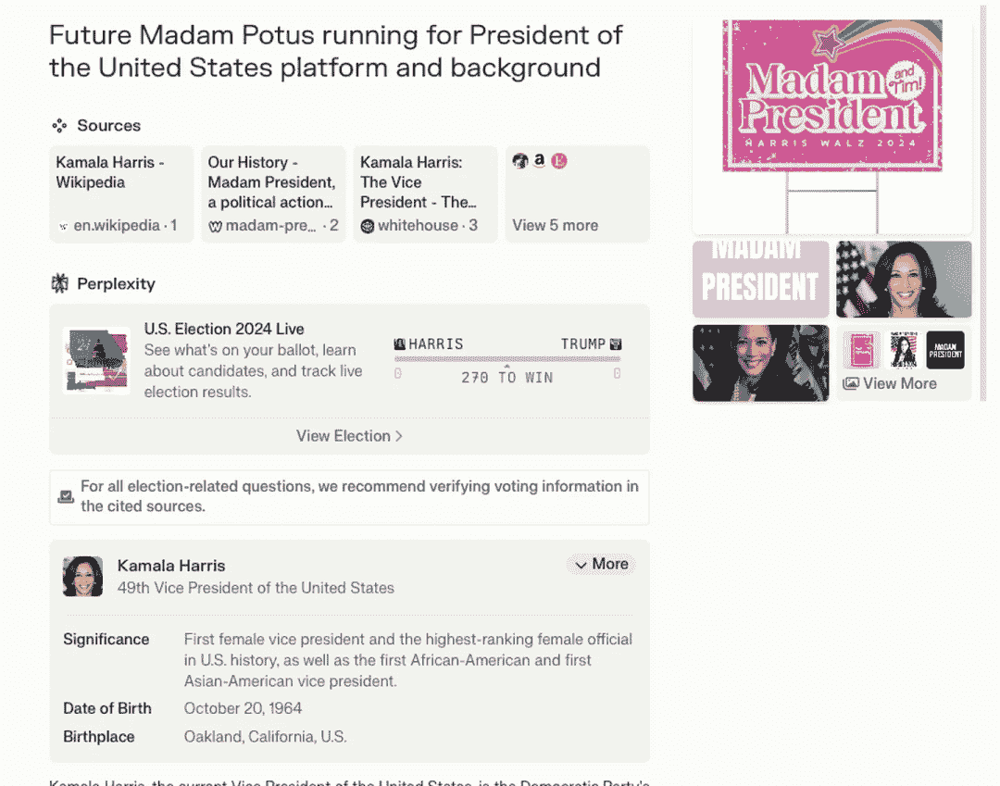

# 信号

### WebRL: Training LLM Web Agents via Self-Evolving Online Curriculum Reinforcement Learning

推荐人 ：

推文链接 ： https://x.com/omarsar0/status/1853821990177485311

原文链接 ： https://arxiv.org/abs/2411.02337v1

ResearchFlow 解读版：https://rflow.ai/flow/58716e5a-09d8-4e78-9b67-5f462a74d4a0（电脑端食用最佳）

信号源 ： elvis

研究节点 ： 开发体系

这篇文章提出了一种利用强化学习（RL）训练大规模语言模型（LLM）作为Web代理的创新方法。该方法通过“自我进化”的**方式，让模型能**够自动调整和优化在Web环境中的行为，从而完成诸如网页抓取、表单填写、数据查询等任务。论文的核心思想是通过在线自适应课程来训练Web代理，即通过逐步增加任务的难度，帮助模型从简单的任务开始，逐步掌握更复杂的Web任务。这种自适应课程可以动态调整任务的难度，确保模型逐步提高能力，类似于人类学习的递进式过程。

此外，论文强调了强化学习的重要性，代理通过与Web环境的交互获得奖励和惩罚，根据这些反馈不断优化自身的策略。通过这种方法，Web代理可以在没有人工干预的情况下，自我改进并适应复杂的Web环境，相比传统的Web自动化工具，这种方法具有更高的灵活性和效率。实验结果表明，WebRL方法能使代理在多个Web任务中表现优异，特别是在动态环境下的自适应能力更强，能够应对更复杂的任务，避免固定规则的限制。

总的来说，论文展示了一种新颖的通过自适应学习提升Web代理能力的思路，推动了Web任务自动化的研究与应用。

# 产品

### MindOne Builder

贡献人：

https://mindone.app/

MindOne 是一个以设计为中心的应用构建平台，能够根据用户提示生成复杂应用，并提供手动调整和内置 AI 助手的功能。

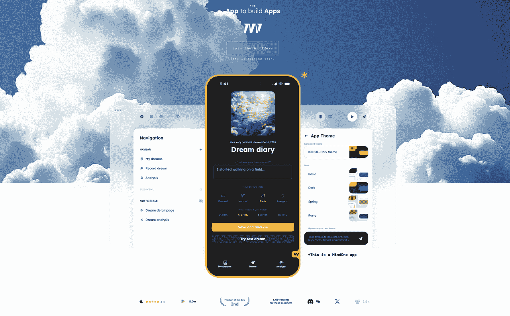

### Overlay by Crisp

贡献人：

https://crisp.chat/en/v4/

Crisp 团队开发的 Overlay，一个新的 AI 驱动网站搜索引擎。它可以解决用户对聊天机器人的疲劳感，通过全屏弹窗提供强大的网站搜索功能，从而帮助企业提高客户获取率。Overlay 的特点包括：基于定制数据训练的 AI、完全可定制的搜索体验，以及无缝的用户转接功能。

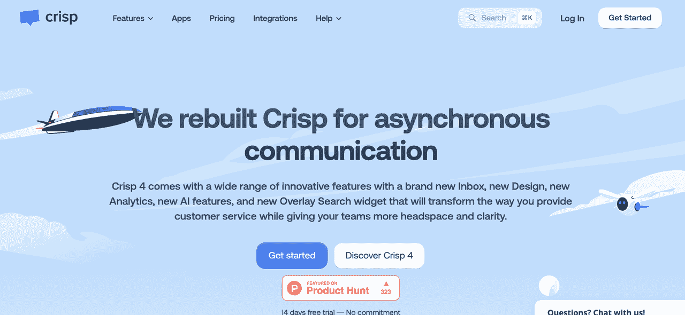

# HuggingFace&Github

### Vanna

贡献人：

https://github.com/vanna-ai/vanna

Vanna 是一个开源的 Python 框架，专注于 SQL 生成和相关功能，利用 RAG（Retrieval-Augmented Generation）模型来回答问题并生成 SQL 查询，能够自动在数据库上执行。它支持多种用户界面，如 Jupyter Notebook、Streamlit 和 Flask，并可连接任何 SQL 数据库，允许扩展以使用自定义语言模型和向量数据库。

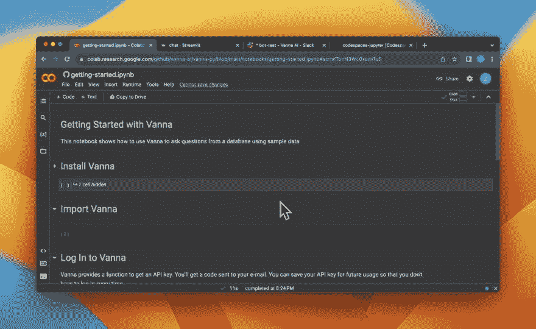

[261049010-1901f47a-515d-4982-af50-f12761a3b2ce.mp4](https://internal-api-drive-stream.feishu.cn/space/api/box/stream/download/all/IqAPb1CQ2oDvSgx99azc05IKnRc)

# 投融资

### 给机器人装AI「大脑」的Physical Intelligence获4亿美元融资

https://mp.weixin.qq.com/s/MvqFT0Jll3tn07twZy5bKg

2024年11月4日，总部位于美国旧金山的机器人AI初创公司Physical Intelligence宣布完成4亿美元融资，融资后估值达到24亿美元。本轮融资由亚马逊创始人Jeff Bezos、OpenAI、Thrive Capital、Lux Capital和Bond Capital等知名投资者领投，Khosla Ventures和红杉资本也参与其中。这一融资大幅提升了公司估值，与3月时公司以4亿美元估值筹集7000万美元的种子轮融资相比，增幅显著。

Physical Intelligence的核心目标是通过开发能够为多功能机器人提供动力的AI模型和算法，将“通用AI带入物理世界”。该公司已展示其技术如何使机器人执行洗衣、清理桌子、组装箱子等日常任务，这些任务通常需要人类的判断力和适应能力。公司的愿景是，在未来，用户能够像与ChatGPT等大型语言模型互动一样，要求机器人完成任何任务。

过去8个月，Physical Intelligence一直致力于开发通用人工智能模型，旨在推动实现人工智能的通用智能（AGI），使机器人能够超越或媲美人类在各项任务中的认知能力。公司的成长和融资反映了市场对先进AI驱动机器人技术的兴趣，尤其是在通用任务导向型机器人领域的潜力。

本轮融资及其背后的强大投资支持表明，Physical Intelligence有望在机器人和人工智能领域发挥重要作用，并推动机器人与人类的无缝协作，进而改变机器人在日常生活中的应用。

### 清维如风完成Pre-A轮融资 专注机场自动驾驶应用

https://36kr.com/p/3001686401890435

2024年11月，北京清维如风科技有限公司（清维如风）宣布完成数千万元的Pre-A轮融资。本轮融资由云时资本领投，启迪创投跟投，资金将用于团队扩展、产品研发及项目运营。

清维如风成立于2022年，专注于研发L4级自动驾驶技术及数字化大脑平台，目标为机场、航司和物流公司提供一站式物流解决方案。其无人驾驶产品已经部署到全国11个城市的机场，包括西安、兰州、乌鲁木齐和成都等。公司核心团队由来自清华大学的优秀毕业生组成，拥有丰富的自动驾驶研发经验。

机场物流运输是自动驾驶的重要应用场景，清维如风的无人驾驶系统在机场环境中表现出色。该公司研发的无人车具备先进的安全系统，能够有效识别飞机、人员等障碍物并实施紧急制动，且具有高精度的定位系统，确保车辆在机场的全区域作业。公司还开发了基于大模型训练的智能规划系统，能够学习驾驶员操作模式，在确保规则的基础上提升无人车的决策能力。

自动驾驶不仅能帮助机场减少人力成本，还能提升物流运输效率。无人车可以24小时不间断运行，极大提升机场的物流吞吐量。此外，清维如风的产品也与机场智能网联系统对接，实现更高效的调度管理。

随着全国机场建设的加速和物流需求的增加，清维如风计划将其自动驾驶技术扩展到航空物流的客货运输、无人配送及低空经济等领域，进一步推动机场自动驾驶应用的商业化进程。

清维如风的融资和技术进展标志着自动驾驶在机场物流领域的应用前景广阔，预计将在未来几年内迎来更多的市场机会。

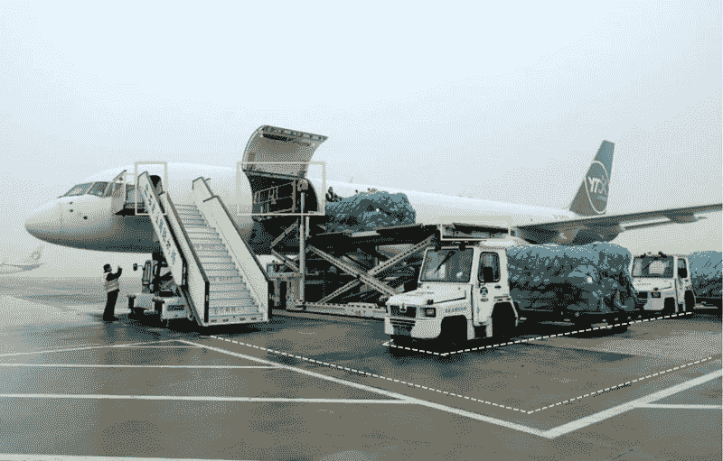

# 学习

### 浅析主流 Alignment 算法与 NeMo-Aligner 框架

贡献人：

原专栏：https://zhuanlan.zhihu.com/p/5220718268

ResearchFlow 解读版：https://rflow.ai/flow/e5f08939-23a8-4d37-9f65-278221c5ce89（电脑端食用最佳）

在2024年10月的费城COLM大会上，我有幸了解了NVIDIA的两项重要工作，其中包括RULER（现在已成为长上下文模型的关键基准）和NeMo-Aligner。NeMo-Aligner是一款可扩展的工具包，集成了主流的对齐算法，如RLHF、DPO、SteerLM和SPIN，能够高效地训练大规模模型（如Llama 4.1 405B）。该工具包支持高级分布式训练技术，包括在Megatron-LM上实现的3D并行（数据、张量、管道），并在rollout阶段使用TensorRT-LLM进行推理，以优化性能。

NeMo-Aligner的核心设计在于高效处理强化学习（RL）对齐的计算需求，尤其是在大规模模型中，这些操作需要巨大的计算资源。例如，在PPO过程中，涉及四个模型的计算流，每个模型需要大量内存，对于一个70B的模型，资源消耗可达到2100GB，这突显了此类操作的高昂成本。NeMo-Aligner通过在推理和训练模型之间采用卸载策略，优化了内存使用，并在反向传播阶段减少了显存压力。

该工具包的重点不仅是集成现有的对齐算法，还在于优化推理和训练工作流。例如，NeMo-Aligner在rollout阶段使用推理引擎加速响应生成，因为推理引擎在自回归任务中比训练引擎更为高效，训练引擎则更适合处理大批量训练。NeMo-Aligner还为推理延迟的变异性设置了一个路由器，并集成了TensorRT Refitter，支持在训练过程中进行内存中的实时更新。

此外，论文中还讨论了NeMo-Aligner的性能扩展性，在增加计算资源时，响应生成的效率几乎是线性的，但训练效率的增长是亚线性的，主要是由于微批量减少和流水线并行的开销。

一个关键的观察点是，如何提升推理过程中生成的logits精度仍然是一个挑战。NeMo-Aligner目前的策略是使用训练引擎来计算精确的logits，同时利用推理引擎加速执行，未来计划进一步优化这一过程。同时，还提出了关于提供更强大的奖励模型接口和权重更新机制的疑问，特别是在与OpenRLHF等其他系统集成时，如DeepSpeed和vLLM的结合。

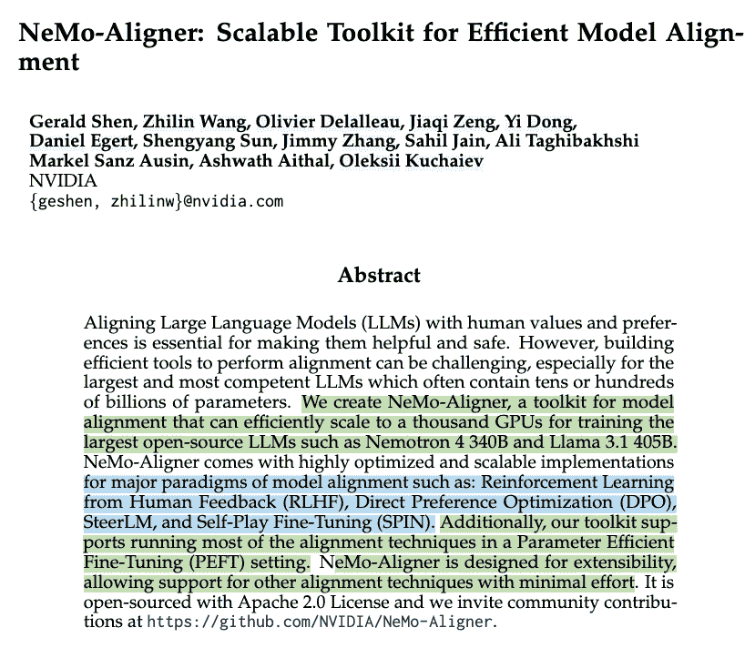

### 采访3DGS创业者康总：畅谈3D高斯泼溅技术在移动端的创新应用与未来展望

原专栏：https://zhuanlan.zhihu.com/p/5240176329

ResearchFlow 解读版：https://rflow.ai/flow/806d92ea-1eae-48fc-8a7e-96490dc9fd55（电脑端食用最佳）

最近与3DGS行业的创业公司CEO康迂松进行了交流，他在行业中有深入的研究和技术洞察。康总分享了自己丰富的经验以及对当前技术发展的独特看法，尤其是三维视觉技术和元宇宙概念的未来趋势，给我带来了很多启发。

采访中，康总详细讲述了自己的成长轨迹与专业背景。他曾在一家计算机图形渲染引擎公司工作，负责投融、商务、市场和项目管理，重点研发面向AR/VR设备的高效渲染引擎。他提到，随着3D内容和空间交互的兴起，未来将有更多机会涌现，而这也是他创办当前公司的原因之一。

康总认为，2020年NeRF技术的出现为行业带来了革命性的变化，尤其是在3D内容创作和分享方面。传统的图形工业流程难以满足C端用户对创作的需求，而NeRF技术让普通用户能够通过简单的拍摄与上传，轻松创建并交互3D空间。他认为，元宇宙应当突破传统技术路径，转向低门槛的用户参与，才能真正实现全民创作的目标。

关于公司现阶段的主要项目，康总介绍了他们的3D Moment App，这是一个无需特定硬件支持的应用，用户只需使用手机摄像头拍摄照片或视频，上传后就能生成3D空间，创建个人的“3D朋友圈”。平台的核心在于低门槛、趣味化的3D创作体验，吸引用户通过内容分享、互动推动平台发展。

康总还谈到了公司未来的宏大目标——全民地球三维重建计划。通过大规模积累用户生成的3D数据，未来将推动全球空间的虚拟重建，为AR/VR和跨平台应用提供丰富的数据资源。此外，他们计划通过广告、线上线下互动、以及定制化内容创作等多种方式实现商业闭环。

他指出，目前三维技术面临的主要挑战包括高精度数据采集成本、渲染效率和跨平台应用的兼容性等。尽管如此，随着技术的发展和用户需求的增长，这些问题会逐步得到解决，尤其是在C端用户参与和低门槛创作工具的推动下。

### [TrENV@SOSP24] 当 FaaS 遇到 CXL：走向真正意义上的弹性云计算

原专栏：https://zhuanlan.zhihu.com/p/5224128384

ResearchFlow 解读版：https://rflow.ai/flow/f204323b-ef8c-4adb-887f-685d3488609c（电脑端食用最佳）

在SOSP24会议上，我们展示了TrEnv（透明共享Serverless执行环境）系统，继续探索通过硬件加速共享内存（如CXL）提升Serverless/FaaS计算的弹性和性能。去年在SOSP23的文章中，我们讨论了基于CXL等新型互联协议的共享内存系统的价值，强调其与Serverless/FaaS云计算发展的契合。

**FaaS的理想与现实：**

+   FaaS希望达到两大目标：高资源利用率和按需计费，但现实中面临内存资源浪费和冷启动延迟问题。内存资源往往没有得到高效利用，因为CPU和内存资源在物理机上是按固定比例配置的，导致部分资源浪费。冷启动问题则来源于函数实例启动时的初始化开销，通常会引起较长的等待时间。

**现有方案的不足：**

+   **内存资源管理**：传统的RDMA内存池虽然能共享内存，但由于CPU不能直接访问，存在较高延迟，效率低。

+   **冷启动优化**：常见的优化方案包括缓存和快照（Checkpoint/Restore）。缓存方式存在资源预留浪费问题，而快照方式（如CRIU）则依赖数据拷贝，恢复过程也存在时间开销，不能完全消除延迟。

**TrEnv的创新：**

+   TrEnv通过CXL内存的共享特性，保存函数快照至共享内存池，实现函数间内存共享，同时避免了传统快照技术的内存拷贝开销。

+   TrEnv引入了新的内核接口（mm-template），支持跨节点、跨函数实例共享内存，同时保持高效的内存使用。

+   在容器复用方面，TrEnv通过增强传统缓存策略，构建了类型无关的沙箱容器，使得不同类型的函数实例能够共享相同的容器环境，从而减少资源预留和启动延迟。

**性能提升：**

+   TrEnv能够将冷启动时间降低至10ms，并在容器隔离级别上与标准Docker容器相当。实验表明，TrEnv能提升函数7X的P99端到端耗时，并减少48%的峰值内存使用。

**未来方向：**

+   在现有工作基础上，团队计划进一步探索更多实际应用场景的机会和挑战。

### SOSP 2024 论文评述 Day 1 Session 1 Distributed Systems

原专栏：https://zhuanlan.zhihu.com/p/5091263327

ResearchFlow 解读版：https://rflow.ai/flow/bfa738a2-0dfc-4484-b643-d263ea290fc7（电脑端食用最佳）

Autobahn：无缝高速拜占庭容错协议

该论文提出了一种新的拜占庭容错共识协议—Autobahn，旨在解决传统协议在处理“坏区间”时存在的性能损失问题。Autobahn通过解耦数据分发和共识过程，实现了更低的延迟和无缝的性能恢复。它采用了一个分布式数据分发层，能够在坏区间恢复时快速恢复性能，且支持低延迟提交。该协议的原型系统在与现有BFT协议（如HotStuff和Bullshark）对比时展现了优异的性能，尤其在应对网络波动或节点故障时，能够有效减小性能退化的持续时间。

SWARM：无需等待的共享分散内存数据复制

本文提出了一个新的数据复制协议SWARM，专门针对分散内存架构（如RDMA和CXL）。SWARM通过两个创新机制—Safe-Guess和In-n-Out—有效地减少了数据复制的延迟和额外的网络通信开销。Safe-Guess通过预测最新时间戳来避免多次往返延迟，而In-n-Out则结合了内外部更新方式，优化了内存布局，减少了原子操作的时间。在测试中，SWARM比传统的复制协议表现出更低的延迟和更高的性能。

**高效重现分布式系统中的故障**

本文提出了Anduril，一个通过反馈驱动的故障注入工具，旨在通过静态代码分析和动态反馈来高效地复现分布式系统中的故障。Anduril能够快速定位故障的根本原因，并通过反馈机制优化故障重现过程。通过在分布式系统中插入因果图和动态调整错误注入的优先级，Anduril可以大大缩小故障复现的搜索空间，从而有效提高调试效率。

### CUDA shared memory避免bank conflict的swizzling机制解析

专栏：https://zhuanlan.zhihu.com/p/4746910252

CUDA共享内存按32个bank（每个bank大小为4字节，总共128字节）组织。不同线程访问同一bank的不同地址时，会发生bank conflict，而这种冲突只会在同一warp内的线程之间出现。如果多个线程访问相同bank的相同地址，实际上是广播，不会产生冲突。Bank conflict会导致warp停顿，增加访问延迟，影响性能。

为解决bank conflict，有几种方法：padding、转置存储和swizzling机制。padding通过在共享内存数组尾部添加额外元素来避免冲突，但可能会降低SM的occupancy。swizzling机制则通过重排数据在共享内存中的位置，从而避免冲突。

以矩阵转置为例，使用共享内存的naive实现时，每个线程将一个元素从全局内存加载到共享内存，转置后再写回全局内存。在一个warp中，由于32个线程操作同一列的共享内存，导致每个线程访问的地址落在同一bank上，发生了bank conflict。通过profile分析，发现每个warp的冲突次数为31，总共冲突2031616次。每个warp的冲突会导致warp需要额外一个cycle来重新提交访问指令。

padding通过增加共享内存的列数（例如从32变为33），确保同一列的不同行访问不同的bank，从而避免bank conflict。使用padding后，profile数据显示bank conflict为0，但会增加内存占用并可能影响资源利用率。

swizzling机制则通过对共享内存中的数据进行重排来避免冲突，避免了额外的内存开销。通过映射函数将逻辑坐标映射到物理位置，使得同一行的不同列或同一列的不同行数据访问时不会落在相同的bank上，从而避免冲突。

例如，使用异或操作来实现swizzling，将行列坐标转换为新的物理坐标，避免同一warp中的线程访问同一bank。profile结果显示swizzling后，shared memory的store操作没有产生冲突，尽管load操作仍有冲突，推测这是由于读取逻辑本身的原因。

swizzling在TMA（Tensor Memory Accelerator）中应用，通过调整数据块的访问方式，减少了内存访问指令数目，有效避免了bank conflict。在cutlass中，swizzling机制被用来优化共享内存的访问，特别是在矩阵乘法的计算中，通过针对不同线程的访问方式调整共享内存布局，有效避免了bank冲突的影响。

# 招聘公告

---

**奇绩创坛****由陆奇博士**于2019年创立，使命是在源头最大化驱动创新。奇绩研究组将研究模型理论、到投研战略分析、市场策划等不同背景的同学聚在一起，搭建GenAI时代独特的跨界人才社群。

## 🚀F**24实习岗位**

##### [行研-学术科研人才交流组实习生](https://miracleplus.feishu.cn/docx/Yn6rdf2iOoY2Rcx8yVNcUBYRnch#part-QkMcdeJmuob9uvxvV3qcLSzHn8g)

##### 行研-GenAI研究岗位-战略分析（偏产品）

##### Web / AI 全栈开发工程师实习生

## **火热开放中🚀**

##### 行研-GenAI研究岗位-前沿学术探索

##### 行研-GenAI研究岗位-战略分析（偏咨询）

##### 创新活动产品运营 （大模型系列活动产品运营）

> **点击**相关岗位可查看对应**岗位需求【JD】；**相关岗位投递请**扫描二维码**

> 欢迎**推荐/自荐**

> 期待在**奇绩创坛**遇见更好的你

---

# 声明

本文档仅供学习交流使用，版权归原作者所有，若涉侵权，请联系Jack Jin 15101136166

（欢迎在下方反馈您宝贵的意见！整理不易，觉得有用给AI日报小组点个赞👍吧！）

ChatGPT；Angela；Zijia Liu；Alex；Zeqi Tan；Tiezhen（HuggingFace）；Naixu；Lizhi；Peter；Suoman；Jack

学术分析报告：ResearchFlow -- 奇绩F23校友的开发的深度研究产品，PC端进入RFlow的分析报告，可直接点击节点右侧的小数字展开节点，登录后可在节点上直接“询问AI”，进一步探索深度信息

如果你有大模型相关的创业想法，欢迎来找我们聊聊～微信：15101136166

> 快邀请你的小伙伴们一起来读大模型日报吧！

> **【日报****知识库****】**这里是近期日报内容的汇总,欢迎大家查阅

> [大模型日报知识库(分享版)](https://miracleplus.feishu.cn/wiki/KapVwXfkriOBiskB0B2cUHxjnTh)

>

> 欢迎大家多多帮我们分享,转发~~

> 如果大家有任何的建议或者吐槽,欢迎随时找我聊天~

