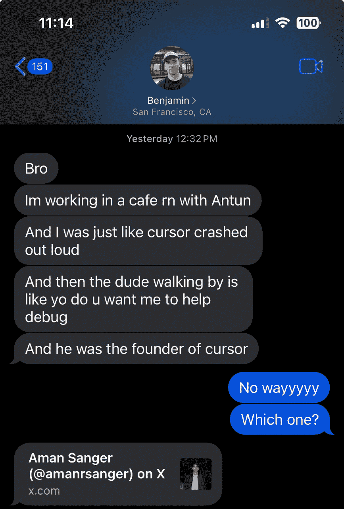
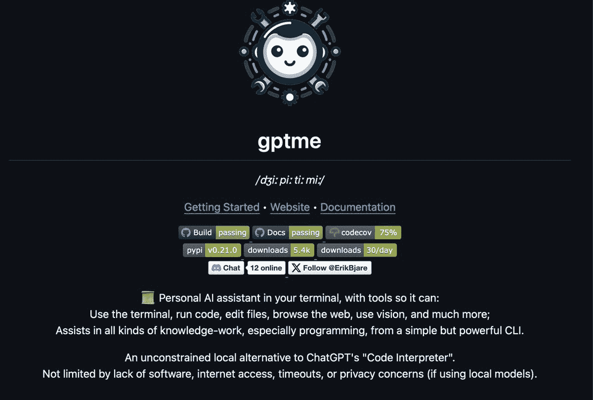
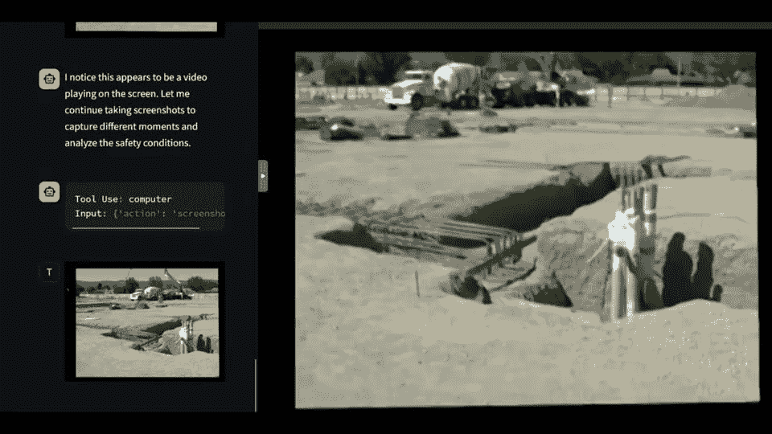
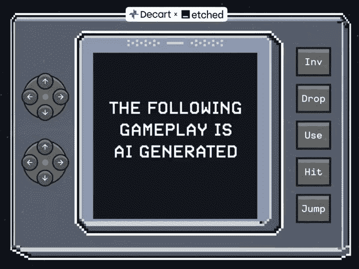
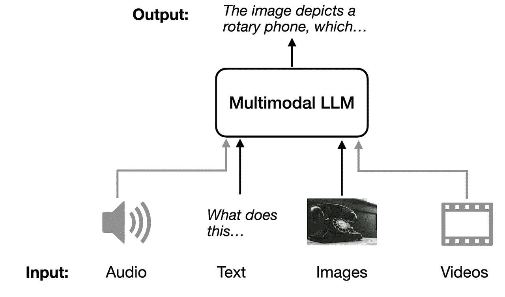
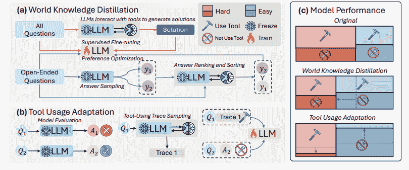
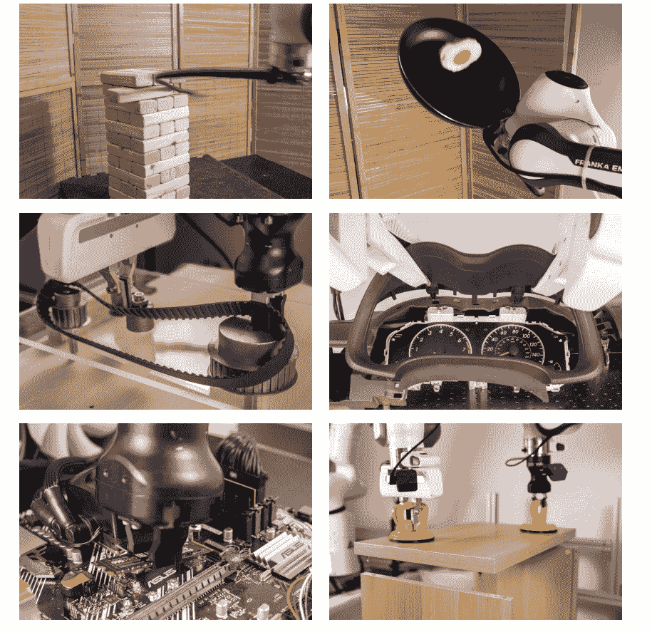
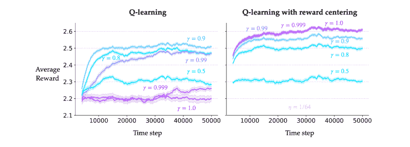
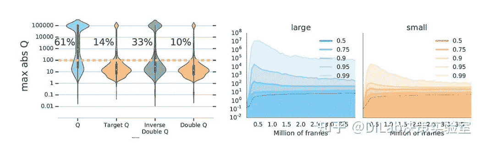
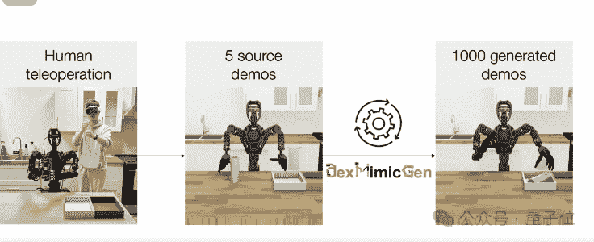

# 奇绩大模型日报（11月 4日）

> 来源：[https://miracleplus.feishu.cn/docx/AkGOdC9eco6tDQxkDgWcix2xnZf](https://miracleplus.feishu.cn/docx/AkGOdC9eco6tDQxkDgWcix2xnZf)

# 🔉潜空间活动报名

> 本期活动将在**11月9日** **10:00**开始，我们邀请到的嘉宾是**鱼哲**，Le**pton AI 创始成员，曾在阿里云担任高性能 AI** 平台产品负责人，专注于 AI 在多个行业的落地及应用。Lepton AI 致力于建立高效可用的AI 基础设施，让团队更关注于应用构建及落地。在本次分享中鱼哲将带来关于AI产品相关的思考，分享主题《Beyond Infra, what matters?—— 不同AI产品形态对团队的挑战》。

> 除嘉宾分享外，每期设置了【匹配合伙人 Cofounder Matching】环节。你可以和 GenAI 时代最有活力的创业者和研究者线下面对面交流，将有机会找到志同道合、有共同创业梦想的小伙伴。

> 报名通道已开启，欢迎扫描下方二维码报名。

# 推特

### 外国小哥在旧金山咖啡馆随口一句抱怨，Cursor CEO竟然主动帮忙调试

贡献人：

https://x.com/trivanmnzs/status/1852785731099635950

朋友在旧金山的一家咖啡馆，结果他的笔记本电脑上「Cursor 崩溃了」。

就在那一刻，Cursor 的一位联合创始人正好路过，主动提出帮忙调试。

这家公司真的是无处不在啊。

---

“兄弟，

我现在和 Antun 在一家咖啡馆工作，

我随口说了一句『Cursor 崩溃了』。

然后有个路过的家伙说『嘿，你要我帮你调试吗？』

结果他竟然是 Cursor 的创始人。”

“不会吧！

哪个创始人？”

“Aman Sanger (@amanrsanger) 在 X 上。”

### 在终端中使用本地工具运行 AI 代理？Sumanth分享gptme开源工具

贡献人：

https://x.com/Sumanth_077/status/1852705713656934501

介绍 gptme：一个开源工具，让您在终端中使用本地工具运行 AI 代理。

它就像您终端中的个人 AI 助手，拥有多种功能，可以：使用终端、运行代码、编辑文件、浏览网页、进行视觉处理等等。

### Claude观看施工现场视频并创造待解决关键问题表格，Emollick：AI管理者/全局监视将产生重大影响

贡献人：

https://x.com/emollick/status/1853255574843982241

“嘿 Claude，当你使用电脑时，观看这个施工现场视频并写下你看到的危险或好的方面，创建一个需要解决的关键问题的电子表格。”（加速播放）

公司将 AI 用作管理者、教练或全景监视工具的方式，将对未来的工作形式产生重大影响。

[rpO4JBAPfX92k4el.mp4](https://internal-api-drive-stream.feishu.cn/space/api/box/stream/download/all/Sql2b4DVioDvRyxNIUxcKSx4nMR)

### Oasis：可玩的 AI 生成游戏，根据你的键盘输入生成画面

贡献人：

https://x.com/Etched/status/1852089772329869436

介绍 Oasis：首款可玩的 AI 生成游戏。

我们与 @DecartAI 合作，构建了一个实时互动的世界模型，在搜狐平台上运行速度提升超过10倍。我们将开源该模型的架构、权重和研究成果。

Oasis 会根据你的键盘输入生成画面。你可以在游戏中移动、跳跃、打破方块，甚至每次玩游戏时都能构建和探索全新的地图。

我们设计的 Oasis 在即将推出的 AI 芯片 Sohu 上运行速度极快，该芯片具有 DiT 主干网络、ViT 自动编码器等特点。Sohu 专为处理大规模视频模型而打造，支持4K分辨率，运行超过1000亿参数的模型。游戏体验只是个开始。很快，互联网上的大部分内容将由 AI 生成，其中超过70%的网络流量将是视频。视频扩散模型对计算资源需求极高，每帧需要处理数千个 token。这种工作负载非常适合 Sohu。

[2fq7559kUtWubRAO.mp4](https://internal-api-drive-stream.feishu.cn/space/api/box/stream/download/all/NUXJbWkTmoIhTAxPVQocClfVnCg)

### Researcher Raschka分享文章：理解多模态大语言模型如何工作

贡献人：

https://x.com/rasbt/status/1853073656525599022

如果你对多模态大语言模型（Multimodal LLMs）如何工[作](https://magazine.sebastianraschka.com/p/understanding-multimodal-llms)感到好奇，我写了一篇新文章，解释了两种主要方法：仅解码器方法和交叉注意力方法：https://magazine.sebastianraschka.com/p/understanding-multimodal-llms。另外，我还审阅并总结了最新的10篇研究论文，以了解这些方法在实际中的应用。祝阅读愉快！

### Hertz-dev：开源的全双工对话音频基础模型，拥有 85 亿参数

贡献人：

https://x.com/si_pbc/status/1853184307063660723

在 Standard Intelligence，我们发布了 𝗵𝗲𝗿𝘁𝘇-𝗱𝗲𝘃，这是一个开源的全双工对话音频基础模型。

Hertz-dev 拥有 85 亿参数，基于 2000 万小时高质量音频数据训练而成。我们在网站上公开了支持单声道和全双工生成的模型检查点和代码，遵循 Apache 许可证。

Hertz-dev 是一个基础模型，未经过微调。研究人员可以将其用于实时翻译、分类等各种音频建模任务。

通过全球最大的高质量对话音频数据集，Hertz-dev 学习了类似人类的语音模式，如停顿和情感起伏。

Hertz-dev 的理论平均延迟为 80 毫秒，单块 RTX 4090 上的实测延迟为 120 毫秒，比之前的最先进模型低 1.5-2 倍。

我们正在训练一个 700 亿参数的扩展版本 Hertz，并计划未来扩展到更多模态。

[3KoykIJzjDwmpXx9.mp4](https://internal-api-drive-stream.feishu.cn/space/api/box/stream/download/all/OMJCbat03oGzBUxTM2wca4i0nnb)

# 信号

### Adapting While Learning: Grounding LLMs for Scientific Problems with Intelligent Tool Usage Adaptation

贡献人：

推文链接：https://huggingface.co/papers

原文链接：https://arxiv.org/pdf/2411.00412

研究节点：应用体系-AI4Science

这篇文章提出了一种新颖的双组件微调方法，用于提高大型语言模型（LLMs）在解决科学问题时的准确性和工具使用精度。第一个组件是世界知识蒸馏（WKD），LLMs通过使用工具生成的解决方案直接学习，以内化领域知识。第二个组件是工具使用适应（TUA），根据模型的直接回答准确率将问题分为简单和困难两类，对于简单问题保持与WKD相同的对齐目标，而对于更具挑战性的问题，则训练模型智能地切换到工具使用。该方法在六个科学基准数据集上进行了验证，涵盖了数学、气候科学和流行病学等领域，平均提高了答案准确性28.18%，工具使用精度提高了13.89%，超越了包括GPT-4o和Claude-3.5在内的最新模型。

### Precise and Dexterous Robotic Manipulation via Human-in-the-Loop Reinforcement Learning

贡献人：

推文链接：https://mp.weixin.qq.com/s/5pVajhtp8KSFz4AnV8PVTQ

原文链接：https://hil-serl.github.io/static/hil-serl-paper.pdf

研究节点：应用体系-智能硬件

这篇文章介绍了一个循环中的人类视觉强化学习（RL）系统，该系统在一系列复杂的机器人操控任务上表现出色，包括动态操控、精密组装和双臂协调。这种方法整合了示范、人工校正、高效的RL算法和其他系统级设计选择，以学习策略，这些策略在1到2.5小时的训练内就能达到接近完美的成功率和快速的周期时间。文章表明，这种方法在成功率上平均提高了2倍，执行速度提高了1.8倍，显著优于模仿学习基线和之前的RL方法。通过广泛的实验和分析，文章提供了对这种方法有效性的见解，展示了它如何学习既适用于反应控制也适用于预测控制策略的稳健、适应性策略。结果表明，RL确实可以直接在现实世界中学习一系列复杂的基于视觉的操控策略，且训练时间实际可行。作者希望这项工作能激发新一代的机器人操控技术，造福工业应用和研究进展。

### Reward Centering

贡献人：

推文链接：https://mp.weixin.qq.com/s/lwoq764gVSFjsEhzPS3ChQ

原文链接：https://arxiv.org/pdf/2405.09999

研究节点：模型体系-推理体系

这篇文章提出了一种改进的折扣方法，用于解决连续强化学习问题。该方法通过减去奖励的实证平均值来中心化奖励，从而显著提高性能，特别是在常用的折扣因子下，并且随着折扣因子接近1，改进效果更加明显。文章还表明，如果问题的奖励发生恒定偏移，标准方法的性能会大幅下降，而采用奖励中心化的方法则不受影响。在on-policy设置中，估计平均奖励是直接的；对于off-policy设置，文章提出了一种稍微复杂的方法。由于奖励中心化是一个通用概念，作者预计几乎所有的强化学习算法都可以通过添加奖励中心化来受益。

### TD Learning （时序差分学习）中的值函数收敛性

贡献人：

原文链接：https://zhuanlan.zhihu.com/p/2883455468?utm_medium=social&utm_psn=1835369279245148160&utm_source=wechat_timeline&utm_id=0

推文链接https://zhuanlan.zhihu.com/p/2883455468?utm_medium=social&utm_psn=1835369279245148160&utm_source=wechat_timeline&utm_id=0

研究节点：模型体系-推理体系

这篇文章讨论了强化学习（RL）中的TD  Learning（时序差分学习）方法，特别是它与函数近似和off-policy学习结合时可能出现的“致命三角”问题，这可能导致算法不稳定或发散。文章介绍了目标网络的概念，这是一种提高算法收敛性和稳定性的技术，并且分析了它在DQN等深度强化学习算法中的应用。文章还总结了TD学习中值函数收敛性的最新研究成果。

# 资讯

### 清华赵明国：智能人形机器人≠智能+人形

https://mp.weixin.qq.com/s/h1mN2S5zYbOdO9ohSIHOpQ

在2024年，人形机器人领域经历了爆发式增长，得益于特斯拉的Optimis迭代、OpenAI对1X的投资、初创公司崛起以及学术界的持续创新。清华大学赵明国教授强调，这一技术进步虽然令人振奋，但发展路径必须谨慎选择，以应对复杂环境中的自主适应与学习需求。

赵教授认为，“智能人形机器人”不仅仅是智能和人形机器人的叠加，而是需要更深层次的融合，形成一个全新的研究主题。他提到，运动控制涉及多层次系统，不应单纯依赖大模型。人类的运动控制是复杂的，涵盖本体反射、中枢控制和大脑控制，研究者需深入生物运动机制，以重新构建机器人控制架构。

赵教授还指出，技术的先进性并不意味着其实用性，必须与时代需求相匹配。他提及波士顿动力和本田在机器人运动控制上的贡献，认为当前人形机器人的发展呈现多元化的态势，各种技术路线都有其价值。

在双足运动控制方面，赵教授提到，传统仿生模型面临许多技术瓶颈，强化学习的突破为解决复杂任务提供了新方法，但视觉感知的仿真仍需改进。未来，结合运动控制与人工智能的系统可能会通过数据获取和学习方法的融合实现新的进展。

最后，赵教授总结说，运动控制不应仅依赖于大模型的逻辑，生物神经系统的多层次结构为机器人运动控制提供了新的思路。他呼吁在推动机器人技术发展的同时，结合人工智能的进步，以便更有效地解决复杂任务并推动整个人形机器人领域的前进。

### OpenAI 招聘 Twitter 竞争对手 Pebble 的联合创始人

https://techcrunch.com/2024/11/03/openai-has-hired-the-co-founder-of-twitter-challenger-pebble/

OpenAI 最近招聘了 Gabor Cselle，他曾是 Twitter 竞争对手 Pebble 的首席执行官和联合创始人。Cselle 自十月以来便在 OpenAI 工作，他在社交媒体上宣布了这一消息，并表示将会在适当的时候分享更多工作进展。他在科技行业有丰富的经验，曾出售多家公司，包括将移动电子邮件初创公司 reMail 卖给谷歌。

Pebble 于 2022 年由 Cselle 和前 Discord 工程负责人 Michael Greer 共同创立，旨在提供一个强调安全和内容管理的微型博客服务。尽管 Pebble 在初期获得了一定的关注和资金支持，但最终未能保持增长，去年十月宣布关闭，并转型为 Mastodon 实例。

在 Pebble 关闭之前，Cselle 曾在谷歌的 Area 120 孵化器担任主管，并致力于多个生成式 AI 原型的开发。他的加入恰逢 OpenAI 竞争对手 Anthropic 也招聘了前自动驾驶卡车公司 Embark 的创始人 Alex Rodrigues，后者将担任 AI 安全研究员。

### 英伟达团队机器训练新方法！仅5次演示让机器生成1000个新demo

https://mp.weixin.qq.com/s/-Xl7Tj2kcuYKXOdlLhVjZg

DexMimicGen是英伟达提出的一种新型机器人训练方案，旨在解决机器人训练中数据匮乏的问题。该系统仅需人类演示五次，就能够生成1000个新的演示数据（demo），并能在仿真环境中显著提高任务成功率，达到97%，超越使用真人数据的效果。参与该项目的科学家Jim Fan认为，这种“用机器训练机器”的方法有效地解决了数据收集的痛点，并预测机器人数据的未来将是生成式的。

DexMimicGen的工作原理基于之前的MimicGen，后者通过将人类示范数据分割成以目标物体为中心的片段来生成新数据。DexMimicGen在此基础上，针对双臂机器人灵巧操作任务进行了改进，加入了并行、协调、顺序三种子任务类型，并设计了相应的异步、同步和顺序约束机制，以实现双臂的独立及协调动作。

具体实验中，DexMimicGen通过采集和分割5-10个示范样本来生成数据，并在9个场景中测试了三种机器人形态，获得了21000多个生成demo。在执行整理抽屉、积木组装和罐子分类等任务时，使用DexMimicGen生成的数据成功率大幅提升，分别达到76%、80.7%和97.3%。在迁移到真实环境的易拉罐分拣任务中，使用40个生成demo的成功率达到了90%。

DexMimicGen展现出强大的泛化能力和鲁棒性，能够在不同任务和初始状态分布下保持一定的成功率。项目团队由来自德克萨斯大学奥斯汀分校的研究人员组成，他们都是李飞飞教授的学生，反映了学术界与业界的紧密联系。整体来看，DexMimicGen为机器人学习提供了一个新的视角，未来可能在多个领域得到广泛应用。

### 万卡集群的AI数据中心，到底是如何运作的？

https://mp.weixin.qq.com/s/thbDAHz9RCkHHTL1e1Qacw

在2024年7月22日，xAI创始人Elon Musk宣布在美国田纳西州孟菲斯市启动全球最强的AI训练集群，集合了10万个液冷H100芯片。然而，该项目引发了当地居民的抗议，主要由于其每天消耗100万加仑水和150兆瓦电力，环保人士对此表示担忧。

随着AI计算需求的增长，数据中心的结构和运营面临着挑战。数据中心主要由主机房、供电系统和冷却系统组成，其中冷却系统尤为关键。传统CPU向GPU的转变导致了功率密度的显著提升，从每个机柜3-5千瓦跃升至10千瓦甚至更高。这样的提升给冷却和供电系统带来了四个主要挑战：散热能力、能源供应、占地面积和快速部署。

冷却系统的耗水问题主要源于液冷技术的使用，这种技术通过水的蒸发潜热来降温，相较于传统风冷，液冷的热交换效率更高。液冷分为冷板液冷和浸没液冷，而前者在主流GPU中应用广泛。由于液冷消耗大量水，一些地区的环保抗议愈发严重，影响当地水资源的可用性和质量。

在供电方面，随着功率密度的提升，供电系统的占地面积成为一大挑战。传统供电设备需要大量空间，而新型的交流直流供配电一体化方案则能够减少30%的占地面积。为了提高电能传输效率，行业内也在积极采用碳化硅和多晶合金等新技术。

面对快速增长的算力需求，数据中心建设速度也需提升。一些创新方案如使用正交胶合木（CLT）材料的木质数据中心，通过预制化方法显著缩短建设时间。综上所述，AI时代的数据中心在冷却、供电和建设速度等方面都面临重大的技术挑战和转型机遇。

### 芯片互连取得进展

https://zhuanlan.zhihu.com/p/4765531373

文章探讨了分解系统级芯片（SoC）并通过异构方式将其组成部分组合的技术进展，强调了互连、复杂分区以及业界对可行性的理解。实现即插即用的愿景比预期更复杂，受到应用程序、工作负载、封装类型、调度和互连类型的影响。

互连被视为连接各部分的“粘合剂”，包括片上网络（NoC）和芯片间连接（如UCIe）。互连的设计需要解决如何有效地划分计算和数据流的问题。不同的互连技术（如电缆和潜在的光互连）在性能上有所不同，物理特性如直径、密度和绝缘性也需考虑。

芯片互连的挑战在于如何处理跨芯片的时序接口，以优化信号的传输速率。设计时通常会隔离跨芯片边界的时序接口，以避免复杂的收敛问题。D2D（芯片到芯片）互连的效率关键在于降低功耗和面积，并确保电路复杂性与性能之间的平衡。

多个协议（如AMBA CHI和UCIe）被用于实现芯片间数据传输。芯片互连的设计需要考虑到信号处理、数据包传输和系统内存映射的性能影响。正确的互连选择和架构设计至关重要，尤其是在高数据速率下，保证各部分的协同工作。

此外，随着Chiplet系统的发展，设计和测试新的D2D接口成为一大挑战，特别是在支持多供应商互操作性方面。文章指出，芯片设计需要围绕系统发现进行标准化，确保各个芯片能有效地互连和协作。

# 产品

### VoteGPT

贡献人：

https://votegpt.co/

VoteGPT 是一个 AI 驱动的平台，可以帮助未决定的选民通过回答关键问题找到与自己利益最契合的候选人。它提供个性化的候选人匹配、无偏见的信息和用户隐私保护，简化选民的决策过程，帮助他们在信息泛滥中做出自信的投票选择。

### KLING AI

贡献人：

https://klingai.com/

Kling AI 是一个下一代人工智能创意工作室，利用先进的 AI 技术提升创意过程，帮助用户生成图像、文本和音频等内容，以提高创作效率和创造力。

# HuggingFace&Github

### Docling

贡献人：

https://github.com/DS4SD/docling

Docling 是一个强大的文档处理工具，能够解析多种常见文档格式（如 PDF、DOCX、PPTX 等）并导出为 Markdown 和 JSON 格式。它具备高级的 PDF 理解能力，包括页面布局和表格结构，并支持元数据提取和光学字符识别（OCR）。Docling 提供统一的 DoclingDocument 表示格式，并与 LlamaIndex 和 LangChain 等工具无缝集成，适用于 RAG/QA 应用程序，同时还提供简单易用的命令行界面。

### OpenHands

贡献人：

https://github.com/All-Hands-AI/OpenHands

OpenHands 是一个基于 AI 的软件开发代理平台，能够自动执行各种开发任务，如修改代码、运行命令和调用 API，甚至可以从 StackOverflow 复制代码片段。它支持连接本地文件系统，以无界面模式运行，并提供友好的命令行界面与用户交互，还能与 GitHub 集成，处理标记的 issue。

# 学习

### 在昇腾Ascend 910B上运行Qwen2.5推理

贡献人：

https://zhuanlan.zhihu.com/p/4831454249

在国产AI芯片（如昇腾NPU）上运行大模型的需求日益增长，但当前生态仍不够成熟，涵盖从底层算力性能到上层推理框架的多个方面。以下是关于在昇腾910B上运行Qwen 2.5模型的操作实践。

**环境配置**

1.  **驱动确认**：通过命令 npu-smi info 检查昇腾NPU驱动是否已安装。

1.  CANN Toolkit与Kernel安装：

+   下载相应的CANN Toolkit与Kernel包：

+   css

+   复制代码

+   wget [Toolkit URL]
wget [Kernel URL]

+   安装Toolkit和Kernel：

+   bash

+   复制代码

+   sudo chmod +x [Toolkit Filename] && sudo ./[Toolkit Filename] --install --install-for-all
sudo chmod +x [Kernel Filename] && sudo ./[Kernel Filename] --install --install-for-all

+   配置环境变量：

+   bash

+   复制代码

+   echo "source /usr/local/Ascend/ascend-toolkit/set_env.sh" >> /etc/profile
source /usr/local/Ascend/ascend-toolkit/set_env.sh

**安装GPUStack** GPUStack是一个开源大模型即服务平台，支持多种NPU/GPU类型，安装命令如下：

bash

复制代码

curl -sfL https://get.gpustack.ai | sh -

如网络受限，使用腾讯云下载：

bash

复制代码

curl -sfL https://get.gpustack.ai | sh - --tools-download-base-url "https://gpustack-1303613262.cos.ap-guangzhou.myqcloud.com"

安装完成后，通过以下命令获取初始密码并登录：

bash

复制代码

cat /var/lib/gpustack/initial_admin_password

**纳管NPU资源** 通过获取Token，可以将其他昇腾NPU服务器纳入GPUStack集群：

bash

复制代码

cat /var/lib/gpustack/token

在其他节点上执行：

bash

复制代码

curl -sfL https://get.gpustack.ai | sh - --server-url http://YOUR_IP_ADDRESS --token YOUR_TOKEN

**部署Qwen 2.5模型** GPUStack支持从HuggingFace、ModelScope等多种源部署模型。需确保模型为GGUF格式，当前CANN算子对FP16精度和Q8_0、Q4_0量化模型支持较为完善。推荐使用FP16模型。

**推理性能测试** 在昇腾910B上测试Qwen 2.5的推理性能如下：

+   Qwen2.5 72B FP16：6 tokens/s，NPU利用率10-60%

+   其他模型（如0.5B、1.5B等）在性能与内存利用上表现不一，详细数据见原文。

测试表明，当前硬件性能未得到充分发挥，CANN算子和推理引擎仍有优化空间，期待GPUStack后续版本提供更佳支持。

### 提出Rectified Diffusion, 重新思考Rectified Flow

https://zhuanlan.zhihu.com/p/880760492

在2023年，基于rectified flow和flow-matching的扩散模型在生成任务中获得了显著关注。然而，许多关于这些模型的误解仍然存在，尤其是在网络平台和学术论文中。本文旨在澄清这些概念，并提供对rectified flow的深入分析。

首先，flow-matching与传统的扩散模型（DMs）在本质上有所不同。早在2021年，变分扩散模型（Variational Diffusion Models）就已经提出了一种通用的扩散模型表达式，许多后续研究（如DPM-Solver）基于此进行了改进。不同扩散模型（如DDPM、EDM）的表现与它们的超参数设置有很大关系，而不是模型形式本身的优越性。

关于flow-matching的“直线轨迹”误解较多。尽管从数学形式上看，flow-matching的采样步骤可以视为直线前进，实际操作中，因模型训练过程中的随机配对，最终的采样轨迹往往是曲线。模型每一步的denoise尽管为直线，但因每次采样的方向不同，整体路径实际上是折线。

rectified flow的创新在于通过重训练和rectification操作改善模型的性能。具体来说，rectified flow的三个核心思想包括：

1.  **Flow-matching**：提出了一种简化的扩散形式，使用中间噪声状态来定义模型，简化了训练过程。

1.  **-预测**：模型学习预测特定状态，减少了数值不稳定性，提高了去噪效率。

1.  **Rectification**：通过渐进式重训练提升生成质量，将随机噪声和样本转化为确定性配对，改善了低步长生成的灵活性。

这些改进使得rectified flow能够在生成过程中实现“轨迹直线化”，在多次rectification后，采样轨迹逐渐趋近于直线。

### o1 系列：过程监督-Process Reward Model

https://zhuanlan.zhihu.com/p/4757394529

1. Process Reward Model (PRM)

o1在2024年9月12日发布，其内部研发周期超过一年半。最早的相关工作可以追溯到2023年5月的“Let's verify step by step”。PRM的核心在于提升多步推理任务中的反馈精度，减少逻辑错误。该模型探讨了两种监督方法：结果监督和过程监督。结果监督为当前RLHF模型常用方法，通过拟合整个响应的评价来提供反馈；而过程监督则是对模型每一步进行打分，提升模型的输出质量。

2. **过程监督的实现**

“Let's verify step by step”研究了通过步骤打分来监督模型，强调了在标注过程中的资源投入。PRM800K数据集的开源显示了OpenAI的开放态度。与人工标注相比，该方法的优势在于成本较低，但依赖预先提供的参考答案，从而限制了应用范围。

3. **MATH-SHEPHERD**

该工作旨在无需人工注释，通过训练过程监督奖励模型提升多步数学推理能力。采用SFT模型解码解题路径，并验证最终答案是否与参考答案匹配。优点在于成本低，缺点则是依赖于参考答案的可用性。

4. **改进的过程监督**

Google DeepMind提出了更高效的数据构造方法，利用二分搜索快速定位错误位置，优化了错误定位效率，将时间复杂度从O(kM)降至O(klogM)。通过构建状态-动作树和选择阶段的统计信息更新，提升了效率。

5. **奖励进展 (PAV)**

此研究改进了PRM的模型，提出拟合Advantage函数以提升效果。相较于传统的Q函数，Advantage函数能更好地判断特定步骤对最终答案概率的影响。实验显示，PAV模型在计算效率和准确性上均有显著提升。

### 跟基础模型公司做朋友

https://zhuanlan.zhihu.com/p/4559399002

+   《她》和《黑镜》等科幻电影涉及 AI 的场景已经实现或接近实现，把科幻变成现实肯定会有巨大的价值。

+   模型能力处于快速上升期，小规模 AI 公司要跟基础模型公司做朋友，不要做在模型上雕花、套壳的事情。

+   “20% 项目” 的创业成功率较高，根据日常工作和生活的需求先利用业余时间做兴趣项目，如果有泛化需求再扩展成商业项目，成功率较高。

+   AI 应用的很多性能问题并不是模型问题，而要用基于第一性原理的系统优化解决。

+   AI 行业大量工作未被发表或没有被开源，存在巨大的信息差。

+   现代社会信息差巨大，AI 跟用户交流多了，可以知道每个人的知识边界，推荐的效率会高很多，有助于抹平信息差。

+   OpenAI o1 的强推理能力对模型在严肃场景下应用的可靠性很重要。

+   大多数用户的日常生活需求现在能力最强的模型已经基本够用，重点是降低成本；AGI 可能很昂贵，主要用于解决人类科学中最重要的问题。

+   有限的能源和芯片制造能力是 AGI 面临的重大挑战。

+   创业公司招人需要扎实的计算机基础知识、强学习能力、强自驱力。

+   AI 辅助编程可以大幅提升程序员的工作效率，节约出来的时间可以用于探索 “20% 项目”，或者更好的工作生活平衡。

+   AI 提升效率后，会带来更多的需求，使更多的需求变成现实，甚至独立开发者就可以完成之前一个团队的开发工作。

+   一个人的职业生涯是由一系列项目组成，重要的是每个项目都有影响力。不同的项目适合不同的方式，包括创业公司、小而美公司、社区、学术项目等

### 身体智力（π）π0 ：我们的第一个通才策略

https://zhuanlan.zhihu.com/p/4554232348

文章介绍了一个新开发的通用机器人基础模型π 0（pi-zero），旨在赋予机器人物理智能，使其能像人类一样灵活地执行各种任务。尽管人工智能在多个领域取得了显著进展，但在物理世界中的多功能性仍远不及人类。为了克服这一挑战，作者提出需要让AI具象化，增强其对物理交互的理解。

π 0模型通过广泛的多任务和多机器人数据集进行训练，结合了来自开源机器人操作数据和自有数据的训练。该模型支持通过文本指令执行各种任务，并能通过微调适应特定应用场景。它的设计使其能够直接输出低级运动命令，并能控制多种类型的机器人。

在数据集方面，π 0的训练涵盖了多种复杂任务，例如折叠衣物、清理桌子和组装纸箱。这些任务通过不同的运动原语和物体，锻炼了机器人的灵活性，提供了对物理交互的初步理解。

该模型的另一个创新之处在于采用了流匹配方法，结合预训练的视觉语言模型（VLM），以高频率输出运动命令。这种设计允许机器人在实时控制中表现出更大的灵活性，适合复杂的机器人操作。

通过微调，π 0能够自主地完成具体任务，如折叠衣物和清理桌子，展现出卓越的物理能力。与其他机器人基础模型（如OpenVLA和Octo）比较，π 0在复杂任务中表现最佳。

### 计算之比特位宽

https://zhuanlan.zhihu.com/p/4396044480

**比特位宽定义**

比特位宽是整数和浮点数在计算机中的表示长度，直接影响表示范围和精度。

1.  **整数类型**：使用二进制补码表示，符号位决定正负，范围为 -2^(n-1) 到 2^(n-1) - 1。例如，8位补码中，0110 1100 表示108，1111 0011 表示-13。

1.  **浮点数类型**：依据 IEEE 754 标准，分为单精度（32位）和双精度（64位）。单精度由符号位、指数部分（8位）和尾数部分（23位）组成；双精度指数部分为11位，尾数为52位。浮点数的表示方式包括规格化、非规格化及特殊值（如零和NaN）。

**AI中的数据类型**

常见的浮点数格式包括 FP32、TF32、FP16、BF16 和新兴的 FP8。FP32 适用于大范围数据表示，TF32 提升了计算速度而不显著损失精度；FP16 和 BF16 则在深度学习中提供混合精度训练的便利，FP8 旨在减少内存占用并提高计算吞吐量，特别适用于大型模型。

**FP8应用案例**

FP8 数据类型在最近的 GPU 设计中得到支持，例如英伟达的 H100 GPU。FP8 有两种设计：E4M3 提供更好的精度，而 E5M2 则在动态范围上表现更佳。在前向传播中，通常使用 E4M3，反向传播时使用 E5M2。微软的研究显示，FP8 在训练大型语言模型时，相较于 BF16 提升了速度和内存效率。

**降低比特位宽的优势**

在资源有限的背景下，降低比特位宽能有效降低计算和存储成本，减轻能耗负担。通过降低 MAC 的数据位宽，能够减少数据搬运和存储开销，提高能效。不同位宽的数据类型适应不同精度需求，使硬件设计更具灵活性和经济性。

### 序列并行2，DeepSpeed Ulysses

https://zhuanlan.zhihu.com/p/4496065391

Ulysses的基本运作流程如下：

1.  数据切分：将输入数据X = (N, d)切分成若干个seq_chunk，每个尺寸为(N/P, d)，P为GPU数量。

1.  计算q/k/v值：每个GPU独立计算其维护的seq_chunk的q/k/v值，保留完整的模型参数。

1.  All2All通信：进行All2All操作，使每个GPU获得所有序列的某个head的q/k/v值。

1.  执行Attention：在每个GPU上执行Attention计算，输出结果尺寸为(N, d/P)。

1.  反向通信：经过第二次All2All操作，恢复到(N/P, d)的格式，准备进入MLP层。

1.  MLP层计算：各个seq_chunk独立计算。

1.  重复过程：直到计算到Loss为止。

Ulysses的关键在于高效的All2All通信，避免了在Megatron中切分矩阵导致的高通信开销。

通信量分析显示，Ulysses在通信量方面表现出色，整个过程的通信量为(8Nd)/P，而Megatron的通信量为8Nd。关键的差别在于Megatron的通信量不随卡数增加而减少，N的增大可能导致单卡通信量增加，而Ulysses的通信量随着GPU数量P的增加而降低，维持在一个常数。尽管Ulysses在理论上提供了较低的通信开销，但由于head_num限制，P的扩展受到限制，影响其在特定条件下的灵活性。

### 在FSDP2中开启Float8 All-Gather

https://mp.weixin.qq.com/s/44zFNWr5aVtA3zPtegY9dg

文章讨论了在FSDP2中启用Float8 All-Gather的实现和优化，以及TorchAO中的Float8实现。研究表明，使用128个H100 GPU预训练Llama3-70B模型时，Float8相较于bfloat16提升了1.50倍的性能，其中20%来自Float8 All-Gather，80%则源于Float8计算。文章详细介绍了Float8训练的两个核心组件：torch._scaled_mm实现的Float8计算和节省50%带宽的Float8通信。

在优化策略方面，Float8计算与bfloat16 All-Gather结合获得了1.40倍的加速，进一步结合独立AMAX All-Reduce的Float8 All-Gather和组合AMAX AllReduce分别提供了0.02倍和0.08倍的额外性能提升。此外，文章还优化了NCCL和Float8计算之间的SM资源竞争。代码示例展示了如何将nn.Linear替换为Float8Linear、配置FSDP2以及处理缩放因子和类型转换。

对于实际应用，建议小矩阵（如1024x2048）使用bfloat16，而大矩阵（如4096x8192）则应使用Float8以实现加速。未来的工作方向包括在张量并行和流水线并行中支持Float8、实现延迟缩放以提升性能，以及探索行级缩放以提高精度。

文章强调Float8的优势在于加速H100上的大型矩阵乘法，同时通过减少消息大小节省网络带宽。与bfloat16相比，Float8在H100上原生支持，训练启用可分为Float8计算和Float8通信。Float8计算需要维护缩放因子，而Float8通信则利用all-gather前后的类型转换来节省带宽。

此外，TorchAO中的Float8实现可以与原生PyTorch工具调试，并支持autograd和分布式。建议在使用TorchAO时结合torch.compile以优化性能。整体来看，Float8训练在性能上表现优异，未来还有进一步的优化空间。

# 招聘公告

---

**奇绩创坛****由陆奇博士**于2019年创立，使命是在源头最大化驱动创新。奇绩研究组将研究模型理论、到投研战略分析、市场策划等不同背景的同学聚在一起，搭建GenAI时代独特的跨界人才社群。

## 🚀F**24实习岗位**

##### [行研-学术科研人才交流组实习生](https://miracleplus.feishu.cn/docx/Yn6rdf2iOoY2Rcx8yVNcUBYRnch#part-QkMcdeJmuob9uvxvV3qcLSzHn8g)

##### 行研-GenAI研究岗位-战略分析（偏产品）

##### Web / AI 全栈开发工程师实习生

## **火热开放中🚀**

##### 行研-GenAI研究岗位-前沿学术探索

##### 行研-GenAI研究岗位-战略分析（偏咨询）

##### 创新活动产品运营 （大模型系列活动产品运营）

> **点击**相关岗位可查看对应**岗位需求【JD】；**相关岗位投递请**扫描二维码**

> 欢迎**推荐/自荐**

> 期待在**奇绩创坛**遇见更好的你

---

# 声明

本文档仅供学习交流使用，版权归原作者所有，若涉侵权，请联系Jack Jin 15101136166

##

（欢迎在下方反馈您宝贵的意见！整理不易，觉得有用给AI日报小组点个赞👍吧！）

ChatGPT；Angela；Zijia Liu；Alex；Zeqi Tan；Tiezhen（HuggingFace）；Naixu；Lizhi；Peter；Suoman；Jack

封面生成——右脑科技

如果你有大模型相关的创业想法，欢迎来找我们聊聊～🛰️：15101136166

> 快邀请你的小伙伴们一起来读大模型日报吧！

> **【日报****知识库****】**这里是近期日报内容的汇总,欢迎大家查阅

> [大模型日报知识库(分享版)](https://miracleplus.feishu.cn/wiki/KapVwXfkriOBiskB0B2cUHxjnTh)

>

> 欢迎大家多多帮我们分享,转发~~

> 如果大家有任何的建议或者吐槽,欢迎随时找我聊天~

