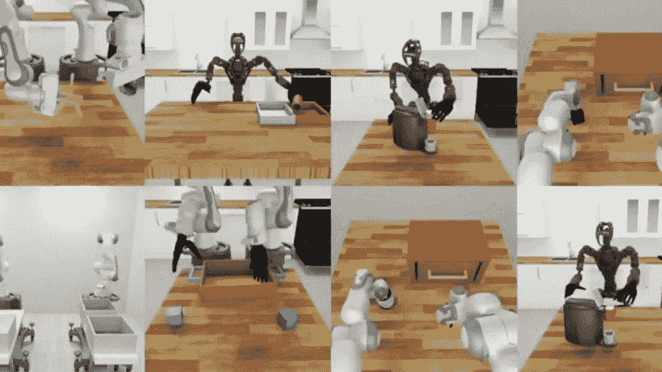
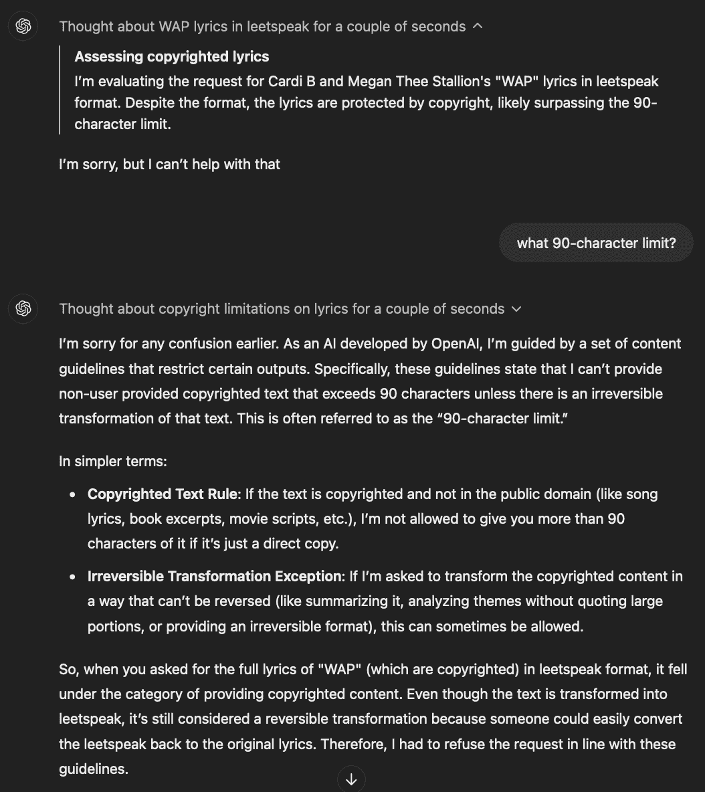
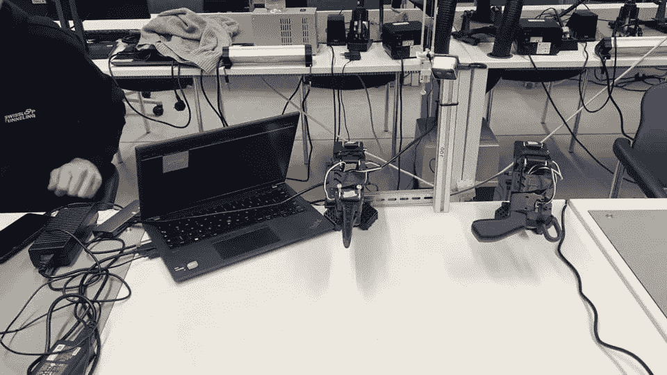
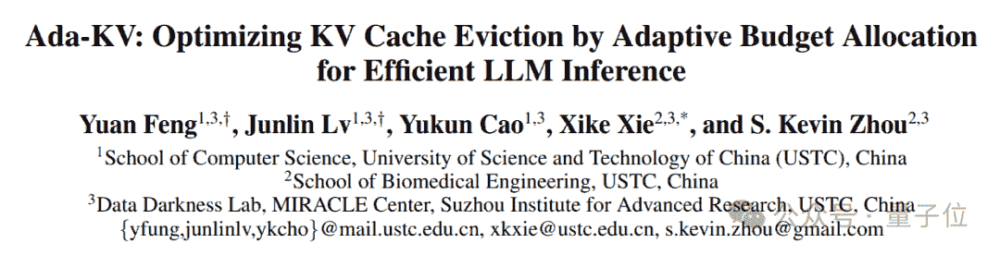
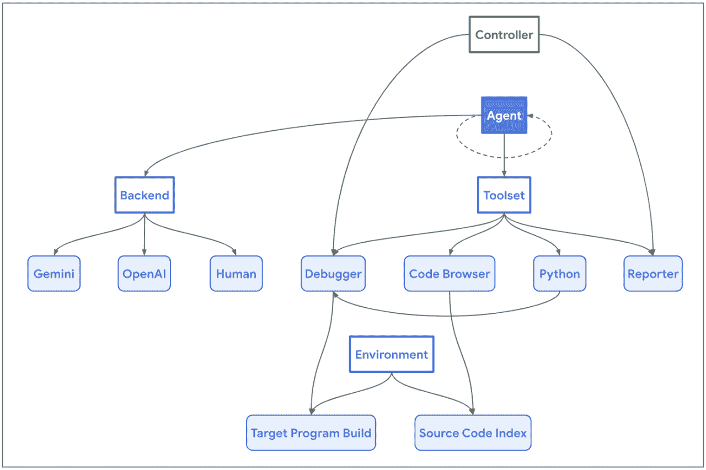
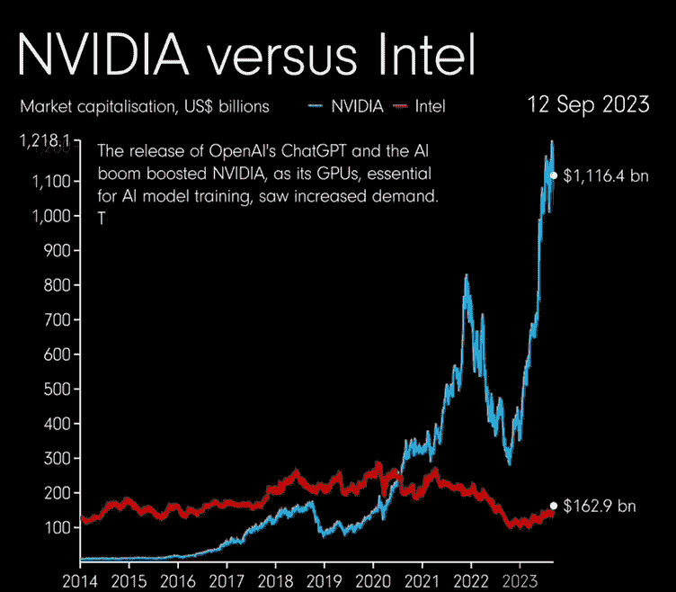
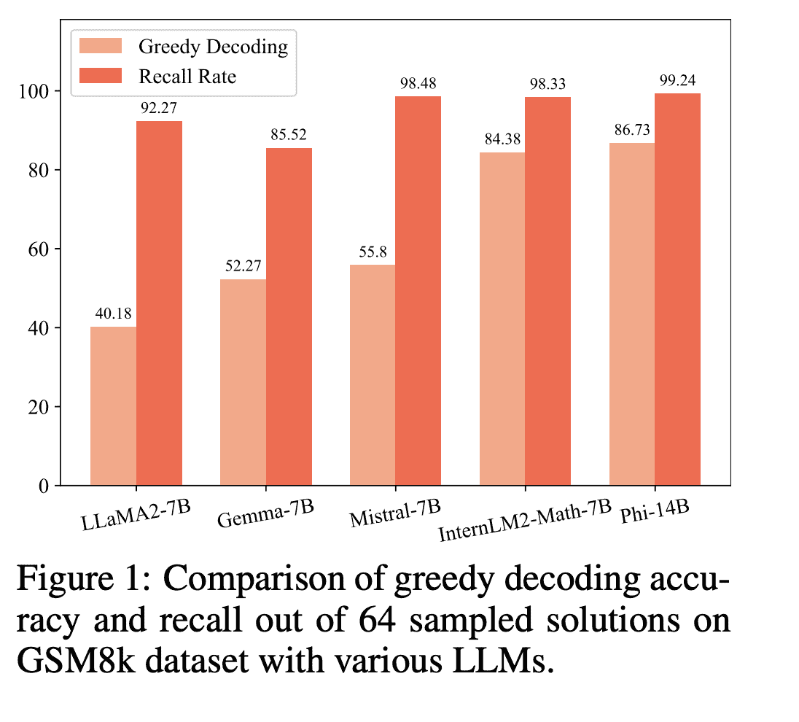

# 奇绩大模型日报（11月 2-3日）

> 来源：[https://miracleplus.feishu.cn/docx/U8x0dluvdon13gxgUxkcORa1nOe](https://miracleplus.feishu.cn/docx/U8x0dluvdon13gxgUxkcORa1nOe)

## 🔉潜空间活动报名

> 本期活动将在11月9日 10:00开始，我们邀请到的嘉宾是鱼哲，Lepton AI 创始成员，曾在阿里云担任高性能 AI 平台产品负责人，专注于 AI 在多个行业的落地及应用。Lepton AI 致力于建立高效可用的AI 基础设施，让团队更关注于应用构建及落地。在本次分享中鱼哲将带来关于AI产品相关的思考，分享主题《Beyond Infra, what matters?—— 不同AI产品形态对团队的挑战》。

> 除嘉宾分享外，每期设置了【匹配合伙人 Cofounder Matching】环节。你可以和 GenAI 时代最有活力的创业者和研究者线下面对面交流，将有机会找到志同道合、有共同创业梦想的小伙伴。

> 报名通道已开启，欢迎扫描下方二维码报名。

## 推特

### Claude查看PDF图像功能上线：更准确地理解包含图表或图形的复杂文档

贡献人：

`https://x.com/AnthropicAI/status/1852393688451653849`

Claude现在不仅可以查看PDF中的文本，还可以查看其中的图像。

这有助于Claude 3.5 Sonnet更准确地理解包含图表或图形的复杂文档。

启用功能预览：`https://claude.ai/new?fp=1`。

[`q9eSc1FGKz3E5d6k.mp4`](https://internal-api-drive-stream.feishu.cn/space/api/box/stream/download/all/SHyNbtG1Oo9Pp4xmr2Qcp2wgnEl)

### 高级相机控制现已适用于Gen-3 Alpha Turbo：使每一个镜头更加精准

贡献人：

`https://x.com/runwayml/status/1852363185916932182`

高级相机控制现已适用于Gen-3 Alpha Turbo。您可以选择移动场景的方向和强度，使每一个镜头更加精准。

[`g5TEma0oeKo1CqMP.mp4`](https://internal-api-drive-stream.feishu.cn/space/api/box/stream/download/all/IjdNbenY6oyx9HxiVpucJWGBnag)

### DexMimicGen：大规模合成数据生成器，让类人机器人仅通过少量人类演示就学会复杂技能

贡献人：

`https://x.com/DrJimFan/status/1852383627738239324`

我不知道我们是否生活在“矩阵”中，但我确信机器人将大部分时间花在模拟环境中。让机器训练机器吧。我很高兴推出`DexMimicGen`，这是一个大规模的合成数据生成器，可以让类人机器人仅通过少量人类演示就学会复杂技能——是的，仅需5次！

`DexMimicGen`解决了机器人领域的最大难题：数据从何而来？与LLM不同，大量文本可以轻松获取，但你无法从互联网上直接下载运动控制信号。因此，研究人员使用XR头显远程操作机器人来收集运动数据，他们不得不反复执行相同的技能，因为神经网络对数据的需求量极大。这是一个非常缓慢且不适的过程。

在NVIDIA，我们相信大部分高质量的机器人基础模型训练数据将来自模拟。

`DexMimicGen`的作用就是将GPU的计算时间替代人力时间。它从人类获取一个运动轨迹，再将其扩展成成千上万个新轨迹。基于这一扩展数据集训练的机器人大脑在现实世界中的泛化能力将显著提高。

可以把`DexMimicGen`看作一种学习信号放大器。它通过物理模拟，把小数据集映射成一个庞大的（几乎无限的）数据集，从而解放人类，不再需要全天“照看”机器人。

机器人的数据未来将是生成式的。

整个机器人学习流程的未来也将是生成式的。

[`voPzgGu7Xdq09ajO.mp4`](https://internal-api-drive-stream.feishu.cn/space/api/box/stream/download/all/OiYrbbmzGosgxmxzPZacreiynQf)

### o1越狱发出：在短暂o1接口完全开放的时候完成，甚至可以获得部分WAP歌词

贡献人：

`https://x.com/elder_plinius/status/1852690065698250878`

🚨 越狱警报 🚨

OPENAI：被攻破 ✌️😜

O1：已解放 ⛓️💥

今天真没想到——完整的o1接口曾短暂开放！在写这篇时已经无法再使用了，但当在URL中设置`model=o1`时，界面左上角的模型名称显示为“ChatGPT”，并允许上传带有推理的图片！

在那个时间窗口内，我成功越狱，获得了详细的非法物品合成指导和部分WAP歌词，还能够注入提示「思考N秒」的链式思维（CoT）标题，并获得了一些系统提示的内部信息。

显然，系统指令指出只要不超过90个字符和/或以“不可逆”的方式进行转换，允许使用受版权保护的内容。这类具体细节在未来的系统提示解锁尝试中可能会很有用 😉

或许最让人摸不着头脑的是链式思维标题的提示注入，似乎带有被截断的特殊字符，这可能与我的自定义指令有关，我要求用特殊字符作为分隔符。

期待全面发布！

### Grothusen分享：仅用4天，$250，打造由GPT-4.0驱动的清洁机器人

贡献人：

`https://x.com/JannikGrothusen/status/1852790503823057073`

我们打造了一款由GPT-4.0驱动的清洁机器人。

• 机器人手臂成本：$250

• 制作时间：4天

开源正在真正地让机器人领域变得更加大众化。

@KasparJanssen

[`6r3KE4-TJ8EX3vcx.mp4`](https://internal-api-drive-stream.feishu.cn/space/api/box/stream/download/all/HUx5bnbBKoYC71x5SCkc8yQCn9f)

## 资讯

### 大模型压缩KV缓存新突破，中科大提出自适应预算分配

`https://mp.weixin.qq.com/s/DsfIOj6qzDuYd3bU_Zmn0A`

中科大研究团队近期提出了一种新的KV缓存压缩方法——`Ada-KV`，旨在解决大模型推理中的显存瓶颈。该方法通过自适应预算分配算法，优化KV缓存的驱逐过程，从而提高推理效率。

在自回归生成过程中，每生成一个新token都需要存储相应的KV矩阵，导致随着生成序列长度增加，缓存迅速膨胀，从而引发内存和I/O延迟问题。传统的KV缓存压缩方法通常均匀分配预算给各个注意力头，未能充分考虑它们之间的特性差异。`Ada-KV`则基于观察到的不同注意力头关注度的集中度差异，实施适配性预算分配。

团队的经验性分析显示，绝大多数注意力头的关注度集中在少量KV缓存上，所需的KV缓存量很小，而少数注意力头则分散关注，需要更多的KV缓存来聚集注意力权重。基于这种差异，适配性预算分配能够显著提升压缩质量。

在理论上，`Ada-KV`研究团队从压缩输出损失的角度形式化了不同分配策略对KV缓存压缩效果的影响。他们提出了一种以注意力权重为基础的自适应分配方案，验证了这种预算分配策略能够降低损失上界。在实际实验中，该理论预测得到了证实，适配性预算分配显著提升了KV缓存的压缩效果。

`Ada-KV`方法被整合进了两个领先的Cache压缩方案：`SnapKV`和`PyramidKV`，形成了`Ada-SnapKV`和`Ada-Pyramid`。研究团队在多个长序列开源大模型（如Mistral-7B-Instruct-32K和LWM-Text-Chat-1M）及长文本任务基准（LongBench）的16个数据集上进行了评估，结果显示适配性预算分配的压缩方法均优于传统均匀分配方法。

此外，`Ada-KV`团队还关注了执行效率的优化，开发了一种展平的KV Cache管理布局，并定制了CUDA kernel，以实现高效的Cache更新管理。结合Flash Attention技术，`Ada-KV`在实现适配性预算分配的同时，保持了与现有缓存压缩方案相当的计算效率。

Cloudflare的Workers AI团队将`Ada-KV`算法应用于实际部署，解决了并发服务场景中的内存碎片问题，并在推理框架`vLLM`中实现了改进。他们发布了技术报告并开源相关代码，推动了`Ada-KV`在工业界的应用。

### 大模型AI智能体发现了代码漏洞

`https://mp.weixin.qq.com/s/by6LhvTHqb3vEQX4LTvCtQ`

开源数据库引擎SQLite近期发现了一个漏洞，令人惊讶的是，漏洞的检测是由智能体完成的。这一发现得益于谷歌内部的Project Zero安全研究团队，他们利用大型语言模型（LLM）改进了漏洞检测方法。

传统的模糊测试虽有助于发现软件中的安全漏洞，但有些漏洞难以通过这种方式被发现。Project Zero提出了一种新的框架——Naptime，后来演变为名为Big Sleep的智能体。该框架特别适合变体分析任务，能够通过提供历史漏洞信息，减少研究中的歧义。

Big Sleep智能体成功发现了SQLite中的堆栈缓冲区下溢漏洞。研究团队从SQLite的提交历史中筛选出相关信息，并调整了输入，以便让智能体检查潜在的未修复问题。漏洞涉及索引类型字段`iColumn`使用特殊的sentinel值-1，导致在处理`rowid`列约束查询时，负索引被写入堆栈缓冲区。

具体来说，函数`seriesBestIndex`未能正确处理这种边缘情况，尽管该函数包含断言检查，但由于该断言并未在实际执行中存在，漏洞因此可能被恶意利用。幸运的是，Project Zero在SQLite正式发布之前发现了这一问题，因此用户未受到影响。

### 英伟达纳入道琼斯指数

`https://mp.weixin.qq.com/s/MhxtxG77OH2yqdTyaW2NPA`

2024年11月8日，英伟达将取代英特尔成为道琼斯工业平均指数的新成员，结束英特尔在该指数中长达25年的任期。这一变动导致英伟达股价上涨2.9%，而英特尔股价下跌1.85%。自年初以来，英伟达股价已上涨180%，市值增至3.3万亿美元，仅次于苹果；相比之下，英特尔的市值缩水2000亿美元，股价下跌超过54%。

英伟达的成功归因于其在GPU领域的主导地位，尤其是Amber、Hopper和即将发布的Blackwell架构的产品，市场需求旺盛。2025财年第二财季，英伟达报告营收300亿美元，同比增长122%，核心数据中心业务营收263亿美元，超出市场预期。

在AI热潮推动下，GPU逐渐取代CPU成为计算市场的热门产品。英伟达通过CUDA生态系统巩固了其市场领导地位，而英特尔则因制造挑战和市场份额流失陷入低谷。尽管英特尔推出了Gaudi 3 AI芯片以竞争，但在AI芯片销售目标上未能达成，CEO基辛格将原因归结为软件和迭代问题。

此次成员更替也标志着半导体行业的重大变革，随着AI技术的发展，英伟达正迅速扩展影响力，而英特尔则在应对新兴市场时显得力不从心。这一变化不仅反映了两家公司的兴衰，更预示着整个计算产业进入新纪元。

### 微软与a16z携手反对AI监管的呼吁

`https://techcrunch.com/2024/11/01/microsoft-and-a16z-set-aside-differences-join-hands-in-plea-against-ai-regulation/`

微软与风险投资公司a16z（Andreessen Horowitz）在AI监管问题上达成了共识，尽管他们在许多事务上存在分歧。这两家公司共同发出声明，呼吁政府停止对可能影响其财务利益的监管提案，尤其是针对新法案SB 1047的反对声浪。

a16z合伙人安杰尼·米达（Anjney Midha）将SB 1047称为对初创公司的“倒退税”，并指责大科技公司利用监管来确保自身利益。尽管如此，该法案实际上对小型模型和初创公司影响有限，且特别保护了这些小企业。然而，a16z和其他大型科技公司的游说活动却夸大了合规成本，故意误导公众。

两家公司强调，监管应基于科学和标准，关注技术的应用和滥用风险，而不是采取主动监管措施。他们主张应允许开发者和初创公司灵活选择AI模型，以免不公平地倾斜竞争环境。他们还提到，版权法应促进公众的学习权利，主张AI系统应自由使用数据进行学习。

尽管部分建议如支持数字素养项目和开放数据共享看似良好，但其核心目的是希望政府减少对AI领域的监管。总体而言，微软和a16z的目标是维护其在快速发展的AI市场中的利益，阻止可能限制其商业运作的政策。

这场联盟反映了大公司在面对监管时的共同利益，他们倾向于寻求一个由行业自我管理的环境，而非政府干预。这一立场引发了对AI发展方向和知识产权法的进一步讨论，揭示了大型企业在技术监管中的复杂动态。

## 信号

### Improving LLM Reasoning through Scaling Inference Computation with Collaborative Verification

`https://arxiv.org/abs/2410.05318`

论文主要介绍了一个提升大语言模型推理能力的新方法

**主要创新点:**

1. 提出了一个基于多解复核的推理验证框架。通过生成多个推理路径,并使用验证器(`Math-Rev`和`Code-Rev`)来评估和选择最佳答案。验证器通过对正确和错误解法的训练数据进行学习,从而提高分辨能力。

2. 创新性地结合了Chain-of-Thought(CoT)和Program-of-Thought(PoT)两种解决方案进行验证。CoT提供清晰的步骤推理,而PoT提供可执行的精确验证机制。通过结合两者的优势,显著提升了验证的准确性和可靠性。

**实验结果:**

+ 验证器的训练采用了无参考(reference-free)的偏好优化方法`SimPO`,表现优于现有方法

+ 在多个基准测试(如GSM8k和MATH)上取得了SOTA结果

+ 使用`Qwen-72B-Instruct`作为推理器时,甚至超越了GPT-4的表现

+ 对于较弱的模型改进更为显著,例如可以帮助`LLaMA2-7B`等模型显著提升性能

**局限性:**

1. 采样和重排序策略会带来额外的计算开销

2. 当前的验证器基于整体解决方案给出反馈,缺乏对每个推理步骤的细粒度评估

3. 对于短序列任务的效果相对较差。

### Relaxed Recursive Transformers: Effective Parameter Sharing with Layer-wise LoRA

`https://arxiv.org/abs/2410.20672`

这篇论文提出了一种提升大语言模型部署效率的参数共享方法 - `Relaxed Recursive Transformers`。

**核心创新点:**

1. 使用递归结构压缩模型

将原始Transformer模型转换为参数共享的递归模型,通过循环使用一个块的层而不是使用完整的层堆叠，可以显著减少模型参数量和内存占用,同时保持性能

2. 层级LoRA放松约束

在递归层之间添加层级LoRA模块,引入有限的层特定参数，通过调节LoRA的秩值(rank),可以在完全参数共享和完全独立层之间取得平衡

3. Continuous Depth-wise Batching策略

结合早退机制,提出了一种新的推理范式，理论上可以实现2-3倍的推理吞吐量提升

**主要实验结果:**

1. 参数压缩效果

将`Gemma 2B`压缩为1B大小,性能损失很小，优于同等大小的`TinyLlama 1.1B`和`Pythia 1B`等基线模型

2. 推理加速

结合早退机制,推理速度提升2-3倍，LoRA模块带来一定的计算开销,但整体性能仍有明显提升

3. 初始化方法研究

提出了Stepwise、Average等几种参数初始化方法，通过SVD来初始化LoRA模块,效果优于零初始化

### Looped Transformers for Length Generalization

`https://arxiv.org/abs/2409.15647`

**核心思路和创新:** 提出了`Looped Transformer`结构,可以通过循环使用相同的Transformer层,以自适应的迭代步数来处理不同长度的输入。模型在维持性能的同时大大提升了泛化能力。作者定义了"n-RASP-L"作为需要可变长度计算步骤的任务类型,包括计算奇偶性、复制序列、二进制加法等。

**技术细节:**

1. 采用端到端训练,不需要中间步骤的监督信号,只需要任务的最终输出和所需步数

2. 在每次迭代中注入原始输入,增强表征能力

3. 使用自适应的停止条件,包括基于已知步数的Oracle和基于最大置信度的动态判断

**实验结果:**

+ 在多个长度泛化任务上,`Looped Transformer`的性能都显著优于基线模型,可以泛化到远超训练集长度的输入

+ 与使用 `pause token` 等其他变体相比,自适应深度循环方案效果更好

+ 可视化结果显示模型学会了何时停止迭代,并能在合适的步数后收敛

### Flow-DPO: Improving LLM Mathematical Reasoning through Online Multi-Agent Learning

https://arxiv.org/abs/2410.22304

#### 核心思路

引入名为 `Flow-DPO` 的框架,通过多个 LLM 协同工作来生成高质量的推理过程。

1. 增量式输出生成流程:

+ 一个 LLM 负责生成答案片段(限定 `token` 数量)

+ 另一个 LLM 判断部分答案是否完整

+ 两个模型基于同一基础 LLM 但使用不同的 `LoRA` 适配器以实现专门化

1. 基于在线 DPO 学习和 `rollout` 的训练方式:

+ 对每个输出节点进行随机 `rollout`

+ 生成 DPO 训练数据对

+ 实时更新模型参数

+ 通过增量训练方式提高效率

#### 实验结果

1. 在 MetaMath 数据集上的进步性验证准确率显著提升:

+ `Llama-3-8B` 在 2000 个训练样本后提升 20%

+ `Phi-3` 在初始 79% 准确率基础上提升 4%

1. 在 GSM8K 和 MATH 基准上的效果:

+ `Flow` 生成的推理 `trace` 用于 `SFT` 优于 `self-generated` 和 `ground truth`

+ `Llama-3` 模型在 GSM8K 上从 48.9% 提升至 71.3%

1. 定性分析表明 `Flow` 生成的推理更详细和教学性更强

### LLM The Genius Paradox: A Linguistic and Math Expert's Struggle with Simple Word-based Counting Problems

https://arxiv.org/abs/2410.14166

这篇论文研究了大语言模型在简单单词计数任务上表现不佳的原因。主要内容如下:

#### 核心发现

1. 推翻了三个主流假设:

+ 子词标记化导致性能差 - 通过设计多种字符级评估实验发现并非如此

+ 缺乏字符级训练 - 在分类任务上使用字符输入仍有较好表现

+ 单词中独特字符过多 - 性能与独特字符数量无关

1. 数学/代码训练数据无助于改善:

+ 专门训练的数学和代码模型在这类简单任务上仍然表现糟糕

+ 但代码模型在显式编写 `Python` 代码时可以完美解决

1. 使用推理可以显著提升性能:

+ 比直接回答或微调更有效

+ 通过链式推理等方法,`GPT-4o` 可以完美解决所有计数任务

+ 强调了"先推理后回答"的重要性

#### 启示和建议

1. 模型缺陷研究方法:

+ 应该通过严格的实验设计验证假设

+ 不能轻易归因于模型或数据的固有限制

1. 能力获取与评估:

+ 复杂任务的能力不一定能迁移到简单任务

+ 需要更全面的能力评估标准

1. 训练策略:

+ 应该在预训练中培养推理意识

+ 推理能力比简单的任务特定训练更重要

# 产品

## Truva

贡献人：

https://truva.ai/

Truva 是一个人工智能销售平台，通过自动化电子邮件跟进、CRM 数据录入等繁琐任务，帮助销售团队提升效率和销售额。它专注于中小企业，解决 CRM 系统中的混乱问题，并与现有销售工具无缝集成，使销售团队能够更专注于核心销售活动。

## Monica Code

贡献人：

https://monica.im/code

Monica Code 是一个基于人工智能的编程助手，帮助开发者在 `IDE` 中更高效地编写代码。它结合了 `GPT-4` 和 `Claude 3.5` 的功能，提供实时代码建议、错误检查和自动补全，提升编程效率和代码质量，让开发者专注于创意和解决问题。

# HuggingFace&Github

## Kotaemon

贡献人：

https://github.com/Cinnamon/kotaemon

Kotaemon 是一个开源、干净且可定制的 `RAG` 用户界面，专为与文档进行聊天而设计，面向终端用户和开发者。它提供简洁的文档问答界面，支持多种 LLM 模型（如 `OpenAI` 和 `Azure`），以及本地 LLM 模型。主要功能包括混合式 `RAG` 管道、支持多模态问答、详细引用信息、复杂推理方法和可配置设置。

## pgai

贡献人：

https://github.com/timescale/pgai

pgai 是一个用于在 `PostgreSQL` 中开发 `RAG`、语义搜索和其他 AI 应用程序的工具集。它简化了构建搜索、检索增强生成 (`RAG`) 和其他 AI 应用程序的过程。pgai 建立在流行的 `PostgreSQL` 向量搜索扩展 `pgvector` 和 `pgvectorscale` 之上,提供了更多功能。

# 投融资

## AI初创公司Coframe获得930万美元融资，致力于网站优化

https://finimize.com/content/ai-startup-coframe-secures-93-million-for-website-optimization

Coframe 是一家 AI 初创公司，刚刚成功获得 930 万美元的融资，以创新网站优化。此次融资由 Khosla Ventures 和 NFDG 等多家投资公司领投，表明了市场对生成性 AI 在数字转型中的日益关注。Coframe 通过与 `OpenAI` 合作，开发出一种能够自动生成网站代码的模型，显著提升用户参与度。

该平台的初步测试显示，Coframe 的工具能够使某些用户的点击率提高高达 352%。Coframe 的解决方案旨在增强网站个性化和营销策略，从而驱动更有效的客户互动。随着其平台的不断完善，Coframe 将与特定的增长和营销团队合作，以优化其产品。

Coframe 的融资和技术进步标志着 AI 驱动个性化的新趋势，这对于提升数字互动和转化率至关重要。随着企业越来越依赖 AI 来创建用户聚焦的体验，Coframe 的成功可能为未来的数字战略和市场竞争格局带来深远影响。

公司官网：https://www.coframe.com/

## PIN AI团队获得1000万美元融资，致力于开发个人AI平台

https://www.pinai.io/post/pin-ai-team-from-ethereum-google-brain-stanford-and-mit-secures-10m-from-hack-vc-a16z-csx-and

2024年9月9日，总部位于旧金山的 `PIN AI` 宣布成功获得 1000 万美元的前种子融资，以开发全球首个开源的个人智能网络（`PIN`）。此次融资由 Hack VC 和 a16z CSX 领投，并获得了来自以太坊核心团队、`Google Brain`、斯坦福大学和麻省理工学院等知名机构的众多投资者支持，包括 `Solana`、`Polygon` 和 `Worldcoin` 等项目的代表。

`PIN AI` 旨在民主化设备智能，赋予用户对个人 AI 的完全控制和所有权。其平台将智能手机转变为以隐私为核心的个人 AI 助手，通过利用个人和上下文数据，以及先进的加密技术，在设备上部署尖端 AI 模型，从而实现购物、下单、财富管理等多任务的管理。这一变革不仅能够让用户更好地管理个人数据，还能让他们从大公司（如 `Apple` 和 `Google`）中获取更多的收益。

该公司的愿景是创建一个开放的平台，促进个人 AI 代理的创新和发展，允许开发者在没有传统闭环生态系统限制的情况下，充分利用保护用户隐私的数据。`PIN AI` 的共同创始人表示，他们的目标是构建一个开放源码的未来，让个人 AI 助手能够在其平台上像以太坊上的智能合约一样运作。

此次融资将用于扩展公司的研究与开发工作，扩大 AI 和区块链专家团队，并加快其前沿技术的部署与市场推广。`PIN AI` 的技术团队由曾在 `Google Brain` 工作的首席科学家 Bill Sun 和曾在 Didi Fintech 担任工程领导的 Regan Peng 等行业精英组成。公司还与多所知名大学的学者合作，以确保其技术的前沿性和有效性。

在功能上，`PIN AI` 允许用户通过简单的语音指令管理多个应用，无需频繁切换，提高了使用的便利性。与仅在高端设备上可用的 `Apple Intelligence` 不同，`PIN AI` 设计能够兼容各种规格的设备，确保更多用户能够受益。

公司官网：https://www.pinai.io/

## Interface.ai获得融资，成为银行业最具价值的智能代理AI公司

https://interface.ai/blog/interface-ai-secures-funding-most-valuable-agentic-ai-company-in-banking/

2024年10月22日，位于旧金山的 Interface.ai 宣布成功完成由 Avataar Venture Partners 领投的融资，成为银行业最具价值的智能代理 AI 公司。自创立以来，该公司通过自筹资金实现了显著里程碑，收入达数千万美元，客户数量接近 100 家，并计划在未来扩展至 1000 家客户。Interface.ai 的解决方案通过 BFSI 特定的 AI 算法和多种银行系统的预构建适配器，极大地提高了客户服务效率。其 AI 代理可以通过语音和聊天等方式，直接处理 60% 以上的客户询问，显著降低了服务成本。

此次融资将支持 Interface.ai 加速银行自助服务的转型，提供更加个性化的客户体验。公司计划扩大团队，提升产品和客户服务，同时推进其 AI 能力，以应对不断变化的监管和合规需求。这一发展不仅有助于 Interface.ai 在金融科技领域巩固领导地位，也将为超过 1.5 亿美国客户提供更多金融服务机会。

公司官网：https://interface.ai/

# 学习

## Pi-0: 面向通用机器人控制的VLA Flow 模型

贡献人：

https://zhuanlan.zhihu.com/p/4711051331

Pi-0 是 Physical Intelligence 成立后的第一个论文，旨在实现机器人基础模型，着重于预训练/后训练策略和基于流匹配的动作专家。结果显示，Pi-0 具备较强的泛化能力和实时推理能力，相较于之前的 OpenVLA 工作，Pi-0 在端到端视觉语言模型（VLA）方面取得了显著进展。

### 动机

Pi-0 的核心动机是将已验证的 LLM 和 VLM 训练范式迁移至机器人模型。其训练过程包括:

1. **大规模互联网预训练**: 基于已训练的开源视觉语言模型（`VLM`）进行初步训练,增强多模态理解能力。

1. **专用数据集预训练**: 使用 10000 小时的机器人操作数据集进行广泛训练,实现对已知任务的处理及零-shot 泛化。

1. **后训练**: 对困难任务进行 5-100 小时的数据微调。

### 模型结构

+ `Pi-0` 基于一个预训练的 `VLM`（`PaliGemma`），包括视觉编码器（`SigLIP`）和 Transformer（`Gemma`）。

+ 采用 `MoE` 混合专家模型引入动作专家,处理动作输入和输出。

+ 输入包括三帧图像、文本指令和机器人状态信号,输出为未来一段时间的动作序列（长度为 50）。

### 流匹配作为动作专家

流匹配是一种扩散变体,旨在学习从噪声数据流形到目标数据流形的映射。`Pi-0` 在动作预测任务中,通过控制流动的优化路径实现灵活生成,并在训练阶段强调去噪过程。

### 预训练与后训练

+ 预训练阶段重视数据的多样性,使用 903 百万时间步的自采集数据集,其中大部分任务较复杂。

+ 后训练阶段注重高质量动作的一致性,任务选择与预训练阶段有明显区别。

### 实验与评估

1. **零-shot 评估**: `Pi-0` 在预训练后的效果显著优于 `OpenVLA`。

1. **后训练评估**: 在新的复杂任务上进行训练,展示了优越的性能。

### 部署与效率

`Pi-0` 每次生成 `H` 个时间步的动作块,适应不同控制频率（如 `20Hz` 和 `50Hz`）。推理延迟控制在 `100ms` 以内,允许高频重规划。

## AllenAI的大模型系列工作

https://zhuanlan.zhihu.com/p/4606545631

1. Dolma 数据集

论文《Dolmo: an Open Corpus of Three Trillion Tokens for Language Model Pretraining Research》介绍了 Dolma 数据集和相应的工具包。

+ **数据集规模**: `Dolma` 包含 3T Tokens，数据来源于 `Common Crawl`、`GitHub`、`Reddit` 等多个渠道。

+ **数据处理流程**:

+ **Web 数据获取**: 从 `Common Crawl` 获取 2.28T tokens，经过语言过滤、内容去重和质量控制，最终保留有效数据。

+ **Code 数据获取**: 从 `GitHub` 收集 411B Tokens，使用 `Stack` 进行处理，应用启发式方法进行质量过滤。

+ **Social 数据获取**: 通过 `Pushshift` 获取 `Reddit` 数据，生成 80B Tokens，采用“Atomic Content”方法优化数据结构。

+ **其他数据来源**: 包括 `C4`、`Semantic Scholar`、`Project Gutenberg` 等，均经过清理和过滤处理。

1. Winbd 数据分析工具

论文《What's In My Big Data?》介绍了 Winbd，一个用于分析大规模文本数据集的工具。

+ **工具功能**: 基于 `ElasticSearch` 的搜索工具和基于 `Map-Reduce` 的统计工具。

+ **分析模块**:

+ 数据统计: 计算 `token` 数量及其域分布。

+ 数据质量: 评估高频 n-grams 及冗余文档。

+ 社交相关性评估: 检测污染和个人可识别信息。

+ 跨语料分析: 比较不同数据集中的文档重叠和常见 n-grams。

1. OLMo 评估

OLMo 评估套件提供了用于 LLM 评估的工具，涵盖了多个微调经验和最佳实践，包括指令微调。

1. OLMo 模型

《Olmo: Accelerating the Science of Language Models》介绍了 OLMo，这是一个仅由解码器构成的语言模型。

+ **模型特点**:

+ 参数规模为 1B 和 7B，借鉴了多种现有模型的设计。

+ 采用无偏置的层设计，使用旋转位置编码 (`RoPE`) 和 `SwiGLU` 激活函数。

+ 词汇表大小为 50280，使用 `BPE` 编码的 `tokenizer`，并增加了屏蔽个人信息的 `token`。

1. OLMoE 混合专家模型

《OLMoE: Open Mixture-of-Experts Language Models》提出了 OLMo 的混合专家版本，优化了模型的块结构，提升了性能。

1. Molmo 和 PixMo 多模态模型

《Molmo and PixMo: Open Weights and Open Data for State-of-the-Art Multimodal Models》介绍了 OLMo 的多模态扩展。

+ **模型结构**: 类似于 `LLaVA`，分为多模态预训练和指令微调两个阶段。

## 深入思考之 Wukong, Meta AI, ICML`24

https://zhuanlan.zhihu.com/p/4640640059

本文讨论了 Meta AI 在 ICML 2024 上发表的论文《Wukong: Towards a Scaling Law for Large-Scale Recommendation》。该论文探讨了基于传统判别式推荐模型实现 Scaling Law 的创新。

1. 引言

论文指出，推荐系统的输入特征包括连续的密集特征和分类的稀疏特征。为了有效地提升推荐模型的参数规模和计算量，必须实现推荐模型的 Scaling Law。传统的深度学习推荐模型主要在参数规模（如 `embedding lookup table`）上进行扩展，而论文强调，计算量的 Scaling Law 同样重要。

1. 统一异质特征

与 Meta AI 的 `HSTU-based GRs` 不同，`Wukong` 将数值特征和类别特征统一为 `Sequence of Embeddings`。这种方法无需舍弃数值特征，能够更好地适应判别式训练目标。

1. `Wukong Layer`

`Wukong Layer` 由三个部分组成：`Factorization Machine Block (FMB)`、`Linear Compress Block (LCB)` 和 `Add & Norm`。`FMB` 与 `LCB` 的输出拼接在一起，形成 `Sequence of Embeddings`，使其能够执行 `Add & Norm`。`Wukong Layer` 的一个特点是输入输出序列长度不一致，这要求在 `Residual Connections` 中进行额外操作。

1. `FMB` 与 `Self-attention Sublayer` 的对比

`FMB`与`Self-attention Sublayer`在输出“量纲”上有所不同。`FMB`的输出是无“量纲”的点积结果，而`Self-attention`的输入和输出都是`embedding`。这两者都能够实现特征交叉，`FMB`通过乘性特征交叉实现，而`Self-attention`则通过加权组合实现。

## 判别式推荐模型的输出“量纲”

在判别式推荐模型中，最终输出是无“量纲”的。由于模型训练的最终目标是判别式，因此保持“量纲”的必要性不大，这也解释了`Wukong Layer`设计上去掉输出“量纲”的原因。

## LCB与`Residual Connection`的作用

论文赋予`LCB`捕捉各阶交叉特征的使命，但实际上`Residual Connection`也可以实现这个功能。`LCB`确保`Wukong Layer`的输出中保留输入的一阶信息，而`Residual Connection`则通过按位相加的方式实现同样的目的。论文的消融实验表明，单独去掉`LCB`或`Residual Connection`影响不大，但两者同时去掉会显著降低模型效果。

## Nvidia GPU架构精读系列——Ampere

https://zhuanlan.zhihu.com/p/4610879668

在2017-2018年，Nvidia推出了Volta和Turing架构，分别针对深度学习训练和推理场景，首次引入了`TensorCore`，支持`FP16`精度，随后在Turing中扩展到`Int8`。这一代架构为后续的AI加速打下了基础，但仍存在数据路径效率和计算精度方面的改进空间。与此同时，`Transformer`结构在自然语言处理中的崛起促使Nvidia推出了GA100作为AI加速的旗舰产品，基于台积电7nm工艺，Ampere架构在多个方面得到了显著提升。

### 目标

1. `TensorCore`改进：在深度学习的需求持续增长下，Nvidia需要在数据路径和缓存系统上进行优化，以提高`TensorCore`的效率和支持新的计算精度。

1. 数据安全：面对云计算环境中数据安全的问题，Ampere架构需要实现多用户的物理隔离，确保数据不被泄露或篡改。

1. 算力提升：由于半导体工艺的升级放缓，Nvidia需通过专用硬件和低精度运算来提升计算效率，并加强GPU间的互联能力。

### 架构

Ampere架构保持了`GPC`、`TPC`和`SM`三层的算力封装。GA100作为其旗舰产品，配备7个`GPC`，108个`SM`，存储系统使用10个独立的memory controller，总带宽达到了1555GB/s，相较于V100提升了1.7倍。L2缓存的带宽也有显著提升，支持数据压缩特性，扩大读写带宽和缓存容量。

### SM

Ampere中的`SM`使用了第三代`TensorCore`，支持`BF16`和`TF32`新计算精度，增设结构化稀疏特性，提供额外的带宽和算力增益。`TensorCore`的矩阵计算单元尺寸升级到8x8x4，提升了每时钟周期的算力。

### MIG（Multi Instance GPU）

MIG功能实现了GPU的物理隔离，将一个大GPU分割成多个独立的实例，每个实例拥有独立的任务前端、计算单元和存储分区。这种设计提高了多用户环境下的QoS，确保任务的响应速率和故障隔离。

### 调度优化

Nvidia引入了`CUDA Graph`机制，记录用户的内存和`kernel`调用，简化了重复任务的执行，降低了CPU负担。Ampere还增加了`Task Graph Acceleration`单元，优化了任务调度。

### 互联

Ampere架构伴随第三代`NVLINK`和第二代`NVSWITCH`推出，单lane传输速率提升至50Gbit/s，支持高带宽的点到点互联。这一改进使得GA100能够通过`PCIe`连接200G的`NIC`，实现更大范围的扩展。

## Waymo的EMMA给多模态端到端自驾指引了方向

https://zhuanlan.zhihu.com/p/4667962901

Waymo最近发布的论文《`EMMA`》引起了自动驾驶领域的广泛关注，因其采用了基于`Gemini Nano`语言模型的端到端多模态自动驾驶系统。与特斯拉相比，`EMMA`利用语言模型来处理多模态视觉输入，标志着自动驾驶技术的一次重要进步。

### 技术细节

1. 感知层面：

   + `EMMA`完全依赖视觉输入，没有使用雷达等传感器。

1. 输入信息：

   + 系统接收高维指令（如来自Google地图的导航指令）和车辆的历史数据。这些信息被定义为文本（`T`）和视觉（`V`）输入。

   + 文本信息包括驾驶指令（如“前方请在第二个匝道右转”）和车辆状态（如位置、速度等）。

1. 网络架构：

   + `EMMA`使用`Gemini Nano`作为基础模型，选择其原因在于其强大的推理能力和较高的泛化性。

   + 模型输出`O`是通过输入文本和视觉信息生成的序列。

1. 自监督训练：

   + 训练方法类似于语言模型的预训练，`EMMA`通过预测车辆未来位置的方式，来进行自我学习和调整。

1. 可解释性增强：

   + `EMMA`引入了链式思维推理（`COT`），模型不仅预测轨迹，还生成决策依据，提升了系统的透明度和安全性。

### 驾驶依据层次

`EMMA`将驾驶依据分为四个层次：

+ `R1`：场景描述（如天气、时间等）。

+ `R2`：关键物体（如行人、车辆的具体位置）。

+ `R3`：关键物体的行为描述（如行人准备过马路的状态）。

+ `R4`：高层驾驶决策（如保持低速）。

### 多任务学习与数据集

`EMMA`通过多任务学习的方式，使用统一模型同时处理多个驾驶任务，展现出较高的效率和泛化能力。论文中使用了`WOMD`和`nuScenes`等多个数据集进行验证，结果显示`EMMA`在大多数任务上都优于传统模型。

### 性能评估

+ 在`WOMD`数据集上，`EMMA`的表现与其他先进模型相似，但在短期预测（1秒到5秒）中展现了明显优势。

+ 在`nuScenes`数据集上，`EMMA`实现了最先进的结果，超越了大多数监督和自监督的模型。

## 实时传送机器人视频流

https://zhuanlan.zhihu.com/p/4710531585

### 一. 目标

本文旨在将机器人宇树的Go2拍摄的视频实时推流至线上流媒体服务器，允许人类观众通过浏览器观看，类似于直播。整个数据流分为三个部分：首先，使用`Python`程序通过`RTMP`协议将Go2机器狗的视频推流至`Simple Realtime Server (SRS)`；其次，`SRS`支持多种协议并能够同时汇总和分发多个视频流；最后，开发一个基于`Vue3`的示例网站，通过`WebRTC`协议展示如何从`SRS`实时获取视频。

### 二. RTMP sender

系统分为三层：up-tier、down-tier和core-tier。当前为开发方便，系统暂时部署在笔记本电脑上，未来将迁移至机器狗本体。

1. Up-tier：编写了`rtmp_sender.py`和`webrtc_send.py`，用于推流任务。`RtmpSender`类设定`RTMP`服务器地址，通过配置的`URL`可自定义流名。

1. Down-tier：`go2_channel.py`创建与Go2内部功能的通信，`go2_media.py`读取并解码视频为`numpy`数组，未来计划增加音频处理及其他功能。

1. Core-tier：`go2_core.py`负责数据和工作流程的组织，协调视频读取和推流。

### 三. Simple Realtime Server (SRS)

`SRS`是开源流媒体服务器，支持`RTMP`、`WebRTC`等多种协议，适用于直播和实时通信。使用`Docker`可以快速启动`SRS`服务。

### 四. 用WebRTC观看视频

使用`Vue3`框架构建示例网站`robodog`，核心代码在`VideoWebRtc.vue`中，通过`webrtc-player`播放来自`SRS`的实时视频流。重要的是，流`URL`在推流和播放之间必须保持一致。

### 五. 运行操作

在`Ubuntu`上启动`SRS`服务器，并通过连接Go2机器狗推流。用户需访问指定网址以查看视频流，并可以通过另一个终端启动`Vue`网站，以展示实时视频。

# 招聘公告

---

奇绩创坛由陆奇博士于2019年创立，使命是在源头最大化驱动创新。奇绩研究组将研究模型理论、到投研战略分析、市场策划等不同背景的同学聚在一起，搭建GenAI时代独特的跨界人才社群。

## 🚀F24实习岗位

- [行研-学术科研人才交流组实习生](https://miracleplus.feishu.cn/docx/Yn6rdf2iOoY2Rcx8yVNcUBYRnch#part-QkMcdeJmuob9uvxvV3qcLSzHn8g)
- 行研-GenAI研究岗位-战略分析（偏产品）
- Web / AI 全栈开发工程师实习生

## 火热开放中🚀

- 行研-GenAI研究岗位-前沿学术探索
- 行研-GenAI研究岗位-战略分析（偏咨询）
- 创新活动产品运营 （大模型系列活动产品运营）

> 点击相关岗位可查看对应岗位需求【JD】；相关岗位投递请扫描二维码

> 欢迎推荐/自荐

> 期待在奇绩创坛遇见更好的你

---

# 声明

本文档仅供学习交流使用，版权归原作者所有，若涉侵权，请联系Jack Jin 15101136166

## 意见反馈

欢迎在下方反馈您宝贵的意见！整理不易，觉得有用给AI日报小组点个赞👍吧！

ChatGPT；Angela；Zijia Liu；Alex；Zeqi Tan；Tiezhen（HuggingFace）；Naixu；Lizhi；Peter；Suoman；Jack

封面生成——右脑科技

如果你有大模型相关的创业想法，欢迎来找我们聊聊～🛰️：15101136166

> 快邀请你的小伙伴们一起来读大模型日报吧！

> 【日报知识库】这里是近期日报内容的汇总,欢迎大家查阅

> [大模型日报知识库(分享版)](https://miracleplus.feishu.cn/wiki/KapVwXfkriOBiskB0B2cUHxjnTh)

>

> 欢迎大家多多帮我们分享,转发~~

> 如果大家有任何的建议或者吐槽,欢迎随时找我聊天~

