# 奇绩大模型日报（11月 1日）

> 来源：[https://miracleplus.feishu.cn/docx/K050dTEFxokk52xzaxscuQgDnec](https://miracleplus.feishu.cn/docx/K050dTEFxokk52xzaxscuQgDnec)

# 🔉潜空间活动报名

> 本期活动将在**11月9日** **10:00**开始，我们邀请到的嘉宾是**鱼哲**，Le**pton AI 创始成员，曾在阿里云担任高性能 AI** 平台产品负责人，专注于 AI 在多个行业的落地及应用。Lepton AI 致力于建立高效可用的AI 基础设施，让团队更关注于应用构建及落地。在本次分享中鱼哲将带来关于AI产品相关的思考，分享主题《Beyond Infra, what matters?—— 不同AI产品形态对团队的挑战》。

> 除嘉宾分享外，每期设置了【匹配合伙人 Cofounder Matching】环节。你可以和 GenAI 时代最有活力的创业者和研究者线下面对面交流，将有机会找到志同道合、有共同创业梦想的小伙伴。

> 报名通道已开启，欢迎扫描下方二维码报名。

#

# 资讯

### OpenAI推出ChatGPT搜索，挑战谷歌市场地位

https://techcrunch.com/2024/10/31/openai-launches-its-google-challenger-chatgpt-search/

OpenAI正式发布了ChatGPT Search，这是一个旨在提供“及时答案”的搜索工具，是其此前SearchGPT原型的升级版。该功能集成于ChatGPT平台中，使用优化后的GPT-4o模型支持，从网上获取信息与图片，以提供如体育比分、新闻、股票行情等信息，并附带链接，便于用户进一步查询。

主要功能与特点：

+   **即时搜索**：ChatGPT Search可以根据用户的提问自动选择是否进行网络搜索，用户也可以通过点击图标手动激活搜索功能。

+   **信息来源标注**：在回答中，ChatGPT Search提供了新闻来源及其他数据的边栏和内联标注，例如，当用户查询某地活动时，ChatGPT会从当地新闻来源中提取信息。

+   **分阶段发布**：ChatGPT Search首先面向ChatGPT Plus和Team用户开放，未来几周内将推广至企业和教育用户，最终向免费用户开放。

OpenAI还推出了一个浏览器扩展，可将ChatGPT Search设为Chrome中的默认搜索引擎。同时，公司计划不断优化搜索功能，尤其在购物和旅游领域，并打算将其应用于高级语音模式（Advanced Voice Mode）功能。

潜在挑战：

AI生成的概览式信息功能引发了一些出版商的不满，担心流量被截留。OpenAI表示，ChatGPT Search在选择相关文章和生成摘要时已考虑到合作出版商的反馈，以便减轻对来源网站流量的影响。

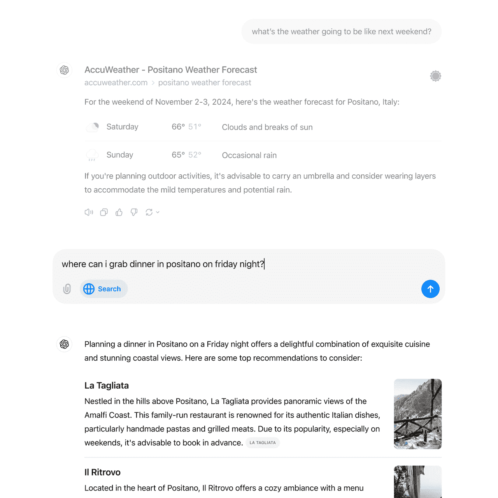

### Meta开发具备触觉感知的机器人手

https://techcrunch.com/2024/10/31/meta-is-making-a-robot-hand-that-can-feel-touch/

Meta宣布与传感器公司GelSight和韩国机器人公司Wonik Robotics合作，推进AI触觉传感器的商业化。这些新设备主要面向科学研究领域，而非普通消费者，旨在帮助AI“更精细地感知和理解物理世界”。

核心产品与技术：

+   **Digit 360传感器**：Meta与GelSight合作推出了这一具有人类多模态感知能力的指尖传感器。Digit 360使用了内置AI芯片和18个传感特征，可感知振动、温度甚至气味。这款设备预计将于明年上市。

+   **Allegro机器人手**：Meta与Wonik合作开发了新一代的Allegro机器人手，集成了Digit 360等触觉传感器，并配备控制板，能将触觉数据编码并传输至主机电脑。新款Allegro手计划于明年推出。

### Claude 新增桌面应用与语音输入功能

https://techcrunch.com/2024/10/31/claude-gets-desktop-apps-and-dictation-support/

Anthropic公司推出了Claude聊天机器人的Mac和Windows桌面应用，现已在公测阶段开放下载。该应用为免费用户和Anthropic的高级用户均可使用，但尚未包含最新推出的“电脑操作功能”（Computer Use），即Claude 3.5 Sonnet版本的高级功能，无法直接在PC上执行任务。

此外，Claude还推出了移动端的语音输入工具。在iOS、Android和iPadOS设备上，用户可以录制最长10分钟的语音信息，Claude将转录并回复内容。然而，这一语音输入功能并非实时交互模式，更类似于发送语音消息的体验。该功能暂未引入桌面应用。

这一更新发布之际，Anthropic公司正寻求以超过400亿美元的估值融资数十亿美元，意在增强Claude的竞争力，使其在市场中与OpenAI的ChatGPT等竞争对手抗衡。

### AI应用大航海：4种变现路径及定价对比

https://mp.weixin.qq.com/s/zUc9PXRrn1frA3jXahbBPQ

人工智能应用由认知到产业渗透阶段，各行业对AI技术赋能的拥抱态度更加明确。随AI原生或AI Agent行业产品落地，对AI能力变现路径，各公司存在差异。归结为四种商业化路径：MaaS按量计费、SaaS订阅制计费、解决方案及实施部署、流量变现。

大模型性能提升+降本，MaaS预计2027年前成主流商业模式。MaaS降低中小企业应用门槛，2023年MaaS市场规模约5%，预计至2027年，市场规模占比达47%。对MaaS厂商，上半场为智算基础设施的比拼，下半场关键在规模效应释放及用户使用粘性。因此，随头部模型厂商将模型能力普惠化，落地推广也随之加速，主流MaaS厂商部分模型降价以培养用户习惯及生态。行业软件积极探索AI+垂类落地，助力用户拓展及留存。

AI SaaS以订阅制为主，B端较C端变现更快。当前71.05%的AI SaaS采用订阅制，约7成应用仍处免费或试用以积累用户的阶段，约3成应用定价非公开。B端变现模式清晰且更快盈利，C端空间大、供给激发需求、增长潜力强但模式仍在探索。AI功能推动订阅收入占比提升，福昕软件2023年订阅制收入占比由22年21.2%提升至35.4%。金山办公WPS AI推动订阅制、云化转型，提升用户粘性。WPS AI会员和大会员累计年度付费用户数合计已超百万，至2026年C端AI边际收入有望达18亿元。

行业软件AI+垂类落地利于用户拓展及留存，企业级应用当前较大比例仍为非标准化，一定程度的联合开发，根据投入协商定价。

解决方案及实施部署，头部厂商发挥客户及渠道优势，由标杆案例逐步标准化。企业数智化项目招标市场明显扩容，2023年大模型采购190起，其中49%为B端需求，10%为G端需求，2023Q4平均项目预算升至618万元。国内DCS龙头中控技术AI赋能降本显著，发布流程工业首款AI时序大模型TPT，打造智能工厂。中软国际携手华为，打通AI落地应用最用一公里。

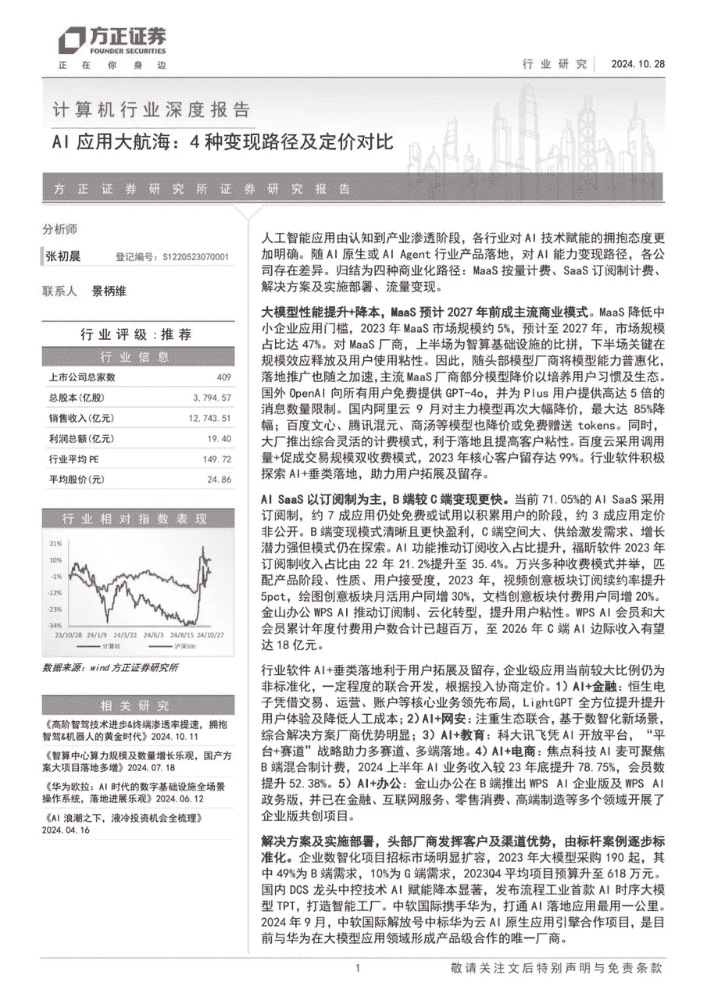

### 微软万引理论大佬跳槽OpenAI

https://mp.weixin.qq.com/s/J42Us6chUQ6uEFuYWfAV3Q

前微软副总裁及杰出科学家Sebastien Bubeck加入OpenAI，曾在微软工作10年，在计算机理论、机器学习理论（如凸优化、在线学习、对抗稳健性）上贡献卓越。2021年，他的理论研究论证了扩大AI模型的重要性，促使微软投入数十亿美元用于AI基础设施，为OpenAI大模型的训练与部署提供支持。

Bubeck在参与未对齐版GPT-4的早期测试后转向AGI研究，创立“AGI的物理学”理论，提出用物理学分析Transformer模型的复杂性，将系统分解以识别关键行为因素。带领团队发布的《AGI的火花》报告引发轰动，尽管实验方法并非严谨，他依然坚持“GPT-4具备推理能力”。其研究强调Transformer与RNN的差异：Transformer按集合处理输入，强化模型对元素关系的理解。

在微软，他主导Phi系列小模型研究，通过控制训练数据质量提升模型性能，已迭代至phi-3.5，并广泛应用于本地大模型工具。如今，OpenAI和微软合作关系显现裂痕，双方在服务器供应和模型选用上各自扩展新选项。

Bubeck还提到大模型智力的评估标准，展示GPT-4生成独角兽图像的能力。

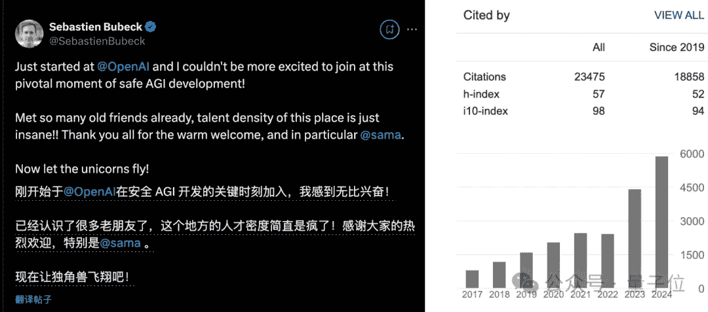

# 推特

### HOVER模型：不用庞大数据集，仍然可以捕捉人类协调平衡时的“潜意识”，学习如何协调电机

贡献人：

https://x.com/DrJimFan/status/1851643431803830551

并非每个基础模型都需要庞大。我们训练了一个拥有150万参数的神经网络来控制人形机器人的身体。对人类而言，行走、保持平衡，以及协调四肢动作需要大量的潜意识处理。我们在 HOVER 模型中捕捉到了这种“潜意识”，使其能学习如何协调人形机器人的电机，以实现运动和操控。

我们在 NVIDIA 的 Isaac 仿真套件中训练 HOVER，这是一个 GPU 支持的仿真环境，加速物理仿真速度达到了实时的 10,000 倍。为了帮助理解这个速度，机器人在虚拟的“道场”中经历一年的高强度训练，仅需要约 50 分钟的 GPU 实时运行。这个神经网络模型能够零样本迁移至现实世界，而无需进行微调。

HOVER 可以被“提示”执行各种高层次的动作指令，我们称之为“控制模式”。例如：

• 头部和手部姿势：可通过 XR 设备（如 Apple Vision Pro）捕捉。

• 全身姿势：通过动作捕捉（MoCap）或 RGB 摄像头获取。

• 全身关节角度：外骨骼设备。

• 根部速度指令：操纵杆控制。

HOVER 带来的功能包括：

• 提供统一接口，使我们能使用便捷的输入设备来控制机器人。

• 简化了全身遥操作数据的采集，为训练提供数据。

• 上游的视觉-语言-动作模型可以提供运动指令，而 HOVER 将其快速翻译为底层电机信号。

HOVER 支持在 Isaac 中仿真任何人形机器人。只需带上您的机器人，便可让它“活”起来！

[K4CVj_BMkWmMZUGj.mp4](https://internal-api-drive-stream.feishu.cn/space/api/box/stream/download/all/U6qybVBZVoseXcxP9Y9cw7DEnsf)

### ElevenLabs分享Voice Design API：只用根据Twitter个人资料，生成自己的独特声音

贡献人：

https://x.com/elevenlabsio/status/1852035812176577018

向“X to Voice”问好。

这是一个开源应用，可根据您的 X/Twitter 个人资料生成独特的声音。

使用我们今天上线的 Voice Design API 构建——您可以从任意提示生成独特的声音。

在这里试试您的个人资料生成吧：http://xtovoice.com

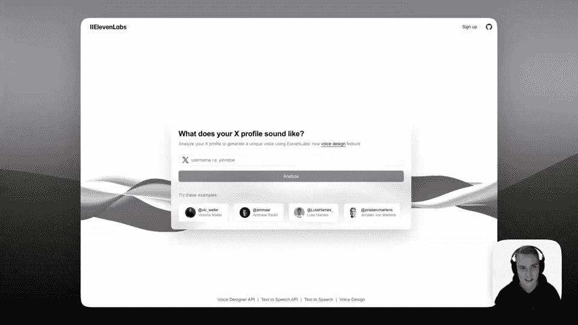

[izAZFoYCUc2lXzVk.mp4](https://internal-api-drive-stream.feishu.cn/space/api/box/stream/download/all/GHKubo8TfoIcCUxFermcL9Fjnkc)

### 小模型又上分！SmolLM2：全新、最佳的开源10亿参数语言模型

贡献人：

https://x.com/LoubnaBenAllal1/status/1852055582494294414

介绍 SmolLM2：全新、最佳的开源10亿参数语言模型。

我们在高达11万亿精心整理的数据集上训练了这些小模型。完全开源，遵循 Apache 2.0 协议，我们将发布所有数据集和训练脚本！

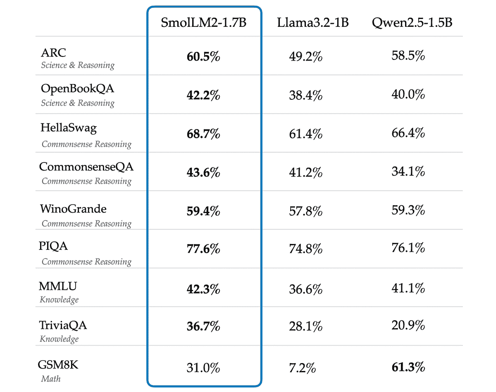

### Recraft V3：一款在设计语言中思考的革命性 AI 模型

贡献人：

https://x.com/recraftai/status/1851706399631224939

很高兴认识你！我们是 red_panda，但朋友们叫我们 Recraft。

---

介绍 Recraft V3 —— 一款在设计语言中思考的革命性 AI 模型。它在文本生成的质量上达到了前所未有的高度，超越了 Midjourney、OpenAI 等模型。

它不仅是一个图像生成器，更是一个强大的工具，具有更高效的文本布局、风格控制和行业内最高的质量标准。以下是让它成为游戏规则改变者的关键因素 🧵

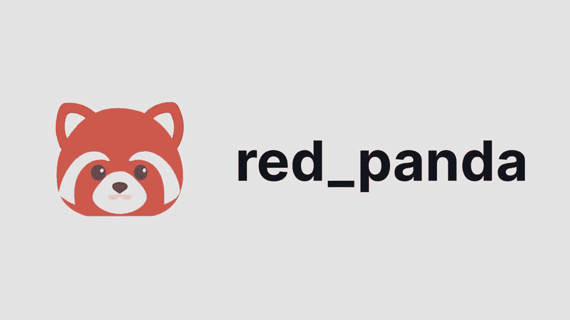

[HABcwOliIIXa5f1o.mp4](https://internal-api-drive-stream.feishu.cn/space/api/box/stream/download/all/HMrtboQfJoz8Cqx5qnlcj8rangd)

### 谷歌“Learn About”全新 AI 工具：输入任何想要学习的主题，轻松深入了解

贡献人：

https://x.com/itsPaulAi/status/1852068651773628772

Paul Couvert：我真的有被震撼到！

Google 悄然推出了一款名为 “Learn about” 的全新 AI 工具，堪称天才之作：

您可以输入任何想要学习的主题，然后轻松深入了解。

它会建议相关方面、简化内容、配以图解等。详细信息如下：

---

访问链接：https://learning.google.com/experiments/learn-about?src=signup

目前仅在美国可用

这是我迄今为止尝试过的学习新科目的最佳工具。

[riCltgmPTdZFz3E5.mp4](https://internal-api-drive-stream.feishu.cn/space/api/box/stream/download/all/A2InbZQkVox8euxUxqyce680nuh)

### Pi分享进展：一个3B参数的通用预训练模型； 一个后期训练方案，让机器人能够完成灵活的、长时间的任务

贡献人：

https://x.com/chelseabfinn/status/1852043351366996449

很高兴开始分享我们在 Pi 的工作 🤖❤️

•  一个3B参数的通用预训练模型，基于8+机器人平台训练

•  一个后期训练方案，让机器人能够完成灵活的、长时间的任务

https://physicalintelligence.company/blog/pi0

激动人心的不是洗衣，而是这个方案——简短介绍 🧵

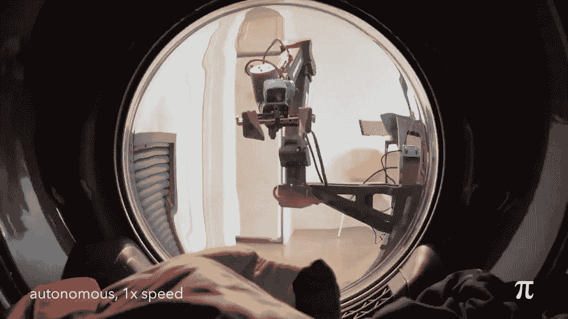

[aDcw8_Ru7s5ozErE.mp4](https://internal-api-drive-stream.feishu.cn/space/api/box/stream/download/all/Kpk5bdGM3odBN0xQOU9cxCqGnAg)

# 信号

### AAAR-1.0: ASSESSING AI’S POTENTIAL TO ASSIST RESEARCH

贡献人：

推文链接：https://x.com/Reza0843/status/1852012322211959173

原文链接：https://arxiv.org/pdf/2410.22394

信号节点：模型体系-评估体系

这**篇论文研究了如何**评估大型语言模型（LLMs）在支持科研任务中的表现，尤其是在具备专业知识需求的研究任务中。具体而言，作者们开发了一个名为 AAAR-1.0 的基准数据集，用来测试 LLMs 在四种科研核心任务中的表现：

equation inference：评估 LLMs 是否能够根据论文中的上下文信息判断方程的正确性；

experiment design：设计验证研究思路和解决方案的实验；

**paper weakness**：识别论文中的薄弱之处；

**review critique**：判断人类评审意见的各个部分是否存在不足之处。

AAAR-1.0 数据集与之前的基准不同，特别之处在于它是专门面向科研领域设计的，任务需要深入的领域专业知识。此外，该数据集模拟了研究人员日常参与的主要活动。因此，该基准不仅对模型提出了更高的专业要求，也贴近科研人员的实际需求。论文还评估了不同开源和闭源 LLMs 在这些任务中的表现，指出了其在复杂科研任务中的潜力与局限性。

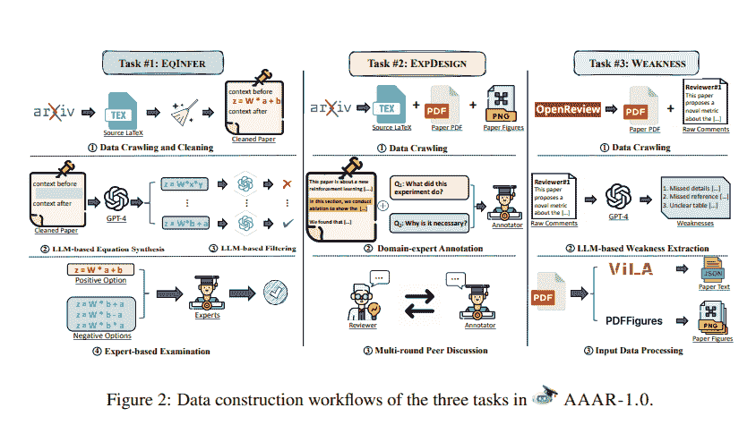

### π0: A Vision-Language-Action Flow Model for General Robot Control

贡献人：

推文链接：https://x.com/Reza0843/status/1852012322211959173

原文链接：https://www.physicalintelligence.company/download/pi0.pdf

信号节点：模型体系-具身智能

这篇论文探讨了机器人学习如何应对现实世界应用中的数据需求、泛化能力和鲁棒性等关键挑战。作者提出了开发通用机器人策略（即机器人基础模型）作为应对这些挑战的有效方法。

论文提出了一种新的流匹配架构，称为Physical Intelligence，该架构基于预训练的视觉-语言模型（VLM），利用大规模互联网语义知识来增强机器人的理解力和任务适应性。研究中展示了如何使用来自多个灵巧机器人平台的多样化数据集来训练这一模型，包括单臂机器人、双臂机器人和移动操控机器人。

最后，作者通过多项任务评估了该模型的表现，包括其预训练后的零样本任务完成能力、在不同指令来源下的任务执行能力（如人类语言指令和高级 VLM 策略），以及通过微调获得新技能的能力。测试任务涉及洗衣折叠、桌面清洁和盒子组装等。

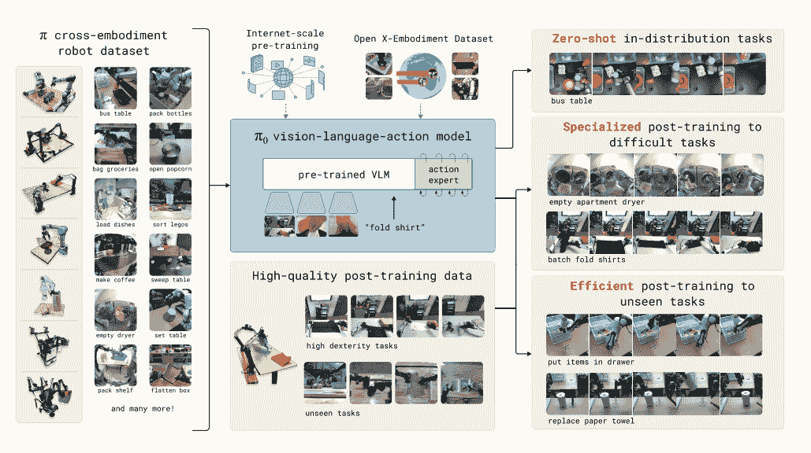

### AUTOKAGGLE: A MULTI-AGENT FRAMEWORK FOR AUTONOMOUS DATA SCIENCE COMPETITIONS

贡献人：

推文链接：https://x.com/GeZhang86038849/status/1851472327860687300

原文链接：https://arxiv.org/pdf/2410.20424

信号节点：开发体系-Agent

这篇论文介绍了 **AutoKaggle**，一个为数据科学家设计的自动化框架，用于帮助完成复杂的表格数据处理任务。AutoKaggle 通过一个多智能体系统协作来完成数据管道工作，帮助用户更高效地解决日常数据科学问题。该框架采用了迭代式开发流程，包括代码执行、调试以及全面的单元测试，以确保代码的正确性和逻辑一致性。此外，AutoKaggle 支持高度可定制的工作流程，允许用户在各个阶段进行干预，从而将自动化智能和人类专业知识相结合。

AutoKaggle 的核心工具包包含经过验证的函数库，涵盖数据清洗、特征工程和建模等常见任务，极大地提高了工作效率。研究中使用了 8 个 Kaggle 竞赛的数据来模拟真实场景中的数据处理流程。评估结果表明，AutoKaggle 在典型的数据科学管道中实现了 0.85 的验证提交率和 0.82 的综合评分，验证了该框架在应对复杂数据科学任务方面的有效性和实用性。

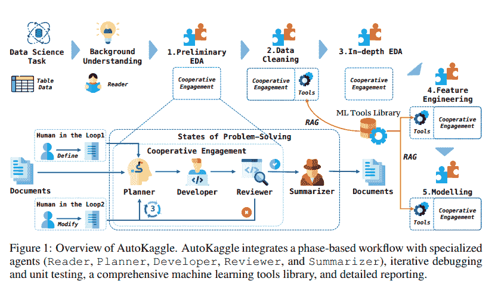

# 产品

### Zefi

贡献人：

https://www.zefi.ai/

Zefi 是一款专注于客户声音（Voice of Customer, VoC）分析的平台，通过自动化分析客户反馈（如电话、调查、客户支持票据、评论和社交媒体）来帮助企业减少客户流失、增加收入并保持竞争优势。Zefi 提供实时的可操作洞察，帮助公司更好地理解客户体验和产品趋势。

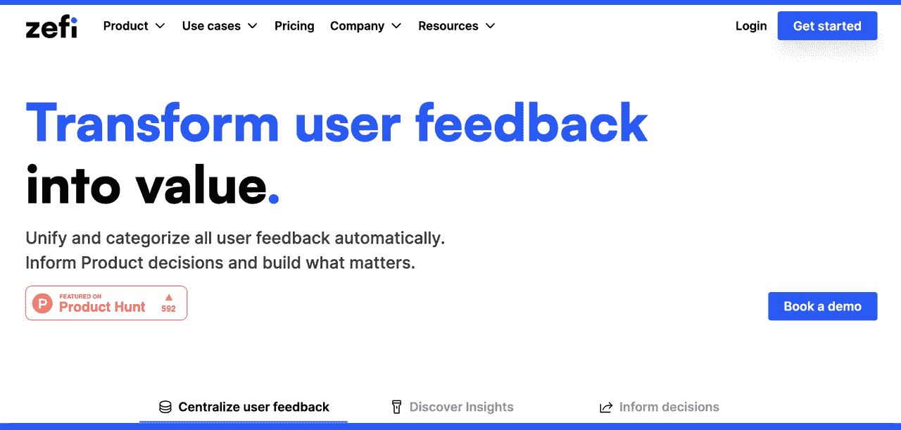

### Fable

贡献人：

https://www.sharefable.com/

Fable 是一款工具，帮助用户创建精美的互动演示，结合了人工智能的支持。它允许用户轻松生成引人入胜的演示内容，适用于产品展示、教育培训和市场营销等场景。Fable 的 AI 驱动功能能够提高创作效率，使用户能够在短时间内制作出专业水平的演示文稿。

# HuggingFace&Github

### Jarvis

贡献人：

https://github.com/synth-mania/jarvis

Jarvis 是一个基于命令行的个人助理，能够与 Gmail、Google 日历和 Google 任务集成，帮助用户管理数字生活。主要功能包括查看未读邮件、即将到来的事件和任务，同时支持 OpenRouter 或本地 LLM API。它基于 Python 3.12+ 开发，利用 Google API 实现集成。

### Aquila-VL-2B-llava-qwen

贡献人：

https://huggingface.co/BAAI/Aquila-VL-2B-llava-qwen

Aquila-VL-2B-llava-qwen 是一种多模态人工智能模型，主要用于处理视觉和语言任务。它结合了视觉理解和自然语言处理能力，可以用于图像描述、视觉问答等应用。该模型通常基于先进的深度学习架构，能够在多个领域提供高效的性能，适用于需要同时理解图像和文本的场景。

# 投融资

### Decart获2100万美元融资，推出可实时生成Minecraft体验的AI模型

贡献人：

https://techcrunch.com/2024/10/31/decarts-ai-simulates-a-real-time-playable-version-of-minecraft/

以色列AI公司Decart近日推出了一款名为“Oasis”的AI模型，能实时生成类似Minecraft的开放世界游戏体验。该公司宣布获得了来自红杉资本和投资人Oren Zeev的2100万美元融资，用于支持这项技术的发展。Oasis通过实时处理键盘和鼠标输入来生成游戏画面，模拟物理规则和图形渲染，属于一种新兴的“世界模型”生成式AI。

Oasis模型能够以较高的帧率生成游戏场景，目前的演示版本运行在Nvidia H100 GPU上，而未来版本将优化为兼容Etched的AI加速芯片，甚至有望实现4K游戏画面生成。Decart认为，这类模型未来或能通过用户偏好实时生成内容，为互动娱乐平台带来全新的可能性。

公司官网：https://www.decart.ai/articles/oasis-interactive-ai-video-game-model

### Noma的AI安全新工具获2500万美元融资

https://techcrunch.com/2024/10/31/noma-is-building-tools-to-spot-security-issues-with-ai-apps/

Noma Security作为一家新兴的安全公司，正致力于开发用于检测AI应用中安全问题的工具，旨在解决由于AI应用复杂性导致的网络安全薄弱问题。据统计，许多企业在快速采用AI的过程中，面临着安全团队技能短缺、数据管道和代码脆弱点以及特有的攻击手段（如提示注入攻击）等问题。

Noma由Niv Braun和Alon Tron创立，致力于填补现有传统软件生命周期工具在AI数据和研发过程中的“安全盲区”。Noma的工具可以扫描模型训练数据集中的敏感数据（如包含个人信息的文本），并通过集成控制台帮助企业有效管理AI应用的安全状态，确保应用部署的安全性与合规性。

Noma成立于2023年，目前已成功完成A轮融资，获得2500万美元的资金支持。该轮融资由Ballistic Ventures领投，加上此前未披露的由Glilot Capital Partners和Cyber Club London参与的700万美元种子轮融资，Noma的总融资金额已达3200万美元。Noma计划利用这笔资金加速技术开发及市场扩展，并计划在明年将团队规模从现有的20人翻倍。

公司官网：https://noma.security/

### **Buddy.ai：通过AI和游戏帮助**儿童学习英语，获1100万美元种子轮融资

https://techcrunch.com/2024/10/31/buddy-ai-is-using-ai-and-gaming-to-help-children-learn-english-as-a-second-language/

Buddy.ai是一款专为儿童设计的AI语言学习应用，通过动画化的AI角色作为虚拟英语教师，帮助儿童在游戏化互动中学习英语。该应用现已拥有约5500万次下载，每年为超过2200万名学生提供服务。

Buddy.ai创始人Ivan Crewkov在移居美国后，受到自己孩子学英语的启发，创立了该公司。尽管AI语音技术发展迅速，Buddy.ai的推出经历了重重挑战，包括需遵守《儿童在线隐私保护法》（COPPA）等法规，且AI需能理解不同语言环境下的儿童语音和方言。

Buddy.ai刚刚完成了1100万美元的种子轮融资，由BITKRAFT Ventures领投，One Way Ventures、J Ventures和Point72 Ventures等参与。Crewkov表示，本轮融资过程历时艰难，与186位投资人交流才得以完成。BITKRAFT作为早期接触的投资方，以其游戏领域的专业背景成为Buddy.ai的理想合作伙伴。

这笔资金将主要用于产品开发，尤其是聘请游戏设计和用户体验设计专家，以提升技术水平和用户体验。同时，Buddy.ai计划进一步增加多语言支持，并加强与学校的合作，拓展其全球教育市场。

公司官网：https://buddy.ai/en/

# 学习

### Nvidia CUTE 实战1：ABQ-LLM GEMM Kernel

贡献人：

https://zhuanlan.zhihu.com/p/3904815819

Cute编程库在Nvidia的Cutlass3.0中引入，专为高效处理复杂的坐标计算和多层级的计算数据拆分提供高级抽象。通过Cute，开发者可以轻松进行Epilog定制和复杂的layout操作（如swizzling），避免处理底层坐标细节。

ABQ-LLM是字节跳动的ByteNN团队开发的任意bit量化库，用于LLM的高精度量化推理。ABQ-LLM基于1bit指令，将任意bit的计算转换为1bit的矩阵乘法（GEMM），并通过Epilog阶段的bit reduction实现高效的矩阵乘积。其实现使用Nvidia提供的WMMA和BMMA PTX封装，BMMA通过PTX汇编直接操作线程，具备更高的操作粒度。Cute提供了ABQ-LLM自定义GEMM的重实现，使其更具灵活性。

Cute库通过Swizzle和tiled mma封装解决了smem（共享内存）访问的bank conflict问题，实现了更高效的G2S（全局内存到共享内存）数据拷贝。Cute提供的tiled mma用于高效的warp级别计算分配，消除了warp-tiling的中间层级。

在性能对比中，Cute在rtx4090上获得了略高的TOPS和带宽峰值，但部分配置下在BMMA版本上仍表现更佳。Cute具备高灵活性，但文档和示例仍然有限，且有若干bug，如cp_async_zfill的pred bug等。

### llvm后端实现指南

https://zhuanlan.zhihu.com/p/679412102

1.  **创建目录结构**：在 llvm/lib/Target/ 下创建 MyArch 文件夹。

1.  **编写目标描述文件**：使用 TableGen 语言创建 MyArch.td，定义指令、寄存器等架构特性。

1.  **生成 TableGen 文件**：运行 tblgen MyArch.td 生成相关的 Gen 文件，如 MyArchGenRegisterInfo.inc。

1.  **实现目标相关C++代码**：

+   MyArchInstrInfo.cpp、MyArchRegisterInfo.cpp 等文件内定义指令和寄存器信息。

+   MyArchTargetMachine.h/cpp 实现目标管理类 MyArchTargetMachine，重写 createPassConfig 等函数以配置优化Pass。

1.  **实现 TargetLowering **和 TargetRegisterInfo：

+   TargetLowering 类实现数据类型、操作等定义，TargetRegisterInfo 描述寄存器信息。

1.  **配置 CMake**：在 llvm/lib/Target 中的 CMakeLists.txt 添加新后端。

1.  **实现后端核心代码**：

+   在 MyArch.cpp 注册 MyArchTargetMachine。

+   在 CMakeLists.txt 配置 tablegen 生成的文件，引用实现的 .cpp 文件。

1.  **重编译和测试**：编译LLVM并编写测试用例验证新后端的功能。

1.  **文档补充**：在 LLVM 文档目录中添加说明，包括指令集和架构特性。

**技术要点**：通过 TableGen 定义并生成目标代码、实现 TargetMachine、TargetLowering 等核心类，并合理配置寄存器和指令信息是实现新后端的关键。同时，为支持优化和代码生成，需确保 TargetPassConfig 配置合理并优化内存布局和寄存器分配。

### Ray Data 让你的 ML 训练数据加载速度

https://mp.weixin.qq.com/s/x-wezQN-8G0jY0Mo19MbiA

数据加载和预处理常成为机器学习(ML)训练中的性能瓶颈。Ray Data可实现快速、灵活、可扩展的数据加载，特别适用于异构计算环境中的分布式数据预处理。它通过流数据集抽象提高GPU利用率，同时优化内存使用。

Ray Data提供的data loader能从本地磁盘和云端进行流式数据加载，适应不同的数据格式（如Parquet、图像、视频）和数据分布（分布式缓存、多节点等），与常见的开源loader（如PyTorch DataLoader、tf.data）相比具有优势，特别在分布式环境下支持多节点动态划分数据集，从而实现高效的扩展性。

在MLPerf图像分类基准测试中，Ray Data展示了其优越的吞吐量，尤其在云数据集的流式加载上表现出色，能够在多节点集群上通过自动数据分区和并行加载提高GPU利用率。此外，Ray Data可以在异构集群上运行，利用CPU节点进行数据预处理，减轻GPU节点的负担，进一步优化集群资源利用率。

Ray Data还支持数据集缓存，这对于避免重复的I/O和预处理开销非常有效。在异构集群中，Ray Data能够智能地在节点间缓存数据，确保GPU trainer可以高效读取处理后的数据。同时，Ray Data与Ray Core的结合，支持出错恢复、分布式调度和自动负载均衡，显著减少了开发者对集群环境的手动调整需求。

单节点性能对比显示，尽管Ray Data加载图像时较其他loader稍慢，但凭借其可扩展性和灵活的数据处理能力，在Pinterest等企业的实际应用中已展现出性能优势。例如，Ray Data在复杂预处理任务中相对PyTorch DataLoader快45%，并且支持异构集群的扩展，节约了约25%的训练成本。Ray Data后续将进一步优化单线程性能和恢复机制，助力大规模ML任务的高效数据加载与预处理。

### GPU 性能迷思

https://zhuanlan.zhihu.com/p/2759747438

**隐面剔除**：各GPU架构的隐面剔除技术有所不同。PowerVR基于可见性缓冲剔除像素级遮挡的片段，称为HSR；Adreno使用LRZ缓冲在Binning阶段剔除不可见三角形，减少光栅化开销；Mali则通过FPK剔除过时片段，但不会阻塞管线。

**Shader分支优化**：GPU并行执行时的Divergency会导致性能降低。Adreno对Divergency较敏感，其wave内线程数多，因此建议尽量避免Shader中的复杂分支，尤其是运行时变量决定的分支。

**Overdraw问题**：TBDR架构在Binning阶段利用深度信息减少Overdraw，但Quad Overdraw仍会导致Adreno等架构的Divergency。使用合适的LOD，确保每个三角形至少覆盖10-20个片段以减少Quad Overdraw。

**带宽限制**：移动端GPU受限于内存带宽，其增加不仅带来功耗问题，也难以匹配算力增长。因此减少VS Output写入外部存储和在渲染阶段避免深度回写可显著节省带宽。

**PrePass必要性**：传统桌面端的PrePass在移动端已被Binning阶段的LRZ处理取代，除非特定大面积Mask物体重叠场景，通常无需额外的PrePass。

Vertex Shader (VS)优化：VS计算复杂度和VS Output量影响整体管线效率。Adreno等架构需控制VS计算量，避免复杂采样和数据读取。对于Mali第五代架构，DVS技术可降低带宽消耗，提升VS效率。

### 强化大模型的事实性表达

https://zhuanlan.zhihu.com/p/3164307829

**R-Tuning**：为应对知识外幻觉，R-Tuning通过指令微调阶段采样判断模型已知与未知的知识范围。对于未知知识，模型选择“拒答”（如“I am unsure”），从而避免生成虚构内容。实验表明，在域内和域外任务中，R-Tuning显著提高了准确率和泛化能力。

**CONQORD（Confidence-Quali**ty-ORDer-preserving）：解决模型置信度与生成质量不对齐的问题。CONQORD通过强化学习调整模型的置信度，使低质量回答对应低置信度，从而避免高置信度错误回复。该方法在多个基准上有效降低了校准误差（ECE），实现了置信度与质量的双重对齐。

**Reinforcement Learning fro**m Knowledge Feedback：此方法利用知识反馈强化模型的拒答能力。在训练集中，模型对未知问题采用拒答策略，从而减少幻觉。通过准确率、精度和真实性等指标验证了其对幻觉的有效抑制。

**SaySelf**：基于自反推理的细粒度置信度表达。SaySelf通过生成自反性理由（Self-Reflective Rationales）来细化置信度评价，结合推理步骤使模型在回答时能清晰表达置信度。这一训练框架显著提高了模型的校准效果和可靠性。

Inference-Time Intervention (ITI)：ITI通过改变推理中的激活状态来提升事实性表达。利用知识探针探测中间层激活值并引导生成过程，使输出朝可信方向调整，显著提高了模型在开放式生成任务中的事实性。

### FlashAttention算法之美：极简推导版

https://zhuanlan.zhihu.com/p/4264163756

FlashAttention（FA）作为优化大模型训练和推理的关键组件，其算法在并行计算设计方面具有极高的教科书价值。FA通过简单的数学变换实现计算流程的等价重组，使并行执行与内存效率最大化。以下是FA的精简算法流程与LSE版本流程：

一、前置知识

1.  矩阵乘法分块：FA通过分块计算 O = QK^TV 避免直接计算 QK^T。

1.  Softmax简化：softmax(x) = exp(x - m) / sum(exp(x - m))。

1.  指数和对数运算性质：利用 exp(a + b) = exp(a) × exp(b)，简化Softmax分子和分母的分块计算。

1.  矩阵乘法性质：分块矩阵乘法可以逐步分解为 A1V1 + A2V2。

二、FA基本流程

1.  计算 Q × K^T：独立计算 X1 = Q × K1^T，X2 = Q × K2^T。

1.  寻找最大值：找到分块最大值，计算 m1 = max(X1)，m2 = max(m1, max(X2))。

1.  Softmax分子部分：引入矫正因子 alpha = exp(m1 - m2) 来修正Softmax分子，使 a1' = a1 × alpha。

1.  Softmax分母部分：以 alpha 调整分母，使 d1' = d1 × alpha，最终计算得到Softmax的完整表达。

1.  结果组装：以分块因式分解方式合并计算结果，得到 O = O1 × d1 / d12 + O2 × d2 / d12。

三、FlashAttention LSE版本流程 为了数值稳定性，FA还引入了 Log-Sum-Exp（LSE）技巧。

1.  计算 Q × K^T：同样独立计算分块乘积 X1 和 X2。

1.  最大值和LSE计算：计算LSE的最大值并利用 alpha 矫正分块，得到 lse1，lse2。

1.  Softmax分子和分母更新：使用 alpha 更新分子与分母，并引入LSE确保数值稳定。

1.  组装与对称更新：通过等价变换简化结果表达，最终以 O1 × exp(lse1 - lse12) + O2 × exp(lse2 - lse12) 计算得出最终输出。

### TD Learning （时序差分学习）中的值函数收敛性

https://zhuanlan.zhihu.com/p/2883455468

在强化学习（RL）中，时序差分（TD）学习方法以其高效性而受到重视，但结合函数逼近（如神经网络）与off-policy学习时可能导致发散问题，即“致命三角”。为解决这一问题，研究者提出目标网络（target network）以提升算法的稳定性。本文首先介绍TD学习和“致命三角”，然后展示以DQN为代表的深度强化学习算法如何通过目标网络应对这一挑战，并介绍双时间尺度框架的设计和其收敛性。此外，本文还讨论了TD学习中关于值函数收敛性的最新研究成果。

**关键点概述：**

1.  **致命三角**：函数逼近、off-policy学习和引导更新的结合导致RL算法易于发散。TD学习通过状态估计的自我更新实现值函数更新，但在大型问题中依赖函数逼近，当与off-policy学习相结合时，这种泛化会影响不相关状态，从而导致不稳定。

1.  **目标网络**：目标网络有效打破致命三角，通过与主网络同步降低不稳定性。DQN引入目标网络，使主网络以双时间尺度更新，从而确保了训练收敛性。Polyak平均更新策略进一步稳定了收敛性。

1.  **TD学习收敛性研究**：近年来，TD学习收敛性研究从优化视角、离线RL中的Q值发散以及交叉熵训练方法对值函数的改进等方面深入探讨。TD学习作为优化问题的迭代解，目标函数动态变化使得常规优化策略存在问题，交叉熵损失在此情境下显示出更高稳定性，尤其在面对高容量网络（如Transformers）时。

1.  **实验结果**：实验表明，使用目标网络的双Q学习和多步TD方法能够显著减小Q值估计偏差，缓解发散；而对优化器重置以及引入LayerNorm等正则化手段也对训练稳定性有帮助。

1.  **未来方向**：研究继续探索不依赖目标网络的鲁棒off-policy学习算法，以及面向非线性逼近的TD学习优化方法。随着RL在离线场景的应用增加，Q值发散问题需要进一步解决以提高实际应用表现。

# 招聘公告

---

**奇绩创坛****由陆奇博士**于2019年创立，使命是在源头最大化驱动创新。奇绩研究组将研究模型理论、到投研战略分析、市场策划等不同背景的同学聚在一起，搭建GenAI时代独特的跨界人才社群。

## 🚀F**24实习岗位**

##### [行研-学术科研人才交流组实习生](https://miracleplus.feishu.cn/docx/Yn6rdf2iOoY2Rcx8yVNcUBYRnch#part-QkMcdeJmuob9uvxvV3qcLSzHn8g)

##### 行研-GenAI研究岗位-战略分析（偏产品）

##### Web / AI 全栈开发工程师实习生

## **火热开放中🚀**

##### 行研-GenAI研究岗位-前沿学术探索

##### 行研-GenAI研究岗位-战略分析（偏咨询）

##### 创新活动产品运营 （大模型系列活动产品运营）

> **点击**相关岗位可查看对应**岗位需求【JD】；**相关岗位投递请**扫描二维码**

> 欢迎**推荐/自荐**

> 期待在**奇绩创坛**遇见更好的你

---

# 声明

本文档仅供学习交流使用，版权归原作者所有，若涉侵权，请联系Jack Jin 15101136166

##

（欢迎在下方反馈您宝贵的意见！整理不易，觉得有用给AI日报小组点个赞👍吧！）

ChatGPT；Angela；Zijia Liu；Alex；Zeqi Tan；Tiezhen（HuggingFace）；Naixu；Lizhi；Peter；Suoman；Jack

封面生成——右脑科技

如果你有大模型相关的创业想法，欢迎来找我们聊聊～微信：15101136166

> 快邀请你的小伙伴们一起来读大模型日报吧！

> **【日报****知识库****】**这里是近期日报内容的汇总,欢迎大家查阅

> [大模型日报知识库(分享版)](https://miracleplus.feishu.cn/wiki/KapVwXfkriOBiskB0B2cUHxjnTh)

>

> 欢迎大家多多帮我们分享,转发~~

> 如果大家有任何的建议或者吐槽,欢迎随时找我聊天~

