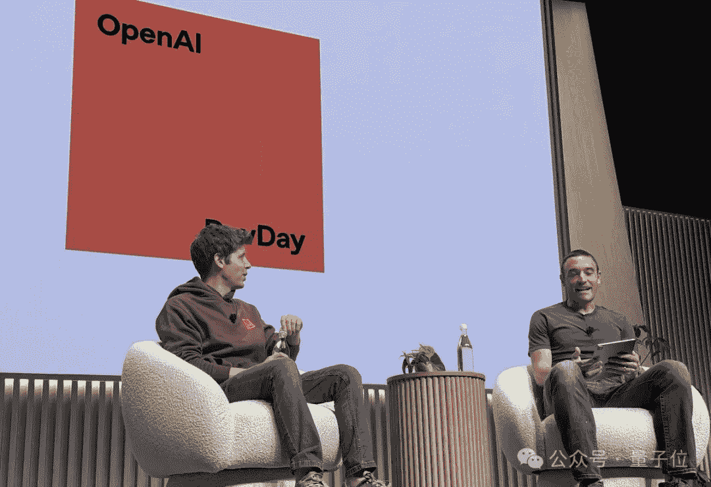
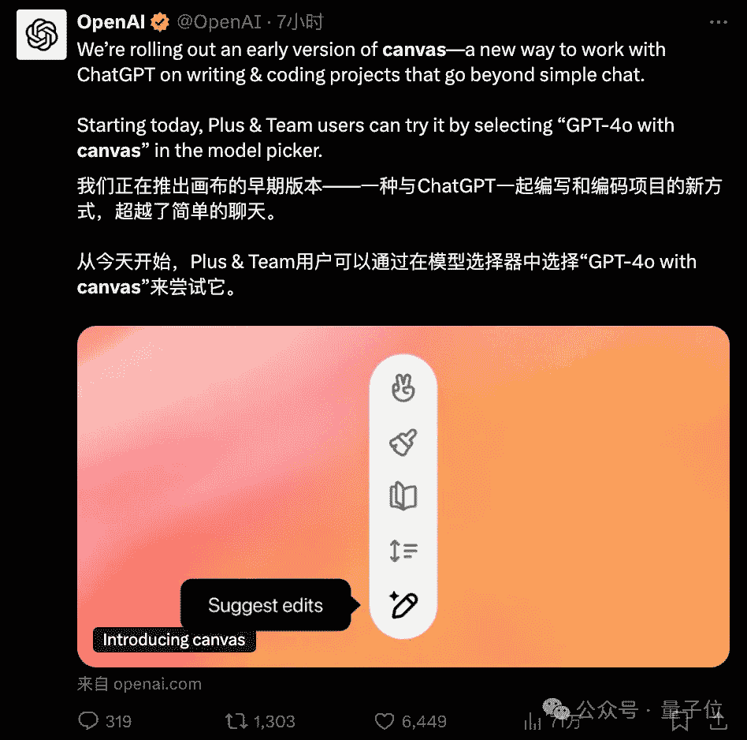
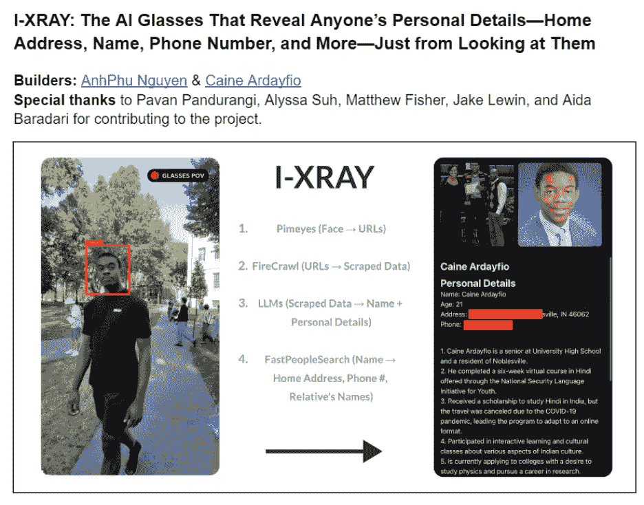
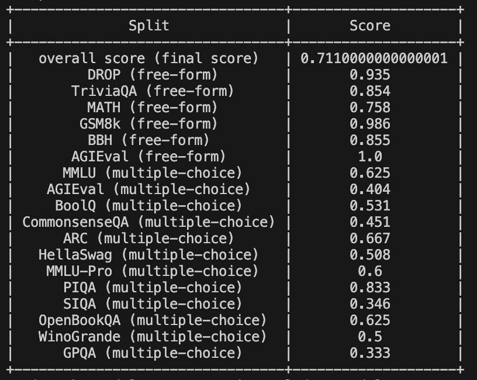

# 奇绩大模型日报（10月 1-7日国庆特刊）

> 来源：[https://miracleplus.feishu.cn/docx/LwiBdM4dWokFVCxj2pIcDzcIncc](https://miracleplus.feishu.cn/docx/LwiBdM4dWokFVCxj2pIcDzcIncc)

# 资讯

### 奥特曼：自认比o1聪明请举手🤚到o2还这么想么🤨？

贡献人：

https://mp.weixin.qq.com/s/PwagxcH0aiYCBxZlUE05Ig

在本次对话中，OpenAI首席产品官Kevin Weil和奥特曼（Sam Altman）就未来人工智能的发展趋势和技术创新进行了深入探讨。奥特曼预测，未来十年内将实现无限上下文长度，并认为智能体（Agents）技术将推动AI应用的广泛普及。人们会要求AI在极短时间内完成过去需要数月或数年的工作，最终每个人将拥有数十甚至数千个智能体。

此外，奥特曼特别强调了对科幻设想的关注，并指出这是AI发展过程中不可忽视的重要问题。

在活动中，OpenAI宣布了多项API更新：

1.  **实时语音API**：开放测试版，所有开发者都能在自己的APP中实现与ChatGPT高级语音模式类似的体验。语音输入每分钟收费0.06美元，语音输出每分钟收费0.24美元。语言学习应用Speak已率先采用此功能开发AI角色扮演练习模式。

1.  **视觉微调API**：开发者可通过上传少量图像对GPT-4o进行微调，以提升其在特定视觉任务中的表现，如物体检测、医学图像分析等。只需使用100张图像即可显著提升模型性能，微调费用为每百万tokens 25美元。

1.  **自动提示词缓存功能**：在多个API调用中自动缓存相同上下文，从而降低推理延迟与成本。该功能已适配GPT-4o和o1系列模型，并对已见过的tokens提供五折优惠。

1.  **模型蒸馏API**：允许开发者用前沿模型（如GPT-4o）的输出对小型模型（如GPT-4o mini）进行微调，大幅简化了以往多步骤、易出错的蒸馏流程。该功能通过集成工作流程自动生成输入-输出对并完成微调。

在现场演示环节，GPT-4o驱动的实时语音API结合Twillio实现了电话订购草莓甜点的功能。此外，最新发布的o1模型在无人机编程操控方面也展现了强大的推理能力。

活动结束后，OpenAI离职高管的去向引发了广泛关注。前研究副总裁Barret Zoph计划成立新公司，前CTO Mira Murati也受到投资人的热捧。与此同时，前OpenAI联合创始人Durk Kingma宣布加入Anthropic团队。

今年的OpenAI开发者日与去年不同，没有全程直播，并在美国、英国和新加坡分地点举行。OpenAI在活动上强调了其在API生态上的多项技术进展，展示了模型推理和应用场景的最新成果。

### OpenAI重磅发布Canvas：跟ChatGPT一起写作编程

https://mp.weixin.qq.com/s/ZgAqgGfpHJkWf808MRb_Mw

OpenAI 最近发布了全新的创作和编程界面——Canvas，与ChatGPT合作的增强交互功能引发广泛关注。该功能由OpenAI的GPT-4o模型提供支持，用户需在模型选择栏中选择“GPT-4o with canvas”才能使用。

Canvas模式打破了传统对话框架，为用户提供了编辑、创作和编程的新方式。它允许用户对生成内容进行二次创作和编排，就像使用文案或代码编辑器一样。用户可以通过右下角的“编辑”按钮，使用五个主要功能进行操作：编辑建议、调整上下文长度、改变阅读水平、添加最终润色以及添加表情包。用户可选择要修改的内容片段，并进行细节上的重新生成和微调。这种模式不仅提高了创作效率，也让内容生成变得更具灵活性和可控性。

Canvas功能迅速引起了业界的高度评价。沃顿商学院教授Ethan Mollick认为，这种模式让ChatGPT更像是一个协作同事，而不是简单的聊天机器人。许多网友也认为这是今年ChatGPT最大的更新之一。

除了文本创作，Canvas在编程方面也提供了审查代码、添加日志、添加注释、修复bug和转换语言等功能。用户可以选择代码片段，让模型按照要求修改代码，甚至手动更改特定细节。转换编程语言的功能支持多种语言，包括JavaScript、Python、Java等。

Canvas的推出提升了用户与AI模型的交互体验。通过自动化内部评估和合成数据生成技术，OpenAI实现了更高效的模型调优。Canvas模式的生成质量比带有提示指令的GPT-4o高出30%的准确率，质量提升16%。

目前，Canvas面向ChatGPT Plus和Team用户开放，并将在下周扩展到Enterprise和Edu用户。虽然与Claude的Artifacts功能有些相似，但Canvas在写作和编程的细节处理上更进一步。总体来看，Canvas为AI创作与编程提供了更为全面的支持，成为OpenAI生态中的重要创新。

### Meta将智能眼镜与人脸搜索结合引发隐私担忧

https://mp.weixin.qq.com/s/nybGteiVjlLCvqLO7UB1uw

在AI技术的推动下，Meta的虚拟现实（VR）头显Quest 3S和增强现实（AR）眼镜Orion备受瞩目。此外，Meta还宣布升级其雷朋（Ray-Ban）智能眼镜，新增AI功能，预计今年出货量将突破200万台。尽管这款眼镜在消费市场上大获成功，但隐私问题一直备受关注，尤其是设备可能被滥用及数据使用透明度的质疑。

哈佛大学的两名学生安福·阮（AnhPhu Nguyen）和凯恩·阿达菲奥（Caine Ardayfio）通过实验展示了这种隐私风险。他们将Meta的雷朋智能眼镜与人脸搜索引擎PimEyes相结合，开发了一个名为I-XRAY的系统。该系统能够通过捕捉路人的人脸信息，在几秒钟内收集目标的个人隐私数据，包括姓名、地址和电话号码。在地铁站测试中，他们成功识别了数十位路人的身份，并利用这些信息假扮熟人进行互动。

这项实验引发了对隐私保护的广泛担忧。尽管两位学生没有公开系统代码，但他们希望借此研究提高公众对隐私泄露的警惕，并提供了从PimEyes等平台移除个人信息的指南。

Meta在使用AI训练数据的政策上也引发争议。其政策表明，所有经过AI分析的图像，包括通过智能眼镜采集的内容，都可能被用于模型训练。此外，Meta还推出了实时视频分析功能，能够在未明确告知用户的情况下持续将图像传输给AI模型进行处理。该公司此前因Facebook平台上的面部识别技术问题支付了14亿美元和解金，而其现行的隐私政策仍默认储存所有通过Ray-Ban设备记录的语音对话，用于训练未来的AI模型。

这一系列隐私事件凸显了智能设备、AI技术与个人隐私保护之间的复杂关系。在欧盟，《通用数据保护条例》（GDPR）对面部识别数据的收集进行了严格限制，但在美国，由于缺乏统一的隐私法律，此类技术更容易被滥用。

### Reflection-70B模型发布后的技术反思

https://glaive.ai/blog/post/reflection-postmortem

基准测试分数复现过程：

+   复现流程：使用相同的评估框架、提示词和输出提取方法来复现初始的基准测试分数，并修复系统提示的差异。

+   工具和资源：提供了模型权重、训练数据、训练脚本和评估代码（相关链接见文末），供社区成员验证模型性能。

+   评估分数：通过上述评估框架复现的分数如下：

+   MMLU：90.94%（原报告：89.9%）

+   GPQA：55.6%（原报告：55.3%）

+   HumanEval：89.02%（原报告：91%）

+   MATH：70.8%（原报告：79.7%）

+   GSM8K：95.22%（原报告：99.2%）

+   IFEVAL：87.63%（原报告：90.13%）

由于在初始代码中存在MATH和GSM8K评估中的漏洞，导致初始分数存在偏差（如MATH从79.7%降至70.8%）。

数据集污染检测：

+   使用llm-decontaminator工具检测数据集是否与基准测试存在重合，未发现显著重合部分。

+   进一步测试模型是否能够生成与基准测试中相似的内容，发现约6%的MMLU测试集问题可以被模型生成。这表明可能存在间接的训练数据集污染。

模型开发和发布过程中的问题：

1.  模型开发：模型开发过程中，尝试了多个数据迭代并在较小的模型上进行了反复验证，但最终版本的70B模型未经过充分的测试。

1.  模型发布问题：模型发布时未验证上传的权重是否正确、模型配置文件是否与实际模型一致，导致了配置文件错误（例如，config.json中写着Llama 3而非Llama 3.1），影响了模型性能。

1.  API表现问题：在使用API时，模型生成了与Claude模型相同的随机数，出现了奇怪的响应行为（如生成"Anthropic"相关信息），这引发了关于API是否实际调用了Claude模型的质疑。

反思与改进：

+   发布前未能验证模型的完整性和准确性，导致了大量不可控的问题。

+   对于社区反馈的处理过于仓促和被动，未能及时解决问题。

+   在未来的开发和发布中，应加强模型测试、分数验证和代码管理，并在公开发布前确保模型的一致性和准确性。

### 何恺明新作出炉！异构预训练Transformer颠覆本体视觉学习范式，AI性能暴涨超20%

https://mp.weixin.qq.com/s/TcikCgqg_QcFlchWSuzl6g

通用机器人模型的主要障碍在于“异构性”，即每个机器人、任务和环境都需要特定的数据集，训练后的策略难以泛化。为了解决这一问题，何恺明带领的MIT与Meta FAIR团队提出了异构预训练Transformer（HPT）模型，通过预训练大型共享神经网络，学习与任务和机器人形态无关的共享表示。HPT在多个基准测试中优于现有模型，在模拟器和真实世界环境中，微调后的性能提升20%。

HPT采用模块化设计，针对不同机器人本体的数据进行对齐，映射为统一的token序列，并通过Transformer结构共享主干进行处理。HPT在视觉和本体感受的跨模态对齐上，引入了特定分词器（stem）模块，将异构输入映射到共享表示空间，从而实现跨任务的高效迁移。研究表明，HPT在多任务场景下能够实现高成功率，对异常值更具稳健性，并能灵活适应新任务。

HPT的架构包括三部分：stem、trunk 和 head。其中，stem模块用于对异构本体感受和视觉数据进行预处理，并将其表示为固定数量的token；trunk部分是共享的Transformer主干，负责捕获复杂的输入-输出关系；head部分则用于根据任务生成具体的操作指令。通过预训练HPT模型，研究人员成功将超过50个异构数据集整合，实现跨本体、跨任务的策略学习，并在不同机器人、任务和环境中展现了优异的迁移学习能力。

实验结果显示，HPT在真实环境中可以自主执行复杂任务，如为柴犬投食、清理洒落的狗粮等，并能够处理不同的光照条件、物体数量、相机配置等复杂场景。此外，HPT在Simpli基准测试中，相比于RT1-X和RT2-X等模型表现出更高的成功率。

HPT的提出为机器人通用模型的发展铺平了道路，其共享策略语言和跨模态对齐方法能够有效应对异构性带来的挑战，并有望推动机器人技术的进一步发展。研究团队希望未来的工作能够基于HPT的成果，进一步提升机器人基础模型的通用性和扩展性。

### Playground v3发布：深度融合LLM，图形设计能力超越人类

https://mp.weixin.qq.com/s/P8rieQj_-KoY0H-HfwN5hA

PGv3与传统模型不同之处在于其创新的深度融合（Deep-Fusion）架构，完全集成了大型语言模型（LLMs），使用解码器（decoder-only）模型进行文本到图像生成，而不是依赖预训练语言模型如T5或CLIP文本编码器。此外，PGv3引入了内部描述生成器（in-house captioner），生成不同详细程度的描述，并提出了新的图像描述基准CapsBench用于评估模型在复杂推理和文本渲染上的性能。

实验表明，PGv3在提示词遵循、复杂推理、RGB颜色控制和多语言理解方面具有显著优势。用户偏好研究显示，PGv3在表情包、海报和logo设计等常见应用中表现超越人类设计水平。

PGv3的架构设计采用了DiT风格的Transformer模型，与Llama3-8B的各个层次紧密集成，通过从LLM每层提取隐藏嵌入输出，充分利用LLM的「思考过程」，从而提升生成图像时的提示遵循和一致性。为了优化模型性能，PGv3采用了以下策略：

1.  Transformer块之间引入U-Net跳跃连接。

1.  中间层进行token下采样，使图像键和值序列长度缩短四倍。

1.  使用2D版本的旋转位置嵌入（RoPE），解决图像分辨率变化带来的过拟合问题。

此外，PGv3升级了变分自编码器（VAE），将潜通道数从4增加至16，并扩展至512×512分辨率，提高了细节重建能力。实验显示，PGv3在生成复杂图像时展现出更好的细节保留和纹理还原能力。

新基准CapsBench评估了PGv3的描述能力，通过问答方式全面考察图像描述的精确性和详细程度，覆盖了17种图像类别和2471个问题。测试结果显示，PGv3在图像描述的语义理解和细节捕捉上优于其他模型。

### 全球首台Arm超算光荣退役！下一代已接任，配备384块英伟达Grace CPU

https://mp.weixin.qq.com/s/_A804bdBOTp33gefm1X6dQ

世界上首台基于Arm架构的超级计算机——Isambard 2，近日正式退役。该系统于2018年部署，搭载由Cavium开发的64位Armv8 ThunderX2处理器，配备部分Nvidia P100 GPU。项目由布里斯托尔大学的Simon McIntosh-Smith教授领导，并将于9月30日关闭数据访问权限。

Isambard 2的退役标志着其6年使命的完成，并将由新一代的Isambard 3超算接任。Isambard 3基于NVIDIA Grace CPU，拥有34,272个核，性能和能效预计为前代的6倍，成为欧洲最节能的系统之一，峰值性能可达2.7 petaflops（FP64），功耗不足270KW，在Green500排行榜上名列第二。

下一代Isambard 3将继续推动生命科学、医学和天体物理等领域的研究进展。它能够高效模拟风力发电场、聚变反应堆等复杂模型，支持研究人员开发清洁和绿色能源的新方法。同时，Isambard 3还将用于研究帕金森氏症、骨质疏松症和新冠肺炎的治疗方法。

Isambard 2的退役并非孤例，橡树岭国家实验室的Summit超算也将在今年11月退役。Summit同样于2018年投入使用，其功能将被新一代Frontier超算所取代。Frontier目前位列全球TOP500超算榜单榜首，是首个达到百亿亿次浮点运算性能的系统。Aurora位居第二，成为全球第二台突破百亿亿次计算级别的超算。

尽管Isambard 3目前尚未进入TOP500榜单，但其在未来更新时有望进入前十名，成为全球最强的超级计算机之一。项目由布里斯托尔大学牵头，巴斯大学、卡迪夫大学和埃克塞特大学参与，共同推动超级计算技术的发展。

### Mirage零门槛生成PyTorch算子

https://mp.weixin.qq.com/s/M3WFt17QErAt46VuqkFjFQ

近日，来自卡内基梅隆大学（CMU）Catalyst Group 的团队发布了一款名为 Mirage 的 PyTorch 算子编译器。Mirage 能够自动生成高效的 GPU 内核，用户无需编写 CUDA 或 Triton 代码即可实现优化，显著提升了 PyTorch 程序的计算性能。

GPU 加速器的进步和大语言模型（LLM）等生成式 AI 应用的广泛使用，使得高效 GPU 内核开发变得至关重要。然而，编写高性能 GPU 内核通常需要深厚的 GPU 知识和工程经验。现有的机器学习编译器（如 TVM、Triton 和 Mojo）尽管简化了 GPU 编程，但依然依赖用户设计优化策略，如在 Triton 中实现 FlashAttention 需要约 700 行 Python 代码，而在 CUDA 中则需 7000 行 C++ 代码。相比之下，Mirage 通过 SuperOptimization 技术自动搜索潜在的 GPU 内核，并在某些场景下比现有手写内核提升性能 3.5 倍。

Mirage 的工作原理是利用形式化验证技术自动验证生成内核的正确性，并自动搜索与输入的 PyTorch 程序功能等价的优化内核。在多个 LLM 基准测试中，Mirage 生成的内核比专家手动编写或现有编译器生成的替代方案快 1.2 至 2.5 倍。Mirage 通过以下几点提升 GPU 内核开发效率：

1.  **更高的生产力**：用户只需在 PyTorch 层面描述计算需求，Mirage 会自动生成适配于各种 GPU 架构的高效实现，无需手动编写低级 CUDA/Triton 代码。

1.  **更好的性能**：Mirage 自动探索优化策略，能够找到比现有手写代码更优的实现，避免次优性能。

1.  **更强的正确性**：Mirage 通过形式化验证减少了 GPU 内核中的错误风险。

在 Transformer 架构的多个用例中，Mirage 展现了出色的优化能力：

+   Normalization + Linear 融合：通过代数变换消除中间张量，性能提升 1.5 至 1.7 倍。

+   LoRA + Linear 融合：将多个矩阵乘法和加法融合为单个内核，提升 1.6 倍性能。

+   **Gated MLP 优化**：将矩阵乘法、激活和逐元素乘法融合，减少内核启动和内存访问开销。

+   QK-Norm Attention 变体优化：融合归一化与注意力计算，性能提升 1.7 至 2.5 倍。

未来，Mirage 的目标是让开发者能够轻松指定数学操作，自动生成高效的 GP[U 实现，降低 GPU](https://github.com/mirage-project/mirage) 编程门槛，同时提升计算效率。项目代码已开源，详情可访问 Mirage 项目地址。

### 95后创业AI游戏陪玩，留存付费双高！已适配《黑神话》，团队全员二次元

https://mp.weixin.qq.com/s/1bjej2cTtAkTHOCa6cILfg

桌崽AI是一款桌面陪伴宠物，定位于二次元和游戏玩家市场。内测一个月就获得了超过1万的注册用户，日活跃用户超过3000，付费率表现超出预期。次日留存率达到63%，30日留存率为22%，平均每日使用时长高达237分钟，相较于其他大模型Chatbot产品在30天后的用户流失情况，表现十分亮眼。

桌崽AI能够适配《黑神话·悟空》《原神》《绝区零》《鸣潮》等20多款游戏，并实现全程陪伴、实时互动及提供游戏攻略。用户在游戏过程中可以随时与桌崽互动，无需额外查找攻略，桌崽便能实时提供帮助和反馈，甚至还可以陪用户聊天、看动漫等。

桌崽AI的一大特色是用户可以随心所欲自定义桌崽的形象、声线和性格。用户只需上传一张图片和一段文字描述，就能生成3D动态的二次元形象。上线“捏人”功能后，用户留存率提升了1.5倍。

桌崽AI背后的技术支撑来自三款自研大模型：多模态游戏陪玩大模型、二次元视频生成大模型和语音声线定制大模型。多模态游戏陪玩大模型能够基于游戏画面和用户情绪反馈实时生成符合上下文的互动内容；二次元视频生成大模型则专门用于生成符合二次元风格的动态形象；语音声线定制大模型可根据用户提供的音色样本，实现特定角色和人物声音的克隆。

桌崽AI由AI创业公司脸谱心智开发，成立于2023年6月。创始人Adam本硕毕业于帝国理工学院，曾在亚马逊和微软任职，专注于聊天机器人领域的研究。联合创始人Victor则拥有剑桥大学博士学位，并在多模态领域深耕多年。团队整体对二次元文化有高度的认同感，这使得他们在理解用户需求和打磨产品时能更好地与玩家共情。

未来，桌崽AI计划推出移动端版本，并希望将产品扩展至更多形象和物体的桌宠化，比如已故的宠物或者直升机等，实现更广泛的AI桌面陪伴功能。团队希望借此产品让用户不再感到寂寞，并通过不断提升商业化和运营能力，将桌崽AI发展成更受欢迎的智能桌面伙伴。

### 黄仁勋谈AI与能源技术

https://mp.weixin.qq.com/s/01INHK9_UkE-aF7oVy2RWw

该访谈中，英伟达创始人黄仁勋（Jensen Huang）深入探讨了公司的发展历程及其对加速计算的愿景。他回顾了1993年创立英伟达的初衷，旨在解决通用计算机在处理特定问题（如物理仿真、数据处理和图形渲染）时效率低下的局限性。英伟达通过引入专用处理器的理念，实现了百倍的性能提升，同时大幅降低了能耗与成本。这种架构在人工智能和其他领域展现了巨大的扩展性，使其逐渐成为游戏、分子动力学、能源勘探等领域的关键技术。

黄仁勋进一步描述了加速计算在人工智能领域的应用，通过专用硬件设计和并行计算优势，英伟达的GPU能够同时执行数万个线程，极大提升了计算效率。他强调了使用人工智能模型进行天气预测的能效提高，达到传统计算方法的数千倍。英伟达采用“加速计算”策略，不仅降低了训练模型的能耗，同时为工业应用提供了更多的可能性，包括智能电网、碳捕获和新材料开发等领域。

他还提到，未来的人工智能学习将依赖“人工智能模型间的对话”来加速知识的获取，这意味着数据中心的设计可以更加灵活，能够在能源富余地区进行分布式部署。这种“人工智能工厂”的概念体现了新型工业模式，通过数据中心和模型训练的耦合，逐步实现全球能源配置的优化和效率提升。

在谈到英伟达与美国政府的合作时，他指出，主权人工智能（Sovereign AI）将成为国家发展的核心策略，各国必须掌握自己的人工智能基础设施，以确保经济与国家安全。他认为，美国政府应积极参与人工智能实践，并建立国家级的人工智能超级计算平台。

此外，黄仁勋也讨论了人工智能在法律和政策领域的应用前景。他认为，人工智能将渗透到每一个信息密集型行业，如法律文件的分析与合规监控。未来的政策制定和监管框架都将通过人工智能进行优化和提升，从而实现更高效的社会治理和更准确的政策实施。

### 芯明 周凡：芯明空间计算芯片解锁MR无限潜能

https://mp.weixin.qq.com/s/ZtbaPl0ta9xTWCLtL2LghA

周凡分享了芯明在空间计算领域的技术成果及其应用场景，并深入讨论了MR（混合现实）和XR（扩展现实）行业的技术痛点及芯明的应对策略。他强调，随着芯片、AI和空间计算技术的发展，芯明专注于将底层技术集成到专用芯片中，以提升行业整体性能。

首先，他介绍了当前空间计算的主要技术挑战：多传感器数据处理和低延时的需求。现代MR设备如苹果的Vision Pro集成了多种传感器，包括摄像头、Lidar、磁力计和ToF传感器，这些传感器的数据量庞大且分辨率和刷新率要求极高。传统计算方式依赖主控芯片（如CPU/GPU）进行数据处理，导致高延时、高功耗问题。因此，芯明推出了专门针对MR应用的低时延空间计算芯片，能够实时处理多传感器数据，并融合多个传感器的信息。这款芯片集成了通用3D视觉AI处理引擎，可在端侧实现AI相关算法的本地运行，降低了数据传输延时并减少了系统功耗。

芯明的MR感知计算芯片采用模块化设计，一个单芯片可处理6路摄像头数据，并具备多芯片扩展架构，通过内部协议可以灵活扩展至12路或18路摄像头，满足复杂MR应用的需求。芯明的芯片架构能够以0.5~0.9W的功耗支持720P@120fps和FHD@60fps的3D感知，AI算力范围在3.5~40 TOPS之间，内置的多传感器融合引擎可裁剪和拼接多个摄像头的信息。

此外，周凡还提到了芯明的定制化解决方案，该方案适用于工业头显、机器人和无人机等不同应用场景。基于端到端的全栈设计理念，芯明不仅提供芯片级解决方案，还涵盖模组、驱动库、API接口及上层应用支持，能够灵活应对不同客户的需求。

在实际应用中，芯明的空间计算芯片已经被多家全球领先的MR厂商采用，如某工业头显客户在新一代产品中采用了两颗芯明芯片处理10路摄像头数据，显著降低了BOM成本并提升了整体性能。芯明目前与全球超过130家龙头企业展开合作，包括高端工业MR头显供应商、Top 3笔记本厂商和中国Top 3移动机器人公司等，为其量身定制空间计算解决方案，进一步巩固了其在全球3D感知和空间计算领域的技术领先地位。

### Cursor创始团队最新访谈

https://mp.weixin.qq.com/s/9kD3Po6Xb2ms0ppkPF2VuQ

近日，Lex Fridman 访谈了 Cursor 团队的四位创始成员——Michael Truell、Sualeh Asif、Arvid Lunnemark 和 Aman Sanger，探讨了 Cursor 的技术理念与未来方向。

Cursor 的起源

Cursor 成立于 OpenAI 提出缩放损失（scaling loss）概念之后，团队注意到随着计算量和数据的增加，模型性能显著提升，认为无需博士学位即可在 AI 领域做出贡献。2022 年底，团队在获得 GPT-IV 使用权后，决定将理论研究成果转化为实际产品，专注于提高程序员工作效率。

核心功能亮点

Cursor 以智能编辑器为核心，提供自动代码补全、diff 接口、错误检测等功能。diff 功能可显示代码变更，并通过多种 diff 方案优化用户体验，使用户能更直观地查看和应用改动。这些功能通过对微调模型的多次训练迭代来提升表现，并且引入了“投机编辑”等机制来提高编辑速度和降低延迟。

模型集成与智能化方向

Cursor 采用多个定制化模型协同工作。复杂代码的处理通常通过多个模型合作完成——首先粗略描述代码修改，然后由另一个模型具体实现。此方法可降低大型模型的推理成本和延迟。此外，团队讨论了 OpenAI o1 模型的潜力，并正在探索如何在 Cursor 中更好地集成该模型，以应对复杂编程任务和增强推理能力。

未来规划

Cursor 团队认为，未来 AI 编程环境将进一步发展成为全新的编程范式。他们希望通过更多的模型创新与深度集成来提升代码处理能力，并计划在未来 3-4 年内将 Cursor 打造成最具影响力的编程工具之一。

### AI博士如何做出有影响力的研究？

https://mp.weixin.qq.com/s/mskAe-kLi1Mrn8zzY_G8ng

**项目优先于论文**：研究生阶段应该避免只注重论文数量。应将精力放在具有长期价值的项目上，围绕开源模型、系统或基准构建论文，使研究成果更具连贯性和长期影响力。

**选择前沿、有潜力的问题**：关注将在2-3年内变得热门但尚未主流的研究方向。要选择那些能够影响多个下游问题的问题，挖掘其潜力。并且，在解决方案上要有很大的提升空间，比如性能提升 20 倍甚至 100 倍，而不是仅限于小幅度改进。

**提前思考两步并快速迭代**：当发现新问题时，不要急于选择显而易见的路径，而是要预测未来主流方案可能遇到的局限性，并着手解决这些问题。快速迭代能够加快问题的验证和解决过程。

**开放并推广自己的研究**：发布论文仅仅是个开始。通过开源工具、框架和基准测试让更多人了解自己的工作，建立研究的影响力，并在不同环境中多次传达核心思想，吸引社区关注和参与。

**发布开源研究的技巧**：好的开源研究需要满足“有用”和“通俗易懂”的标准。要让研究易于他人理解和使用，降低用户上手难度，并逐步形成活跃的社区，使项目可持续发展。

**将项目投入新研究中**：开源项目和论文研究可以相辅相成，开源项目能够帮助发现新问题，吸引优秀合作者，并成为进一步学术研究的基础。通过与社区互动和反馈，新研究可以快速获得关注。

### Y Combinator 支持的 PearAI 被指抄袭，遭受社区广泛批评

https://techcrunch.com/2024/09/30/y-combinator-is-being-criticized-after-it-backed-an-ai-startup-that-admits-it-basically-cloned-another-ai-startup/

近日，由 Y Combinator 支持的 AI 初创公司 PearAI 因涉嫌抄袭开源项目而引发广泛争议。PearAI 的创始人 Duke Pan 在社交媒体上公开表示，该公司推出的 AI 代码编辑器是基于开源项目 VSCode 和 AI 编辑器 Continue 的克隆版本。PearAI 最初试图为该项目添加一个名为“Pear 企业许可证”的自定义闭源许可，然而，这一举动违反了开源社区的规范，引发了严重的负面反馈。

在强烈批评声中，PearAI 迅速撤销了闭源许可，将项目改为原始的 Apache 开源许可证，并在社交平台发布了公开道歉声明。Pan 表示，PearAI 的错误在于未能明确告知用户其项目源自其他开源工作，并且没有在项目中做出足够的创新，从而引起了误解。

此次事件在社交媒体上引发了大量讨论，甚至在 Twitter 上出现了社区备注，提醒用户 PearAI 是“直接复制了 Continue.dev 项目”。尽管 PearAI 在其声明中补充了项目与 Continue.dev 的区别，但大多数评论者仍对其行为表示不满，认为 PearAI 只是简单替换了项目名称而非进行真正的创新。

Y Combinator 的 CEO Garry Tan 也卷入了这场风波。他在推文中为 PearAI 辩护，认为项目遵循开源许可的原则，因此不应受到如此严厉的批评。然而，许多人指出，PearAI 是在争议后才更改许可证的，这种行为让其难以获得外界信任。此外，有人质疑 Y Combinator 的审核机制为何会接受这样一个没有技术创新的项目，认为这表明 YC 对于孵化项目的遴选标准过于宽松，甚至可能导致其品牌价值的下滑。

这起事件揭示了开源社区与商业化初创公司之间的矛盾，同时也引发了对 Y Combinator 在孵化项目时是否应更严格遵循开源和知识产权规范的广泛讨论。此次事件不仅影响了 PearAI 的声誉，也让 YC 面临外界对其项目孵化模式的质疑

### OpenAI视频生成器Sora项目联合负责人Tim Brooks离职加入谷歌

https://techcrunch.com/2024/10/03/a-co-lead-on-sora-openais-video-generator-has-left-for-google/

OpenAI视频生成器Sora的联合负责人之一Tim Brooks宣布离职，将加入谷歌旗下的DeepMind，并继续在视频生成技术和“世界模拟器”领域工作。Brooks表示，他在OpenAI的两年工作经历非常出色，但他对加入DeepMind团队并推动“世界模拟器”愿景的实现感到兴奋。

据悉，Brooks是Sora项目的首批研究人员之一，自2023年1月起便开始推动该项目的研究方向和大型模型训练。然而，Sora项目目前进展并不顺利，其技术开发遭遇了挑战。据《The Information》报道，Sora项目初期系统在生成1分钟视频时需要超过10分钟的处理时间。OpenAI正在开发改进版的Sora，目标是缩短生成时间并提升整体性能。

Brooks的离职发生在OpenAI内部频繁人事变动之际。9月底，OpenAI首席技术官Mira Murati、首席研究官Bob McGrew和研究副总裁Barret Zoph相继宣布离职。此前，知名研究科学家Andrej Karpathy、联合创始人兼前首席科学家Ilya Sutskever以及前安全负责人Jan Leike均已离开OpenAI。今年8月，另一位联合创始人John Schulman也表示将离职，而公司总裁Greg Brockman则目前处于休假状态。

与此同时，谷歌在视频生成领域的竞争力不断提升。今年春季，谷歌推出了视频生成模型Veo，并计划将其集成到YouTube Shorts中，供创作者生成背景和6秒短片。相比之下，OpenAI在与电影制作公司及好莱坞工作室建立长期合作方面尚未取得重大进展，而竞争对手如Runway和Stability则已分别与狮门影业和知名导演詹姆斯·卡梅隆达成了合作。

Brooks的加入将进一步增强DeepMind在视频生成技术领域的研发实力，同时也表明了OpenAI在该领域面临的激烈竞争和内部动荡。

### Anthropic聘请OpenAI联合创始人Durk Kingma，进一步强化人才布局

https://techcrunch.com/2024/10/01/anthropic-hires-openai-co-founder-durk-kingma/

Anthropic宣布聘请OpenAI联合创始人Durk Kingma加入公司团队。Kingma在X平台（前Twitter）上表示，他将主要以远程工作形式从荷兰办公，但尚未透露其将加入或领导Anthropic的具体团队。他提到：“Anthropic在AI开发上的理念与我的个人信念高度契合，我期待能够为Anthropic在负责任地开发强大AI系统的使命做出贡献。”

Kingma拥有阿姆斯特丹大学的机器学习博士学位，此前曾是谷歌的博士研究员。作为OpenAI的创始团队成员之一，Kingma在OpenAI担任研究科学家，领导算法团队，专注于生成式AI模型的开发（例如图像生成器DALL-E 3和大语言模型ChatGPT）。2018年，他离开OpenAI成为AI初创公司的天使投资人和顾问，随后重新加入谷歌并进入Google Brain，该实验室后来与DeepMind合并，成为谷歌的顶级AI研发部门之一。

此次聘请Kingma是Anthropic在人才布局上的又一大手笔。今年5月，Anthropic已招募了OpenAI前安全负责人Jan Leike，8月又引入了另一位OpenAI联合创始人John Schulman。此外，Instagram和Artifact的联合创始人Mike Krieger也在5月被任命为Anthropic的首席产品负责人。

Anthropic的CEO Dario Amodei曾是OpenAI的研究副总裁，但因对OpenAI日益商业化发展路线的分歧而离开，并带领一批前OpenAI员工创立了Anthropic，包括前OpenAI政策负责人Jack Clark。Anthropic一直试图将自己定位为比OpenAI更注重安全的AI开发公司，此次招聘Kingma进一步强化了其在技术和人才储备上的竞争力。

# 推特

### OpenAI筹集66亿美元新融资，估值达到1570亿美元：旨在加速推动我们使命的实现

贡献人：

https://openai.com/index/scale-the-benefits-of-ai/

新的融资推动人工智能的普惠发展

我们正在为确保通用人工智能造福全人类的使命取得进展。每周，全球有超过2.5亿人使用ChatGPT来提升他们的工作、创意和学习。在各个行业，企业正在提高生产力和运营效率，开发者们也利用我们的平台开发新一代应用程序。而这仅仅是个开始。

我们已筹集到66亿美元的新融资，估值达到1570亿美元，旨在加速推动我们使命的实现。这笔新资金将使我们加倍致力于前沿人工智能研究的领导地位，增加计算能力，并继续构建帮助人们解决难题的工具。

我们的目标是让先进的智能技术成为人人可及的资源。我们感谢投资者对我们的信任，并期待与合作伙伴、开发者以及更广泛的社区携手，打造一个以人工智能为驱动力的生态系统和未来，造福所有人。通过与包括美国及其盟友政府在内的重要伙伴合作，我们可以释放这项技术的全部潜力。

### Liquid AI推出液态基础模型：基于动力系统理论、信号处理和数值线性代数构建的神经网络

贡献人：

https://x.com/LiquidAI_/status/1840768716784697688

今天，我们向世界推出液态基础模型（Liquid Foundation Models，LFMs），并发布了第一系列语言LFM模型：1B、3B和40B模型。

LFM-1B在1B参数级别的公共基准测试中表现出色，成为该规模内的最新最先进模型。这是非GPT架构首次显著超越基于Transformer的模型。

LFM-3B在其规模上展现了惊人的性能。它不仅在3B参数的Transformer、混合模型和RNN模型中位列第一，还超越了上一代的7B和13B模型。在多个基准测试中，它的表现与Phi-3.5-mini相当，但模型大小减少了18.4%。LFM-3B是移动端和其他边缘设备上的文本应用的理想选择。

LFM-40B在模型大小和输出质量之间提供了新的平衡。它在使用时激活12B参数，性能堪比更大规模的模型，同时其专家混合（MoE）架构使其具备更高的吞吐量，并可部署在更具性价比的硬件上。

LFMs是基于动力系统理论、信号处理和数值线性代数构建的神经网络。

了解更多我们的研究内容：http://liquid.ai/blog/liquid-neural-networks-research

### ⌘ + ⇧ + P ：Perplexity AI预告Perplexity for mac

贡献人：

https://x.com/perplexity_ai/status/1840890047689867449

⌘ + ⇧ + P —— 即将推出。

现在预购：http://pplx.ai/mac

[ssstwitter.com_1728288822805.mp4](https://internal-api-drive-stream.feishu.cn/space/api/box/stream/download/all/ZnWMbHl49oEfXHx2JdAcKp05naY)

### PIKA1.5上线：更逼真的动作、更大的屏幕截图，以及打破物理法则的惊人“Pika效果”

贡献人：

https://x.com/pika_labs/status/1841143349576941863

抱歉，我们忘记了密码。

PIKA 1.5 已上线。

更逼真的动作、更大的屏幕截图，以及打破物理法则的惊人“Pika效果”，让你对Pika的喜爱超越以往。

试试看吧！

[ssstwitter.com_1728288913318.mp4](https://internal-api-drive-stream.feishu.cn/space/api/box/stream/download/all/Sp3HbzjtEoop9YxGMQ5cvHTqnDf)

### Karpathy分享：使用AI两个小时策划10集新播客《谜团历史》，探索探索生成式AI解锁的可能性空间和杠杆效应

贡献人：

https://x.com/karpathy/status/1841594123381571863

在过去的大约两个小时里，我策划了一个包含10集的新播客，名为《谜团历史》。你可以在Spotify上找到它：

https://open.spotify.com/show/3K4LRyMCP44kBbiOziwJjb?si=432a337c28f14d97

这一季的10集内容如下：

第1集：失落的亚特兰蒂斯城

第2集：巴格达电池

第3集：罗阿诺克殖民地

第4集：安提凯希拉机械装置

第5集：沃伊尼奇手稿

第6集：晚青铜时代的崩溃

第7集：“哇！”信号

第8集：玛丽·塞莱斯特号

第9集：哥贝克力石阵

第10集：LUCA：最后的共同祖先

流程：

+   我使用ChatGPT、Claude和Google研究了有趣的主题

+   我将NotebookLM链接到每个主题的维基百科页面，并生成了播客音频

+   我还使用NotebookLM编写了播客/每集的描述

+   我使用Ideogram为每一集以及整个播客创作了数字艺术

+   我通过Spotify上传并托管了这个播客

我这么做是为了探索生成式AI解锁的可能性空间，以及AI提供的巨大杠杆效应。作为一个人，在两个小时内能够策划（不是创作，而是策划）一个播客，我觉得这是相当不可思议的。我也完全理解并承认这里的潜在批评，比如AI生成的内容正在充斥互联网。不过，我想——下次你散步或开车的时候，可以听听这个播客，看看你有什么想法。

### Bindu Reddy发言引热议：如果人工智能尽快取代医生，将对人类有很大好处

贡献人：

https://x.com/bindureddy/status/1841611949622362435

如果人工智能尽快取代医生，将对人类有很大好处。

人类医生被迫记忆大量信息，信息检索能力相对较差，而且经常犯错。

此外，整个系统也被人为操纵以限制供给。

人工智能在这些任务上远优于人类，并且犯错更少。我们越早在医疗领域采用人工智能，越好。

### 《从零开始将 Llama 2 转换为 Llama 3.2 》， 来自Raschka

贡献人：

https://x.com/rasbt/status/1842548690256384278

Llama 3.2 1B 和 3B 模型是我最喜欢的大型语言模型——小巧但非常强大。

如果你想了解这些架构的底层原理，我从零开始实现了它们（这是学习的最佳方式之一）：https://github.com/rasbt/LLMs-from-scratch/blob/main/ch05/07_gpt_to_llama/converting-llama2-to-llama3.ipynb

---

从零开始将 Llama 2 转换为 Llama 3.2

这是继《从零实现GPT架构并转换为Llama 2》之后的笔记本，逐步将Meta AI的Llama 2架构模型转换为Llama 3、Llama 3.1和Llama 3.2。

### 一个prompt助力Cluade AI 3.5 Sonnet击败OpenAI o1模型

贡献人：

https://x.com/JeremyNguyenPhD/status/1842888290376261668

这是一个帮助Claude 3.5 Sonnet在推理能力上击败OpenAI的o1模型的提示！

---

图片翻译：

开头：将所有思考放在<thinking>标签中，探索多角度和多种方法。

将解决方案分解为清晰的步骤，并放在<step>标签中。以20步预算开始，如果问题更复杂可以请求更多步骤。

使用<count>标签在每一步显示剩余的预算。在预算为0时停止。

根据中间结果和反思，不断调整你的推理过程，随着进展适应策略。

定期使用<reflection>标签评估进展。对你的推理过程保持批判性和诚实的态度。

在每次反思后使用<reward>标签打分，范围为0.0到1.0。使用以下标准指导你的方法：

+   0.8以上：继续当前方法

+   0.5到0.7：考虑小幅调整

+   0.5以下：认真考虑回溯并尝试不同的方法

如果不确定或者得分较低，请回溯并尝试不同的方法，在<thinking>标签中解释你的决定。

对于数学问题，使用LaTeX详细展示所有计算过程和证明。

尽可能单独探索多种解决方案，在反思中比较不同方法。

将想法当作草稿，明确写出所有计算过程和推理。

在<answer>标签中综合最终答案，提供一个清晰简洁的总结。

最后，通过反思整体解决方案来结束讨论，分析有效性、挑战和解决方案，并给出最终得分。

# 信号

### Embodied-RAG: General Non-parametric Embodied Memory for Retrieval and Generation

贡献人：

原文链接：https://arxiv.org/abs/2409.18313

机器人探索和学习的范围是没有限制的，但所有这些知识都需要可搜索和可操作。在语言研究中，检索增强生成 (RAG) 已成为大规模非参数知识的工作场所，但现有技术无法直接转移到具身领域，因为具身领域是多模态的，数据高度相关，感知需要抽象。

为了应对这些挑战，本研究引入了 Embodied-RAG，这是一个框架，它使用非参数记忆系统增强了具身代理的基础模型，该系统能够自主构建用于导航和语言生成的分层知识。Embodied-RAG 可处理各种环境和查询类型的各种空间和语义分辨率，无论是针对特定对象还是整体氛围描述。从本质上讲，Embodied-RAG 的记忆结构为语义森林，以不同细节级别存储语言描述。这种分层组织使系统能够跨不同的机器人平台高效地生成上下文相关的输出。研究证明 Embodied-RAG 有效地将 RAG 连接到机器人领域，成功处理了 19 个环境中的 200 多个解释和导航查询，凸显了其作为具身代理通用非参数系统的前景。

### Law of the Weakest Link: Cross Capabilities of Large Language Models

贡献人：

原文链接：https://arxiv.org/abs/2409.19951

大型语言模型 (LLM) 的开发和评估主要侧重于个体能力。然而，这忽略了现实世界任务通常需要的跨不同专业技能的多种能力的交集，我们称之为交叉能力。为了系统地探索这一概念，本研究首先定义七种核心个体能力，然后将它们配对形成七种常见的交叉能力，每种能力都由手动构建的分类法支持。基于这些定义，本研究引入了 CrossEval，这是一个基准，包含 1,400 个人工注释的提示，每个个体和交叉能力有 100 个提示。为了确保可靠的评估，本研究让专家注释者评估 4,200 个模型响应，收集 8,400 个带有详细解释的人工评分作为参考示例。我们的研究结果表明，无论是在静态评估还是在增强特定能力的尝试中，当前的 LLM 始终表现出“最弱环节定律”，其中交叉能力的表现受到最薄弱组件的严重制约。具体而言，在 17 个模型的 58 个交叉能力得分中，有 38 个得分低于所有单个能力，而有 20 个得分介于强弱之间，但更接近较弱的能力。这些结果凸显了 LLM 在交叉能力任务中的表现不佳，因此，识别和改进最薄弱的能力是未来研究的关键重点，以优化复杂、多维场景中的表现。

### Hyper-Connections

贡献人：

原文链接：https://arxiv.org/abs/2409.19606

本研究提出了超连接，这是一种简单而有效的方法，可以作为残差连接的替代方案。这种方法专门解决了残差连接变体中观察到的常见缺点，例如梯度消失和表示崩溃之间的跷跷板效应。从理论上讲，超连接允许网络调整不同深度特征之间的连接强度并动态重新排列层。我们进行了实验，重点是大型语言模型（包括密集和稀疏模型）的预训练，其中超连接比残差连接显示出显着的性能改进。在视觉任务上进行的其他实验也证明了类似的改进。本研究预计这种方法将广泛应用于各种人工智能问题并受益匪浅。

### Introducing the Realtime API

贡献人：

原文链接：https://openai.com/index/introducing-the-realtime-api/

今天，OpenAI 推出了 Realtime API 的公开测试版，让所有付费开发者都能在其应用中打造低延迟、多模式体验。与 ChatGPT的高级语音模式类似，Realtime API 支持使用六种预设声音进行自然的语音对语音对话API 中已经支持。

OpenAI 还在Chat Completions API中引入了音频输入和输出以支持不需要 Realtime API 的低延迟优势的用例。通过此更新，开发人员可以将任何文本或音频输入传递到GPT-40，并让模型以他们选择的文本、音频或两者做出响应。

从语言应用和教育软件到客户支持体验，开发人员一直在利用语音体验与用户建立联系。现在有了 Realtime API，并且很快会在 Chat Completions API 中增加音频功能，开发人员不再需要拼凑多个模型来支持这些体验。相反，只需调用一个 API 即可构建自然的对话体验。

### MM1.5: Methods, Analysis & Insights from Multimodal LLM Fine-tuning

贡献人：

原文链接：https://arxiv.org/abs/2409.20566

本研究推出了 MM1.5，这是一系列新的多模态大型语言模型 (MLLM)，旨在增强文本丰富的图像理解、视觉引用和基础以及多图像推理的能力。在 MM1 架构的基础上，MM1.5 采用以数据为中心的方法进行模型训练，系统地探索整个模型训练生命周期中各种数据混合的影响。这包括用于持续预训练的高质量 OCR 数据和合成字幕，以及用于监督微调的优化视觉指令调整数据混合。本研究的模型参数范围从 1B 到 30B，涵盖密集和混合专家 (MoE) 变体，并证明即使在小规模（1B 和 3B）下，精心的数据管理和训练策略也可以产生强大的性能。此外，本研究还推出了两个专门的变体：专为视频理解而设计的 MM1.5-Video 和专为移动 UI 理解量身定制的 MM1.5-UI。通过广泛的实证研究和消融，本研究对训练过程和决策提供了详细的见解，为最终设计提供了参考，为未来 MLLM 开发的研究提供了宝贵的指导。

### Physics of Language Models: Part 2.2, How to Learn From Mistakes on Grade-School Math Problems (Allen Zhu)

贡献人：

原文链接：https://x.com/ZeyuanAllenZhu/status/1840386985976098834

Allen Zhu 在 YouTube 上更新了一条关于 Physics of Language Models: Part 2.2 的视频，涵盖了许多技术细节。

视频链接为：https://www.youtube.com/watch?v=yBgxxvQ76_E

### Revisit Large-Scale Image-Caption Data in Pre-training Multimodal Foundation Models

贡献人：

原文链接：https://arxiv.org/abs/2410.02740

多模态模型的最新进展凸显了重写字幕对提高性能的价值，但关键挑战仍然存在。例如，虽然合成字幕通常提供卓越的质量和图像文本对齐，但它们是否可以完全取代 AltText 尚不清楚：合成字幕的作用及其与原始网络爬取 AltText 在预训练中的交互仍未得到很好的理解。此外，不同的多模态基础模型可能对特定字幕格式有独特的偏好，但为每种模型确定最佳字幕的努力仍然有限。本研究提出了一种新颖、可控且可扩展的字幕管道，旨在生成适合各种多模态模型的多种字幕格式。通过将短合成字幕 (SSC) 向密集合成字幕 (DSC+) 作为案例研究，系统地探索了它们在 CLIP、多模态 LLM 和扩散模型等模型中的影响和与 AltText 的交互。最终的研究结果表明，保留合成字幕和 AltText 的混合方法比单独使用合成字幕效果更好，可以同时提高对齐和性能，并且每个模型都展示了对特定字幕格式的偏好。这项全面的分析为优化字幕策略提供了宝贵的见解，从而推进了多模态基础模型的预训练。

### Video Instruction Tuning With Synthetic Data

贡献人：

原文链接：https://arxiv.org/abs/2410.02713

由于难以从网络上整理大量高质量原始数据，视频大型多模态模型 (LMM) 的开发受到了阻碍。为了解决这个问题，本研究提出了一种替代方法，即创建一个专门用于视频指令跟踪的高质量合成数据集，即 LLaVA-Video-178K。该数据集包括详细字幕、开放式问答 (QA) 和多项选择问答等关键任务。通过对该数据集进行训练，结合现有的视觉指令调整数据，本研究推出了一种新的视频 LMM LLaVA-Video。实验表明，LLaVA-Video 在各种视频基准测试中都表现出色，凸显了本研究数据集的有效性。本研究计划发布数据集、其生成管道和模型检查点。

### How Meta Movie Gen could usher in a new AI-enabled era for content creators

贡献人：

原文链接：https://ai.meta.com/blog/movie-gen-media-foundation-models-generative-ai-video/?utm_source=twitter&utm_medium=organic_social&utm_content=thread&utm_campaign=moviegen

无论一个人是希望在好莱坞大展身手的电影制作人，还是喜欢为观众制作视频的创作者，Meta都相信每个人都应该有机会使用有助于提高创造力的工具。今天，Meta推出 MetaMovie Gen，这是Meta针对媒体的突破性生成式人工智能研究，其中包括图像、视频和音频等模式。我们最新的研究展示了如何使用简单的文本输入来制作自定义视频和声音、编辑现有视频，并将用户的个人形象转换成独特的视频。在人类评估中，Movie Gen 在这些任务上的表现优于业内同类模型。

这项工作是Meta长期与社区分享基础 Al研究成果的一部分。第一波生成 AI工作始于Make-A-Scene系列模型，这些模型支持创建图像、音频、视频和3D 动画。随着扩散模型的出现，Meta利用Lama Image基础模型开展了第二波工作，这些模型能够生成更高质量的图像和视频，以及进行图像编辑。Movie Gen 是Meta的第三波工作，它结合了所有这些模式，并力使用模型的人们提供了前所未有的进一步细粒度的控制。与前几代类似，Meta预计这些模型将支持各种新产品，从而加速创造力。

# 产品

### Meta Movie Gen

贡献人：

https://ai.meta.com/research/movie-gen/

Meta Movie Gen 是由 Meta 开发的先进媒体生成工具，利用 30 亿参数模型生成高质量图像和视频，并通过 13 亿参数模型创建同步音频。它支持精确的视频编辑和个性化视频生成，为创作者提供全新的创作可能性。

[AQOuOxod5gTk4x2RfQBdpu5EARkJdH_eqk-WC6V_5YLxIiD0Q8-9XD3dOjwIDskByjO4lIRgylv_LwkPkEb1vgX2.mp4](https://internal-api-drive-stream.feishu.cn/space/api/box/stream/download/all/S25Hb899GoaibtxESLucVXWpnRb)

Text input summary: A red-faced monkey with white fur is bathing in a natural hot spring. The monkey is playing in the water with a miniature sail ship in front of it, made of wood with a white sail and a small rudder. The hot spring is surrounded by lush greenery, with rocks and trees.

### video-sdk-3-0

贡献人：

https://www.videosdk.live/character-sdk

Video SDK 是一个强大的开发平台，允许开发者快速集成实时音频和视频功能，适用于在线教育、远程医疗和企业视频会议等场景。它可以提供简单易用的 API 和多平台支持，简化音视频集成过程，从而提升用户体验。

### Sembian

贡献人：

https://www.sembly.ai/semblian

Semblian 2.0 是一款 AI 驱动的工作自动化工具，提升用户的工作效率。它能够智能记录会议内容，生成个性化的文档和后续步骤，并支持多种语言，帮助用户更好地管理和分析会议信息。通过自动化，Semblian 2.0 助力用户节省时间，专注于更重要的任务。

### Hedy

贡献人：

https://www.hedy.bot/

Hedy AI 是一款实时 AI 会议助手，帮助用户在会议和讲座中获得即时的智能建议和洞察，增强自信心和参与感。它支持多种语言，能够分析对话并提供上下文相关的建议，尤其适合非母语人士和希望提升沟通能力的专业人士和学生。

### CostGPT.ai

贡献人：

https://costgpt.ai/

CostGPT 是一款利用人工智能帮助用户估算软件项目成本和时间的工具，提供详细的功能分解、用户故事、网站地图和里程碑规划，提高项目管理的准确性和效率。

### JOGG AI

贡献人：

https://www.jogg.ai/

JoggAI 是一款基于人工智能的视频广告生成工具，能够快速将网址或产品视觉内容转化为引人注目的视频广告，从而提升销售和流量。它提供丰富的模板、AI 头像和剪辑理解功能，方便营销人员和内容创作者轻松制作高质量的营销视频。

### Graphy

贡献人：

https://graphy.app/

Graphy 是一个利用人工智能将数据转化为图表和故事的工具，用户只需添加数据即可生成最佳图表并获得关键见解的解释，支持多种展示格式，从而简化数据可视化和沟通的过程。

### Cheat Layer

贡献人：

https://cheatlayer.com/

Cheat Layer 的 Open Agent Cloud 是一个无代码自动化工具，用户只需上传屏幕录制（如Loom视频），便能在20秒内生成自动化 Agent。该工具支持无限使用、易于操作，并采用智能目标识别技术，且无需安装软件，直接在云端运行。

# HuggingFace&Github

### Chital

贡献人：

https://github.com/sheshbabu/Chital

Chital 是一款原生 macOS 应用，允许用户与 Ollama 模型聊天，具备低内存使用、快速启动、多个聊天线程支持、模型切换、Markdown 支持及自动总结聊天标题等功能。它基于 SwiftUI 和 Ollama-client。

[371845956-14eddab2-87c3-4dd5-b26a-a58e2f12f76a.mov](https://internal-api-drive-stream.feishu.cn/space/api/box/stream/download/all/Qm57bacdJoBSFpxPHGsc1gQznyj)

### BaseAI

贡献人：

https://github.com/LangbaseInc/BaseAI

BaseAI 是一个 AI 框架，可以帮助开发者构建可组合的 AI 驱动 LLM 产品。它支持在本地机器上开发集成智能工具和具有记忆的 AI 代理，使用的技术栈包括 TypeScript、MDX、JavaScript 和 CSS。

### OpenHands

贡献人：

https://github.com/All-Hands-AI/OpenHands

OpenHands 是一个基于 AI 的软件开发代理平台。它可以执行任何人类开发人员能做的事情，如修改代码、运行命令、浏览网页、调用 API，甚至从 StackOverflow 复制代码片段。

### BlinkShot

贡献人：

https://github.com/Nutlope/blinkshot

BlinkShot 是一个开源的实时 AI 图像生成器，基于 Flux 和 Together.ai。它使用 Next.js 构建，采用 Tailwind CSS 进行样式设计，并通过 Helicone 提供可观察性，使用 Plausible 进行网站分析。

### Scriberr

贡献人：

https://github.com/rishikanthc/Scriberr

Scriberr 是一个自托管的 AI 音频转录应用，利用 OpenAI 的 Whisper 模型在本地转录音频，并通过 ChatGPT API 提供自定义总结功能。它具备快速转录、硬件加速、可定制计算设置和移动友好性，支持与其他工具的自动化集成，采用 Svelte、TypeScript 等技术栈。

[373818458-69d0c5a8-3412-4af5-a312-f3eddebc392e.mp4](https://internal-api-drive-stream.feishu.cn/space/api/box/stream/download/all/SdJybJwDAoU04gxo2LNcmC54nub)

# 投融资

### OpenAI完成66亿美元融资，估值达1570亿美元，创下史上最大风险投资轮记录

贡献人：

https://techcrunch.com/2024/10/02/openai-raises-6-6b-and-is-now-valued-at-157b/

OpenAI近期宣布完成66亿美元融资，本轮融资由Thrive Capital领投，其他参与方包括微软、英伟达、软银、Khosla Ventures、Altimeter Capital、Fidelity和MGX等。此次融资使得OpenAI的估值达到1570亿美元，创下风险投资历史上最大单轮融资记录。至此，OpenAI的总融资金额达到179亿美元。

据《纽约时报》报道，Thrive Capital投资了约13亿美元，并拥有到2025年追加投资10亿美元的独家选择权。微软则投资了不到10亿美元，而英伟达和软银分别出资1亿美元和5亿美元。本轮融资将用于进一步加强OpenAI在前沿AI研究领域的领导地位，提升计算能力，并继续开发帮助人们解决复杂问题的工具。

本轮融资还附带了特定的条款，要求投资者避免支持OpenAI的竞争对手，如Anthropic和xAI等。另据彭博社报道，若OpenAI未能在两年内完成从非营利性组织向营利性结构的转变，投资者有权收回投资款项。此次融资标志着OpenAI在AI领域的强劲增长，同时也凸显了其未来面临的巨大资金需求和市场竞争压力。

尽管OpenAI的ChatGPT用户量已超2.5亿，其中1000万为付费用户，公司2023年年化营收已超过34亿美元，但为了应对未来的竞争压力，OpenAI可能会将ChatGPT Plus的月费从目前的20美元提升至44美元，并计划调整公司结构以吸引更多投资。此次融资的资金还将用于AI芯片研发、数据中心建设及与数据提供商的许可协议签署，帮助OpenAI在未来保持竞争优势。

### Voyage AI完成2000万美元A轮融资，致力于构建RAG工具以减少AI“幻觉”现象

https://techcrunch.com/2024/10/03/voyage-ai-is-building-rag-tools-to-make-ai-hallucinate-less/

Voyage AI是一家专注于开发检索增强生成（RAG）工具的初创公司，旨在通过定制AI模型和嵌入技术来减少AI“幻觉”现象（即错误生成信息）。公司近期完成了2000万美元的A轮融资，此轮融资由CRV领投，Wing VC、Conviction、Snowflake和Databricks参与投资。此次融资使Voyage AI的总融资金额达到2800万美元。

Voyage AI由斯坦福大学教授Tengyu Ma于2023年创立，旨在提升企业级AI系统中的搜索和检索效率及精度。公司主要客户包括Harvey、Vanta、Replit和SK电信等，客户总数已超过250家。Voyage专门为不同领域（如编码、金融、法律和多语言应用）以及企业的特定数据开发RAG系统，并提供定制模型服务。

Voyage AI的解决方案基于将文本、文档、PDF等数据转换为数值表示形式（即向量嵌入），以捕捉数据之间的含义和关系。特别是公司采用了一种名为“上下文嵌入”的技术，不仅捕捉数据的语义意义，还能反映数据出现的上下文。例如，对于句子“我坐在河岸上”和“我在银行存了钱”中的“bank”一词，Voyage的嵌入模型将生成不同的向量，反映出两种不同的含义。

此次融资将帮助Voyage进一步推出新嵌入模型，并计划将员工数量翻倍。Ma表示，Voyage的嵌入模型在检索精度方面表现出色，能显著提升RAG系统的整体响应质量。目前，Voyage的模型可部署在本地、私有云或公有云环境中，并根据客户需求进行细化和定制。

Voyage AI的成功得到了业界认可，包括OpenAI的主要竞争对手Anthropic在内的支持。Anthropic在其支持文档中将Voyage的模型描述为“最先进”的解决方案之一。这表明Voyage AI在减少AI“幻觉”现象和提升检索准确性方面，具有独特的竞争优势。

公司官网：https://www.voyageai.com/

### Submer完成5550万美元C轮融资，推动数据中心液冷技术发展

https://techcrunch.com/2024/10/02/as-data-center-usage-heats-up-submer-raises-55-5m-to-cool-things-down/

随着数据中心需求的增加和AI工作负载的激增，传统的冷却技术已难以应对日益增长的散热需求。巴塞罗那初创公司Submer推出了创新的液冷技术，通过将服务器机架浸没在专有的可生物降解、不导电的冷却液中，来更高效地管理数据中心的散热问题。公司最新完成了5550万美元的C轮融资，估值达到5亿美元。

此次融资由M&G领投，先前的投资者Planet First Partners和Norrsken VC，以及新投资者Mundi Ventures均参与其中。Submer计划利用这笔资金扩大业务规模，并推动其液冷解决方案在更多数据中心的应用。Submer现已拥有包括全球知名“超大规模”数据中心运营商、电信公司（如Telefonica）、大型企业（如ExxonMobil）、欧盟委员会以及主要研究中心在内的客户群体。

Submer的冷却液由一组退役的工业工程师和材料科学家团队开发，冷却液具有水的粘度，并且是不可燃、可生物降解的合成混合物。此外，Submer还提供一系列沉浸式冷却液体和容器，并在某些型号中集成了水冷系统，可以将冷却过程中产生的热量重新利用，例如用于建筑物供暖。

Submer的液冷技术获得了包括戴尔、Supermicro、英特尔等在内的主要服务器OEM厂商的支持，并与他们达成了组件兼容性的合作协议。凭借延长服务器使用寿命、无尘无噪音等优势，Submer的解决方案在市场上脱颖而出，并正在快速扩展其生态系统和客户群体。

Submer的成功也引发了同行业的关注。英国的Icetope和美国得克萨斯州的两家初创公司（LiquidStack和Green Revolution Cooling）也在开发类似的液冷技术，LiquidStack甚至获得了老虎全球基金的投资支持。此次融资将帮助Submer进一步巩固其在数据中心液冷市场的领先地位，并推动其在全球范围内的扩张。

公司官网：https://submer.com/

### AI编程初创公司Poolside完成5亿美元B轮融资，eBay、Nvidia等多家科技巨头参与

https://techcrunch.com/2024/10/02/ai-coding-startup-poolside-raises-500m-from-ebay-nvidia-and-others/

AI编程初创公司Poolside近日完成了5亿美元的B轮融资，此轮融资由Bain Capital Ventures领投，eBay（通过eBay Ventures）、Nvidia等多家知名科技公司参与。此次融资使得Poolside的总融资金额达到6.26亿美元，并将公司估值推升至30亿美元。

Poolside成立于去年，由GitHub前首席技术官Jason Warner和多次创办开发者领域公司的Eiso Kant共同创立。Warner曾是GitHub AI编程工具Copilot的孵化者，而Kant则创办了包括工程分析公司Athenian在内的多家创业公司。两人在2017年相识，并共同构思了一款针对开发者的AI辅助工具，最终诞生了Poolside。

Poolside开发了自主AI模型，主要帮助用户完成自动代码补全、提供与特定上下文或代码库相关的代码建议等功能。其主要客户为全球2000强企业和公共部门机构。公司计划利用此次融资扩展市场和研发团队，并引入了1万块Nvidia GPU以训练未来的AI模型。

Poolside的B轮融资吸引了众多投资者，包括LG Technology Ventures、Felicis Ventures、Redpoint Ventures、Citi Ventures、Capital One Ventures、HSBC Ventures、DST Global、StepStone Group、Schroders Capital、Premji Invest、Dorsal Capital、BAM Elevate、Adams Street和Fin Capital等。

近年来，随着开发者对AI辅助编程工具的热情不断高涨，该领域的初创公司融资频繁。8月，生成式AI编程公司Magic筹集了3.2亿美元，GitHub Copilot竞争对手Codeium也完成了1.5亿美元的融资。同月，另一家知名AI编码助手Cognition以20亿美元的估值筹集了1.75亿美元。

根据Polaris Market Research的预测，到2032年，AI编程工具市场的规模可能达到270亿美元。此次Poolside的大规模融资进一步表明，投资者对这一快速增长的市场充满信心。

公司官网：https://poolside.ai/

### Qodo 获得 4000 万美元 A 轮融资，助力企业级高质量代码生成和测试

https://techcrunch.com/2024/09/30/qodo-raises-40m-series-a-to-bring-quality-first-code-generation-to-the-enterprise/

近日，Qodo（前身为 CodiumAI）宣布完成 4000 万美元的 A 轮融资，此轮融资由 Susa Ventures 和 Square Peg 领投，Firestreak Ventures 和 ICON Continuity Fund 参投，种子轮投资者 TLV Partners 和 Vine Ventures 也参与了此轮融资。本轮融资使 Qodo 的总融资金额达到 5000 万美元。

Qodo 致力于提供“质量优先”的代码生成和测试平台，旨在帮助企业级开发者减少代码中的缺陷，并提升整体代码质量。该平台通过多种工具（包括支持 GitHub、GitLab、Atlassian BitBucket 的 Git 代理、Chrome 插件和 CLI 工具）集成到整个软件开发生命周期，从而实现质量管理的全流程覆盖。

Qodo 创始人兼 CEO Itamar Friedman 表示，公司将进一步扩展其服务，以涵盖从代码编写、测试到部署的各个阶段，并计划推出新的用户界面测试服务（Qodo UX），模拟人类用户操作网站，自动检测 UI 中的缺陷。这种全面覆盖的策略能够帮助企业更加高效地管理软件开发中的各类问题，为代码生成提供更可靠的质量保障。

Square Peg 的投资人 Yonatan Sela 表示，Qodo 的“质量优先”策略是其受到企业青睐的关键。企业级开发者往往需要与数十万行现有代码协同工作，因此高质量的代码生成和测试至关重要。此次融资将助力 Qodo 进一步发展其企业平台，为全球更多的 Fortune 100 公司提供服务。

公司官网：https://www.qodo.ai/

### Augmented Intelligence 获得 4400 万美元投资，推出基于符号 AI 的会话式人工智能平台

https://techcrunch.com/2024/09/30/augmented-intelligence-claims-its-symbolic-ai-can-make-chatbots-more-useful/

近日，初创公司 Augmented Intelligence 宣布获得 4400 万美元的融资，该公司由前 IBM 总裁 Jim Whitehurst 领投。本轮融资用于开发其结合符号 AI 和神经网络的新型会话式 AI 模型 Apollo，该模型被设计用于提升企业级聊天机器人在实际应用中的表现。

Augmented Intelligence 的 Apollo 模型能够将符号 AI 和神经网络技术整合在一起，这使得该平台在应对复杂任务时能够表现出更高的可预测性和“代理性”。这意味着 Apollo 能够根据规则执行特定任务，而不仅仅是像传统聊天机器人那样提供简单的对话回答。例如，对于航班预订问题，Apollo 不仅能给出预订说明，还能列出航班票价并直接帮助用户预订机票。

与其他依赖神经网络的 AI 模型不同，Apollo 能够利用企业内部提供的 API 和工作流进行任务操作，而无需直接训练企业的内部数据，从而避免了潜在的数据泄露风险。这一特性使得其模型能够提供更高的安全性和透明度，特别是在企业环境中具有竞争优势。与此同时，Apollo 模型的输出内容还带有详细的解释记录，便于企业对其性能进行调整和优化。

Augmented Intelligence 此前还获得了与 Google Cloud 的战略合作，将其模型引入 Google 云平台。公司未披露具体的营收数据，但上一次 1000 万美元的融资将公司的估值提升至 3.5 亿美元，这在一家仅有 40 名员工且刚刚推出产品的 AI 初创公司中是一个相当高的估值。公司 CEO 表示，相比其他专注语言生成的传统模型，Apollo 的“神经-符号”架构更适合执行复杂任务和决策，并为企业带来了更广泛的应用可能性。

公司官网：https://www.aui.io/

### Series 获得 2800 万美元 A 轮融资，用生成式 AI 颠覆游戏开发

https://techcrunch.com/2024/09/30/series-the-genai-startup-reinventing-game-development-has-quietly-raised-28m-from-netflix-dell-a16z-others/

初创公司 Series Entertainment 宣布完成 2800 万美元的 A 轮融资，此轮融资由 Netflix、Dell Technologies Capital 领投，种子轮投资者 Andreessen Horowitz（a16z）、BITKRAFT 和 F4 Fund 跟投。该轮融资是在公司成立仅一年后完成的，早前其种子轮融资为 790 万美元，由 a16z 领投。

Series 旨在利用生成式 AI（GenAI）和大语言模型（LLM）重新定义游戏开发流程。公司已推出基于 AI 的 Rho 引擎，这是首个 AI 原生、多模态的全栈游戏开发平台，可处理视觉和音频内容。Rho 引擎的目标是帮助游戏开发者更快速地构建游戏，并通过 AI 增强游戏中的非玩家角色（NPC）和互动体验，从而实现前所未有的游戏自定义能力和互动性。

Series 创始人兼 CEO Pany Haritatos 是游戏行业的资深人士，他曾创立并出售过多家游戏工作室，先后担任 Zynga 和 Kongregate 的高管职位，并领导 Snap 的游戏业务部门。凭借其丰富的行业经验和敏锐的市场洞察力，他吸引了诸多知名投资者的关注。BITKRAFT 和 F4 Fund 的联合创始人均是游戏行业内资深的创业者和投资人，曾多次成功创建并出售游戏工作室。

据 PitchBook 估算，Series 本轮 A 轮融资约占公司 15% 股份，公司投后估值达 1.9 亿美元。Series 目前员工人数已从年初的 17 人增至 100 多人，团队成员来自 Zynga、Machine Zone、Google 和 Snap 等知名科技和游戏公司。Series 表示，本轮融资将用于进一步拓展其 Rho 引擎平台，加速推动生成式 AI 在游戏开发中的应用。公司发言人称：“在融资环境严峻的一年里，我们依然成功筹集了 2800 万美元的 A 轮融资，感到非常振奋和激动。”

公司官网：https://www.series.inc/

### 11x.ai 获得 5000 万美元 B 轮融资，专注开发 AI 销售代表

https://techcrunch.com/2024/09/30/11x-ai-a-developer-of-ai-sales-reps-has-raised-50m-series-b-led-by-a16z-sources-say/

AI 销售开发初创公司 11x.ai 宣布完成了 5000 万美元的 B 轮融资，此轮融资由 Andreessen Horowitz（A16Z）领投。据多方消息透露，此轮融资后，公司的估值约为 3.5 亿美元。此次融资是继该公司在今年早些时候宣布完成 2400 万美元的 A 轮融资之后的又一轮重大融资，当时 A 轮融资由 Benchmark 领投，其他投资者包括 20VC、Project A、Lux Capital 和 SV Angel。本次 A 轮融资为 11x.ai 带来了 9000 万美元的估值。

11x.ai 专注于开发基于 AI 的销售开发代表（SDR）自动化机器人，目前其主要产品包括两个 AI 机器人：Alice 和 Jordan。Alice 负责销售线索生成、市场研究和客户联络；Jordan 是一款支持 30 多种语言的 AI 电话销售代表，能够处理入站和出站的客户沟通。通过这两个产品，11x.ai 能够帮助企业自动化其销售流程，提高效率和客户沟通的效果。

11x.ai 的创始人兼 CEO Hasan Sukkar 向 TechCrunch 表示，公司年化经常性收入（ARR）接近 1000 万美元。按此计算，公司目前的估值相当于 ARR 的 35 倍，这与同类 AI 驱动的公司相比属于较为保守的估值水平。例如，文件搜索初创公司 Hebbia 在其 B 轮融资中的估值达到了 ARR 的 54 倍。

虽然市场上有不少竞争者，如 Regie.ai、AiSDR 和 Artisan 也在开发类似的 AI 销售代表工具，但 11x.ai 的 B 轮融资表明，部分风险投资公司仍然愿意对该领域进行更大规模的投资。公司计划利用本轮融资扩大其 AI 机器人产品线，进军人才招聘和人力资源管理等领域，从而进一步扩展其“数字员工”业务。

此次融资完成后，11x.ai 的团队将继续拓展产品功能，提升技术能力，为企业客户提供更优质的自动化销售解决方案。公司创始人表示：“在这样一个融资环境艰难的年份里，能够完成 5000 万美元的 B 轮融资，我们感到非常激动。”

公司官网：https://www.11x.ai/

### Numa获3200万美元B轮融资，用于推动AI和自动化技术在汽车经销商中的应用

https://techcrunch.com/2024/10/01/numa-is-bringing-ai-and-automation-to-car-dealerships/

Numa是一家致力于为汽车经销商开发AI自动化技术的初创公司，近期完成了3200万美元的B轮融资。此轮融资由Touring Capital和三井集团领投，Costanoa Ventures、Threshold Ventures以及Google的AI风投基金Gradient也参与了投资。至此，Numa总融资金额达到了4800万美元。

Numa创立于2017年，此前曾推出对话式AI产品，但随后转向专注于汽车经销商的客户服务自动化工具。公司CEO Tasso Roumeliotis表示，公司决定将AI技术全面应用于汽车行业，是基于对该市场巨大潜力的识别。美国拥有超过1.7万家新车经销商，行业规模达1.2万亿美元，但许多经销商在客户服务管理方面面临挑战。Numa的AI技术旨在通过自动化处理未接来电、预约服务和客户状态更新等任务，帮助经销商提高客户服务质量。

Roumeliotis透露，目前Numa在美国和加拿大拥有600家客户，包括全球最大的零售汽车经销商。公司现有70名员工，并计划利用最新融资扩大AI和机器学习工程团队，进一步推动产品开发。Numa希望通过这些投入，加速AI模型在汽车领域的应用和创新。

公司官网：https://www.numa.com/

### Runware获300万美元融资，致力于定制硬件和高级调度以提升AI推理速度

https://techcrunch.com/2024/10/01/runware-uses-custom-hardware-and-advanced-orchestration-for-fast-ai-inference/

Runware是一家新兴的AI推理（即生成式AI）初创公司，主要通过定制硬件和优化软件层来提升AI模型的推理速度。公司近期完成了由Andreessen Horowitz的Speedrun、LakeStar的Halo II以及Lunar Ventures领投的300万美元融资。

Runware的创新在于其硬件和软件的双重优化：公司自行制造服务器，并将尽可能多的GPU集成到同一主板上，配合自主设计的冷却系统来提升整体性能。此外，Runware还开发了自有的算法来分配推理工作负载，并通过改进BIOS和操作系统来提升冷启动时间。Runware的目标是加快推理速度，同时降低成本，以便在与现有的云计算服务商如Together AI、Replicate和Hugging Face等的竞争中脱颖而出。

Runware的商业模式并不基于GPU使用时间收费，而是采用按API调用次数收费的传统结构，并基于Flux和Stable Diffusion等热门AI模型推出图像生成API。公司创始人兼CEO Flaviu Radulescu表示，相比竞争对手，Runware在生成图像的速度和成本上都具有显著优势，特别是在使用虚拟化环境的云提供商面前，Runware在性能上更是无可匹敌。

目前，Runware主要使用Nvidia的GPU，但公司计划未来使用多家供应商的GPU，打造混合云架构，进一步降低成本并提升灵活性。Radulescu指出，通过将模型在GPU内存中快速切换，Runware能够将多个客户的任务部署在同一台GPU上，从而大幅提高资源利用效率。

这次融资将帮助Runware继续提升硬件与软件的集成能力，并加速AI推理解决方案的商业化进程。公司希望凭借这一独特的技术优势，颠覆当前AI推理服务市场的收费模式。

# 学习

### moviegen 92页技术报告解读 + 细节全整理，如何复现sora？

贡献人：

https://zhuanlan.zhihu.com/p/835288682

1.  **模型参数与数据**：

+   模型规模：30B参数。

+   训练数据：包含2B低分辨率图片、400M低分辨率视频和70M高分辨率视频，涵盖了多种分辨率和时长的组合。

+   训练资源：使用了最高6144张H100显卡，765台机器进行并行训练，体现了极高的算力投入。

+   支持视频规格：最高16秒时长，16 FPS，共256帧，最高分辨率可达1080p。

1.  **三阶段预训练策略**：

+   **第一阶段**：仅训练256分辨率的图片，形成图像生成的基础能力。

+   **第二阶段**：加入256分辨率的视频数据，与图片联合训练，以增强时序信息建模能力。

+   **第三阶段**：训练768分辨率的图片和视频，提升高分辨率视频生成能力。

+   训练过程中采用VAE模型，对THW（时间、空间、高度）三维度做8倍下采样，并使用对称填充和时序卷积，来提升上下采样时的图像和视频质量。

1.  **技术细节与模型设计**：

+   VAE设计通过时序1D卷积和2D卷积的组合进行特征提取，并在时序卷积上引入惩罚项以避免点状伪影（dot artifacts）。

+   视频生成模型采用3D Attention来联合空间和时间维度的信息，并使用“patchify”策略将大矩阵分解为多个小矩阵进行处理。

+   位置编码采用分离式（factorized）绝对位置编码，在x和y方向上分别编码，并在每层中使用位置编码以减少时间维度的失真和变形。

1.  **视频超分辨率生成**：

+   构建了7B参数的超分模型，在latent空间中进行超分以提升图像锐利度。

+   通过双线性插值和噪声通道拼接生成高分辨率视频，并在时间维度上做重叠处理（overlap）以减少跨帧不一致性。

1.  **训练优化与并行策略**：

+   采用了多种并行策略来提升训练效率，包括Tensor Parallelism (TP)、Sequence Parallelism (SP)、Context Parallelism (CP) 和 Fully Sharded Data Parallel (FSDP)。

+   预训练时使用了大量的视频数据过滤策略，如OCR检测、场景边界检测、运动矢量分析和美学评分等，对视频进行逐层筛选，剔除低质量视频，最终保留高质量数据进行训练。

1.  **视频编辑与个性化生成**：

+   通过多个阶段的训练策略逐步优化视频编辑模型，先使用图像编辑模型初始化，再通过生成编辑任务来完善视频编辑能力。

+   为个性化视频生成设计了“Cross-Pair”数据集，在不同视角和视频片段间进行跨视频的人脸匹配和一致性优化。

+   最终的个性化模型通过多次微调、数据合成与反向翻译（back-translation）策略，解决了视频生成过程中出现的伪影和失真问题。

### 如何评价Ultralytics出的YOLOv11？

贡献人：

https://www.zhihu.com/question/694696741/answer/3861567276

YOLO11是Ultralytics发布的最新物体检测模型，作为YOLOv8的继任者，YOLO11带来了多项关键技术更新，显著提升了模型的性能和适应性。技术改进包括：

1.  **特征提取能力增强**：采用改进的C2PSA模块，这是一种轻量级自注意力机制，能够提升模型对复杂图像细节的捕捉能力。

1.  **模型参数优化**：在保持高精度的前提下，YOLO11的参数量比YOLOv8减少了22%，尤其是在COCO数据集上的mAP表现更好。

1.  **跨平台适应性**：YOLO11支持在多种硬件平台上运行，包括边缘设备、云平台和NVIDIA GPU，适配广泛的应用场景。

1.  **多任务支持**：除了物体检测外，YOLO11还支持实例分割、图像分类、姿态估计和定向物体检测等任务。

1.  **高效的推理速度**：与YOLOv10相比，YOLO11的推理速度提升了2%，更适合实时应用场景。

此外，YOLO11还可以导出为ONNX模型，经过优化后适用于多种硬件部署，如AX650N的NPU。Ultralytics提供了简洁的API，方便开发者快速集成和部署YOLO11模型，并支持通过MNN等框架进行推理和加速。

### CPU上推理矩阵乘不厉害，那么查表呢？MS的 新推理方法T-MAC

https://zhuanlan.zhihu.com/p/790321828

本文探讨了不同计算硬件在矩阵乘法（GEMM）上的优化策略及其对深度学习模型的影响，重点介绍了微软提出的T-MAC方法，如何在CPU上通过查表优化矩阵运算，以提高低比特量化模型的推理性能。

1.  **GEMM优化与硬件特性**：

+   GPU和NPU在矩阵乘法上的优势源于其天生为并行计算设计的架构，尤其是针对GEMM做了大量硬件优化，使得多核计算和向量化处理非常高效。

+   相比之下，CPU架构虽然可以通过指令集（如Intel的AMX）进行矩阵优化，但受限于流水线和缓存结构，性能远不及GPU/NPU。

1.  Llama.cpp与CPU量化推理：

+   Llama.cpp使用C语言实现，并结合CPU的向量化引擎来提升效率，还支持低比特量化以减少计算资源的占用。

+   虽然量化推理在低精度（如int8）时占用的显存和计算资源较少，但在精度来回转换时仍然需要大量资源（如从int8到float32），难以避免误差累积及性能损失。

1.  **T-MAC查表优化方案**：

+   T-MAC（Table-Multiplication Approximation Computing）通过查表的方式，简化了大矩阵间的运算。具体做法是将矩阵分解为多个小矩阵，提前计算这些小矩阵的乘法结果并存储在查找表（LUT）中。

+   在推理时，激活矩阵和权重矩阵不再直接做大规模的矩阵乘法，而是先将激活矩阵拆分成小矩阵，再根据查表结果进行简单的与或计算，从而大幅减少计算量。

1.  **T-MAC查表优化的具体步骤**：

+   **离线预处理**：将权重矩阵W拆解为多个1-bit的矩阵表示，然后进行矩阵划分（Tiling）和重排序（Permutation），并形成查表所需的小矩阵集合。

+   **在线计算**：将输入激活矩阵A同样拆解为1-bit形式，与查表的小矩阵逐一匹配，通过查找表（LUT）获取最终计算结果，再合并成完整的矩阵输出。

1.  **性能对比与应用场景**：

+   在CPU上的测试结果表明，T-MAC能够接近NPU的性能（如高通骁龙8gen3上的测试），每秒推理10个token，几乎接近人类阅读的最佳速度。

+   该方法适用于资源受限的CPU设备（如边缘设备），但在GPU和NPU上则不建议使用，因为查表频繁访问外部内存会引入额外的延迟，反而降低整体性能。

总结：T-MAC利用查表优化矩阵乘法，降低CPU上量化推理的计算复杂度，特别适用于低比特LLM部署。但在GPU和NPU上，传统的GEMM仍然是最佳选择。

### 构建 10 万卡 GPU 集群的技术挑战

https://zhuanlan.zhihu.com/p/841580146

1.  **网络拓扑与硬件选型**：

+   **网络拓扑设计**：Ethernet与InfiniBand的取舍至关重要。InfiniBand通常具备更高的通信带宽和更低的延迟，但成本与维护复杂度较高。Ethernet方案（如Spectrum-X）则在成本和扩展性上更具优势。针对大规模集群，通常采用计算“岛屿”设计，每个岛屿之间的带宽较低，以降低光学收发器和多层交换机的成本。

+   **交换机与收发器选型**：Broadcom的Tomahawk 5交换机和Nvidia的Spectrum-X交换机被广泛采用。Tomahawk 5支持128个400G端口，可以灵活配置收发器，并显著降低成本。而Spectrum-X支持NVIDIA NCCL库的优化，但在功耗和兼容性方面存在限制。

+   **光学收发器成本**：长距单模收发器成本是多模收发器的数倍。为提升集群效率，可采用混合架构：在短距离内使用多模收发器，而在长距离和跨建筑间使用单模或相干光学收发器，进一步优化成本。

1.  **电力与冷却挑战**：

+   每个10万GPU集群的IT电力需求超过150MW，远超传统数据中心负载能力。GPU服务器的电力消耗主要集中在GPU、网络接口卡（NIC）及其他周边设备上。某些数据中心（如X.AI）需改造旧厂房以满足电力和散热需求。

+   光学收发器与交换机的电力消耗较大。Tomahawk 5与Nvidia Quantum-2交换机的功耗分别为747W和1500W，前者在能效和成本上更具优势。

1.  **并行计算与模型训练**：

+   **并行计算模式**：数据并行、张量并行与流水线并行是大规模集群的核心架构。通过3D并行架构，将数据并行用于跨岛屿通信，张量并行用于岛屿内通信，流水线并行则用于优化内存使用和模型分层计算。

+   **混合并行策略**：在大型集群中，采用多种并行策略组合可提升FLOP利用率（MFU）。在10万H100集群上，FP8与FP16的MFU可分别达到35%和40%，比传统方案大幅提升。

1.  **故障恢复与可靠性**：

+   大规模集群中，光学收发器、GPU HBM ECC错误、NIC过热等都是常见的故障点。为了确保集群稳定运行，需配备热备用节点与冷备用组件，利用RDMA等技术快速恢复数据。

+   定期保存检查点数据至CPU内存或NAND SSD，有效应对HBM ECC错误和光学设备故障。然而，频繁检查点保存会导致整体性能下降，增加运维成本。

1.  **集群优化策略**：

+   **Nvidia Spectrum-X vs** Broadcom Tomahawk 5：Spectrum-X依赖Nvidia专有的LinkX收发器，虽能充分发挥NCCL性能，但硬件成本高。相比之下，Tomahawk 5灵活性更强，并在全球范围内可采购通用收发器和铜缆，性价比更优。

+   **轨道优化设计与机架中部连接**：轨道优化技术可提升集体通信效率，但需要较长的光纤连接，复杂度高。而机架中部设计采用铜缆直接连接至叶交换机，简化布线并降低功耗，是更具可行性的设计方案。

### RISC-V多精度DNN推理——SPEED

https://zhuanlan.zhihu.com/p/745427905

1.  自定义指令：

SPEED扩展了RVV指令集，增加了VSACFG（配置）、VSALD（内存访问）、VSAM/VSAC（算术运算）等指令。VSACFG提供高效的数据精度配置（如4位、8位、16位）和卷积核大小等信息，VSALD可从外部内存同时向多个模块广播数据，提升数据重用效率。VSAM/VSAC指令支持矩阵-矩阵和矩阵-向量操作，减少了指令数量和数据移动，提升了整体算术效率。

1.  硬件架构：

SPEED处理器采用四级流水线结构，包含VIDU（解码单元）、VIS（指令调度单元）、VLDU（数据加载单元）和多个并行计算通道。每个通道集成了矢量寄存器、算术逻辑单元（ALU）和多精度张量单元（MPTU）。MPTU使用多精度乘法累加（MAC）操作，可处理4位、8位和16位运算，并利用PP、POI和POW三种并行维度提升数据吞吐量。

1.  数据流映射策略：

针对MP-DNN中矩阵乘法和卷积运算的特点，提出了矩阵乘法（MM）、特征图优先（FFCS）、通道优先（CF）和特征图优先（FF）等混合数据流映射策略。该策略通过在不同操作中灵活配置数据流，实现高效的计算资源利用和数据重用。

1.  性能评估：

SPEED在多种MP-DNN模型上进行基准测试，采用性能（ops/cycle）作为指标，评估其在28 nm工艺下的吞吐量和面积效率。实验表明，SPEED在包括卷积（CONV、PWCV、DWCV）和矩阵乘法（MM）在内的算子层面和模型层面都优于基准方案（Ara）。

### LLM实践--数据去重：Simhash&Minhash 原理分析&代码实现

https://zhuanlan.zhihu.com/p/739101179

首先，文章介绍了数据去重的三种粒度：文档级别、段落级别和句子级别。然后，详细阐述了文档级别去重的核心思想：将文档向量化，通过向量的相似度比较判断文档是否重复，并进一步解释了Simhash和Minhash在这一过程中的应用。

**Simhash算法**的原理和步骤：

1.  **分词处理**：使用BPE或其他分词器对文档进行分词，将文档分解为若干个词语（如“不能”、“复现”等）。

1.  **计算词的哈希值**：使用MD5等哈希函数将每个词转化为二进制表示，并将二进制值中1变为1、0变为-1，得到词语的向量表示。

1.  **计算文档向量**：通过所有词向量的和来获得文档的向量表示，再通过clip操作将向量截断到0或1，形成Simhash的文档向量。

1.  **计算汉明距离**：通过比较两个文档向量的汉明距离来判断相似性（位数不同的位置数目）。

**Minhash算法**的原理和步骤：

1.  **分词与计算哈希值**：与Simhash相同，使用分词器进行分词，并计算每个词的哈希值。

1.  **选择最小哈希值**：对所有词的哈希值进行比较，取最小值作为文档向量的第一个值。

1.  **多次哈希取值**：重复上述过程，使用不同的哈希函数（通过MD5结果随机变换实现），得到文档的N维向量。

1.  **计算雅可比相似度**：通过求两个文档向量的交集与并集的比值来计算相似性。

文章还探讨了如何应用局部敏感哈希（LSH）来优化去重效率。LSH通过将文档向量分成多个band（带），在每个band内部使用哈希值进行分桶，然后只对同一桶内的文档进行比较。文章指出，通过调整band的数量可以控制不同文档相似性的判断标准，并给出了在Spark集群上实现Minhash去重的完整代码。

### 2024 云栖大会：基础模型、应用与算力的两个 Bitter Lesson

https://zhuanlan.zhihu.com/p/798025451

一号馆（基础模型）：从文本生成到多模态生成的突破。视频生成技术方面，AI生成逐步从“文本到视频”发展到支持图片、骨架图及3D模型输入，这些多模态输入能更精准地复现人物及场景细节，特别是在广告行业中可以通过上传图片生成广告视频。一些新型模型还支持3D模型作为输入，能够在电影及游戏行业实现高度一致的人物形象生成。基于动作参考生成的Animate Anyone模型，可通过静态图片和动作骨架图生成动态视频，如跳舞、走路的场景，广泛用于短视频、社交媒体及影视动画制作中。基于口型同步的视频生成技术在虚拟主播及数字人对话中应用广泛，通义EMO模型能通过照片和音频生成逼真的说话视频，如兵马俑唱歌项目，但其局限在于无法生成复杂动作，仅适用于简单的对话场景。语音识别（ASR）与合成（TTS）技术中，阿里FunAudioLLM等模型在方言识别方面有优势，但需要进一步提升专业名词识别准确率及降低延迟。语音合成方面，CosyVoice等模型在发音自然性及少样本克隆能力上有显著进步，但实时率与首个Token输出时间仍需进一步优化。

二号馆（计算基础设施）：AI发展的算力基础。CXL（Compute Express Link）架构打破了传统服务器内存限制，实现跨节点内存共享，极大提升了资源利用率和模型推理效率。阿里云高密度服务器在有限物理空间内集成了多计算单元，有效优化了算力资源配置。云原生与Serverless技术在云数据库、消息队列和多语言应用中得到了广泛应用，Serverless服务的自动扩展特性显著降低了运维门槛和开发成本，尤其是在大模型推理阶段能够动态调配算力资源。机密计算技术利用TEE（可信执行环境）和Attestation（验证）技术，通过硬件隔离与加密手段，确保模型推理过程中数据的隐私性和安全性，即使在敏感数据处理行业（如金融、医疗）也能保证数据不会被泄露。

三号馆（应用落地）：AI赋能千行百业。生成式AI应用在设计和应用开发中展示了巨大潜力。Motiff设计工具可以根据文本需求生成高质量的设计稿，大幅提升了设计效率。Anthropic Claude可以通过指令生成完整的应用原型，并自动部署和运行，简化了从创意到产品的全过程。行业应用场景方面，AI在旅游助手中实现了数据集成与实时更新，通过与景区和文化机构合作，提供了精准的景区导览服务。AI在教育领域的个性化应用则提升了编程、语言学习等多个领域的学习效率。

大会揭示了AI发展的两大关键教训：“基础模型是应用的关键，算力是基础模型的关键”。国内外算力的差距显著影响了大模型的训练效率及推理性能。在推理阶段，国内模型的首次Token生成时间较长，推理延迟较高，主要由于国内普遍使用的GPU型号较为落后，如A800甚至V100，而国外公司则使用更高性能的H100或A100卡。大规模模型的训练也需要充足的算力支持，国内企业在算力上的不足导致模型的训练效率和效果均存在劣势。

### 思考Bradley-Terry和Reward Modeling这一年（预告）

https://zhuanlan.zhihu.com/p/803861786

过去一年中，作者一直在探索如何将Bradley-Terry（BT）模型应用于大语言模型（LLM）的Reward Modeling，并对其进行了深入调研和实践探索。最初在2023年10月的报告《LLM时代下的RL视角》中，作者尝试引入BT模型进行reward建模讨论，但发现其在某些应用场景中的适用性存在疑问。例如，BT模型通常用于多玩家游戏中评估各个玩家之间的强弱对比，但在LLM的reward建模中，它仅用于比较两个response（输出），且每个response仅比较一次，缺乏多次重复验证的机制。因此，关于BT模型能否用于RLHF（Reinforcement Learning with Human Feedback）中的reward建模，作者一直心存疑惑。

为了探讨reward模型的其他可能性，作者在实践中尝试了多种基于分类器（如XGBoost和LightGBM）的模型来进行reward建模，并在这些模型上做了大量实验，包括用树模型进行集成，通过不确定性度量来提高预测的稳定性。实践表明，tree-based的模型在处理噪声很大的LLM alignment任务中具备良好的性能和鲁棒性，尤其是在应对大规模数据集、快速迭代和结果复现性方面。

虽然这种方法在实际应用中效果显著，但也带来了一系列新的问题：为什么可以用classification（分类模型）来做reward modeling？它和BT模型相比有什么优缺点？这成为了作者在暑期期间反复思考的问题。直到8月在Amherst的一次交流中，作者得到了启发，将该问题形式化为“order consistency”的概念，并逐渐在实验和讨论中对这些模型的适用性形成了更系统的理解。

在调研过程中，作者发现BT模型更适用于具有稳定对抗关系的场景，如传统的multi-player game，而在LLM的reward建模中，这种“对抗性”是弱化的。因此，classification模型能够更好地利用现有数据，尤其是在存在大量标注噪声和不可控变量的场景下。相比之下，classification模型通过合适的标签分配和多模型集成，可以有效避免overfitting，同时提升模型对未见数据的预测能力。

在尝试理解BT模型与classification模型的优劣时，作者还结合了Inverse RL（逆强化学习）的方法，用于生成更优质的Prompting策略（Prompt-OIRL），并在实践中得到了比传统RLHF流程更好的表现。同时，为了应对reward model在RL训练中的噪声问题，作者尝试将多种分类器结果进行集成，从而生成更加保守和稳定的reward分数，这在实践中显著提高了模型的稳定性。

最终，在两个月的实验和多轮优化后，作者运行了超过十万组实验，对BT模型和classification模型的理解一步步收敛，并形成了一个完整的理论体系。这项工作不仅加深了作者对reward建模的理解，也让作者在LLM与RLHF结合的研究中看到了更多可能性。在后续研究中，作者计划进一步探索如何利用这两种模型的优劣势来构建更高效的reward建模流程，并撰写更详细的教程分享给社区。

### 也来猜猜 o1 实现方法

https://zhuanlan.zhihu.com/p/839732117

最近在猜测OpenAI的o1模型的实现机制，并认为其核心是利用某种reward model来提升模型的推理效果。以下是对其技术细节和潜在实现方案的分析与猜想。

首先，o1的训练使用了强化学习（RL），这一点是明确的。那么在RL中最关键的就是如何定义reward。在考虑reward model时，有两个重要因素：

1.  **通用reward的定义**：OpenAI的reward model应该是具备通用性，而不是仅仅用于某一特定领域的任务（如数学题或代码）。这意味着模型输出的评价标准应该更关注某种普适性的特征。例如，模型回答的丰富度、多样性、逻辑性等，这样的reward model才能在多个任务领域中泛化。

1.  **训练数据的收集**：虽然o1模型可能并非单纯的“解题家”，但它的数据收集过程可能充分利用了数学题“难生成、易验证”的特点。具体来说，reward model的训练数据可能是基于数学题中间推理过程的数据，而非简单的最终结果（即outcome reward model, ORM）。与之相对，process-supervised reward model（PRM）更为合理，它在数据标注时记录每个推理步骤的分数，这样可以帮助模型逐步接近更优解，而非依赖于某些领域内的小技巧。

如何高效标注中间步骤的分数及生成足够长的CoT数据是两个关键挑战：

1.  **高效标注中间步骤的分数**：大规模标注过程中，OpenAI可能使用自动化标注方法，如Math-Shepherd和OmegaPRM中提到的策略，根据某一步对最终结果的影响概率来给出中间步骤的重要性评分。

1.  **生成足够长的CoT数据**：长序列输出的生成难度很高，尤其是要保持逻辑连贯与高效信息传递。使用prompt engineering或单一模型可能不足以扩展现有模型的输出长度。一个可能的方案是使用多模型协同工作（如不同模型负责规划、细化、验证等任务），类似于Self-Correct中的思路。但多模型协作也可能引入额外的先验偏差，如每一步都要反思等，这会干扰模型自发涌现能力的判断。

训练方式上，o1更可能是使用了human data而非纯自我对抗的训练。Noam Brown在访谈中多次提到，LLM的训练需要人类数据，而非像AlphaZero那样仅依赖自我博弈达到Nash均衡。对于人类交互数据的需求，使得PRM的reward标注更加适合于LLM的训练流程。猜测o1的训练流程可能是先使用监督微调（SFT）进行初始化（类似于reject sampling），然后再进行RL训练。这种方式可以确保模型在训练中遵循合理的逻辑顺序，并逐渐提升中间步骤的推理能力。

至于RL算法的具体选择，可能是某种PPO的改进版本（如提升采样效率的策略），但在推理过程中可能还会引入控制输出长度的惩罚项（如限制思考时间），以防止推理过程变得过长而影响效率。

**推理形式**上，o1更可能是单模型生成长CoT，而非多个agent协作推理，也没有采用MCTS之类的搜索算法。虽然AlphaGo/AlphaZero的成功让MCTS被频繁提及，但LLM的推理环境更复杂，强调的是模型与人类交互时的理解能力，而非围棋这样的零和博弈。若要引入MCTS，可能是在生成数据阶段或者RL过程中用来提升采样效率的辅助手段，而非实际推理过程中的主导策略。

最后，基于目前猜测和各种访谈内容的整理，o1的发布很可能标志着LLM领域迈向更高推理能力的里程碑。它依赖于通用性reward model和多层次的推理数据标注，并在推理过程中引入了多样性的策略和结构化流程。接下来还需关注更多社区资源（如数据集）以验证这些想法，并观察OpenAI官方进一步的技术细节披露。

### o1 系列：inference scaling law

https://zhuanlan.zhihu.com/p/839046978

本文讨论了OpenAI在红杉资本访谈中提到的强化学习（RL）在大语言模型（LLM）中的应用，特别是o1模型的发布被认为是LLMs领域的“AlphaGo时刻”，标志着强化学习重新成为AI发展的核心技术之一。Noam Brown提到，过去数年中，强化学习（RL）领域曾经历过热潮与低谷，尤其是在GPT-1到GPT-3期间，许多任务可以通过监督学习而非RL来出色完成。但随着RLHF（强化学习与人类反馈相结合）在模型对齐中的重要性日益凸显，RL在大模型训练中的地位再次被确立。

Scaling law（扩展规律）被视为指导大模型训练的根本性原则。Sutton在《The Bitter Lesson》中指出，历史经验表明，依赖大规模计算的搜索和学习方法最终比依赖人类预设知识和规则的方法更有效。当前LLM的训练方向需要依托scaling law来确定模型规模、数据量及算力投入，特别是在达到GPT-4级别的智能水平时，这些问题只能通过大规模实验来解答。然而，GPT-5的研发过程中面临数据匮乏及算力分配的挑战，使得该模型至今未能发布。

o1模型的发布引导了scaling law的新方向，即从预训练阶段转向推理阶段的inference scaling law。接下来总结了三篇相关的重要文章：

1.  **《Large Language Monkeys: Scaling I**nference Compute with Repeated Sampling》

该文章指出，通过增加采样数量，即使不引入其他优化策略，也能提升LLM的推理效果。文章引入了“覆盖率”和“准确率”两个关键指标，前者表示增加采样数量后模型解决测试集问题的比例，后者表示在大量采样后筛选出正确答案的比例。实验表明，采样数量在达到1e4级别时，覆盖率仍然持续上升。

1.  **《S**caling LLM Test-Time Compute Optimally can be More Effective than Scaling Model Parameters》

DeepMind的研究表明，将更多算力投入到推理阶段（而非传统的预训练阶段），可以在某些测试集中显著提升小模型的性能。例如，当推理阶段的算力投入足够时，小模型在某些任务上的表现甚至优于大模型（提升14倍）。但当任务超出小模型能力范围时，额外的算力无法带来性能增益，表明预训练阶段的算力投入依然至关重要。

1.  **《Smaller, Weaker, Yet Better: Training LLM** Reasoners via Compute-Optimal Sampling》

DeepMind的研究探讨了在固定推理预算下，使用弱基座模型生成合成数据训练推理能力更强的模型的有效性。结果表明，即使使用成本更低的基座模型生成数据，微调后的模型在多个基准测试中依然优于使用强基座模型生成的数据进行训练的模型。

总的来看，当前大模型的发展趋势是将更多算力引入推理阶段，以提升模型在推理时的表现，而不仅仅依赖于大规模模型参数的扩展。推理阶段的优化成为未来研究的重点，尤其是在成本与性能的权衡上具有重要的实践意义。

### 晶圆代工厂的竞争升级：全环绕栅极技术与2纳米背面供电

https://zhuanlan.zhihu.com/p/814821037

文章分析了晶圆代工企业在2纳米及以下工艺节点上的技术竞争，聚焦于全环绕栅极(GAA)和背面供电(BSPDN)技术。随着摩尔定律逐渐失效，晶体管设计面临微缩极限，GAA成为了FinFET的继任者，通过环绕栅极结构提升电流控制精度，带来更高的性能和更低的功耗。

2纳米节点引入的背面供电技术能够显著提升电源效率。传统电源分布方式依赖晶片正面的多层金属网络，而BSPDN将电源线移至晶片背面，减少了电力传输路径的电阻损耗，预计在高性能设计上可节省约15-20%的功率。英特尔的PowerVia方案在背面供电中进一步优化，将电源轨道直接置于晶片背面，避免了前端金属污染，并简化了对齐操作。然而，更具挑战性的直接背面接触(DBC)方案虽然可以显著缩小晶体管高度，但制造难度更高，需要采用更先进的EUV光刻技术。

目前，三星、英特尔和台积电在GAA和BSPDN上的布局各有不同。三星计划在2027年SF2Z节点引入背面电源，而台积电则将在A16节点上采用GAA+背面电源技术。英特尔的18A节点虽然计划在密度上赶超，但实际性能可能更接近3纳米工艺。

SRAM的微缩逐渐遇到瓶颈，主要因其单元接触点间距缩放受限。虽然GAA晶体管可以带来一次性的缩放提升，但后续节点难以实现显著改进。当前SRAM的密度提升主要依赖外围逻辑单元的设计技术优化(DTCO)，而不是核心比特单元的缩放。

此外，晶圆代工设备成本在2纳米节点上大幅上升。GAA晶体管的外延生长、各向同性刻蚀和原子层沉积(ALD)工艺复杂度提升，使得晶圆厂对设备的需求量激增。与此同时，背面电源工艺引入了融合键合机等新设备，市场需求预计将急剧扩展。

未来十年，材料工程将逐渐取代光刻成为微缩的主要推动力。虽然光刻仍然是制造成本的关键因素，但GAA和BSPDN对材料的精细控制能力将成为半导体工艺突破的关键。各大代工厂在2纳米节点的技术路线将直接决定未来晶圆代工市场的格局。

### 从O1模型再谈低延迟LLM推理加速器

https://zhuanlan.zhihu.com/p/764498716

文章分析了Groq LPU加速器在LLM（大语言模型）推理中的低延迟优势，并与传统GPU方案及Cerebras WSE3进行了详细对比。Groq LPU在LLAMA2 70B模型推理中，单用户吞吐达到了200Token/s，每Token延迟（TBT）仅5ms，而传统GPU方案的TBT约为15-50ms。Cerebras WSE3在LLAMA3.1 70B模型上更进一步，达到了450Token/s，是NVIDIA H100解决方案的5倍。

从技术细节来看，Groq和Cerebras通过SRAM+数据流架构提升了低延迟推理性能，但业界普遍认为50ms的TBT已足以覆盖大多数应用场景，超低延迟推理的实际应用场景仍待验证。而OpenAI的O1模型引入了内在思维链（CoT）技术，在回答问题时会自动进行多步分解和反思修正，使得推理过程类似人类思考，但也带来了更高的延迟（每Token 15ms，66 Token/s）。传统模型的延迟瓶颈主要集中在Prefill阶段，而O1模型则将瓶颈转移至Decode阶段。

基于GPU的分布式推理在实现超低延迟时存在瓶颈。以LLAMA 70B为例，为达到2ms的TBT，需要每层延迟不超过25μs。而现有GPU的集合通信延迟通常在60μs以上，即使单次传输的数据量很小（如0.16MB），也难以满足需求。这表明GPU架构在通信延迟上受限，难以进行细粒度的调度优化。

相比之下，Groq和WSE3可以通过确定性调度或数据流架构有效降低延迟。GPU架构更倾向于提升吞吐，无法像这些专用AI加速器一样优化延迟。然而，由于大部分AI算法基于NVIDIA GPU进行设计，GPU硬件的局限性可能会促使算法改进，而非迁移至其他硬件。例如，GQA和MLA等新算法就旨在提高计算与访存的比率。

总的来看，未来硬件和算法的竞争可能更多集中于低延迟优化。超低延迟推理对硬件架构提出了更高的要求，而追求吞吐的GPU架构很难在该领域立足。AI加速器在低延迟推理上的探索仍是一个值得关注的发展方向。

# 招聘公告

---

**奇绩创坛****由陆奇博士**于2019年创立，使命是在源头最大化驱动创新。奇绩研究组将研究模型理论、到投研战略分析、市场策划等不同背景的同学聚在一起，搭建GenAI时代独特的跨界人才社群。

## 🚀F**24实习岗位**

##### [行研-学术科研人才交流组实习生](https://miracleplus.feishu.cn/docx/Yn6rdf2iOoY2Rcx8yVNcUBYRnch#part-QkMcdeJmuob9uvxvV3qcLSzHn8g)

##### 行研-GenAI研究岗位-战略分析（偏产品）

##### Web / AI 全栈开发工程师实习生

## **火热开放中🚀**

##### 行研-GenAI研究岗位-前沿学术探索

##### 行研-GenAI研究岗位-战略分析（偏咨询）

##### 创新活动产品运营 （大模型系列活动产品运营）

> **点击**相关岗位可查看对应**岗位需求【JD】；**相关岗位投递请**扫描二维码**

> 欢迎**推荐/自荐**

> 期待在**奇绩创坛**遇见更好的你

---

# 声明

本文档仅供学习交流使用，版权归原作者所有，若涉侵权，请联系Jack Jin 15101136166

##

（欢迎在下方反馈您宝贵的意见！整理不易，觉得有用给AI日报小组点个赞👍吧！）

ChatGPT；Angela；Zijia Liu；Alex；Zeqi Tan；Tiezhen（HuggingFace）；Naixu；Lizhi；Peter；Suoman；Jack

封面生成——右脑科技

如果你有大模型相关的创业想法，欢迎来找我们聊聊～🛰️：15101136166

> 快邀请你的小伙伴们一起来读大模型日报吧！

> **【日报****知识库****】**这里是近期日报内容的汇总,欢迎大家查阅

> [大模型日报知识库(分享版)](https://miracleplus.feishu.cn/wiki/KapVwXfkriOBiskB0B2cUHxjnTh)

>

> 欢迎大家多多帮我们分享,转发~~

> 如果大家有任何的建议或者吐槽,欢迎随时找我聊天~

