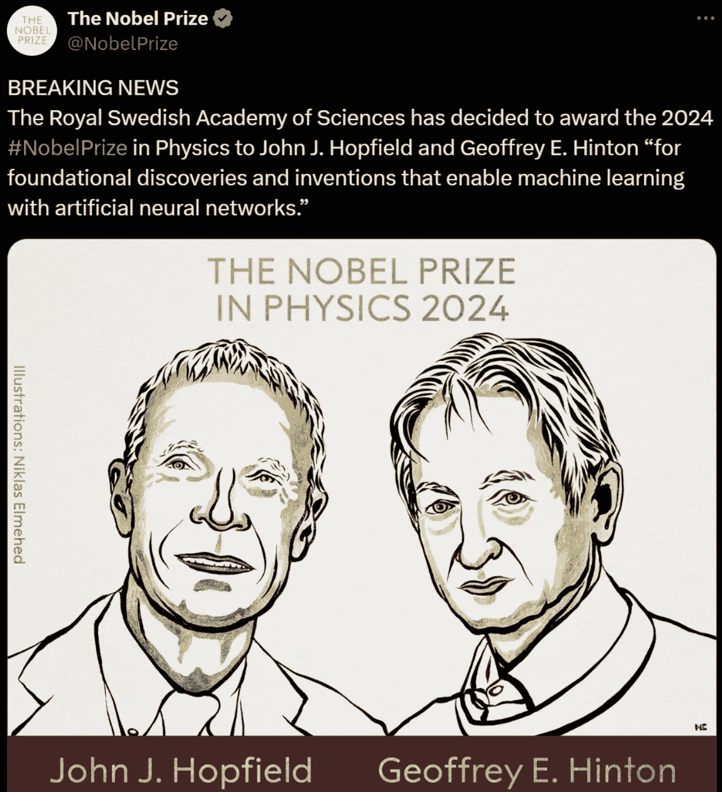
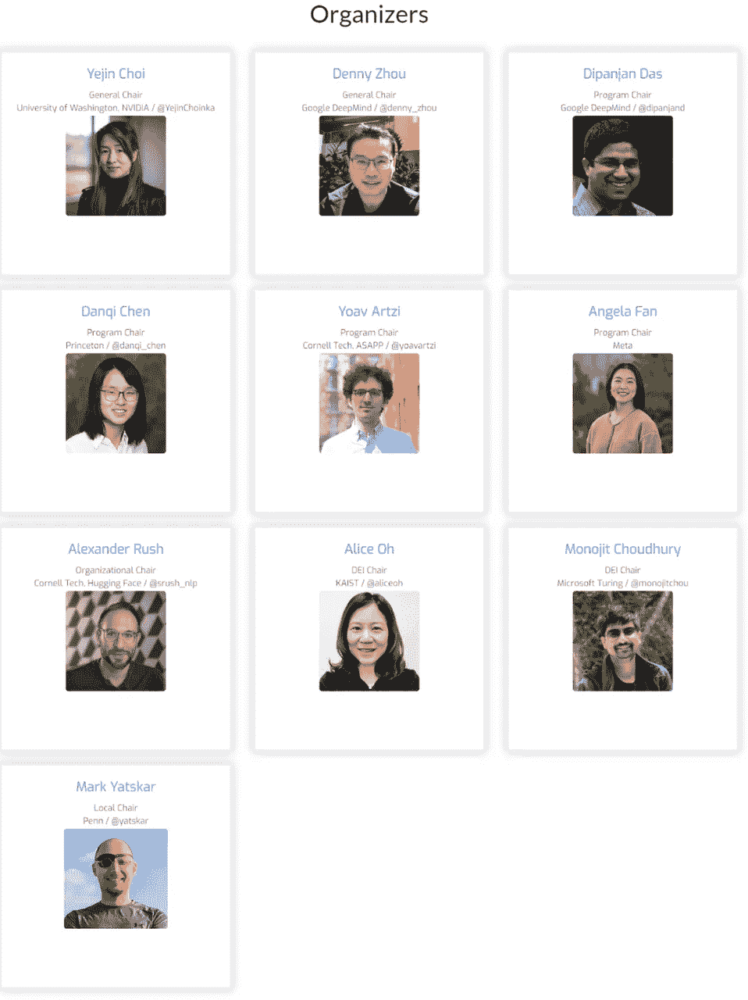
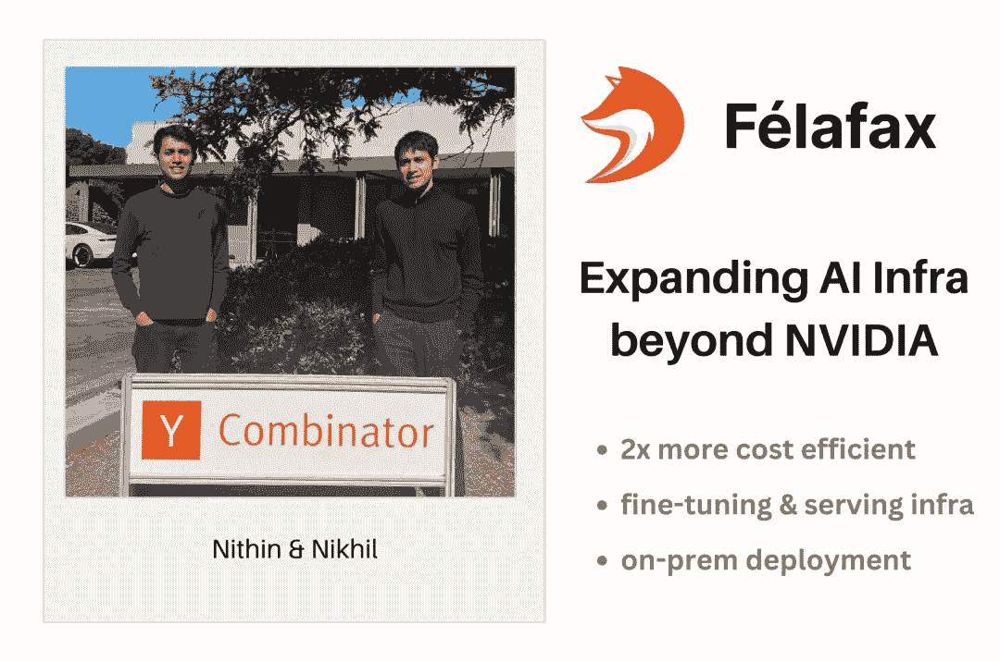
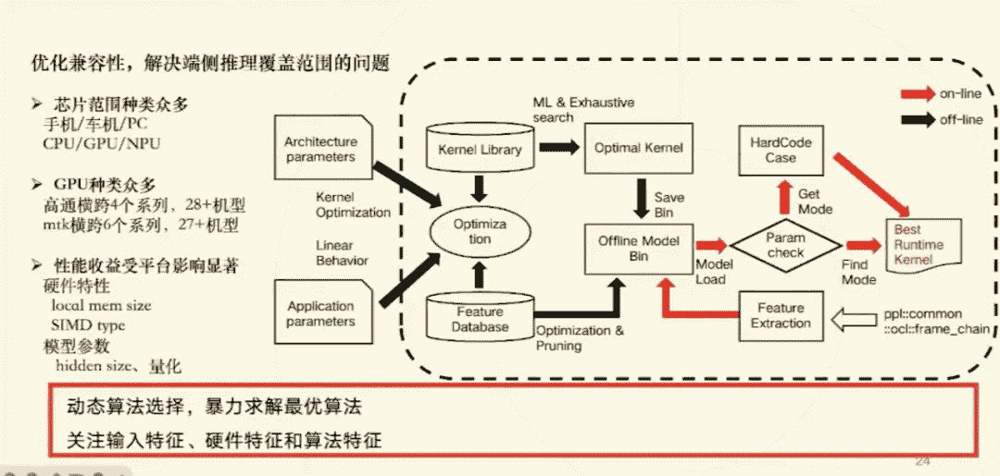
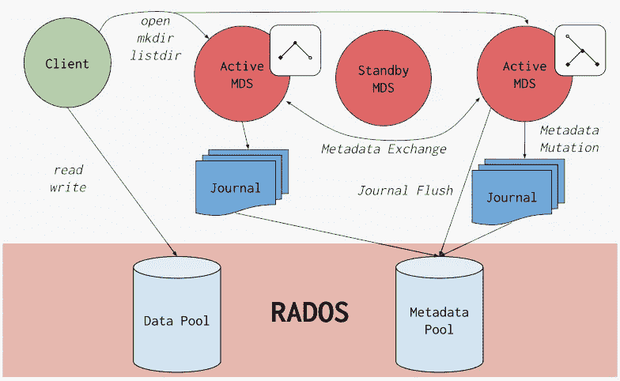
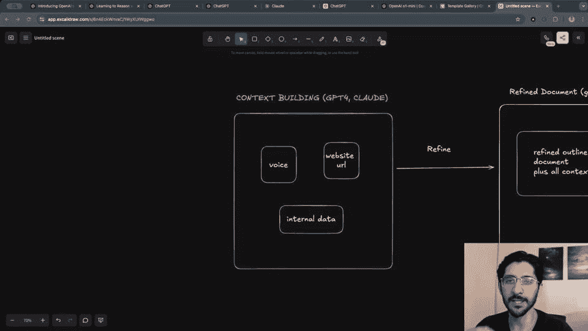

# 奇绩大模型日报（10月 8日）

> 来源：[https://miracleplus.feishu.cn/docx/V4N3dQmwdoo2n9xbxmZcb8kNn2g](https://miracleplus.feishu.cn/docx/V4N3dQmwdoo2n9xbxmZcb8kNn2g)

# 🔉潜空间活动报名

#### 潜空间系列活动重磅回归！

> 本期活动将在**10月13日** **10:00**开始，我们邀请到的嘉宾是朱亦博，他将在潜空间上海场进行分享。阶跃星辰（StepFun）系统负责人，曾任字节跳动 AI 基础设施负责人。朱亦博在大规模数据处理和人工智能算法优化方面有着深厚的背景和丰富的经验。阶跃星辰专注于通用大模型的研发，发布了 Step 系列通用大模型，包括千亿参数的语言大模型和多模态大模型，以及万亿参数的 MoE 语言大模型预览版。他将带来《从模型到集群硬件，关于全栈式 AI Infra 设计与搭建的思考的分享。

> 除嘉宾分享外，每期设置了【匹配合伙人 Cofounder Matching】环节。你可以和 GenAI 时代最有活力的创业者和研究者线下面对面交流，将有机会找到志同道合、有共同创业梦想的小伙伴。

> 报名通道已开启，欢迎扫描下方二维码报名。

# 资讯

### 诺贝尔物理学奖破天荒颁给「AI教父」！Hinton成首位图灵奖诺贝尔物理学奖双料得主

2024年的诺贝尔物理学奖，花落John Hopfield和Geoffrey Hinton，理由是运用物理学原理训练人工神经网络。委员会宣布获奖名单时，所有人倒吸一口冷气。现在，网友已经炸锅了。

两人获得诺贝尔物理学奖的理由是，他们使用物理学工具训练了人工神经网络，这些方法是当今强大机器学习的基础。他们的工作，让如今的深度神经网络和深度学习得以诞生。

### COLM奖项公布：被ICLR拒稿的Mamba入选杰出论文

2023年，为了更好地探索语言模型领域，一批知名青年学者发起了COLM（Conference on Language Modeling）会议，旨在创建一个专注语言模型研究、改进和交流的学术平台。今年，COLM公布了2024年杰出论文奖，共有4篇论文获奖，其中引起广泛关注的包括Mamba模型。

**Mamba模型**的研究解决了Transformer在长序列处理中的效率问题。Mamba通过将状态空间模型（SSM）参数化为输入函数，根据当前token选择性传播或遗忘信息，实现了线性时间序列建模。Mamba在语言、音频、基因组学等多种模态中达到SOTA水平，并在语言建模中表现优于同规模Transformer模型。该模型的硬件感知算法将SSM与Transformer的MLP块融合，形成同质架构，能够支持百万token长度的推理，提升5倍推理吞吐量，并能与两倍规模的Transformer模型媲美。

另一篇获奖论文“Dated Data: Tracing Knowledge Cutoffs in Large Language Models“研究了LLM的“有效截止日期”问题，提出了一种无需访问预训练数据的方法来估计不同数据集的实际有效时间点，并揭示了数据版本错位与重复数据处理导致的知识偏移问题。

第三篇论文“AI-generated text boundary detection with RoFT”提出了在文本中检测人类与AI生成部分的边界。通过测试不同边界检测算法，作者发现基于困惑度的检测方法在处理跨领域数据时更为鲁棒，指出了现有检测方法在处理特定文本特征时的局限性。

最后一篇获奖论文“Auxiliary task demands mask the capabilities of smaller language models”探讨了任务需求对小型语言模型能力评估的影响。实验表明，任务复杂度越高，小型模型表现越差，这种“需求差距”使得模型性能不能直接代表智能水平。

COLM致力于促进语言模型技术的发展，并推动学术界与产业界的深度交流。Mamba模型及其他获奖论文展示了语言模型领域的前沿探索，为未来的研究指明了方向。

### 在 Google Cloud TPU 上微调 LLaMa3.1，成本降低 30%，并实现无缝扩展！

https://mp.weixin.qq.com/s/eJwg4GwH--9IVFedum_BnA

随着AI模型参数量的增长，对算力需求也急剧上升。例如，Llama-3.1的405B版本需要900GB以上的内存，对算力构成巨大挑战。为了解决这一问题，Felafax公司致力于简化AI训练集群的搭建，采用了性价比更高的AMD GPU，并通过JAX对LLaMA 3.1 405B模型进行微调。

JAX是一个强大的机器学习库，它结合了类似NumPy的API、自动微分功能和Google的XLA编译器，在非英伟达硬件上表现优异。使用JAX可以在多种硬件设备上高效运行，而无需修改代码。这种硬件无关的设计使JAX成为非英伟达硬件上的最佳选择。相比之下，PyTorch在迁移至AMD GPU或TPU时，需要更多适配工作。Felafax利用JAX在8张AMD MI300X GPU上成功微调了LLaMA 3.1 405B模型。每张MI300X拥有192GB的HBM3内存，使得LLaMA 405B在AMD节点上能够高效运行。

模型微调采用了LoRA（Low-Rank Adaptation）方法，将所有权重和LoRA参数设为bfloat16格式。LoRA通过将权重更新分解为低秩矩阵，减少了可训练参数的数量，有效降低了内存开销。LoRA的rank值设为8，alpha值设为16，最终模型占用总显存的77%，即约1200GB。在此设置下，使用JAX急切模式时模型训练速度为35 tokens/秒，显存利用率达到70%。虽然由于硬件和显存限制无法使用JIT编译，但整体扩展性在8张GPU上表现接近线性。

模型分片策略是Felafax优化的关键。使用JAX的设备网格（device mesh）功能，可将模型的参数和计算任务分配到不同GPU上。在此应用中，设备网格形状为（1, 8, 1），表示数据并行（dp）、全分片数据并行（fsdp）和模型并行（mp）。模型的LM head（lm_head/kernel）张量在第一个轴上被分片到8个GPU，而没有设置分片规范的参数（如层归一化）则会被复制到所有设备上。

训练过程中，Felafax还对LoRA参数进行了分片策略优化。LoRA的A矩阵参数沿着fsdp轴分片到8个设备，而B矩阵则沿着mp轴分片，减少了通信开销，增强了训练并行性。最终，该策略在训练LLaMA 405B模型时，仅计算LoRA参数的梯度，保持主模型权重不变，从而降低了内存使用并加快了训练速度。

https://github.com/felafax/felafax

### 商汤 SensePPL 深度调优实践

https://mp.weixin.qq.com/s/KhWLmWugFmTswUOj8JkIIg

端侧大模型在2024年迎来了广泛关注，手机、汽车、PC等领域的AI应用逐渐成熟。各大厂商如苹果、vivo、OPPO、小米纷纷推出端侧AI系统，理想汽车和小米汽车也推出了自研语音大模型，AIPC逐步成为热点。端侧推理的快速发展得益于大模型的小型化及硬件算力的迭代，如LLAMA3、Phi-3、Mini CPM模型与高通、联发科的AI芯片，为端侧推理提供了坚实的技术基础。

端侧推理流程可分为prefill和decoding阶段。prefill阶段以计算密集型操作为主，decoding阶段则是访存密集型操作。评估推理系统性能的常用指标包括吞吐量、每秒请求数、首次延迟和解码延迟。云侧推理侧重提升吞吐量和并发处理能力，而端侧推理则更关注首次延迟和整体响应时间的优化。端侧推理面临内存占用、延迟、模型效果和跨平台兼容性四大挑战。

优化端侧推理的显存占用是关键，采用W4A16量化方案，并结合AWQ量化技术可有效降低权重尺寸，提升量化精度。KV Cache采用INT8量化方案，并对算子进行优化融合，通过减少量化和反量化过程中的开销实现更高效的MHA计算。prefill阶段主要优化矩阵乘法，decoding阶段优化矩阵向量乘法。在GPU资源受限情况下，结合GPU内存特性使用n连续、k连续和K8N4等算法策略，选择适合不同数据规模的算法方案。

端侧推理在跨平台兼容性上也面临挑战。芯片种类繁多，包括手机、车机和PC的CPU、GPU、NPU等异构架构。为此，端侧推理框架需针对不同硬件架构进行适配，并根据硬件特性和模型参数选择合适算法及分块策略。实际应用中，通过离线处理和Kernel编译进一步提升系统兼容性。

Serving Pipeline优化在端侧推理中扮演重要角色，从接收用户输入到分词、推理、采样，再到输出的整个流程，通过Serving层进行统一管理，并实现KV Cache管理与多轮对话优化。多轮对话优化可以在KV Cache中拼接历史prompt与回答，减少整体推理过程中的计算开销。

在应用场景中，SensePPL已在高通和MTK的旗舰机型中得到验证。prefill和decoding性能分别提升30%，内存占用降低50%。在WAIC大会上，展示的多模态模型部署方案在LLM性能上比开源方案提升了三倍。未来，SensePPL将继续拓展至AIPC和机器人领域，推动AI技术更广泛地普及和落地。

### Ceph：20 年前沿边缘存储的发展历程

https://mp.weixin.qq.com/s/58WsOP9hZGxE6jw2CKK7yg

在2023年OpenInfra Summit Asia大会上，Ceph的使用率已达到82%，成为全球范围内广泛应用的数据存储解决方案。Ceph最初是加州大学圣克鲁斯分校一个学生项目，由Sage Weil作为博士研究的一部分启动，逐渐发展成为业界领先的分布式存储系统。Ceph具备独特的技术特性，如分布式对象存储、数据与元数据解耦、动态分布式元数据管理和CRUSH算法，使其能够在多个节点上横向扩展，提供一致可靠的存储服务。

Ceph采用RADOS作为基础架构，引入CRUSH算法来确定性地放置数据，消除集中式分配表的需求。它通过动态子树分区（DSP）自适应地分配元数据管理，实现元数据和数据的分离，提升了系统可扩展性。Ceph的设计理念将更多智能推向边缘设备，与当时的主流存储解决方案如Lustre和GFS区别开来，强调自主管理和单点故障避免。

在2007至2011年，DreamHost为Ceph的发展提供了关键支持，核心组件逐步稳定并引入了大量新特性。随着Inktank的成立，Ceph的企业级支持进一步增强，并最终被红帽收购，推动Ceph成为企业级生产系统。2011年，Ceph被纳入Linux内核2.6.34主线版本，性能大幅提升。Ceph的重大突破之一是引入BlueStore，它通过直接管理SSD和HDD设备，避免传统文件系统的性能瓶颈。BlueStore采用嵌入式RocksDB键值数据库存储元数据映射，提升了数据存取效率和可靠性。

Ceph在存储数据的可靠性和恢复能力上表现出色。不同于传统的“磁盘复制”或“对象复制”方法，Ceph采用对象分组机制，即使发生故障，也能在数分钟内快速重建数据，显著缩短了恢复时间。Ceph的创新理念和技术特性使其在企业和云基础设施中得到广泛应用，并在人工智能和机器学习领域也具备潜力。2018年，Ceph基金会成立，进一步推动其生态发展。未来，Ceph将在数据存储领域继续发挥重要作用，为各类应用场景提供高效可靠的存储解决方案。

# 推特

### Sully分享使用OpenAI o1的工作流：如何正确使用o1来看到真正的魔力

贡献人：

https://x.com/SullyOmarr/status/1843425434501091718

很多人发现 O1 有点难用。

所以我制作了一段视频，展示了我经常使用的工作流程。

主要要点：

+   O1 非常智能，但它需要上下文才能发挥作用。

+   不要像用 GPT-4 那样（来回对话）使用它，那样是浪费时间。

+   先构建上下文（语音模式），创建一个大文档，然后用另一个模型进行优化。

+   最后把所有内容交给 O1，这样才能看到真正的魔力。

完整视频在下方。

[ssstwitter.com_1728379408109.mp4](https://internal-api-drive-stream.feishu.cn/space/api/box/stream/download/all/Gj7SbhXoLoT9APxubv2cqih4nld)

### Supervision-0.24.0：按类别统计线的穿越次数

贡献人：

https://x.com/skalskip92/status/1843321679210279043

Supervision-0.24.0 正式发布！

你终于可以按类别统计线的穿越次数了。很多人一直在要求这个功能，现在我们终于实现了！

我用 Supervision 花了不到 30 分钟就做了这个演示！

链接: [https://github.com/](https://github.com/roboflow/supervision)roboflow/supervision

[ssstwitter.com_1728317637663.mp4](https://internal-api-drive-stream.feishu.cn/space/api/box/stream/download/all/Gjn1blP5DohXNlxt7nEcek7nnqf)

### LeLaN：从野外视频中学习语言条件导航策略

贡献人：

https://x.com/svlevine/status/1843181197163483495

我们的新论文关于使用 YouTube 视频进行语言条件导航学习已经发布！通过利用预训练模型和从网络中获取的视频数据，我们可以让机器人更好地理解语言指令。

---

很高兴分享我们最近的研究 LeLaN，它用于从野外视频中学习语言条件导航策略，由加州大学伯克利分校和丰田北美共同研究。我们将在 CoRL 2024 上展示 LeLaN。

[ssstwitter.com_1728379557092.mp4](https://internal-api-drive-stream.feishu.cn/space/api/box/stream/download/all/CApnbJSjVowBulx8IRlcbtmEnQd)

### Imrat整理Lex Fridman 播客与 Cursor 团队中10个片段

贡献人：

我刚看了 Lex Fridman 播客与 Cursor 团队的第一小时内容。

我整理了其中我最喜欢的 10 个片段，并剪辑了播客的部分内容，放在下面。

如果你也想看第二小时的内容，告诉我哦。

总结一下：这是关于 AI 编程最深入的讨论之一。不仅仅是 Cursor 粉丝，任何对 AI 编程感兴趣的人都应该看。

无论你是使用 Claude、O1、Aider、GPT Engineer、Copypasta、Amazon CodeWhisperer 还是 Replit Agent，这里都有你能学到的东西。

我有遗漏什么吗？你最喜欢的部分是什么？

[ssstwitter.com_1728379651192.mp4](https://internal-api-drive-stream.feishu.cn/space/api/box/stream/download/all/E5euboLaVoFxDKxUnxdcjItSnng)

更多在原帖中～

### RunwayML分享：为生成模型制定的安全性、公平性和诚信度的保障措施

贡献人：

https://x.com/runwayml/status/1843285078002061611

随着我们不断构建能够提升人类创造力、支持艺术家、增强媒体和娱乐行业的通用世界模型，我们也更加深刻地感受到构建对世界产生正面影响的工具的责任感。

今天，我们分享了我们为生成模型制定的安全性、公平性和诚信度的保障措施，旨在防止我们工具的滥用。

链接: [h](https://runwayml.com/research/foundations-for-safe-generative-media)ttps://runwayml.com/research/foundations-for-safe-generative-media

# 信号

### VideoGuide: Improving Video Diffusion Models without Training Through a Teacher's Guide

贡献人：

原文链接：https://arxiv.org/abs/2410.04364

文本到图像 (T2I) 扩散模型彻底改变了视觉内容的创建，但将这些功能扩展到文本到视频 (T2V) 生成仍然是一个挑战，特别是在保持时间一致性方面。现有的旨在提高一致性的方法通常会导致诸如降低成像质量和不切实际的计算时间等权衡。为了解决这些问题，本文引入了 VideoGuide，这是一个新颖的框架，它无需额外的训练或微调即可增强预训练 T2V 模型的时间一致性。相反，VideoGuide 利用任何预训练的视频扩散模型 (VDM) 或其本身作为推理早期阶段的指导，通过将指导模型的去噪样本插入采样模型的去噪过程来提高时间质量。所提出的方法显著提高了时间一致性和图像保真度，提供了一种经济高效且实用的解决方案，可以协同各种视频扩散模型的优势。此外，本文展示了先验蒸馏，揭示了基础模型可以通过所提出的方法利用指导模型的优越数据先验来实现增强的文本连贯性。

### Differential Transformer

贡献人：

原文链接：https://arxiv.org/abs/2410.05258

Transformer 倾向于将注意力过度分配到不相关的上下文中。在本文中，我们引入了 Diff Transformer，它可以在消除噪音的同时放大对相关上下文的注意力。具体而言，差分注意力机制将注意力分数计算为两个单独的 softmax 注意力图之间的差值。减法消除了噪音，促进了稀疏注意力模式的出现。语言建模上的实验结果表明，在扩大模型大小和训练 token 的各种设置下，Diff Transformer 的表现都优于 Transformer。更有趣的是，它在实际应用中具有显着优势，例如长上下文建模、关键信息检索、幻觉缓解、上下文学习和减少激活异常值。通过减少不受不相关上下文的干扰，Diff Transformer 可以减轻问答和文本摘要中的幻觉。对于上下文学习，Diff Transformer 不仅提高了准确性，而且对顺序排列更具鲁棒性，这被认为是一个长期存在的鲁棒性问题。结果表明，Diff Transformer 是一种高效且有前景的架构，可以推动大型语言模型的发展。

### OmniBooth: Learning Latent Control for Image Synthesis with Multi-modal Instruction

贡献人：

原文链接：https://arxiv.org/abs/2410.04932

我们提出了 OmniBooth，这是一个图像生成框架，可通过实例级多模态定制实现空间控制。对于所有实例，可以通过文本提示或图像参考来描述多模态指令。给定一组用户定义的掩码和相关的文本或图像指导，我们的目标是生成一幅图像，其中多个对象位于指定的坐标处，并且它们的属性与相应的指导精确对齐。这种方法大大扩展了文本到图像生成的范围，并将其提升到可控性方面更加通用和实用的维度。在本文中，我们的核心贡献在于提出的潜在控制信号，这是一种高维空间特征，可提供统一的表示，以无缝集成空间、文本和图像条件。文本条件扩展了 ControlNet，以提供实例级开放词汇生成。图像条件进一步实现了具有个性化身份的细粒度控制。在实践中，我们的方法为用户提供了可控生成的更大灵活性，因为用户可以根据需要从文本或图像中选择多模态条件。此外，全面的实验证明了我们在不同任务和数据集上图像合成保真度和对齐方面的性能增强

### MathHay: An Automated Benchmark for Long-Context Mathematical Reasoning in LLMs

贡献人：

原文链接：https://arxiv.org/abs/2410.04698

最近的大型语言模型 (LLM) 已在长上下文场景中展现出多种能力。尽管最近已经开发了一些基准来评估 LLM 的长上下文能力，但仍然缺乏评估 LLM 在长上下文中的数学推理能力的基准，而这对于 LLM 在实际场景中的应用至关重要。在本文中，我们介绍了 MathHay，这是一个旨在评估 LLM 长上下文数学推理能力的自动化基准。与之前的基准（如 Needle in a Haystack）不同，MathHay 要求模型既具有信息搜索能力，又具有复杂的数学推理能力。我们在 MathHay 上进行了广泛的实验，以评估八个表现最佳的 LLM 的长上下文数学推理能力。即使是表现最好的模型 Gemini-1.5-Pro-002，在长上下文中的数学推理方面仍然举步维艰，在 128K 个 token 上仅达到 51.26% 的准确率。这凸显了 MathHay 基准测试的巨大改进空间。

### FAN: Fourier Analysis Networks

贡献人：

原文链接：https://arxiv.org/abs/2410.02675

尽管神经网络，尤其是以 MLP 和 Transformer 为代表的神经网络取得了显著成功，但我们发现它们在周期性的建模和推理方面存在潜在缺陷，即它们倾向于记忆周期性数据，而不是真正理解周期性的基本原理。然而，周期性是各种推理和泛化形式的一个关键特征，通过观察中重复出现的模式支撑着自然和工程系统的可预测性。在本文中，我们提出了一种基于傅里叶分析的新型网络架构 FAN，它能够有效地对周期性现象进行建模和推理。通过引入傅里叶级数，周期性自然地融入到神经网络的结构和计算过程中，从而实现对周期性模式的更精确的表达和预测。作为多层感知器 (MLP) 的有前途的替代品，FAN 可以无缝地在各种模型中取代 MLP，并且具有更少的参数和 FLOP。通过大量实验，我们证明了 FAN 在周期函数建模和推理方面的有效性，以及 FAN 在一系列实际任务中的优越性和通用性，包括符号公式表示、时间序列预测和语言建模。

# 产品

### OpenBB Terminal

贡献人：

https://openbb.co/

OpenBB 是一个基于 AI 的金融终端，可以通过无缝的数据集成和 AI 助手提升投资研究效率。它提供强大的数据分析、定制化功能和社区支持，适合各类用户使用。

### opencord.AI

贡献人：

https://www.opencord.ai/

Opencord AI 是一个社交媒体 AI 助手，提供 24/7 的目标客户互动服务，帮助用户找到潜在客户、提升内容创作效果，并个性化社交媒体交流。它通过分析社交平台上的信息，自动化处理和回复，可以节省时间并提高在线存在感。

# HuggingFace&Github

### Agents

贡献人：

https://github.com/livekit/agents

Agents 是一个框架，用于构建实时多模态 AI 应用程序，支持文本、音频、图像和视频流的处理与生成。它与 LiveKit 会话兼容，允许代理连接用户设备，具备高级功能如自动转换检测和负载均衡。技术栈包括 Python、C++、CMake。

# 投融资

### VESSL AI 获得1200万美元融资，致力于降低高达80%的GPU成本

https://techcrunch.com/2024/10/07/vessl-ai-secures-12m-for-its-mlops-platform/

韩国MLOps平台VESSL AI近日完成了1200万美元的A轮融资，旨在利用混合基础设施和多云策略降低GPU成本，为企业提供更高效的机器学习模型开发和部署平台。本轮融资的投资方包括A Ventures、Ubiquoss Investment、未来资产证券（Mirae Asset Securities）、Sirius Investment、SJ Investment Partners、Wooshin Venture Investment和新韩风险投资（Shinhan Venture Investment）。截至目前，VESSL AI的总融资金额已达1680万美元。

VESSL AI创立于2020年，由Jaeman Kuss An（首席执行官）、Jihwan Jay Chun（首席技术官）、Intae Ryoo（首席产品官）和Yongseon Sean Lee（技术负责人）共同创办，创始团队成员曾供职于Google、PUBG和多家AI初创公司。该公司主要通过混合基础设施模式和多云策略，最大限度地降低GPU开销，并优化大规模语言模型（LLM）和垂直AI代理的开发流程，旨在满足企业级客户的定制化需求。

目前，VESSL AI已拥有50家企业客户，包括现代汽车、LIG Nex1、TMAP Mobility、Yanolja、Upstage、ScatterLab和Wrtn.ai等，并与Oracle和Google Cloud在美国市场建立了战略合作关系。其平台的核心功能包括自动化模型训练的VESSL Run、实时部署的VESSL Serve、集成训练和数据预处理的VESSL Pipelines以及优化GPU资源使用的VESSL Cluster。

该轮融资将用于加速平台的基础设施开发，进一步提升其在机器学习模型开发中的成本效益和资源管理能力。

公司官网：https://vessl.ai/

### Kobold Metals利用AI技术寻找关键矿产，完成4.91亿美元融资

https://techcrunch.com/2024/10/07/ai-powered-critical-mineral-startup-kobold-metals-has-raised-491m-filings-reveal/

AI驱动的矿产勘探初创公司Kobold Metals近日在其最新一轮融资中获得4.91亿美元（目标为5.27亿美元），这一轮融资后，Kobold的估值有望达到20亿美元。该公司专注于利用人工智能技术寻找铜、锂、镍和钴等关键矿产，以推动能源转型，并且在今年早些时候发现了全球最大高品位铜矿床之一，该矿床每年可能生产数十万吨铜。

Kobold Metals成立之初主要专注于矿产资源的发现，通过应用AI技术分析大量数据，提升矿产发现的成功率，而传统矿产勘探的成功率仅为千分之三左右。此次融资将帮助该公司进一步开发其在赞比亚发现的巨型铜矿资源，同时推进其他60多个矿产勘探项目。Kobold预计将自主开发赞比亚的铜矿项目，这一开发可能需要23亿美元的资金投入。

Kobold Metals此前的投资者包括比尔·盖茨、杰夫·贝佐斯、马云、Andreessen Horowitz和Breakthrough Energy Ventures等知名人士和风投公司。此前的一轮1.95亿美元融资曾使公司估值达到10亿美元。目前，该公司正致力于转型为既能勘探又能开发资源的综合性矿产公司，以加速矿产资源的开发与商业化。

公司官网：https://www.koboldmetals.com/

# 学习

### Long Context Prefill的自然哲学的数学原理

贡献人：

https://zhuanlan.zhihu.com/p/853199744

**长上下文模型的外推及训练策略：** 长上下文模型的外推主要通过修改RoPE的base参数（即theta-i）来实现。虽然ntk等方法无需训练就能在一定程度上提升外推能力，但效果并不稳定。因此，研究表明通过“长上下文持续预训练”（long context continual pretrain）能够将上下文长度推至更长（如1百万标记），并有效解决无训练外推的不稳定问题。同时，在持续预训练过程中，需要适当调大base值以减缓衰减速度，从而提升模型对超长距离上下文的适应能力。然而，这样的调整可能导致短文性能下降，需在预训练后进行微调来恢复短文性能。

**RoPE的理论框架：** RoPE的位置编码可以分为两个部分：theta-i（位置编码的旋转夹角）和theta-0（查询和键的内积）。theta-i与远程衰减强相关，当频率提高时，theta-i的积分会趋近于零，从而确保远距离上下文的权重衰减。另一方面，theta-0与模型的OOD（Out-of-Distribution）问题相关，其规范化能够提高模型在未见过位置的泛化能力。这种规范化可以通过POCP（Phase of Cosine Projections）来实现，POCP通过调整位置编码的相位，解决了频率与衰减之间的匹配问题。

**调节RoPE的****base****参数：** 增大base参数可以降低旋转角度，减缓衰减速度，使模型在长距离上下文中保持较好的鲁棒性。然而，base过大时，会导致模型对远近距离内容的区分度变差，进而影响短文本的学习能力。因此，选择合适的base值至关重要，需要在性能和稳定性之间找到平衡点。百川的研究进一步指出，过小的base值会使attention分布特性失衡，而合适的base值则能够保证模型对相似token的attention期望值高于随机token，从而提升检索性能。

**Alibi与RoPE的对比：** Alibi编码在长距离上下文中效果明显下降，因为其衰减曲线是单调递减的，难以支持超长距离内容的关联。相比之下，RoPE编码能够在达到一定位置后开始震荡，从而为超长距离上下文提供足够的学习空间。因此，Alibi尽管计算效率高，但在长距离场景下表现不佳，而RoPE通过调节base值能够在性能和远程衰减之间取得更好的平衡。

长上下文持续预训练的挑战及策略： 长上下文预训练的核心在于解决未见过位置的OOD问题和重新拟合由于修改base导致的衰减曲线的变化。研究表明，这种持续预训练通常不需要大量样本即可取得显著效果。然而，如果单纯扩大base值而不进行进一步的持续预训练，模型可能难以有效适应新的衰减曲线，从而在短文本任务上出现性能下降。因此，推荐的策略是先在短文本上调优衰减曲线，再进行长上下文预训练。

**未来研究方向：** 长上下文模型在推理性能、长上下文强化学习和评估等方面仍存在大量优化空间。例如，通过改进long context prefill与decode的策略，可以将推理复杂度从N²降低至线性。此外，如何在超长文档生成中实现更强的语义一致性和上下文连贯性，也是未来需要攻克的技术难题。随着RoPE的应用范围扩展，基于相位规范化的POCP与多模态窗口压缩可能为长上下文模型提供新的技术突破点。

### torch.compile 的详细示例解析教程

https://mp.weixin.qq.com/s/8FwbaP5q4f_VGWE4vobaMw

**torch.compile**** 编译器的基本原理：** PyTorch 编译器是一个 Just-In-Time (JIT) 编译器，它根据代码运行时的输入条件动态进行优化，并生成与原始代码等效的高效执行版本。torch.compile 通过捕获用户代码的计算图，利用多种后端（如 Inductor、AOTAutograd）进行优化，并为不同的设备（CPU、GPU）生成优化代码。编译器通过 Dynamo、AOTAutograd 和 Inductor 三个核心模块分离并优化用户代码。

**torch.compile**** 的三个核心模块：**

+   **Dynamo：** 它负责捕获用户代码，将 PyTorch 的 Tensor 操作和与张量无关的 Python 操作分离出来，并将用户代码拆分成可被进一步优化的计算图和 Python 控制流部分。Dynamo 在 Python 字节码层面操作，通过分析代码结构生成守卫（Guard）和转换后的代码（Transformed Code）。守卫是优化的触发条件，而转换后的代码则是经过优化后的计算图。

+   **AOTAutograd：** 该模块从前向计算图中生成反向计算图，并进行内存优化。AOTAutograd 可以通过重新计算策略减少反向传播时需要保存的中间张量数量，从而降低内存占用，并在需要时重新计算前向值（如二次 cos 计算），以减少保存的中间张量。

+   **Inductor：** Inductor 是 PyTorch 的默认后端，它根据前向和反向计算图进行一系列优化操作，如 Kernel Fuse（内核融合），以提高代码执行效率。Inductor 可以将计算图中相邻的算子合并，减少内存的读写开销，从而提升计算性能。

**torch.compile**** 的不同后端模式：**

+   torch.compile(backend="eager")：仅使用 Dynamo 来捕获用户代码并生成前向计算图，不对反向图做额外优化。

+   torch.compile(backend="aot_eager")：使用 Dynamo 和 AOTAutograd，将前向图和反向图分离并进行基本优化。

+   torch.compile(backend="inductor")：默认模式，使用 Dynamo、AOTAutograd 和 Inductor 进行完整优化。

编译过程中的守卫机制和动态形状支持： 编译器根据输入张量的形状、设备、数据类型等信息生成守卫条件，以确保在不同输入形状或类型时能够有效地触发编译后的优化代码。当守卫条件失败时，编译器将重新生成新的优化版本，以支持动态形状（如从 [10] 泛化到任意一维 [s0]）。

**前向和反向计算图的生成及优化：**torch.compile 利用 AOTAutograd 动态生成前向和反向计算图，并通过最小流切割算法对图进行分割，以选择最优的内存和计算策略。优化过程中，AOTAutograd 会动态分析计算图，并决定在哪些地方进行重新计算（以减少保存的中间张量数量），而 Inductor 则进一步对整个计算图进行 Kernel 融合及其他硬件相关优化。

**实际应用案例及代码解析：** 本文通过多个代码示例（如 torch.cos 的前向和反向计算）展示了如何利用 torch.compile 对实际的深度学习模型进行优化，并详细解释了编译器在不同输入情况下如何触发守卫及重新编译过程。用户可以通过设置不同的后端参数来查看计算图转换效果，并利用 make_fx 工具来观察生成的 PyTorch 计算图。

### 分布式深度学习训练中的debug

https://zhuanlan.zhihu.com/p/848041731

过去两年中，作者主要聚焦于分布式深度学习框架nnScalar的开发，积累了丰富的debug经验。nnScalar的目标是在大模型时代降低分布式训练的复杂性，提高效率，保障模型训练的正确性。以下是本文的核心技术内容概述：

深度学习训练流程包括数据读取、前向和反向计算、Gradient Norm与Clipping、学习率调节、Optimizer与Checkpoint管理。数据读取是影响网络收敛的重要环节，需确保其行为符合算法设计者的预期；前向和反向计算则在GPU上处理数据并计算梯度；Gradient Norm与Clipping用于调整梯度大小以避免梯度爆炸；学习率调节常见策略包括warm up和decay；Optimizer则用于更新参数，Checkpoint管理保存训练状态以便后续调优。

分布式并行方案通过将计算分配到不同设备上来提升训练效率，并突破单个设备的显存限制。数据并行（Data Parallelism）将输入数据划分到各设备，并利用AllReduce合并本地梯度；ZeRO并行通过通信均分Optimizer状态，减少冗余，支撑更大模型；张量并行（Tensor Parallelism）将模型参数直接分布在不同设备中，通过在Attention前插入AllReduce提升性能；序列并行（Sequence Parallelism）解决长输入序列引发的显存瓶颈，通过AllGather进一步分配激活张量；流水线并行（Pipeline Parallelism）将模型划分成多个阶段，每个阶段利用内部并行方案；上下文并行（Context Parallelism）通过通信交换均分KV张量，适应大序列长的需求；专家并行（Expert Parallelism）针对MoE结构，将不同Expert均分到设备，以提高内存效率和训练表现。

混合精度训练引入16位浮点（如fp16、bf16），进一步提升计算和通信速度，但浮点数精度降低会带来误差。系统开发者需熟悉不同数据类型的表示范围，确保在分布式环境中引入的误差符合预期。典型场景包括算子的不同划分方案、通信物理实现的差异，以及软硬件环境的更新。

Debug方法与性能优化主要关注正确性问题与利用率问题。正确性方面，分布式训练应与单卡训练等价，模型收敛性和Checkpoint一致性是关键。系统开发者应深入理解模型语义，保证数学上的等价性。利用率方面，应关注计算与通信效率，常用指标为MFU（Model FLOPs Utilization），一般要求大于40%。通过分析每个Kernel的执行时间和利用率，并尝试不同的分布式方案组合以提升效率。

在复杂的分布式系统中，应遵循“确认是否Bug、建立合适Baseline、控制变量、构建最小复现单元”的原则，深入定位问题模块。引入assertion嵌入代码中提高鲁棒性，并收集详细的状态信息以辅助分析。对利用率进行调优时，应升级重要的Kernel库（如torch、cuda和flash-attn）、尽可能fuse kernel（如RMSNorm和rope），并在Python端调整代码避免低效形状。尝试不同的分布式方案能提高利用率，但分布式方案空间较大，需谨慎调整配置。

nnScalar正是基于这些理念设计，旨在降低分布式深度学习开发难度，加速大模型架构创新。

### 基于Ray构建复杂数据处理链路（1）

https://zhuanlan.zhihu.com/p/847336896

在大规模数据流程中，数据管道和机器学习任务的复杂性和动态性不断增加。基于Ray的机器学习框架能够更好地支持复杂的数据处理流程。Ray Serve通过引入Deployment Graph API，将推理服务构建为有向无环图（DAGs），利用Ray的计算能力实现高效的动态扩展和灵活性。

Ray Serve旨在支持多种模型部署模式，包括顺序链式调用、扇出集成以及动态调度等。这些模式能够支持复杂的机器学习任务，例如图像处理、内容理解等。通过简单的Python代码构建DAG，可以将不同模型连接为一个整体的推理图，并且具有独立扩展、配置和动态调度的能力，提升部署的灵活性和资源利用率。

Ray Serve的Deployment Graph API允许开发者将推理流程定义为一个可扩展、易于调试的图结构。在这个图中，节点可以是单个模型的推理逻辑，也可以是多个模型的集成调度。比如，一个图像理解管道可以通过Downloader节点下载图像，再经过Preprocessor节点预处理，并行发送到不同的模型（如Segmentation和Integrity模型），最后通过Dispatcher节点根据输入图像的类别进行动态选择调度。这种图结构的定义方式消除了传统基于手写YAML配置的复杂度，更加符合Python的习惯，简化了开发和调试流程。

在Ray Serve的设计中，Python句柄（handle）是用来编写和编排复杂部署图的重要工具。利用句柄可以轻松创建和管理复杂的部署图，例如将多个模型进行串联、并行或动态调度。通过@serve.deployment装饰器，开发者能够将Python类或函数快速转换为可部署的模型服务。Ray Serve还通过引入InputNode和.bind() API，使开发者能够像操作普通Python类一样编写DAG，自动获得Ray Serve提供的调度和扩展能力。

Deployment Graph API还支持图的动态调度。可以根据输入数据的元数据动态选择不同的处理路径，这种灵活的图结构能够显著提升生产环境中多模型部署的效率。此外，Ray Serve还支持细粒度的资源配置，例如为每个任务分配部分CPU或GPU资源，能够跨集群部署并滚动更新。

相比传统推理服务框架，Ray Serve的Deployment Graph API不仅符合Python的使用习惯，还提供了更简洁的API接口和动态扩展能力，使得多模型组合、调度和集成更为便捷。同时，Ray Serve还提供DAGDriver等工具，帮助开发者将DAG图部署到生产环境中，简化从本地开发到生产部署的整个流程。

这种图结构不仅在多模型推理任务中表现出色，还适用于构建端到端的机器学习管道，并支持对模型的动态扩展、轻量级更新（如模型权重）以及与FastAPI的HTTP集成，极大提升了复杂推理流程的可维护性和性能。Ray Serve通过结合DAG API和Ray的强大计算能力，为复杂的机器学习工作负载提供了一个高效、灵活且易用的解决方案。

### Triton到SASS（4）：dotOp的划分+一些乱猜

https://zhuanlan.zhihu.com/p/856486020

MMA（Matrix Multiply Accumulate）Layout设计复杂，直接影响每个Warp的访问模式和性能优化。Triton框架引入了triton-tensor-layout工具，用于可视化Tensor到寄存器的映射关系（Layout），但目前还不支持Shared Memory的映射。MMA Layout中每个Warp处理16x8xfp32的矩阵块（Turing和Ampere架构），而4个Warp计算时会存在内存访问的重复，导致全局内存带宽利用率下降。

Triton通过convert_layout操作将MMA Layout转换为更适合全局内存写入的Blocked Layout。convert_layout会在矩阵变换中插入Local Memory存取操作，并在某些情况下使用Shared Memory进行数据交换。对于不同的转换场景，Triton将采用以下四种策略：

1.  同线程内重排元素；

1.  同Warp内使用Warp Shuffle指令交换；

1.  同CTA内借助Shared Memory；

1.  跨CTA时使用分布式Shared Memory。

对于共享内存，Triton使用Padding避免Bank冲突。在getScratchConfigForCvt中，为最连续的维度添加Padding元素，计算出转换中所需的Shared Memory大小。实际测试中，MMA Layout到Blocked Layout的转换可能导致Bank冲突，从而影响性能。

在Tensor Core的运作中，Ampere架构引入了TF32精度（19个bit，10个小数位），可直接通过指令集cvt.rna.tf32.f32进行转换。虽然TF32在不改动代码的情况下就能利用Tensor Core，但它的精度并不足以支持当前大模型的需求。更高效的做法是采用TF32x3策略，将FP32的乘法拆分为3个TF32的运算组合，从而提升精度。

Hopper架构在MMA基础上引入了WGMMA指令，允许通过Warp Group操作提升计算密度。WGMMA指令直接从Shared Memory加载数据，省去地址计算与数据预取的复杂步骤。相比MMA的16x8矩阵操作，WGMMA能够处理64x256的更大块矩阵，并且提供了更灵活的同步控制。

在具体实现时，WGMMA的Shared Memory和寄存器布局非常关键。WGMMA会使用128个64bit寄存器描述符来定位Shared Memory中的数据，并根据Swizzle模式对不同矩阵块进行布局转换。Triton通过预先计算Shared Memory的地址和Stride，实现高效的数据流控制。为了尽可能提高Shared Memory和寄存器带宽利用率，WGMMA会将每个Warp的输出累加器保留在寄存器中，并避免频繁地与Shared Memory交换数据。

### 波士顿动力在系统建模思想的总结

https://zhuanlan.zhihu.com/p/813458297

**K**inodynamic + Object Kinematics and Centroidal Dynamics：Kinodynamic系统结合了运动学（如位置、速度、加速度）与动力学（如力、转矩、质量、摩擦力等）约束条件，旨在规划和控制物体或机器人在动力学条件下的运动。该系统不仅考虑几何约束，还需综合动力学因素，从而更好地描述和预测机器人的实际行为。

**模型复杂度的边界与计算难度**：随着模型复杂度的增加，性能提升的边界并未被完全找到，前提是这些增加的模型能够准确代表系统的约束和环境交互。但模型复杂度的提升将导致计算难度的增加，并且需要更复杂的软件系统来进行支撑。

多Kinodynamic系统与机器人-物体交互：在长序列规划问题中，系统不仅需考虑机器人自身的动力学和运动学，还需把环境中的可调整物体纳入建模，从而提高整体系统对复杂交互场景的控制能力。

**模型复杂度与延迟之间的权衡**：如何在增加模型复杂度的同时减少计算延迟是一个需要重点考虑的方向。要找到适合的模型复杂度，既能提升机器人性能，又不会导致不必要的计算开销。

**常见建模因素**：

+   执行器扭矩（Actuator torques）：用于控制关节或肢体的扭矩，影响机器人动作的精确性。

+   闭合运动学链（Closed kinematic chains）：精确建模闭合运动学链可提升机器人多肢体协调性。

+   **隐式接触优化（Contact-im**plicit optimization）：处理机器人与环境接触（如抓取、行走）的优化，提高交互能力。

+   **状态不确定性（State uncertainty）与模型不确定**性（Model uncertainty）：前者源于传感器误差或外部因素，后者表示模型不能完全捕捉物理现象。

**模型发展阶段**：

+   **Potato Model**：基础模型，用于验证简单控制任务。

+   带有四肢的简单模型（Potato Model with Limbs）：在基础模型上增加四肢，提高模型复杂性和控制精度。

+   **结**合运动学和质心动力学模型（Combined Kinematics and Centroidal Dynamics）：同时考虑关节位置、速度与质心动力学，用于描述机器人整体运动。

+   机器人与物体交互/扭矩约束/复杂碰撞模型：处理复杂场景下的机器人与物体交互及碰撞模拟。

+   **非结构化真实世界交互模型（Unstructured Rea**l-World Interaction）：最高级别模型，用于处理机器人在非结构化环境中的复杂交互。

如何高效利用现代计算架构（如GPU）：利用GPU进行仿真是提升计算效率的关键思路之一，可以加速复杂模型的求解与优化。

快速迭代学习（Learning by Doing）：在实际应用中，通过快速迭代的方式进行模型调整和优化，以应对复杂和多变的现实环境。

### 基于扩散的视觉基础模型LOTUS：零样本深度和法线估计新SOTA

https://zhuanlan.zhihu.com/p/792829918

**传统扩散模型问题分析**：

+   现有扩散模型在密集预测任务中表现不佳，主要因为它们通常沿用用于图像生成的噪声预测参数化形式。这种形式在初始去噪步骤中引入大量误差，并在后续去噪过程中被放大，导致预测结果模糊和不准确。

+   扩散模型的多步去噪推理方式计算复杂度高且训练效率低。尤其在高质量训练数据有限的情况下，多步扩散过程的优化困难、精度下降，导致其不适用于密集预测任务。

**Lotus模型的改进**：

+   **单步去噪公式**：Lotus采用单步去噪公式，在纯噪声与清晰输出之间只需一步，显著缩短了训练和推理时间。同时，单步公式避免了多步去噪中误差传播的问题，提高了模型的稳定性和准确性。

+   **参数化改进**：将原始的噪声预测（ε-prediction）替换为干净样本预测（x₀-prediction），有效减少了去噪过程中因大方差带来的误差，从而提升了模型在密集预测任务中的性能。

+   **减少时间步数**：通过采样原始扩散时间步数集的子集来进行训练，减少去噪步骤的数量，从而缩小模型的优化空间，使得适应过程更加高效。实验表明，减少时间步数后，单步公式在多种数据规模下始终表现最佳。

**细节保留机制**：

+   为解决模型在处理高细节区域时的灾难性遗忘问题，Lotus引入了一种名为“细节保留器”的新型正则化策略。该策略通过任务切换器使得去噪模型能够同时生成标注和重建输入图像，从而在生成密集标注时保持细节的准确性，而不引入额外的网络参数或受到表面纹理的影响。

**推理效率与扩展性**：

+   采用Lotus的单步去噪公式和细节保留机制，模型能够在零样本的单目深度估计和表面法线估计中取得最先进的性能，并且推理速度提升数百倍。

+   Lotus模型包含两种版本：Lotus-G（生成式）和Lotus-D（判别式），分别支持带有噪声输入和不带噪声输入的密集预测任务，能够适应多种应用需求。

**实验与性能验证**：

+   实验结果表明，Lotus在各种数据规模和复杂度下均表现出更低的预测误差和更高的稳定性。相比于传统多步扩散模型，Lotus在有限高质量数据集下依然能够实现快速优化和更高效的推理。

### LLM推理引擎对比

https://zhuanlan.zhihu.com/p/796219014

1.  TensorRT-LLM 是专为 NVIDIA GPU 设计的推理引擎。其优势包括 In-Flight Batching（减少等待时间，提高 GPU 利用率）、分页 KV 缓存、MultiGPU-MultiNode 推理和 FP8 支持。该框架支持将 Hugging Face 模型转换为 TensorRT 格式，并利用量化（INT8）降低模型权重存储需求。实验中，TensorRT-LLM 在延迟和吞吐量上都优于传统的 Hugging Face 模型，并且量化后的 INT8 模型性能提升明显。

1.  vLLM 通过分页注意力、连续批处理、量化（GPTQ、AWQ、FP8）和优化的 CUDA 核心加速 LLM 推理。实验表明，在吞吐量和延迟方面，vLLM 的表现优于传统推理引擎。具体实现中，通过调用 vLLM 的 API 并在 MedQA-Reason 数据集上生成模型输出来测试性能。vLLM 在多项任务上的吞吐量指标优异，适合大规模文本生成任务的部署。

1.  LMDeploy 提供了高效的 LLM 压缩、部署和推理引擎，支持 TurboMind 和 PyTorch 引擎。其创新之处在于支持持久批处理、块 KV 缓存、张量并行及多机多卡部署。LMDeploy 采用了4位量化，使推理性能相比于 FP16 提升了 2.4 倍。通过在 A100 GPU 上的测试，LMDeploy 展现了比 vLLM 高出 1.8 倍的吞吐量，证明其在大规模推理任务中的优势。

1.  MLC-LLM 提供了一个高性能的部署和推理引擎——MLCEngine。其主要特性包括对 Hugging Face 模型权重格式的转换及 q0f16 量化支持。该引擎能在各种设备（如 CPU、GPU 和专用硬件）上高效运行。在测试中，MLC-LLM 展现了显著的吞吐量提升，同时还提供了灵活的部署选项。

在实验中，TensorRT INT8 模型在推理速度上优于 HF 模型和常规 TensorRT，而常规 TensorRT 模型在 ROUGE 得分上表现更佳，适合复杂任务。LMDeploy 在 A100 GPU 上的请求吞吐量显著高于 vLLM，适合多机多卡部署的大规模应用场景。MLC-LLM 适用于需要灵活部署和较高推理性能的场景。

# 招聘公告

---

**奇绩创坛****由陆奇博士**于2019年创立，使命是在源头最大化驱动创新。奇绩研究组将研究模型理论、到投研战略分析、市场策划等不同背景的同学聚在一起，搭建GenAI时代独特的跨界人才社群。

## 🚀F**24实习岗位**

##### [行研-学术科研人才交流组实习生](https://miracleplus.feishu.cn/docx/Yn6rdf2iOoY2Rcx8yVNcUBYRnch#part-QkMcdeJmuob9uvxvV3qcLSzHn8g)

##### 行研-GenAI研究岗位-战略分析（偏产品）

##### Web / AI 全栈开发工程师实习生

## **火热开放中🚀**

##### 行研-GenAI研究岗位-前沿学术探索

##### 行研-GenAI研究岗位-战略分析（偏咨询）

##### 创新活动产品运营 （大模型系列活动产品运营）

> **点击**相关岗位可查看对应**岗位需求【JD】；**相关岗位投递请**扫描二维码**

> 欢迎**推荐/自荐**

> 期待在**奇绩创坛**遇见更好的你

---

# 声明

本文档仅供学习交流使用，版权归原作者所有，若涉侵权，请联系Jack Jin 15101136166

##

（欢迎在下方反馈您宝贵的意见！整理不易，觉得有用给AI日报小组点个赞👍吧！）

ChatGPT；Angela；Zijia Liu；Alex；Zeqi Tan；Tiezhen（HuggingFace）；Naixu；Lizhi；Peter；Suoman；Jack

封面生成——右脑科技

如果你有大模型相关的创业想法，欢迎来找我们聊聊～🛰️：15101136166

> 快邀请你的小伙伴们一起来读大模型日报吧！

> **【日报****知识库****】**这里是近期日报内容的汇总,欢迎大家查阅

> [大模型日报知识库(分享版)](https://miracleplus.feishu.cn/wiki/KapVwXfkriOBiskB0B2cUHxjnTh)

>

> 欢迎大家多多帮我们分享,转发~~

> 如果大家有任何的建议或者吐槽,欢迎随时找我聊天~

