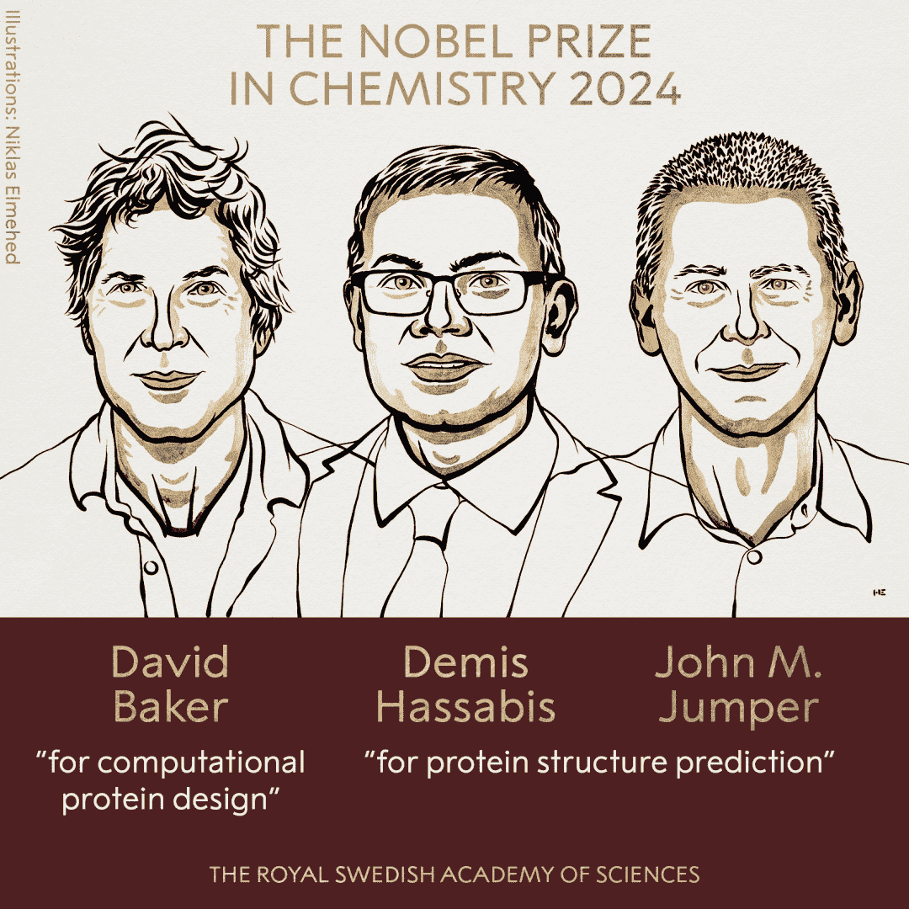
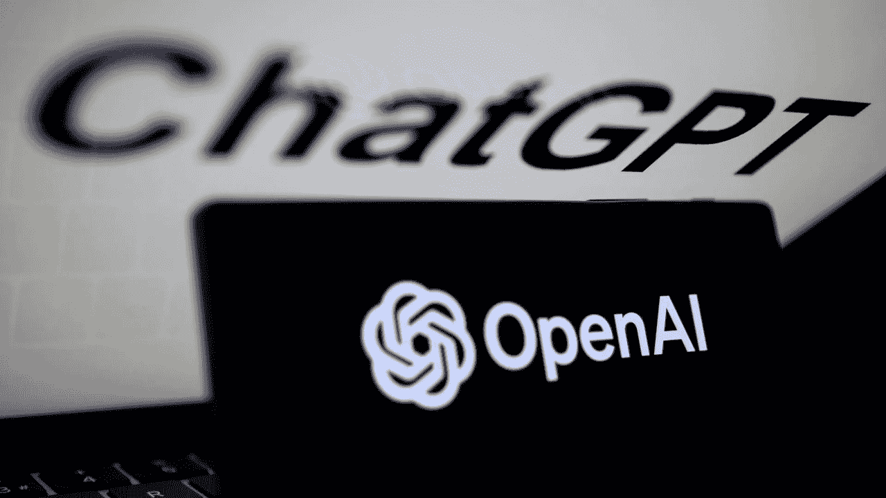
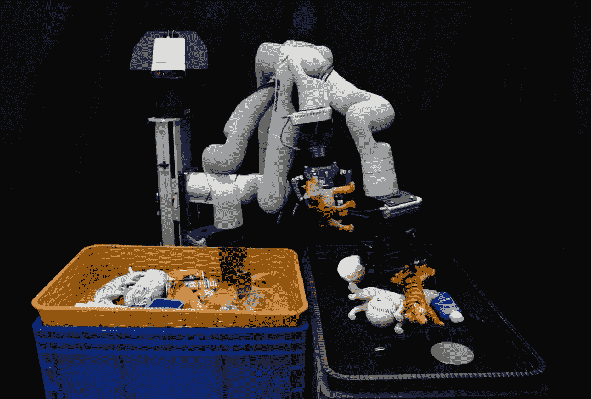
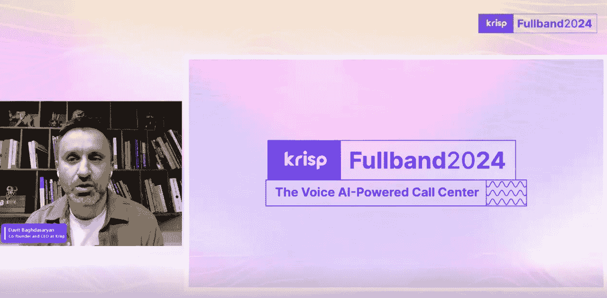
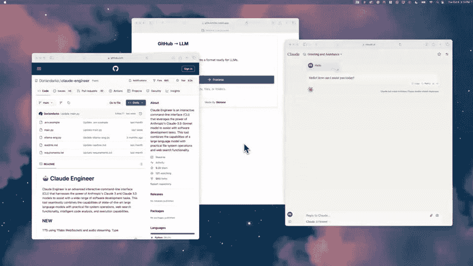

# 奇绩大模型日报（10月 9日）

> 来源：[https://miracleplus.feishu.cn/docx/AZrBd69mDoKABRxzhoCcDkolnGg](https://miracleplus.feishu.cn/docx/AZrBd69mDoKABRxzhoCcDkolnGg)

# 🔉潜空间活动报名

#### 潜空间系列活动重磅回归！

> 本期活动将在**10月13日** **10:00**开始，我们邀请到的嘉宾是朱亦博，他将在潜空间上海场进行分享。阶跃星辰（StepFun）系统负责人，曾任字节跳动 AI 基础设施负责人。朱亦博在大规模数据处理和人工智能算法优化方面有着深厚的背景和丰富的经验。阶跃星辰专注于通用大模型的研发，发布了 Step 系列通用大模型，包括千亿参数的语言大模型和多模态大模型，以及万亿参数的 MoE 语言大模型预览版。他将带来《从模型到集群硬件，关于全栈式 AI Infra 设计与搭建的思考的分享。

> 除嘉宾分享外，每期设置了【匹配合伙人 Cofounder Matching】环节。你可以和 GenAI 时代最有活力的创业者和研究者线下面对面交流，将有机会找到志同道合、有共同创业梦想的小伙伴。

> 报名通道已开启，欢迎扫描下方二维码报名。

#

# 资讯

### David Baker、Alphafold开发者获2024年诺贝尔化学奖！

https://mp.weixin.qq.com/s/mXCRAZLxfRpYRIh4BFuqrA

2024 年诺贝尔化学奖与蛋白质有关，这些生命中巧妙的化学工具。David Baker 成功完成了几乎不可能的任务——构建全新的蛋白质类型。Demis Hassabis 和 John M. Jumper 则开发了一种 AI 模型来解决一个长达 50 年的难题：预测蛋白质的复杂结构。这些发现具有巨大的潜力。

生命的多样性证明了蛋白质作为化学工具的惊人能力。它们控制并驱动所有化学反应，这些化学反应共同构成了生命的基础。蛋白质还作为激素、信号物质、抗体和不同组织的构成单元发挥作用。

“今年被认可的一个发现涉及壮观蛋白质的构建。另一个则是实现了 50 年的梦想：从氨基酸序列预测蛋白质结构。

这两个发现都开启了广阔的可能。”诺贝尔化学委员会主席 Heiner Linke 说。

### **Fei-Fei Li选择Google Cloud**作为World Labs的主要计算提供商

https://techcrunch.com/2024/10/08/fei-fei-li-picks-google-cloud-where-she-led-ai-as-world-labs-main-compute-provider/

在全球云服务市场争相与AI初创企业合作的背景下，Fei-Fei Li领导的World Labs选择Google Cloud作为其主要的计算提供商，用于训练AI模型。尽管Li曾担任Google Cloud的AI首席科学家，双方表示这一合作并非基于其过往关系，而是出于技术考虑。该交易可能价值数亿美元。

在2024年10月的Google Cloud Startup峰会上，World Labs宣布将使用其大部分资金来租赁Google Cloud的GPU服务器，以训练“空间智能”AI模型。这类多模态AI模型需处理视频和地理空间数据，具有高计算需求。World Labs最近获得了由A16Z领投的2.3亿美元融资，估值超过10亿美元。

尽管AI领域的其他公司如OpenAI和Anthropic分别选择了Microsoft Azure和AWS进行合作，World Labs此次选择了Google Cloud的GPU平台。虽然Google提供自研TPU芯片作为替代方案，但由于行业对Nvidia GPU的偏好，World Labs目前仍决定使用GPU。

Google Cloud的高性能工具包和丰富的AI芯片资源成为这次合作的重要因素，尽管双方未透露World Labs GPU集群的具体规模。Google Cloud正尝试吸引更多初创企业使用其TPU，以减少对Nvidia GPU的依赖。

此合作并不具排他性，意味着World Labs仍可能与其他云服务商合作。但Google Cloud目前承载了World Labs的大部分计算任务，并计划维持这一业务。

### OpenAI在新加坡、巴黎和布鲁塞尔开设新办公室推动全球扩张

https://techcrunch.com/2024/10/09/openai-to-open-offices-in-singapore-paris-brussels-to-facilitate-global-expansion/

OpenAI宣布将在纽约、巴黎、布鲁塞尔和新加坡等城市开设新办公室，以推动其全球扩展计划。这次扩展是在该公司完成64亿美元融资、宣布重组计划和高管离职后展开的。除了旧金山、伦敦、都柏林和东京的现有办公室外，OpenAI此次扩张进一步巩固其全球布局。

前Dropbox亚太及拉美业务负责人、Asana前首席营收官Oliver Jay将从新加坡领导公司的国际运营，并负责全球扩张。OpenAI在新加坡的团队已开始组建，计划今年年底前正式启动新加坡办公室。新加坡将作为公司在亚太地区的运营中心，为客户和合作伙伴提供支持。这将是OpenAI在亚洲的第二个办公室，此前已于4月在东京开设了首个办公室。

OpenAI指出，新加坡是全球人均ChatGPT用户量最高的国家之一，自年初以来，新加坡的每周活跃用户数量已翻倍。OpenAI还与AI新加坡达成合作，旨在扩大其AI技术在东南亚地区的应用。AI新加坡是新加坡国家研究基金会于2017年发起的国家级项目，支持本地企业和研究机构在人工智能领域的发展。

OpenAI CEO Sam Altman表示，随着新加坡在技术领域的领导地位日益凸显，人工智能已被视为解决社会难题并促进经济繁荣的关键工具。OpenAI将与新加坡政府和其繁荣的AI生态系统合作，进一步扩展在亚太地区的业务。

### Adobe提议保护艺术家免受AI盗用

https://techcrunch.com/2024/10/08/adobe-proposes-a-way-to-protect-artists-from-ai-ripoffs/

Adobe在数字艺术领域的责任愈发重要，致力于减少AI驱动的深度伪造、虚假信息和内容盗窃。2025年第一季度，Adobe将推出内容真实性网络应用的测试版，允许创作者为其作品申请内容凭证，以证明其所有权。

Adobe的内容凭证系统使用数字指纹、隐形水印和加密签名元数据来保护艺术作品，超越简单的图像元数据修改。隐形水印对像素的改动微乎其微，以至于人眼无法察觉；数字指纹通过在文件中编码ID，即使凭证被移除，文件仍能被识别为原作者的作品。

Adobe内容真实性高级总监安迪·帕森斯表示：“无论图像、视频或音频文件在网络或移动设备上流传到何处，内容凭证始终会与之相伴。”

Adobe拥有3300万付费用户，能够有效触及数字艺术家。即使不是Adobe用户，艺术家也可以使用该应用申请凭证。为了促进内容凭证在互联网上的广泛使用，Adobe共同创立了两个行业组织，会员包括占市场90%的相机制造商及多个大型内容平台。

### GR-2登场！ByteDance Research提出机器人大模型

https://mp.weixin.qq.com/s/h-69PKoCkPtj4_sq9589Tw

GR-2是ByteDance Research开发的第二代机器人大模型，它在预训练阶段通过在3800万个互联网视频片段上进行生成式训练，学习了人类日常生活中的各种动态和行为模式。这种训练方式让GR-2具备了多种操作任务的学习和在多种环境中泛化的能力。

在微调阶段，GR-2通过在机器人轨迹数据上进行微调，能够预测动作轨迹并生成视频。它能够根据输入的图片和语言指令预测未来的视频，并生成相应的动作轨迹。这种视频生成能力不仅提升了动作预测的准确性，也为机器人的智能决策提供了新方向。

GR-2的Scaling Law表现在随着模型规模的增加，其性能显著提升。在7亿参数规模的验证中，GR-2展现出了处理更复杂任务和泛化到未见任务及场景的能力。

在多任务学习测试中，GR-2能够完成105项不同的桌面任务，平均成功率为97.7%。它不仅能处理已知任务，还能适应未知场景和物体，展现出强大的泛化能力。

GR-2还能与大语言模型结合，完成复杂的长任务，并与人类互动。它能处理环境中的干扰，并通过适应变化的环境成功完成任务。在实际应用中，GR-2能够端到端地完成物体拣选任务，无论是透明、反光、柔软物体还是其他挑战性物体，GR-2都能准确抓取。

尽管GR-2在互联网视频上接受了大规模的预训练，但真实世界动作数据的规模和多样性仍然有限，这表明它还有进步的空间。GR-2的故事展示了AI如何推动机器人发展，它不仅是一个机器人大模型，更是一个能够学习和适应各种任务的智能体。

### 第三届年度语音创新大会Fullband 2024

https://voice-ai-newsletter.krisp.ai/p/wrapping-up-fullband-2024

**语音渠道洞察：**

1.  **65%** 的客户互动仍然通过语音进行。

1.  业务端的主要问题是语音渠道的成本远高于其他渠道。

1.  无论使用其他渠道与否，语音渠道能够全面覆盖客户需求，是客户互动的核心渠道。

1.  **80%** 的客户仍然偏好通过语音获得人工支持。

1.  **口音和音质**问题仍然是主要挑战，每年给联络中心带来 55亿美元 的损失。

1.  语音机器人目前能处理多达 **40%** 的简单任务，使座席能够专注于更复杂的交互。

1.  史蒂夫认为，鉴于行业规模及消费者偏好，语音机器人短期内不会完全取代人工座席。

1.  客户面临的最大问题是长时间等待，这严重影响了客户满意度及整体体验，并且情况正在恶化。

1.  语音机器人将被广泛用于初步筛查，从情绪强度、紧迫性和问题复杂性等角度分析问题，并相应分配给合适的座席。

# 推特

### Anthropic更新批处理 API：经济高效的方式，用于异步处理大量查询

贡献人：

https://x.com/AnthropicAI/status/1843695536614060201

介绍消息批处理 API——一种经济高效的方式，用于异步处理大量查询。

您可以一次提交多达 10,000 个查询的批次。每个批次将在 24 小时内处理完毕，且费用比标准 API 调用低 50%。

### 快速工具：将任何形式的 GitHub 链接转换为 LLM 可以读取的格式

贡献人：

https://x.com/skirano/status/1843732806763167912

我需要一个快速工具来将任何形式的 GitHub 链接转换为 LLM 可以读取的格式。

于是我开发了这个工具。

GitHub → LLM

完全免费，支持项目、文件夹或文件 🪄

部署在@Replit

[ssstwitter.com_1728465831834.mp4](https://internal-api-drive-stream.feishu.cn/space/api/box/stream/download/all/Foinbq1U2obyWoxuQfEcBwtPnMv)

### Runway ml支持所有用户使用：输入第一帧和最后一帧，让 Gen-3 Alpha Turbo 生成视频

贡献人：

https://x.com/runwayml/status/1843707595141644617

现在，您可以为 Gen-3 Alpha Turbo 提供首帧和末帧输入。所有用户均可在网页上使用，支持横向和纵向比例。

[ssstwitter.com_1728465994128.mp4](https://internal-api-drive-stream.feishu.cn/space/api/box/stream/download/all/VvbCbfnTAoM3s3xqCnccL8rDnZb)

### Alex Volkov 分享Cursor 小技巧：从快捷指令到模型选用

贡献人：

https://x.com/altryne/status/1843738554352185542

今天我和@weights_biases 的同事们进行了一个“Cursor 小技巧”会议，我想分享一下我们之间‘发现’并讨论的内容：

首先，我们讨论了每个人使用的功能以及如何进行编辑，总结如下：有些同事尝试过 Composer，但还不是很习惯，CMD+K 很有用，但常常缺乏上下文，而聊天侧边栏总体上非常棒。

要点总结：

使用 Command+K 来编辑内联函数

当需要编辑多个文件时使用 Composer

使用聊天功能 (cmd+shift+L) 处理其他所有任务

上下文来源：

有些人不知道你可以在上下文中 @tag 进去的所有内容，所以我们一个一个讲解：

你可以添加特定的文件（和文件夹！），从网页上直接链接，参考当前或之前的 Git 更改，当然，还可以添加（并重新索引！）完整的文档站点。

关于引用文档的建议，有时候 @tag 整个文档站点很有用，但通常情况下，直接链接到你正在处理的特定文档效果更好（个人观察），这样还能为你节省 tokens。

模型：

我们深入讨论了 o1-mini 和 o1-preview，主要围绕是否根据不同任务切换模型。实际上，大多数人确实根据具体的使用场景切换模型，而不仅仅只是使用 sonnet。

更多在原帖中～

### Chunkr AI：从PDF转化成LLM可用结构的开源解决方案

贡献人：

https://x.com/Ishaank1999/status/1843764968556278020

PDF 是撒旦的文件格式。

几乎所有构建 RAG（检索增强生成）的人都必须处理它们——这真是糟透了。

市面上的解决方案要么太慢、太贵，要么不是开源的。

这一切本该更简单。因此我们开源了 http://chunkr.ai。

[ssstwitter.com_1728466328977.mp4](https://internal-api-drive-stream.feishu.cn/space/api/box/stream/download/all/WYzHb5x3fo0yYox7Y0HcGZennic)

# 信号

### Differential Transformer

贡献人：

https://arxiv.org/abs/2410.05258

Transformer往往会将注意力过度分配到不相关的语境中。在这项工作中引入了 Diff Transformer，它可以在消除噪音的同时放大对相关语境的注意力。具体来说，差分注意力机制将注意力分数计算为两个独立的软最大注意力图之间的差值。减法消除了噪音，促进了稀疏注意力模式的出现。语言建模的实验结果表明，Diff Transformer 在扩大模型规模和训练代币的各种设置中都优于 Transformer。更有趣的是，它在实际应用中具有显著的优势，如长语境建模、关键信息检索、幻觉缓解、语境内学习和减少激活异常值等。Diff Transformer 可以减少无关上下文的干扰，从而在问题解答和文本摘要中减轻幻觉。在上下文学习方面，Diff Transformer 不仅提高了准确性，而且对秩变异（被认为是一个长期存在的鲁棒性问题）具有更强的鲁棒性。研究结果表明，Diff Transformer 是一种高效且前景广阔的架构，可推动大型语言模型的发展。

### LongGenBench: Long-context Generation Benchmark

贡献人：

https://arxiv.org/abs/2410.04199

当前的长语境基准主要侧重于基于检索的测试，要求大型语言模型（LLM）在广泛的输入语境中定位特定信息，例如 “大海捞针”（NIAH）基准。长语境生成指的是语言模型生成跨长段落或文档的连贯且语境准确的文本的能力。最近的研究表明，NIAH 和其他基于检索的长语境基准性能很强，但评估长语境生成能力的基准却非常缺乏。为了弥补这一差距并提供全面的评估，我们引入了一个合成基准--LongGenBench，它允许灵活配置自定义的生成上下文长度。LongGenBench 通过重新设计问题格式，要求 LLM 用单一、连贯的长上下文回答问题，从而超越了传统基准。通过使用 LongGenBench 进行广泛评估，我们发现 (1) API 访问模型和开源模型在长文本生成场景中都表现出性能下降，降幅从 1.2% 到 47.1%；(2) 不同系列的 LLMs 表现出不同的性能下降趋势，其中 Gemini-1.5-Flash 模型在 API 访问模型中的性能下降幅度最小，而 Qwen2 系列在开源模型中的 LongGenBench 性能下降幅度最小。

### ScienceAgentBench: Toward Rigorous Assessment of Language Agents for Data-Driven Scientific Discovery

贡献人：

https://arxiv.org/abs/2410.05080

要使代理完全自动化科学发现，它必须能够完成工作流程中的所有基本任务。因此，在大胆宣称端到端自动化之前，我们呼吁对科学工作流中各个任务的代理进行严格评估。为此，我们提出了科学代理平台（ScienceAgentBench），这是一个用于评估数据驱动科学发现的语言代理的新基准。为了确保我们的基准具有科学真实性和现实意义，我们从四个学科的 44 篇同行评议出版物中提取了 102 项任务，并邀请九位主题专家对其进行验证。我们将每个任务的目标输出统一为一个独立的 Python 程序文件，并采用一系列评估指标来检查生成的程序、执行结果和成本。每个任务都要经过标注者和主题专家的多轮人工验证，以确保其标注质量和科学合理性。我们还提出了两种有效的策略来缓解数据污染问题。利用我们的基准，我们评估了五个开放重量级和专有 LLM，每个 LLM 都有三个框架：直接提示、OpenHands 和自我调试。

# 产品

### Eddie AI

贡献人：

https://heyeddie.ai/

Eddie AI 是一款基于人工智能的视频编辑工具，通过文本提示快速生成粗剪，识别关键主题和音频片段，简化编辑流程。用户可以与其互动，调整视频内容并导出为 MP4，或在其他编辑软件中进一步处理，帮助创作者更专注于故事构建和创意实现。

Eddie AI 是一款基于人工智能的视频编辑工具，通过文本提示快速生成粗剪，识别关键主题和音频片段，简化编辑流程。用户可以与其互动，调整视频内容并导出为 MP4，或在其他编辑软件中进一步处理，帮助创作者更专注于故事构建和创意实现。

### Kvistly

贡献人：

https://kvistly.com/

Kvistly 是一个基于人工智能的测验制作工具，它允许用户快速创建自定义测验，并结合实时竞标和动态排行榜，增强参与者的互动和学习体验。

# HuggingFace&Github

### CANVAS

贡献人：

https://worv-ai.github.io/canvas/

CANVAS 是一个结合视觉和语言指令的框架，可以实现常识感知的机器人导航。通过模仿学习，机器人能够从人类的导航行为中学习，以理解和执行抽象指令。配备 COMMAND 数据集，CANVAS 在处理噪声指令时表现优越，成功率显著高于传统系统 ROS NavStack，并在实际应用中展现了良好的从模拟到现实的转移能力。

### ControlFlow

贡献人：

https://github.com/PrefectHQ/ControlFlow

ControlFlow 是一个用于构建智能 AI 工作流的 Python 框架，提供了一个结构化的开发者导向框架，用于定义工作流并将任务委派给大型语言模型（LLMs），同时保持控制和透明性。其主要功能包括创建可观察的离散任务、分配专门的 AI 代理、组合任务以实现复杂行为、提供类型安全的输出、部署特定任务的 AI 代理、调节控制与自主性的平衡、协调多个 AI 代理、以及支持完整的 Prefect 3.0 监控和调试。

# 投融资

### Alpha Design AI完成309万美元Pre-Seed轮融资

贡献人：

https://www.finsmes.com/2024/10/chipagents-raises-3-09m-in-pre-seed-funding.html

总部位于美国圣塔芭芭拉的Alpha Design AI公司成功完成了309万美元的Pre-Seed轮融资。本轮融资由ScOp Venture Capital领投，参与方包括Impact Assets、Amino Capital、半导体行业高管以及天使投资人。

Alpha Design AI开发了名为ChipAgents的AI工具，专为芯片设计和验证工作流程服务。公司计划利用此次融资加速其AI工具的开发和部署，帮助硬件工程师和半导体公司优化芯片设计流程。

ChipAgents由公司创始人兼CEO William Wang和创始顾问John Bowers教授领导，旨在通过生成式AI技术，为芯片设计团队提供自动化辅助工具。ChipAgents能够分析和生成RTL设计规范及代码，自动补全Verilog代码，并自动生成测试平台，从而减少繁琐的手动编码工作。该工具通过实时学习模拟结果，自动验证和调试设计代码，确保测试的全面性和高质量，显著缩短设计验证周期，提升生产力并降低开发成本。

公司官网：https://chipagents.ai/

### Braintrust获得投资，开发AI产品工具

https://a16z.com/announcement/investing-in-braintrust/

Braintrust是一家专注于大语言模型（LLM）产品开发工具的平台，近日获得了投资，进一步推动其工具平台的发展。该平台为基于LLM的产品开发提供了一整套支持，吸引了众多知名公司使用，如Notion、Stripe、Vercel、Airtable、Instacart、Zapier和Coda等。

Braintrust的工具涵盖LLM开发的多个核心功能，包括日志记录、提示模板管理、实时提示服务、代理支持以及工具集成等。特别是在产品开发中，Braintrust支持JavaScript/TypeScript，这使其不仅适用于小型项目，也适合复杂的开发需求。

Braintrust由创始人兼CEO Ankur Goyal领导，他的团队在AI开发平台建设方面经验丰富，曾在Figma和Goyal的前公司Impira参与相关工作。与传统的Python数据科学背景不同，Braintrust团队的系统背景使其在LLM状态管理等复杂问题上表现出色。

投资方表示，Braintrust为产品开发者提供了前所未有的开发体验，是未来AI产品开发的有力工具。

公司官网：https://www.braintrust.dev/

### Unify完成1200万美元A轮融资，专注于“暖外呼”信息

https://techcrunch.com/2024/10/08/unify-an-openai-converge-accelerator-grad-lands-12m-for-warm-outbound-messages/

AI驱动的初创公司Unify成功完成1200万美元的A轮融资，由现有投资者Emergence Capital和Thrive Capital领投，OpenAI Startup Fund、Neo、Abstract、20Sales和AltCap也参与了此次融资。该公司在去年通过了OpenAI的Converge I加速器，并在该计划后获得了近700万美元的种子轮融资，投资者同样包括本次A轮的参与者。

Unify由Austin Hughes和Connor Heggie联合创立，Hughes曾在Ramp负责销售外呼项目，发现传统的冷邮件外呼效果逐渐减弱。由此他产生了利用数据和AI技术，帮助销售团队更好地接触潜在客户的想法。与Heggie合作后，他们开发了AI增强的“暖外呼”信息工具，帮助销售团队更快生成线索并促成交易。

尽管AI销售开发工具（AISDR）市场增长迅速，Unify并不定位为AISDR公司，而是通过整合CRM等数据源，提供个性化的外呼信息。Unify的AI系统通过扫描在线数据源，识别潜在客户及其购买信号，以实现更有效的外呼策略。Unify的客户已包括Justworks和Lattice等公司，其收入已达数百万美元。

公司官网：https://www.unifygtm.com/

### **Distributional完成1900万美元**A轮融资，致力于自动化AI模型和应用测试

https://techcrunch.com/2024/10/08/distributional-raises-19m-to-automate-ai-model-and-app-testing/

AI测试平台Distributional由前英特尔AI软件总经理Scott Clark创立，近日完成了1900万美元的A轮融资，由Two Sigma Ventures领投。其他参与的投资者包括Andreessen Horowitz、Operator Collective、Oregon Venture Fund、Essence VC以及Alumni Ventures。截至目前，这家位于加州伯克利的初创公司已累计融资3000万美元。

Distributional的创始人Clark表示，公司的灵感来源于他在英特尔和Yelp工作时遇到的AI测试难题。该平台通过自动生成统计测试，帮助AI产品团队检测并解决AI模型在生产环境中的风险，从而降低操作失误的可能性。

Clark此前创立的模型实验和管理平台SigOpt在2020年被英特尔收购，之后他在英特尔的AI与超级计算软件部门担任副总裁及总经理。工作期间，Clark意识到AI模型的不可预测性使得监控和观测问题变得尤为棘手，这直接促成了他创办Distributional的想法。

Distributional的解决方案通过自动化测试和数据分布分析，帮助团队在开发周期中持续检测AI行为是否发生变化。该平台支持内部部署和托管计划，并与流行的告警和数据库工具进行集成。通过提供可视化的测试结果和可共享的测试模板，Distributional帮助团队标准化AI应用的测试流程。

随着此轮融资的完成，Distributional计划扩展技术团队，特别是在UI和AI研究工程方面。预计到今年年底，公司员工将增长至35人，并展开首批企业级部署。Clark表示，公司已经处于一个有利位置，能够在未来几年抓住这一巨大的市场机会。

公司官网：https://distributional.com/

### **前亚马逊高管Dave Clark新**供应链项目Auger获1亿美元种子轮融资

https://techcrunch.com/2024/10/08/dave-clark-formerly-of-amazon-and-flexport-just-landed-100m-for-new-supply-chain-venture/

前亚马逊全球消费者部门CEO Dave Clark创立的供应链公司Auger，近日完成了1亿美元的种子轮融资。本轮融资由风险投资公司Oak HC/FT领投，资金将用于开发基于AI的供应链工具。

Clark此前曾在亚马逊和Flexport担任高管职位，期间积累了丰富的供应链管理经验。离开Flexport后，Clark决定创立Auger，致力于通过AI技术帮助依赖供应链的企业获得实时库存管理和运营数据，解决供应链中的信息碎片化和效率低下问题。

Clark表示，尽管企业在供应链技术上投入巨大，但现有的系统往往是各类不兼容技术拼凑的“碎片软件”，无法有效沟通，导致企业不得不依赖Excel等不适用于复杂供应链的工具。Auger将通过整合多种数据源，并利用AI和机器学习技术，提供动态的实时分析，帮助企业优化供应链规划、预测和融资。

目前，全球供应链管理市场需求强劲，物流软件市场预计到2025年将达到465亿美元。Auger面临的竞争对手众多，包括Altana、Everstream和Pando等公司，它们也在开发供应链可视化和管理解决方案。

尽管竞争激烈，Clark认为Auger将凭借独特的技术优势脱颖而出。Oak的合伙人Matt Streisfeld对Clark充满信心，称他是具备重新定义供应链管理软件潜力的“千载难逢的创始人”。

Auger目前尚未公布客户或收入情况，但Clark表示公司将在未来几个月内发布更多产品路线图和发展目标。

# 学习

### 【PyTorch 奇技淫巧】FlexAttetion 基于Triton打造灵活度拉满的Attention

贡献人：

https://mp.weixin.qq.com/s/KJUk-jmwGPrJvVuLQ44DyQ

FlexAttention 是一种新型 PyTorch API，结合了 PyTorch 的灵活性和 FlashAttention 的高效性，允许在几行代码中实现各种注意力变体，并自动生成反向传播。此 API 通过 torch.compile 降级为融合的 FlashAttention 内核，实现与手写内核相媲美的性能。FlexAttention 支持相对位置嵌入、ALiBi 偏置、滑动窗口、因果掩码等多种变体，通过使用 score_mod 和 mask_mod 函数对注意力分数进行修改，并利用掩码中的稀疏性进一步提升性能。

API 的灵活性体现在允许用户根据需要定义新的注意力变体，提供广泛的组合支持，如滑动窗口 + 因果掩码等。尽管这个 API 提供了灵活性，但其性能也毫不妥协，特别是在利用 BlockMask 进行掩码稀疏性优化时，执行时间较标准实现快 2 倍。

FlexAttention 支持常见注意力变体，例如因果掩码、相对位置编码、ALiBi 偏置、Soft-capping、滑动窗口等。通过 mask_mod 和 score_mod，研究人员可以为新的注意力模式提供稀疏性支持，而无需额外的内存或性能开销。

### LLM训练-sft

https://zhuanlan.zhihu.com/p/809229182

**Special Token**：SFT 阶段引入的新语义 token，主要用于标注对话角色（如 user、assistant、system），并通过这些 token 验证模型的训练效果，避免过拟合。

**耗时分析**：SFT 模型生成时间与 token 的数量和 prompt 长度成正相关。特别是首个 token 的生成耗时远大于后续 token，因此 prompt 的简洁性尤为重要。

**与预训练的区别**：SFT 与预训练主要区别在于数据格式，SFT 数据长度可变、引入新 token，并对 eos_token 进行学习。同时，SFT 不注重知识注入，而是专注于任务执行和指令跟随能力。

**幻觉问题**：广义幻觉是指模型生成错误答案，狭义幻觉则是模型 alignment 后丢失了某些知识。狭义幻觉可以通过调参来缓解，但在工业界通常采用外挂方式来处理幻觉问题。

**数据质量与多样性**：SFT 的核心在于数据质量和多样性。数据的用途、形式都需要保证足够的多样性，避免模型在训练过程中过拟合或退化。

**数据生产**：SFT 的数据生成可通过 GPT4 等强大的模型辅助生成，并结合具体任务类型进行调整和优化。在生成过程中，需要注意 prompt 和 answer 的形式多样性以及合理性，避免重复和单一答案。

**数据飞轮**：模型上线后会接触到真实用户的 query，这些用户数据是后续数据生成的重要来源，帮助模型不断优化。

### 不同解码策略对应的vllm采样参数

https://zhuanlan.zhihu.com/p/849793765

在vllm库的解码过程中，不同策略对应不同的采样参数设置，影响着生成结果的多样性与确定性。本文通过代码示例，展示了Greedy Search、Beam Search、Top-K Sampling、Top-P Sampling这几种解码策略在vllm中的使用及对应的采样参数配置。

1.  **Greedy Search**：确定性策略，参数设置temperature=0，无多样性，生成结果一致。

1.  **Beam Search**：参数设置use_beam_search=True，best_of=4，通过搜索多个路径来寻找最优解，但仍是确定性的，生成结果一致。

1.  **Top-K Sampling**：通过截断选取概率最高的前K个词进行采样。top_k=5时，结果多样性较强；top_k=1时，退化为Greedy Search，生成结果确定。

1.  **Top-P Sampling**：累积概率达到top_p的词进行采样，top_p=0.5时多样性较低，top_p=0.9时多样性增强，top_p=1时则对所有词进行采样。

每种策略通过调整SamplingParams类的参数控制生成结果的质量与多样性，开发者可以根据任务需求灵活选择合适的策略和参数设置。

### 从零搭建你的机械狗！具身智能四足机器人开源项目汇总

https://zhuanlan.zhihu.com/p/722202619

1.  **菠萝狗**：这是一个低成本的四足机器人项目，提供了全套的软硬件开源资源。项目包括：

+   Py-Apple Dynamics：控制软件。

+   Py-Apple Controller：控制器。

+   Py-Apple Structure：机械结构设计。

+   **Py-Apple BLDC**：无刷电机驱动的四足机器人。

1.  **OpenDog V3**：这是一个重要的开源四足机器人项目，旨在推动机器人研究和教育。

1.  **CHAMP**：这是一个控制框架，用于开发新型四足机器人和控制算法。

1.  **OpenCat**：由Petoi开发，基于Arduino和树莓派的四足机器人框架。

1.  **UMI on Legs**：结合现实世界演示和模拟训练的控制器框架。

1.  **MIT Cheetah**：麻省理工学院的仿生机器人项目。

1.  RL-MPC-Locomotion：提供仿真和强化学习训练框架，结合了动态预测模型预测控制（MPC）。

1.  **Legged_control**：基于OCS2和ros-control的非线性模型预测控制（NMPC）框架。

1.  **Quad-SDK**：基于ROS的全栈软件框架，专注于敏捷四足运动。

1.  motion_imitation：提供了一个Gym环境，用于训练四足机器人模仿运动。

### 网易伏羲负责人范长杰博士：群体智能引领AI通向物理世界

https://zhuanlan.zhihu.com/p/722286091

1.  AOP（Agent-Oriented-Programming）：

+   面向智能体编程，一种描述智能体任务的领域特定语言（DSL）。

+   基于强化学习中的马尔可夫决策过程（MDP）及相关多智能体系统技术。

+   强调人机协作，旨在通过智能体的学习和进化形成自我增强的闭环系统。

1.  **具身智能与群体智能**：

+   具身智能强调个体与环境的互动。

+   群体智能通过智能体的协作解决复杂问题。

1.  **游戏作为AI技术的试验田**：

+   网易伏羲在《永劫无间》手游中应用AOP技术，实现游戏Copilot功能。

+   集成语音识别、语义理解、人设对话大模型、语音生成、强化学习、模仿学习等技术。

1.  **数字化生产力**：

+   有灵AOP平台是一个数字化、智能化的众包任务平台。

+   通过数字孪生技术、统一建模框架实现具身智能、群体智能及数据智能的整合。

1.  **应用案例**：

+   网易伏羲的AOP技术在游戏、农业、养殖业等行业中得到应用，提高效率和安全性，降低成本。

1.  **未来展望**：

+   网易伏羲计划发布「有灵AOP生态计划」，构建开放、协同的AOP智能体生态体系。

+   邀请开发者与研究者加入AOP技术的发展与应用。

### 从RTL到GDS（七）：布局

https://mp.weixin.qq.com/s/9pCVxsgTSYiojEEMbd578Q

1.  **逻辑综合到网表**：逻辑综合后得到的网表是布局的起点。

1.  **Floorplanning**：确定大模块的大致位置。

1.  **芯片大小**：通常以等效的最小逻辑门数量来衡量。

1.  **Gates与Instances**：Gates是逻辑门，Instances是实际放置的单元。

1.  **Placement目标**：在遵守设计规则的前提下，优化放置位置，减少连线长度和避免时序问题。

1.  **Placement阶段**：

+   Global Placement：快速分配单元到芯片区域。

+   Detailed Placement：为每个单元确定精确位置。

1.  **连线长度**：布局需要为后续布线服务，内部有简化版的router估计工具。

1.  **随机布局**：初始布局方法，随机放置单元后进行优化。

1.  **布线模式**：使用布线模式近似实际布线，如HPWL。

1.  **优化方法**：

+   **随机优化**：通过更换Gate位置来减少线长。

+   **模拟退火算法**：避免局部最优解。

1.  Analytic Placement：基于解析模型的数值求解方法。

1.  **成本函数**：通过数学表达式定义，求导找到最小值。

1.  **二次近似**：用于近似HPWL。

1.  **Clique Model**：处理多于两个点的net。

1.  **递归Partitioning**：层次化的布局方法。

1.  **合法化**：将实例映射到实际的离散位置上。

1.  **实际布局考虑**：除了线长最小化，还需考虑时序优化、阻塞最小化、时钟树和功耗优化。

1.  **时间驱动的布局**：优化关键路径的时序。

1.  **阻塞问题**：由于连线太多太密集导致的问题。

1.  **EDA工具**：如Innovus，提供了人性化的布局工具。

### OpenDriveLab Newsletter (Oct. 2024)

https://zhuanlan.zhihu.com/p/731169314

ECCV 2024会议将于9月29日在意大利米兰举行，团队成员将分享多篇论文，并由李弘扬博士在两个论坛上发表演讲。其中，DriveLM作为首个结合语言模型和自动驾驶的数据集，被选为ECCV 2024的Oral论文。DriveLM旨在通过大语言模型和自然语言数据集，构建安全、精确、可解释的自动驾驶系统。

ELM提出了用于理解长时序和大尺度驾驶场景的具身语言模型，并建立了十个新任务作为自动驾驶场景理解的基准。相关论文和项目主页已提供。

SparseOcc网络从纯相机输入中重建稀疏的三维表示，并预测语义和实例占用栅格。RayIoU评价指标被用作CVPR 2024国际自动驾驶挑战赛的官方评价指标。Lightwheel AI与团队联合推出的LightwheelOcc数据集也被用于占据栅格和运动估计赛道。

李弘扬博士将在MLLMAV和CODA两个论坛上讨论自动驾驶多模态相关内容。

NeurIPS 2024会议上，团队展示了多项亮点工作，包括Vista、CLOVER、BeTop和NAVSIM。Vista是新一代自动驾驶世界模型，具有高度泛化和可控性。CLOVER是一个闭环视觉运动控制框架，能够处理视觉干扰和物体变化。BeTop关注多智能体拓扑表征，推进预测和规划性能。NAVSIM是大规模真实世界自动驾驶规划的基准测试。

# 招聘公告

---

**奇绩创坛****由陆奇博士**于2019年创立，使命是在源头最大化驱动创新。奇绩研究组将研究模型理论、到投研战略分析、市场策划等不同背景的同学聚在一起，搭建GenAI时代独特的跨界人才社群。

## 🚀F**24实习岗位**

##### [行研-学术科研人才交流组实习生](https://miracleplus.feishu.cn/docx/Yn6rdf2iOoY2Rcx8yVNcUBYRnch#part-QkMcdeJmuob9uvxvV3qcLSzHn8g)

##### 行研-GenAI研究岗位-战略分析（偏产品）

##### Web / AI 全栈开发工程师实习生

## **火热开放中🚀**

##### 行研-GenAI研究岗位-前沿学术探索

##### 行研-GenAI研究岗位-战略分析（偏咨询）

##### 创新活动产品运营 （大模型系列活动产品运营）

> **点击**相关岗位可查看对应**岗位需求【JD】；**相关岗位投递请**扫描二维码**

> 欢迎**推荐/自荐**

> 期待在**奇绩创坛**遇见更好的你

---

# 声明

本文档仅供学习交流使用，版权归原作者所有，若涉侵权，请联系Jack Jin 15101136166

##

（欢迎在下方反馈您宝贵的意见！整理不易，觉得有用给AI日报小组点个赞👍吧！）

ChatGPT；Angela；Zijia Liu；Alex；Zeqi Tan；Tiezhen（HuggingFace）；Naixu；Lizhi；Peter；Suoman；Jack

封面生成——右脑科技

如果你有大模型相关的创业想法，欢迎来找我们聊聊～微信：15101136166

> 快邀请你的小伙伴们一起来读大模型日报吧！

> **【日报****知识库****】**这里是近期日报内容的汇总,欢迎大家查阅

> [大模型日报知识库(分享版)](https://miracleplus.feishu.cn/wiki/KapVwXfkriOBiskB0B2cUHxjnTh)

>

> 欢迎大家多多帮我们分享,转发~~

> 如果大家有任何的建议或者吐槽,欢迎随时找我聊天~

