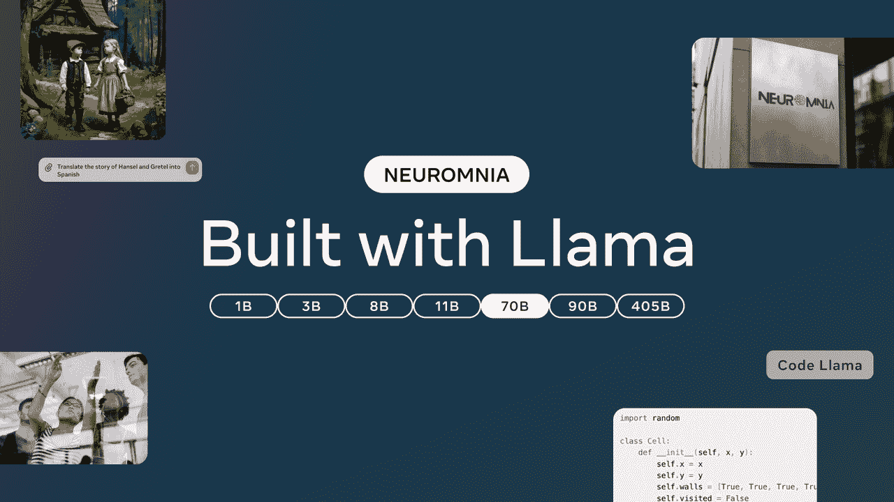
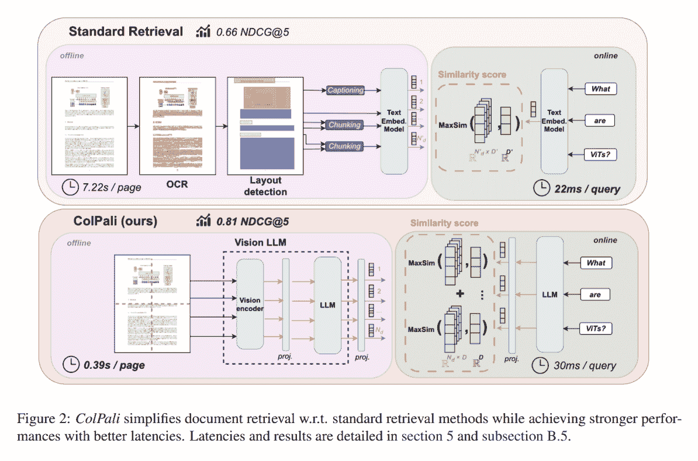
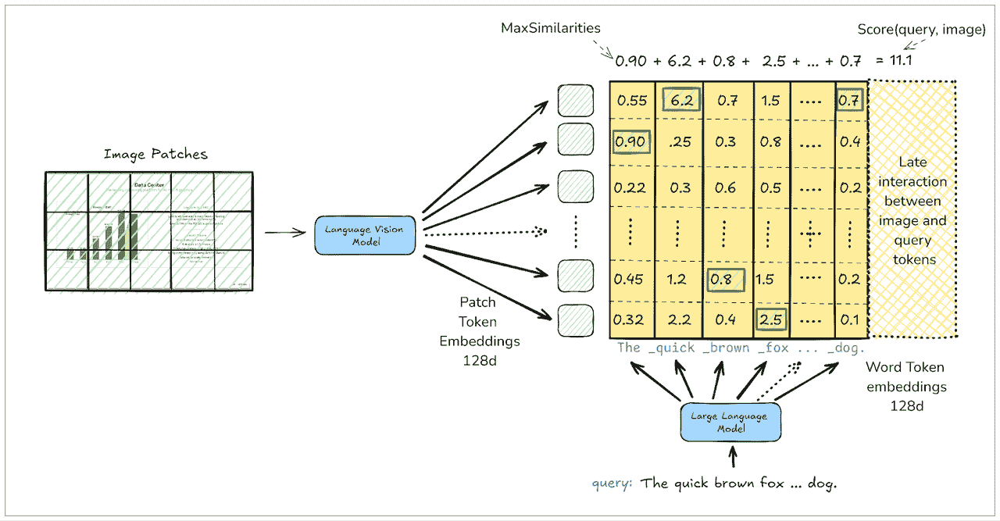
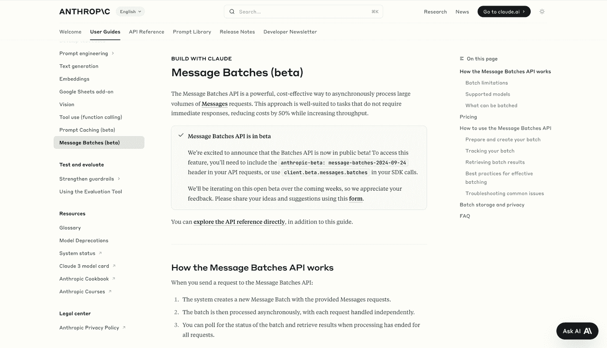
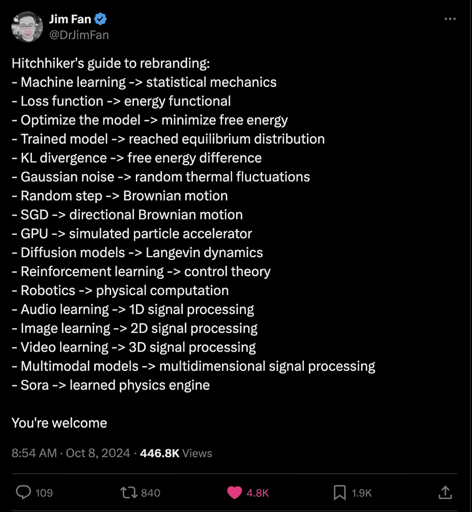
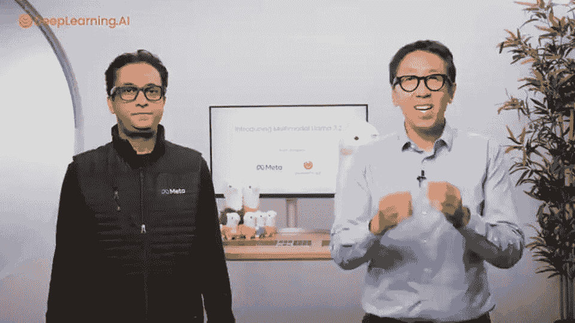
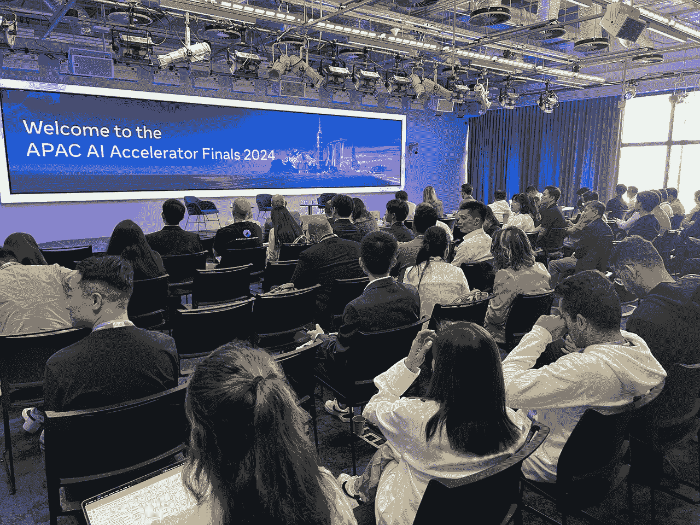
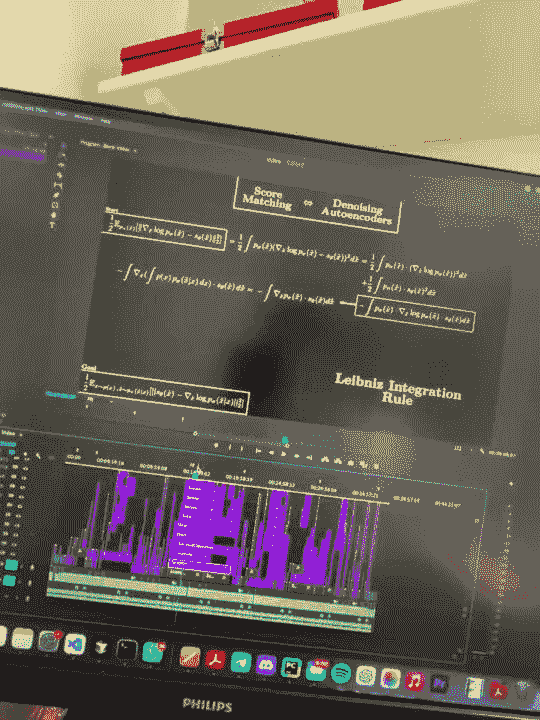

# 奇绩大模型日报（10月 10日）

> 来源：[https://miracleplus.feishu.cn/docx/WR1TdKodronyjfxngnBcgwEpnNd](https://miracleplus.feishu.cn/docx/WR1TdKodronyjfxngnBcgwEpnNd)

## 🔉潜空间活动报名

### 潜空间系列活动重磅回归！

> 本期活动将在**10月13日** **10:00**开始，我们邀请到的嘉宾是朱亦博，他将在潜空间上海场进行分享。阶跃星辰（StepFun）系统负责人，曾任字节跳动 AI 基础设施负责人。朱亦博在大规模数据处理和人工智能算法优化方面有着深厚的背景和丰富的经验。阶跃星辰专注于通用大模型的研发，发布了 Step 系列通用大模型，包括千亿参数的语言大模型和多模态大模型，以及万亿参数的 MoE 语言大模型预览版。他将带来《从模型到集群硬件，关于全栈式 AI Infra 设计与搭建的思考的分享。

> 除嘉宾分享外，每期设置了【匹配合伙人 Cofounder Matching】环节。你可以和 GenAI 时代最有活力的创业者和研究者线下面对面交流，将有机会找到志同道合、有共同创业梦想的小伙伴。

> 报名通道已开启，欢迎扫描下方二维码报名。

## 资讯

### Meta：Neuromnia 如何通过 Llama 3.1 改变 ABA 疗法

https://ai.meta.com/blog/neuromnia-autism-aba-therapy-built-with-llama/?utm_source=twitter&utm_medium=organic_social&utm_content=image&utm_campaign=builtwithllama

Neuromnia是一个创新的人工智能驱动平台，它开创性地解决了自闭症护理中最紧迫的一些挑战。每36名儿童中就有一名患有自闭症，Neuromnia 为临床医生、家长和教师提供了强大的人工智能驱动工具，以提高工作效率、改善治疗质量并增加自闭症患者获得护理的机会。

利用Llama 3.1，Neuromnia 最近开发了 Nia，这是一款以人为本的应用行为分析（ABA）疗法Al 副驾驶员。Nia 提高了临床医生的工作效率并改善了医疗服务，使临床医生能够专注于大规模提供优质医疗服务。

### together.ai：使用 Llama 3.2 Vision 和 ColQwen2 的多模式文档 RAG

https://www.together.ai/blog/multimodal-document-rag-with-llama-3-2-vision-and-colqwen2

为了让人工智能模型有效地完成专业任务，它们通常需要特定领域的知识。例如，金融咨询聊天机器人需要了解市场趋势和特定银行提供的产品，而人工智能法律助理必须具备法规、法规和过去判例法的知识。

一种常见的解决方案是检索增强生成 (RAG)，它从知识库中检索相关数据并将其与用户的提示相结合，从而改进模型的输出。然而，企业知识通常以 PDF、PowerPoint 演示文稿或扫描文档等格式存在，这使得检索和准备相关部分以注入我们可以发送给 LLM 的提示变得很困难。

传统上，解决这个问题的方法是使用管道提取文本，这些管道结合了光学字符识别 (OCR) 来识别扫描文本、语言视觉模型来解释图表和表格等视觉元素，并使用页码和章节号等结构化元数据来增强文本和描述。挑战在于，这个过程因文档的性质和组织的存储格式而异。

在本文中，我们将探索一种名为 ColPali 的新方法，它允许我们直接索引和嵌入文档页面，而无需复杂的提取管道。结合 Llama 3.2 视觉系列等尖端多模态模型，ColPali 使 AI 系统能够推理文档图像，从而实现更灵活、更强大的多模态 RAG 框架。

### Anthropic：新的消息批处理API

https://www.anthropic.com/news/message-batches-api

我们推出了一种新的消息批次API——一种强大且经济高效的异步处理大量查询的方法。

开发人员可以批量发送最多10,000个查询，每个批次的处理时间不到24小时，成本比标准API 调用低50%。这使得处理非时间敏感型任务更加高效且经济高效。

Batches API 现已推出公测版，支持 Anthropic API 上的 Claude 3.5 Sonnet、Claude 3 Opus 和 Claude 3Haiku。在Amazon Bedrock 中使用Claude 的客户可以使用批量推理。Google Cloud 的 Vertex AI 上即将推出对Claude 的批处理支持

## 推特

### Jim Fan：从机器学习到统计力学的奇妙旅程

贡献人：

https://x.com/DrJimFan/status/1843681423443800315

搭车者的重新命名指南：

• 机器学习 -> 统计力学

• 损失函数 -> 能量泛函

• 优化模型 -> 最小化自由能

• 训练好的模型 -> 达到平衡分布

• KL散度 -> 自由能差

• 高斯噪声 -> 随机热波动

• 随机步 -> 布朗运动

• 随机梯度下降（SGD） -> 定向布朗运动

• GPU -> 模拟粒子加速器

• 扩散模型 -> 朗之万动力学

• 强化学习 -> 控制论

• 机器人学 -> 物理计算

• 音频学习 -> 一维信号处理

• 图像学习 -> 二维信号处理

• 视频学习 -> 三维信号处理

• 多模态模型 -> 多维信号处理

• Sora -> 学习的物理引擎

### DeepLearningAI课程：《介绍多模态Llama 3.2》

贡献人：

https://x.com/AndrewYNg/status/1844092080987177409

《介绍多模态Llama 3.2》：如两周前承诺的那样，以下是Meta最新开源模型的简短课程！

这门课程由@Meta制作，并由Meta的AI合作伙伴工程总监@asangani7授课。

Meta的Llama模型家族正在引领开源模型的潮流，任何人都可以下载、定制、微调或在其基础上构建新的应用。

在这门课程中，您将了解Llama 3.2的视觉功能，并将其用于图像分类、提示、分词和工具调用。您还将学习开源的Llama堆栈，它为LLM应用生命周期的各个阶段提供了构建模块。

课程内容包括：

• 了解Meta最新的四款模型的特点，并掌握在不同场景下如何选择合适的Llama模型。

• 学习多模态提示的最佳实践，并通过多个例子展示其在高级图像推理中的应用：例如理解汽车仪表盘上的错误信息、计算拍摄的餐馆账单总额、批改书写的数学作业。

• 掌握如何在Llama 3.1和3.2模型中使用不同的角色——系统、用户、助手、`ipython`，以及区分这些角色的提示格式。

• 理解Llama如何使用`tiktoken`分词器，并如何扩展至128k的词汇量，以提高编码效率和多语言支持。

• 学习如何提示Llama调用内置和自定义工具（函数），通过网络搜索和数学问题求解等例子加以演示。

• 了解Llama Stack，这是一个标准化接口，适用于常见的工具链组件，如微调或合成数据生成，对构建具备代理能力的应用大有裨益。

通过这门课程，您将掌握使用Llama 3.2构建新应用的能力。

请在此注册！ https://deeplearning.ai/short-courses/introducing-multimodal-llama-3-2/

[ssstwitter.com_1728544567969.mp4](https://internal-api-drive-stream.feishu.cn/space/api/box/stream/download/all/UZR8b4D6WoKN66xL4lrc5hqwnuh)

### Alex Reibman 分享：Meta新加坡比赛入围决赛选手

贡献人：

https://x.com/AlexReibman/status/1844091367133458891

Meta邀请了13家使用Llama3的AI初创公司前往新加坡，展示开源AI的影响力。

他们投入了12.5万美元。

以下是@cerebral_valley x @AIatMeta Llama Impact Grant新加坡决赛选手的项目：

1/ Tullibot - 印尼团队 🇮🇩

AI眼镜，自动为聋人转录对话。

使用Llama3进行印尼语翻译。

🥈亚军 - 15,000美元。

2/ Perfingo - 新加坡团队 🇸🇬

基于Llama3的对话式银行应用，服务23,000多名新加坡用户。

3/ traversaal.ai - 巴基斯坦团队 🇵🇰

微调Llama模型，支持非英语语言。

模块化训练系统，生产如UrduLlama和ArabicLlama等专用模型。

### 从零开始讲解扩散模型：基于评分的生成模型解析数学详解

贡献人：

https://x.com/dome_271/status/1844019518005211455

我终于发布了关于扩散模型/基于评分的生成模型的新视频，已经上传到YouTube了！

https://youtube.com/watch?v=B4oHJpEJBAA

这个视频我计划了一整年，投入了很多精力。我觉得这种扩散模型的讲解方式非常直观，强烈推荐大家看看！

视频时长38分钟，所以你可能需要点时间来观看，哈哈。

[ssstwitter.com_1728544816695.mp4](https://internal-api-drive-stream.feishu.cn/space/api/box/stream/download/all/LgvCb6wN0ojFVGxUEllch8u0njb)

### Podcastfy AI：开源的 Python 包，利用生成式 AI (GenAI) 将网页内容、PDF 和文本转化为引人入胜的多语言音频对话

贡献人：

https://x.com/_akhaliq/status/1843830270882898004

Podcastfy AI

Podcastfy 是一个开源的 `Python` 包，利用生成式 AI (GenAI) 将网页内容、PDF 和文本转化为引人入胜的多语言音频对话。

与主要专注于笔记整理或研究汇总的 UI 工具（例如 NotebookLM ❤️）不同，Podcastfy 专注于通过多种文本来源以编程方式定制生成对话式的文字记录和音频，从而实现定制化和规模化。

[ssstwitter.com_1728544929659 (1).mp4](https://internal-api-drive-stream.feishu.cn/space/api/box/stream/download/all/WAYebjYPtocOsGxTiSpc24Rrnge)

## 信号

### Towards World Simulator: Crafting Physical Commonsense-Based Benchmark for Video Generation

贡献人：

原文链接：https://arxiv.org/abs/2410.05363

像 Sora 这样的文本转视频 (T2V) 模型在可视化复杂提示方面取得了重大进展，这越来越被视为构建通用世界模拟器的一条有希望的道路。认知心理学家认为，实现这一目标的基础是理解直觉物理的能力。然而，这些模型准确表示直觉物理的能力在很大程度上仍未得到探索。为了弥补这一差距，我们引入了 `PhyGenBench`，这是一个全面的 \textbf{Phy}sics \textbf{Gen}eration \textbf{Ben} 基准，旨在评估 T2V 生成中的物理常识正确性。`PhyGenBench` 包含 160 个精心设计的提示，涵盖 27 个不同的物理定律，涵盖四个基本领域，可以全面评估模型对物理常识的理解。除了 `PhyGenBench`，我们还提出了一个名为 `PhyGenEval` 的新型评估框架。该框架采用分层评估结构，利用适当的高级视觉语言模型和大型语言模型来评估物理常识。通过 `PhyGenBench` 和 `PhyGenEval`，我们可以对 T2V 模型对物理常识的理解进行大规模自动评估，这与人类反馈密切相关。我们的评估结果和深入分析表明，当前的模型难以生成符合物理常识的视频。此外，简单地扩大模型规模或采用快速工程技术不足以完全解决 `PhyGenBench` 提出的挑战（例如动态场景）。我们希望这项研究能够激励社区优先考虑在这些模型中学习物理常识，而不仅仅是娱乐应用。

### Temporal Reasoning Transfer from Text to Video

贡献人：

原文链接：https://arxiv.org/abs/2410.06166

视频大型语言模型 (Video LLM) 在视频理解方面表现出了良好的能力，但它们在跟踪时间变化和推理时间关系方面却举步维艰。虽然先前的研究将这种限制归因于视觉输入的无效时间编码，但我们的诊断研究表明，视频表示包含足够的信息，即使是小型探测分类器也能实现完美的准确性。令人惊讶的是，我们发现视频 LLM 时间推理能力的关键瓶颈源于底层 LLM 在时间概念方面的固有困难，这从文本时间问答任务的糟糕表现中可以看出。基于这一发现，我们引入了文本时间推理迁移 (`T3`)。`T3` 从现有的图像文本数据集中合成纯文本格式的各种时间推理任务，解决了具有复杂时间场景的视频样本稀缺的问题。值得注意的是，在不使用任何视频数据的情况下，`T3` 增强了 `LongVA-7B` 的时间理解能力，在具有挑战性的 `TempCompass` 基准上将绝对准确率提高了 5.3，这使我们的模型的表现优于在 28,000 个视频样本上训练的 `ShareGPT4Video-8B`。此外，增强后的 `LongVA-7B` 模型在综合视频基准上实现了具有竞争力的性能。例如，它在 `Video-MME` 的时间推理任务上实现了 49.7 的准确率，超越了 `InternVL-Chat-V1.5-20B` 和 `VILA1.5-40B` 等强大的大型模型。进一步的分析揭示了文本和视频时间任务性能之间的强相关性，验证了将时间推理能力从文本转移到视频领域的有效性。

### On The Planning Abilities of OpenAI's o1 Models: Feasibility, Optimality, and Generalizability

贡献人：

原文链接：https://www.arxiv.org/abs/2409.19924

大型语言模型 (LLM) 的最新进展展示了它们执行复杂推理任务的能力，但它们在规划方面的有效性仍未得到充分探索。在本研究中，我们评估了 OpenAI 的 `o1` 模型在各种基准任务中的规划能力，重点关注三个关键方面：可行性、最优性和可推广性。通过对约束密集型任务（例如，`Barman`, `Tyreworld`）和空间复杂的环境（例如，`Termes`, `Floortile`），我们强调了 `o1-preview` 在自我评估和约束遵循方面的优势，同时也确定了决策和内存管理方面的瓶颈，特别是在需要强大空间推理的任务中。我们的结果表明，`o1-preview` 在遵守任务约束和管理结构化环境中的状态转换方面优于 `GPT-4`。然而，该模型通常会生成具有冗余操作的次优解决方案，并且难以在空间复杂的任务中有效地概括。这项初步研究为 LLM 的规划局限性提供了基础性见解，为未来改进基于 LLM 的规划中的内存管理、决策和泛化的研究提供了关键方向。

### TableRAG: Million-Token Table Understanding with Language Models

贡献人：

原文链接：https://arxiv.org/abs/2410.04739

语言模型 (LM) 的最新进展显著增强了它们推理表格数据的能力，主要是通过操纵和分析表格的程序辅助机制。然而，这些方法通常需要整个表作为输入，由于位置偏差或上下文长度限制，导致可扩展性挑战。为了应对这些挑战，我们推出了 `TableRAG`，这是一个专为基于 LM 的表格理解而设计的检索增强生成 (RAG) 框架。`TableRAG` 利用查询扩展与模式和单元格检索相结合来精确定位关键信息，然后再将其提供给 LM。这可以实现更高效的数据编码和精确的检索，从而显着减少提示长度并减少信息丢失。我们从 `Arcade` 和 `BIRD-SQL` 数据集开发了两个新的百万标记基准，以全面评估 `TableRAG` 在规模上的有效性。我们的结果表明，`TableRAG` 的检索设计实现了最高的检索质量，从而在大规模表格理解方面取得了新的最先进的性能。

## 产品

### GodmodeHQ

贡献人：

https://godmodehq.com/

GodmodeHQ 是一个专注于销售的人工智能平台，通过自定义 AI 代理提供个性化的客户研究，替代传统的外展销售方法，提高销售效率和效果。

### Miro

贡献人：

https://miro.com/

Miro 是一个可视化协作平台，可以帮助团队在共享工作空间中进行创意、计划和项目管理。它支持实时协作，提供多种模板和工具，允许用户进行头脑风暴、绘制流程图和项目规划，并能与其他应用程序集成。

# HuggingFace&Github

### UniMuMo

贡献人：

https://hanyangclarence.github.io/unimumo_demo/

UniMuMo 是一种统一的多模态模型，能够处理文本、音乐和动作数据，通过对非配对的音乐和动作数据进行基于节奏模式的对齐，解决了时间同步数据的缺乏。该模型采用统一的编码器-解码器变换器架构，将音乐、动作和文本转换为基于标记的表示，以实现跨模态的生成。通过引入运动与音乐的代码本编码，并采用音乐-动作并行生成方案，UniMuMo 将所有生成任务整合为单一的训练任务，显著降低了计算需求。

### Mistral-NeMo-Minitron-8B-Instruct

贡献人；

https://huggingface.co/nvidia/Mistral-NeMo-Minitron-8B-Instruct/tree/main

英伟达发布的大语言模型可用于生成各种文本生成任务（角色扮演、检索增强生成和函数调用）的响应，支持8K上下文长度。

# 投融资

# 学习

### 大算力芯片与Chiplet

贡献人：

https://zhuanlan.zhihu.com/p/835791948

AMD率先在2019年将Chiplet用于其Ryzen 5000处理器，并通过3D Chiplet技术（3D V-Cache）显著提升性能。其MI300芯片采用了8个GPU芯粒和4个I/O芯粒，总晶体管数高达1530亿，超过英伟达H100。英特尔在其2023年发布的Sapphire Rapids处理器中使用了Chiplet架构，通过EMIB技术互联，提升性能和互连带宽。英伟达的GB200超级芯片也采用Chiplet，集成了两个GPU和一个Grace CPU。

技术上，Chiplet的四大优势包括提高芯片良率、降低制造成本、实现多样化定制、允许不同制造商的芯片混合使用。此外，Chiplet在大算力芯片中尤其具有优势，如CPU、GPU等大芯片领域，可以通过堆叠核心来提升计算能力。

在代工厂方面，台积电和英特尔等厂商从中获得了商机。台积电凭借其先进的制程技术（如3nm、5nm和7nm），在Chiplet时代进一步巩固了市场地位。英特尔则通过其IDM 2.0战略，利用Chiplet技术推动多源代工模式的发展。

尽管当前的Chiplet生态系统尚不完善，且互连标准存在碎片化现象，但诸如UCIe 1.0等标准协议的推出为其发展提供了指导。随着产业链的成熟，Chiplet技术有望在更多领域得到应用。

### RISC-V架构CPU的微架构设计分析

https://zhuanlan.zhihu.com/p/884824550

P870是SiFive公司推出的高端RISC-V处理器，遵循RVA23 profile，采用6解码乱序设计，具备128位向量长度、Hypervisor扩展、向量加密、IOMMU/AIA等特性。该处理器的流水线较深，考验预测器性能，尤其在分支预测方面较ARM N2有所不足。P870配备64KB指令缓存（ICache）和16K的TAGE预测器，以提升处理效率。虽然在单周期处理分支数上略逊于ARM N2，但P870在解码宽度上达到6个，与ARM V2架构一致。

执行单元方面，P870配备了96个整数寄存器、4个ALU和1个分支执行单元，显示出其多周期处理特性。负载存储单元（LSU）配置64KB数据缓存和48个加载/存储缓冲区，确保数据传输的高效性。总体上，P870在参数上与ARM N2接近，但在预测器设计等细节上仍存在一定差距。

Veyron V1是一款专为服务器和汽车等高端应用设计的RISC-V处理器，具备IOMMU/AIA、Hypervisor扩展等高端特性，并支持48VA-52PA地址空间。其流水线深度较大，设计独特。其微架构设计包括64KB的Dcache采用VIVT结构，并配备了512KB的L1/L2指令缓存。与P870不同，Veyron V1将指令和数据缓存分离处理，优化了延迟和功耗。

### 从芯片公司的角度对LLM推理框架的一些思考

https://zhuanlan.zhihu.com/p/730537639

在过去的半年中，LLM推理框架经历了快速演进，AI芯片公司面临新的技术挑战。传统的推理场景，如使用TensorRT，是较为成熟的交付界面，能够很好地在硬件层与用户需求之间架设桥梁。然而，进入LLM推理时代后，AI芯片公司在推理框架层面的优势不再明显。由于LLM推理框架已经深度耦合业务细节，用户对迁移到新框架的抵触心理较强，除非芯片公司在硬件层面有明显优势，否则难以说服用户更换框架。

一些关键技术取舍影响了推理框架的设计，包括prefill与decode的SLO取舍、SLO与成本的平衡、资源管理的灵活性、prefix caching的激进程度、长序列支持及量化优化等。这些因素使得在不知道用户具体需求的前提下，国产芯片公司很难打造出超越现有框架的替代品。

应对这些挑战的可能路径包括：第一，走开源或半开源路线，但这需要强大的影响力；第二，向标准化服务层接口转移，甚至自建云服务以直接获得用户反馈并优化产品；第三，将交付界面下移到算子层。这一策略在LLM推理中尤为可行，尤其是针对清晰的算子需求。不过，框架与算子的分界尚不明确，仍需进一步的抽象和优化，如算子融合、私有格式处理以及Device与Host通信协同等问题。

长远来看，算子层可能是芯片公司应对LLM推理的最优交付界面，但这需要进一步的技术迭代和行业推动。

### Go2 机器狗运控数据的可视化，并附源代码

https://zhuanlan.zhihu.com/p/894331701

本文介绍了如何通过数据可视化技术，更直观地展示宇树机器狗 Go2 的运动状态数据。Go2 提供了 C++ 和 Python SDK，开发者可以通过 SDK 实时获取机器狗的底层和高层运动状态数据。

底层数据包括 12 个关节的角度、加速度、电池状态、IMU 传感器数据等，开发者可直接控制各关节的电机运动。高层运动状态数据则封装了常用的机器狗动作，如站立、行走、跳跃等，通过 `SportModeState_` 模式激活高层控制。

开发者通过 `Matplotlib` 可视化工具包实现了运动状态数据的图形化展示。具体实现了以下功能：

1. **底层与高层运动数据的获取与传输**：通过 `go2_motion.py` 程序从机器狗中实时获取运动数据，传输至服务器端的 `go2_supervisor.py`，后者使用 `Matplotlib` 将数据展示为加速度和速度的散点图。

2. **系统部署与连接方式**：系统支持有线和无线两种连接方式。根据不同的连接方式，`go2_motion.py` 可部署在机器狗或电脑上，数据通过 Wi-Fi 或网线传输，展示端则始终在电脑上运行。

3. **数据可视化设计**：在可视化界面中，左侧展示机器狗在三个轴向的加速度数据，右侧展示速度数据，分别对应 IMU 数据和高层运控数据。

此可视化工具能够帮助开发者通过数据图形化，直观地分析数据的分布、正常取值范围、速度与位置的关系等。此外，该工具未来还计划通过网页控件进一步提升数据展示的灵活性。

### 扩散模型去伪求真，Straightness Is Not Your Need？！

https://zhuanlan.zhihu.com/p/884824542

早在2021年，Variational Diffusion Models就提出了一个通用的扩散模型框架，统一了多种扩散模型的表达形式。基于这一框架，像DDPM、VE等扩散模型都可以看作是特定形式的实现。DDPM采用variance preserving (VP)形式，VE用于variance exploding (VE)模型，且两者通过不同的噪声处理实现不同的生成策略。

Flow-matching也是该通用框架的一种特例。只需设定特定的噪声调度和时间采样方案，它的数学形式看似简单，但本质上与VP、VE等形式无根本性不同。模型效果的差异更多源于超参数的选择和优化策略。比如，时间采样和噪声权重等超参数的设置对模型效果影响显著，而这些细节常常会导致不同扩散形式在性能上产生差异。

许多人误解了flow-matching模型采样轨迹的“直线性”。虽然每一步去噪操作（denoise step）可以近似为一条小直线，但这些直线段的方向并不相同，整体采样轨迹实际上是曲线。具体来说，flow-matching在每一时刻的噪声状态是随机的，模型的去噪过程逐步逼近目标分布。因此，尽管局部看似直线，但全局轨迹仍然呈现为曲线或由多条折线组成。

为了更形象地说明这一点，文章通过图示展示了红色点表示的采样轨迹，每个点代表模型去噪一步的结果，虽然单步看似直线，但总体是由多个方向不同的小步线构成的曲线。

Rectified flow的核心创新是“Rectification”操作。这个过程通过重新训练模型，使得采样轨迹逐步变直。Rectified flow提出的三大核心概念包括：

1. **Flow-matching**：这是rectified flow中提出的扩散形式，其噪声状态通过简单的线性组合来定义，与DDPM的semi-linear形式相比更为简洁。

2. **Prediction类型**：Rectified flow采用 ϵ-prediction，直接预测噪声。这种方式简化了去噪过程，同时避免了数值不稳定问题，尤其是在极端噪声条件下。

3. **Rectification**：这是rectified flow的关键技术，通过渐进式重新训练来提高生成质量。具体而言，它将真实数据和噪声之间的随机耦合，替换为生成数据和噪声的确定性耦合，逐步修正采样路径，使其趋于直线。该操作使得单步采样成为可能，大大提高了生成效率。

Rectified flow与传统的扩散模型（如VP、VE）相比，区别在于其特别强调轨迹的修正。其他扩散模型并不能直接应用rectification操作实现采样加速，因为这些模型的轨迹设计没有专门针对直线化做优化。因此，rectified flow需要专门设计的扩散形式，如flow-matching，才能有效使用rectification技术。

以InstaFlow为例，研究者将Stable Diffusion的权重转换为flow-matching的形式并应用ϵ-prediction，然后通过rectification进行重新训练，从而实现加速。这也证明了rectified flow的优势在于它能够针对特定任务（如文生图）显著减少采样步骤，同时保持高生成质量。

Rectified diffusion本质上通过噪声样本对的重训练来实现加速采样。它通过与标准flow-matching不同的训练方式，将噪声与样本对的随机配对替换为确定性配对，使采样路径更加平滑，并提升模型的生成效率。

在这种训练方式下，模型的轨迹逐步一阶化，意味着模型的轨迹趋于直线。这种一阶化的过程是通过预定义的噪声采样和数据对耦合来实现的，从而保证采样路径的稳定性。即使轨迹本质上是弯曲的，通过特定的转换，所有的一阶轨迹都可以被解释为直线，从而实现加速生成。

本文通过大量实验验证了rectified diffusion的性能，结果表明，该方法不仅在生成质量上优于现有的rectified flow方法，还在采样速度上取得了与最先进的蒸馏加速算法相当的结果。特别是在Stable Diffusion上的实验中，rectified diffusion仅使用了rectified flow 8%的训练数据便达到了接近一步生成的效果，充分展示了该方法的效率。

### 时间的本质

https://zhuanlan.zhihu.com/p/895454739

在Stephen Wolfram的最新文章中，他探讨了时间的本质，提出了一个核心观点：时间并非独立的维度，而是宇宙通过持续计算演化的过程。Wolfram将宇宙比作一台巨大的计算机，时间就是它不断从一个状态计算到下一个状态的体现。不同于传统物理学将时间视为类似空间的维度，Wolfram认为时间是宇宙进行计算的过程。我们对时间的感知源于我们对宇宙计算进程的观察，而这一过程本身是不可简化的。

技术细节方面，Wolfram引入了几个关键概念。首先是“计算不可约性”，即许多计算过程无法跳过步骤，必须逐步进行，这意味着未来只能通过计算一步步揭示。其次是“计算等价性原理”，即不同的系统尽管遵循不同的规则，但其计算能力相等，这表明时间的流逝是计算效应的积累。Wolfram还提到了“Ruliad”，一个包含所有可能计算规则的抽象空间，宇宙的物理定律是我们对Ruliad的有限采样的结果。

此外，Wolfram指出，我们对时间的单线性感知是由于我们作为观察者的局限性，实际宇宙可能像多线程程序一样演化，包含多个并行的历史路径，但我们只能感知到其中一个线程。这种多线程演化解释了量子力学中的许多现象，并暗示了时间不仅仅是简单的线性流逝，而是复杂的计算进程。

推特链接：https://x.com/stephen_wolfram

### 秋招面试被锤大赏

https://zhuanlan.zhihu.com/p/717917077

1. **Triton编程优化**：

   + 作者在Kernel优化中采用了“两步走”策略：首先进行浅层优化（算子替换、合并kernel等），然后进行深层优化（分析IR，使用性能分析工具如`perf`）。如果浅层优化接近算子库性能，深层优化通过观察访存行为及汇编代码进一步调整。

   + Triton的执行流程包括从Triton-lang到Triton GPU方言，再到LLVM IR，最后生成PTX代码。在Triton中，layout用于描述tensor的访问方式，如block layout、mma layout等，以实现memory coalesce。

2. **MLIR Codegen优化**：

   + MLIR更适合处理访存密集型任务，尤其是在硬件层次进行软件流水优化。通过MLIR，访存延迟可以被掩盖，优化不同存储空间间的数据流。

   + `Tensor`和`Memref`的设计理念不同，`Tensor`具有单次赋值特性，适合高级运算描述，而`Memref`则是可变的，便于在硬件层次进行优化。作者也探讨了`Linalg` dialect的作用，其通过一系列优化贴近硬件，帮助实现更高效的计算。

3. **推理中的常见优化技术**：

   + KV Cache、MQA、GQA等技术通过减少计算或访存需求来提高推理速度。Flash-attention和Page-attention分别适用于prefill和decode阶段，前者处理计算密集型任务，后者应对访存瓶颈。

   + 动态批处理技术调整任务触发时机和大小，平衡低延迟与高吞吐。

4. **面试经验与总结**：

   + 作者分享了在秋招过程中对SIMD和SIMT硬件优化的理解，指出SIMD更注重访存连续性，而SIMT更关注吞吐量优化，如memory-coalesce和layout-swizzling。

   + 对MLIR中的拓扑排序、算子融合和流水展开等技术问题也进行了深入分析。

文章最后，作者鼓励大家在秋招中继续学习和探索，借鉴经验应对技术面试中的复杂问题。

# 招聘公告

---

**奇绩创坛****由陆奇博士**于2019年创立，使命是在源头最大化驱动创新。奇绩研究组将研究模型理论、到投研战略分析、市场策划等不同背景的同学聚在一起，搭建GenAI时代独特的跨界人才社群。

## 🚀F24实习岗位

##### [行研-学术科研人才交流组实习生](https://miracleplus.feishu.cn/docx/Yn6rdf2iOoY2Rcx8yVNcUBYRnch#part-QkMcdeJmuob9uvxvV3qcLSzHn8g)

##### 行研-GenAI研究岗位-战略分析（偏产品）

##### Web / AI 全栈开发工程师实习生

## 火热开放中🚀

##### 行研-GenAI研究岗位-前沿学术探索

##### 行研-GenAI研究岗位-战略分析（偏咨询）

##### 创新活动产品运营 （大模型系列活动产品运营）

> **点击**相关岗位可查看对应**岗位需求【JD】；**相关岗位投递请**扫描二维码**

> 欢迎**推荐/自荐**

> 期待在**奇绩创坛**遇见更好的你

---

# 声明

本文档仅供学习交流使用，版权归原作者所有，若涉侵权，请联系Jack Jin 15101136166

（欢迎在下方反馈您宝贵的意见！整理不易，觉得有用给AI日报小组点个赞👍吧！）

ChatGPT；Angela；Zijia Liu；Alex；Zeqi Tan；Tiezhen（HuggingFace）；Naixu；Lizhi；Peter；Suoman；Jack

封面生成——右脑科技

如果你有大模型相关的创业想法，欢迎来找我们聊聊～🛰️：15101136166

> 快邀请你的小伙伴们一起来读大模型日报吧！

> **【日报知识库】**这里是近期日报内容的汇总,欢迎大家查阅

> [大模型日报知识库(分享版)](https://miracleplus.feishu.cn/wiki/KapVwXfkriOBiskB0B2cUHxjnTh)

>

> 欢迎大家多多帮我们分享,转发~~

> 如果大家有任何的建议或者吐槽,欢迎随时找我聊天~

