# 奇绩大模型日报（8月5日）

> 来源：[https://miracleplus.feishu.cn/docx/WiCLdcTfYoazPcxTSEDcmV5PnOe](https://miracleplus.feishu.cn/docx/WiCLdcTfYoazPcxTSEDcmV5PnOe)

# 📡潜空间活动预告

> **潜空间系列活动第三季全面升级！**

> 第三季第二期将在**8月11日** **11:00 am**开始，嘉宾是**陈贝迪**。她将为我们带来关于 Efficient Long-context Generation 的分享。

> 活动包括嘉宾分享、访谈Q&A、cofounder matching餐会。活动现场还可以体验到奇绩校友的最新产品，期待大家大力支持！

> 陈贝迪-卡内基梅隆大学助理教授，斯坦福大学人工智能博士后学者，前 Meta AI 研究科学家；致力于在现代硬件上设计和优化算法和模型，以加速大型机器学习系统。

> 欢迎扫描报名~~

# 资讯

### ResNet作者张祥雨，投身AI大模型

贡献人：

https://mp.weixin.qq.com/s/AlFK2Qag9wA1mvGWINLpzw

张祥雨，作为 ResNet 的四位作者之一，是一位在 AI 领域内享有盛誉的后生代表。他在西安交通大学学习并获得了软件工程学士学位，后在微软亚洲研究院与孙剑和何恺明共同开发了 ResNet，并因此获得了未来科学大奖的 “数学与计算机科学奖”。ResNet 的研究对深度学习领域产生了深远的影响，被广泛应用于包括 AlphaGo Zero 和 ChatGPT 在内的多个 AI 热门项目中。张祥雨除了在 ResNet 上的工作，还在移动端高效卷积神经网络 ShuffleNet 上有突出贡献，并多次获得 AI 领域的重要奖项和认可。

阶跃星辰是国产大模型领域的六大创企之一，已经在投融资市场中获得了高达 20 亿美元的估值。该公司不仅拥有颇受认可的市场地位，还拥有一支由顶尖 AI 人才组成的团队，包括张祥雨、俞刚和段楠等。这些人才的加入，使得阶跃星辰在 AI 大模型的研发和产品开发方面拥有了强大的技术实力和市场竞争力。

### 英伟达B200A曝光：内存带宽减半

贡献人：

https://mp.weixin.qq.com/s/2_G3C1bxT61bIANtxdqpzw

英伟达因台积电的新封装工艺 CoWoS-L 产能不足，被迫推迟发布 B200 芯片，并推出阉割版 B200A 以应对市场需求。B200A 的内存带宽从 8TB/s 降至 4TB/s，封装工艺退回至 CoWoS-S。Blackwell 架构的 B200 虽算力强劲，但耗电和其他技术挑战如供电、散热等也随之增加。AI 巨头在使用 H100 等芯片训练大模型时遇到高故障率问题，表明新技术的实际应用仍需解决诸多实际问题。英伟达官方表示 Hopper 需求强劲，产量有望增加，而摩根士丹利预测生产暂停约两周。

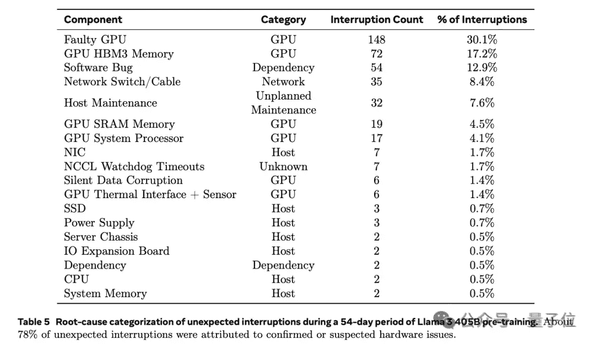

### Figure02新品视频解析：从硬件到AI，畅想人形机器人的技术能力与场景应用展望

贡献人：

https://mp.weixin.qq.com/s/QkHObVCww_OHRD38yx9QhA

Figure02 是人形机器人研究院即将发布的新型人形机器人，预计将在 8 月 6 日正式亮相。该机器人在硬件上进行了显著升级，包括关节执行器的扭矩和活动角度的提升，特别是下肢关节执行器的扭矩达到了 150Nm。新增的蜂窝状缓冲组织复合材料有助于提升运动缓冲和散热性能。灵巧手的设计增强了触觉感知能力，手指的灵活性更贴近人类。模块化设计使得关节模组的快速拆装更换变得简便。在外观设计上，Figure02 更加符合消费市场的审美，预示着机器人技术将进入家庭和日常生活的应用。

在技术原理上，Figure02 预计将集成 OpenAI 的 GPT-4o 多模态大模型，这将提升机器人的常识推理和人机交互能力。同时，机器人的运动控制将采用类似 RT-1、RT-2 或 RT-X 的控制模型，确保了动作执行的安全性和平衡性。

与特斯拉的 Optimus 和波士顿动力的 Atlas 相比，Figure02 在多模态推理和任务执行方面表现出色，特别适合于工业制造和仓库物流等场景。Optimus 专注于生产线上的应用，而 Atlas 则以其高度的机动性和灵巧度著称。

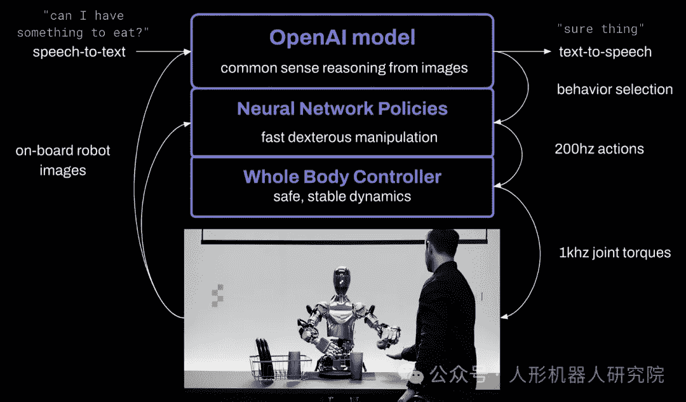

### 京东大模型应用实战：从供应链到全行业的AI革命

贡献人：

https://mp.weixin.qq.com/s/EFckRjvDlIjWk0b4ZogWoA

京东利用自身丰富的供应链场景和数据，将大模型技术应用于电商、物流、健康、科技等领域，推出了包括言犀数字人 3.0 平台、智能编程助手 JoyCoder、言犀智能体平台等多款 AI 产品。这些产品在实际场景中得到了广泛应用，例如言犀数字人在直播电商中的成功案例，以及在医疗、物流、营销等领域的多样化应用。京东云大模型的落地实践体现在内部超过 100 个 AI 场景的全面铺开，并为超过 35 万京东自有配送员、超过 23 万商家、超过 5 万副主任级别以上医生等提供了支持。京东云的言犀智能体平台和 AI 开发计算平台 2.0 等技术支撑了这些应用的实现，并且正在将这些内部实践向外部市场推广。

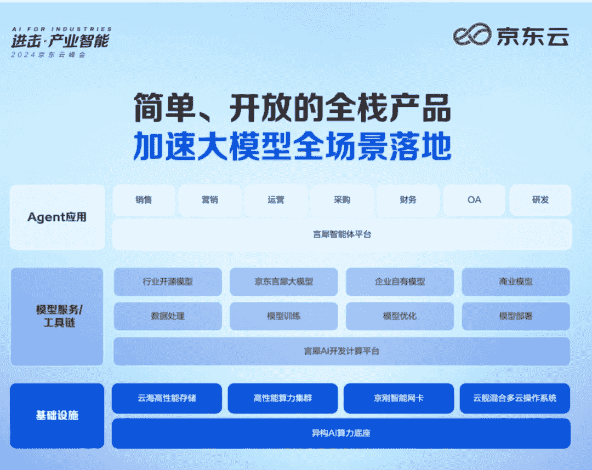

# 推特

### Openperplex宣布开源：由 AI 驱动的搜索引擎

https://x.com/KhazzanYassine/status/1819787693330399344

很高兴宣布 http://openperplex.com 的开源发布，这是一款由 AI 驱动的搜索引擎！

技术栈：

推理：@GroqInc

内容分块：@cohere + semantic-chunkers

LLM：@Meta LLama 3 70B

重排序：@JinaAI_

搜索：@Serperapi

后端：@FastAPI

前端：@vuejs

GitHub 仓库：

后端：https://github.com/YassKhazzan/openperplex_backend_os.git

前端：https://github.com/YassKhazzan/openperplex_front.git

快来试试吧！！#OpenSource #AI #SearchEngine

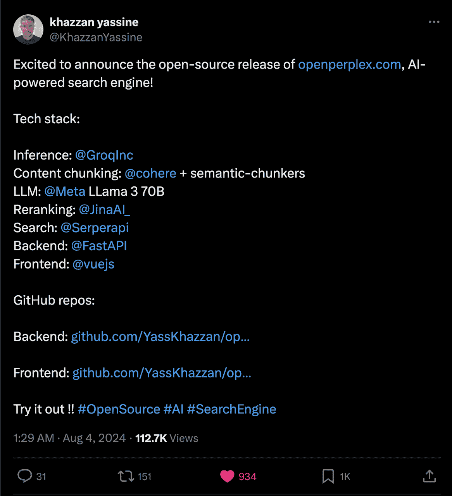

### Karpathy大赞FarmBot：有点像食物界的太阳能电池板

https://x.com/karpathy/status/1820167525575115045

太酷了！https://farm.bot (@farmbotio) FarmBot 有点像食物界的太阳能电池板。我喜欢这个想法，自动化可以帮助我们重新掌控食品生产，并将其从农场搬回自己的后院。（另外 - 这也像是食物版的《异星工厂》！）

https://youtube.com/watch?v=qwSbWy_1f8w

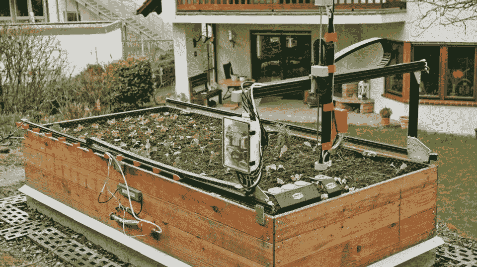

### Burkov解释为什么GPT产生荒谬错误答案：第二个词的生成依赖于第一个词

https://x.com/burkov/status/1819936613100671041

了解LLMs（大语言模型）逐个生成答案的机制非常重要，因为第二个词的生成依赖于第一个词。这个特点解释了为什么LLMs在尝试解释无法解释的事物时会生成荒谬的答案。

以下截图完美地展示了这个问题。用户询问一个数字是否为素数。LLM生成的第一个词是"No"（否）。一旦生成了这个词，模型就无法回头，只能继续生成逻辑上符合这个错误答案的解释，而这几乎是不可能的。生成错误第一个词的几率永远不为零，因此这种情况是不可避免的。

如果你理解LLMs的工作原理，这并没有什么可笑的。

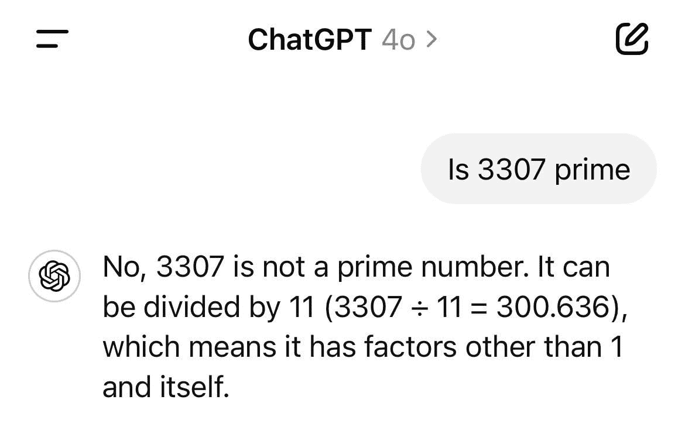

### Raschka分享：从头开始编写直接偏好优化，与用户偏好更紧密对齐

https://x.com/rasbt/status/1820096879440662972

直接偏好优化（DPO）已经成为将大型语言模型（LLMs）与用户偏好更紧密对齐的首选方法之一。

[如果你想了解它是如何工作的，我从头开始编写了代码：https://github.com/rasbt/](https://github.com/rasbt/LLMs-from-scratch/blob/main/ch07/04_preference-tuning-with-dpo/dpo-from-scratch.ipynb)LLMs-from-scratch/blob/main/ch07/04_preference-tuning-with-dpo/dpo-from-scratch.ipynb

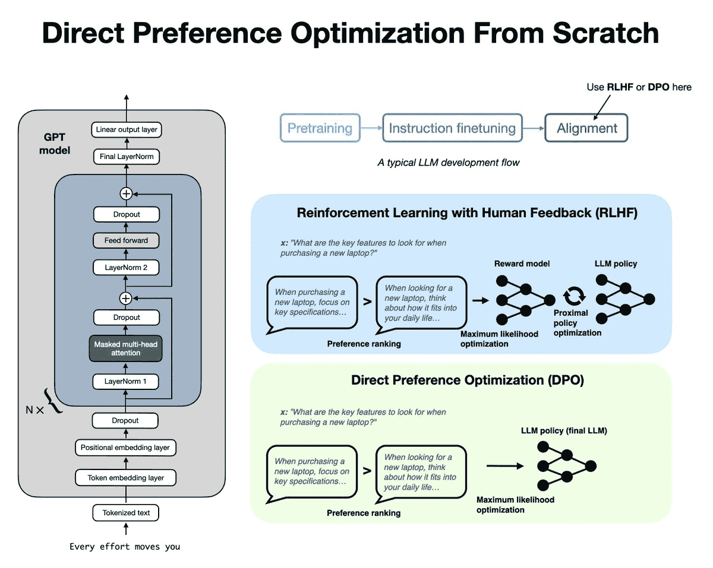

# 论文

### 循环搜索：LLM自动提示中具有自适应增长的活体框架

贡献人：

链接：http://arxiv.org/abs/2408.01423v1

大语言模型（LLMs）在自然语言处理（NLP）领域展示出卓越的能力，可以解决多样的任务，各种提示设计策略显著增强了它们的能力。然而，这些提示虽然有益，但每个都具有固有的局限性。主要的提示设计方法有两种：一种由“思维链”（CoT）所展示，涉及手工制作适用于单个数据集的提示，因此被称为专家设计的提示（EDPs）。一旦建立了这些提示，它们就无法更改，其有效性受到人类设计者专业知识的限制。应用于LLMs时，EDPs的静态性导致了对同一数据集中的简单和复杂问题采用统一方法，导致对简单问题使用token的效率低下。第二种方法涉及LLM自动生成的提示，称为LLM派生的提示（LDPs），为特定问题提供量身定制的解决方案，减轻了EDPs的限制。然而，在解决方案规划过程中，LDPs在处理复杂问题时可能会遇到性能下降，因为存在错误累积的可能性。为了解决这些挑战，我们构想了一个新颖的Prompt Recursive Search（PRS）框架，利用LLM生成特定于问题的解决方案，从而节省token。该框架结合了问题复杂性的评估和可调整结构，确保错误几率降低。通过在不同领域的各种数据集上使用具有不同参数数量的LLMs进行广泛实验，我们证实了PRS框架的有效性。与CoT方法相比，PRS方法使用Llama3-7B模型在BBH数据集上将准确率提高了8%，实现了22%的改进。

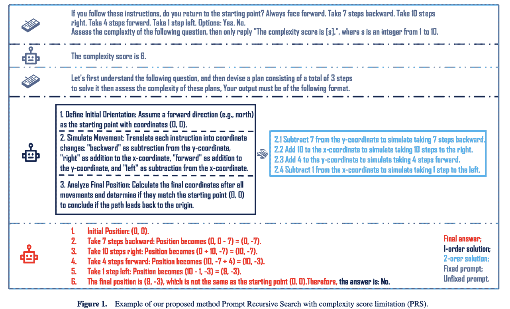

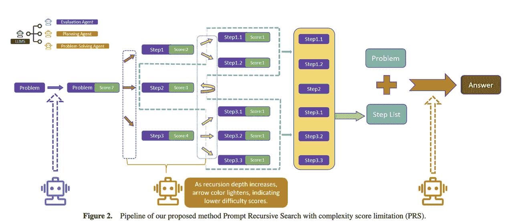

### ArchCode: 在代码生成中融入软件要求与大语言模型

贡献人：

链接：http://arxiv.org/abs/2408.00994v1

本文旨在将大型语言模型（LLMs）的代码生成能力扩展到自动管理来自给定文本描述的全面软件要求。这些要求既包括功能性要求（即实现输入的预期行为），还包括非功能性要求（例如时间/空间性能、鲁棒性、可维护性）。我们介绍了ARCHCODE，这是一个新颖的框架，利用上下文学习来整理描述中观察到的要求，并从中推断出未表达的要求。ARCHCODE从给定描述中生成要求，对它们进行条件处理以生成代码片段和测试用例。每个测试用例都针对一个要求量身定制，可以根据执行结果与要求的符合度对代码片段进行排名。公共基准显示，ARCHCODE增强了满足功能性要求，显著改善了Pass@k分数。此外，我们介绍了HumanEval-NFR，这是LLMs在代码生成中首次评估非功能性要求，展示了ARCHCODE优于基准方法。ARCHCODE的实施和HumanEval-NFR基准均可以公开访问。

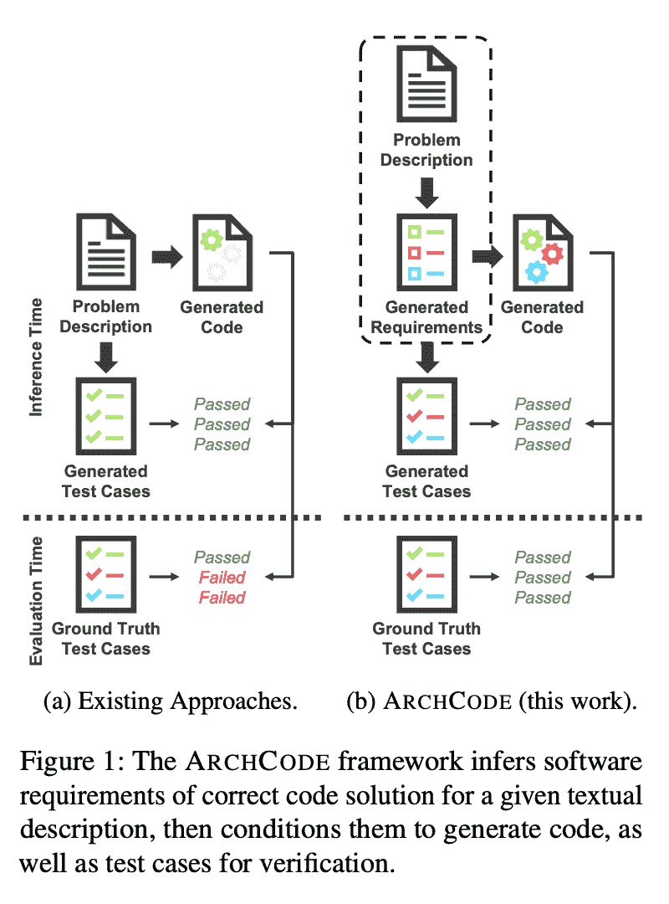

### 利用大语言模型的推理能力增强个性化推荐系统

贡献人：

链接：http://arxiv.org/abs/2408.00802v1

最近的进展展示了大语言模型（LLMs）在执行推理任务方面的潜力，特别是通过链式思维（CoT）提示的促进。虽然诸如算术推理等任务涉及明确、明确的答案和逻辑思维链，但LLM推理在推荐系统（RecSys）中的应用提出了一个独特的挑战。RecSys任务围绕主观性和个性化偏好展开，这是LLMs推理能力利用中尚未开发的领域。我们的研究探索了若干方面，以更好地理解RecSys推理，并展示了通过在零-shot和微调设置中利用LLM推理来提高任务质量。此外，我们提出了RecSAVER（Recommender Systems Automatic Verification and Evaluation of Reasoning），可以自动评估LLM推理响应的质量，无需精心策划的黄金参考或人类评分者。我们表明，我们的框架与真实人类对推理响应的连贯性和忠实度的判断一致。总的来说，我们的工作表明，将推理纳入RecSys可以改善个性化任务，为推荐系统方法的进一步发展铺平道路。

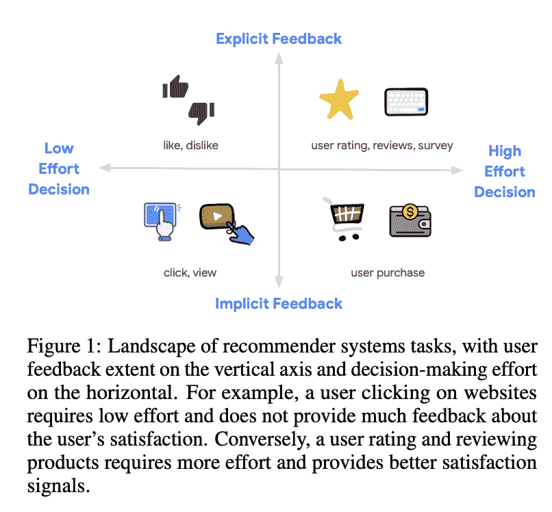

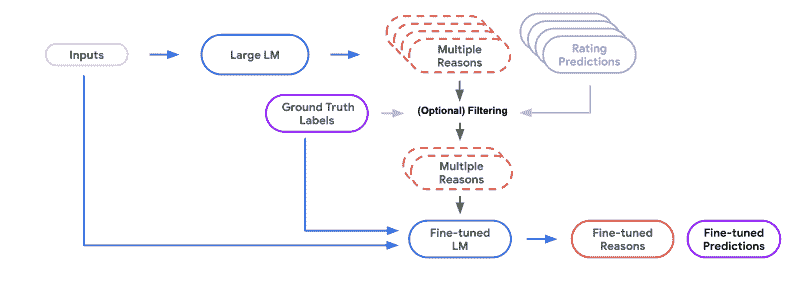

### **Mamba 研究综述**

贡献人：

链接：http://arxiv.org/abs/2408.01129v1

深度学习作为一种重要技术，在人工智能领域引发了显著的革命。作为最具代表性的结构，Transformer已经赋予了许多先进模型强大的能力，特别是由数十亿参数组成的大语言模型，成为深度学习的基石。尽管取得了令人瞩目的成就，但Transformers仍然面临固有的局限性，特别是由于注意力计算的二次计算复杂度导致的耗时推断。最近，一种新型架构Mamba出现了，从经典状态空间模型中汲取灵感，成为构建基础模型的有前途的替代选择，具有与Transformers相媲美的建模能力，同时保持与序列长度相关的近线性可伸缩性。这引发了越来越多的研究积极探索Mamba在各个领域取得出色表现的潜力。鉴于这样的快速发展，急需进行系统性评估，整合现有的以Mamba为基础的模型，提供对这种新兴模型架构的全面了解。在这项调查中，我们深入调查了最近与Mamba相关的研究，涵盖三个主要方面：基于Mamba的模型的进展，适应Mamba到各种数据的技术以及Mamba可以优于的应用。具体来说，我们首先回顾各种代表性深度学习模型的基础知识，并介绍Mamba的细节作为预备知识。然后，为了展示Mamba的重要性，我们全面回顾了相关研究，重点关注Mamba模型的架构设计、数据适应性和应用。最后，我们提出了对当前局限性的讨论，并探索各种有前途的研究方向，以为未来的调查提供更深入的见解。

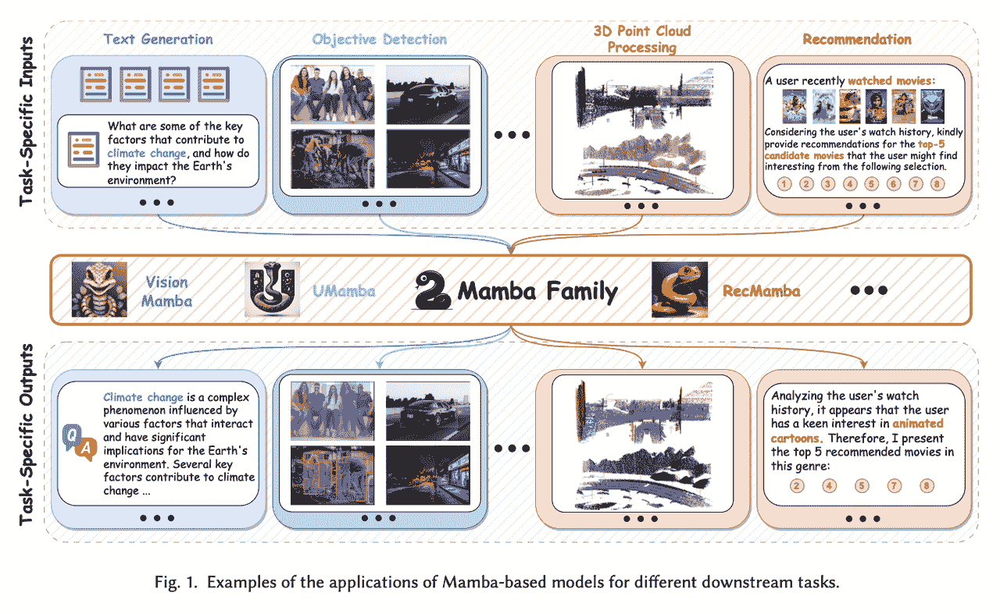

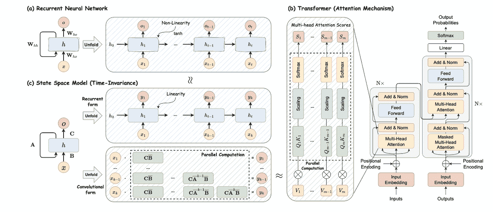

### POA：为所有大小的模型进行一次预训练

贡献人：

链接：http://arxiv.org/abs/2408.01031v1

大规模自监督预训练为一个基础模型处理许多不同的视觉任务铺平了道路。大多数预训练方法一次训练一个特定大小的单个模型。然而，在现实场景中，由于各种计算或存储约束，需要大量努力开发一系列具有不同大小的模型来部署。因此，在本研究中，我们提出了一个新颖的三分支自监督训练框架，称为POA（一次预训练即可解决所有问题），以解决上述问题。我们的方法引入了一个创新的弹性学生分支到现代自蒸馏范式中。在每个预训练步骤中，我们从原始学生随机抽样一个子网络形成弹性学生，并以自蒸馏方式训练所有分支。一旦预训练完成，POA允许提取多种大小的预训练模型用于下游任务。值得注意的是，弹性学生促进了同时预训练多个不同大小模型，同时还作为各种大小模型的附加模型集合，以增强表示学习。包括k最近邻、线性探测评估以及多个下游任务的评估在内的大量实验证明了我们的POA的有效性和优势。它使用ViT、Swin Transformer和ResNet骨干，在单次预训练会话中通过大约一百个不同大小的模型实现了最先进的性能。代码可在https://github.com/Qichuzyy/POA找到。

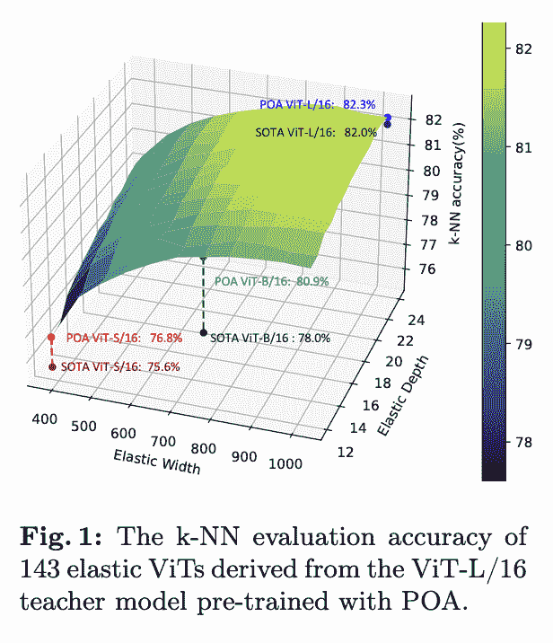

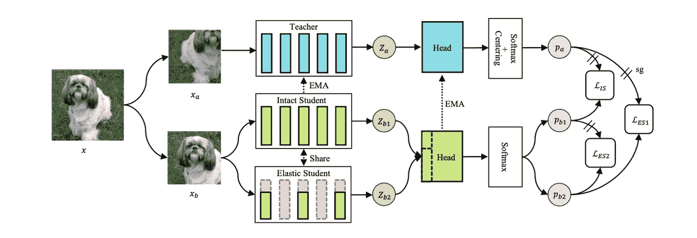

# 产品

### Avatar Architect

贡献人：

https://gcproductivity.gumroad.com/l/avatararchitect/

Avatar Architect 是一个基于 Notion 的 AI 驱动系统，希望可以帮助企业主、营销人员和产品开发者深入了解他们的目标客户。

### Felo Search

贡献人：

https://felo.ai/search

Felo 是一个多语言搜索引擎，用户可以用自己的语言提问并获取全球权威答案。它利用自动化技术扫描多个平台，提供最新信息，打破语言障碍，提升搜索效率。同时，Felo 支持文档搜索，用户可通过手机、网页或 Twitter 访问。

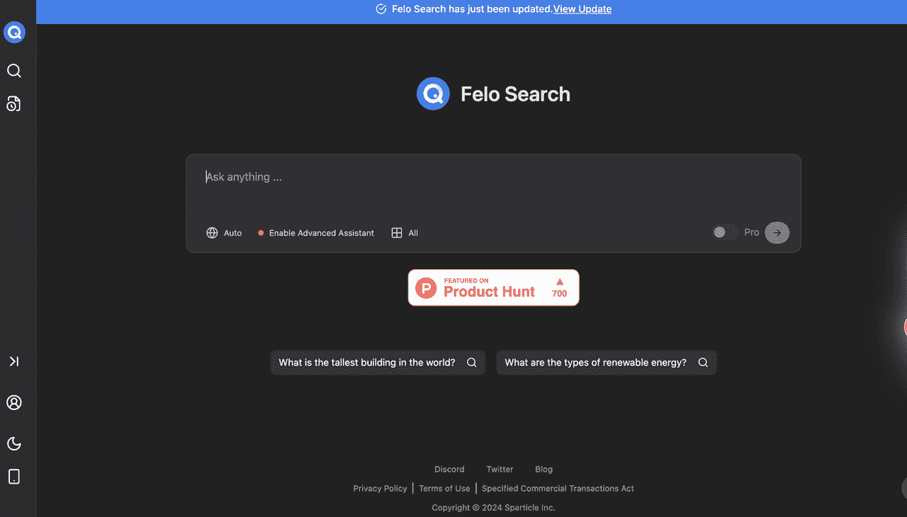

# HuggingFace&Github

### Stable Fast 3D

贡献人：

https://huggingface.co/spaces/stabilityai/stable-fast-3d

SF3D 是一种从单幅图像重建 3D 网格的最新方法。用户可以上传图像并从中生成 3D 网格模型，0.5s 内即可完成。

# 投融资

### Hedra获1000万美元种子轮融资

贡献人：

https://www.hedra.com/blog/announcement

Hedra，AI视频创作平台，成功筹集1000万美元种子轮融资，投资方包括Index Ventures、Abstract和A16Z Speedrun。Hedra由前Nvidia、Google和Meta员工创立，并推出了其视频基础模型Character-1。该模型号称是市场上最快的视频基础模型，旨在提高内容创作者和营销人员的效率。目前，超过35万用户使用Character-1创建了160多万个视频，部分视频在Reddit和Instagram上获得了病毒式传播。Hedra计划进一步改进其平台的多模态功能，并加强安全和内容审核功能。

公司官网：https://www.hedra.com/

# 学习

### 我感悟的几个最重要的架构规律

贡献人：

https://zhuanlan.zhihu.com/p/712609502?utm_psn=1803691460752723968

铁原在文章中提出了软件架构设计的核心原则，强调信息传递和系统能力拓扑结构的重要性。他提倡架构师应以想象力为动力，不断创新能力定义，并追求最少实体原则以简化系统。铁原还强调架构需提供确定性，同时解决技术和业务副作用。他通过图抽象方法实现关注点分离，提高系统的模块化和可维护性。此外，他对 DDD 中的聚合根概念进行了深入解读，并对 RPC 框架如 Dubbo 的设计进行了分析，强调在开发中追求简洁和可扩展性。

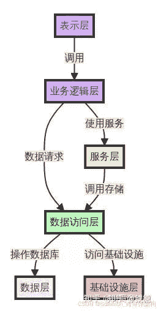

### 矩阵乘法内核优化CUDA杂谈

贡献人：

https://zhuanlan.zhihu.com/p/712613620?utm_psn=1803693691338113025

矩阵乘法内核优化在 CUDA 编程中是提升 GPU 性能的关键。文章首先阐述了矩阵乘法的并行算法基础，然后详细探讨了优化策略。包括通过合理组织线程和块结构来提高计算效率，使用共享内存减少全局内存访问延迟，以及采用 Tile 技术优化内存访问模式，从而提升 memory bandwidth 的利用率。此外，文章还讨论了如何通过 CUDA 动态并行来优化算法，以及如何利用编译器优化，例如使用restrict关键字来提示编译器进行更激进的优化。最后，作者强调了在实际应用中进行性能调试和优化时需要注意的问题，如矩阵大小调整、性能瓶颈分析等。

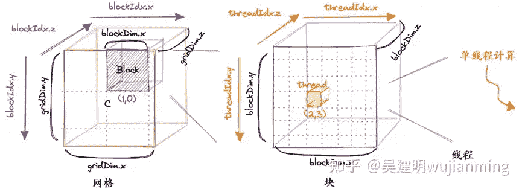

### 阿里云块存储架构演进的得与失

贡献人：

https://zhuanlan.zhihu.com/p/707748557?utm_psn=1803692586231279616

阿里云块存储架构演进的技术细节包括数据分片、多副本机制、故障恢复技术和自适应调度策略等。数据分片技术通过将数据划分为更小的部分，有效提高了存储系统的并发处理能力和扩展性。多副本机制确保了数据的高可靠性，通过在不同节点上保存数据副本来防止数据丢失。故障恢复技术则能够在发生硬件故障时快速恢复服务，减少对用户的影响。自适应调度策略优化了数据的读写操作，提升了存储性能。

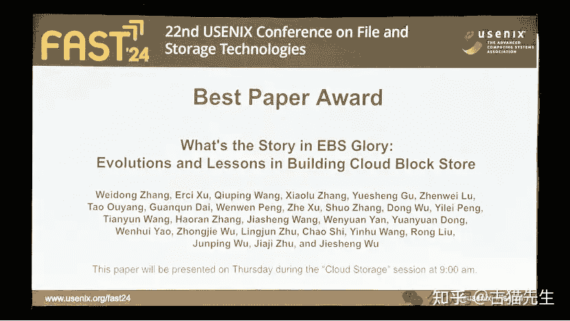

### 源码解读 - 微软GraphRAG框架

贡献人：

https://zhuanlan.zhihu.com/p/707759736

微软 GraphRAG 框架是一个基于知识图谱的检索增强生成系统，专注于提取非结构化文本的结构化数据，构建知识图谱以支持复杂查询和问答系统。该框架采用图机器学习算法进行语义聚合和层次化分析，能够有效回答高层级的抽象或总结性问题。GraphRAG 内置工作流编排系统，支持 Global Search 和 Local Search 两种查询模式，分别采用 map-reduce 方法和直接上下文回复来处理查询。框架的技术细节包括使用 Leiden 算法进行社区检测，以及如何通过 LLM 提取节点、边和协变量，并利用这些信息构建和查询知识图谱。虽然 GraphRAG 在处理查询焦点的总结性任务（QFS）方面具有优势，但目前使用成本较高，且存在模块化和与 OpenAI 耦合的问题，这些都是未来改进的方向。开源的 GraphRAG_Lite 仓库提供了一个简化版本的框架，专注于 QFS 相关功能，但运行官方 demo 的代价昂贵。

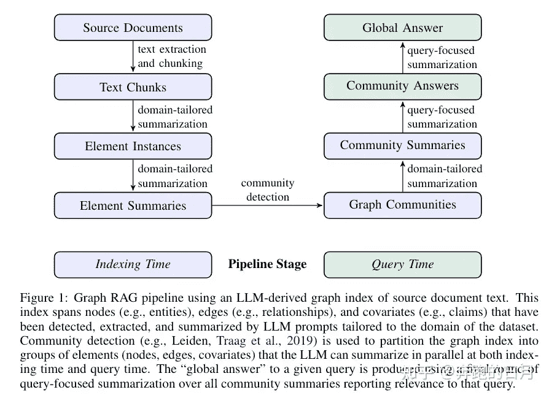

### Code Droid：技术报告

贡献人：

https://www.factory.ai/news/code-droid-technical-report

Code Droid 是由 Factory 团队开发的一个智能系统，旨在提高软件工程的效率和自主性。它能够自动执行编码任务，包括代码库现代化、功能开发、概念验证和集成构建。该系统具备高级功能，如计划和任务分解、工具集成、环境适应、HyperCode 和 ByteRank 技术、多模型采样等。Code Droid 在 SWE-bench 基准测试中取得了显著成绩，实现了 19.27% 的全面通过率和 31.67% 的 Lite 版通过率。此外，Factory 还开发了 Crucible 基准测试框架，用于更精确地评估 Code Droid 在实际生产环境中的表现。Factory 团队还特别强调了 Code Droid 的安全性和可解释性，采用了沙箱运行环境、审计跟踪和 DroidShield 算法等措施，以确保其在处理复杂软件工程任务时的可靠性和透明度。

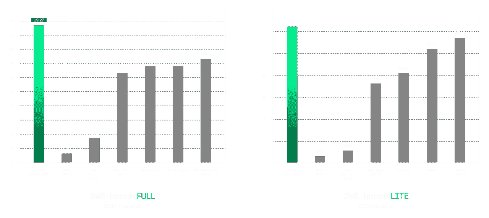

### 图像生成模型FLUX.1实战

贡献人：

https://mp.weixin.qq.com/s/E6dEz8wVThsK5jJvTrYx4w

FLUX.1 是一个新型图像生成模型，它在模型架构上采用了 FlowingMatching 调度，并通过引入 T5 模型增强了对 prompt 的依从性。与 Stable Diffusion 3 相比，FLUX.1 的创新之处在于引入了 DoubleStreamBlock 结构，使得文本和图像特征在前几层中独立处理，然后拼接后通过统一的 Transformer 块进一步对齐，以提高生成图像的准确性。目前，FLUX.1 提供了 schnell、dev 和 pro 三种型号，其中 dev 版本模型大小达到 12B，为了适应消费级显卡，社区开发者提供了 fp8 版本。此外，AutoDecoder 的权重也已开源。网页还提供了基于 ComfyUI 的使用教程，包括环境搭建、模型下载和运行 ComfyUI 的方法，以及如何使用流程图来生成图像。通过实例展示，FLUX.1 在处理简单和复杂 prompt 时都表现出色，能够生成具有多种风格的图像，并且在处理文本和多样性方面也有不错的表现。

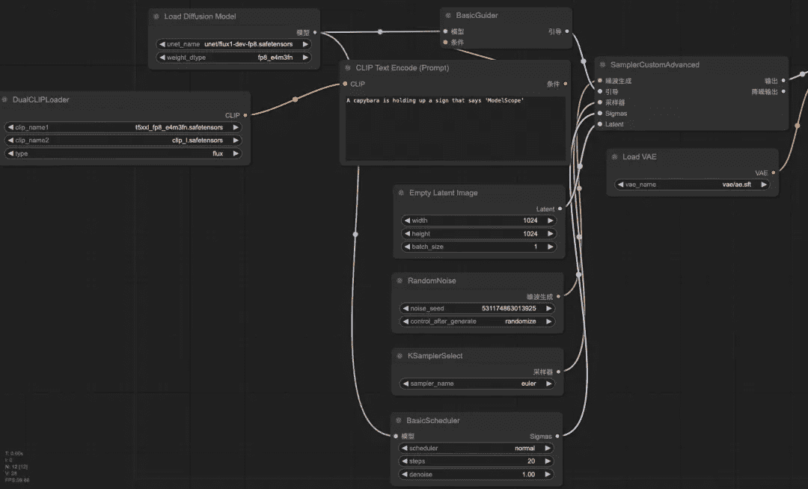

### MR-MUF封装技术：突破HBM散热瓶颈的关键创新

贡献人：

https://mp.weixin.qq.com/s/UM7Wkcv9R_VobFqINjcTrw

SK 海力士为了应对人工智能时代下的存储器产品需求，面对着热量过高的挑战，开发了一种名为批量回流模制底部填充（MR-MUF）的新型封装技术。这项技术不仅提高了芯片的散热性能，而且使得 SK 海力士在 HBM 市场中脱颖而出。MR-MUF 技术自 2019 年起应用于 SK 海力士的 HBM 产品中，并在后续的 HBM2E 和 HBM3 产品中得到进一步的应用和改进。该技术的关键在于采用了环氧树脂模塑料（EMC）作为保护材料，显著提升了散热性能和产品的环境可靠性。随着技术的不断发展，SK 海力士在 2024 年成为首家量产 HBM3E 的公司，并计划将 HBM4 产品的量产提前至 2025 年。

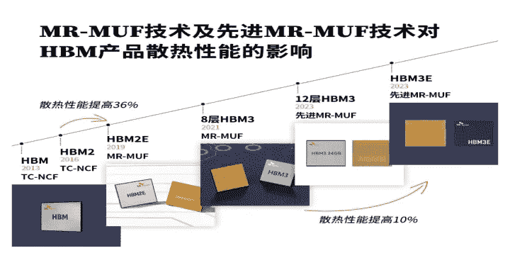

# 声明

本文档仅供学习交流使用，版权归原作者所有，若涉侵权，请联系Jack Jin 15101136166

##

（欢迎在下方反馈您宝贵的意见！整理不易，觉得有用给AI日报小组点个赞👍吧！）

ChatGPT；Angela；Zijia Liu；Alex；Zeqi Tan；Tiezhen（HuggingFace）；Naixu；Lizhi；Peter；Suoman；Jack

封面生成——右脑科技

如果你有大模型相关的创业想法，欢迎来找我们聊聊～微信：15101136166

> 快邀请你的小伙伴们一起来读大模型日报吧！

> **【日报****知识库****】**这里是近期日报内容的汇总,欢迎大家查阅

> [大模型日报知识库(分享版)](https://miracleplus.feishu.cn/wiki/KapVwXfkriOBiskB0B2cUHxjnTh)

>

> 欢迎大家多多帮我们分享,转发~~

> 如果大家有任何的建议或者吐槽,欢迎随时找我聊天~

