# 奇绩大模型日报（8月 6日）

> 来源：[https://miracleplus.feishu.cn/docx/KewfdW0eoocswtxUV8Ncp9B5ngf](https://miracleplus.feishu.cn/docx/KewfdW0eoocswtxUV8Ncp9B5ngf)

# 📡潜空间活动预告

> **潜空间系列活动第三季全面升级！**

> 第三季第二期将在**8月11日** **11:00 am**开始，嘉宾是**陈贝迪**。她将为我们带来关于 Efficient Long-context Generation 的分享。

> 活动包含嘉宾分享、访谈Q&A、cofounder matching餐会。活动现场还可以体验到咱们奇绩校友的最新产品，期待大家大力支持！

> 陈贝迪-卡内基梅隆大学助理教授，斯坦福大学人工智能博士后学者，前 Meta AI 研究科学家；致力于在现代硬件上设计和优化算法和模型，以加速大型机器学习系统。

> 欢迎扫描报名~~

# 资讯

### AI芯片公司Groq迎来杨立昆加盟，估值达200亿人民币

贡献人：

https://mp.weixin.qq.com/s/V0AteHwAAP-xFPc-y5BocQ

Groq，一个由谷歌 TPU 核心团队成员创立的 AI 芯片公司，近期宣布完成了 6.4 亿美元的 D 轮融资，领投方为贝莱德，其他投资者包括思科和三星旗下风投机构等，使得公司估值达到了 28 亿美元。同时，Groq 宣布邀请了深度学习领域的权威人物杨立昆出任技术顾问。Groq 自创以来，一直专注于推理芯片的研发，并在市场上展现出高效率和快速增长的潜力。尽管过去曾经面临生存危机，但 Groq 通过抓住生成式 AI 的发展机遇，转型为 “世界最快推理” 的芯片提供商，并与多家大公司如 Meta、三星等建立合作关系。Groq 的 LPU 芯片在处理大语言模型时，展现出超越 GPU 和 CPU 的计算能力，并且在没有 HBM 和 CoWoS 的情况下，通过单核心时序指令集计算机架构实现了高效的数据处理。Groq 正在扩大其 TaaS 产品的版图，并为其 GroqCloud 平台添加新的模型和功能，吸引了超过 36 万名开发者。目前，Groq 正在推进下一代芯片的研发生产，并与晶圆代工厂格芯合作生产 4nm IPU。

相关链接：https://www.bloomberg.com/news/articles/2024-08-05/ai-startup-groq-gets-2-8-billion-valuation-in-new-funding-round

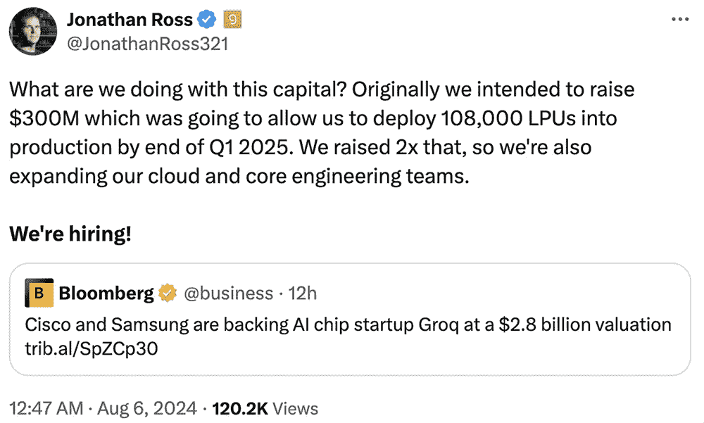

### OpenAI高管变动，联合创始人离职

贡献人：

https://mp.weixin.qq.com/s/a2e1yJ_hZERloNFFroebTw

OpenAI 最近面临着重大的高管变动。John Schulman，OpenAI 的联合创始人和 ChatGPT 后期训练负责人，宣布将离开 OpenAI 加入竞争对手 Anthropic 进行技术研究。此外，OpenAI 的另一位联合创始人和总裁 Greg Brockman 决定延长休假至年底，而产品负责人 Peter Deng 也已经离职。这些人事变动发生在 OpenAI 业务增长迅速的同时，可能面临重大亏损的时期。自从 Sam Altman 去年 11 月被解雇并重新受聘后，OpenAI 的领导层一直处于不稳定状态。目前，OpenAI 的 11 位联合创始人中只剩下 Sam Altman、Wojciech Zaremba 和长期休假中的 Greg Brockman。OpenAI 最近还聘请了首位首席财务官和首席产品官，并将安全负责人 Aleksander Madry 调任其他职位。外界对于 OpenAI 高管的离职和休假表示质疑，网友们在社交媒体上对此进行了广泛讨论。

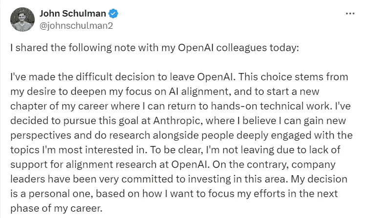

### 英伟达Cosmos被曝违规抓取大量数据

贡献人：

https://mp.weixin.qq.com/s/8BvV_vM5y9o2No3T4JMCig

NVIDIA 正在开发一个名为 Cosmos 的项目，该项目尚未对外公开。该项目涉及从 Netflix、YouTube 等平台爬取视频，用于训练 NVIDIA 的 Omniverse 3D 世界生成器、自动驾驶汽车系统和 “数字人类” 产品的 AI 模型。NVIDIA 对其采集的数据量进行了描述，称之为 “人类一生的视频量”。尽管公司声称其行为 “完全符合版权法的字面和精神”，但内部讨论显示员工对使用学术研究目的编译的数据集和 YouTube 视频存在法律问题的担忧。NVIDIA 高层对使用这些内容给予了明确的批准。

链接：https://www.404media.co/nvidia-ai-scraping-foundational-model-cosmos-project/

### 面向多样应用需求，书生·浦语 2.5 开源超轻量、高性能多种参数版本

贡献人：

https://mp.weixin.qq.com/s/S0MXLVzR_ZCpGIhGckhSxw

InternLM2.5 提供了 1.8B、7B 和 20B 三种参数版本，分别针对不同的应用场景和开发者需求。其中，InternLM2.5-20B 模型在数学评测集 MATH 上的准确率达到了 64.7%，显示出其在复杂推理任务上的强大能力。此外，InternLM2.5 通过高效的预训练和微调技术，提升了在长文档理解和复杂智能体交互等场景下的性能。开源的模型支持与多个推理和微调框架无缝对接，如 XTuner、LMDeploy、vLLM 和 Ollama，使得开发者能够快速部署和微调模型，同时保持了与 OpenAI 服务接口的兼容性。

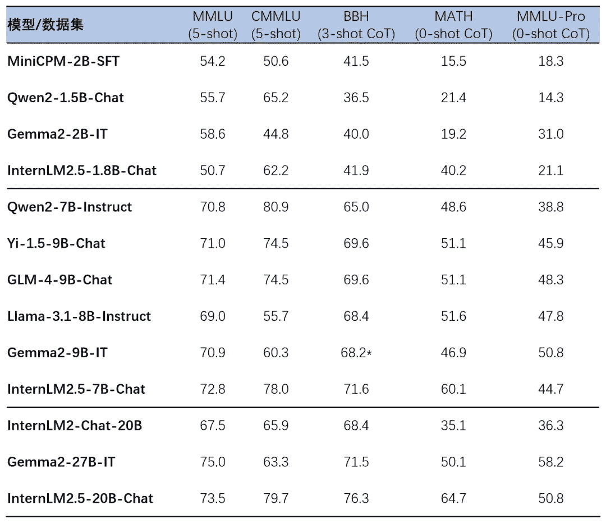

### 2024年NeurIPS研讨会公告

贡献人：

https://blog.neurips.cc/2024/08/02/announcing-the-neurips-2024-workshops/

NeurIPS 2024 研讨会的官方博客发布了 56 个接受的研讨会列表，这些研讨会将在 2024 年 12 月 14 日和 15 日举行。选定的研讨会涵盖了从基础模型、大型语言模型、医疗保健、机器学习在物理科学中的应用等多个领域，显示了机器学习领域的多样性和深度。研讨会已经开始征集论文和其他贡献，并鼓励使用 8 月 30 日作为提交截止日期。

### Join us at OpenAI DevDay

贡献人：

https://openai.com/devday/

OpenAI于2024年秋季在旧金山、伦敦和新加坡举办的OpenAI DevDay。这是一个专为开发者设计的活动，旨在帮助构建者彼此联系，深入了解新的AI功能和产品。活动包括动手技术研讨会、专题讨论、产品演示和开发者项目展示，帮助参与者提升技能，探索新可能。申请截止日期为8月15日。

# 推特

### WH分享：手绘Flux的架构图

https://x.com/nrehiew_/status/1820404554795802684

Flux的架构图 :)

好像没有论文，所以我快速浏览了一下他们的代码。可能有助于理解当前的扩散架构。

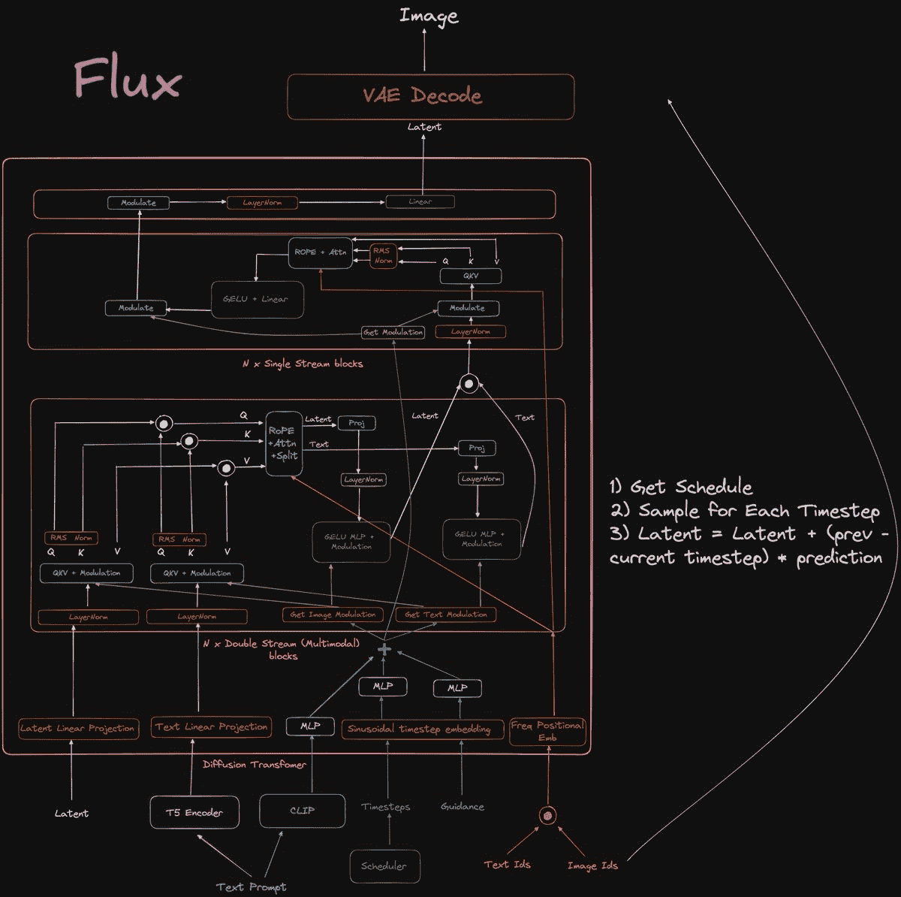

### Sully：5 分钟内构建一个仪表盘，展示AI 编码工作流程和工具

https://x.com/SullyOmarr/status/1820522120163492111

制作了一个视频，展示了我的 AI 编码工作流程和工具，5 分钟内构建了一个仪表盘

从想法到产品的过程现在变得非常容易

我半天的时间都在用 AI（Cursor, Claude v0）为我构建东西

0:00 - 1:48 工具概览

1:50 - 3:43 初始设置

3:45 - 6:00 使用 Composer 进行 Cursor 魔法

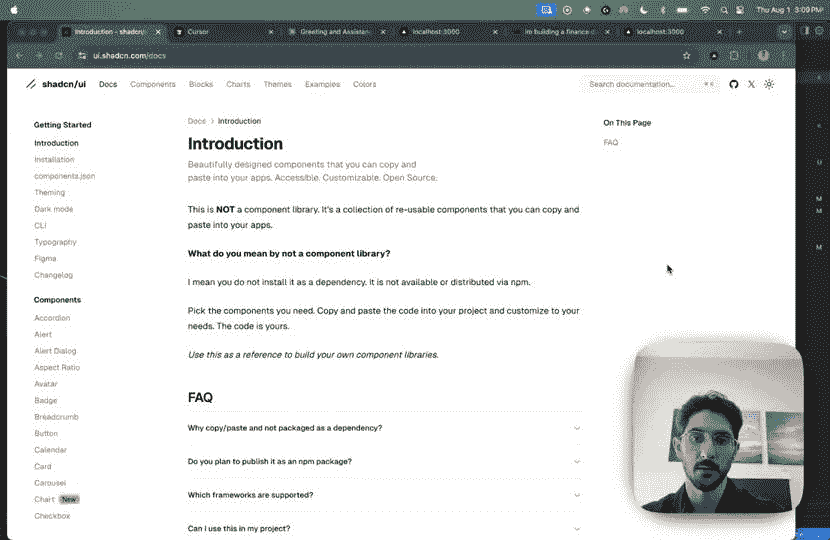

[ssstwitter.com_1722939865007.mp4](https://internal-api-drive-stream.feishu.cn/space/api/box/stream/download/all/IkXIbPwv4oYBvhxaRArc6bKwn8d)

### Anthropic AI Albert分享：探索 Anthropic 在大型语言模型方面的最新进展，重点介绍增强的推理和多模态能力

https://x.com/alexalbert__/status/1820520897465246194

几周前在 AI 工程师峰会上的完整演讲现在已经上传到 YouTube 了！

-----

探索 Anthropic 在大型语言模型方面的最新进展，重点介绍增强的推理和多模态能力。我们将展示这些进步如何转化为强大的开发者工具、API 以及构建复杂、符合 RSP 标准的 AI 应用程序的最佳实践

[ssstwitter.com_1722939937933.mp4](https://internal-api-drive-stream.feishu.cn/space/api/box/stream/download/all/TwrpbctSComoVLxc1ZlcA3dlnqn)

### Watney Robotics分享：Watney机器人清洗窗户视频

https://x.com/watneyrobotics/status/1820543232025219107

你见过机器人洗窗户吗？

你的办公室距离 OpenAI 办公室五个街区内吗？回复你的地址，Watney 会来帮你清洗窗户！

[ssstwitter.com_1722940126732.mp4](https://internal-api-drive-stream.feishu.cn/space/api/box/stream/download/all/HFNHbqCnzozxwExTfIicvjEQnmx)

### 清华ChatGLM团队开源CogVideoX

https://x.com/ChatGLM/status/1820578051480236231

我们刚刚开源了我们的文本到视频模型 CogVideoX，这个模型类似于 Sora 或 Gen3。

https://github.com/thudm/cogvideo

CogVideoX 是视频生成模型的开源版本，与清影同源。

# 论文

### **MathLearner：一个用于**学习解决数学问题的大型语言模型智能体框架

贡献人：

链接：http://arxiv.org/abs/2408.01779v1

随着人工智能（AI）的发展，大型语言模型（LLM）被广泛应用于许多领域。然而，在数学推理方面，LLM的推理能力仍然非常有限。数学在人类社会的各个方面起着重要作用，在医疗保健、交通和航空航天等领域是技术保障，在数学领域开发AI大型语言模型具有巨大潜在意义。为提高大型语言模型的数学推理能力，我们提出了一种基于归纳推理的学习解决数学问题的智能体框架。通过模拟人类学习过程中对学到信息的泛化和有效应用先前知识于新推理任务的过程，该框架在数学推理过程中表现出色。它在全局准确率上比基线方法（思维链）提高了20.96％，解决了基线无法解决的17.54％数学问题。受益于高效的检索方法，我们的模型提高了大型语言模型有效使用外部知识的能力，即模型的数学计算可以基于书面程序。在教育方面，我们的模型可以用作个性化的学习援助，从而减少教育资源的不平等。

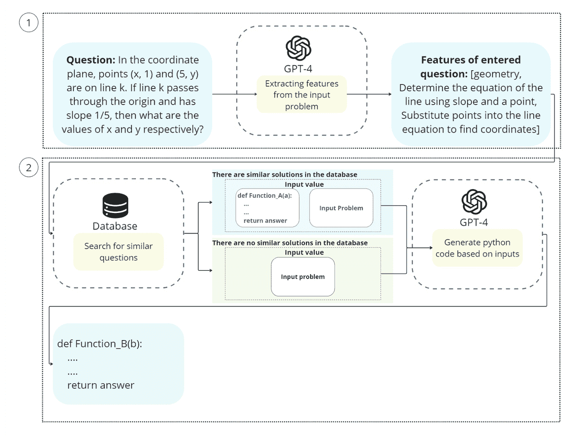

### **带有少样本索引的生成式检索**

贡献人：

链接：http://arxiv.org/abs/2408.02152v1

现有的生成式检索（GR）方法依赖于训练-based索引，即微调模型以记住查询和相关文档的文档标识符（docid）之间的关联。训练-based索引存在三个限制：高训练开销，未充分利用大型语言模型（LLMs）的预训练知识，以及适应动态文档语料库的挑战。为了解决以上问题，我们提出了一种新颖的少样本基于索引的GR框架（Few-Shot GR）。它具有一种新颖的少样本索引过程，在其中我们提示LLM生成整个语料库中所有文档的docids，最终为整个语料库创建一个docid银行。在检索过程中，我们将查询传递给相同的LLM，并限制其在检索期间生成一个在索引期间创建的docid银行内的docid，然后将生成的docid映射回其对应的文档。Few-Shot GR仅依靠提示LLM，无需任何训练，使其更高效。此外，我们设计了一对多映射的少样本索引，以进一步增强Few-Shot GR。实验表明，Few-Shot GR比需要大量训练的最先进的GR方法表现更优异。

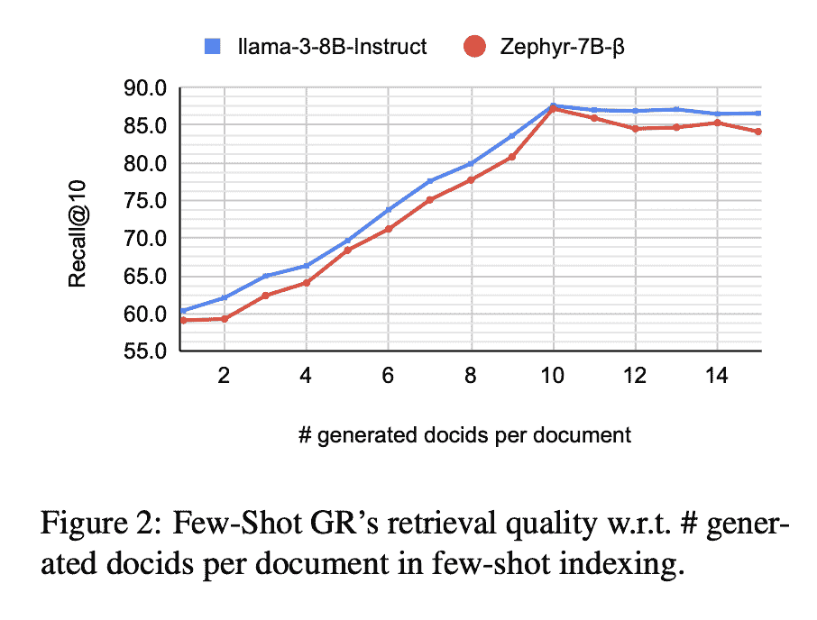

### 发挥LLM的力量：高质量基于方面的总结的微调方法

贡献人：

链接：http://arxiv.org/abs/2408.02584v1

随着数字信息量的不断增加，用户需要高效的方法从长篇文档中提取关键信息。基于方面的摘要提供了一种有针对性的方法，生成专注于文档内特定方面的摘要。尽管基于方面的摘要研究取得了进展，但对模型性能的改进仍在持续。鉴于大型语言模型已经展示了在自然语言处理中改革各种任务的潜力，尤其是在摘要问题上，本文探讨了微调大语言模型（LLMs）用于基于方面的摘要任务的潜力。我们评估了微调开源基础LLMs（包括Llama2、Mistral、Gemma和Aya）对公开可用的基于领域的方面摘要数据集的影响。我们假设这种方法将使这些模型能够有效地识别和提取与方面相关的信息，从而产生比最先进技术更优质的基于方面的摘要。我们建立了一个全面的评估框架，比较了微调LLMs与竞争性基于方面的摘要方法和微调LLMs的基本对应项的性能。我们的工作通过展示微调LLMs生成高质量的基于方面的摘要的有效性，为方面摘要领域做出贡献。此外，它为在各种NLP领域中进一步探索使用LLMs进行有针对性的信息提取任务打开了大门。

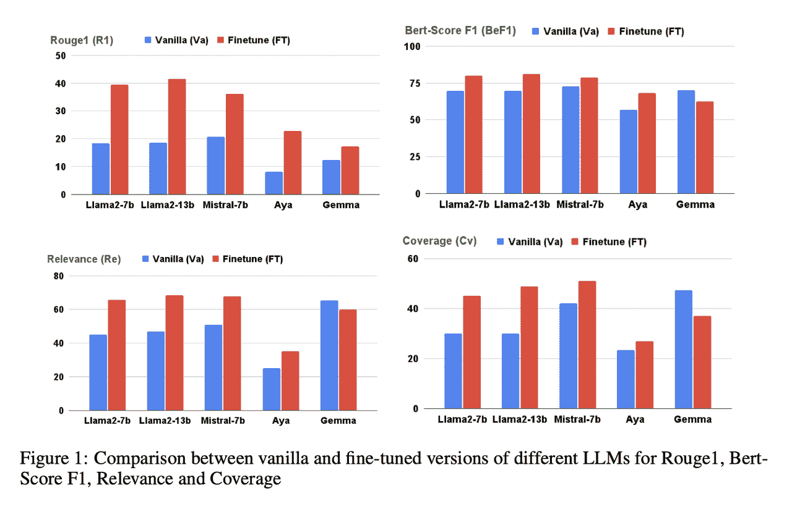

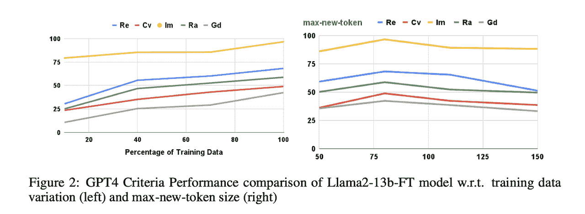

### **语言模型: 能够听取和说话**

贡献人：

链接：http://arxiv.org/abs/2408.02622v1

对话作为人机交互（HCI）最自然的方式。最近语言模型（SLM）的发展显著增强了基于语音的对话AI。然而，这些模型局限于轮流对话，缺乏在实时口语场景中与人类交互的能力，例如在生成的内容不理想时被打断。为解决这些限制，我们探索了交互式语音语言模型（iSLM）中的全双工建模（FDM），专注于增强实时交互，尤其是探索打断的基本能力。我们引入了一种新的模型设计，即听说语言模型（LSLM），一个配备听说双通道的端到端系统。我们的LSLM采用基于token的仅解码TTS进行语音生成，以及用于实时音频输入的流自我监督学习（SSL）编码器。LSLM融合了两个通道进行自回归生成，并实时检测轮流。探索了三种融合策略 -- 早期融合、中间融合和晚期融合 -- 其中间融合在语音生成和实时交互之间达到了最佳平衡。两种实验设置，基于命令的FDM和基于语音的FDM，展示了LSLM对噪声的稳健性和对多样指令的敏感性。我们的结果突显了LSLM在对现有系统影响最小的情况下实现全双工通信的能力。本研究旨在推动交互式语音对话系统的发展，增强其在现实环境中的适用性。

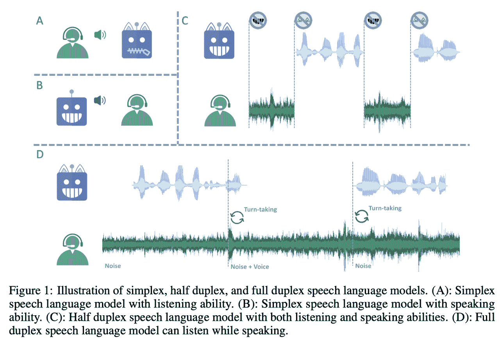

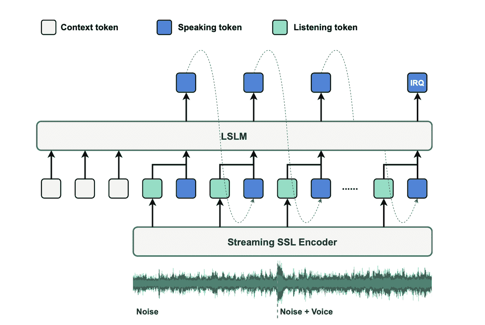

### Self-Taught Evaluators

贡献人：

链接：http://arxiv.org/abs/2408.02666v1

摘要：基于模型的评估是成功模型开发的核心--作为训练的奖励模型，以及替代人类评估。为了训练这样的评估器，标准方法是收集大量关于模型响应的人类偏好判断，这既昂贵又会使数据变得陈旧。本研究提出了一种新方法，旨在通过仅使用合成训练数据来改进评估器，而无需人类注释。从未标记的指令开始，我们的迭代自我改进方案生成对比模型输出，并训练LLM作为裁判产生推理轨迹和最终判断，在每个新迭代中使用改进的预测重复这种训练。在没有任何标记的偏好数据情况下，我们的自学评估器可以将强大的LLM（Llama3-70B-Instruct）在RewardBench上从75.4提高到88.3（在多数投票下达到88.7）。这超过了常用的LLM评判者，如GPT-4，并与使用标记示例训练的表现最好的奖励模型相匹配。

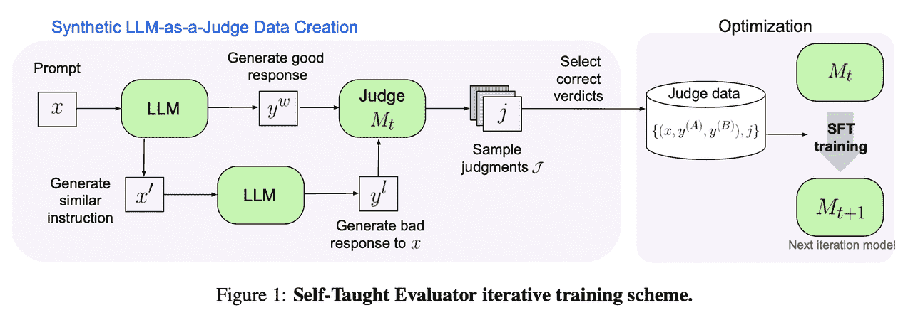

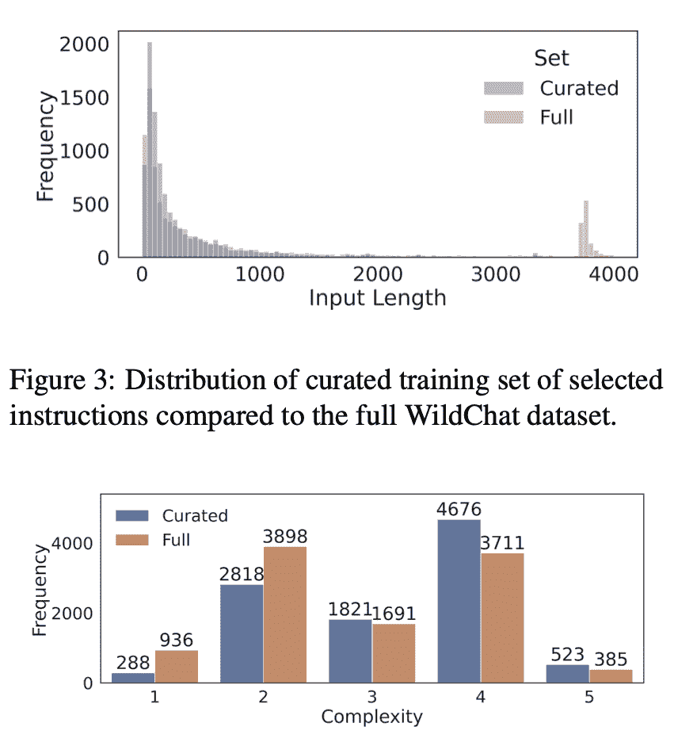

### 在生产中构建一个领域特定的Guardrail Model

贡献人：

链接：http://arxiv.org/abs/2408.01452v1

生成型AI有望实现一系列渴望的能力，并在各种消费者和企业领域的工作流程中引起革命。然而，将模型投入生产涉及的远不止生成输出这么简单。它还涉及确保模型可靠、安全、高性能，并且符合特定领域的操作政策。在模型周围发展了监控措施的必要性，是为了强制执行模型的适当行为，特别是当它们投入生产时。在这篇论文中，我们以教育作为一个用例，因为教育领域对内容的恰当性有严格的要求，来展示如何训练和部署一个监控模型到生产。具体来说，我们描述了为K-12教育平台构建一个生产级监控模型的经验。我们首先制定了部署到这个敏感领域所需的要求。然后描述了我们领域特定的监控模型的训练和基准测试，这个模型在专有的与教育相关的基准测试和与安全的一般方面相关的公共基准测试上胜过了竞争的开放式和封闭式模型，这些模型的大小相似或更大。最后，我们详细介绍了在生产中部署这项服务所做的架构选择和优化；这些优化涵盖了从硬件基础设施到服务层再到语言模型推理优化的整个堆栈。希望这篇论文对其他从事生成型AI和大语言模型基础上创建生产级领域特定服务的实践者有所启示。

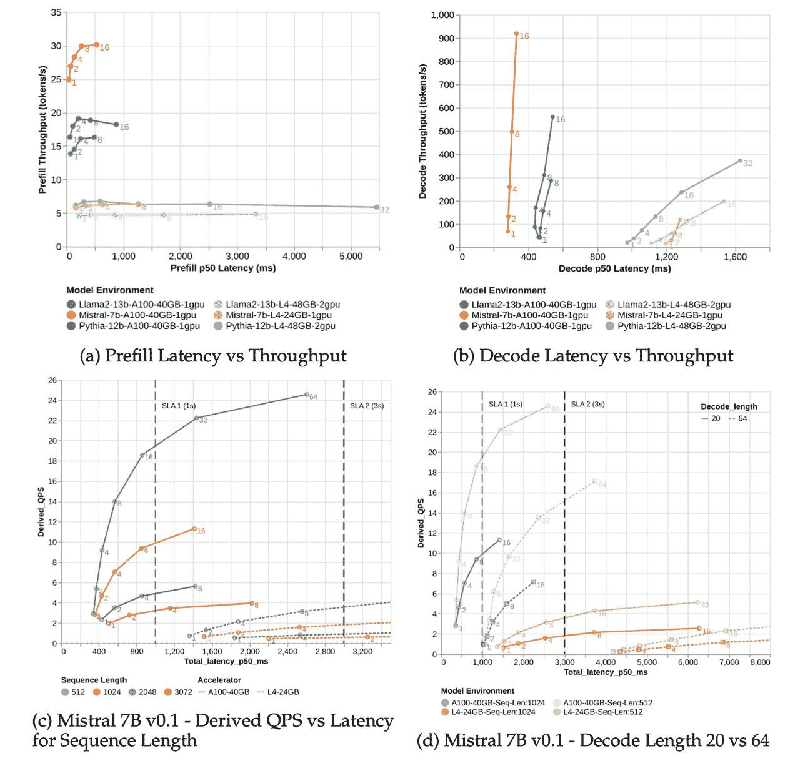

# 产品

### Me.Bot

贡献人：

https://www.me.bot/

Me.bot 是个性化的 AI 伴侣，通过学习用户的经验和互动，帮助他们更好地理解自己并提供支持，帮助用户应对生活中的各种挑战，如职业转变和情绪管理。

### MindSearch

贡献人：

https://mindsearch.netlify.app/

MindSearch 是一个开源的 AI 搜索引擎框架，具有与 Perplexity.ai Pro 相同的性能。您可以轻松部署它来构建您自己的搜索引擎，可以使用闭源 LLM（如 GPT、Claude）或开源 LLM（如 InternLM2.5-7b-chat）。其拥有以下特性：

+   📚 深**度知识探索**

+   🔍 透**明的解决方案路径**

+   💻 多**种用户界面**

+   🧠 动**态图构建过程**

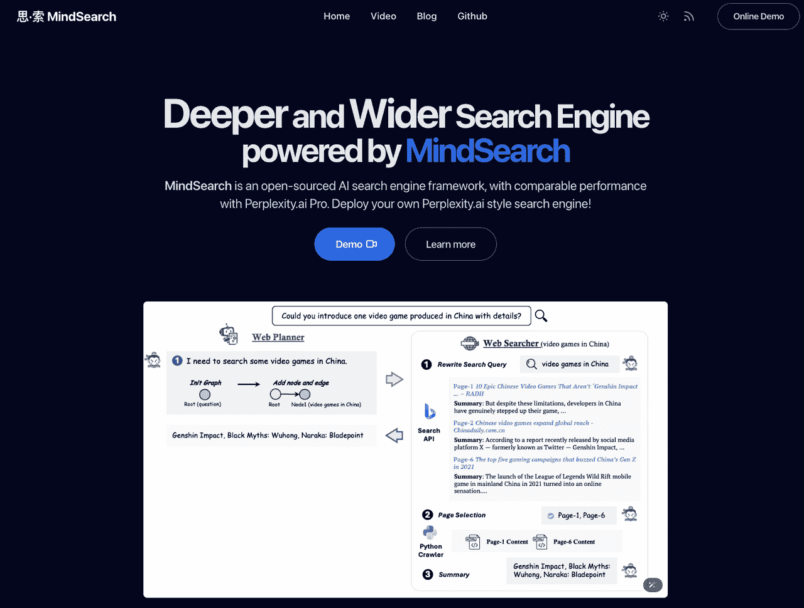

# HuggingFace&Github

### sycamore

贡献人：

https://github.com/aryn-ai/sycamore

Sycamore 是一个开源的、基于人工智能的文档处理引擎，用于 ETL、RAG、基于 LLM 的应用程序和对非结构化数据的分析。它可以对各种类型的文档进行分区和丰富，包括报告、演示文稿、文字记录、手册等。它可以分析和分块复杂的文档，如包含表格、图形、图表和其他信息图的 PDF 和图像。

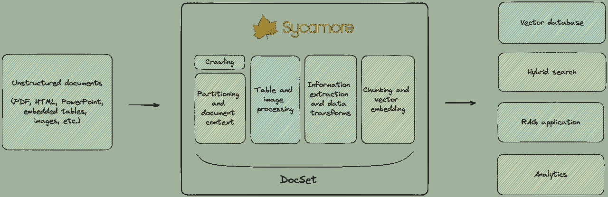

### Open-Reasoning-Tasks

贡献人：

https://github.com/NousResearch/Open-Reasoning-Tasks

这个项目是一个开放合作的仓库，在收集一系列用于训练和评估大型语言模型（LLM）推理能力的任务。该仓库包含了各种类型的推理任务，希望可以帮助改善 LLM 的推理能力。

# 投融资

### 月之暗面完成3亿美元融资 腾讯参投

贡献人：

https://laoyaoba.com/n/912437

月之暗面（Moonshot）完成了3亿多美元的融资，估值达到33亿美元。此次融资由腾讯控股、阿里巴巴和高榕资本等多方参与。此前，阿里巴巴曾在2月份领投Moonshot创纪录的10亿美元融资。

公司网站：https://www.moonshot.cn/

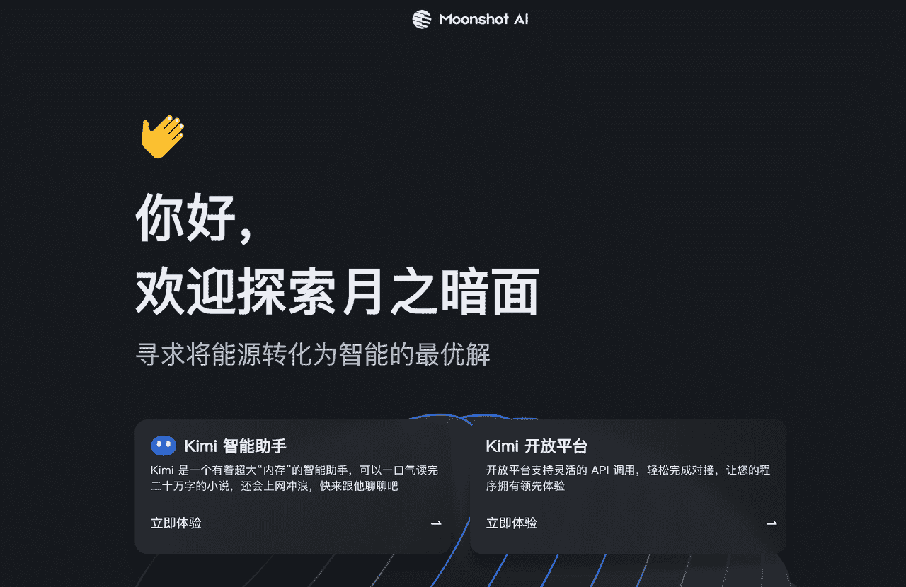

### Placer.ai融资提升估值至15亿美元

贡献人：

https://techcrunch.com/2024/08/05/placer-ai-boosts-valuation-to-1-5b-after-quietly-raising-another-75m/

位置数据AI市场研究公司Placer.ai近日在未公开情况下筹集了7500万美元，使公司估值达到15亿美元。此次融资主要由现有投资者参与，已确认包括GEM Realty Capital。自2022年1亿美元C轮融资以来，Placer.ai估值增长近50%。公司CEO Noam Ben-Zvi表示，Placer.ai年收入已突破1亿美元，客户数量从2022年的1000增加至4300。融资将用于业务发展和增加平台功能及数据集。

公司官网：https://www.placer.ai/

### 机器人2024年二季度投融市场报告

贡献人：

https://mp.weixin.qq.com/s/K56DKVDykHTU5fM290mcTA

根据来觅 PEVC 数据，2024 年二季度机器人领域共有 60 起融资案例，环比增长 1.69%，但同比减少 3.23%；融资金额为 37.62 亿元，环比下降 16.79%，同比下降 17.18%。报告指出，2024 年上半年，受电子、汽车等下游终端应用行业的回暖影响，工业机器人和服务机器人的产量进一步提升。同时，政策限制放宽、手术机器人的灵活度和精确度提升以及市场需求增加，都有助于提高手术机器人的渗透率。

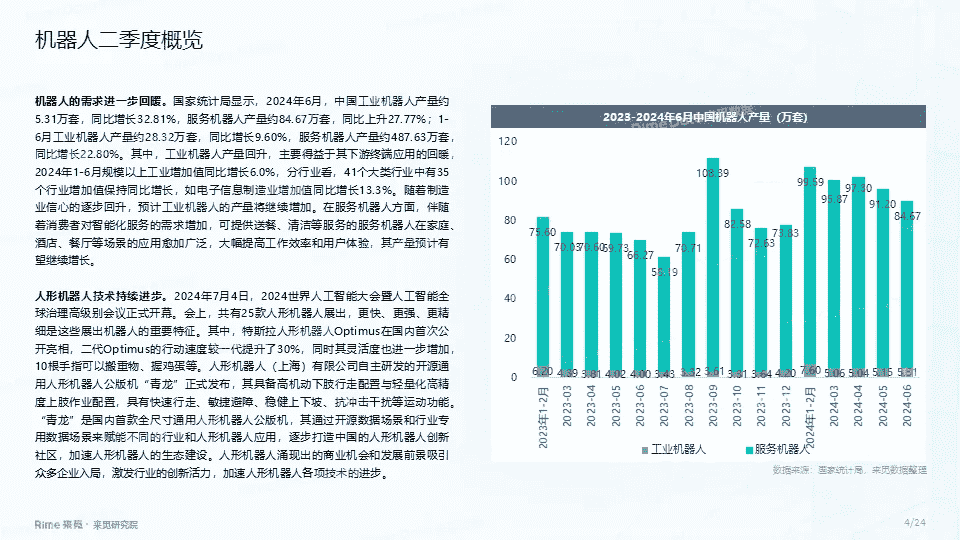

# 学习

### 如何让 AI 在构建 AI 功能时表现得更好

贡献人：

https://www.builder.io/blog/make-ai-suck-less

文章探讨了如何优化 AI 特别是大型语言模型的性能，以减少其生成误导性信息的情况。细节包括：

1.  明确的 AI 边界设定：通过在提示中定义 AI 的知识范围，限制其回答的信息来源，减少误信息的产生。

1.  精确的指令 crafting：详细说明 AI 如何使用提供的信息，避免模糊不清的指令，提高 AI 的准确性。

1.  用户交互与反馈机制：设计聊天式接口，让用户能够提供实时反馈，帮助 AI 更准确地理解需求并及时调整输出。

1.  AI 与传统编程的有效结合：在生成代码时，先使用非 AI 方法生成基础代码，然后利用 AI 进行优化和改进，以此确保代码的质量和可维护性。

1.  示例导向的上下文提供：通过给 AI 提供具体的示例，帮助它更好地理解任务要求，从而提升其执行任务的准确性。

1.  微代理方法：将复杂任务分解为小任务，并在 AI 操作之间设置非 AI 检查点，确保每一步的准确性，避免错误累积。

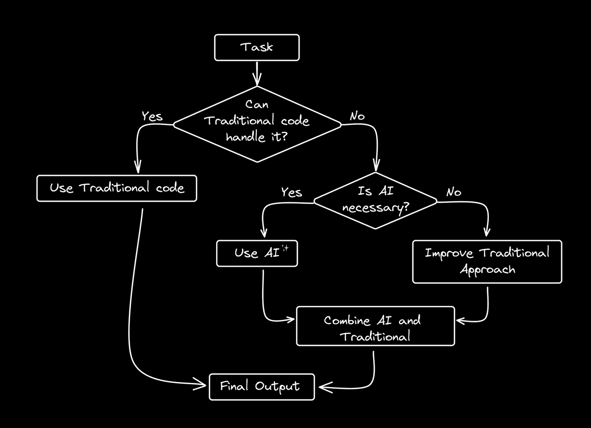

### SFT Data for Alignment 之一般篇

贡献人:

https://zhuanlan.zhihu.com/p/712547287?utm_psn=1804069014676307968

本文详细探讨了大模型微调（SFT）的数据收集方法，特别是针对一般性目标的数据准备过程。Flan 项目通过包含 1836 个不同 NLP 任务的数据集，提高了任务多样性，并采用了 Zero-shot、Few-shot 以及 Chain-of-Thought 策略来增强模型的泛化能力。InstructGPT 则通过标注人员撰写和用户收集两种方式提升了 Prompt 的质量和覆盖范围。Llama 系列在 SFT 中初步使用了 Flan 数据，而 Llama 2 进一步通过标注人员撰写的高质量数据和 Rejection Sampling 技术提升了数据的有效性。Llama 3 则完全放弃了 Flan 数据，转而依赖于基于 Reward Modeling 的 Rejection Sampling 方法，并在后期训练中引入 system prompts 以强化特定能力。此外，DeepSeek LLM & V2 以及 Qwen & Qwen2 也在 SFT 数据收集上采取了类似的策略，并重点关注数学和代码等专项能力的数据比例。Rejection Sampling 在这一过程中起到了关键作用，通过选择最佳的 Response 作为 Demonstration，有效提升了模型的性能。

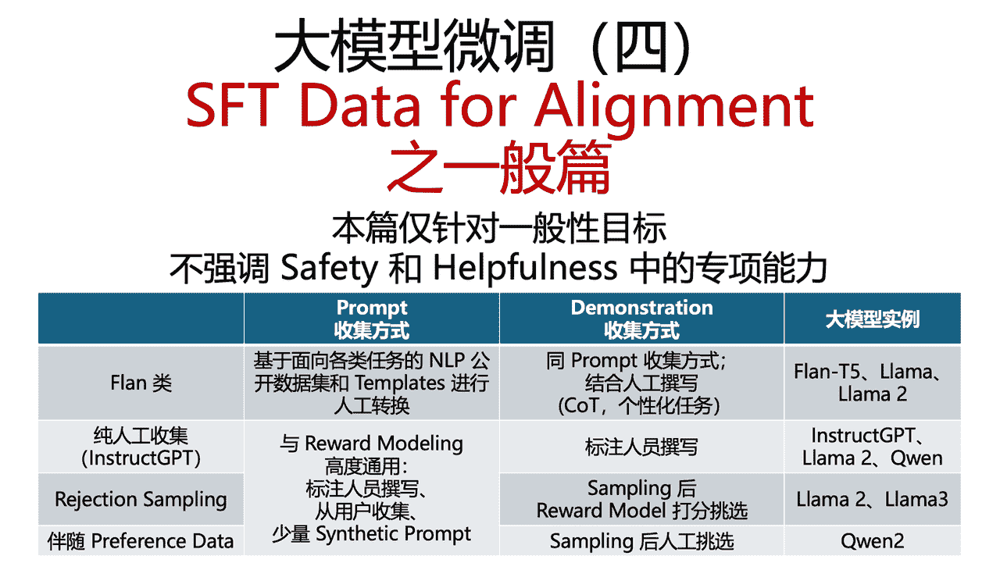

### 多模态MLLM都是怎么实现的-Florence-2

贡献人：

https://zhuanlan.zhihu.com/p/711845759?utm_psn=1804067069525893120

Florence-2 是一种多模态序列到序列模型，专注于处理不同空间层次和语义粒度的视觉任务。它采用了创新的多任务学习方法，并通过构建大规模的 FLD-5B 数据集来提升模型性能。该数据集包含了超过 5 亿个注释，覆盖了 1.26 亿张图像，支持多种类型的标注，如语义粒度、空间层次和注释类型。数据打标过程严格，包括初始标注、数据过滤和增强、迭代数据精炼，确保了数据质量。Florence-2 使用 DaViT 作为视觉编码器，该编码器采用双重注意力机制，结合空间和通道注意力，提取更丰富的特征。实验结果显示，Florence-2 在 COCO 和 ADE20K 等基准数据集上的表现优于其他模型，特别是在目标检测和图像分割任务上展现出高效的性能。

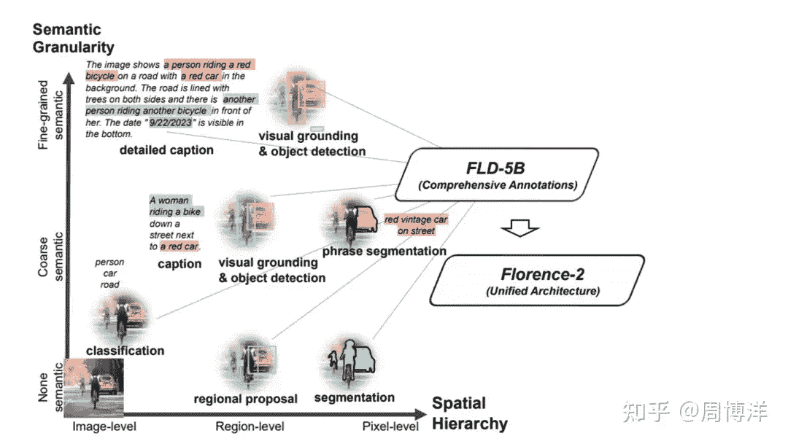

### RAG->GraphRAG

贡献人：

https://zhuanlan.zhihu.com/p/707445642?utm_psn=1804069658938183681

RAG 技术是大语言模型（LLM）性能提升的关键，通过外部知识检索增强生成能力。RefAug 方法通过在训练数据中嵌入反思过程，提高了 LLM 在复杂推理任务中的表现。SeaKR 实现了自适应检索，根据模型内部状态的不确定性动态决定是否进行知识检索。Memory3 通过将知识库转换为 kv 值并存储，大幅降低了参数大小和计算成本，同时提升了性能。ColPali 优化了图像信息输入，提高了基于视觉语言模型的文档检索效率。GraphRAG 利用知识图谱，有效地提升了 LLM 在处理复杂查询和总结任务时的能力。Triplex 通过降低知识图谱构建成本，实现了性能优于 GPT-4、成本大幅降低的 RAG 解决方案。

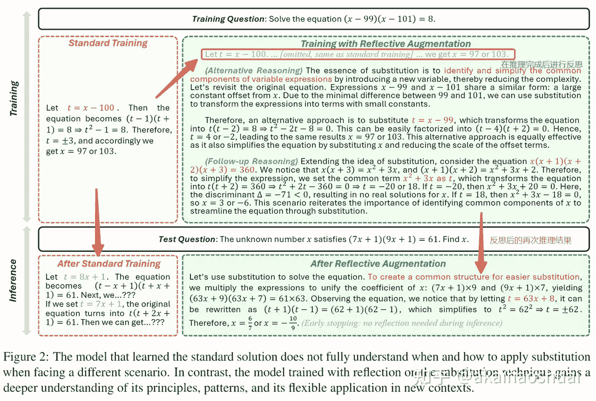

### RoCE网络用于大规模分布式AI训练

贡献人：

https://engineering.fb.com/2024/08/05/data-center-engineering/roce-network-distributed-ai-training-at-scale/

Meta 工程师们通过论文详细介绍了他们为了应对分布式 AI 训练工作负载而构建的 RoCEv2 网络。该网络采用了两级闭合拓扑（Clos topology），包括 Rack Training Switch (RTSW) 和 Cluster Training Switch (CTSW)，以及后续引入的 Aggregator Training Switch (ATSW) 层，实现了跨 AI Zone 的扩展。在路由和拥塞控制方面，他们从标准 ECMP 转向了包含 Queue pair scaling 在内的定制解决方案，以提高网络性能。在拥塞控制上，Meta 选择了不使用 DCQCN，而是通过 PFC（Priority-based Flow Control）来管理流量。此外，为了进一步优化，他们引入了接收器驱动的流量接入策略，通过优化 NCCL 库和网络协调，提高了 AI 训练的稳定性和效率。

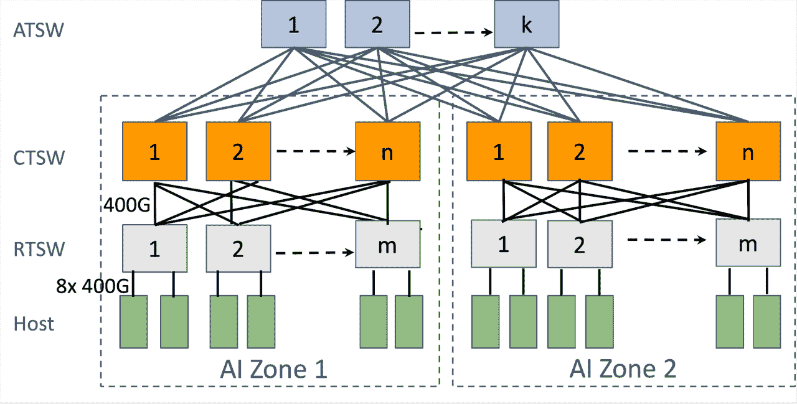

### 将 LlamaIndex 和 Qdrant 应用扩展至 Google Kubernetes Engine

贡献人：

https://medium.com/@benitomartin/find-your-code-scaling-a-llamaindex-and-qdrant-application-with-google-kubernetes-engine-2db126f16344

文章探讨了如何利用 Google Kubernetes Engine（GKE）对 LlamaIndex 和 Qdrant 应用程序进行扩展。LlamaIndex 是一个数据索引工具，Qdrant 是一个向量数据库，两者结合可以处理大规模数据的检索和分析。文章详细描述了在 GKE 上部署这两个技术的步骤，包括配置集群、设置持久化存储、管理服务和入口，以及如何通过 Kubernetes 的自动扩展功能应对负载变化。此外，还强调了监控和日志记录的重要性，以及通过预留实例和优化资源配置来降低成本的策略。技术细节包括使用 Helm charts 进行应用程序部署、配置存储类型以确保数据持久化、设置水平 Pod 自动扩展（HPA）以及利用 Google Cloud 的监控工具 Stackdriver 进行性能跟踪。

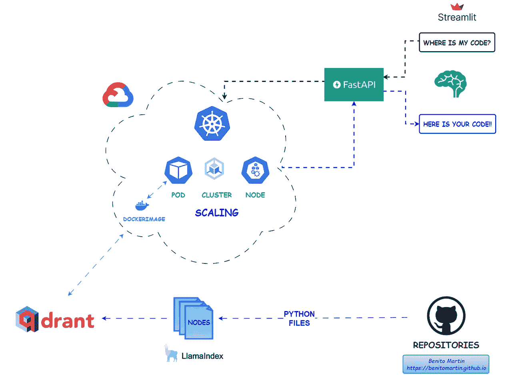

### MindSearch技术详解，本地搭建媲美Perplexity的AI应用

贡献人：

https://mp.weixin.qq.com/s/AhPoPD8eOnKFP670xeVt_g

MindSearch 是一个基于 InternLM2.5 7B 模型的 AI 搜索框架，它通过 Multi-Agent 框架模拟人类思维过程，实现深度和广度的信息搜集。该框架包含两层：外层的 Web Planner 负责任务拆解和动态规划，内层的 Web Search 负责子问题的搜索和信息整合。MindSearch 的搜索过程包括思考、改写、搜索、阅读和总结五个步骤，确保了回答的准确性和完整性。此外，MindSearch 支持开放域搜索，并且整个搜索过程是可视化的，便于用户理解和跟踪。技术细节方面，MindSearch 使用了 few-shot 学习和 function call 功能，实现了在大模型中的高效搜索和信息整合。同时，MindSearch 支持使用 Bing Web Serach 和 DuckDuckGo Search 作为搜索 API，并且可以通过修改代码适应不同的显存大小，例如调整为 22G 算力环境下运行。开发者可以通过 GitHub 获取源码，并按照文档指导在本地部署 MindSearch，享受到类似 Perplexity 的 AI 思索应用带来的便利。

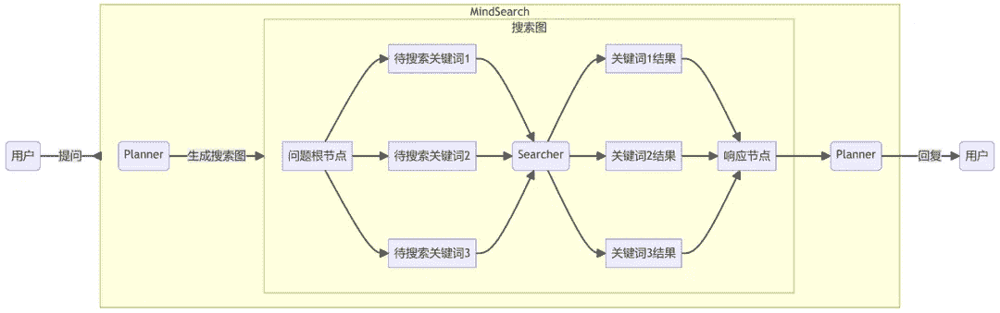

# 声明

本文档仅供学习交流使用，版权归原作者所有，若涉侵权，请联系Jack Jin 15101136166

##

（欢迎在下方反馈您宝贵的意见！整理不易，觉得有用给AI日报小组点个赞👍吧！）

ChatGPT；Angela；Zijia Liu；Alex；Zeqi Tan；Tiezhen（HuggingFace）；Naixu；Lizhi；Peter；Suoman；Jack

封面生成——右脑科技

如果你有大模型相关的创业想法，欢迎来找我们聊聊～🛰️：15101136166

> 快邀请你的小伙伴们一起来读大模型日报吧！

> **【日报****知识库****】**这里是近期日报内容的汇总,欢迎大家查阅

> [大模型日报知识库(分享版)](https://miracleplus.feishu.cn/wiki/KapVwXfkriOBiskB0B2cUHxjnTh)

>

> 欢迎大家多多帮我们分享,转发~~

> 如果大家有任何的建议或者吐槽,欢迎随时找我聊天~

