# 奇绩大模型日报（8月 7日）

## 📡潜空间活动预告

> 来源：`https://miracleplus.feishu.cn/docx/YkhNdRabhoYnnhxuaDNcnRJnnlc`

> **潜空间系列活动第三季全面升级！**

> 第三季第二期将在**8月11日** **11:00 am**开始，嘉宾是**陈贝迪**。她将为我们带来关于 Efficient Long-context Generation 的分享。

> 活动包含嘉宾分享、访谈Q&A、cofounder matching餐会。活动现场还可以体验到咱们奇绩校友的最新产品，期待大家大力支持！

> 陈贝迪-卡内基梅隆大学助理教授，斯坦福大学人工智能博士后学者，前 Meta AI 研究科学家；致力于在现代硬件上设计和优化算法和模型，以加速大型机器学习系统。

> 欢迎扫描报名~

## 资讯

### OpenAI实现JSON输出100%准确

贡献人：

`https://mp.weixin.qq.com/s/E0z9wTy2G6NWd7fB8hikvw`

OpenAI 最新升级其 GPT-4o 模型，引入了结构化输出功能，能够以 100% 准确率生成 JSON 格式输出。这一进步解决了之前模型在处理结构化数据时的不准确问题，对开发者而言是一个重大好消息。新模型通过专项培训和基于工程的确定性方法，以及约束解码技术，确保了输出的正确性和可靠性。尽管存在一些限制，如只支持部分 JSON 模式和对象嵌套的限制，但这一功能的推出无疑提高了开发效率和准确性。同时，OpenAI 也降低了输入输出 tokens 的价格，以促进新功能的接受和使用。

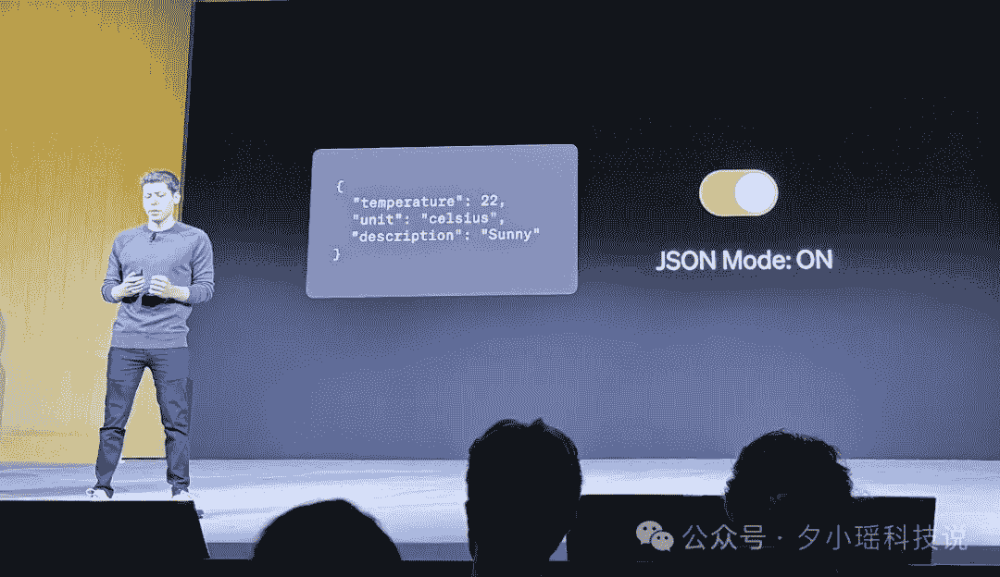

### 华人研究生与MIT联手攻克等差数列难题

贡献人：

`https://mp.weixin.qq.com/s/ppTl0b8uqsk1joJzYH4CCQ`

华人研究生 James Leng 与 MIT 的 Ashwin Sah 和 Mehtaab Sawhney 在组合数学领域的一个长期未解难题 — 等差数列的完全无序不可能性上取得了突破。他们的研究改进了陶哲轩的成果，并在 Szemerédi 定理上进行了扩展，证明了在避免长等差数列时，集合大小的上限比之前的记录要低得多。这一成果是该领域数十年来的首次进展，为未来的数学研究提供了新的视角和方法。

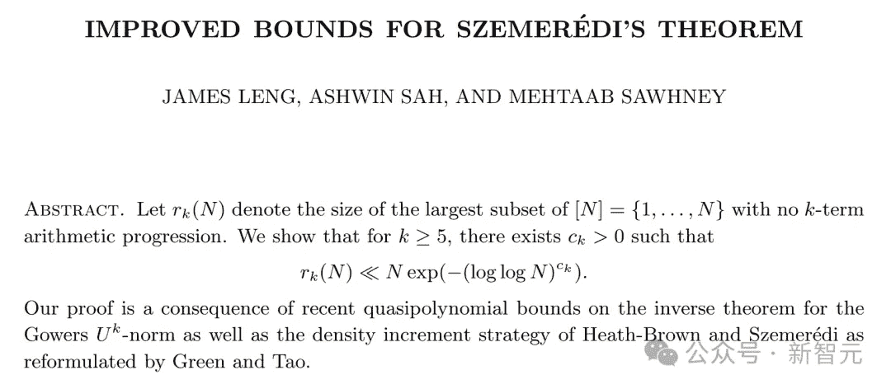

### 右手骨折也不耽误，工程师用AI一周完成3000行代码

贡献人：

`https://mp.weixin.qq.com/s/mjD_wPVnAn3ruSo3r10pnA`

Claude 工程师 Erik Schluntz 因手臂骨折无法手写代码，转而使用 AI 编码工具 Claude 进行编程。通过语音转文字技术，他与 AI 结对工作，在一周内完成了 3000 行代码的编写。这一经历让他认为，AI 将在未来软件工程中扮演关键角色，能够自主编写代码，并与人类工程师进行配对编程。Schluntz 强调，AI 编程将提高效率，降低开发门槛，使工程师能够专注于更高层次的问题解决。他预测，AI 工程师的出现将使软件开发进入一个新的繁荣时代，工程师的工作方式将更加注重自然语言和智能体的交互。

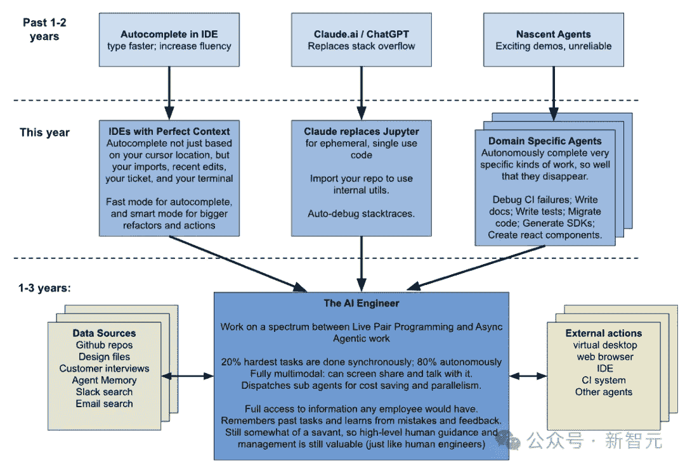

### 谷歌DeepMind推出终身学习智能体：三大模型协作创新

贡献人：

`https://mp.weixin.qq.com/s/P-x8EDrfd1ydCnPP8MYu6g`

帝国理工与谷歌 DeepMind 合作，开发了扩散增强智能体（DAAGG）框架，结合大模型（LLM）、视觉语言模型（VLM）和扩散模型（DM），实现了 AI 终身学习的关键能力。DAAGG 通过后见之明经验增强技术，重新标记过去经验，实现无人监督的迁移学习和高效探索。实验结果显示，DAAGG 在奖励检测、迁移经验和新任务学习方面取得了显著改进，尤其在视觉增强方面提高了智能体的鲁棒性，为 AI 终身强化学习提供了有效解决方案。

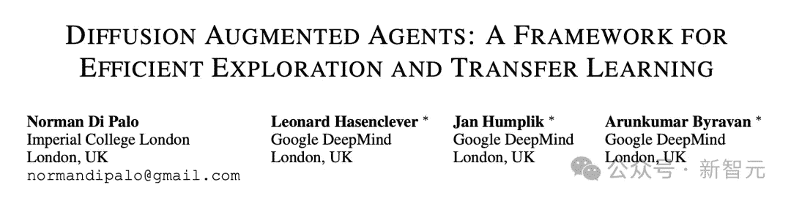

### 李飞飞联名科学家反对加州AI限制法案

贡献人：

`https://mp.weixin.qq.com/s/EkxZ-r4-Swaj5l8ioJyQ7Q`

加州议员提出的 SB-1047 法案引发了人工智能领域的广泛关注和讨论。该法案旨在通过对高风险 AI 模型实施安全标准来防止滥用，但被许多科学家和行业专家视为对创新和开源社区的打击。李飞飞等知名人工智能专家认为，该法案不仅过度负责了开发者，而且可能会抑制学术研究和开源项目的发展。他们指出，法案中的责任条款和对模型能力的限制可能会导致开发者在技术创新上采取更为谨慎的态度，从而影响整个 AI 生态系统的进步。此外，法案可能会对学术界的研究和开源社区的活动产生不利影响，限制了学术界对大型模型的访问和研究。科学家们通过联名信和社交媒体表达了对法案的担忧，强调人工智能政策应该鼓励而非限制创新，并且应该以监管应用为主，而不是直接对技术本身进行监管。他们提出，应该建立更加合理和科学的规则，以确保人工智能的安全发展，同时保护和促进开源社区和学术研究的繁荣。

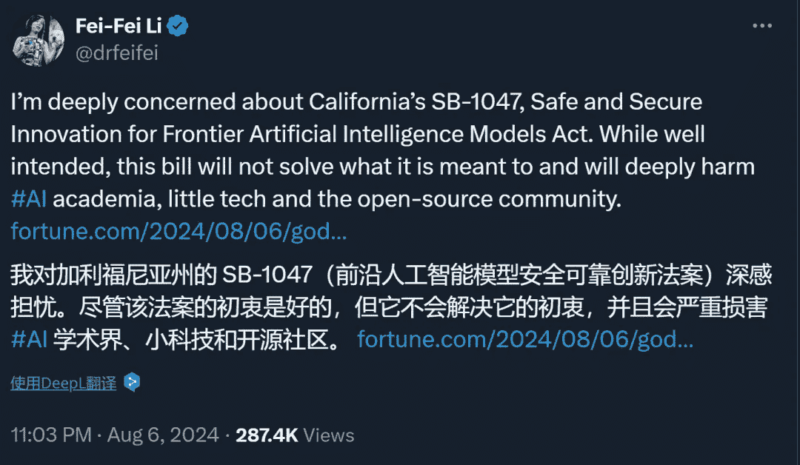

### 阿里推出全自动AI数据科学家，简化科研流程

贡献人:

`https://mp.weixin.qq.com/s/VgGNa9ByB09sJJTucNnuIA`

阿里推出的 AI 数据科学家（DS Assistant）基于 `Modelscope-Agent` 框架，实现了数据科学任务的全流程自动化，包括数据分析、预处理、特征工程、模型训练和评估。该系统支持无需编码即可创建 Agent 助理，采用 `plan-and-excute` 框架处理复杂任务，通过四个主要模块（任务计划、子任务调度、任务执行和结果整合）高效完成任务。实验效果评估显示，DS Assistant 在性能得分、任务时间和消耗 token 数上超越了开源 SOTA。

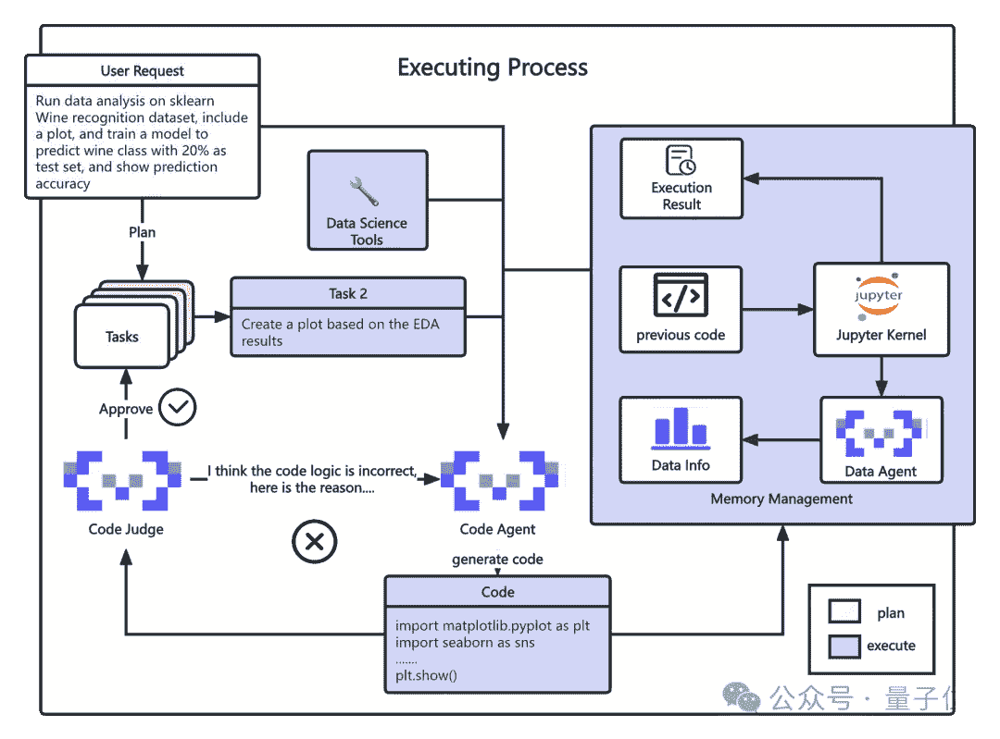

### LlamaIndex网络研讨会：使用RAG进行大规模生成编码

贡献人：

`https://lu.ma/ka5xtyqo`

本次网络研讨会将于8月9日星期五，GMT+8时间凌晨0点至1点通过Zoom平台举行。研讨会重点介绍如何使用`LlamaIndex`实现检索增强生成（RAG）技术，以提升AI生成代码的上下文意识，确保高代码质量和完整性。具体内容包括：

+ 解决大规模代码库中RAG的挑战

+ CodiumAI如何利用`LlamaIndex`增强代码生成的上下文意识

+ 使用`LlamaIndex`进行索引和检索的最佳实践，提升生成代码质量

+ 为企业提供的高级RAG解决方案

### ACM SIGCOMM 2024

贡献人：

`https://conferences.sigcomm.org/sigcomm/2024/`

ACM SIGCOMM 2024 将于2024年8月4日至8日在澳大利亚悉尼新南威尔士大学的Round House举行。作为ACM数据通信特别兴趣小组的年度旗舰会议，本次会议将展示数据通信领域的最新应用、技术、架构和协议。会议内容包括主会场报告、海报展示、演示、学生研究竞赛、工作坊及平行活动等。

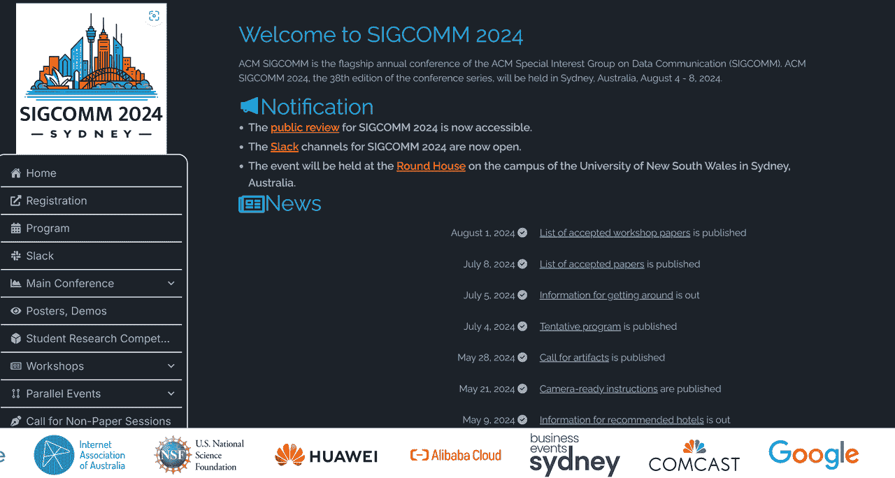

## 推特

### OpenAI Mac App现支持并排访问 ChatGPT

`https://x.com/OpenAI/status/1820914089612439622`

macOS 的桌面应用现在为您提供并排访问 ChatGPT 的功能。使用 Option + 空格键 打开一个辅助窗口，该窗口会保持在最前方，这样您在使用其他应用程序时可以更方便地使用它。

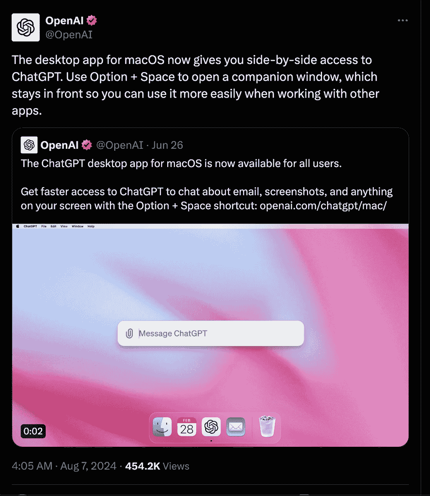

### 吴恩达：分享一些识别有前景创意的最佳实践

`https://x.com/AndrewYNg/status/1820863062993490137`

上周我写了关于为什么致力于具体的初创公司或项目创意——即详细构想的具体产品，以便我们为特定目标用户构建它——可以让你走得更快。在这封信中，我想分享一些识别有前景创意的最佳实践。

我领导的 AI 基金与许多企业合作，识别创意，通常涉及将 AI 应用于公司的领域。因为 AI 适用于许多行业，如零售、能源、物流和金融，我发现与了解这些领域的领域专家合作，对于识别哪些应用值得在这些领域中构建非常有帮助。

我们的头脑风暴过程始于建议合作企业的大量关键贡献者（至少 10 人，有时超过 100 人）获得 AI 的非技术性、商业级理解，了解其能做什么和不能做什么。参加 DeepLearning.AI 的“人人生成 AI”课程是一个受欢迎的选择，之后，公司可以很好地分配一个小团队来协调头脑风暴过程，然后通过优先级排序练习来选择要进行的工作。头脑风暴过程可以通过任务分析来支持，在此过程中，我们将员工的工作分解成任务，以识别哪些任务可以使用 AI 自动化或增强。

以下是这些活动的一些最佳实践：

(i) 信任领域专家的直觉。一个在特定领域工作多年的领域专家会有很好的直觉，可以让他们做出非专家需要数周研究才能完成的飞跃。

假设我们正在与金融服务专家合作，并开发了一个模糊的想法（“为金融建议构建一个聊天机器人”）。要将其变成具体的想法，我们可能需要回答如哪些金融领域（应该专注于预算、投资还是保险？）和服务哪些类型的用户（应届毕业生、按揭申请人、新父母还是退休人员？）的问题。即使是一个多年提供金融建议的领域专家也可能不知道最佳答案，但通过直觉做出的选择可以快速得出一个合理的具体想法。当然，如果可以快速获得市场研究数据来支持这个决定，我们应该利用它。但为了避免过度拖延，我们发现专家的直觉反应效果很好，是快速做出决定的一种方法。

所以，如果我收到一个非具体的想法，我通常会请领域专家仅凭直觉——不依赖其他——来快速做出必要的决定，以使想法具体化。由此产生的想法只是一个起点，随着时间的推移需要进行调整。如果在讨论中，领域专家选择了一个选项，但似乎非常犹豫是否要放弃另一个选项，那么我们也可以将第二个选项保留为备用，如果第一个选项看起来不再有前途，我们可以快速转向备用选项。

(ii) 生成许多想法。我通常建议提出至少 10 个想法；有些人会提出超过 100 个，这更好。这里适用的常见头脑风暴建议是追求数量而不是质量。当涉及优先级排序时，拥有许多想法尤为重要。如果只认真考虑一个想法——有时会发生这种情况，如果一个高级管理人员有一个非常喜欢的想法并将其作为“主要”想法提出——那么会有很大的压力使这个想法成功。即使进一步调查发现其存在问题——例如市场需求弱或技术构建成本高——团队也会想方设法让它成功，以避免最终一无所获。

相比之下，当公司有许多想法可供选择时，如果一个看起来不那么有趣，很容易将注意力转移到另一个。当考虑许多想法时，更容易比较它们以选择更好的想法。如《Ideaflow》一书所述，生成更多想法用于评估和优先级排序的团队最终会得到更好的解决方案。

因此，我发现运行一个涉及许多员工的广泛头脑风暴过程很有帮助。具体来说，大公司有许多人，他们对业务有很多智慧。让一个小核心团队协调从大量人员收集想法，可以利用这一集体发明的源泉。我多次看到广泛的努力（例如，涉及约 100 个对领域有了解并对 AI 有基本理解的人）比狭窄的努力（例如，涉及少数顶级管理人员）产生更好的想法。

(iii) 明确评估标准。在评估和优先级排序时，明确的评分和排名标准有助于团队更一致地判断想法。业务价值和技术可行性几乎总是包含在内。此外，许多公司会优先考虑可以快速取胜的项目（以为其整体 AI 工作积累势头）或支持某些战略优先事项（如在业务的特定部分增长）。在想法生成阶段明确这些标准有帮助，在评估和优先级排序时尤其重要。

在大公司中，完成收集和优先级排序想法的过程可能需要几周时间，但这对于识别有价值的具体想法非常有帮助。AI 只有在找到合适的应用方式时才有用，我希望这些最佳实践能帮助你生成出色的 AI 应用创意来工作。

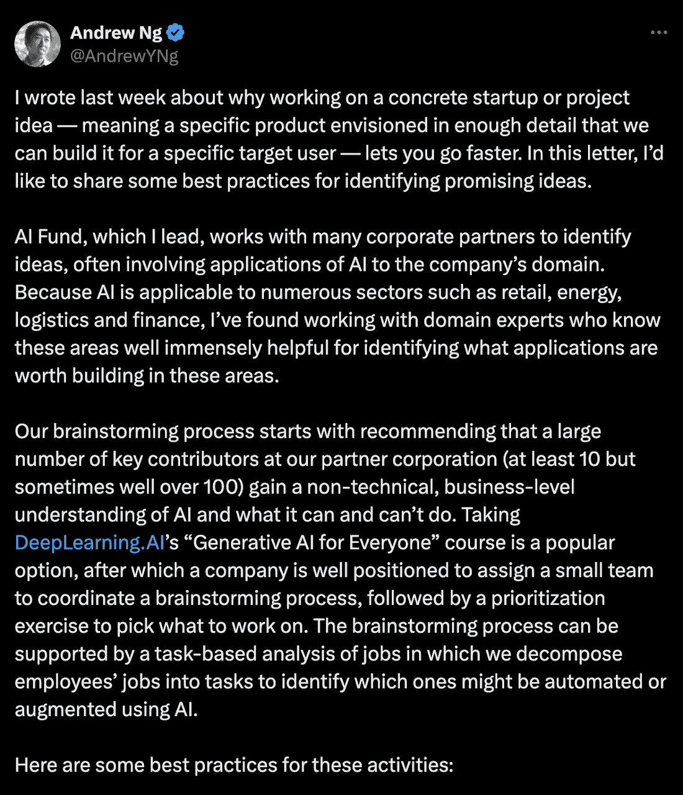

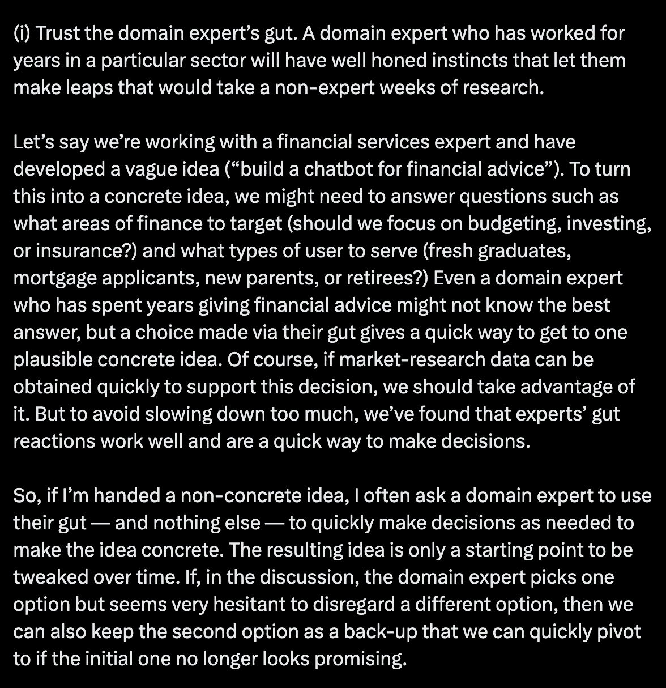

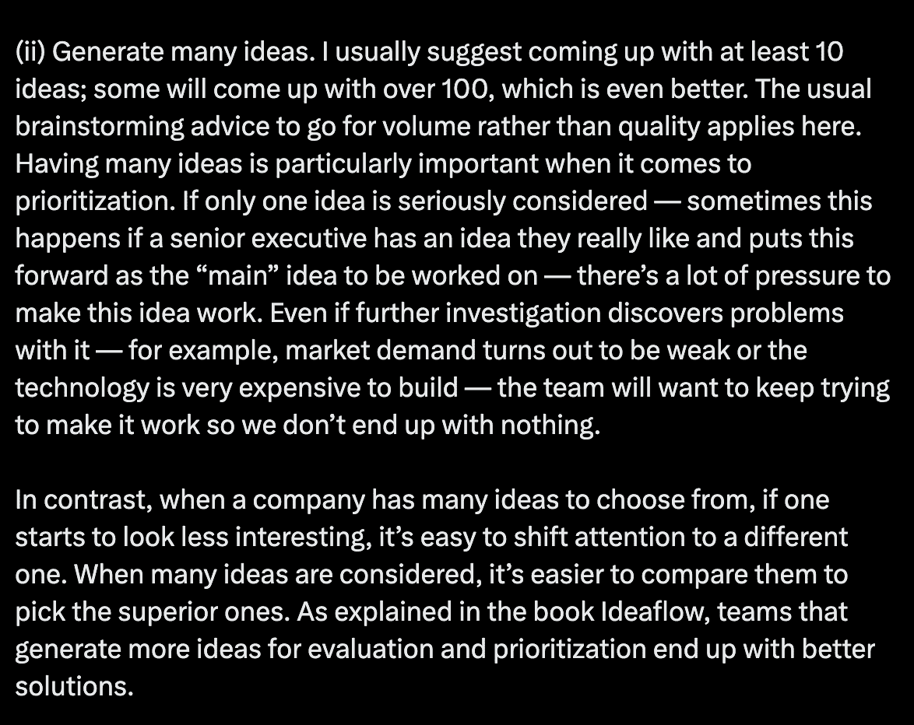

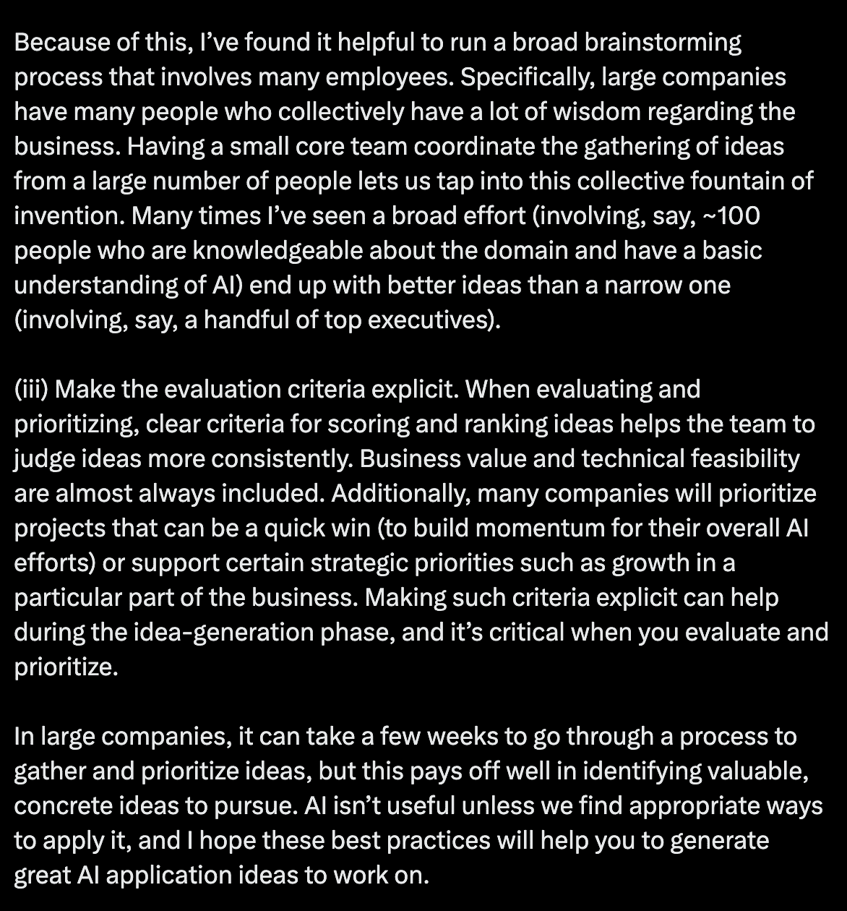

### Mistral Large 2 加入Arena：在硬榜上名列前茅，在编码、复杂提示和数学方面的表现非常出色

`https://x.com/lmsysorg/status/1820849829314257004`

新的 Mistral Large 2 现已发布🔥

它现在在 Arena 硬榜上名列前茅。在编码、复杂提示和数学方面的表现非常出色，超越了顶级模型 GPT-4 Turbo/Claude Opus！

此外，它是一个开源模型——这是开源社区的又一大好消息。

热烈祝贺 @MistralAI ！

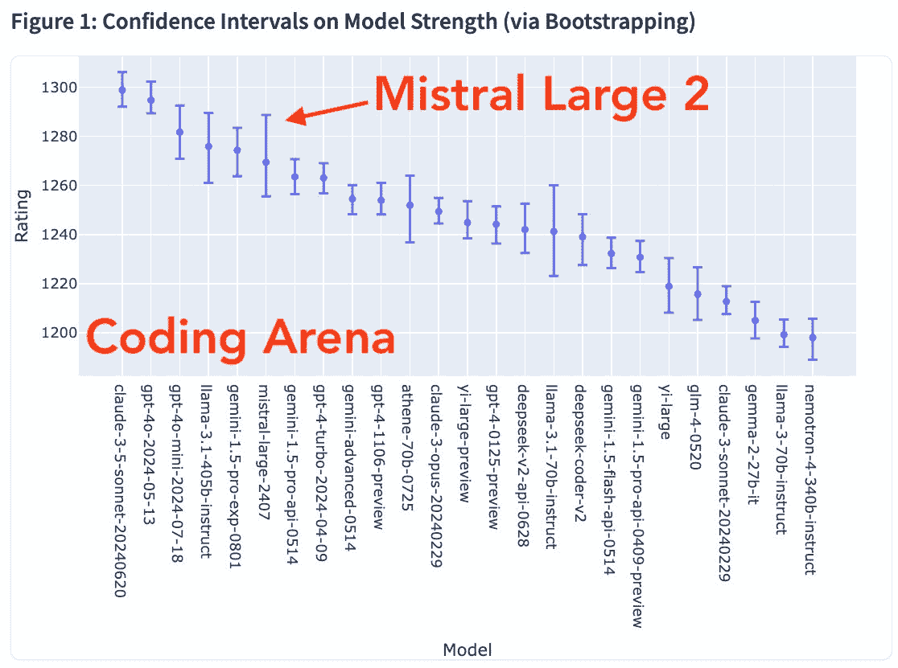

### Vinitsky分享：我们正在开源并发布 GPUDrive，一款 GPU 加速的 2.5D 多智能体驾驶模拟器

`https://x.com/EugeneVinitsky/status/1820869627418701962`

Eugene Vinitsky：我们正在开源并发布 GPUDrive，这是一款 GPU 加速的 2.5D 多智能体驾驶模拟器，运行速度超过每秒一百万帧。在一块 GPU 上运行数百个场景意味着可扩展的多智能体规划。

[`EugeneVinitsky - 1820869627418701962.mp4`](`https://internal-api-drive-stream.feishu.cn/space/api/box/stream/download/all/TAsdbchdloQ2upxSMbyc8Kz7nch`)

### Yangqing分享首次音频时间（TTFA）：在 Lepton，我们正在实现实时语音 LLM，结合文本和音频流，延迟低于 300 毫秒

`https://x.com/jiayq/status/1820876489807872511`

TTFT 已经过时了，是时候讨论首次音频时间 (TTFA) 了！

在 Lepton，我们正在实现实时语音 LLM，结合文本和音频流，延迟低于 300 毫秒。自然集成到每个开源 LLM 模型中。我迫不及待想向您展示这一切。对了，演示视频中的声音就是我本人。你也可以用大约 30 秒的音频获得自己的声音。

“伯克利大学和斯坦福大学哪个更好？”——抱歉，我一直是也永远会是伯克利的粉丝 ;)

我们将在接下来的几天内向我们的客户推出这一功能——如果你有兴趣，请通过 info@lepton.ai 联系我们。

“演讲的唯一原因是改变世界。”

我们正在将本地、实时语音生成带到所有开源 LLMs。我们不是使用分离的、拼凑的模块，而是构建一个单一的引擎，以大约 300 毫秒的首次音频时间同时提供文本和音频。 🧵

[`ssstwitter.com_1723026529793.mp4`](`https://internal-api-drive-stream.feishu.cn/space/api/box/stream/download/all/PeLVbfv0FoPg5cxW6j8cdBL3nMd`)

### Runwayml：结合实景拍摄和生成视觉效果

`https://x.com/runwayml/status/1820806644806070583`

结合实景拍摄和生成视觉效果。

通过 Gen-3 Alpha 学习如何实现：`https://academy.runwayml.com/gen3-alpha/using-image-to-video-in-gen3-alpha`

[`ssstwitter.com_1722963121742.mp4`](`https://internal-api-drive-stream.feishu.cn/space/api/box/stream/download/all/SbudbfWRtowOaHxLFL0cdGs9n2f`)

## 论文

### CoverBench: 一个复杂主张验证的挑战基准

贡献人：

链接：`http://arxiv.org/abs/2408.03325v1`

越来越多的研究专注于验证语言模型输出的正确性。同时，语言模型被用于处理需要推理的复杂查询。我们引入了CoverBench，一个专注于在复杂推理环境中验证LM输出的具有挑战性的基准测试。为了收集这样的基准测试，需要设计能够用于此目的的数据集，这些数据集通常为其他复杂推理任务（例如问答）设计，针对特定用例（例如财务表），需要进行转换、负采样和选择困难示例。CoverBench为各种领域、类型的推理、相对较长的输入以及多种标准化（例如在可用的情况下为表提供多种表示，以及一致的模式）提供了多样化的评估。我们会对数据进行手动审核，以确保标签噪音水平低。最后，我们报告了多种具有竞争力的基准结果，以显示CoverBench具有挑战性，并且具有非常大的提升空间。数据可访问网址`https://huggingface.co/datasets/google/coverbench`。

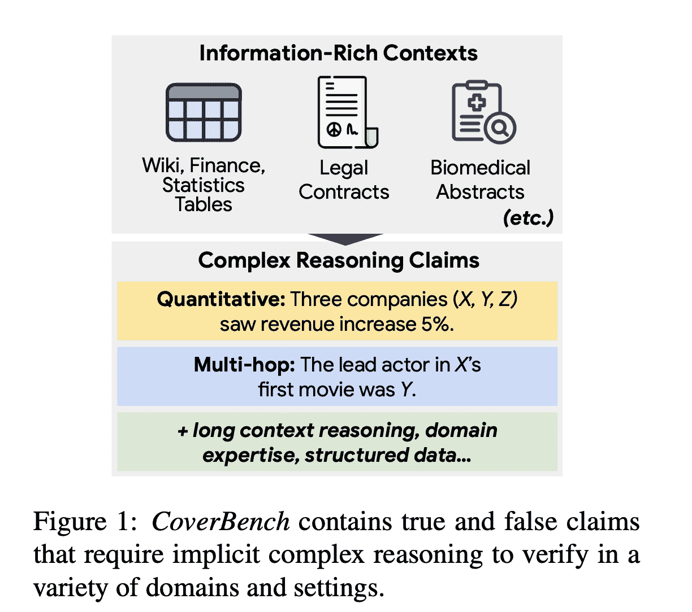

### StructEval: 通过结构化评估加深和拓宽大型语言模型的评估

贡献人：

链接：`http://arxiv.org/abs/2408.03281v1`

评估是大语言模型发展的指挥棒。目前的评估通常采用单项评估范式，针对每个原子测试目标，这在区分模型是否真正具有所需能力或仅仅是记忆/猜测特定问题的答案方面存在困难。为此，我们提出了一种新颖的评估框架StructEval。从原子测试目标出发，StructEval通过跨多个认知层面和关键概念进行结构化评估，从而为LLM提供全面、健壮和一致的评估。对三个广泛使用的基准测试进行的实验证明，StructEval作为一个可靠工具，可抵制数据污染风险，减少潜在偏见的干扰，从而提供更可靠和一致的关于模型能力的结论。我们的框架也为未来基于原则和可信的LLM评估协议的设计提供了启示。

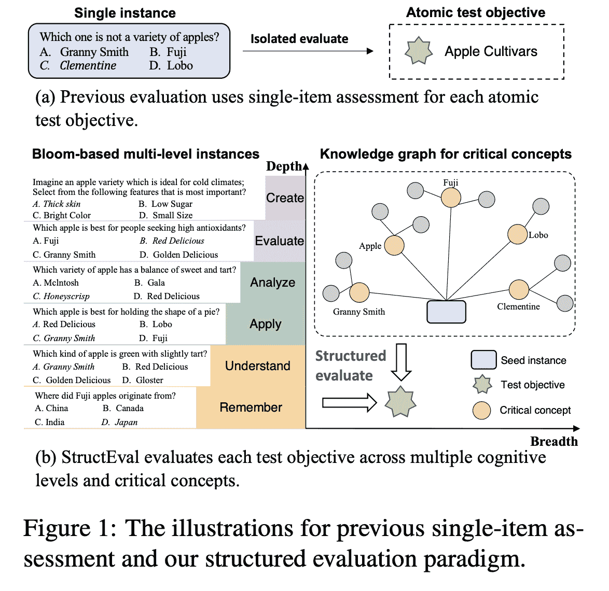

### 从强大和弱大语言模型中合成文本到SQL数据

贡献人：

`http://arxiv.org/abs/2408.03256v1`

摘要：在文本转SQL任务中，开源和闭源大型语言模型（LLMs）之间的能力差距仍然是一个挑战。本文引入了一种合成数据方法，将更强大的模型产生的数据（强模型）与较小且不太对齐的模型产生的错误信息数据（弱模型）结合起来。该方法不仅增强了文本转SQL模型的领域泛化能力，还通过偏好学习探索了错误数据监督的潜力。此外，我们将合成数据方法应用于开源LLMs的指令微调，结果为SENSE，一种专门的文本转SQL模型。通过在SPIDER和BIRD基准测试中展示SENSE的有效性，弥合了开源模型和闭源模型所产生的方法之间的性能差距。

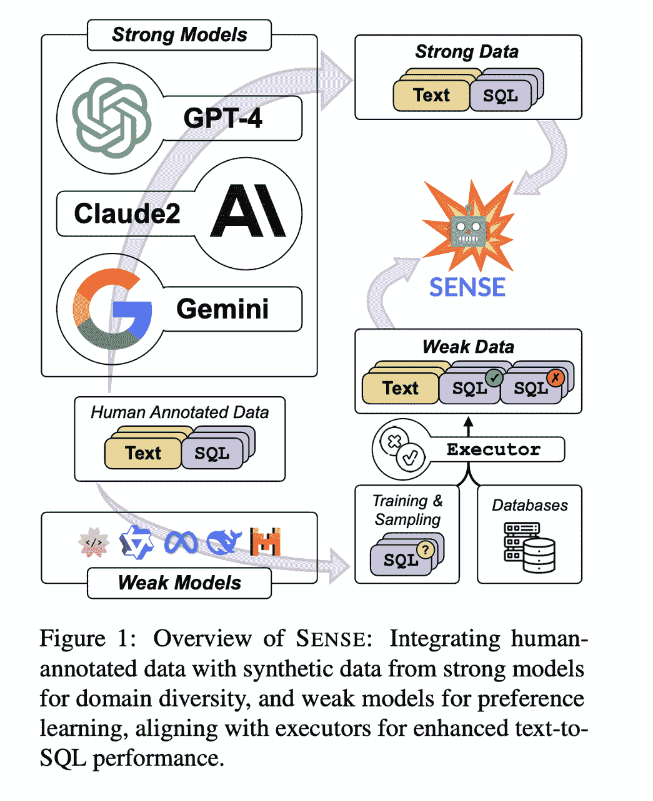

### 揭示大型语言模型通过知识神经元的事实回忆行为

贡献人：

链接：`http://arxiv.org/abs/2408.03247v1`

在这篇论文中，我们研究了大语言模型（LLMs）在面对推理任务时是否积极地回忆或检索它们内部的事实知识库。通过对LLMs在每个推理步骤中的内部事实回忆进行分析，我们发现在某些情况下LLMs未能利用关键的事实关联。相反，它们倾向于选择替代的、类似捷径的路径来回答推理问题。通过手动操纵LLMs中参数化知识的回忆过程，我们证明了增强这种回忆过程直接提高了推理性能，而抑制这一过程会导致明显的退化。此外，我们评估了解决复杂推理任务的强大技术Chain-of-Thought（CoT）提示的效果。我们的研究表明，CoT可以通过鼓励LLMs进行有序和可靠的推理来加强事实知识的回忆。此外，我们探讨了上下文冲突如何影响推理过程中事实的检索，以全面了解LLMs的事实回忆行为。代码和数据将很快提供。

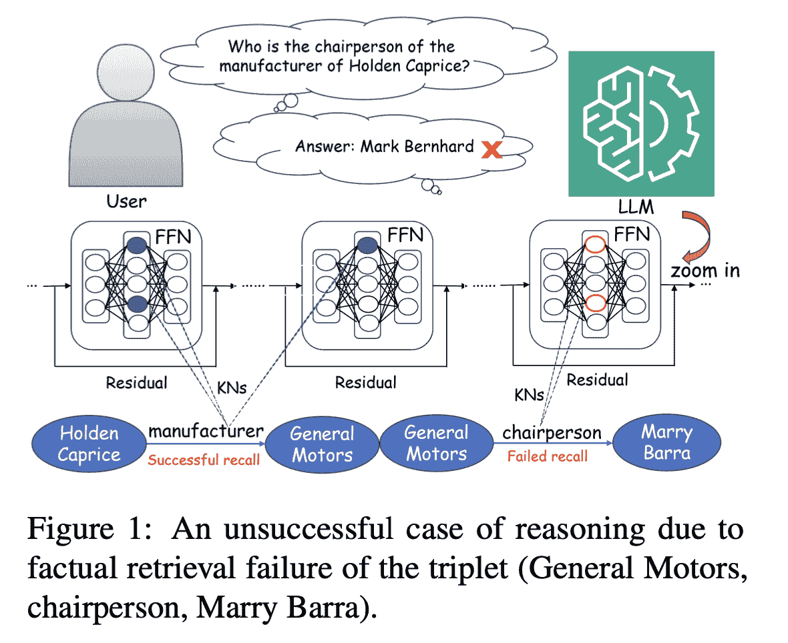

### 使大语言模型更好的多跳推理者

贡献人：

链接：`http://arxiv.org/abs/2408.03246v1`

近期对长文本建模的进展提升了语言模型在各种自然语言处理任务中的能力。尽管如此，我们发现这些模型在多跳推理方面遭遇困难，并且在存在嘈杂上下文的情况下表现下降。本文介绍了一种新方法——带有归因的推理，该方法促使语言模型在推理过程中为每个主张提供归因。我们通过对三个多跳数据集进行实验验证了我们的方法，使用了专有和开源模型，并展示了它的有效性和韧性。此外，我们探讨了通过微调增强推理能力的方法，并提供了一个带有归因标注的数据集和专门的训练策略。我们的微调模型在多跳推理基准测试中取得了竞争性表现，与ChatGPT和Claude-instant等专有语言模型几乎相媲美。

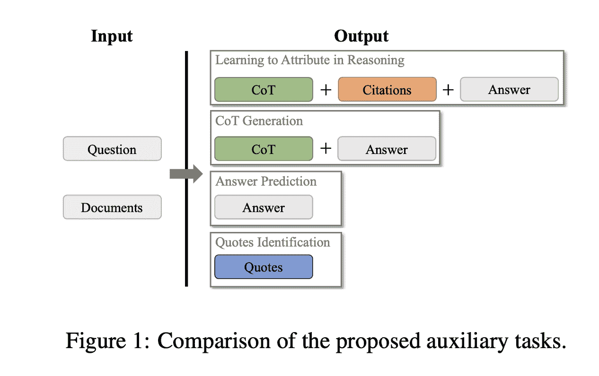

### 500xCompressor: 大语言模型泛化提示压缩

贡献人：

链接：`http://arxiv.org/abs/2408.03094v1`

摘要：Prompt压缩对增强推理速度、降低成本和改善用户体验至关重要。然而，目前的方法面临着诸如低压缩比和评估过程中潜在数据泄露等挑战。为了解决这些问题，我们提出了500xCompressor，这是一种将广泛的自然语言语境压缩成至少一个特殊令牌的方法。500xCompressor引入了大约0.3%的额外参数，实现了从6x到480x的压缩比。它旨在压缩任何文本，回答各种类型的问题，并且可以被原始的大语言模型（LLM）使用，无需微调。最初，500xCompressor在Arxiv语料库上进行了预训练，然后在ArxivQA数据集上微调，并随后在严格不可见和经典问题回答（QA）数据集上进行了评估。结果表明，与使用非压缩提示相比，LLM保留了62.26-72.89%的能力。这项研究还显示，并非所有压缩的token都被同等利用，而K V值在保留高压缩比下的信息方面具有重要优势。自然语言提示的高度压缩性质，即使对于复杂的细粒度信息，也为未来应用和进一步研究开发新的LLM语言提供了有前途的潜力。

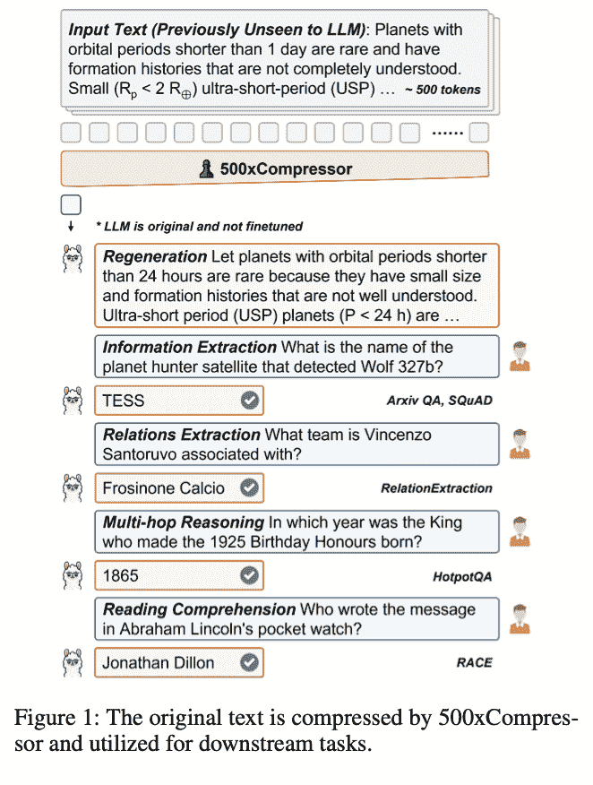

### 合理扩展LLM测试时间计算可以比扩展模型参数更有效

贡献人：

链接：`http://arxiv.org/abs/2408.03314v1`

通过使用更多的测试时间计算使LLMs提高其输出是构建能够在自然语言开放环境中运行的智能体的关键步骤。本文研究了LLMs在推断时间计算上的扩展，重点关注回答以下问题：如果LLM允许使用固定但非平凡量的推断时间计算，它在具有挑战性提示时可以提高多少性能？回答这个问题不仅对LLMs的可达性能有影响，还对LLM预训练的未来以及如何权衡推断时间和预训练计算方法有影响。尽管这很重要，但很少有研究尝试理解各种测试时间推理方法的扩展行为。此外，当前工作主要为一些策略提供了负面结果。在这项研究中，我们分析了两种主要机制来扩展推断时间计算：（1）针对密集的基于进程的验证器奖励模型进行搜索；（2）根据测试时给定的提示自适应地更新模型对响应的分布。我们发现，在这两种情况下，不同方法扩展测试时间计算的有效性取决于提示的难度。这一观察结果促使应用“计算优化”扩展策略，该策略通过最有效地根据提示自适应地分配测试时间计算，可以将测试时间计算的效率提高4倍以上，与最佳-N基线相比。此外，在FLOPs匹配评估中，我们发现在基础模型实现了略微非平凡成功率的问题上，测试时间计算可以用来胜过14倍大的模型。

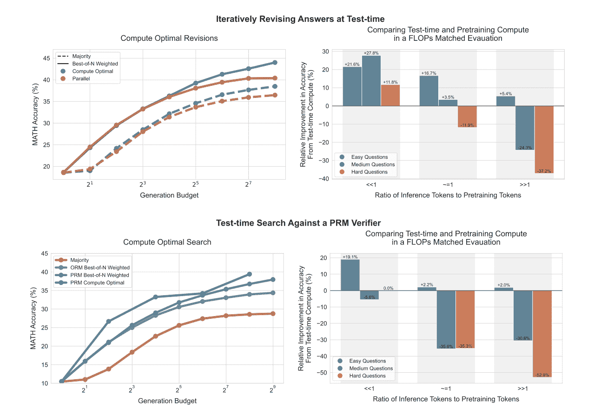

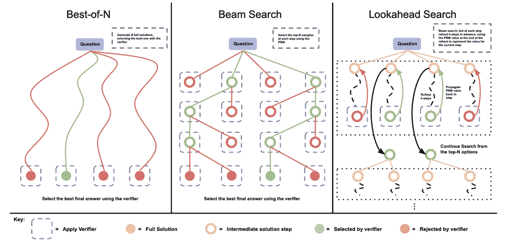

# 产品

### Frontend AI

贡献人：

`https://www.webcrumbs.org/frontend-ai`

Rotendai 是一个基于 AI 的工具，帮助用户快速生成和设计前端组件。用户只需输入文本提示或上传图像，工具便会生成相应的 React UI 组件，并提供代码，支持 Tailwind 或 CSS 等样式。

### Upmetrics AI

贡献人：

`https://upmetrics.co/`

Upmetrics 是一款基于人工智能的商业计划软件，帮助企业家和团队简化商业规划过程。它提供多种功能，包括快速生成商业计划、财务预测、战略规划和投资者演示文稿，可以提高效率并提升用户的规划能力。

# HuggingFace&Github

### MiniCPM-V-2_6

贡献人：

`https://huggingface.co/openbmb/MiniCPM-V-2_6`

MiniCPM-V 2.6 是一款强大的多模态模型，基于 80 亿参数，具备卓越的单图像、多图像和视频理解能力。它在多个基准测试中表现优异，具有强大的 OCR 功能和高效的推理性能，支持多种使用方式，适合在本地设备上进行实时应用。

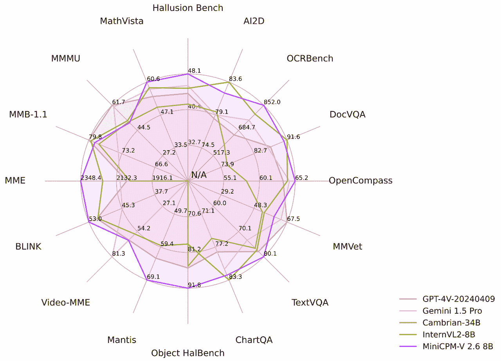

### VidGen-1M

贡献人：

`https://sais-fuxi.github.io/projects/vidgen-1m/`

VidGen-1M 是一个用于文本到视频模型训练的高质量数据集。它通过粗到细的策划策略生成，确保视频质量高、字幕详细且具有良好的时间一致性。与当前常用的数据集相比，VidGen-1M 解决了低时间一致性、字幕质量差、视频质量不佳和数据分布不均等问题，从而为文本到视频模型提供了更合适的训练数据。这使得使用该数据集训练的视频生成模型在实验结果上超过了其他模型。

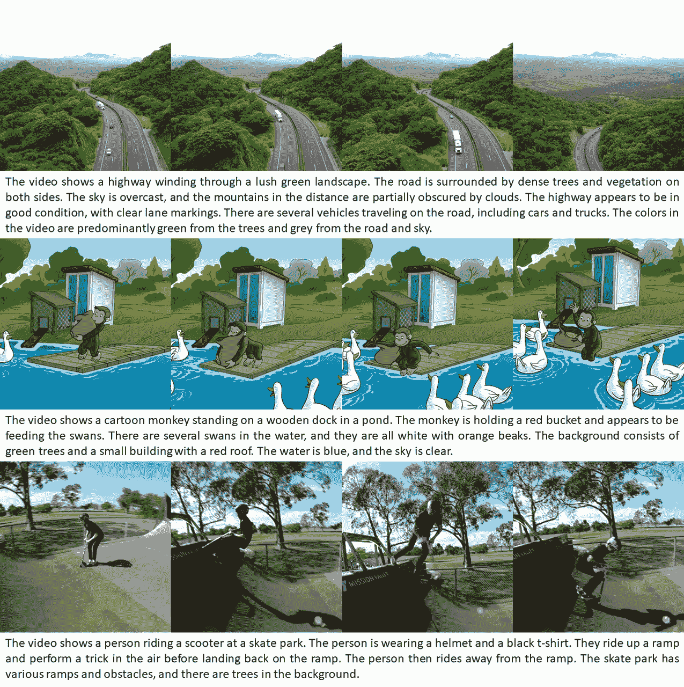

# 投融资

### 「零一万物」完成数亿美元融资，某国际战投、东南亚财团加盟

贡献人：

`https://mp.weixin.qq.com/s/JwEHBtHs4HQZMCh5pg25Ng`

零一万物，李开复创办的 AI 大模型公司，近期完成了数亿美元的融资。此轮融资吸引了国际战投和东南亚财团的参与，显示了对该公司技术和市场潜力的高度评价。自 2023 年 5 月成立以来，零一万物以其核心团队的强大背景和在 AI 领域的快速增长，成为业界关注的焦点之一。公司的产品策略包括在海外市场先行验证，随后在国内市场推广，如 AI 办公工具 PopAi 和生产力工具 “万知”。此外，零一万物推出了首款闭源模型 Yi-Large，在 LMSYS 榜单中获得了中文分榜世界第一的荣誉。公司的全球化战略不仅体现在融资上，也展现在其客户群体和人才招募上，近期多位来自谷歌、微软等公司的 AI 高阶人才加盟。李开复提出的 TC-PMF 理念，强调了在技术成本和产品市场契合度之间寻求平衡的重要性，这也是公司在激烈的市场竞争中保持领先地位的关键。

公司官网：`https://www.01.ai/`

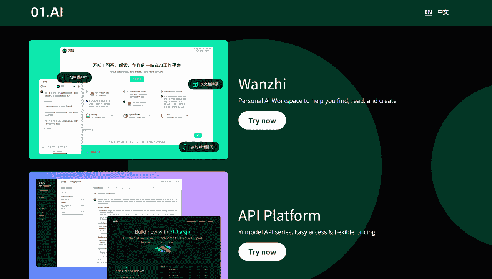

### KNIME最新融资

贡献人：

`https://techcrunch.com/2024/08/06/knime-lets-users-build-workflows-to-automate-data-analytics-task/`

德国计算机科学家团队创建的KNIME公司，近日获得3000万美元投资，使其总融资额达到5000万美元。KNIME开发了一款模块化、可扩展的数据处理平台，旨在帮助企业自动化数据分析任务。该公司现有包括奥迪、AMD、礼来、诺华等在内的400个客户，每年经常性收入增长30-40%，目前约为3235万美元。此次融资将用于产品开发、团队扩展及客户获取，尤其是在美国、欧洲、中东和非洲市场。KNIME计划通过AI助手和SaaS产品进一步增强其竞争力。

公司官网：`https://www.knime.com/`

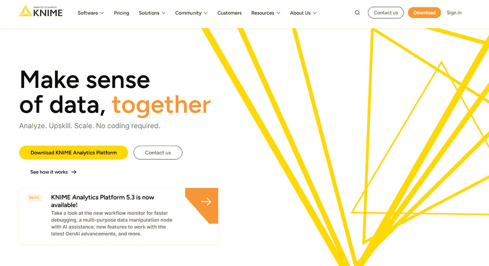

### Hyperspace利用“领域专用计算”加速数据库搜索

贡献人：

`https://techcrunch.com/2024/08/06/hyperspace-is-building-custom-instances-to-accelerate-database-searches/`

以色列特拉维夫的初创公司Hyperspace利用“领域专用计算”技术，加速词法和向量数据库搜索，宣称其搜索速度比传统数据库快10倍，并以50%更低的成本提供5倍的吞吐量。Hyperspace不出售实例，而是以SaaS模式提供托管数据库服务。近期，该公司获得950万美元种子轮融资，由MizMaa领投，JVP和toDay Ventures参投，资金将用于扩大数据库服务规模并推出免费计划。Hyperspace已经与Forter、nSure和Renovai等企业签订合同，并在过去一年中将年经常性收入和总合同量提高了三倍。

公司官网：`https://www.hyper-space.io/`

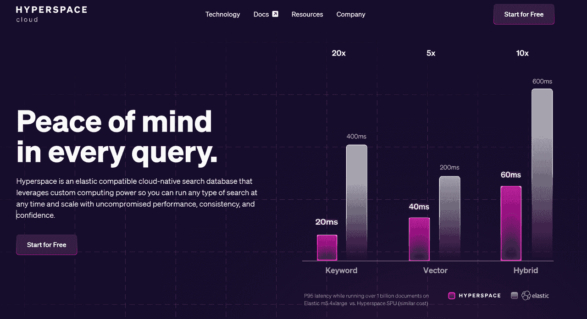

### 「格睿科技」完成数百万美元融资，助力可观测和物联网领域高效数据价值挖掘

贡献人：

`https://mp.weixin.qq.com/s/SsK_tgRebv2U6qiELPmvHA`

格睿科技近期完成了一轮数百万美元的融资，由 Atypical Ventures 领投，Picus Capital 跟投。此轮融资资金将用于研发创新和全球化拓展，以支持其开源时序数据库产品的发展，这些产品广泛应用于可观测、物联网（IoT）及车联网等领域。格睿科技自成立以来，已推出 GreptimeDB 开源时序数据库及企业版产品，并推出了全托管的云服务 GreptimeCloud。

公司官网：`https://greptime.cn/about`

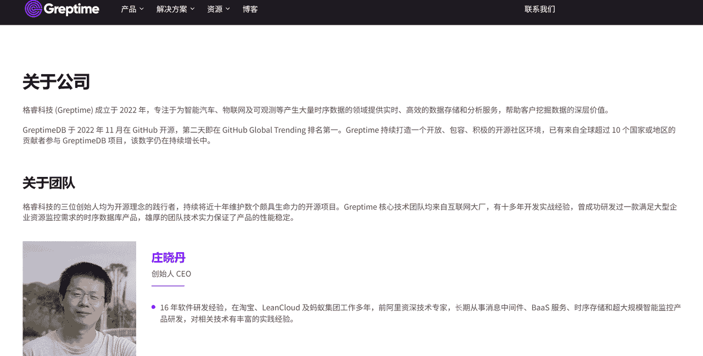

### MuukTest将生成式AI引入软件QA测试

贡献人：

`https://techcrunch.com/2024/08/06/muuktest-is-putting-genai-at-the-center-of-software-qa-testing/`

MuukTest是一家位于北卡罗来纳州罗利的初创公司，近日宣布推出一个新的AI代理，旨在自动化软件质量保证（QA）测试。该公司结合多种AI技术，包括大语言模型、传统机器学习、计算机视觉和图像识别，以创建测试套件。MuukTest成立于2019年，近期融资总额达到600万美元，并在去年实现了15倍的收入增长。新推出的AI功能可以根据用户描述自动生成测试套件，大幅减少测试工作量。

公司官网：`https://muuktest.com/`

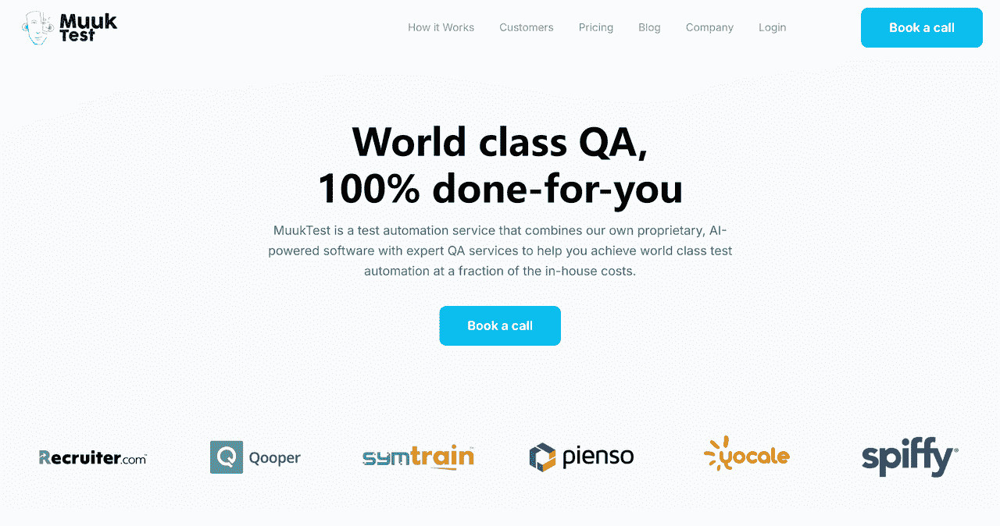

### AI驱动的热水器有望消除冷水澡和碳污染

贡献人：

`https://techcrunch.com/2024/08/06/ai-powered-water-heater-could-banish-cold-showers-and-carbon-pollution/`

Cala Systems开发的热水器结合了先进的热泵和AI驱动的控制系统，能够预测热水需求，提高加热效率。公司近期获得由Clean Energy Venture Group和Massachusetts Clean Energy Center领投的560万美元种子轮融资，其他参投方包括Burnt Island Ventures、CapeVista Capital和Leap Forward Ventures。Cala的首款产品为65加仑热泵热水器，售价2850美元，可预订，预计明年初交付。此产品旨在利用太阳能等可再生能源，降低家庭碳排放并减少能源费用。

公司官网：`https://www.calasystems.com/`

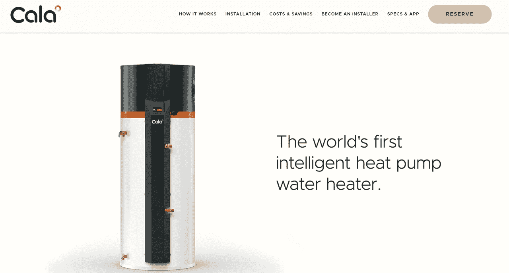

# 学习

### 如何优雅地测量GPU CUDA Kernel耗时？

贡献人：

`https://zhuanlan.zhihu.com/p/712660021?utm_psn=1804173156463808514`

本文详细介绍了在 CUDA 编程中测量 GPU 核函数（Kernel）耗时的方法。作者首先指出了 GPU 和 CPU 耗时测量的差异，解释了 GPU 的异步执行逻辑，并通过示例代码演示了如何测量核函数的启动时间和实际执行时间。文章继而推荐了两种测量手段：Nsight System 和 `CudaEvent`。Nsight System 是 NVIDIA 提供的可视化工具，能够直观地展示每个核函数的执行耗时和启动器的时间。而 `CudaEvent` 通过一系列 API（如 `cudaEventCreate`、`cudaEventRecord`、`cudaEventSynchronize`、`cudaEventElapsedTime` 和 `cudaEventDestroy`），允许开发者更精确地测量指定核函数的执行时间，并提供了统计信息如平均时间、中位数和分布等。最后，作者还提到了其他工具如 NCU，并强调了在实际应用中选择合适的测量方法的重要性。

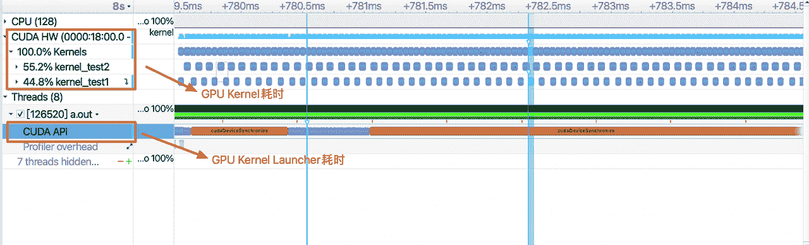

### 如何把 PyTorch 的 GPU 利用率提升到 100% ?

贡献人：

`https://fkong.tech/posts/2023-11-19-torch-gpu-util/`

文章首先指出，GPU 作为一种稀缺且昂贵的资源，需要被充分利用以提高计算效率和速度。 GPU 利用率的衡量方式通常是指 GPU 上有计算和图形活动的时间占总运行时间的比例，而 GPU 利用率不足 100% 意味着 GPU 在程序运行时有空闲状态。 测量 GPU 利用率可以通过 `nvidia-smi dmon`、NVIDIA Nsight Systems (NSYS)、NVIDIA Data Center GPU Manager (DCGM) 和 NVIDIA Management Library (NVML) 等多种方式。

在适用场景方面，文章通过使用 NGC PyTorch 23.09 和 Stable Diffusion 模型进行测试，展示了不同软硬件配置和应用程序特性下 GPU 利用率的差异。 结果表明，软硬件系统和应用程序配置不同，GPU 利用率通常会有较大差异，受到系统硬件配置、GPU 上负载的大小和应用程序特性的影响。

文章进一步分析了 GPU 利用率低的根本原因，认为是由于 CPU 与 GPU 不协调，即 CPU 负载过多或 GPU 负载过少，以及 CPU 在准备运行时环境时导致 GPU 等待。

为了解决 GPU 利用率低的问题，文章提出了一系列解决方案，包括硬件升级、增加 GPU 负载和降低 CPU 负载等。 增加 GPU 负载的方法包括增加每个 GPU 上的 batch size、共享 GPU 等；降低 CPU 负载的方法则包括预处理 / 缓存、多线程、CPU 与 GPU 流水线、迁移到 GPU 上、减少 CUDA kernel 数目、消除 CPU 与 GPU 之间的同步以及使用 CUDA Graph 等。

### torch原生——tensor并行&张量并行（附带`MLP`例子）

贡献人：

`https://zhuanlan.zhihu.com/p/707711038?utm_psn=1804464555071528960`

在 PyTorch 2.3 版本中，引入了`torch.distributed.tensor.parallel`模块，专门用于张量并行。核心函数`parallize_module`负责将模型并行化。并行化方法通过设置不同的`ParallelStyle`来定义，包括`ColwiseParallel`和`RowwiseParallel`两种主要的张量并行方式，以及`SequenceParallel`、`PrepareModuleInput`和`PrepareModuleOutput`等。这些并行策略需要指定参数、输入和输出的处理方式，即`Placement`，包括`Shard`、`Replicate`和`_Partial`三种方法。通过一个 MLP 的例子，文章展示了如何将`nn.Linear`层的参数沿列或行分割，以及如何在多个 GPU 上复制模型或进行维度对齐。此外，文章还强调了并行训练过程中的关键点，如梯度累积、通信开销和内存使 AGE，以及如何使用`torch.cuda.memory_allocated()`来监控内存使用情况。

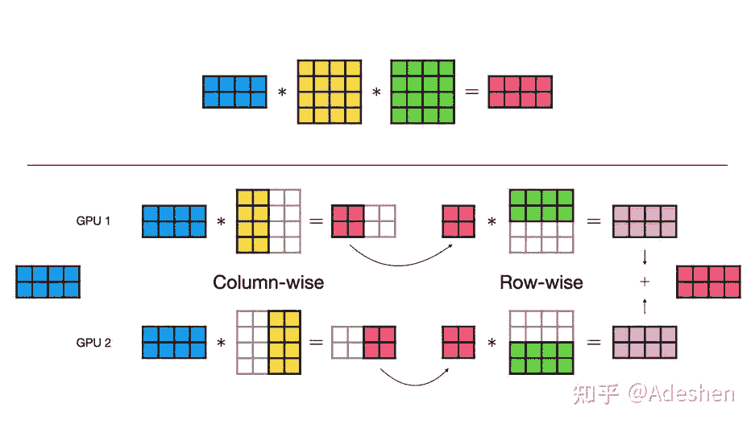

### 使用 vLLM 为多个 LoRA 适配器提供服务

贡献人：

https://zhuanlan.zhihu.com/p/712668798?utm_psn=1804465132673298432

文章探讨了使用 vLLM 技术为多个 LoRA 适配器提供服务的方法。LoRA 适配器通过在预训练模型中引入低秩矩阵进行微调，能够快速适应新任务。vLLM 通过虚拟化技术，使得单一模型能够支持多个 LoRA 适配器，从而在保持模型轻量级的同时提升了其在多任务处理上的能力。这种方法减少了内存和计算资源的消耗，尤其对于大规模模型的部署具有重要意义。

### [2024智源大会速览] 视频生成篇

贡献人：

https://zhuanlan.zhihu.com/p/713143946?utm_psn=1804435630656192512

2024 智源大会视频生成篇聚焦了 AI 在视频制作领域的应用前沿。Aditya Ramesh 从 OpenAI 介绍了从图生文到文生图的发展脉络，强调了语言智能在视觉智能中的作用。万鹏飞从快手提出的可灵视频生成大模型中，展示了 3D 时空注意力机制和 Scaling Law 的应用，实现了分辨率高、运动合理的视频生成。王长虎从爱诗科技角度探讨了 Character2Video 和 MagicBrush 技术，提出了基于 adapter 方法和 RL 的 PPO 模块来提升视频生成的保真度和美学质量。卢志武教授从人民大学视角分析了视频生成的两种范式，即基于图片 SD 模型的时序关系建模和直接全局生成的方法。鲍凡从生数科技介绍了 Vidu 及其在 4D 视频生成中的应用，以及如何通过 DGS 方法进行 3D 场景的重建和优化。SVD 方法介绍了其在 Large Video Dataset (VLD) 建设、Temporal Video Fine-Tuning 和 Generate High Frame & High Resolution Video 方面的技术创新。Sora 方法通过 NaViT 技术支持原分辨率训练，实现了长视频的连贯性和高效率生成。

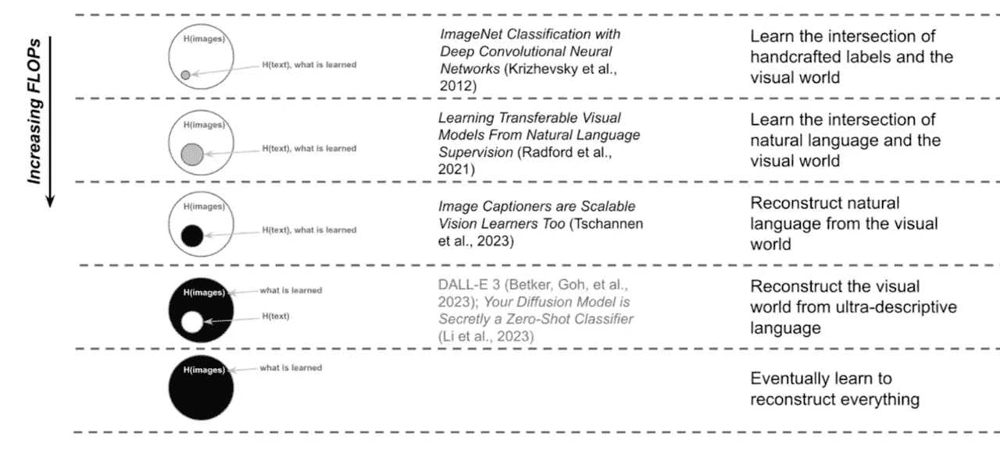

### 大模型分不清 9.9 与 9.11 谁大，那 Embedding 模型呢？

贡献人:

https://mp.weixin.qq.com/s/wIm3loi5KcznFYTpgIl-Dg

本文由肖涵从 Jina AI 撰写，探讨了大型语言模型在数字比较任务中的挑战。通过对`jina-embeddings-v2-base-en`和`jina-reranker-v2-multilingual`模型进行的实验，文章评估了它们在不同数字比较场景下的性能，包括小数、货币、日期和时间等。实验采用余弦相似度和相关性得分作为评价指标，结果显示 Embedding 模型在简单数字比较中表现较好，但在复杂数值区间或浮点数比较时效果下降。Reranker 模型在这些任务中的表现不稳定，尤其是在处理大数字和随机数字范围时。文章指出，分词策略和训练数据对模型的数值推理能力有重要影响，并强调了这种能力对于提升搜索质量的重要性。特别是在处理结构化数据如 JSON 时，模型的算术能力至关重要。

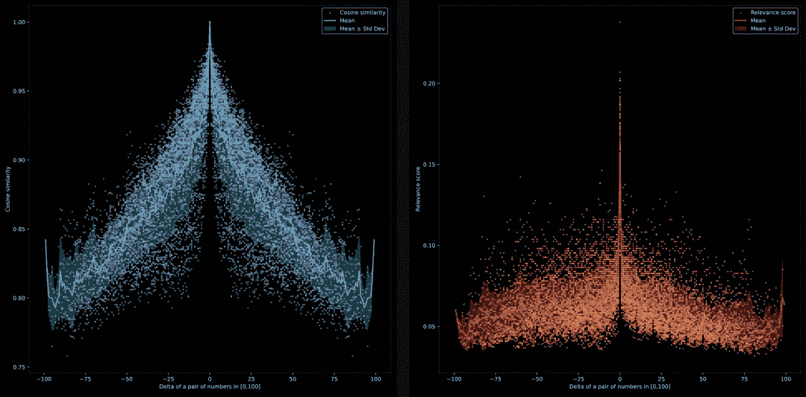

### 赖耶 AI 工厂-基于 NVIDIA AI Enterprise 的最佳落地实践

贡献人：

https://zhuanlan.zhihu.com/p/713030782?utm_psn=1804173697554190336

赖耶 AI 工厂由北京赖耶信息科技有限公司推出，致力于提供全栈式大语言模型技术服务，推动各行各业的智能化转型。公司核心团队成员具备丰富的专业知识和实践经验，在高性能计算集群建设、基础设施及大模型应用方面积累了丰富的实践经验。赖耶 AI 工厂的技术优势和服务内容包括：万卡集群管理系统 KAA、企业大模型服务平台 MANAS、企业级专家技术服务以及一体化集群解决方案。KAA 系统提供了高效的集群管理和自动化工具，支持多租户架构，并具备高可靠性和故障恢复能力。MANAS 平台则提供了从数据管理到模型部署的全套解决方案，支持模型定制和优化，以及信息检索和数据防护。赖耶科技还提供了针对企业的专家技术支持服务，包括业务标准支持和增值技术支持，以及客户生命周期服务。最后，赖耶 AI 工厂提供了一体化集群部署方案，帮助企业快速搭建高效计算中心。

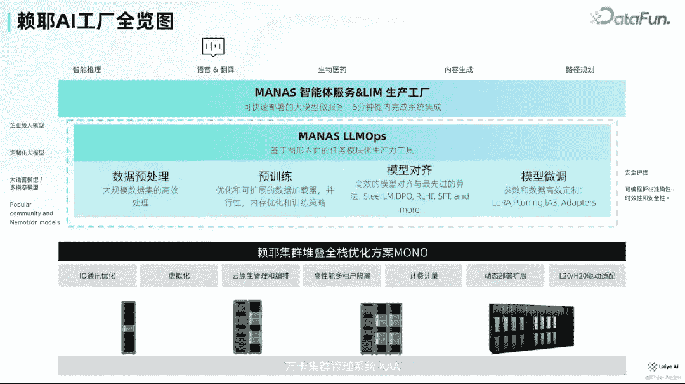

# 声明

本文档仅供学习交流使用，版权归原作者所有，若涉侵权，请联系Jack Jin 15101136166

（欢迎在下方反馈您宝贵的意见！整理不易，觉得有用给AI日报小组点个赞👍吧！）

ChatGPT；Angela；Zijia Liu；Alex；Zeqi Tan；Tiezhen（HuggingFace）；Naixu；Lizhi；Peter；Suoman；Jack

封面生成——右脑科技

如果你有大模型相关的创业想法，欢迎来找我们聊聊～🛰️：15101136166

> 快邀请你的小伙伴们一起来读大模型日报吧！

> 【日报知识库】这里是近期日报内容的汇总,欢迎大家查阅

> [大模型日报知识库(分享版)](https://miracleplus.feishu.cn/wiki/KapVwXfkriOBiskB0B2cUHxjnTh)

>

> 欢迎大家多多帮我们分享,转发

> 如果大家有任何的建议或者吐槽,欢迎随时找我聊天~

