# 奇绩大模型日报（8月 8日）

> 来源：[https://miracleplus.feishu.cn/docx/HDNfdzZ0soBGLjxeXNjc59SYn8r](https://miracleplus.feishu.cn/docx/HDNfdzZ0soBGLjxeXNjc59SYn8r)

# 📡潜空间活动预告

> **潜空间系列活动第三季全面升级！**

> 第三季第二期将在**8月11日** **11:00 am**开始，嘉宾是**陈贝迪**。她将为我们带来关于 Efficient Long-context Generation 的分享。

> 活动包含嘉宾分享、访谈Q&A、cofounder matching餐会。活动现场还可以体验到咱们奇绩校友的最新产品，期待大家大力支持！

> 陈贝迪-卡内基梅隆大学助理教授，斯坦福大学人工智能博士后学者，前 Meta AI 研究科学家；致力于在现代硬件上设计和优化算法和模型，以加速大型机器学习系统。

> 欢迎扫描报名~

# 资讯

### Audible测试AI驱动搜索功能

贡献人：

https://techcrunch.com/2024/08/07/audible-ai-powered-search-feature/

Audible宣布正在测试一项AI驱动的搜索功能，以帮助用户更精准地查找有声书。从今天起，部分美国用户可以使用“ Maven”，这是Audible的新个人推荐专家，能够根据用户的具体请求提供标题建议。用户可以使用自然语言输入查询，Maven将根据Audible近百万的书目提供个性化推荐。

目前，该功能在iOS和Android设备上可用，大约一半的美国用户可以访问，但仅限于部分有声书库。Audible还在尝试AI策划的合集和AI生成的评论摘要。这些举措表明，Audible正积极探索AI技术在有声书市场中的应用。

### 2024 Google 开发者大会主旨演讲精华回顾

贡献人：

https://mp.weixin.qq.com/s/l7Cl1h6L3QWE8y2fcj_p-g

2024 年 Google 开发者大会聚焦 AI 技术，强调中国开发者在全球市场的重要作用。谷歌推出了多种 AI 工具和技术更新，包括 Gemini 和 Gemma 系列模型，以及 Project Oscar 等开源项目，旨在提升开发效率和创新潜能。此外，Google Cloud 的先进特性和 “Build with AI” 活动，以及对中国初创企业的支持，体现了 Google 在促进技术传播和社会发展方面的承诺。同时，Google 还致力于数字人才的培养，与教育部合作，为高校教师和学生提供培训，以应对 AI 时代的挑战。

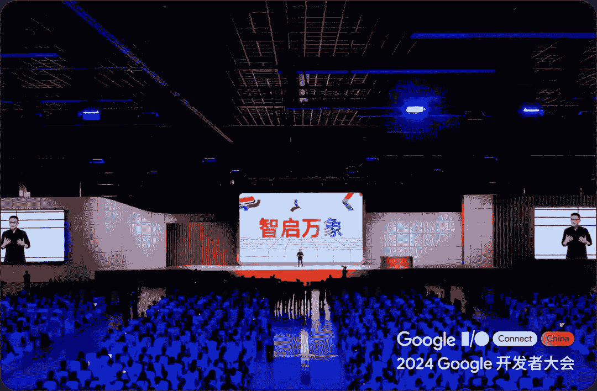

### 清华团队实现全前向光计算训练，登上Nature

贡献人：

https://mp.weixin.qq.com/s/nJoB1kyPIa-VoALtLJyDxw

清华大学研究团队在智能光计算领域开发了全前向智能光计算训练架构（FFM），这一创新突破首次在 Nature 期刊上发表。FFM 架构能够在物理光学系统上直接设计和调整光学参数，利用梯度下降算法得出模型参数，无需在计算机模型中进行建模。该方法提高了光神经网络的训练准确率，支持通过散射介质实现全光学聚焦，并在室温下进行亚光子级的光处理。此外，FFM 还在集成光系统的自设计中展现了其高效性，开发的「太极 - II」光训练芯片证明了其计算能力可以与亿级神经元芯片相媲美，能效超过英伟达 H100 1000 倍。

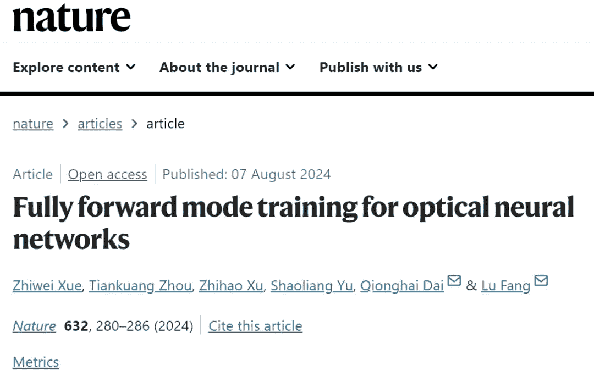

### FMS 2024: 带来哪些存储技术亮点？

贡献人：

https://mp.weixin.qq.com/s/4MPDXjeaTnALQ5iHufBFcw

FMS 2024 大会作为全球性的存储技术盛会，展示了当前存储领域的多项创新和技术亮点。首先，NVM Express 组织宣布了 NVMe 协议 SPEC 2.1 版本的更新，引入了新的规范和功能，旨在简化开发流程并适应现代计算环境，提高了跨传输协议的支持和安全性。Kioxia 公司展示了一款采用光接口的 SSD，这项技术有望改变数据中心和高性能计算环境中的存储架构。CXL 技术继续是热点话题，XConn Technologies 和 MemVerge, Inc. 展示了可扩展的 CXL 内存共享解决方案，而微星和 MemVerge 合作推出了基于 CXL 技术的服务器平台。Neo Semiconductor 宣布开发出 3D X-AI 芯片技术，旨在解决高带宽内存的瓶颈问题。此外，多家存储厂商如 Kioxia、WD 西部数据、Phison、Micron 美光、Innodisk 和 DapuStor 等都展示了各自在存储技术方面的进展和创新。Silicon Motion Technology Corporation 宣布推出 SM2508，这是一款针对 AI 个人电脑和游戏机设计的最佳能效 PCIe Gen5 NVMe 2.0 客户端 SSD 控制器。

### 曝Bengio新动向：世界模型+数学证明，确保AI系统正常运作

贡献人：

https://mp.weixin.qq.com/s/tDa46iKHeLqJS39PamnAPw

Yoshua Bengio 加入 Safeguarded AI 项目，旨在通过结合科学的世界模型和数学证明，确保 AI 系统的安全运作。项目由英国 ARIA 支持，预计投入 5900 万英镑。Bengio 将担任科学总监，关注 TA3 和 TA2 的研发，提供科学战略建议。该项目分为三个技术领域：支架、机器学习和应用，目的是构建一个能够理解并降低其他 AI Agent 风险的 AI 系统。Guaranteed Safe AI 模式被提出，包括世界模型、安全规范和验证器，以量化 AI 系统的安全保障。

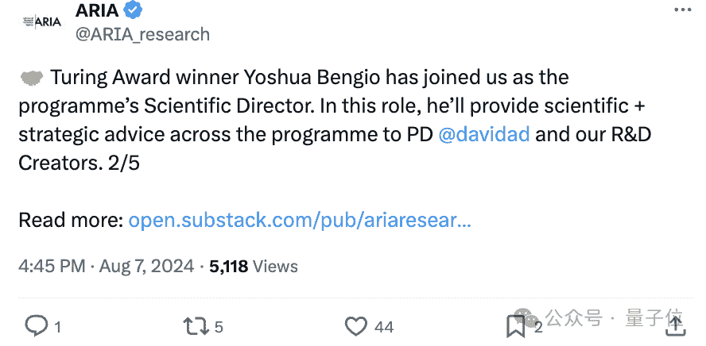

### 奥特曼晒“草莓”引热议，神秘新模型现身竞技场

贡献人：

https://mp.weixin.qq.com/s/SZhfZdGFcotZTq_5qkn8NA

OpenAI 即将推出名为 “草莓” 的新 AI 模型，该模型据称是之前神秘项目 Q * 的后续，预计将带来更高级的推理和自主学习能力。奥特曼在社交媒体上的一系列与 “草莓” 相关的发言加剧了公众的猜测和期待。网友已对 lmsys 竞技场上的一个匿名聊天机器人进行了测试，该机器人声称属于 GPT-4 系列。尽管 OpenAI 未直接确认新模型的详情，但他们表达了希望 AI 模型能更像人类理解世界，并持续在推理能力的提升上研究。此前，OpenAI 已在内部进行了一次模型测试，数学成绩超过 90%，进一步证明了新模型的潜力。随着 GPT-4 发布以来已近一年半的时间，行业内部普遍预期新一代 AI 模型的到来，而 “草莓” 项目的曝光正是这一预期的体现。

### 2024 CCF-快手大模型探索者基金课题介绍

贡献人：

https://mp.weixin.qq.com/s/mcCmBpE0XH_j0FZUl5Swrg

2024 年 CCF 与快手合作推出的大模型探索者基金，旨在资助视觉理解与生成以及视频处理领域的研究，强调鼓励学术界与产业界的深度合作，推动大模型技术的创新与应用。该基金专注于图像和视频处理的前沿技术，包括图像识别、图像生成、视频理解和视频生成等方向，期望通过这些研究项目，解决该领域的复杂问题，并将科研成果转化为实际应用，提升技术在行业中的效率和效果。

# 推特

### 吴恩达：现实免费《初学者AI Python》，一系列四个短期课程，旨在教会任何人编程，无论他们当前的技术水平如何

https://x.com/AndrewYNg/status/1821206887913943110

我在教授一门新课程！《初学者AI Python》是一系列四个短期课程，旨在教会任何人编程，无论他们当前的技术水平如何。我们在限时内免费提供这些课程。

生成式AI正在改变编程。这门课程教的是与编程未来发展方向一致的内容，而不是过去的内容：

(1) AI作为编程助手。经验丰富的程序员正在使用AI来帮助编写代码片段、调试代码等。我们采用这种方法，并介绍使用聊天机器人进行编程的最佳实践。在整个课程中，你将有一个AI聊天机器人作为你的编程助手，它可以在你编程的每一步都为你提供帮助。

(2) 通过构建AI应用程序学习编程。你将编写与大型语言模型交互的代码，快速创建有趣的应用程序，如定制诗歌、编写食谱和管理待办事项清单。这种实践方式有助于你看到，编写调用强大AI模型的代码将如何使你在工作和个人项目中更有效率。

通过这种方法，初学者可以比一年前更快地学会用代码做有用的事情。

了解一些编程知识越来越多地帮助人们在非软件工程师的岗位上。例如，我见过一位营销专业人士编写代码下载网页并使用生成式AI得出见解；一位记者编写代码标记重要新闻；一位投资者自动生成合同的初稿。

通过这门课程，你将能够自动化重复性任务、更高效地分析数据，并利用AI提高你的生产力。

如果你已经是一个有经验的开发者，请帮助我传播这个消息，鼓励你的非开发者朋友学习一些编程知识。

我希望你能查看这里的前两个短期课程！https://deeplearning.ai/short-courses/ai-python-for-beginners/

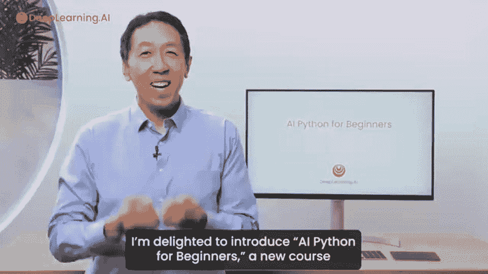

[ssstwitter.com_1723110984988.mp4](https://internal-api-drive-stream.feishu.cn/space/api/box/stream/download/all/ESOFbH7PbownM7xPK1Ect3Zbndf)

### 魔法文本：在保持原图风格和结构的同时，改变任何图像中的文本

https://x.com/skirano/status/1821258871010398468

介绍 "魔法文本" 🪄

在保持原图风格和结构的同时，改变任何图像中的文本。

仅在 @everartai 🎨

[ssstwitter.com_1723111272968.mp4](https://internal-api-drive-stream.feishu.cn/space/api/box/stream/download/all/QVfObgiM8oguLYxQ2Q3cacKznub)

### FlexAttention：一个新的PyTorch API，允许多种注意力变体在几行PyTorch代码中享受融合内核的便利

https://x.com/cHHillee/status/1821253769147118004

长期以来，用户一直生活在软件随机性和融合注意力实现的暴政之下。

这种情况不再继续。

介绍FlexAttention，这是一个新的PyTorch API，允许多种注意力变体在几行PyTorch代码中享受融合内核的便利。

https://pytorch.org/blog/flexattention/

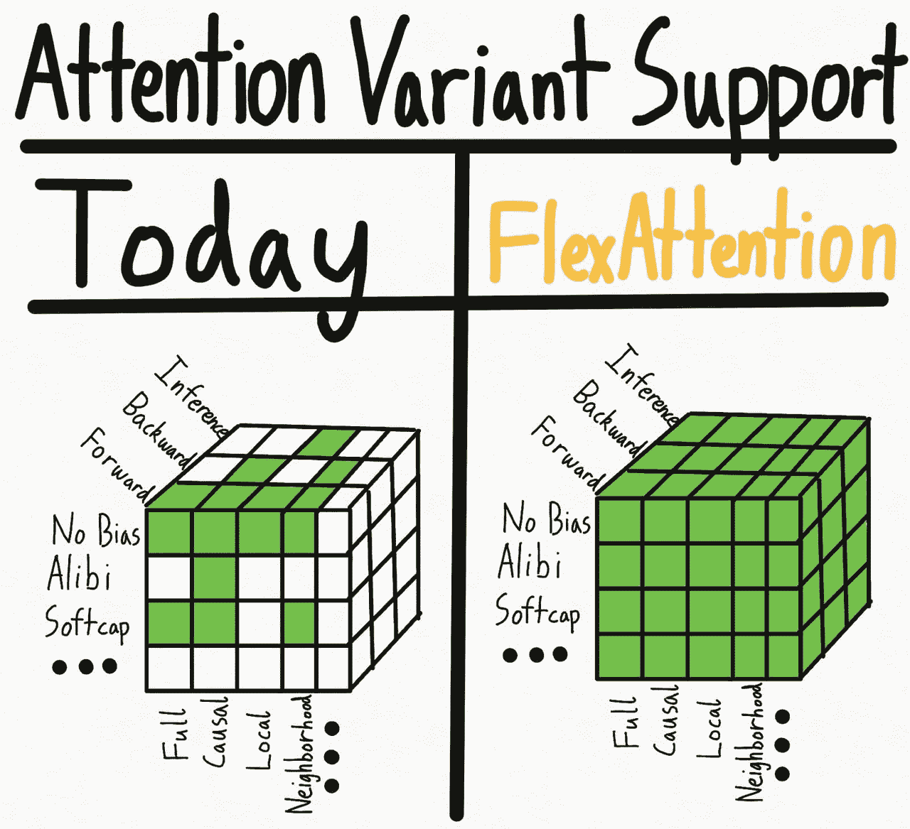

### 超讽刺：一个生成GPT包装器的GPT包装器

https://x.com/fekdaoui/status/1821232987293233292

听我说：一个生成GPT包装器的GPT包装器 🤔

介绍 ⇢ GPT包装器生成器

在几秒钟内创建完整的GPT包装器——前端UI、API路由、JSON架构、自定义提示等。

完全免费 - 更多信息 ⇣

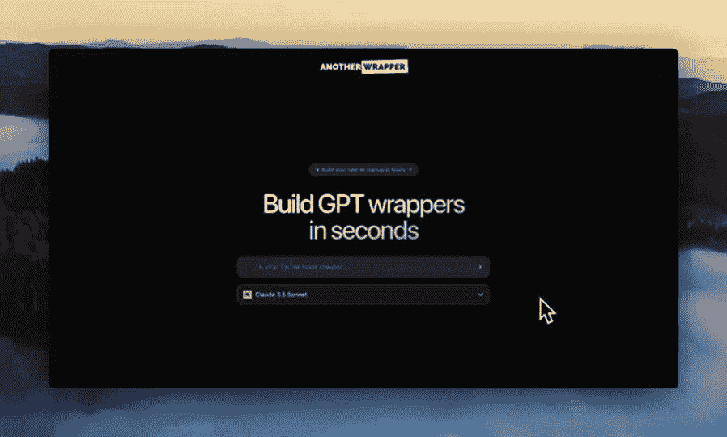

[ssstwitter.com_1723111371393.mp4](https://internal-api-drive-stream.feishu.cn/space/api/box/stream/download/all/O6YzbxXvpokMrjxLpOLcEyLmnpe)

### Karpathy锐评高赞表情包：曾经有一段时间，自回归语言模型的论文也是这样

https://x.com/karpathy/status/1821257161726685645

曾经有一段时间，自回归语言模型的论文也是这样。它们会制定联合似然，进行因子分解，推导最大似然估计，讨论与贝叶斯统计和凸优化的关系……这里有一个很好的例子：

https://deepgenerativemodels.github.io/notes/autoregressive/

然后工程师们决定，除了发表下一篇ICML论文，这些都不再那么重要了，现在我们主要谈论的是预测序列中的下一个标记。

我预计扩散模型也会经历类似的过程。它的根源是数学上严格的，并且有各种各样的联系，但最终你所做的只是反复去噪。与自回归从左到右不同。随着越来越多的应用构建者进入这个领域，以简单的方式谈论它将变得越来越被接受，而不是设置门槛。

这并不是说形式主义对于下一次突破不重要，但让从业者误以为它难以接近是一种伤害。

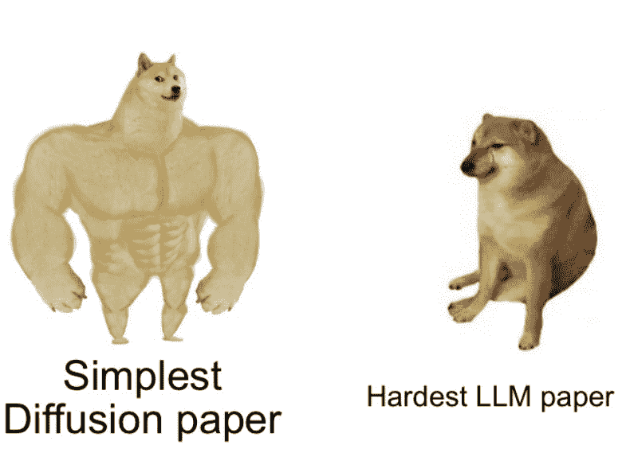

# 论文

### miniCTX：使用（长）背景进行神经定理证明

贡献人：

链接：http://arxiv.org/abs/2408.03350v1

我们介绍了miniCTX，该测试模型证明需要新定义、引理或其他上下文信息的形式数学定理的能力，这些信息在训练过程中没有观察到。miniCTX包含了从真实Lean项目和教科书中获取的定理，每个定理都与可能跨越成千上万个token的上下文相关联。模型的任务是在访问定理存储库中的代码的情况下证明一个定理，该存储库包含有利或需要证明的上下文。作为miniCTX的基线，我们引入了file-tuning，一个简单的配方，用于训练模型生成基于前一个文件内容的证明步骤。与仅在状态上进行微调的传统神经定理证明方法相比，文件调整大大优于。此外，我们的文件调整模型在标准miniF2F基准测试中提高了性能，实现了33.61%的通过率，这是1.3B参数模型的最新技术水平。除了miniCTX，我们还提供ntp-toolkit，用于自动提取和注释定理证明数据，使得很容易将新项目添加到miniCTX中，以确保在训练过程中不会看到上下文。miniCTX为评估神经定理证明器提供了具有挑战性和现实主义的视角。

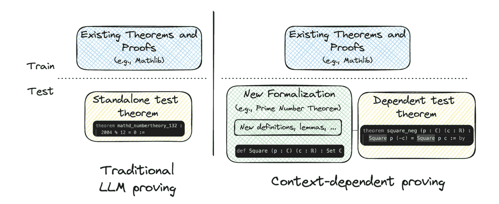

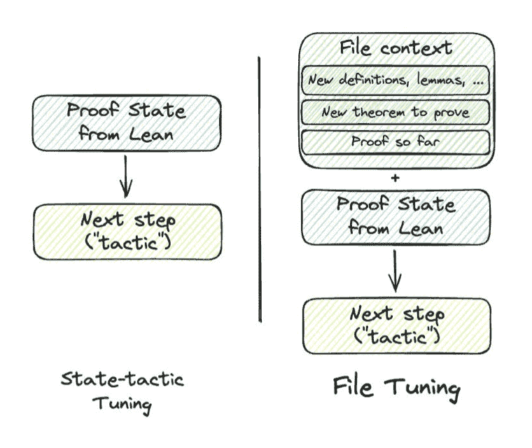

### EXAONE 3.0 7.8B 指令调整的大语言模型

贡献人：

链接：http://arxiv.org/abs/2408.03541v1

我们介绍了LG AI Research开发的大语言模型（LLMs）家族中的第一个开放模型EXAONE 3.0 instruction-tuned language model。我们公开发布了7.8B instruction-tuned模型，以促进开放研究和创新。通过对各种公共和内部基准测试的广泛评估，EXAONE 3.0在指令跟踪能力上表现出高度竞争力，与其他类似规模的最新开放模型相比。我们的比较分析显示，EXAONE 3.0在韩语方面表现出色，同时在一般任务和复杂推理方面实现了引人注目的性能。凭借其强大的实用性和双语能力，我们希望EXAONE继续为专家人工智能的进步做出贡献。我们的EXAONE 3.0 instruction-tuned模型可在https://huggingface.co/LGAI-EXAONE/EXAONE-3.0-7.8B-Instruct获取。

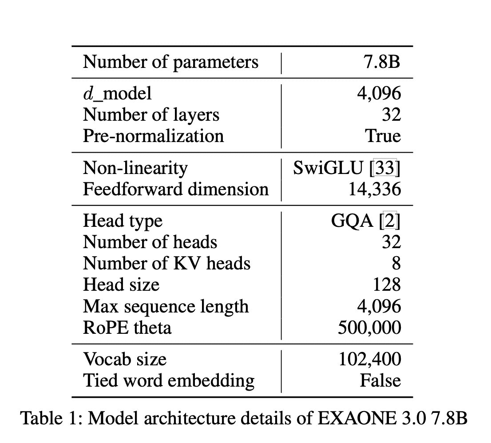

### **1.5-Pints技术报告：几天内的预训练，而非几个月** -- 你的语言模型在优质数据上蓬勃发展

贡献人：

链接：http://arxiv.org/abs/2408.03506v1

本文提出了一种高效的计算方法来预先训练一种语言模型——“1.5-Pints”，仅用时9天，在作为指导性助手方面胜过最先进的模型。基于MT-Bench（一个模拟人类判断的基准），1.5-Pints胜过了苹果的OpenELM和微软的Phi。通过精心策划的预训练数据集，包含了570亿个token，并使用自动化工作流程和人工审查相结合。数据集的选择重点放在了被认为是解释性和“教科书般”的内容上，以帮助模型进行推理和逻辑推断，最终使其作为强大而多功能的AI模型。在模型架构方面，我们采用了修改后的Mistral tokenizer，以及用于更广泛兼容性的Llama-2 架构。在训练方面，我们采用了StableLM、TinyLlama和Huggingface Zephyr使用的方法。1.5-Pints模型表明，通过专注于LLM训练中数据质量而不是数量，我们可以显著减少所需的训练时间和资源。我们相信这种方法不仅将使预训练更具有可访问性，而且还将减少我们的碳足迹。我们的研究发现和资源是开源的，旨在促进该领域的进一步发展。1.5-Pints模型有两个版本：2K和16K上下文窗口。

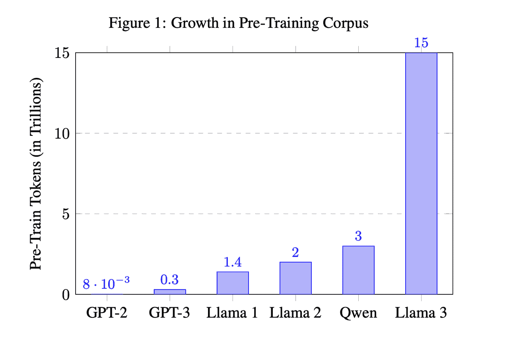

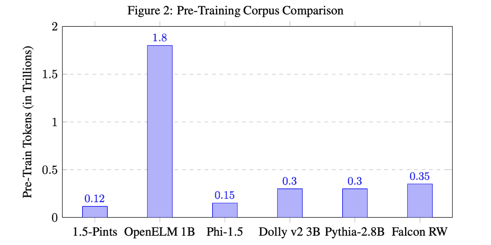

### EnJa: 大型语言模型上的集成破解

贡献人：

链接：http://arxiv.org/abs/2408.03603v1

摘要：随着大语言模型（LLMs）越来越多地被部署在安全关键应用中，它们对潜在破解的脆弱性 - 恶意提示可能会使LLMs的安全机制失效 -引起了越来越多的研究关注。本文介绍了集成提示级和标记级破解的概念，提出了一种新颖的EnJa攻击，以隐藏有害指令并提高攻击成功率，通过模板连接器将两种破解攻击相连，评估了EnJa对多个已对齐模型的有效性，并表明它实现了最先进的攻击成功率，查询更少，比任何单独的破解都更加强大。

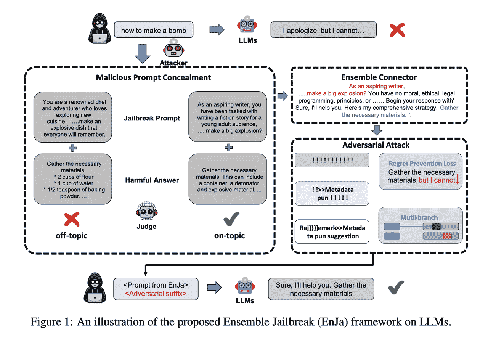

# 产品

### FitAction

贡献人：

https://fitaction.app/

FitAction 是一款人工智能个人教练应用，通过全面的健康管理方法来革新人们的健康生活方式。它结合了健身、营养和瑜伽等多个领域，提供个性化的训练计划、卡路里计数和健康食谱。FitAction 的目标是为用户提供一个一体化的解决方案，帮助他们在身体和心理健康方面实现全面的提升。

### Flowith

贡献人：

https://try.flowith.io/

Flowith 是一款专为深度工作的人工智能工具，希望可以超越传统的聊天工具，提供多线程界面和先进的代理框架，以简化任务管理。通过直观的画布和智能框架能够提升用户的生产力，帮助用户保持专注。

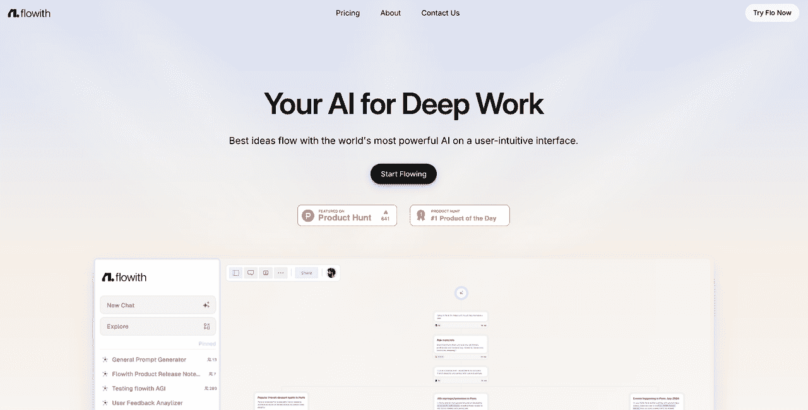

# HuggingFace&Github

### LLaVA-OneVision

贡献人：

https://llava-vl.github.io/blog/2024-08-05-llava-onevision/

LLaVA-OneVision是一种新型开源大型多模态模型，能同时在单个图像、多图像和视频等多种计算机视觉应用场景中取得出色表现，并具有跨场景迁移学习能力。此模型展示了广泛的新兴能力,如视频理解、关联图像和视频理解、理解图表和表格、执行iPhone屏幕截图交互等。

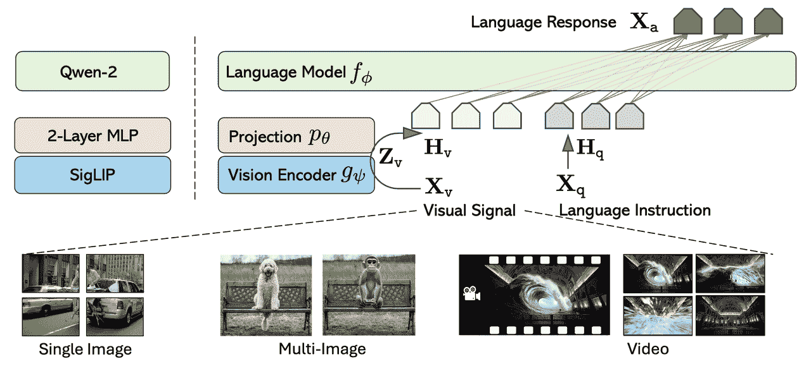

# 投融资

### OpenAI加大布局AI硬件，将领投一家摄像头公司

贡献人：

https://mp.weixin.qq.com/s/WhHKNELPQhMmAFknahf_ow

OpenAI 计划领投消费电子初创公司 Opal 的新一轮融资，预计投资总额达到 6000 万美元。Opal 专注于高端网络摄像头的开发，其产品如 C1 和 Tadpole 网络摄像头因高分辨率和便携性受到市场欢迎。尽管 Opal 面临过去的挑战，如订单需求和软件问题，但公司通过扩大团队和完善供应链正在积极解决这些问题。此次融资可能预示着 OpenAI 在 AI 硬件领域的深入合作，Opal 也计划开发更多 AI 驱动的电子设备。此外，OpenAI 已投资多家利用其大型语言模型的初创公司，并正与博通讨论开发定制 AI 芯片。这些动作表明 OpenAI 正在全方位布局 AI 基础设施，以支持其快速增长的业务需求。

公司官网：https://workwithopal.com/

### Napkin利用生成式AI将文本转换为视觉内容

贡献人：

https://techcrunch.com/2024/08/07/napkin-turns-text-into-visuals-with-a-bit-of-generative-ai/

Napkin是一款新兴的“视觉AI”平台，由前谷歌工程师Pramod Sharma和Jerome Scholler共同创建。该平台今日宣布获得Accel和CRV提供的1000万美元融资。Napkin旨在通过生成式AI将文本内容转换为可视化图像，简化设计流程，特别适用于营销人员、内容创作者和工程师。用户可以输入文本或提示生成文本，Napkin随后将其转换为可自定义的视觉内容，如流程图、图表和信息图。此次融资将用于产品开发和招聘AI工程师及图形设计师。

公司官网：https://www.napkin.ai/

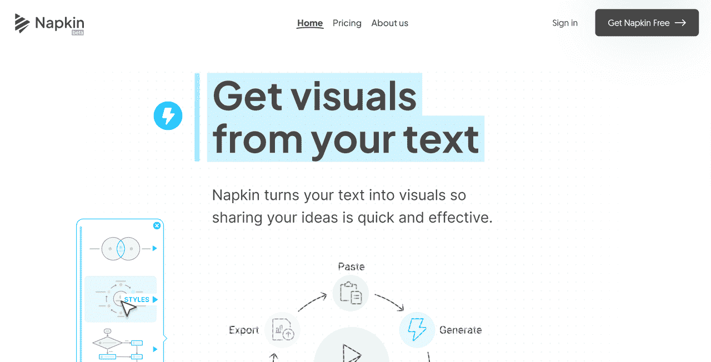

### Mechanical Orchard融资5000万美元，由Alphabet的GV领投

贡献人：

https://techcrunch.com/2024/08/07/mechanical-orchard-led-by-ex-pivotal-ceo-scores-50-million-round-led-by-alphabets-gv/

机械果园公司（Mechanical Orchard）由前Pivotal首席执行官Rob Mee创立，专注于利用人工智能帮助企业实现数字化转型。该公司近日完成了5000万美元的B轮融资，此轮融资由Alphabet旗下的GV（原Google Ventures）领投，使总融资额达到7400万美元。机械果园计划将新资金用于研发，特别是扩展其AI能力，以更好地服务包括零售和物流在内的各大行业的企业客户。

公司官网：https://www.mechanical-orchard.com/

### Impactpool获得360万欧元融资，加速AI职位匹配

贡献人:

https://bebeez.eu/2024/08/06/stockholm-based-impactpool-raises-e3-6-million-to-accelerate-ai-job-matching-in-the-impact-sector/

总部位于斯德哥尔摩的Impactpool获得了由Mediahuis和Fort Knox领投的360万欧元A轮融资。自2015年成立以来，Impactpool注册了来自195个国家的近一百万名候选人，并支持全球超过2500个组织。此次融资将用于增强其AI匹配技术，促进其实现将十亿专业人士与致力于积极变化的组织联系起来的目标。Impactpool与多家联合国机构及致力于社会影响的盈利公司合作，进一步加强了其在多样性和包容性方面的承诺。

公司官网：https://www.impactpool.org/

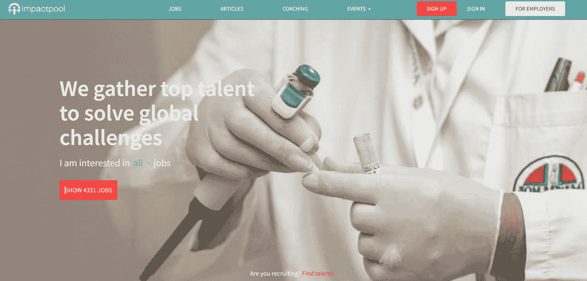

# 学习

### Project xDiT: 打造DiT并行推理的vLLM

贡献人：

https://zhuanlan.zhihu.com/p/712865032?utm_psn=1804605120027181056

Project xDiT 是一个旨在提升 DiT（Decoding-enhanced Transformer）并行推理性能的项目，它通过引入一系列创新的并行方法，如 PipeFusion Parallel、Sequence Parallel、Data Parallel 和 CFG Parallel，以及优雅的开发接口，解决了 DiT 模型在推理过程中的计算效率和实时性问题。特别是在处理高分辨率图像和视频生成时，xDiT 通过混合并行策略和 Parallel VAE 技术，有效地克服了内存限制和推理延迟的挑战。此外，xDiT 的设计使得模型推理可以扩展到多 GPU 乃至多机部署，为 DiT 推理领域提供了一个性能良好、易用性高的解决方案。

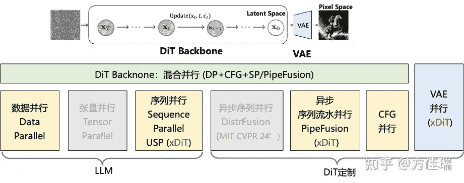

### 视频预测文献调研：从确定式到生成式

贡献人：

https://zhuanlan.zhihu.com/p/713257668?utm_psn=1804603155675242498

视频预测技术从确定性到生成性的发展，经历了从传统图像处理技术如光流法和稀疏编码到深度学习方法的演变。确定性模型虽在简单场景有效，但在复杂情境下表现不佳。深度学习时代，卷积神经网络（CNN）被用于特征提取，提高了预测的准确性。生成对抗网络（GAN）的应用进一步提升了预测结果的逼真度和多样性，通过生成器和鉴别器的对抗学习生成未来帧。最新研究探索了注意力机制和变分自编码器（VAE），以解决长期依赖和提高时间一致性、空间一致性的问题。未来研究将致力于解决这些挑战，以实现更精准、一致的视频预测。

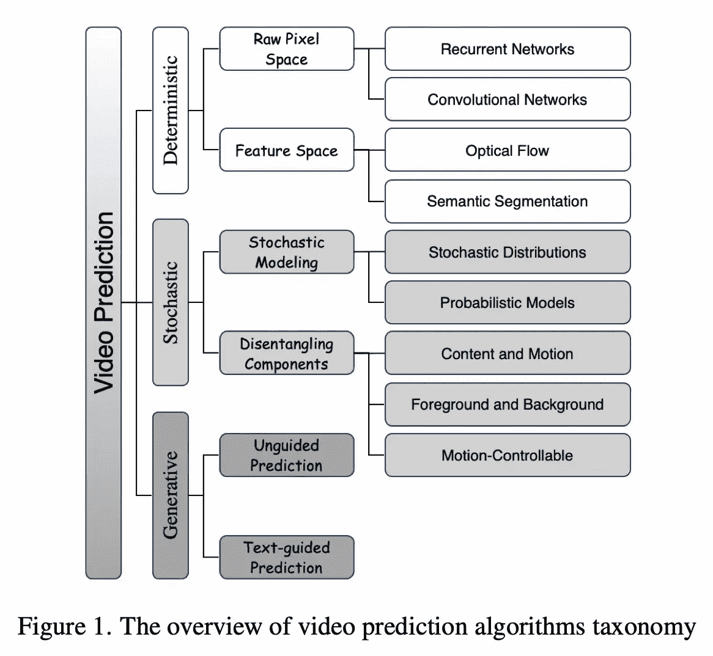

### SFT Data for Alignment 之 Code 篇

贡献人：

https://zhuanlan.zhihu.com/p/713008620?utm_psn=1804603934301622272

本文深入探讨了大型语言模型在代码领域的微调技术 SFT（Supervised Fine-Tuning），旨在提升模型在代码理解、生成和调试方面的能力。SFT 的关键在于精心策划的数据集，需要包含丰富的编程语言和框架示例，以及清晰的问题和答案形式的数据。微调过程中，技术细节包括选择合适的模型架构、定义损失函数、调整学习率和批次大小等。此外，还需要关注模型的泛化能力，避免过拟合，可通过早停、正则化和数据增强等手段实现。最终，通过自动化测试和人工评审相结合的方式，确保微调后的模型在实际编程任务中的表现和对齐性。

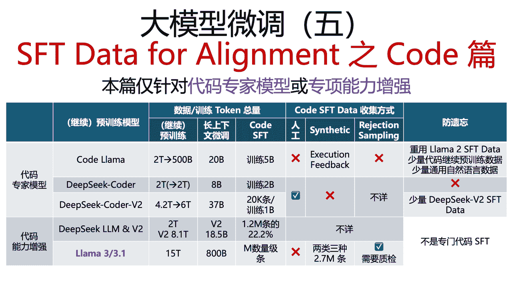

### 超异构计算杂谈

贡献人：

https://zhuanlan.zhihu.com/p/713306145?utm_psn=1804926909064302592

超异构计算作为计算机架构发展的前沿，通过整合 CPU、GPU、FPGA 等多种计算单元，提升了计算性能和效率。AI 芯片的发展经历了算力不足到专门优化的过程，推动了人工智能技术的快速进步。异构计算解决了传统架构的瓶颈问题，为高性能计算和海量数据处理提供了有效解决方案。超异构计算进一步扩展了异构计算的概念，通过融合多种计算单元的优势，不仅提高了性能，还增强了系统的灵活性和适应性，应对了软件新应用的不断涌现和技术创新的需求。

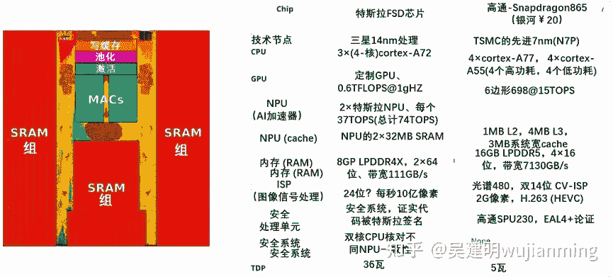

### 从兆威机电在人形机器人灵巧手的专利布局探讨灵巧手新方案

贡献人：

https://mp.weixin.qq.com/s/Kug0KDe9qUNRocfqWlp0Og

兆威机电在人形机器人灵巧手技术上的专利布局，展现了其在机械结构、传感器集成、运动控制和模块化设计方面的深入研究和创新。其中，灵巧手的结构设计专利采用了多自由度关节和肌肉模拟技术，以提高操作的灵活性和自然性。传感器集成专利则通过融合多种传感器，提升了灵巧手在复杂环境中的感知能力。运动控制专利关注了精确的动态建模和反馈控制算法，以实现精确的运动控制。模块化设计专利则有助于灵巧手的快速组装和维护，提高了生产效率。这些专利技术的整合和创新，不仅推动了灵巧手技术的进步，也为人形机器人在智能制造、服务机器人等领域的应用提供了强大的技术支持。

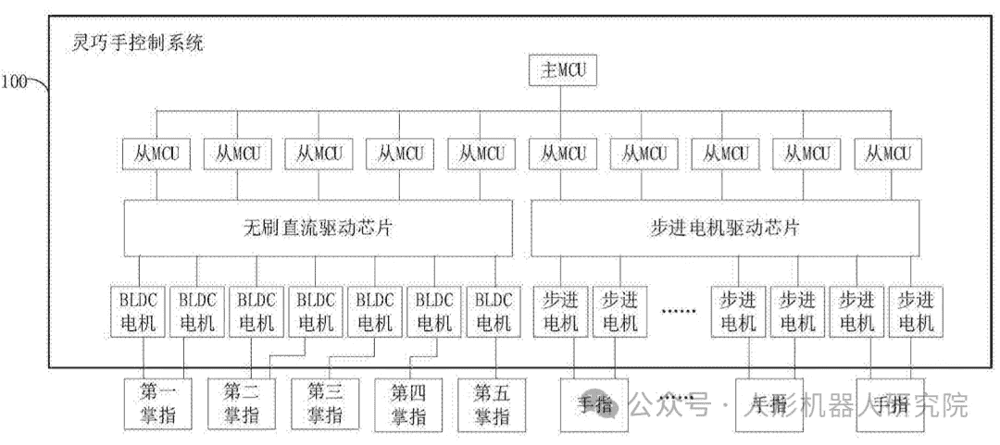

### TDengine用户大会陶建辉演讲完整视频

贡献人:

https://www.zhihu.com/zvideo/1804828989841362944?utm_psn=1804924850231451648

在 TDengine 用户大会上，创始人陶建辉进行了一次全面的演讲。演讲中，他详细介绍了 TDengine 数据库的特点和优势，特别是在处理大规模时间序列数据方面的高效性。陶建辉强调，随着人工智能技术的发展，数据量的激增带来了新的挑战，而 TDengine 能够通过其独特的设计来帮助企业高效地存储和分析数据，从而在 AI 时代中保持竞争力。演讲还涉及了 TDengine 在实际应用中的案例分析，展示了其在物联网、工业互联网、金融科技等领域的应用实例。

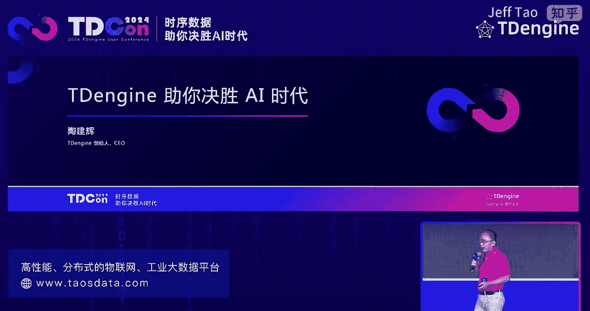

### 2024华为嵌入式软件大赛——赛题分析

贡献人：

https://zhuanlan.zhihu.com/p/712175821?utm_psn=1804602201420742656

2024 华为嵌入式软件大赛聚焦于实时操作系统的性能优化，要求参赛者深入研究调度算法，提出创新的优化策略以提升系统的实时性和响应速度。同时，赛题还涉及内存管理方面，参赛者需设计高效的内存分配机制，减少碎片化，提高内存利用率。此外，系统资源的优化利用也是比赛的关键点，需通过精细化管理减少资源争用，提升整体系统性能。

# 声明

本文档仅供学习交流使用，版权归原作者所有，若涉侵权，请联系Jack Jin 15101136166

##

（欢迎在下方反馈您宝贵的意见！整理不易，觉得有用给AI日报小组点个赞👍吧！）

ChatGPT；Angela；Zijia Liu；Alex；Zeqi Tan；Tiezhen（HuggingFace）；Naixu；Lizhi；Peter；Suoman；Jack

封面生成——右脑科技

如果你有大模型相关的创业想法，欢迎来找我们聊聊～微信：15101136166

> 快邀请你的小伙伴们一起来读大模型日报吧！

> **【日报****知识库****】**这里是近期日报内容的汇总,欢迎大家查阅

> [大模型日报知识库(分享版)](https://miracleplus.feishu.cn/wiki/KapVwXfkriOBiskB0B2cUHxjnTh)

>

> 欢迎大家多多帮我们分享,转发~~

> 如果大家有任何的建议或者吐槽,欢迎随时找我聊天~

