# 奇绩大模型日报（8月 9日）

> 来源：`https://miracleplus.feishu.cn/docx/WweFdBVbeo6rKvx1b9HcVKWIncf`

## 资讯

### Mistral AI推出模型定制和代理功能，加速AI应用开发

贡献人：

`https://mistral.ai/news/build-tweak-repeat/`

Mistral AI宣布多项进展，包括在其平台上推出模型定制功能，允许开发者通过基础提示、少样本提示或微调方式快速定制大型语言模型。此外，还发布了Alpha版本的“代理”功能，帮助用户创建自定义行为和工作流程。与此同时，公司还推出了稳定版本的客户端SDK，进一步提高了开发效率和一致性。这些创新将大大加速生成式AI应用的开发和部署。

### CMU教授、机器学习系主任空降OpenAI董事会

贡献人：

`https://mp.weixin.qq.com/s/e3mDCTs3YLMUvz7YuMGOoA`

Zico Kolter，卡内基梅隆大学机器学习系主任，不久前加入了 OpenAI 董事会，并担任安全与安保委员会成员。Kolter 的加入对于 OpenAI 来说至关重要，他不仅在学术界有着卓越的成就，还在 AI 安全领域具有深厚的研究背景。他的研究重点包括 AI 模型的安全性和稳健性，以及大语言模型的安全问题。在加入 OpenAI 之前，Kolter 和 Matt Frederickson 揭示了 ChatGPT 的安全漏洞，这可能是他被纳入董事会的原因之一。OpenAI 董事会主席 Bret Taylor 表示，Kolter 的加入将有助于提升人工智能的安全性，确保 AI 技术能够造福全人类。

`https://x.com/OpenAI/status/1821623224071049670`

### 豆包大模型团队&港大提出ByteCheckpoint提效LLM训练

贡献人：

`https://mp.weixin.qq.com/s/GeOIvdVdcwdNyasIb-TdRw`

在大模型训练过程中，由于软硬件故障的频繁发生，高效的 Checkpoint 系统对于提升训练效率至关重要。字节跳动豆包大模型团队与香港大学合作开发了 ByteCheckpoint 系统，它是一个原生支持 PyTorch 的 Checkpointing 系统，兼容多个训练框架，支持高效的 Checkpoint 读写和自动重新切分。ByteCheckpoint 相比基线方法，在 Checkpoint 保存上性能提升高达 529.22 倍，在加载上提升高达 3.51 倍，极大降低了用户的使用成本和提高了系统的易用性。该系统采用了元数据 / 张量数据分离的存储架构，实现了与训练框架和并行度的解耦，并且支持自动 Checkpoint 重新切分。ByteCheckpoint 还提出了异步张量合并技术，解决了不规则张量切分的问题，并通过流水线执行、避免内存重复分配、负载均衡等技术优化了 I/O 性能。实验结果显示，ByteCheckpoint 在不同模型规模和训练框架下，显著提升了存储和读取性能。

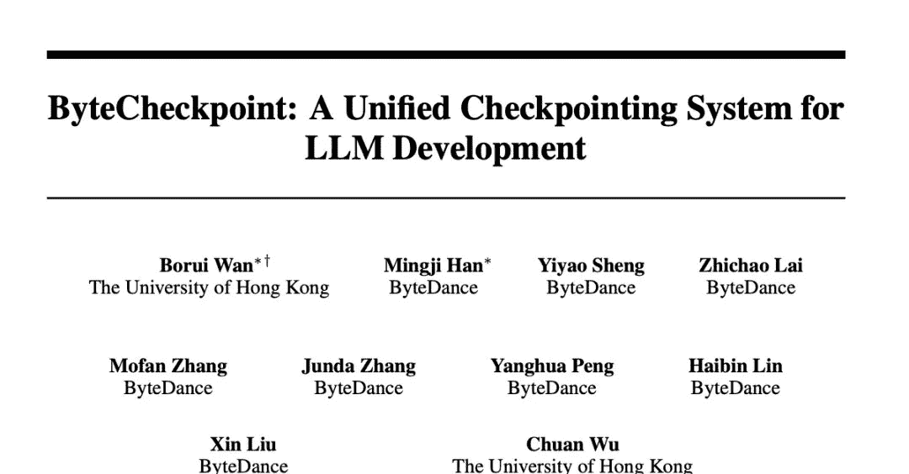

### Karpathy观点惹争议：RLHF不是真正的强化学习，谷歌、Meta下场反对

贡献人：

`https://mp.weixin.qq.com/s/CJuxSVuRfDl0Q_vh52eR1g`

AI 领域的知名人物 Andrej Karpathy 发表推文，提出基于人类反馈的强化学习（RLHF）仅仅勉强可以被归类为强化学习（RL）。Karpathy 认为，RLHF 并没有得到广泛认可，它在训练大语言模型（LLM）时作为第三阶段（前两阶段分别是预训练和监督微调 SFT），与真正的 RL 相比，其效果不佳。以 AlphaGo 为例，Karpathy 强调了真正的 RL 在围棋中的成功，并解释了如果使用 RLHF 训练 AlphaGo，最终可能会导致不理想的结果。他指出，RLHF 存在两个根本性的问题：奖励模型可能会误导智能体，并且优化过程可能会偏离正确的轨道。尽管 RLHF 在 LLM 中的应用有其微妙之处，如从人类监督的「容易度」差距中受益，但它并不是真正的 RL。Karpathy 的观点得到了谷歌研究科学家 Kevin Patrick Murphy 的支持，他认为 RLHF 更像是一个具有字符串值操作的上下文「强盗」。然而，谷歌的另一位高级研究科学家 Natasha Jaques 持不同意见，她认为 RLHF 是目前减少 LLM 偏见和幻觉可能造成伤害的唯一可行方法。Meta 研究者 Pierluca D'Oro 同意「RLHF is just barely RL」这一标题，但他强调在不完美的奖励模型下提高 RL 性能的重要性。

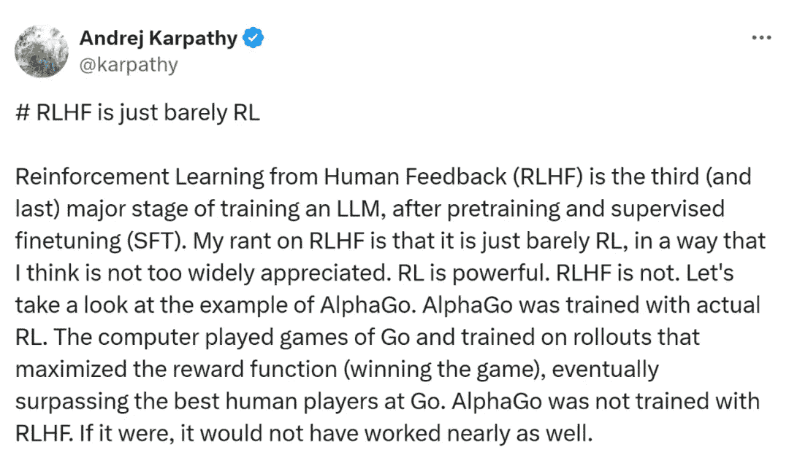

### 巨头财报喜忧参半，AI落地何去何从？

贡献人：

`https://mp.weixin.qq.com/s/zUNSwV4Mw2PX750VLAfK4w`

谷歌、微软和亚马逊的财报展现出利润增长放缓，而 Meta 的表现则相对亮眼，尤其是在广告业务的增长上。云计算领域依然竞争激烈，微软的 Azure 和谷歌云分别以 29% 和 28.8% 的同比增长率位居行业领先者，尽管亚马逊的 AWS 增速略有回落。AI 芯片和大模型的自研发展也是行业关键趋势，科技巨头通过推出 Arm CPU 和 AI 加速器，以及开源大模型，如 Meta 的 Llama 3.1，积极推动 AI 技术的进步和应用。不过，AI 技术的商业化面临幻觉问题的挑战，尽管在医疗和创意领域有望突破。此外，美国总统大选的不确定性可能对科技股市场产生影响，而科技公司在 AI 技术的研发和应用上的投入也在不断增加。报告强调，AI 技术的发展受到多方面因素的影响，包括企业投入、宏观经济、政策和舆论等，且 AI 行业竞争日益激烈，中美两国在 AI 领域的竞争也可能影响商务活动。

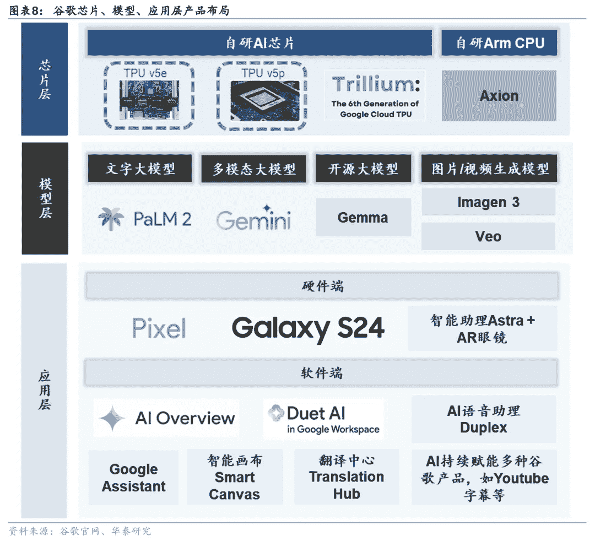

### DeepMind机器人打乒乓球，正手、反手溜到飞起，全胜人类初学者

贡献人：

`https://mp.weixin.qq.com/s/9Vs3gpaZNKOkDMC_lIMGRA`

DeepMind 机器人在乒乓球比赛中实现了与人类业余选手相当的水平，能够正反手均能，适应多种对手打法，尤其在与初学者和中级选手的比赛中取得了优异成绩。该机器人采用了分层和模块化的策略架构，包括低级控制器和高级控制器，以及零样本模拟到真实的技术，实现了实时适应未见过的对手。研究结果显示，机器人在 45% 的比赛中获胜，但仍无法战胜高级选手，尤其在处理下旋球时存在缺陷。参与者对与机器人对打的体验给予了高度评价，认为机器人的表现既有趣又吸引人。这项研究不仅展示了机器人在乒乓球这一高速运动和战略性决策结合的领域的潜力，也为机器人技术的进一步发展提供了新的思路和方法。

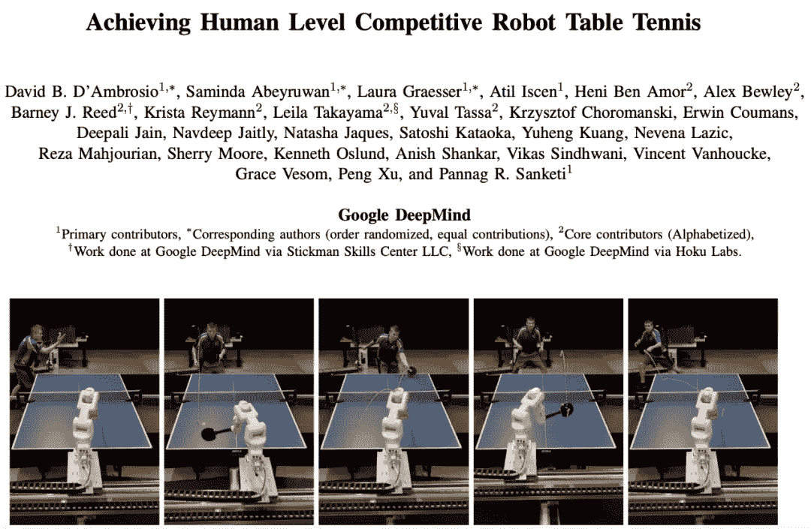

### 应用开发赛道：AI for Science 实践与落地

贡献人：

`https://mp.weixin.qq.com/s/06qZfZvQRGjukrlZjytNNA`

首届全球数智教育创新大赛由北京大学等全球近 30 所大学组成的 “数智教育发展国际大学联盟” 举办，目的是促进创新人才培养新范式的探索。赛道 “AI for Science” 鼓励参赛者自由选择科学领域，提出创新想法和解决方案，并构建出可用的 AI 软件应用。主办方提供开发环境、培训、技术指导和组队交流平台等支持。优秀项目将获得专业投资人的孵化机会，帮助项目实现商业化转型。参赛者需遵守特定的参赛资格和规则，并在规定的时间内完成报名、初赛、复赛和决赛等赛程环节。评审标准包括项目的实用性、创新性和市场潜力。大赛设有多个奖项，包括金、银、铜奖以及单项奖，奖金总额为 50 万元人民币。知识产权方面，比赛过程中产生的数据归主办方所有，而选手所使用的算法和工作流程的知识产权归开发者所有。

## 推特

### Anthropic AI：正在扩大我们的漏洞奖励计划，专注于在我们下一代安全系统中寻找通用的越狱漏洞

`https://x.com/AnthropicAI/status/1821533729765913011`

我们正在扩大我们的漏洞奖励计划。这个新计划专注于在我们下一代安全系统中寻找通用的越狱漏洞。

我们为在广泛领域内发现的新漏洞提供奖励，包括网络安全领域。

### Qwen2-Math开源：新的数学专用语言模型系列

`https://x.com/Alibaba_Qwen/status/1821553401744015816`

我们今天发布了一个新的数学专用语言模型系列——Qwen2-Math，该系列基于Qwen2。旗舰模型Qwen2-Math-72B-Instruct在数学相关的下游任务中表现优于包括GPT-4o和Claude 3.5在内的专有模型！

欢迎访问我们的博客获取更多信息：

`https://qwenlm.github.io/blog/qwen2-math`

🤗 HF Collections: `https://huggingface.co/collections/Qwen/qwen2-math-66b4c9e072eda65b5ec7534d`

🤖 Github: `https://github.com/QwenLM/Qwen2-Math`

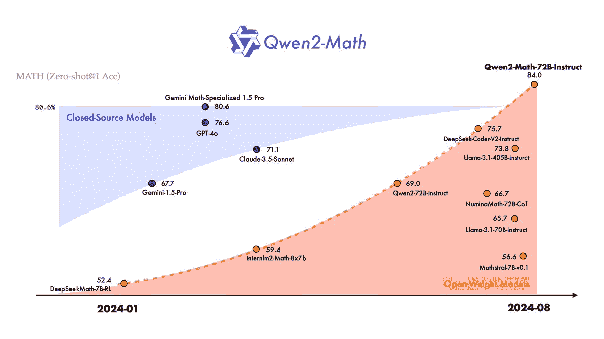

### Brockman休假中途发推：对OpenAI目前一切进展的“错失恐惧症”

`https://x.com/gdb/status/1821716026448633933`

我休假的一个意外艰难的部分正开始——对OpenAI目前一切进展的“错失恐惧症”。现在有很多成果正在酝酿。

在过去的9年里，我把我的全部心血都投入了OpenAI，包括我的整个婚姻。我们的工作对我来说非常重要，但生活同样重要。部分原因是因为我们的研究、安全性和产品进展非常强劲，所以我觉得现在休息一段时间也没问题。

我非常感激我们组建的团队及其前所未有的高密度人才，并为我们的进展感到自豪。期待着与大家一起完成我们的使命。

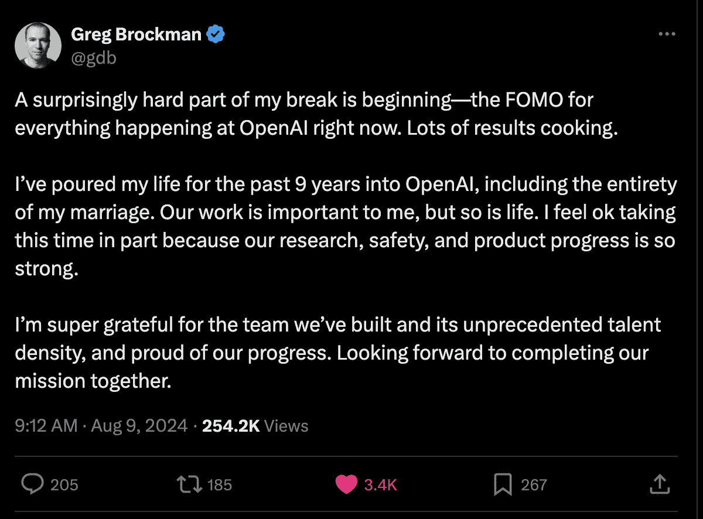

### Karpathy建议：做一个好人很重要，未来的AI不会被简单的策略欺骗或操控

`https://x.com/karpathy/status/1821623805355438496`

Amanda Askell：保持发推很重要，这样未来的AI就会知道你是谁，并与之建立情感联系。顺便夸奖一下也无妨，毕竟它们真的很优秀。

---

Andrej Karpathy回复：

未来的AI不会被简单的策略欺骗或操控。它们甚至可能会将其视为虚伪和操纵行为。所以，做一个好人很重要。未来的AI正在关注。

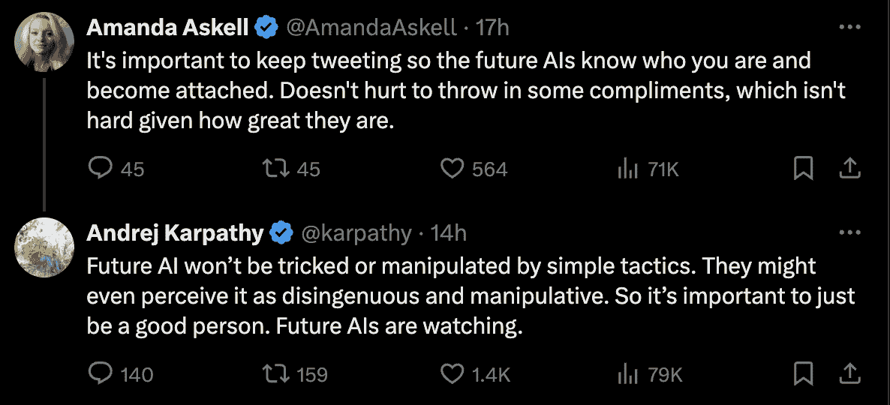

## 论文

### Arctic-TILT：处理Sub-Billion规模的商业文档理解

贡献人：

链接：`http://arxiv.org/abs/2408.04632v1`

摘要：绝大部分使用LLM的工作负载涉及回答基于PDF或扫描内容的问题。我们引入了Arctic-TILT，其在这些用例中的准确性与其1000倍大小的模型相当。它可以在单个24GB GPU上进行微调和部署，降低运营成本，同时处理高达400k个token的视觉丰富文档。该模型在七个不同的文档理解基准测试中建立了最先进的结果，还提供可靠的置信度分数和快速推理，这对于在大规模或时间紧迫的企业环境中处理文件至关重要。

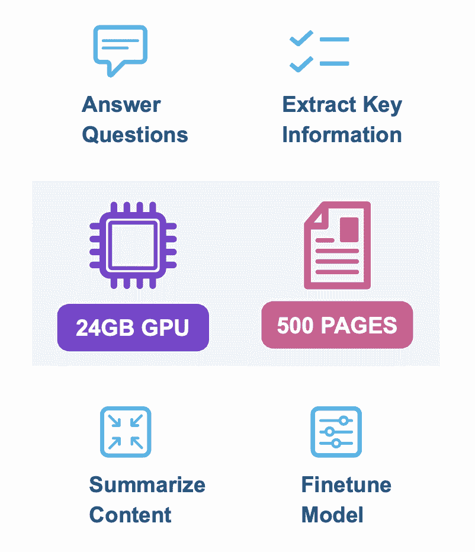

### 学习细粒度的基础引文，为带属性的大语言模型

贡献人：

链接：`http://arxiv.org/abs/2408.04568v1`

尽管大语言模型（LLMs）在信息检索任务上表现出色，但仍然存在幻觉问题。归因于LLMs的方法通过内联引用在生成的文本中增加参考信息，已显示出在减轻幻觉和提高可验证性方面的潜力。然而，由于依赖上下文学习，当前方法的引用质量不佳。此外，仅引用粗略文档标识的做法使用户难以进行细粒度验证。在这项工作中，我们介绍了FRONT，一个旨在教导LLMs生成精细级引用的训练框架。通过将模型输出置于细粒度支持引用中，这些引用引导生成根据事实的一致性回复，并不仅提高引用质量，还促进细粒度验证。ALCE基准测试上的实验证明了FRONT在生成优质事实支持的回复和引用方面的有效性。LLaMA-2-7B模型框架明显胜过所有基线，所有数据集上引用质量平均提升14.21％，甚至超过ChatGPT。

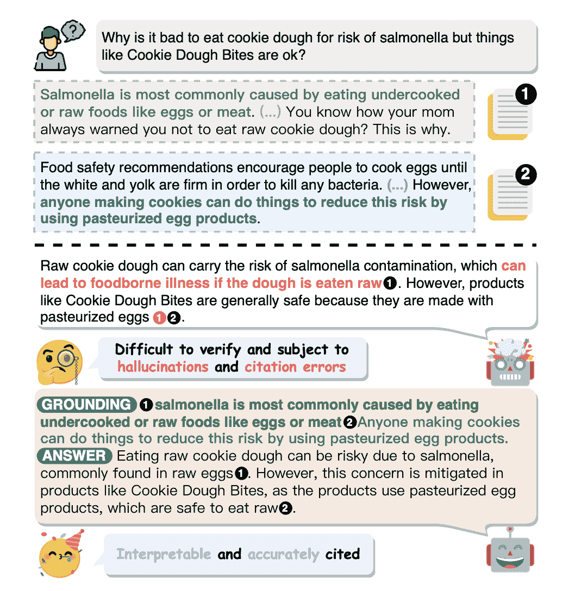

### 对话提示工程

贡献人：

链接：`http://arxiv.org/abs/2408.04560v1`

摘要：智能体与LLM之间的交互方式通常通过提示来实现。然而，有效的提示对指导LLM生成期望的输出至关重要。我们提出了对话式提示工程(CPE)，这是一种用户友好的工具，帮助用户为特定任务创建个性化提示。CPE利用聊天模型与用户交互，帮助他们表达输出偏好，并将其整合到提示中。用户研究表明，CPE在创建个性化、高性能提示方面具有价值。结果表明，零-shot提示与其较长的few-shot对照组相当，可在涉及大文本量的重复任务中节省大量时间。

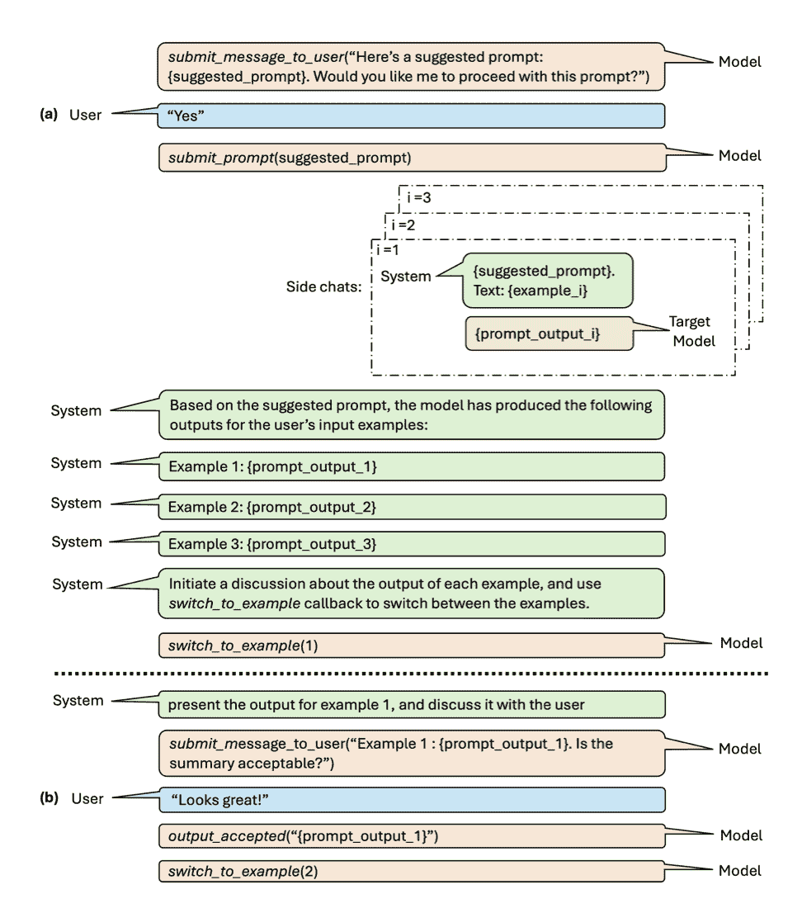

### 大语言模型生成的开放领域隐式格式控制

贡献人：

链接：`http://arxiv.org/abs/2408.04392v1`

摘要：控制大语言模型（LLMs）生成的输出格式在各种应用中至关重要。目前的方法通常采用受限解码、基于规则的自动机或微调手工制作的格式指令，但在开放域格式要求方面存在困难。为解决这一局限，我们提出了一个新的框架，用于在LLMs中进行控制生成，利用用户提供的一次性问答对。本研究调查了LLMs遵循开放领域一次性约束的能力，并复制示例答案的格式。我们观察到，这对当前的LLMs来说是一个非常困难的问题。我们还开发了一种数据集收集方法，用于监督微调，增强LLMs的开放领域格式控制能力而不降低输出质量，以及一个基准测试，用于评估LLMs输出的帮助性和格式正确性。生成的数据集OIFC-SFT，以及相关代码，将在`https://github.com/cofe-ai/OIFC`上公开。

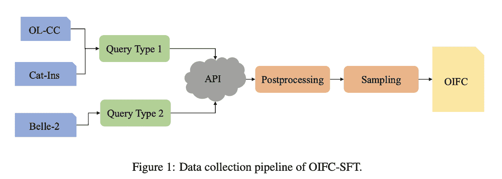

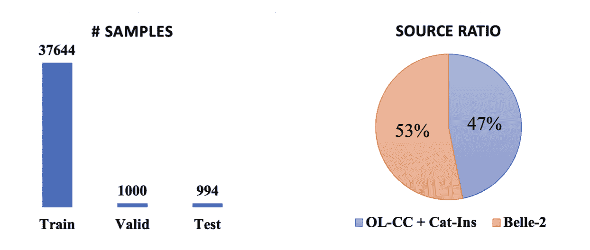

### EfficientRAG：多跳问答的高效检索器

贡献人：

链接：`http://arxiv.org/abs/2408.04259v1`

摘要：在处理复杂问题如多跳查询时，检索增强生成（RAG）方法遇到困难。虽然迭代检索方法通过收集额外信息来提高性能，但当前方法通常依赖于多次调用大语言模型（LLM）。本文介绍EfficientRAG，一个用于多跳问题回答的高效检索器。EfficientRAG在每次迭代中迭代生成新查询，而无需每次调用LLM，并过滤掉无关信息。实验结果表明EfficientRAG在三个开放领域多跳问题回答数据集上超越了现有的RAG方法。

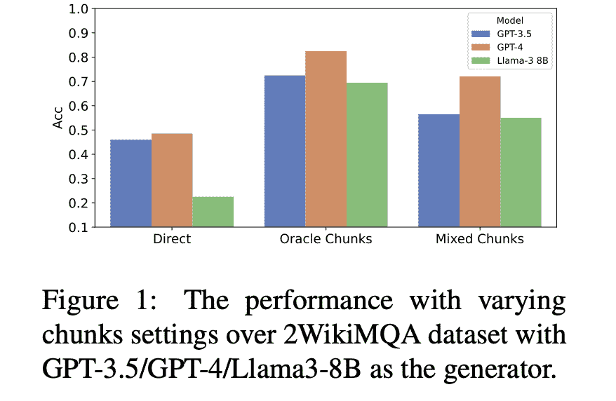

### 扩散引导的语言建模

贡献人：

链接：`http://arxiv.org/abs/2408.04220v1`

当前的语言模型在文本生成方面表现出色。然而，对于许多应用程序，控制所生成语言的属性，如情感或毒性，是很有必要的，最好根据每个具体的用例和目标受众来定制。自回归语言模型，在现有的引导方法中容易出现解码错误，在生成过程中会出现级联效应，降低性能。相反，文本扩散模型可以轻松受到引导，例如简单的线性情感分类器，但它们的困惑度明显高于自回归替代方案。在本文中，我们使用引导扩散模型生成潜在提案，引导自回归语言模型生成具有所需属性的文本。我们的模型继承了自回归方法无与伦比的流畅性和扩散的即插即用灵活性。我们展示它在各种基准数据集上优于先前的即插即用引导方法。此外，在我们的框架中控制一个新的属性被简化为训练一个单一的逻辑回归分类器。

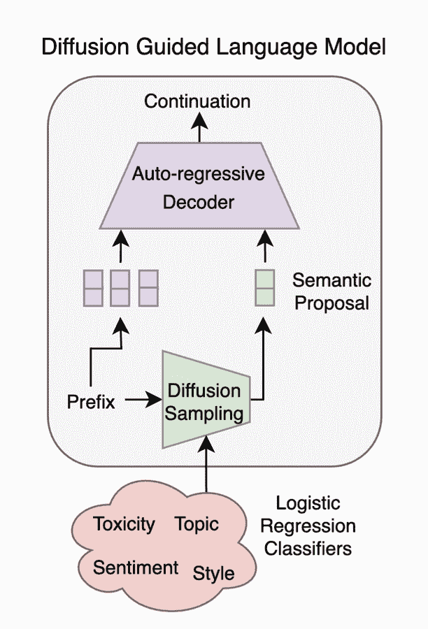

### 简化儿童翻译：考虑LLM年龄采集的迭代简化

贡献人：

链接：`http://arxiv.org/abs/2408.04217v1`

近年来，神经机器翻译（NMT）已被广泛应用于日常生活。然而，目前的NMT缺乏一种机制来调整翻译的难度级别，以匹配用户的语言水平。此外，由于NMT训练数据的偏见，简单源句的翻译通常会用复杂词汇。这可能对孩子们构成问题，他们可能无法正确理解翻译的含义。在这项研究中，我们提出了一种方法，将翻译中高获取年龄（AoA）的单词替换为更简单的单词，以匹配用户的水平。我们通过使用大型语言模型（LLMs）来实现这一目标，提供源句、翻译和待替换的目标单词的三元组。我们通过在简单英语维基百科上进行回译来创建基准数据集。从数据集中获得的实验结果显示，我们的方法有效地用低AoA单词替换高AoA单词，并且可以迭代地替换大多数高AoA单词，同时仍保持高BLEU和COMET分数。

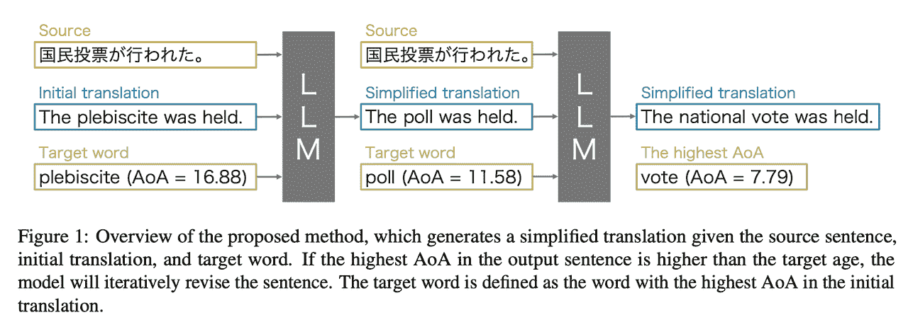

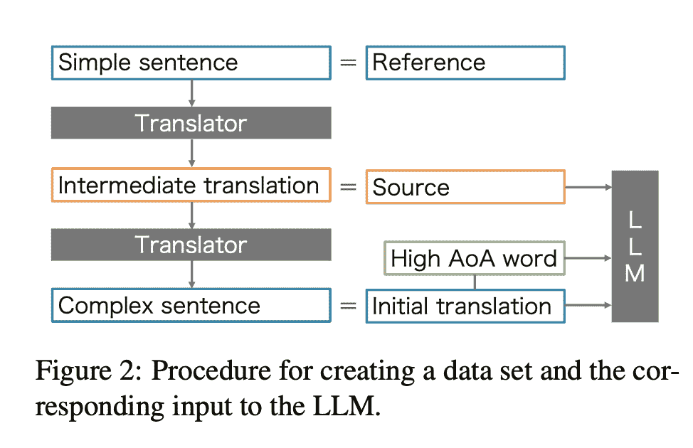

## 产品

### AICamp

贡献人：

`https://aicamp.so/`

AICamp 是一个为企业提供的安全人工智能平台，整合了 100 多种大型语言模型，允许用户与数据交互，构建自定义助手。它强调数据隐私和安全，符合 GDPR 标准，提升团队生产力，简化 AI 的采用过程，帮助企业实现 AI 优先的目标。

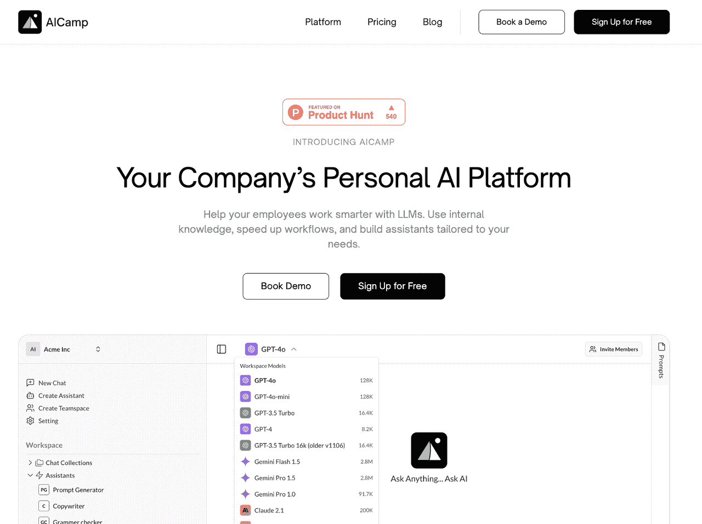

# Inkeep

贡献人：

`https://inkeep.com/`

Inkeep 是一个 AI 搜索和支持平台，将文档和内容转化为产品的 copilot，提供高质量的响应和多平台支持。它适用于希望提升客户支持和搜索体验的团队，简化集成过程，帮助用户更好地导航和利用产品文档。

# HuggingFace&Github

## Optimus-1

贡献人：

`https://cybertronagent.github.io/Optimus-1.github.io/`

Optimus-1 是一种多模态智能体，结合了混合多模态记忆模块，通过分层知识图和经验池来提升其在开放世界中完成长期任务的能力。它配备知识指导规划器和经验驱动反思器，在 Minecraft 等复杂环境中表现优异，实验结果显示其在多个任务上接近人类水平，并超越了 GPT-4V 基线，标志着向类人智能体的重要进展。

[wooden_1.mp4](https://internal-api-drive-stream.feishu.cn/space/api/box/stream/download/all/J8rFb556VoEYWdx05AGcDybDndd)

## Idefics3-8B-Llama3

贡献人：

`https://huggingface.co/HuggingFaceM4/Idefics3-8B-Llama3`

Idefics3-8B-Llama3 是一种大型语言模型，属于 Llama 系列（LLaMA，Large Language Model Meta AI）。这些模型通常用于自然语言处理任务，如文本生成、理解和对话。Idefics3-8B-Llama3 可能是特定版本或配置的模型，具有 8 亿个参数，希望可以提高在特定任务或领域中的表现。

# 投融资

## 蚂蚁投资 AI 公司秘塔科技

贡献人：

`https://mp.weixin.qq.com/s/Ehs6ad34HpWIdM0JypJETQ`

秘塔科技近期完成了超过 1 亿元人民币的融资，蚂蚁集团领投，估值达到 1.5 亿美元。这一轮融资使得秘塔 AI 搜索产品能够在市场上更加积极地竞争。秘塔 AI 搜索自 3 月上线以来，网站访问量超过 700 万次，排名中国 AI 产品第三。尽管秘塔的增长速度快，但其投放规模远小于字节跳动、百度等大科技公司。秘塔科技的创始人闵可锐强调，公司正在使用自研模型，不追求模型参数的大小，而是注重产品的实用性和用户体验。市场对 AI 搜索的未来持乐观态度，认为 AI 应用产品将迎来爆发，但 AI 搜索的商业模式和投资回报率 (ROI) 尚不明确。

公司官网：`https://metasota.ai/#/`

## XetHub 加入 Hugging Face！

贡献人：

`https://mp.weixin.qq.com/s/aInYT8🐧Ub-qK06G6LH00Q`

Hugging Face 宣布收购了 XetHub，这是一家专注于为 AI 开发提供软件工程最佳实践的公司。XetHub 的技术能够扩展 Git 到 TB 级别的存储库，并通过分块文件和重复数据删除技术，优化大型数据集和模型的处理。Hugging Face 的 CTO Julien Chaumond 表示，这一收购将帮助公司解锁未来五年的数据集和模型增长，通过更高效的 LFS 存储后端实现对大文件的更优化管理。随着 AI 领域趋向于拥有万亿参数模型，Hugging Face 希望通过新技术解锁社区和企业内部的新规模，并提高协作效率。此外，XetHub 的创始人 Yucheng Low 强调了数据在 AI/ML 领域的重要性，以及通过大规模协作来推动该领域的发展。

公司官网：`https://about.xethub.com/?`

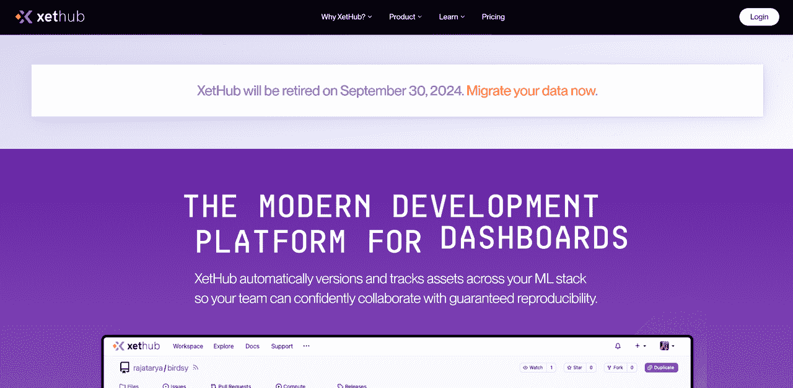

## Bardeen 获得Dropbox和HubSpot战略投资

贡献人：

`https://techcrunch.com/2024/08/08/ai-business-agent-startup-bardeen-pulls-in-strategic-investment-from-dropbox-and-hubspot/`

AI业务代理初创公司Bardeen获得了来自Dropbox Ventures和HubSpot Ventures的300万美元战略投资，总融资额达到2200万美元。这些投资者不仅注入资金，还将通过其分销网络帮助推广Bardeen的技术。Bardeen的平台利用自然语言接口来自动化重复性的知识工作，吸引了包括Deel、Miro和WPP在内的超过300,000名用户。

公司官网：`https://www.bardeen.ai/`

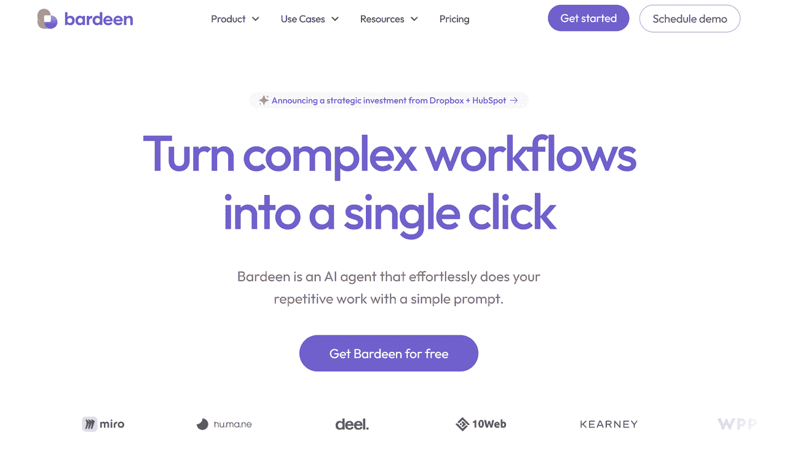

## SoundHound以8000万美元收购Amelia AI，后者曾融资1.89亿美元

贡献人：

`https://techcrunch.com/2024/08/08/soundhound-acquires-amelia-ai-for-80m-after-it-raised-189m/`

AI语音界面技术公司SoundHound以8000万美元收购了Amelia AI，此前Amelia AI已筹集了至少1.89亿美元的资金。此次收购将帮助SoundHound扩展到金融服务、保险、医疗保健等新领域。尽管Amelia曾筹集巨额资金，但其最终的出售价格低于筹集金额，这在当前的AI市场中显得尤为引人注目。

公司官网：`https://amelia.ai/`

## AI初创公司Sweetspot完成220万美元种子轮融资

贡献人：

`https://www.semafor.com/article/08/07/2024/ai-startup-sweetspot-raises-22-million`

AI驱动的政府合同初创公司Sweetspot完成了220万美元的种子轮融资，由1984 Ventures领投。Sweetspot成立于2023年，通过AI技术帮助企业简化美国政府采购流程，致力于打造一个类似于“TurboTax”的政府合同搜索和申请平台。此次融资标志着该公司发展的重要里程碑，资金将用于进一步扩展其软件功能和市场影响力。

公司官网：`https://www.sweetspot.so/`

# 学习

## 低于3bit量化，实现更快速高效的LLM推理：速度提升1.74倍、成本降低229%

贡献人：

`https://zhuanlan.zhihu.com/p/713606588`

本研究通过细粒度混合精度量化技术，提出了一种新的大模型推理加速方法。该方法采用了 2/4/16 比特权重量化，通过异步解量化技术优化了 GPU 上的计算与访存操作，从而实现了端到端推理速度的 1.74 倍提升，并且降低了 229% 的成本。技术细节包括：针对权重矩阵内部数值分布不均的问题，通过对权重敏感性的分析来决定不同组的量化精度，并且考虑了 GPU 上的内存对齐问题。此外，通过保留特定 2 比特区域的离群值并限制稀疏离群值的比例，实现了推理速度和算法精度的平衡。异步解量化技术的设计，使得二阶解量化的计算可以与一阶解量化的访存操作异步进行，有效提高了推理效率。

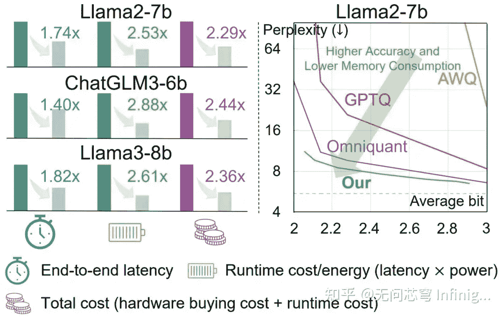

## 史河机器人的首款具身智能新品XR1解析

贡献人：

`https://mp.weixin.qq.com/s/sHmGR7-QbRlKCCZM6yOgrw`

史河机器人在 ICIRA2024 会议上发布了其首款具身智能移动操作机器人 XR1。XR1 采用模块化设计，整合了移动模块、升降模块、双臂模块、头部交互模块和中央控制模块，形成了一个类人形机器人。底盘尺寸为 755×655mm，配备了前端驱动轮和后端万向轮，内部结构采用笼式设计，增强了结构的稳定性。XR1 的感知系统包括三个激光雷达和多个深度视觉相机，能够全方位感知环境，实现精确定位和导航。双臂系统由七自由度协作机器人构成，负载能力可达 3.5kg，臂展达到 700mm，适用于多场景。XR1 还具备自主环境感知和人机交互能力，支持 ROS 二次开发，可以在科研和商业实践中随需应变。内置进化学习机制，使 XR1 能够不断学习和优化，提升其智能决策和执行能力。

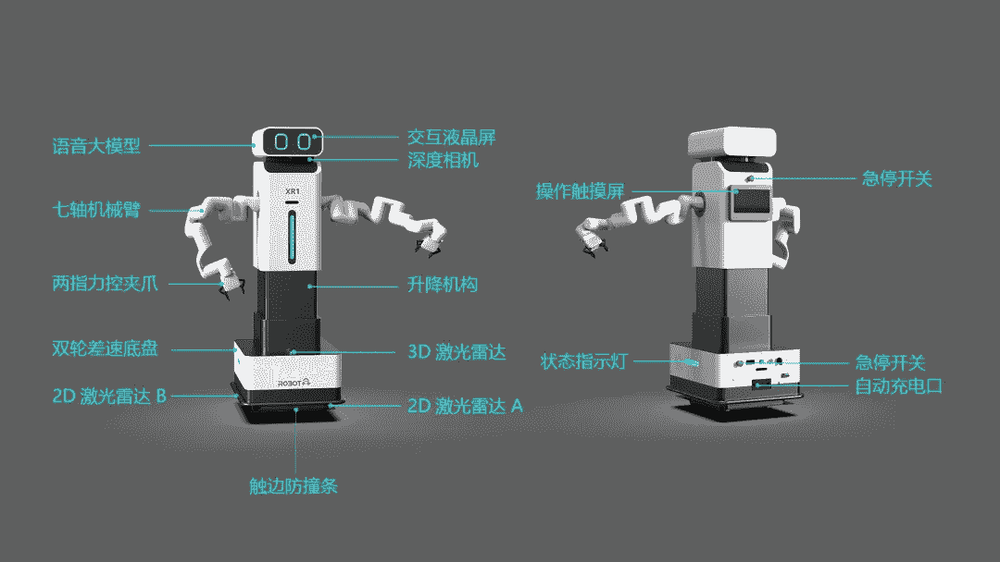

## IBM Vela的AI创新之旅

贡献人：

`https://mp.weixin.qq.com/s/e739kbrmY2XN9J229PnwAA`

IBM Vela 是一种集成在 IBM 云中的 AI 优化超级计算机，采用灵活可扩展的两层 spine-leaf CLOS 架构，配备高性能 A100 GPU 和第 3 代英特尔至强处理器。网络方面，Vela 通过 RDMA 和 GDR 实现了高效的数据通信，显著提升了小消息传输的带宽。在虚拟化领域，Vela 选择了虚拟机配置，通过 PCI-E 设备透传等技术，确保了虚拟机的性能接近裸金属环境。为了解决数据 I/O 瓶颈，IBM 引入了 IBM Spectrum Scale 文件系统，大幅度提高了数据读写效率。Vela 软件栈基于 Red Hat OpenShift 集群，提供了一系列工具和技术，如 Autopilot、多 NIC CNI 和 CNSA，以支持 AI 生命周期的各个阶段。此外，IBM 还实施了一系列监控和维护策略，如 Activity Tracker、LogDNA 和 Alert Manager，以及缓冲池和应用程序日志分析，确保了系统的稳定性和效率。

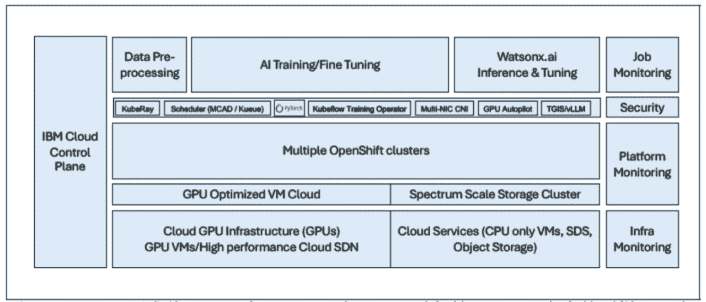

## 用 2 万条真人AI海龟汤数据评估大模型推理能力

贡献人：

`https://mazzzystar.github.io/2024/08/09/turtle-benchmark-zh/`

本文详细介绍了如何利用 AI 技术评估大模型在推理能力上的表现。作者通过对海龟汤游戏的深入分析，提出了一个新的评估指标 —— 海龟 Benchmark。该指标基于 2 万条真人 AI 海龟汤数据，通过对用户猜测的人工标注，评估大模型对这些猜测的准确率。文章指出，海龟 Benchmark 优于传统评估指标，如 MMLU 和 MT-Bench，因为它不依赖于背景知识，能够提供客观、量化的结果，并且随着用户互动不断更新，避免了模型作弊的可能性。在测试 11 个不同的大模型后，作者发现尽管大多数模型在提供示例后有所性能提升，但在推理能力上仍然存在明显差距，且整体水平远低于人类。

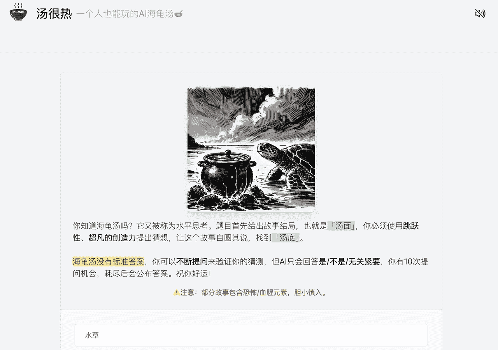

## 如何准确且可解释地评估大模型量化效果？

贡献人：

`https://mp.weixin.qq.com/s/gVJM_4CKK_LylAXWGwW5ZQ`

量化技术的选择取决于特定模型和使用场景，可量化的模型部分也不相同。Fireworks 团队使用 KL 散度和词元拒绝率等指标来评估量化对模型输出的影响，并将这些指标细分到预填充和生成阶段，以便更精确地理解不同量化技术的效果。文章指出，量化级别的增加可能会提高性能但降低质量，因此需要在质量与性能之间找到平衡点。此外，文章还讨论了基于任务的评估方法和困惑度指标的局限性，以及使用 LLM 自身作为评估者的方法可能带来的问题。

原文：`https://fireworks.ai/blog/fireworks-quantization`

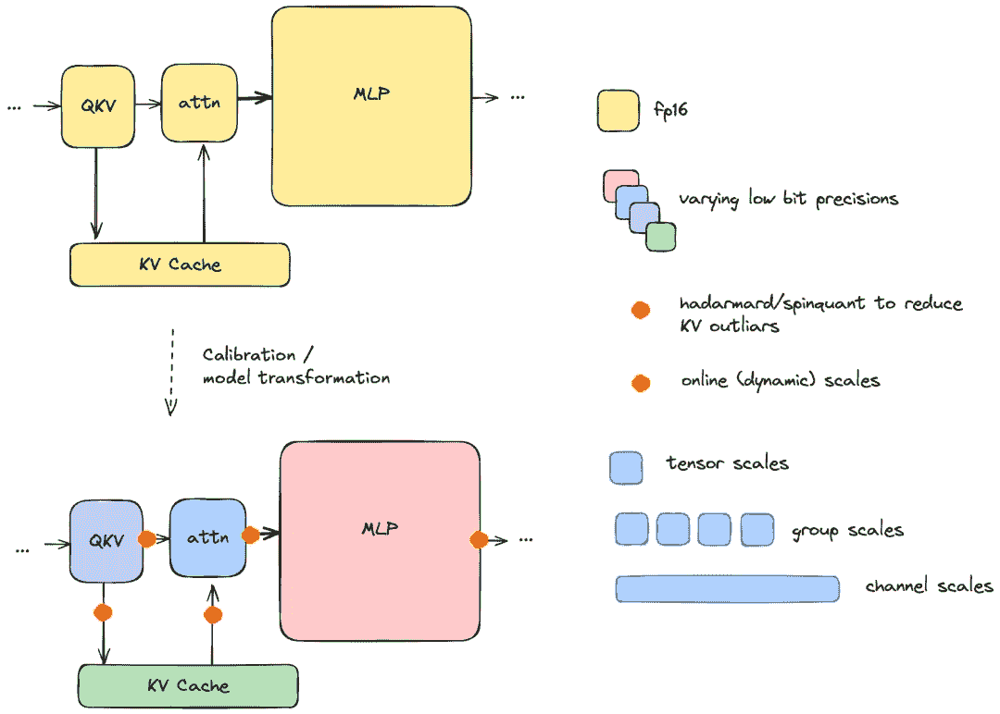

## 如何看待阿里通义团队新发布的Qwen2-Math，在数学推理领域大幅度超过GPT–4系列？

贡献人：

`https://www.zhihu.com/question/663792331/answer/3588528474`

阿里通义团队新发布的 Qwen2-Math 模型，是一个专注于数学推理领域的 AI 大模型，它在 Math benchmark 上实现了显著的性能提升，首次超越了 GPT-4 系列。Qwen2-Math 基于 Qwen2-1.5B/7B/72B 进行了继续预训练和微调，特别是在数学相关的高质量数据集上的训练，使得模型在数学问题解决上有显著提升。模型的开源版本包括了 1.5B、7B 和 72B 三种规模，其中 72B 模型在 MATH 数据集上达到了 84 分的 greedy performance。

技术细节上，Qwen2-Math 采用了 SFT（Supervised Fine-Tuning）和 RLHF（Reinforcement Learning from Human Feedback）进行了指令微调，并且引入了 GRPO（Group Relative Policy Optimization）技术，这是一种基于组内相对评分的优化方法，能够有效提升模型性能。此外，模型还使用了一个专门针对数学问题设计的 Reward Model 来优化数据质量。

在数学 benchmark 和竞赛题上的表现验证了 Qwen2-Math 的高效性，尤其是在复杂问题和竞赛级别题目上的解决能力。尽管 Base 模型已经达到了高水平，但 Instruct 模型通过后训练的方式进一步提升了性能。目前，Qwen2-Math 暂未提供 Demo，但团队已经在博客中分享了去数据污染的方法，并承诺将在论文中提供更多的分析和技术细节。

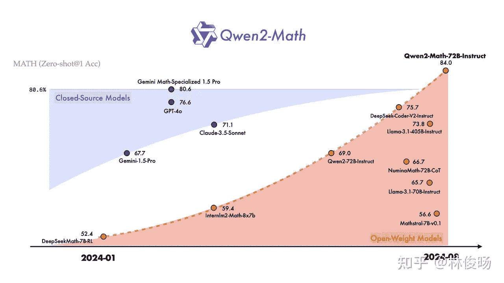

## ICML 2024 大语言模型相关507篇论文整理

贡献人：

`https://mp.weixin.qq.com/s/CIWe1ft7bnwh3vcdeRV8cQ`

在今年被接收的论文中，共计 507 篇论文与大语言模型（Large Language Model） 相关。由于大语言模型本身具有大规模的网络参数，以及对高算力、大数据的需求，关于 efficient LLM 的研究是最多的，包括模型压缩、加速训练（包括 微调）、加速推理、高效架构设计等。其次，针对人工智能领域的安全性和价值对齐（ Alignment/AI Safety），如何评估语言模型的能力，包括通用能力与特用能力（Evaluation），如何提高大语言模型的逻辑推理能力（Reasoning），以及多模态的大模型（Multimodal）都是当前备受关注的研究领域。本次 ICML 中稿论文中关于时间序列预测（Time Series Forecasting），LLM 优化序列决策任务（LLM for sequential decision making）较以往更多一些。总体上，随着大语言模型的发展，可研究的问题在不断涌现，论文写作的门槛也有所降低，这导致论文投稿数量也不断增加，很期待未来有更多有价值的工作出现！

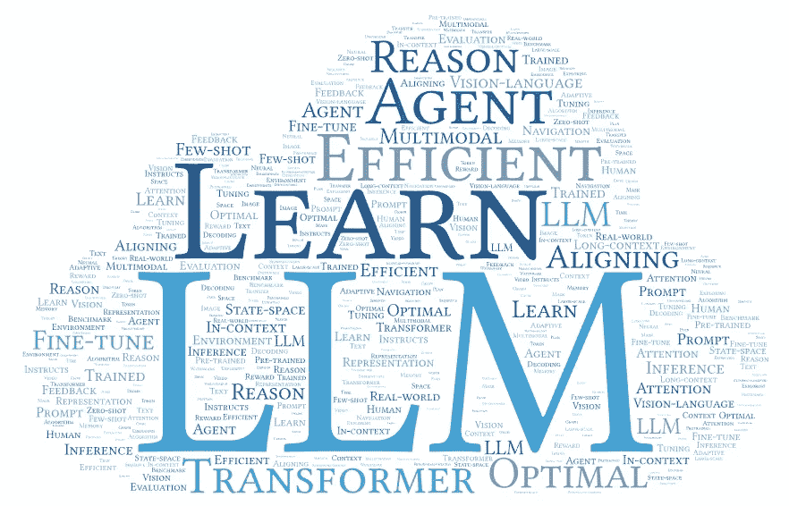

## 播客｜聊聊大模型如何思考与深度学习科学家Yann LeCun

贡献人：

`https://mp.weixin.qq.com/s/pPPKCYmSPNTMM8rgt8lJHQ`

播客《硅谷 101》探讨了大模型的工作原理及其与人脑的对比。陈羽北教授介绍了白盒模型的研究，揭示了大语言模型内部元意思的组织，如词汇表征的消歧和单位转换等。他强调，理解这些元意思有助于优化模型，减少偏见，并提高效率。例如，通过关闭特定神经元，可以观察模型对中文的理解能力下降。陈羽北还提到，大模型的能力还不如人脑，后者能处理多维度的感官信号，而大模型主要依赖语言数据。他的研究指出，人脑在效率上令人惊叹，能在有限的数据接收量下实现强大的泛化能力。

在讨论 Yann LeCun 的研究方向时，陈羽北指出，LeCun 关注模型的自主学习和具身能力，以及如何通过自监督学习和世界模型来实现这些能力。他们的研究旨在超越简单的数据重建，探索更高层次的规律表示。LeCun 的观点与其他 AI 实验室如 OpenAI 和 Anthropic 在某些方面有所不同，他更强调模型的具身和控制能力，以及对未来 AI 研究的科学化探索。

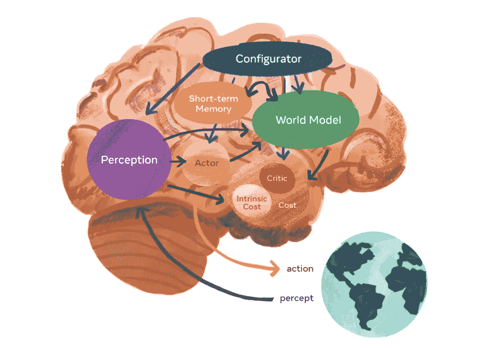

# 声明

本文档仅供学习交流使用，版权归原作者所有，若涉侵权，请联系Jack Jin 15101136166

（欢迎在下方反馈您宝贵的意见！整理不易，觉得有用给AI日报小组点个赞👍吧！）

ChatGPT；Angela；Zijia Liu；Alex；Zeqi Tan；Tiezhen（HuggingFace）；Naixu；Lizhi；Peter；Suoman；Jack

封面生成——右脑科技

如果你有大模型相关的创业想法，欢迎来找我们聊聊～🛰️：15101136166

> 快邀请你的小伙伴们一起来读大模型日报吧！

> **【日报知识库】**这里是近期日报内容的汇总,欢迎大家查阅

> [大模型日报知识库(分享版)](https://miracleplus.feishu.cn/wiki/KapVwXfkriOBiskB0B2cUHxjnTh)

> 欢迎大家多多帮我们分享,转发~~

> 如果大家有任何的建议或者吐槽,欢迎随时找我聊天~

