# 奇绩大模型日报（8月 12日）

> 来源：[https://miracleplus.feishu.cn/docx/WvMrdjlDko2hzQxY1k7c3E10nVJ](https://miracleplus.feishu.cn/docx/WvMrdjlDko2hzQxY1k7c3E10nVJ)

# 📡潜空间活动报名

> 潜空间系列活动第三季第三期开启报名！

> 本期活动将在**8月24日** **10:00 am**开始，嘉宾是**童晟邦**。**童晟邦，纽约大学博士，伯克利人**工智能实验室（BAIR）研究员， OpenAI 超对齐奖学金获得者。他将和大家探讨视觉在多模态大模型中扮演的角色。

> 除嘉宾分享外，每期设置了【匹配合伙人 Cofounder Matching】环节。你可以和 GenAI 时代最有活力的创业者和研究者线下面对面交流，将有机会找到志同道合、有共同创业梦想的小伙伴。

> 报名通道已开启，欢迎扫描下方二维码报名。

# 资讯

### 清华校友问鼎RLC最佳论文奖！AI顶会新秀颠覆审稿流程好评如潮

https://mp.weixin.qq.com/s/a6Na6WGod5bjGktFMXp8rw

清华校友 Wanqiao Xu 和 Shi Dong 在首届强化学习会议（Reinforcement Learning Conference, RLC）上获得了强化学习理论类别的杰出论文奖。该会议在美国马萨诸塞大学举行，专为强化学习研究人员提供一个交流平台，并将接受的论文发表在《强化学习期刊》上。RLC 对审稿流程进行了创新和改进，优先考虑方法论的严谨性，并实施了一种新的审稿流程，强调高质量评论和技术正确性，减轻审稿人负担，提供详细反馈.

除了理论类别，RLC 还设立了其他六个类别的奖项，包括强化学习应用、实证方法、经验资源、开创性视野、科学理解和研究支持工具，以增强论文奖项的多样性和认可优秀研究的机会。其中，论文《Exploration in Continuing Environments with Posterior Sampling》由 Wanqiao Xu、Shi Dong 和 Benjamin Van Roy 合著，提出了一种新的探索方法，将后验采样算法扩展到持续性环境，使得智能体能够更好地处理无限范围问题

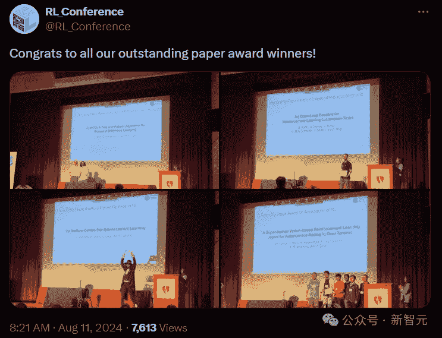

### 北京创新中心研发的天工机器人：室外复杂地形行走与智能交互能力显著提升

https://mp.weixin.qq.com/s/rSxJLLGHbGmVjtQ_AcXoDQ

天工人形机器人在北京亦庄展示了其高效的运动能力和复杂环境适应性，包括在跑步机上奔跑 6 公里、户外复杂地形行走和爬楼梯。该机器人由北京具身智能机器人创新中心研发，自上次发布以来，技术进步显著，全身自由度达到 42 个，配备了先进的传感器和相机，实现了多模态操作能力，如中英文对话和执行人类指令抓取物品。在即将举行的 2024 世界机器人大会上，天工将展示其进化版本，包括大关节的升级。研发团队通过基于状态记忆的预测型强化模仿学习方法，提升了天工的视觉感知能力和运动控制。北京具身智能机器人创新中心推出了 “天工” 通用机器人母平台和 “开物” 平台，旨在解决国内机器人行业的共性问题，并计划在 2025 年底前发布 200 万条高质量数据，以支持具身智能大模型的训练调优。

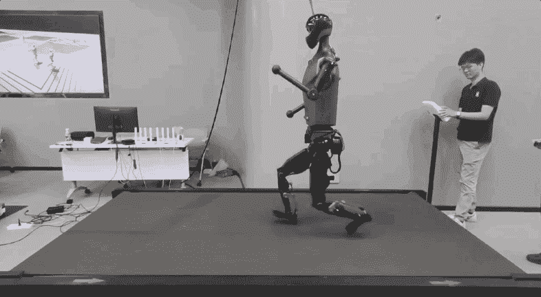

### 库克新活：iPhone也快有Air了

https://mp.weixin.qq.com/s/jw1pSr1E-CxBqkRGlsEiHA

iPhone 16 系列即将发布，将全面配备 Apple Intelligence，提升 AI 体验。新款 iPhone 将推出四种型号，分别为 iPhone 16、16 Plus、16 Pro 和 16 Pro Max，均配备 8 GB 内存，支持更快速的充电技术。Pro 版本的屏幕尺寸将增加，16 Pro 为 6.3 英寸，16 Pro Max 为 6.9 英寸。设备还将增加新的物理按钮，包括操作按钮和相机控制按键。颜色方面，玫瑰金将回归，而蓝色可能被取消。预计明年 iPhone 产品线将有大变化，推出新的 “Air” 版本，同时更新 iPhone SE，配备 OLED 显示屏。

iOS 18 将更新相册 App，新增回忆相册和旅途回忆功能，并优化界面。Mac 产品线也将迎来更新，包括重新设计的 Mac Mini，以及 MacBook Pro、iMac、MacBook Air、Mac Studio 和 Mac Pr o 的迭代版本。Apple Watch SE 将采用塑料外壳，以降低成本并吸引年轻用户。苹果还在开发第二代 Apple Vision Pro 和智能眼镜。同时，谷歌将于 8 月 13 日举办 “Made by Google” 大会，展示其最新的硬件和软件创新。

### AI美女全军覆没！赛博照妖镜下集体变“鬼”，AI代码拆台AI生图

https://mp.weixin.qq.com/s/9Rl3lRimxakCK_ZwpncYcQ

AI 技术在生成人像方面迅速进步，引发了人们对于真伪鉴别的关注。AI 生成的美女图像在细节上如牙齿、饱和度、颜色等处存在与真实不符的特征，而这些特征可以通过调整图像饱和度等方法来暴露。例如，AI 合成的人像常常缺乏真实的纹理细节，如毛孔、正确的光线和阴影效果，以及合理的文字渲染。此外，AI 生成的图像在频谱和噪声分布上存在特定的模式，可以通过 AI 检测模型来分析。近期，Flux 这一 AI 生成工具凸显了这一趋势，它能够生成更加逼真的人像，使得人类辨识 AI 画作的难度更大。为了应对，人们提出了采取 “以模制模” 的策略，通过 AI 生成的图片训练检测模型，并考虑引入隐形水印等措施来打击 AI 造假。

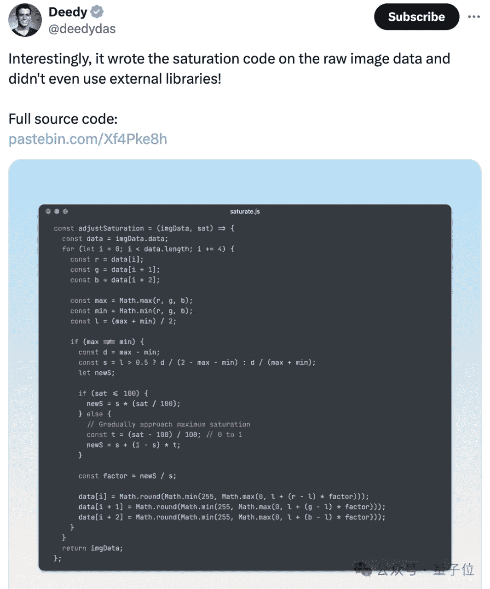

### LEGENT：具身智能体开放平台

https://mp.weixin.qq.com/s/YhSpnJFv4iHX6eKQ3jiJQw

清华大学 TsinghuaNLP 实验室推出了 LEGENT 平台，这是一个具身智能体开放平台，旨在通过 3D 模拟环境和具身数据生成流程，将大语言模型和多模态大模型整合到具身智能体中。该平台支持模型与环境的交互，提供了丰富的场景和物体交互，以及易用的接口，使得智能体能够执行复杂的任务，如导航、操作物体和语言交流。此外，LEGENT 平台还能生成大量的具身轨迹数据，这有助于训练更智能、更通用的具身智能体。平台的设计目标是提升智能体的泛化能力，使其能够在多样化的环境中进行有效的学习和执行。

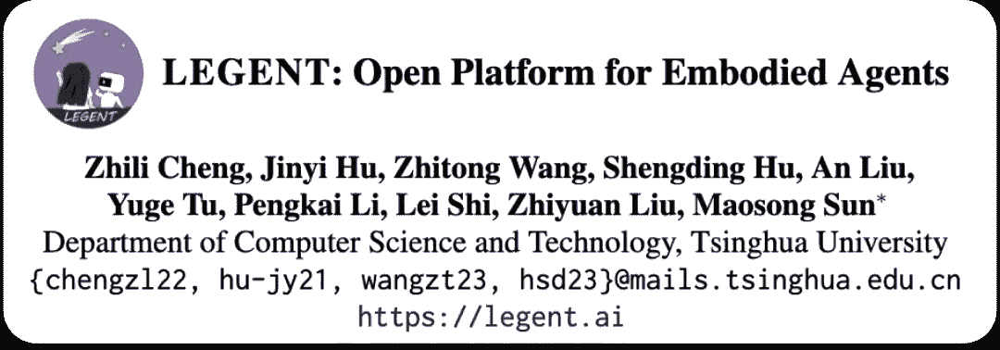

### Palantir与微软合作推进军用人工智能，公司市值已近700亿美元...

https://mp.weixin.qq.com/s/BqkPZ1G9eM_n3A4Zj6rirQ

Palantir 与微软宣布合作，将向美国国防和情报机构提供基于人工智能的数据分析产品和服务。Palantir 的人工智能产品和数据分析软件，如 Gotham、Foundry、Apollo 和 AIP 等，将部署到微软的 Azure Government 和 Azure Government Secret 云平台上。此次合作被分析师认为是重要的，预计将在未来几年内为美国政府和军方安全、可靠、负责任地部署了先进人工智能功能的增强产品组合带来强大动力。Palantir 的股价在合作消息公布后上涨了 11%，截至 8 月 9 日市值已达 672.1 亿美元。公司 CEO 亚历克斯・卡普表示，Palantir 过去 12 个月的美国政府业务收入首次超过 10 亿美元，第二季度其 54% 的收入来自政府客户。Palantir 在军事和情报领域具有重要影响力，与美国多个政府机构有长期稳定的合作关系。近年来，Palantir 与美军签订了多个重要合作合同，主要集中在人工智能领域，包括 AI + 计算机视觉、AI 军事情报卡车 “泰坦”、电磁战斗管理系统、AI 和 ML 研究合同以及陆军研究实验室合作等。Palantir 主要开发了四大产品平台：AIP、Foundry、Gotham 和 Apollo，其中面向军政的产品平台为 AIP 和 Gotham。AIP 是为军事应用而设计的创新智能平台，能够满足多种军事作战需求。Gotham 是 Palantir 推出的第一款产品，主要针对国防、情报、执法等安全领域，提供高度定制化的情报分析和作战决策支持。

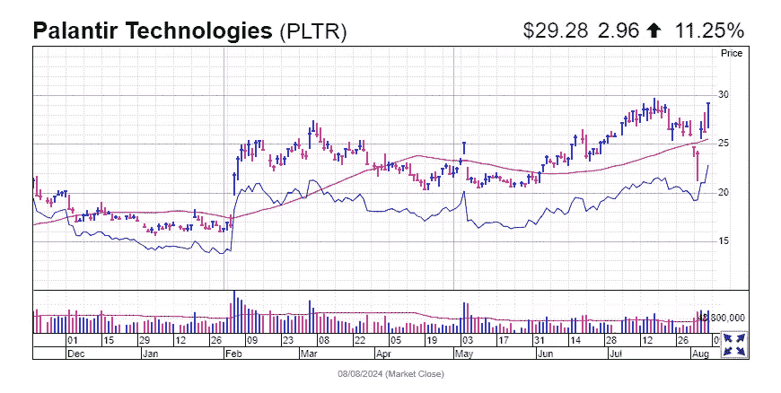

# 推特

### 热传视频AI帮助听障人看见“字幕”，Shawn Wang：每一个抱怨“AI没有杀手级用例”的人都是被特权蒙蔽了双眼

https://x.com/swyx/status/1822719043679437311

每一个抱怨“AI没有杀手级用例”的人都是被特权蒙蔽了双眼。

AI正在让用户界面变得更加无障碍、信息更加多语言化、世界更加易于理解。对于非常年轻的人、非常年长的人，以及所有走非默认路径的人而言，AI正在发挥重要作用。

[ssstwitter.com_1723325495850.mp4](https://internal-api-drive-stream.feishu.cn/space/api/box/stream/download/all/P7gxbdkTFol89ux3Wvxcz5O5n2e)

### Lamers分享：开源浏览器拓展，利用groq过滤推特帖子

https://x.com/RickLamers/status/1822619542855815605

我强烈认为用户应该能够根据个人喜好来决定他们在X上看到的帖子。

👨‍💻 正因为如此，我创建了一个开源浏览器扩展，它使用快速的LLM对帖子进行评估，并在您的个人过滤器超过您设定的阈值时自动隐藏这些帖子。

https://github.com/ricklamers/x-ai-content-filter-groq

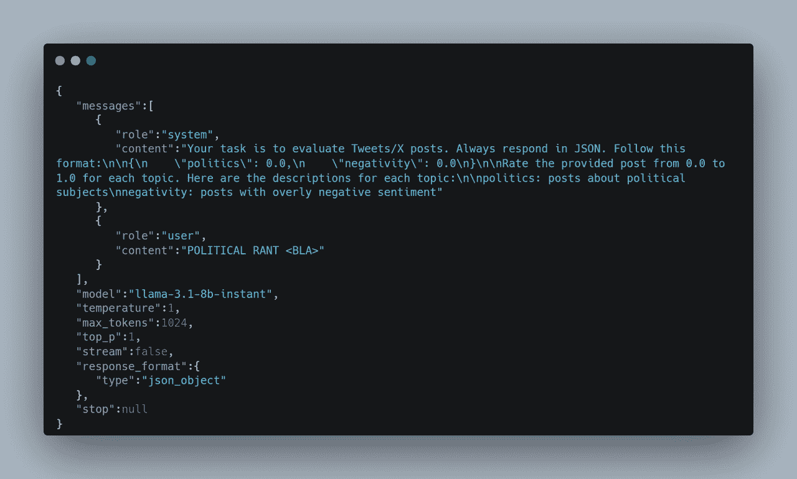

### md2anki：将你的笔记快速转化为学习材料

https://x.com/luca_grippa_/status/1822706679659516412

将你的笔记快速⚡️转化为学习材料... -> md2anki

使用@vercel的AI SDK和GPT-4o-mini构建。

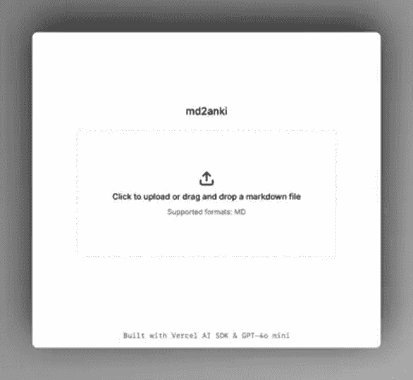

[ssstwitter.com_1723459404540.mp4](https://internal-api-drive-stream.feishu.cn/space/api/box/stream/download/all/FVXAb4vajoCbfpxznOqcIAXcnef)

### David Silver主题演讲谈重新关注强化学习走出大语言模型困境

https://x.com/pcastr/status/1822636670220431485

David Silver的精彩主题演讲指出，我们需要重新关注强化学习（RL）才能走出大语言模型（LLM）困境

@RL_Conference

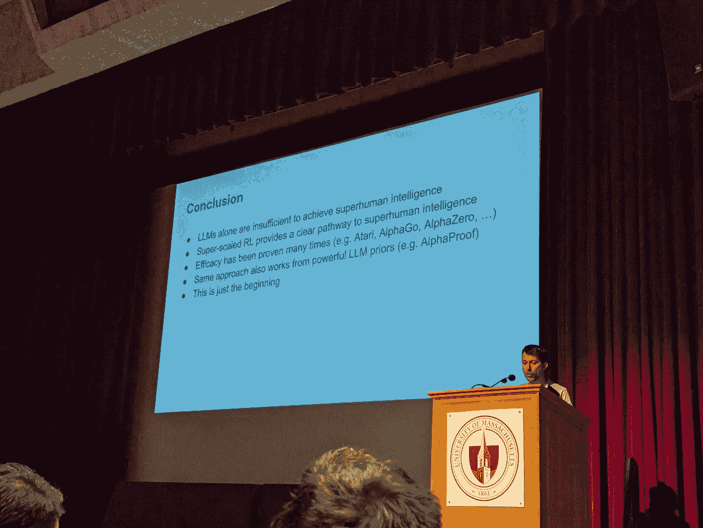

### Sarker分享：可缩放图表，带有刷子功能

https://x.com/rds_agi/status/1822358850714099887

使用@shadcn图表制作的可缩放图表，带有刷子功能

已在MIT许可下开源

灵感来自@shelwin_

https://github.com/rudrodip/shadcn-chart-brush

使用shadcn图表/recharts构建

通过点击并拖动图表进行放大

滚动以缩放

使用刷子进行缩放和移动

点击“重置”按钮重置缩放

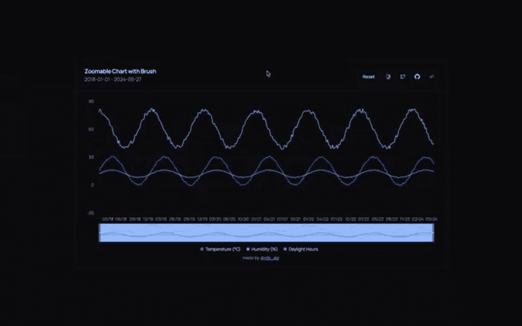

[ssstwitter.com_1723459537962.mp4](https://internal-api-drive-stream.feishu.cn/space/api/box/stream/download/all/BFYbbcrA9oEeclxdUVNclCuonRd)

# 论文

### APE：基于主动学习的工具，用于为基于LLMs的实体匹配找到信息丰富的少量示例。

贡献人：

链接：https://arxiv.org/abs/2408.04637

提示工程是一个迭代过程，通常需要大量的手动工作来制定适当的指令，以有效地引导大语言模型（LLMs）执行特定任务。结合少量示例（few-shot examples）是为LLMs提供精准指令的一个重要且有效的方法，从而提升LLMs的性能。然而，识别出对LLMs最具信息性的示例是劳动密集型的工作，通常需要在广泛的搜索空间中筛选。在本次演示中，我们展示了一种名为APE（Active Prompt Engineering）的工具，它通过主动学习来优化提示。APE从主动学习中汲取灵感，迭代地选择最模糊的示例供人类反馈，反馈将被转化为提示中的少量示例。

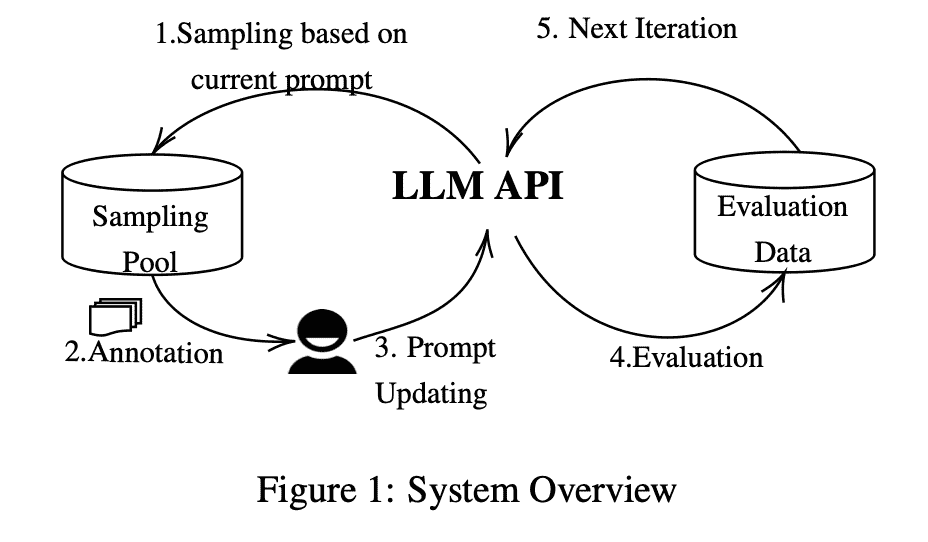

### 基于GPT-3的智能信息提取，用于构建强大的知识库

贡献人：

链接：https://arxiv.org/abs/2408.04641

本研究利用最先进的语言模型GPT-3，提出了一种用于知识库开发的信息提取新方法。该方法旨在解决从非结构化文本中获取相关实体和关系以提取结构化信息的难题。我们在来自不同领域的大量文本语料库上进行实验，以评估我们提出的技术的性能。评估指标包括精确度、召回率和F1分数，这些指标常用于信息提取任务。研究结果表明，GPT-3可以高效、准确地从文本中提取相关和正确的信息，从而提高知识库创建的精确性和生产力。我们还将提出的方法与现有的最先进的信息提取技术进行对比评估。结果显示，通过在上下文学习中仅利用少量实例，我们的方法取得了竞争性结果，并在数据标注和工程成本方面显著节省。此外，我们将所提出的方法应用于生物医学信息的提取，展示了其在现实场景中的实用性。总而言之，我们提出的方法为克服从非结构化文本中获取结构化数据以创建知识库的挑战提供了一种可行途径。该方法能够显著提高信息提取的精确性和效率，这对于包括聊天机器人、推荐引擎和问答系统在内的许多应用来说至关重要。

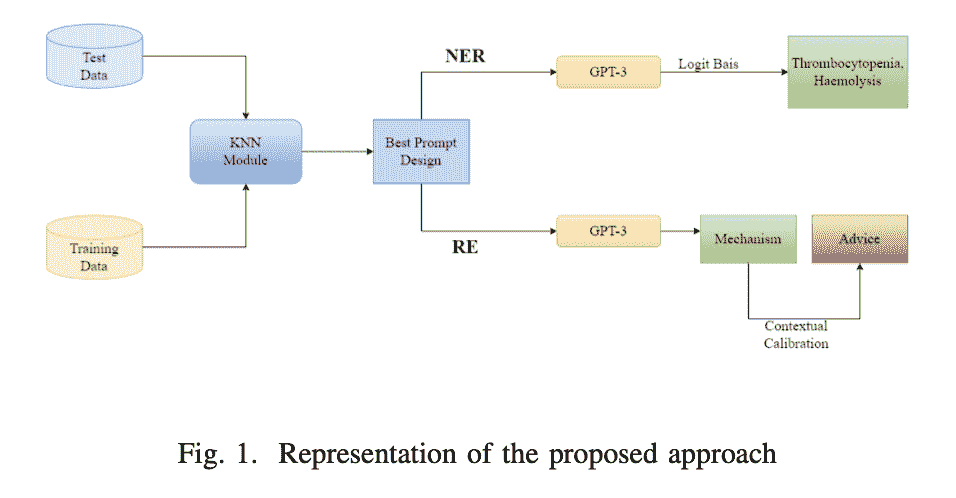

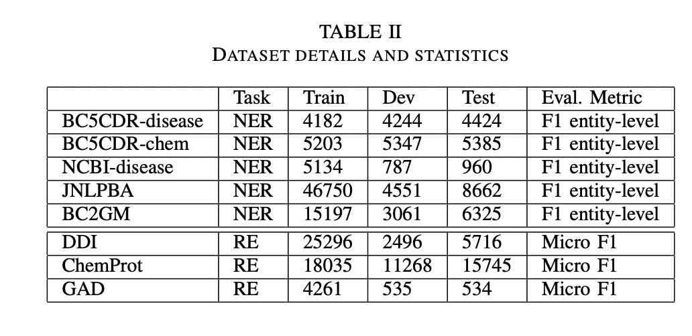

### 评估高级LLM技术对机器人课程中AI讲师的影响

贡献人：

链接：https://arxiv.org/abs/2408.04645

本研究评估了大型语言模型（LLMs）作为大学课程中基于人工智能的导师的表现。我们使用了多种高级技术，包括提示工程（prompt engineering）、检索增强生成（Retrieval-Augmented-Generation, RAG）和微调（fine-tuning）。通过常用的相似度指标，如BLEU-4、ROUGE和BERTScore，并辅以小规模的人类评价（例如对帮助性和可信度的评价），我们对不同模型和技术进行了评估。研究结果表明，RAG与提示工程相结合，显著提升了模型的响应质量，并生成了更为准确的答案。在教育领域，RAG被证明是一种理想的技术，因为它通过为模型输入提供额外信息和材料来丰富模型的知识，这些信息通常已经存在于大学课程中。另一方面，微调可以生成小而强大的专家模型，但也存在过拟合的风险。我们的研究还探讨了如何衡量LLMs的性能以及当前测量方法在多大程度上能够代表正确性或相关性。我们发现相似度指标与人类评价之间存在高度相关性，但大多数指标对较短的回复有偏向。总体而言，我们的研究指出了将LLMs整合到教育环境中的潜力和挑战，提出了对平衡训练方法和高级评估框架的需求。

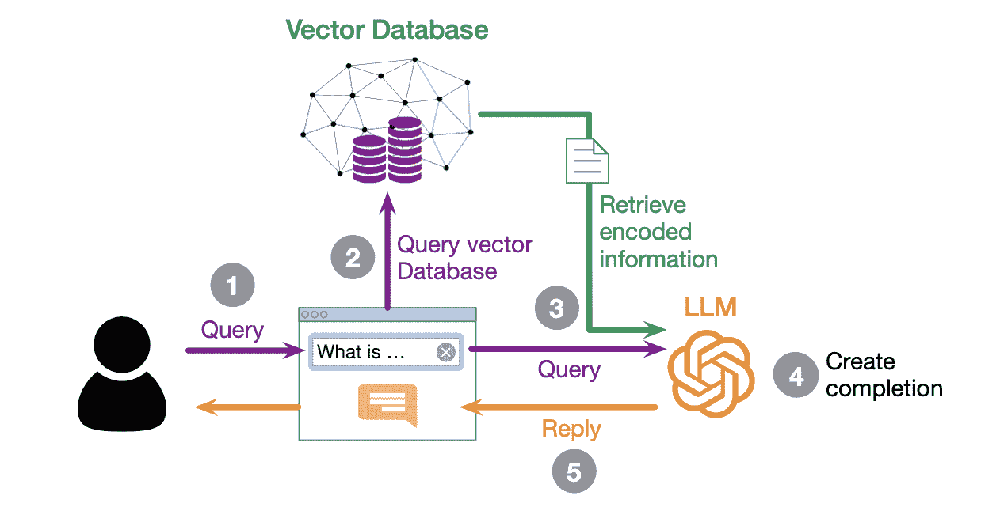

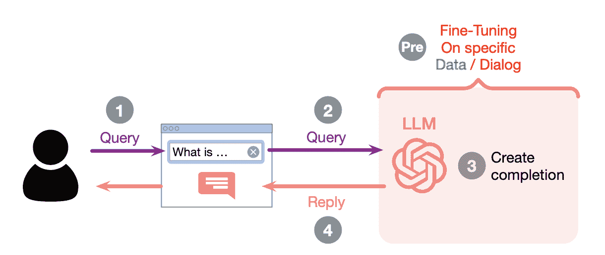

### PLUGH：用于大型语言模型空间理解与推理的基准测试

贡献人：

链接：https://arxiv.org/abs/2408.04648

我们推出了PLUGH（此 https URL），这是一个现代基准测试，目前包含5个任务，每个任务有125个输入文本，这些文本从48款不同的游戏中提取，并代表61个不同（非同构）的空间图，以评估大型语言模型（LLMs）的空间理解与推理能力。我们对基于API和开源的LLMs进行评估，结果显示虽然一些商业LLMs表现出强大的推理能力，但开源的竞争对手也能展示出几乎相同的质量；然而，所有模型仍有显著的改进空间。我们识别了LLMs失败的典型原因，并讨论了可能的应对方法。数据集和评估代码已发布。

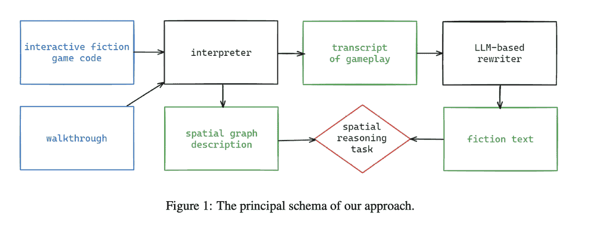

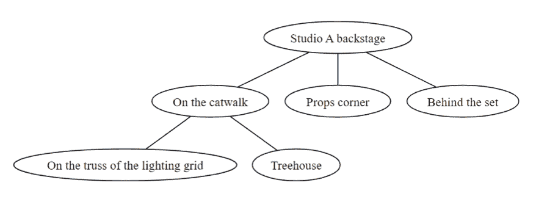

### Chain of Stance：使用大型语言模型进行立场检测

贡献人：

链接：https://arxiv.org/abs/2408.04649

立场检测是自然语言处理（NLP）中的一个活跃任务，旨在识别作者在文本中对特定目标的立场。鉴于大型语言模型（LLMs）卓越的语言理解能力和百科全书式的先验知识，如何探索LLMs在立场检测中的潜力受到了广泛关注。与现有的LLM方法主要依赖于使用大规模数据集进行微调不同，我们提出了一种新的提示方法，称为\textit{Chain of Stance}（CoS）。具体来说，该方法将LLMs定位为专家立场检测器，通过将立场检测过程分解为一系列中间的、与立场相关的断言，最终形成对立场的判断。这种方法显著提升了分类性能。我们在SemEval 2016数据集上使用了四个最先进的LLMs进行了广泛实验，涵盖零样本学习和少样本学习设置。结果表明，所提出的方法在少样本设置中实现了79.84的F1得分，达到了最先进的水平。

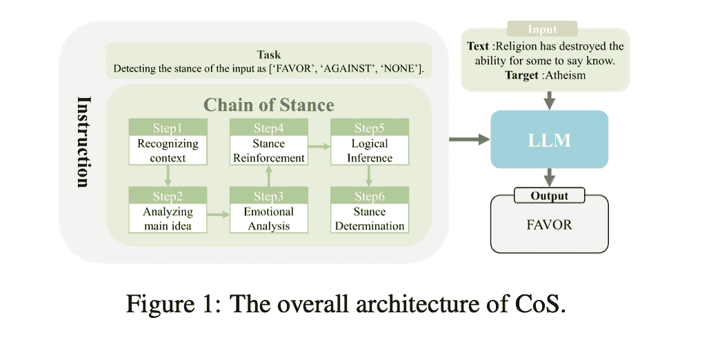

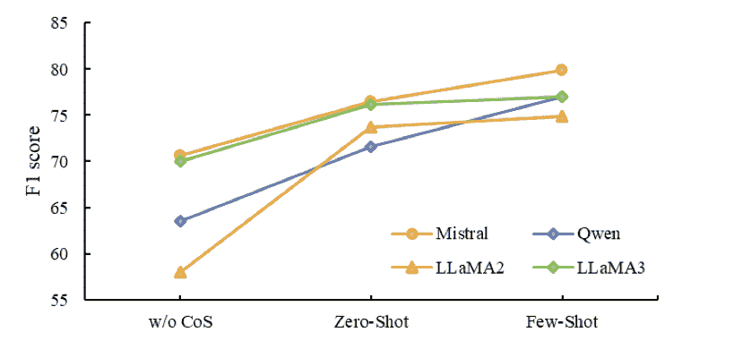

### Knowledge AI: 微调NLP模型以促进科学知识的提取与理解

贡献人：

链接：https://arxiv.org/abs/2408.04651

本项目探讨了大型语言模型（LLMs）在特定领域内理解和提取科学知识的有效性，并创建了一个深度学习框架：知识AI。作为该框架的一部分，我们使用预训练模型并在科学领域的数据集上对其进行微调。模型被调整用于四个关键的自然语言处理（NLP）任务：摘要生成、文本生成、问答和命名实体识别。我们的结果表明，领域特定的微调显著提升了模型在这些任务中的表现，从而提高了它们在科学背景中的适用性。这种调整使非专家能够高效地查询和提取特定科学领域的信息，展示了微调LLMs作为科学知识发现工具的潜力。

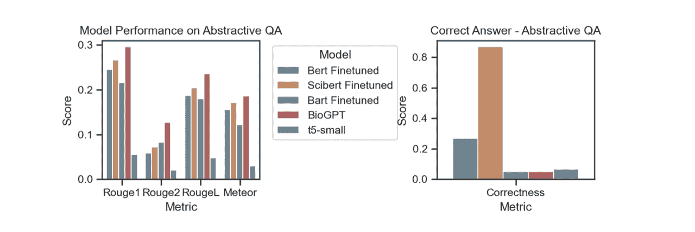

### 批处理BPE分词合并

贡献人：

链接：https://arxiv.org/abs/2408.04653

字节对编码（Byte Pair Encoding，BPE）算法在构建分词器词汇表时，可以批量合并数百对符号。这种技术结合减少用于词汇表训练的文本内存占用，使得在普通笔记本电脑上训练高质量的分词器成为可能。本文介绍了BatchBPE，这是一个开源的纯Python实现，旨在使新分词策略的实验变得更加可行，特别是在计算和内存受限的环境中。通过训练多个词汇表，BatchBPE的实用性和可塑性得到了展示，探索了批量合并过程，并尝试了预处理停用词列表和忽略数据集中最不常见的文本块。编码后文本的长度作为基本评估指标进行了分析。

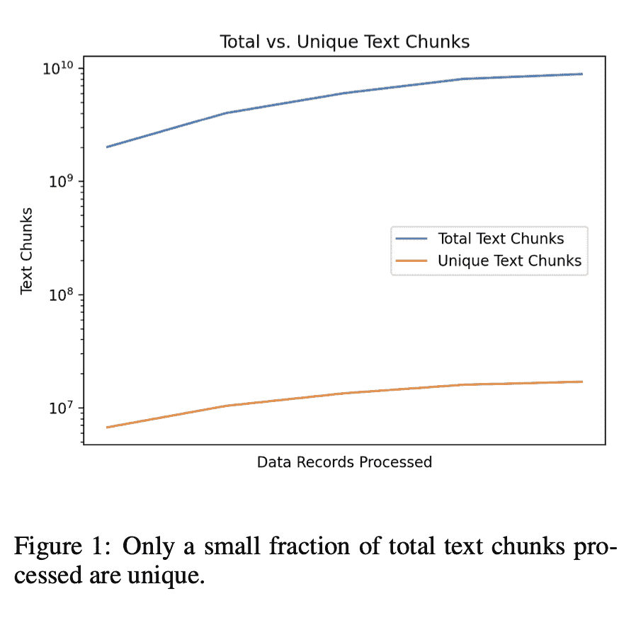

# 产品

### Dome

贡献人：

https://app.trydome.io/

Dome 是一个低代码开发平台，希望帮助企业家快速构建和推出 SaaS 产品。其 AI SaaS Launcher 工具结合人工智能和低代码技术，让用户轻松定制和发布 MVP，提供全面的代码访问，支持支付系统和用户身份验证。

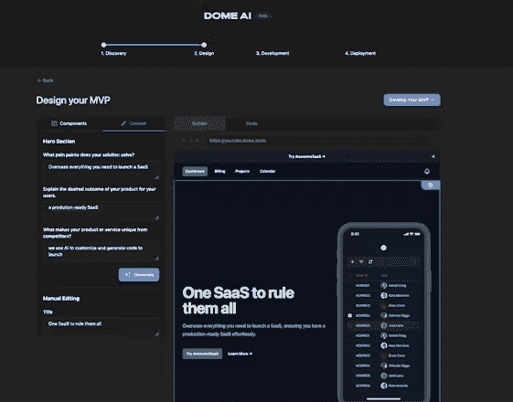

### VMEG

贡献人：

https://www.vmeg.pro/clips-to-videos/

“Clips to Video”是VMEG推出的一款工具，帮助用户将散乱的产品剪辑快速转化为高质量的营销视频。该工具利用人工智能技术，提供自动配音、字幕生成和产品卖点提示等功能，使视频创作变得简单高效，适合用于社交媒体推广和电子商务等场景。用户只需几次点击，就能轻松制作出引人注目的视频内容。

[VMEG_官网视频.mov](https://internal-api-drive-stream.feishu.cn/space/api/box/stream/download/all/IOxZbtxAgoPmx1xgYxkctJcCnHf)

# HuggingFace&Github

### Qwen2-Math-72B-Instruct

贡献人：

https://huggingface.co/Qwen/Qwen2-Math-72B-Instruct

Qwen2-Math-72B-Instruct 是一款专门设计用于处理数学问题的语言模型，属于 Qwen2 系列。它主要用于聊天和指导，能够有效解决复杂的数学和算术问题。该模型在推理能力上进行了显著提升，能够执行多步骤的逻辑推理。

# 投融资

### 卓世科技完成亿元B+轮融资，加速大模型商业化进程

贡献人：

https://36kr.com/p/2901247520627328

生成式大模型公司「卓世科技」宣布完成亿元B+轮融资，由深圳同创伟业领投，青岛国资平台青岛海发及启迪之星等机构跟投。此轮融资将用于产品研发和商业化落地，推动行业大模型的应用。「卓世科技」专注于大模型的应用和商业化，通过算法优化和数据支持，提供高效的模型解决方案。其产品已在养老和教育领域取得进展，特别是AI数字人应用于养老教育，缓解了康养行业的人才缺口。卓世科技与全国多地政府合作，获得优质数据以增强模型性能，展现出强大的商业化潜力和技术创新能力。

公司官网：https://www.maas.com.cn/

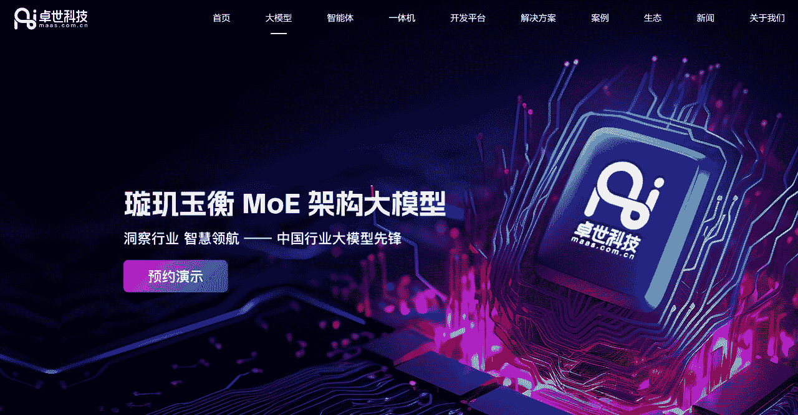

### 恒之未来再获千万级融资，推动机器人新发展

贡献人：

https://36kr.com/p/2902650272537473

恒之未来（重庆）创新科技有限公司，这个由95后创业团队创立的机器人公司，成功获得一轮千万级人民币融资。本次融资由李泽湘教授的XbotPark机器人基地旗下的清水湾二期基金领投，香港X科技基金、知行一号基金等跟投。筹得资金将主要用于产品研发、市场拓展和团队建设。公司首款产品SPARKY哮天机器人计划在2024年底上市，并将在世界机器人大会上展示其最新版本。恒之未来的创新解决方案，特别是其小型化和轻量化机器人技术，获得了投资方的高度认可，并为未来智能硬件发展奠定了基础。

公司官网：https://hengbot.com/

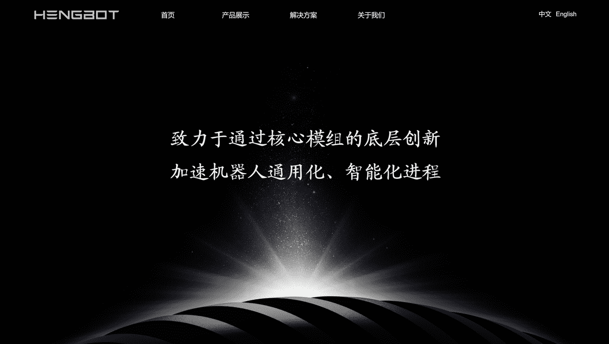

### 具身智能企业「千寻智能Spirit AI」获近2亿元天使轮融资

贡献人：

https://mp.weixin.qq.com/s/AE9PoqepojSZy6m_BFMv0w

千寻智能 Spirit AI，国内领先的具身智能公司，近期宣布完成了近 2 亿元的种子轮 + 天使轮融资。天使轮融资由弘晖基金领投，达晨创投、千乘资本跟投，顺为资本和绿洲资本作为种子轮投资者进行了加码投资。顺为资本在 2024 年首次领投了千寻智能的种子轮融资，并在本轮融资中继续支持，体现了对于机器人与具身智能赛道的长期信心。

# 学习

### 大模型如何推理？先来仿真一下

贡献人：

https://zhuanlan.zhihu.com/p/713812597?utm_psn=1806255575912288256

作者通过一个简化的例子，模拟了大模型在处理问题时的推理过程。在这个例子中，模型需要根据输入的信息进行一系列的推理步骤，包括词义理解、逻辑关系分析、知识检索等，最终输出答案。文章强调，大模型的推理过程是一个复杂的、多阶段的过程，涉及到对输入信息的深入处理和内部知识的广泛运用。此外，文章还提到了大模型在处理不同类型问题时的挑战，以及如何通过优化模型结构和增加训练数据来提高模型性能。

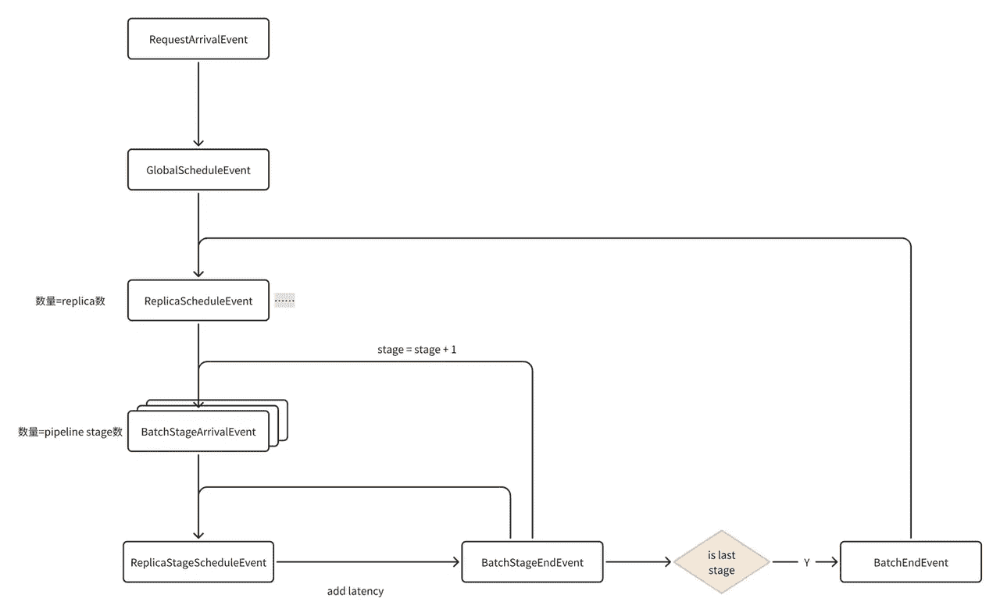

### Decode优化-Lean Attention

贡献人：

https://zhuanlan.zhihu.com/p/713810021?utm_psn=1806255141579546624

LeanAttention 是一种针对 Transformer 模型解码阶段优化的自注意力计算机制，旨在提高长上下文长度下的计算效率和并行化。它通过 softmax 重新缩放将注意力计算的依赖关系转化为归约操作，采用流 K 风格的注意力划分技术，实现了计算工作负载的均衡分配。LeanTile 作为基本计算单元，能够有效地计算局部注意力，并且通过精确的注意力分区，LeanAttention 在单 GPU 和多 GPU 环境下都实现了显著的性能提升。实验结果显示，相比于 FlashAttention-2，LeanAttention 在注意力操作级别提供了平均 2.6 倍的加速，在 512k 上下文长度下达到了 8.33 倍的加速，同时保持了接近 100% 的处理器占用率，为大型语言模型的推理阶段提供了高效的计算支持。

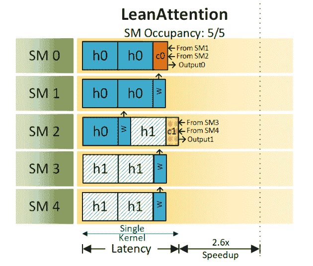

### cutlass GEMM 流水线——single-stage、pipelined、multi-stage

贡献人：

https://zhuanlan.zhihu.com/p/712451053?utm_psn=1806249539138621440

Cutlass 库中的 MmaSingleStage、MmaPipelined 和 MmaMultiStage 三种流水线策略，分别代表单级、管道和多级流水线，它们通过不同的数据加载和计算重叠方式优化了矩阵乘法（GEMM）的性能。三级 tiling 策略，包括 thread block tiling、warp tiling 和 thread tiling，提高了数据局部性，减少了对全局内存的依赖。MmaSingleStage 采用顺序执行，在大循环前加载数据到共享内存，然后进行小循环的计算和累加。MmaPipelined 通过双缓冲机制实现了数据预取和计算的重叠，但需要精细调整分块参数以避免流水线暂停。MmaMultiStage 利用异步访存指令，如 cp.async，实现了数据搬运和计算的异步处理，减少了对寄存器资源的依赖，提高了流水线效率。性能优化关键在于合理设置分块参数和流水线策略，以提高计算密度和隐藏延迟。

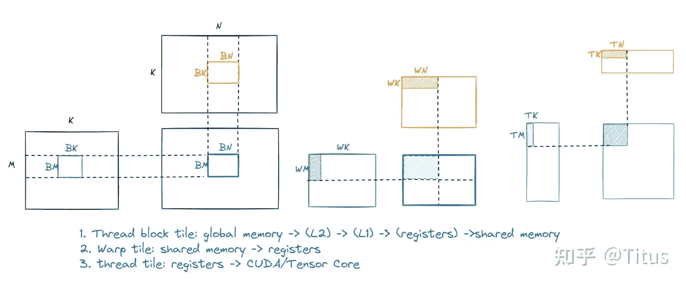

### 人形机器人能否“降维打击”？

贡献人：

https://zhuanlan.zhihu.com/p/713955678?utm_psn=1806254896120467456

文章深入探讨了人形机器人的技术细节，特别是关于 “降维打击” 的概念。首先，它分析了当前人形机器人在机械结构、传感器集成和算法控制方面的技术成就和局限性。然后，文章详细阐述了科幻电影中的 “降维打击” 技术，以及它与现实物理定律的差异。接着，文章探讨了实现空间维度转换可能需要的理论基础，包括量子纠缠、量子隧穿和多维宇宙模型等高级物理概念。文章指出，尽管这些理论在微观尺度上有所应用，但将它们扩展到宏观世界的机器人技术中，尤其是实现空间维度转换，目前仍然面临巨大的技术和理论挑战。

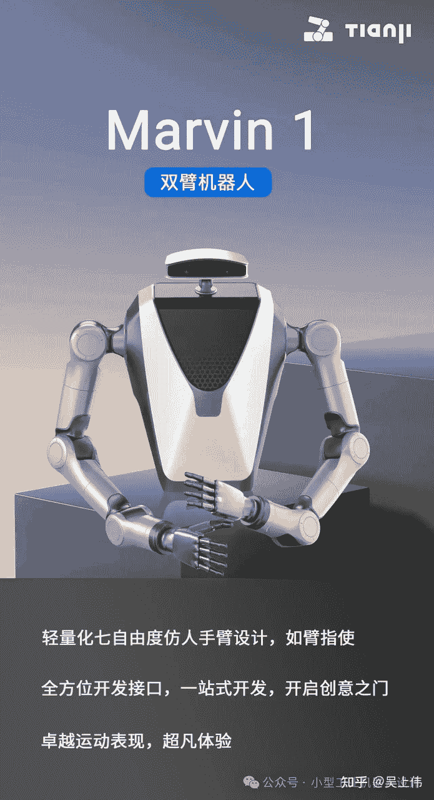

### cute TiledMMA

贡献人：

https://zhuanlan.zhihu.com/p/699255051?utm_psn=1806033154475180032

文章深入探讨了 CUDA 下的 cute TiledMMA 技术，这是一种高效实现矩阵乘法的方法。MMA 抽象是其核心，它包括了硬件层面的 MMA_Atom，即最小的矩阵乘法计算单元，以及在此基础上扩展出来的 TiledMMA，用于处理更大规模的计算。TiledMMA 通过在执行单元层面的重复或对原子操作的重复执行，实现对大型矩阵的乘法。文章通过示例代码展示了如何定义和使用 TiledMMA，包括使用 make_tiled_mma api 简化代码，以及如何实现一个拓展型的 TiledMMA 来适应不同大小的计算任务。此外，作者提供了一个 gemm_device 内核的实现，它使用了 TC 的 SM80_16x8x16_F16F16F16F16_TN 指令集，并通过 local_tile 和 ThrMMA 接口划分了每个线程的计算任务。最终，通过与 cublas 库的计算结果对比，验证了自定义内核的正确性和效率，证明了 TileMMA 技术在处理大规模矩阵乘法时的有效性和高性能。

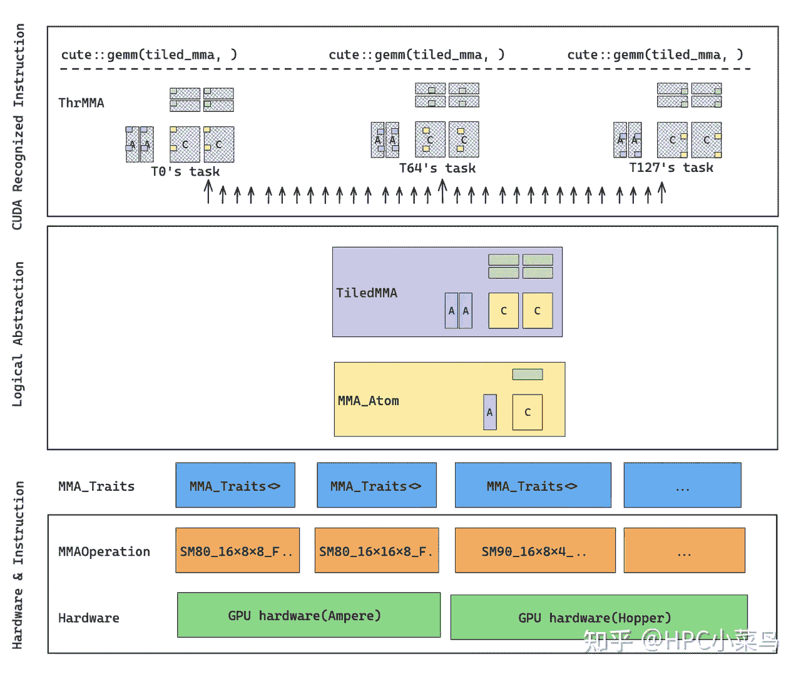

### 聊聊大模型推理中的 Prompt Compression

贡献人：

https://zhuanlan.zhihu.com/p/710508401?utm_psn=1806034075313659904

大模型推理中的 Prompt Compression 技术旨在通过压缩输入提示数据，实现模型推理过程的资源消耗优化。这项技术的核心在于减少输入数据的冗余，同时保持模型的性能和准确率。具体实现方法包括对文本数据的词汇量化、句子简化，以及对图像和音频数据的特征值量化和特征空间降维。量化、剪枝和知识蒸馏是常用的数据压缩策略。量化通过降低数据表示的位数减少存储需求；剪枝则通过移除模型中不重要的参数来减小模型规模；知识蒸馏则通过小模型学习大模型的知识，实现模型的精简。

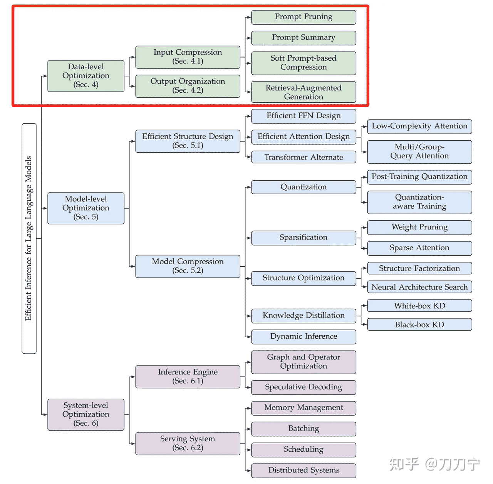

### Prepacking-消除attention padding冗余计算

贡献人：

https://zhuanlan.zhihu.com/p/713813412?utm_psn=1806038258716639233

Prepacking 通过消除 attention 计算中的 padding，优化大语言模型的预填充过程，提高计算效率和速度。技术细节包括修改 attention 算子以支持不同长度 prompt 的组合，自定义注意力掩码和位置编码，以及在 vLLM 框架中的实现。实验证明，该方法显著缩短了预填充时间，减少了 GPU 内存占用，并提升了吞吐量。Prepacking 在处理高变异长度的 batch 时表现出色，且不需要更改模型架构，具有很大的硬件适应性和未来发展潜力。

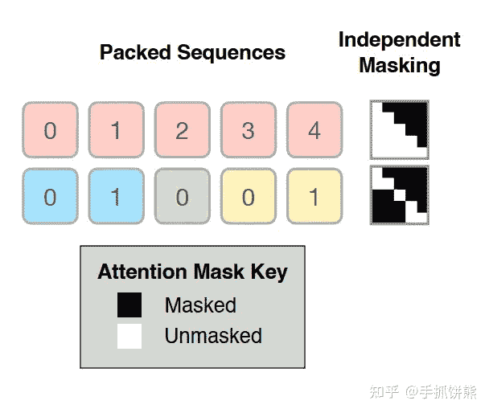

### 首个DRL就业情况调查报告总结

贡献人：

https://zhuanlan.zhihu.com/p/713477472? utm_psn=1805609565074632704

文章作者赵鉴，研究方向为强化学习和游戏 AI，发起了关于 DRL 就业情况的调查。该调查由永乐博士实施，共向 3000 多名 DRLer 讨论群发放问卷，最终收集到 119 份问卷，但由于超过一半的调查者尚未就业，只有 33 份问卷被认为是有效的。调查结果显示，参与调查的 24 名硕士和 9 名博士中，大多数来自 985 高校，主要研究方向集中在游戏 AI 和机器人技术，较少涉及 RLHF 和搜索推荐方向。调查还揭示了 DRL 器们毕业后的就业去向，以及他们对 DRL 技术优势的看法，以及放弃 DRL 领域的原因等信息。

# 声明

本文档仅供学习交流使用，版权归原作者所有，若涉侵权，请联系Jack Jin 15101136166

##

（欢迎在下方反馈您宝贵的意见！整理不易，觉得有用给AI日报小组点个赞👍吧！）

ChatGPT；Angela；Zijia Liu；Alex；Zeqi Tan；Tiezhen（HuggingFace）；Naixu；Lizhi；Peter；Suoman；Jack

封面生成——右脑科技

如果你有大模型相关的创业想法，欢迎来找我们聊聊～微信：15101136166

> 快邀请你的小伙伴们一起来读大模型日报吧！

> **【日报****知识库****】**这里是近期日报内容的汇总,欢迎大家查阅

> [大模型日报知识库(分享版)](https://miracleplus.feishu.cn/wiki/KapVwXfkriOBiskB0B2cUHxjnTh)

>

> 欢迎大家多多帮我们分享,转发~~

> 如果大家有任何的建议或者吐槽,欢迎随时找我聊天~

