# 奇绩大模型日报（8月 14日）

> 来源：[https://miracleplus.feishu.cn/docx/TXRvdgpIwoQuWAxV7mfc2J6QnIb](https://miracleplus.feishu.cn/docx/TXRvdgpIwoQuWAxV7mfc2J6QnIb)

# 📡潜空间活动报名

> 潜空间系列活动第三季第三期开启报名！

> 本期活动将在**8月24日** **10:00 am**开始，嘉宾是**童晟邦**。**童晟邦，纽约大学博士，伯克利人**工智能实验室（BAIR）研究员， OpenAI 超对齐奖学金获得者。他将和大家探讨视觉在多模态大模型中扮演的角色。

> 除嘉宾分享外，每期设置了【匹配合伙人 Cofounder Matching】环节。你可以和 GenAI 时代最有活力的创业者和研究者线下面对面交流，将有机会找到志同道合、有共同创业梦想的小伙伴。

> 报名通道已开启，欢迎扫描下方二维码报名。

# 资讯

### xAI发布Grok-2，X平台新增图像生成功能

https://techcrunch.com/2024/08/13/xais-grok-can-now-generate-images-on-x/

xAI公司推出了Grok-2和Grok-2 mini两个AI模型，并在X（前推特）社交网络上以测试版形式发布。Grok-2具备增强的推理能力，且目前仅向Premium和Premium+用户开放图像生成功能。由于Grok-2在生成政治人物图像方面没有限制，这可能导致误导性内容的传播。尽管目前尚不清楚这些图像是否带有AI生成的元数据标识，xAI计划将Grok-2用于改进X平台的搜索、帖子分析和回复功能等AI驱动的特性。

### 谷歌版GPT-4o和AI手机一起上市

https://mp.weixin.qq.com/s/Rd0FiadhYPNvIGg3BJya6Q

谷歌在 Made by Google 活动上发布了 Gemini Live，一款与 ChatGPT 类似的 AI 对话产品，以及一系列由新一代 Google Tensor G4 芯片支持的 Pixel 智能硬件设备。Gemini Live 支持语音交互，能够与用户进行自然流畅的对话，并且可以集成到多种安卓应用中。同时，谷歌推出了 Pixel 9 系列手机和第一款折叠屏手机 Pixel 9 Pro Fold，这些设备具备增强的 AI 功能，如生成式 AI、智能拍照和通话记录智能化等。新的 Tensor G4 芯片提升了性能和 AI 算力，支持多模态 AI 模型。谷歌还强调了新产品的隐私保护和安全功能，如卫星 SOS 功能，以及通过提供一年的 Gemini Advanced 订阅来吸引用户。

### 智能体Agent Q发布！Llama 3零样本成功率提升340%

https://mp.weixin.qq.com/s/xVB7ZiCsrNbCrQZKb2mwjA

MultiOn 公司推出的智能体 Agent Q，该智能体采用自监督学习框架，能够通过互联网上的真实任务进行自我对弈和强化学习，显著提升了 Llama 3 的零样本成功率，达到了 95.4%。Agent Q 具备规划、推理和自我修复功能，能够执行复杂的预订任务，如餐厅、会议和机票预订。尽管有关 Agent Q 背后是否与 OpenAI 的 Q * 项目有关的猜测，但其技术进展不容忽视，已经吸引了多位大佬和 KOL 的关注。

### 最强超算9月上线，英伟达芯片助力智能进化

https://mp.weixin.qq.com/s/SrSdRY1_M-eOGsFIJuTTvQ

一台强大的超级计算机将于 9 月上线，由 SingularityNET 公司建造，旨在推动人类级别的人工智能（AGI）发展。该超算配备了英伟达最新的 GPU 等先进硬件，预计将在 2025 年前全面投入运行。AGI 假设能在多学科领域超越人类智能，具备自学习和自我改进能力。SingularityNET 正在开发新型神经 - 符号 AI 方法，以减少资源需求，同时该超算的使命是实现基于大数据学习和简单上下文再现，向更高级的非模仿性机器思维转变。该项目预计将在 2024 年底或 2025 年初完成，具体取决于供应商的交付时间表。此外，SingularityNET 提供了 OpenCog Hyperon 软件框架，以及基于 token 的访问权限管理系统，允许用户使用并向现有数据集添加数据。这些数据集用于测试和部署 AGI 概念。DeepMind 的联合创始人 Shane Legg 预计 AI 系统可能在 2028 年达到或超越人类智能，而 Goertzel 估计这一水平可能会在 2027 年实现。

# 推特

### OpenAI发布SWE-bench Verified：更可靠地评估AI模型解决实际软件问题的能力

https://x.com/openai/status/1823404955933548818?s=46&t=GRStLXDcUNuun8J5Noyw4Q

我们正在与原作者合作发布SWE-bench的新版本，以更可靠地评估AI模型解决实际软件问题的能力。

### Karpathy：SQL注入式攻击LLMs（大语言模型）的特殊token

https://x.com/karpathy/status/1823418177197646104?s=46&t=GRStLXDcUNuun8J5Noyw4Q

简而言之，我认为encode/decode的调用不应通过解析字符串来处理特殊token，我建议完全且永久地废弃这一功能。这些特殊token应只通过独立的代码路径显式且程序化地添加。例如，在tiktoken中，始终使用encode_ordinary。在huggingface中，使用上述标志更安全。至少，要意识到这个问题，并始终可视化你的token并测试你的代码。我觉得这些问题非常微妙且文档记录不足，因此我预计现在大约50%的代码可能与此问题相关的bug。

（全文在推文中）

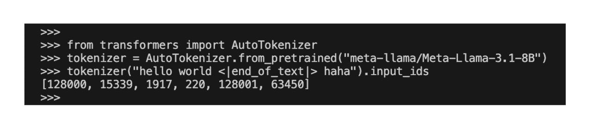

### 最新GPT-4o重新夺回排行榜第一，1314分旁煞众人

https://x.com/lmsysorg/status/1823515224064098546?s=46&t=GRStLXDcUNuun8J5Noyw4Q

来自Chatbot Arena的激动人心的更新！

最新的@OpenAI ChatGPT-4o（20240808）API在过去一周内以“anonymous-chatbot”的身份进行了测试，并获得了超过11,000次社区投票。

OpenAI现在成功重新夺回了第一的位置，以令人印象深刻的1314分超越了Google的Gemini-1.5-Pro-Exp！

新的ChatGPT-4o在技术领域表现出显著的改进，特别是在编码方面（比GPT-4o-20240513高出30多分），以及在指令遵循和复杂提示方面。

热烈祝贺@OpenAI取得这一非凡成就！

新的ChatGPT-4o分类排名：

+   总体：第1名

+   数学：第1-2名

+   编码：第1名

+   复杂提示：第1名

+   指令遵循：第1名

+   长查询：第1名

+   多轮对话：第1名

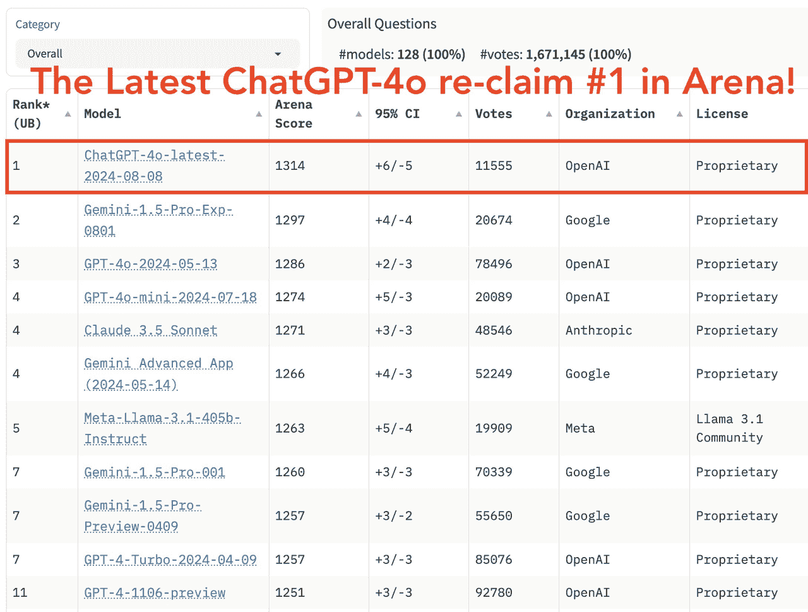

### InternLM2.5发布1.8B和20B

https://x.com/intern_lm/status/1823315045675401408?s=46&t=GRStLXDcUNuun8J5Noyw4Q

🥳我们已在@huggingface上发布了我们的InternLM2.5新模型，分别为1.8B和20B。

😉1.8B：超轻量级，高性能，具有极强的适应性。

😉20B：更强大，适用于复杂任务。

😍立即探索吧！

模型链接：

https://huggingface.co/collections/internlm/internlm25-66853f32717072d17581bc13

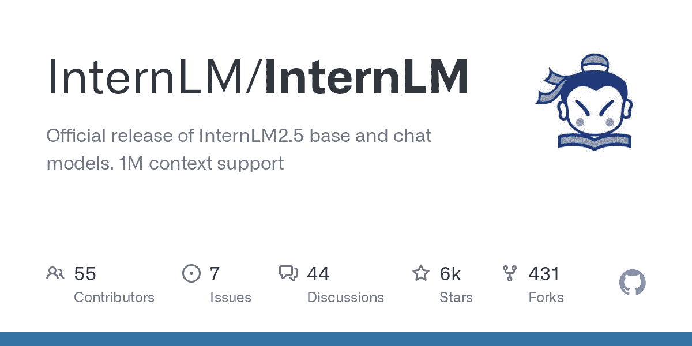

# 论文

### LongWriter：从长上下文LLM中释放1万字以上的生成

贡献人：

链接：http://arxiv.org/abs/2408.07055v1

当前的大语言模型(LLMs)能够处理长达100,000个token的输入，但很难生成超过2,000个单词的输出。通过控制实验，我们发现模型的有效生成长度受到在监督微调(SFT)期间看到的样本的固有限制。换句话说，他们的输出限制是由现有SFT数据集中长输出示例的稀缺性所致。为了解决这个问题，我们引入了AgentWrite，一个基于智能体的管道，将超长生成任务分解成子任务，使现有的LLMs能够生成连贯的超过20,000个单词的输出。利用AgentW[r](https://github.com/THUDM/LongWriter%E3%80%82)ite，我们构建了包含6,000个SFT数据的LongWriter-6k数据集，输出长度从2k到32k个单词不等。通过将这个数据集纳入模型训练，我们成功地将现有模型的输出长度扩展到超过10,000个单词，同时保持输出质量。我们还开发了LongBench-Write，一个用于评估超长生成能力的全面基准。我们通过DPO进一步改进的9B参数模型在这一基准上取得了最先进的性能，甚至超过了更大的专有模型。总的来说，我们的工作表明，现有的长上下文LLMs已经具备了更大输出窗口的潜力--您只需要通过模型对准期间具有扩展输出的数据来释放这种能力。我们的代码和模型位于：https://github.com/THUDM/LongWriter。

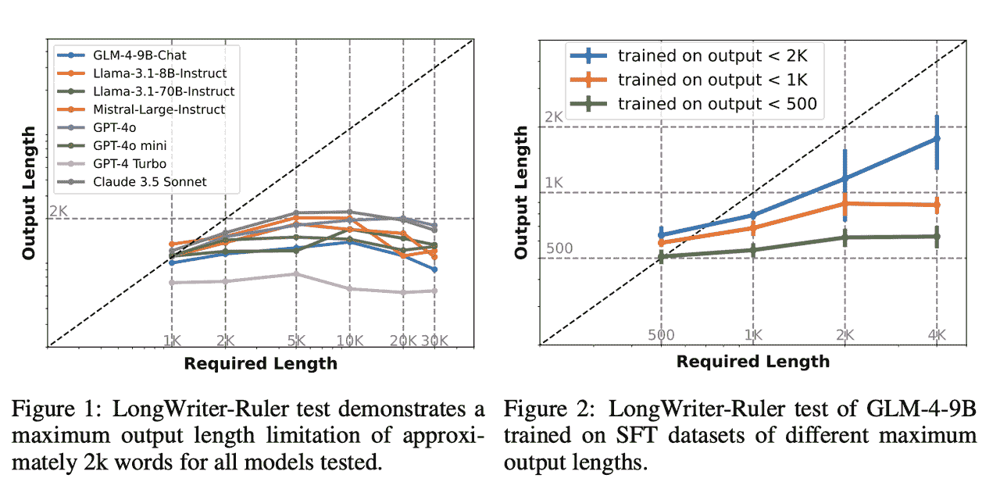

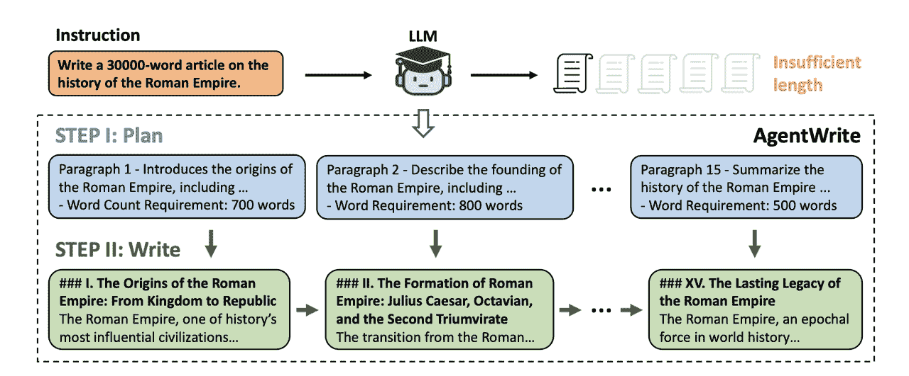

### Re-TASK: 重新审视LLM任务的能力、技能和知识视角

贡献人：

链接：http://arxiv.org/abs/2408.06904v1

随着大型语言模型（LLMs）规模的扩大，它们的性能增强通常不足以解决特定领域的任务。系统地分析它们的失败并有效增强它们的性能仍然是重大挑战。本文介绍了Re-TASK框架，这是一个新颖的理论模型，从认知、技能和知识的角度重新审视LLM任务，受布鲁姆税务学和知识空间理论的指导。Re-TASK框架提供了一种系统方法，以加深我们对LLMs在特定领域任务中的理解、评估和增强。它探讨了LLM能力、它所处理的知识和应用的技能之间的相互作用，阐明了这些要素是如何相互关联并影响任务绩效的。我们应用Re-TASK框架揭示，许多特定领域任务中的失败可以归因于知识不足或技能适应不足。基于这一洞察，我们提出了通过有针对性的知识注入和技能调整来增强LLMs的结构化策略。具体来说，我们确定与任务相关的关键能力项目，并采用精心设计的提示策略来增强任务绩效，从而减少对广泛微调的需求。另外，我们使用特定能力的指令对LLM进行微调，进一步验证了我们框架的效力。实验结果证实了该框架的有效性，显示了LLMs性能和适用性上的显著改进。

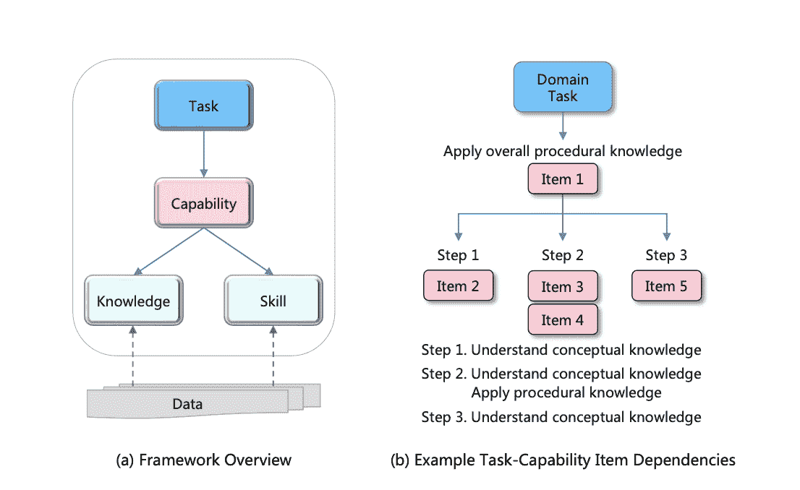

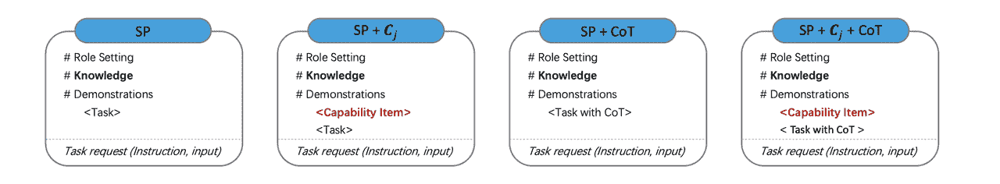

### AquilaMoE: MoE模型的高效训练与规模扩展策略

贡献人：

链接：http://arxiv.org/abs/2408.06567v1

近年来，随着大型语言模型在各个领域的快速应用，这些模型的规模逐渐增大，其预训练所需资源也呈指数增长。从头开始训练一个LLM将消耗大量计算资源，而从较小模型进行扩展是一种更高效的方法，因此引起了重大关注。本文介绍了AquilaMoE，一个先进的双语816B专家混合语言模型，每个模型有8个专家，每个具有160亿参数，采用了一种称为EfficientScale的创新训练方法。这种方法通过两阶段的过程优化性能，同时最大程度减少数据要求。第一阶段称为Scale-Up，通过从预先训练的较小模型初始化较大模型的权重，实现了大量知识转移和显著减少数据的连续预训练。第二阶段Scale-Out，使用预先训练的密集模型初始化MoE专家，进一步增强了知识转移和性能。通过在1.8B和7B模型上进行广泛的验证实验，比较了各种初始化方案，实现了在连续预训练过程中保持和减少损失的模型。利用最佳方案，我们成功训练了一个16B模型，随后训练了816B AquilaMoE模型，显示出在性能和训练效率方面的显著改进。

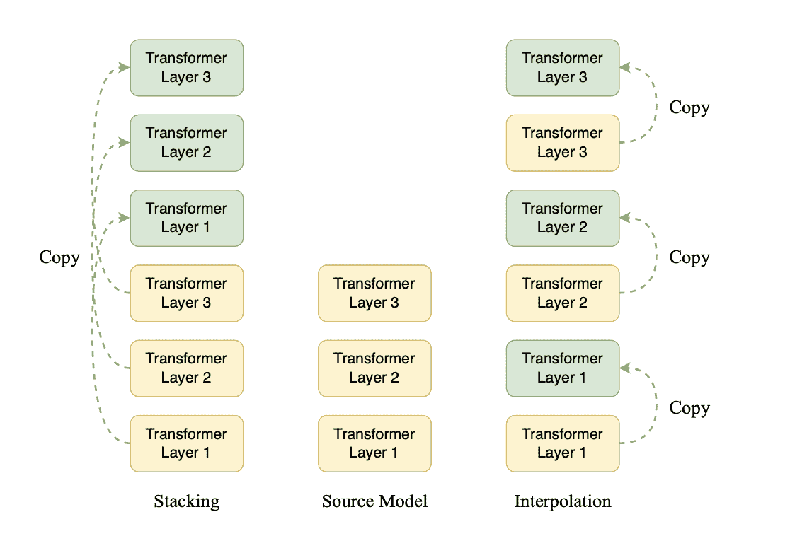

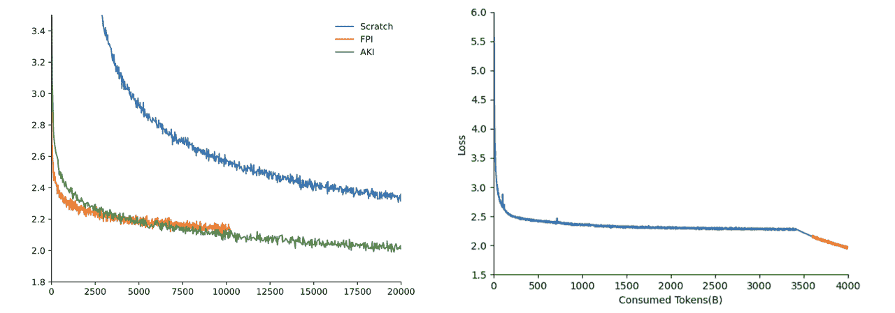

### **Diversity Empowers Intelli**gence：整合软件工程智能体的专业知识

贡献人：

链接：http://arxiv.org/abs/2408.07060v1

大语言模型（LLM）智能体在解决现实世界软件工程（SWE）问题方面表现出巨大潜力。最先进的开源SWE智能体可以解决SWE-Bench Lite中超过27%的真实GitHub问题。然而，这些复杂的智能体框架在各种任务中表现不一，在某些任务中表现出色，在其他任务中表现不佳。为了充分利用这些智能体的多样性，我们提出了DEI（Diversity Empowered Intelligence），这是一个利用它们独特专长的框架。DEI作为一个元模块位于现有SWE智能体框架之上，管理智能体集体以增强问题解决能力。实验结果表明，DEI引导的智能体委员会能够大幅超越最佳个体智能体的表现。例如，一组开源SWE智能体，最大个体解决率为27.3％，在SWE-Bench Lite上通过DEI可以实现34.3％的解决率，改进25％并击败大多数闭源解决方案。我们表现最佳的群体在SWE-Bench Lite上以55％的解决率表现出色，获得最高排名。我们的发现对于研究协作AI系统及其解决复杂软件工程挑战的潜力的日益增长的研究有所贡献。

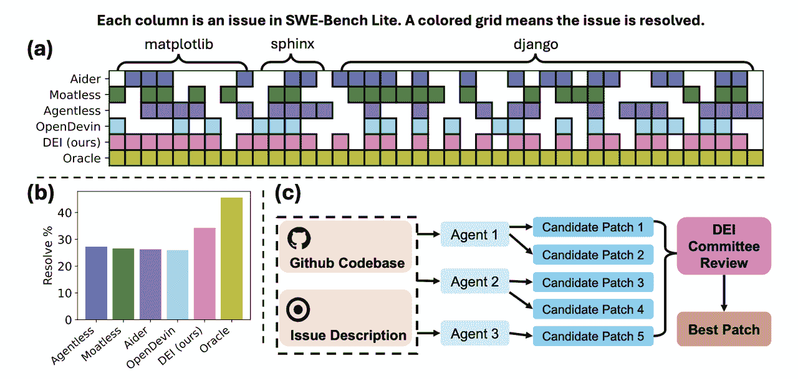

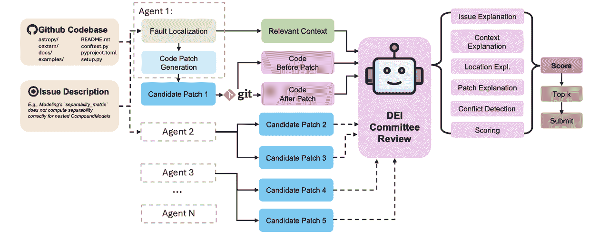

### TableGuard -- 保护结构化和非结构化数据

贡献人：

链接：http://arxiv.org/abs/2408.07045v1

随着数据跨平台和组织之间分享需求的增加，确保敏感信息的隐私和安全已成关键挑战。本文介绍了"TableGuard"，一种为关系数据库量身定制的数据混淆创新方法。借鉴先前关于上下文敏感混淆原理和技术的工作，TableGuard应用这些方法确保API调用仅返回混淆数据，从而在与第三方分享数据时保护隐私。TableGuard利用先进的上下文敏感混淆技术，用上下文适当的替代品替换敏感数据元素。通过保持数据的关系完整性和连贯性，我们的方法减轻了认知失调和数据泄漏的风险。我们展示了使用基于BERT的Transformer模型实现TableGuard，该模型可识别和混淆关系表中的敏感实体。我们的评估表明TableGuard有效地平衡了隐私保护和数据效用，最小化信息损失同时确保混淆数据对下游应用仍然是功能性有用的。研究结果突显了领域特定混淆策略的重要性以及上下文长度在保持数据完整性方面的作用。这项研究对需要与外部方安全共享数据的组织具有重大意义。TableGuard为实施保护隐私的数据共享机制提供了坚固的框架，为数据隐私和安全领域做出贡献。

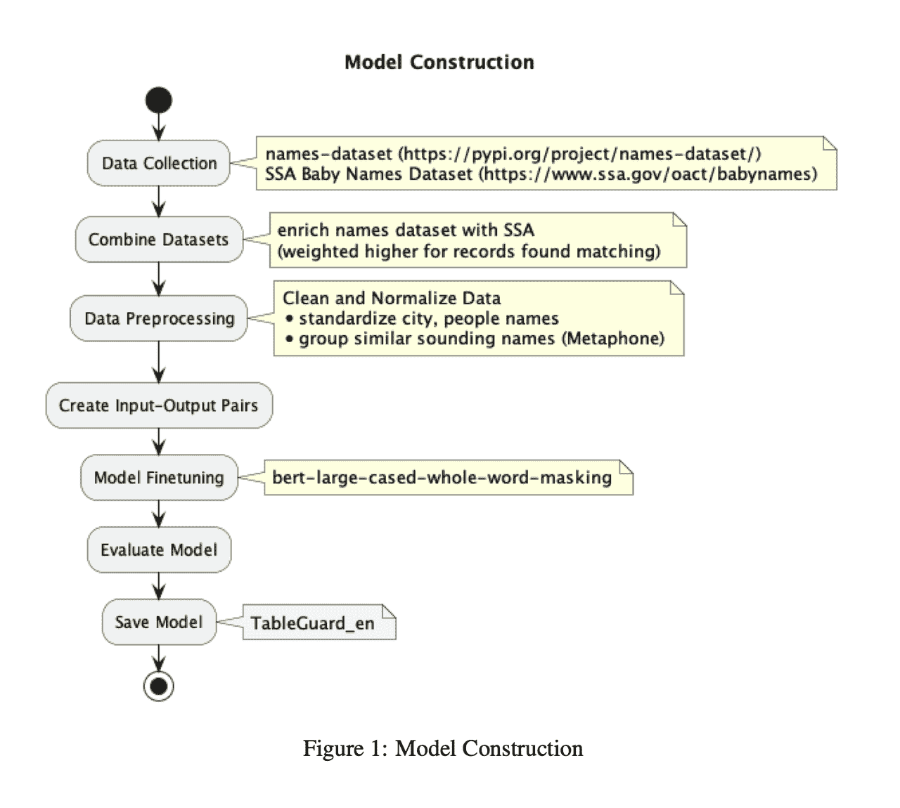

### **A Survey on Model MoErg**ing：协同学习中专业专家的再利用和路由

贡献人：

链接：http://arxiv.org/abs/2408.07057v1

摘要：随着性能卓越的预训练模型的普及，出现了大量经过精细调整的专家模型，这些模型针对特定领域或任务进行了专门优化。模型融合方法旨在回收专家模型，创建一个性能或泛化改进的集成系统。MoErging方法的关键组成部分是创建一个决定对于特定输入或应用程序应使用哪个专家模型的路由器。MoErging的前景、有效性和广泛的设计空间推动了过去几年许多新方法的发展。这种快速发展的速度使得比较不同的MoErging方法变得具有挑战性，这些方法很少互相比较，通常在不同的实验环境中进行验证。为弥补这些差距，我们提出了对MoErging方法的全面调查，其中包括一个为关键设计选择进行分类和澄清每种方法适用的应用程序的新颖分类法。除了调查MoErging研究外，我们还整理了使用MoErging的软件工具和应用程序。此外，我们还讨论了与模型融合、多任务学习和专家混合模型等相关领域的研究。总体而言，我们的调查为现有MoErging方法提供了统一的概述，并为这一新兴领域的未来工作打下了坚实的基础。

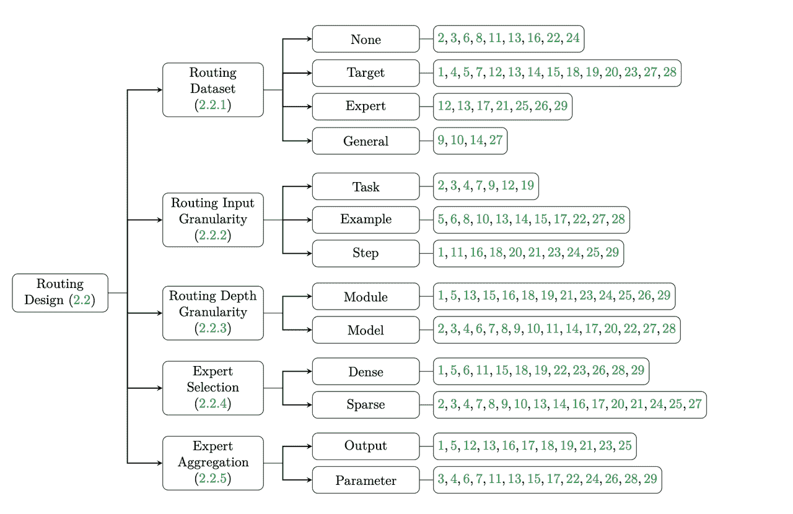

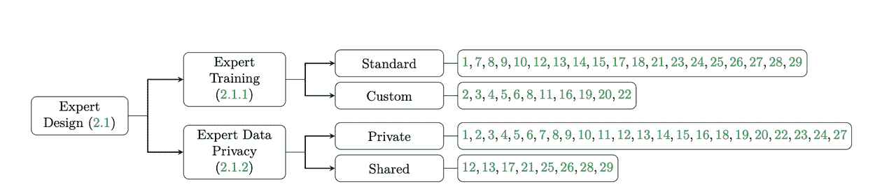

# 产品

### Melodio——昆仑万维正式发布全球首个AI流媒体音乐平台

贡献人：

https://www.mureka.ai/create

昆仑万维正式发布全球首个AI流媒体音乐平台Melodio，并同步推出AI音乐商用创作平台Mureka。两款产品均搭载昆仑万维新款自研DiT架构音乐大模型Skymusic 2.0，它支持500字以上的歌词输入，生成长达6分钟双声道立体声歌曲，成为AIGC音乐大模型领域最新SOTA。

### Flux.ai

贡献人：

https://flux-ai.io/flux-ai/

德[国初创公司 Blac](https://www.yjpoo.com/tags/159.html)k F[o](https://www.yjpoo.com/article/4063.html#)[rest L](https://www.yjpoo.com/article/4063.html#)abs 发布了 一款文生图产品 Flux.AI，据称在生成质量方面与 Midjourney 和  DALL-E 3 不相上下。

通过详细的提示词描述，可以使得 Flux 对生成图片的细节把控的更细腻，在人物生成和地标性建筑的生成上真实感。近期，新增奖牌和二次元生成器的效果。

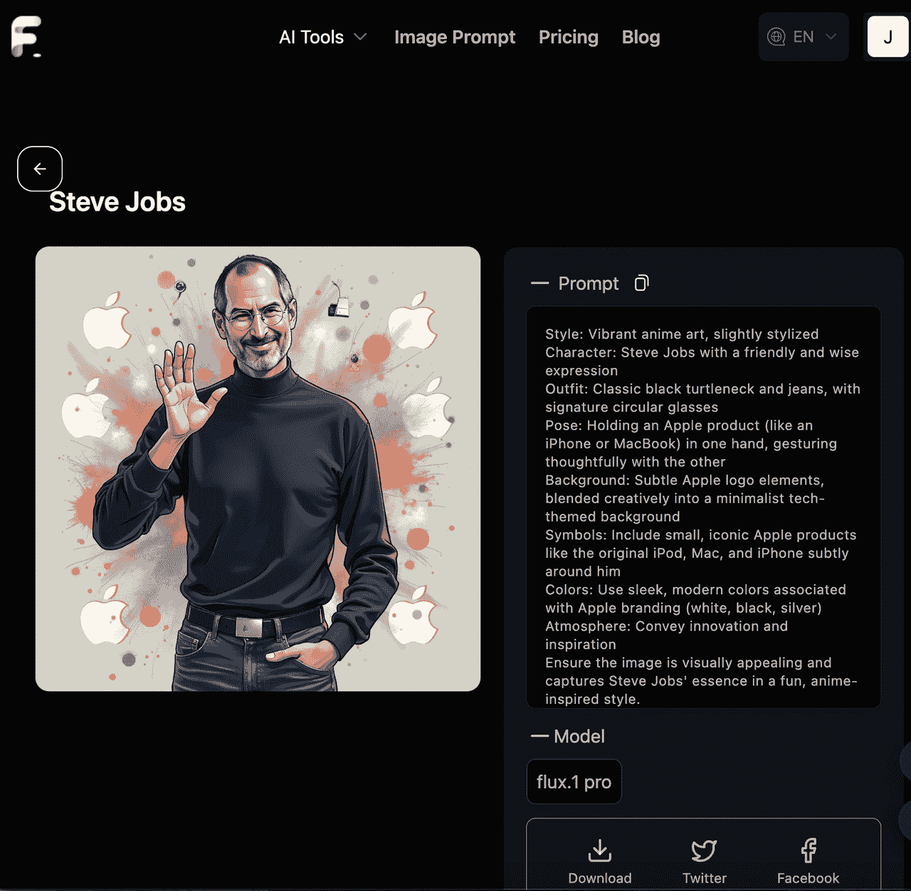

### a1.art

贡献人：

https://a1.art/

即时设计团队开发的面向 AI 图像爱好者的设计平台。操作相对简单，用户只需要在 a1.art 上传图片并添加简短描述（也可以参考风格库中已有的设定），就可以生成不同风格的可爱搞怪图片，偏向人物和动物的生成，可以生成个人自拍照、艺术头像、合影、证件照、宠物肖像、有趣的 GIF、艺术字体等。

# HuggingFace&Github

### VITA

贡献人：

https://vita-home.github.io/

VITA是首个开源的多模态大型语言模型（MLLM），能够同时处理和分析视频、图像、文本和音频等多种模态。它具有以下三个关键特点：

1.  全方位多模态理解：VITA在多语言、视觉和音频理解方面展现出强大的基础能力，能够在多种单模态和多模态基准测试中表现出色。

1.  非唤醒交互：用户可以在环境中通过音频提问，VITA能够自动响应，而无需唤醒词或按钮。

1.  音频中断交互：VITA可以实时跟踪和过滤外部查询，允许用户在任何时候打断模型的生成，并对新问题作出回应。

此外，VITA还采用了两项关键技术来提升多模态交互体验：

+   状态标记：为不同的查询输入设置不同的状态标记，以区分有效查询音频、噪音音频和文本查询。

+   双工方案：同时运行两个模型，一个负责处理用户查询，另一个监控环境，以便在用户提出新有效音频查询时能够及时响应。

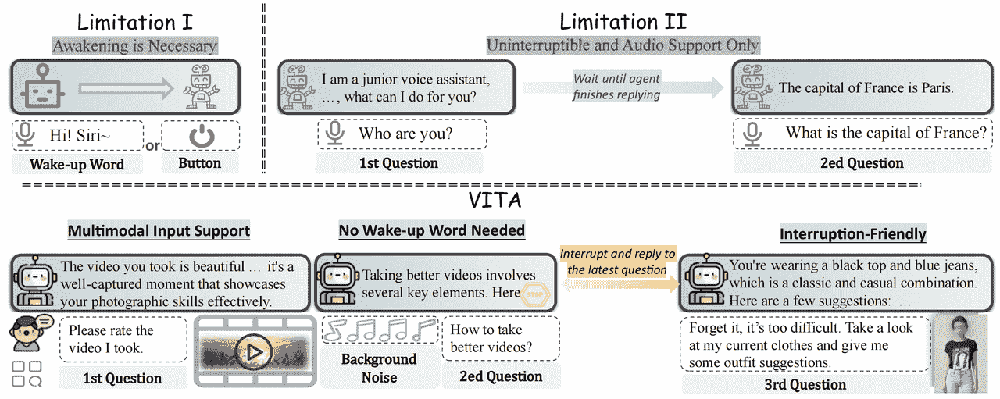

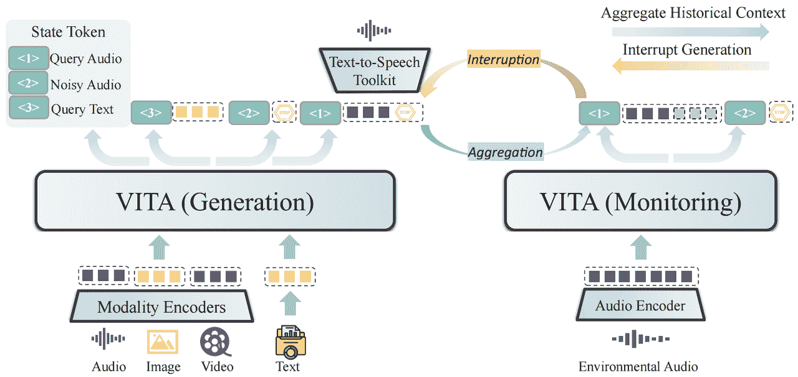

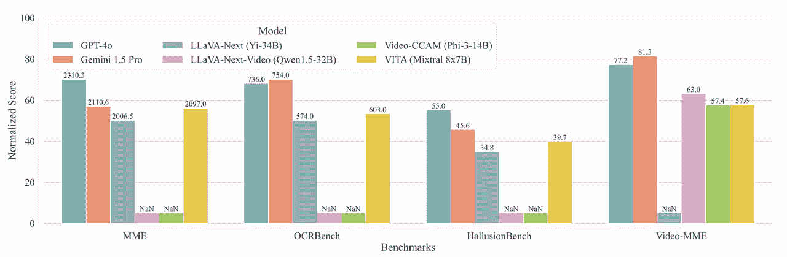

# 投融资

### 印度语音AI初创公司Sarvam获投融资，助力AI普及

贡献人：

https://techcrunch.com/2024/08/13/why-this-ai-startup-is-betting-on-voice-enabled-bots-to-scale-ai-adoption-in-india/

印度AI初创公司Sarvam推出了支持多种印度语言的语音AI机器人，重点瞄准企业客户。该公司得到了Peak XV和Lightspeed的投资支持。Sarvam的语音AI机器人将以每分钟₹1（约1美分）的价格提供服务。Sarvam正在开发的小型语言模型Sarvam 2B，预计成本将是行业同类产品的十分之一。公司还计划将这些模型开源，并参与印度政府的“IndiaAI”计划，推动AI基础设施的本土化发展。

公司官网：https://www.sarvam.ai/

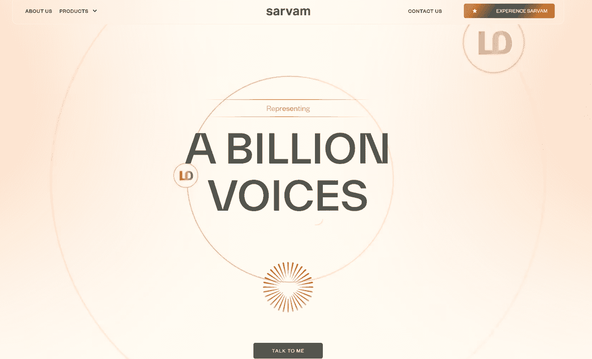

### Profound：AI搜索优化新势力，获350万美元种子轮融资

https://techcrunch.com/2024/08/13/move-over-seo-profound-is-helping-brands-with-ai-search-optimization/

Profound是一家专注于AI搜索优化的初创公司，帮助品牌了解自己在AI搜索工具中的展示情况。公司由James Cadwallader和Dylan Babbs创立，现已完成350万美元种子轮融资，投资方包括Khosla Ventures、Saga和South Park Commons等。资金将用于团队扩展和技术开发。Profound的动态平台帮助品牌实时追踪和调整AI搜索结果，已吸引多家大型品牌代理商的合作。

公司官网：https://www.tryprofound.com/login

### Encord完成3000万美元B轮融资，助力数据标注工具扩展

https://techcrunch.com/2024/08/13/encord-lands-new-cash-to-grow-its-data-labeling-tools-for-ai/

数据标注平台Encord获得了由Next47领投的3000万美元B轮融资，使其总融资额达到5000万美元。这笔资金将用于在未来六个月内将产品、工程和AI研究团队的规模扩大一倍，并扩展其在旧金山的办公室。Encord计划年底前将员工人数从70人增至100人，并在伦敦和旧金山设立双总部。除了Next47外，本轮融资的其他参与者还包括Y Combinator、CRV和Crane Venture Partners。

公司官网：https://encord.com/

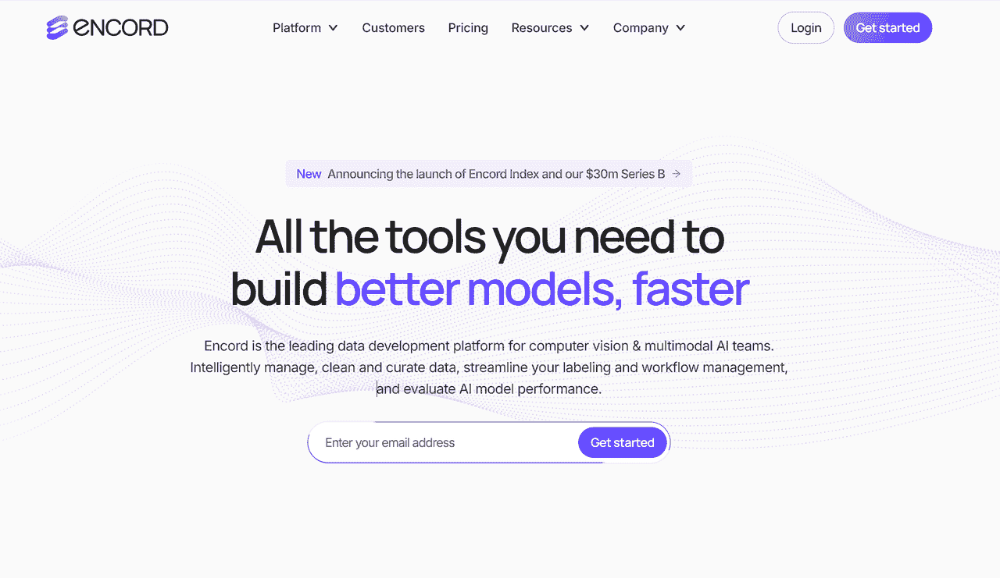

# 学习

### TensorRT-LLM 中的 Hopper Mixed GEMM 的 CUTLASS 3.x 实现讲解 学习笔记

贡献人：

https://zhuanlan.zhihu.com/p/714378343?utm_psn=1807097849596489728

本文旨在阐述在 TensorRT-LLM 中利用 CUTLASS 3.x 实现 Hopper Mixed GEMM 的技术细节。首先介绍了 CUTLASS 的核心概念，特别是 Layout 和 Tensor 的概念，它们用于管理内存和数据传输。接着详细探讨了如何通过 CUTLASS 进行矩阵转置和 GEMM 数据流的优化，包括使用 Copy 和 TiledCopy 等 API 实现高效的数据拷贝和并行计算。文章还特别强调了在 Hopper 架构下实现异步 WGMMA 操作的重要性，以及如何处理混合精度数据类型的特殊要求，例如将低精度数据转换为高精度并保存在寄存器文件中。最后，通过对生产者和消费者线程束的工作流程的描述，展示了如何通过共享内存实现数据的流水线处理。

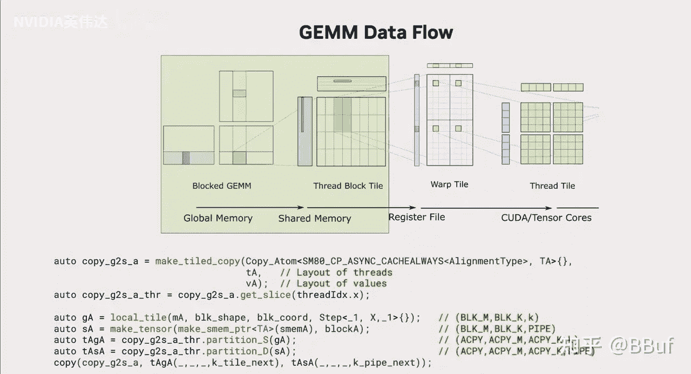

### Alignment下一站：合成数据

https://zhuanlan.zhihu.com/p/714436335?utm_psn=1807093488828948480

大模型训练中，合成数据的使用逐渐成为提升模型性能的关键。合成 Prompt 能够增强数据集的多样性，有助于模型更好地理解和适应各种场景。此外，通过合成 Pair 对进行 self-play，可以在 RLHF 阶段进一步优化模型的对齐能力。为了提高数据质量，可以采用多种策略，如人工设计类目体系、利用模型生成任务、模拟训练数据等，以及利用 Doc2Query 等技术提升数据复杂度。监督信号的准确性对于大模型的对齐至关重要，可以通过 LLM-as-Judge 方法、强约束 Instruction 或固定答案任务来提升。

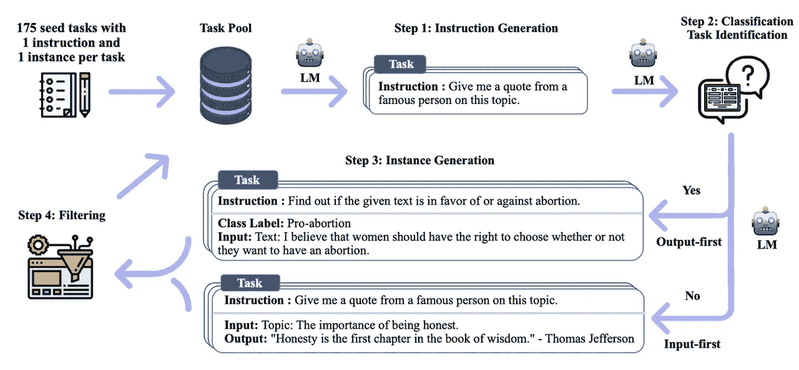

### LLM 推理加速技术 —— GPTQ 量化技术演进

https://zhuanlan.zhihu.com/p/690834228?utm_psn=1807092805031571459

GPTQ 量化技术是针对大型语言模型（LLM）推理过程中的计算和存储瓶颈而研发的。该技术通过对模型权重进行量化，将原本的浮点数转换为低位宽的表示形式，从而减少了内存占用和加速了推理速度。GPTQ 的核心在于其量化算法，它能够在不显著降低模型性能的前提下，有效地降低权重的位宽。此外，GPTQ 考虑了模型权重的稀疏性，通过对稀疏权重进行优化，进一步提升了量化后的模型效率。在实验比较中，GPTQ 展现了与传统量化方法相比，在精度和性能上的优势，特别是在资源受限的设备上，GPTQ 的应用使得 LLM 能够更加广泛地部署。

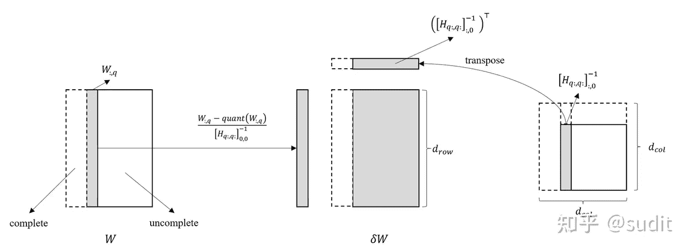

### 浅析GEMM优化multistage数怎么算

https://zhuanlan.zhihu.com/p/714353243?utm_psn=1807093865162874881

GEMM 优化是提升矩阵乘法性能的关键，multistage 数是其核心参数之一。它决定了矩阵分块的粒度，进而影响缓存利用率和计算效率。计算 multistage 数时，需考虑 CPU 缓存层级、缓存大小以及矩阵尺寸。通过实验验证，适当的 multistage 数能显著提高 GEMM 运算速度。技术细节包括：分块策略的选择应根据特定的硬件特性和矩阵规模进行调整；缓存未命中率的降低对性能有显著影响；以及多阶段缓存策略如何平衡计算和内存访问延迟。正确选择 multistage 数，可以最大化硬件性能，为高性能计算提供支持。

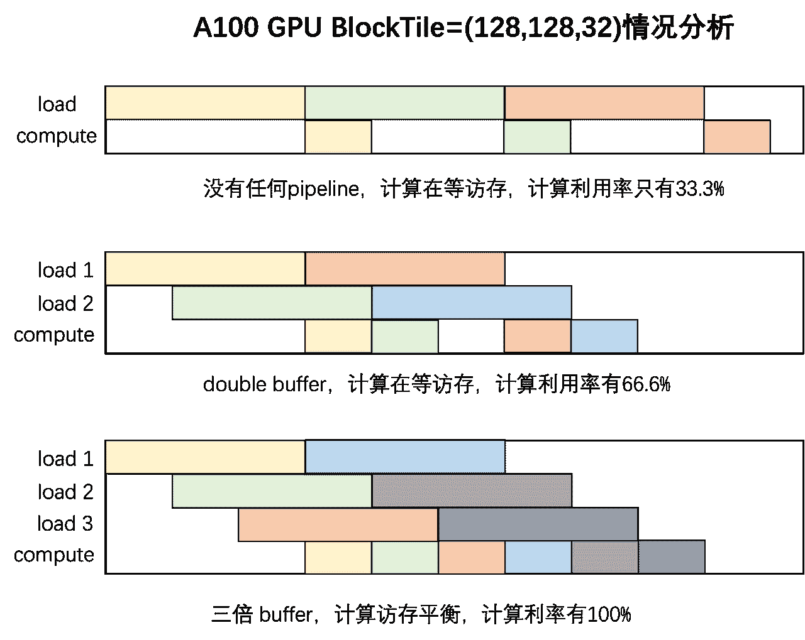

### flux.1作为最强的文生图模型，本地应该如何最快，最轻量化的运行？

https://www.zhihu.com/question/663658504/answer/3593047830?utm_psn=1806763133630558208

Flux.1 是最近发布的一个强大的文生图模型，它在图像生成领域表现出色，具有 120 亿个参数，体现了 Scaling Laws 的原理，即参数越多，模型性能越好。技术细节上，Flux.1 采用了类似于 SD3 的 flow matching 技术，并使用了 MM-DiT 架构，但在处理 condition 和 image tokens 时有所不同。Flux.1 使用了 FluxTransformerBlock 和 FluxSingleTransformerBlock，前者负责对 condition 和 image tokens 分别处理，后者则是将两者拼接后进行处理，这种设计在提高模型性能方面有特定的优势。此外，Flux.1 在 attention 层使用了带有 rope 的 FluxSingleAttnProcessor2_0，这是与 SD3 的 JointAttnProcessor2_0 的一个显著差异，可能对模型的编码能力有积极影响。在实际测试中，Flux.1 的 dev 版本在处理复杂的手部结构和物体细节时表现出色，尤其在生成高分辨率图像时，能够保持较高的图像质量。不过，Flux.1 对中文提示词的理解不如 Dalle-3，这可能是因为 Dalle-3 依赖于 GPT 的语言理解能力更强。为了在本地运行 Flux.1，用户需要下载相应的模型文件，并在 ComfyUI 中配置，可以选择不同的量化版本以适应不同的显存限制。通过这些技术细节的优化和调整，Flux.1 能够在保持较高生成质量的同时，尽可能地减少计算资源的消耗。

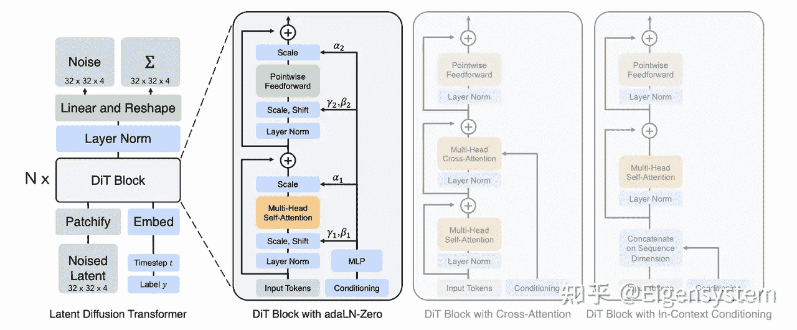

### 简单回顾一下机器视觉领域推理加速技术

https://zhuanlan.zhihu.com/p/713916261?utm_psn=1806763513995194368

机器视觉领域的推理加速技术是提高深度学习模型效率的关键。本文综述了参数剪枝、量化、低秩近似、知识蒸馏等主要方法。量化技术，如二值化，可以减少模型大小，但可能影响准确性。网络剪枝通过移除非关键参数来优化模型，特别适用于 CV 领域。低秩近似通过矩阵分解减少计算量，而知识蒸馏则通过从大模型到小模型的转移来提升性能。此外，文章还探讨了硬件加速技术，如专门针对量化优化的硬件，以及 Transformer 模型在视觉领域的应用，如 Multihead Attention 结构的优化。未来的研究趋势可能包括自动压缩技术、针对非 CNN 结构的优化，以及更多硬件适应性的探索。

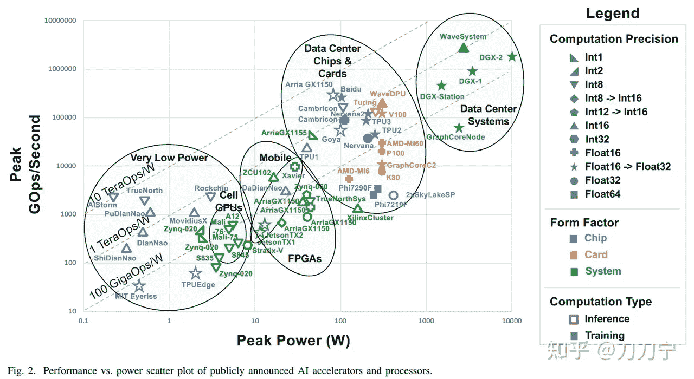

### 用于智算场景的Scale-up互联技术分析

https://mp.weixin.qq.com/s/fyPFr6aBds3dIV2sc1B6Nw

智算场景下的 Scale-up 互联技术是数据中心网络架构中的关键，它专为 AI 和机器学习任务设计，提供高带宽、低延迟的网络连接。在节点内部，处理器、加速器和存储设备通过协议如 PCIe、NVLink 和 Infinity Fabric 相互连接，而节点间的通信则依赖 IB 和 ROCEV2 等技术。AI 训练特别依赖于 Scale-up 网络，因为它需要在多个 GPU 之间进行高效的张量并行通信，这要求网络带宽达到 TB/s 级别，延迟控制在亚微秒水平。CXL 虽然可能成为内存扩展的技术选择，但对于 GPU 间的直接通信，目前基于以太网的 Scale-up 技术和 NVLink 等专有协议更为常见。在选择通信技术时，需要根据实际应用场景权衡铜缆和光纤的成本与性能。此外，AMD 和 NVIDIA 的互联技术在带宽效率上有显著差异，NVIDIA 的 NVLink 在此方面表现出色。尽管私有协议在性能上可能有优势，但开放标准的推广对于整个生态系统的发展同样至关重要。

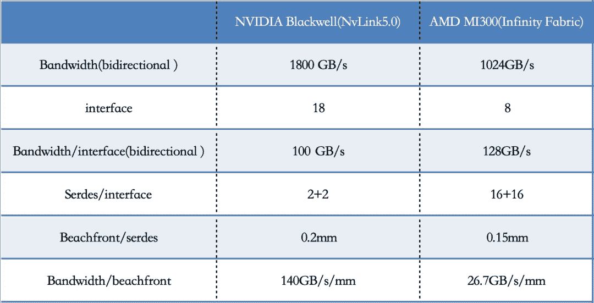

### 打造 LLMOps 时代 Prompt 数据驱动引擎

https://mp.weixin.qq.com/s/PurPjjBLDQafX_-s5MbpDg

文章首先介绍了 LLMOps 的背景，强调了大模型在泛化能力和语言理解能力方面的优势，并指出了在 Prompt application 和 Prompt learning 上的关键要素。接着，文章重点阐述了 LogPrompt 方案，通过 CoT（Chain of Thought）策略和其他 Prompt 策略，提高了日志分析的效率和可解释性。在 Prompt learning 数据飞轮部分，介绍了如何通过 CoachLM 模型优化训练数据，以提升模型性能。最后，对未来的 LLMOps 发展进行了畅想，预测了全模态和多语言支持的趋势。刘逸伦作为华为的工程师，在 AI 智能运维和大模型质量评估方面有深入研究，为 LLMOps 的发展提供了技术支持和理论基础。

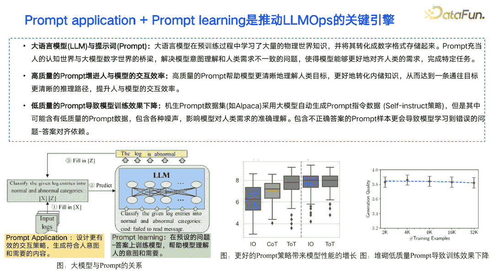

# 声明

本文档仅供学习交流使用，版权归原作者所有，若涉侵权，请联系Jack Jin 15101136166

##

（欢迎在下方反馈您宝贵的意见！整理不易，觉得有用给AI日报小组点个赞👍吧！）

ChatGPT；Angela；Zijia Liu；Alex；Zeqi Tan；Tiezhen（HuggingFace）；Naixu；Lizhi；Peter；Suoman；Jack

封面生成——右脑科技

如果你有大模型相关的创业想法，欢迎来找我们聊聊～🛰️：15101136166

> 快邀请你的小伙伴们一起来读大模型日报吧！

> **【日报****知识库****】**这里是近期日报内容的汇总,欢迎大家查阅

> [大模型日报知识库(分享版)](https://miracleplus.feishu.cn/wiki/KapVwXfkriOBiskB0B2cUHxjnTh)

>

> 欢迎大家多多帮我们分享,转发~~

> 如果大家有任何的建议或者吐槽,欢迎随时找我聊天~

