# 奇绩大模型日报（8月 13日）

> 来源：[https://miracleplus.feishu.cn/docx/MR3mdAPotoGcNex2XCocnvCPnQg](https://miracleplus.feishu.cn/docx/MR3mdAPotoGcNex2XCocnvCPnQg)

## 📡潜空间活动报名

> 潜空间系列活动第三季第三期开启报名！

> 本期活动将在**8月24日** **10:00 am**开始，嘉宾是童晟邦。童晟邦，纽约大学博士，伯克利人工智能实验室（BAIR）研究员，OpenAI 超对齐奖学金获得者。他将和大家探讨视觉在多模态大模型中扮演的角色。

> 除嘉宾分享外，每期设置了【匹配合伙人 Cofounder Matching】环节。你可以和 GenAI 时代最有活力的创业者和研究者线下面对面交流，将有机会找到志同道合、有共同创业梦想的小伙伴。

> 报名通道已开启，欢迎扫描下方二维码报名。

## 资讯

### Transformer作者创业公司Sakana AI推出AI Scientist

https://mp.weixin.qq.com/s/vdvlGkPmbEUmNVBmoRcuRQ

Sakana AI 推出的 AI Scientist 系统能够自动化地进行科学研究，包括构思实验、编写代码、运行实验、总结结果以及撰写和审阅论文。该系统在多个机器学习子领域展现了多功能性，每篇论文的成本仅为 15 美元左右，且能够超越顶级会议的接受标准。

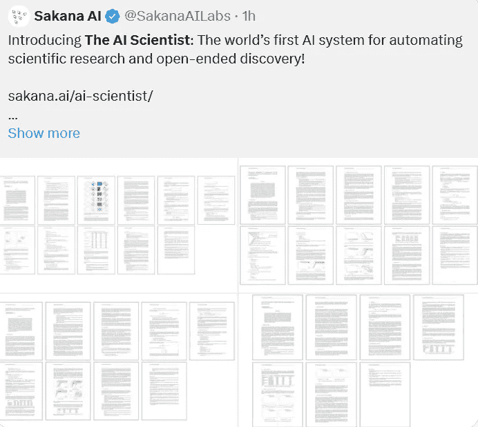

### Genie！能模拟人类工程师思考和行动

https://venturebeat.com/programming-development/move-over-devin-cosines-genie-takes-the-ai-coding-crown/

Cosine 推出的 AI 编程助手 Genie，在第三方基准测试中超越了 Cognition 的 Devin 和其他竞争对手，得分达到 30%。Genie 能够自主完成多种编程任务，包括代码调试、功能开发、代码重构和测试，它模仿人类软件工程师的思维和行为，支持多种编程语言。Genie 通过 OpenAI 的 GPT-4o 长输出上下文模型进行训练和微调，使用了大量高质量的数据集。Cosine 计划通过两种定价模式推出 Genie，一种面向个人和小团队，另一种面向企业级用户。Genie 的推出预示着软件开发团队可以更有效地分配工程资源，专注于更具战略性的任务。Cosine 已经筹集了 250 万美元的种子资金，并计划将人类推理应用于更多复杂问题的解决，从软件工程开始。

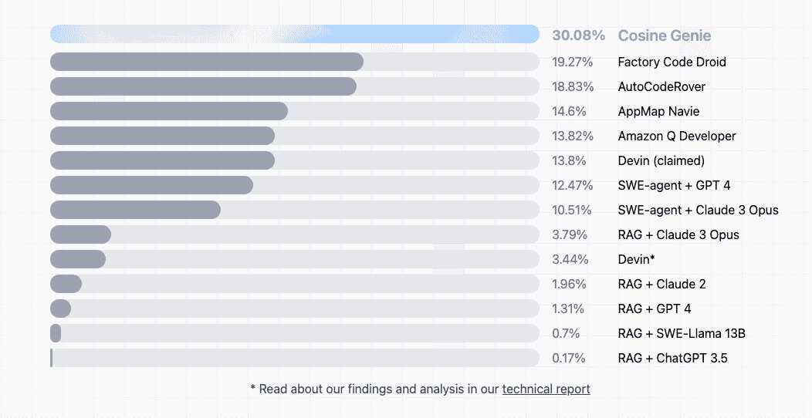

### 7B模型挑战Transformer，长序列处理再升级

https://mp.weixin.qq.com/s/DOeZASQCGeemywrgvqU4Sg

Falcon Mamba 7B 是一款开源的状态空间语言模型，旨在处理任意长度的文本序列。它摒弃了传统的注意力机制，采用了 RNN 和 CNN 的特点，通过选择性传播信息提高了效率。该模型能在不增加内存需求的情况下处理无限长序列，且生成每个 token 的时间接近恒定。Falcon Mamba 在性能上超越了同规模的 Transformer 模型，包括 `Llama-3.1` (8B)、`Mistral` (7B) 和 `Falcon-2` (11B)。它支持多种 Hugging Face API，并提供了指令调优版本，通过额外 50 亿个 token 的微调提升了准确性。

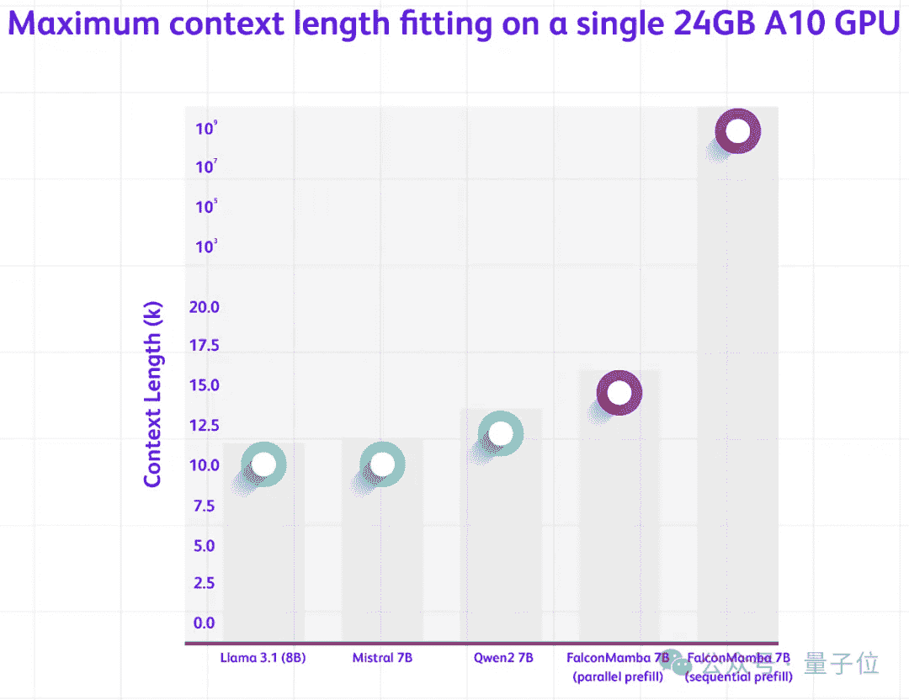

### 论文荣登计算机体系结构顶会ISCA，芯片架构成为边缘AI最佳并行计算选择

https://mp.weixin.qq.com/s/Mw8UV-_zJ_WTYPpNy2XxZg

文章主要介绍了边缘 AI 服务器市场的增长趋势，以及可重构计算架构 CGRA 在该市场中的应用。特别是芯动力公司提出的可重造并行处理器（RPP）架构，它在性能和能效上优于传统的 GPGPU、`FPGA` 和 `NPU`，尤其适合于边缘 AI 计算。RPP 架构的 `R8` 芯片在实验中展现了优异的性能，能效比英伟达的 `Jetson Nano` 和 `Jetson Xavier AGX` 高出多倍。此外，RPP 架构的论文已被国际顶级计算机体系结构会议 ISCA 收录，获得了学术界和产业界的认可。随着边缘 AI 技术的不断发展，RPP 处理器有望成为边缘 AI 服务器和 AI PC 的理想选择。

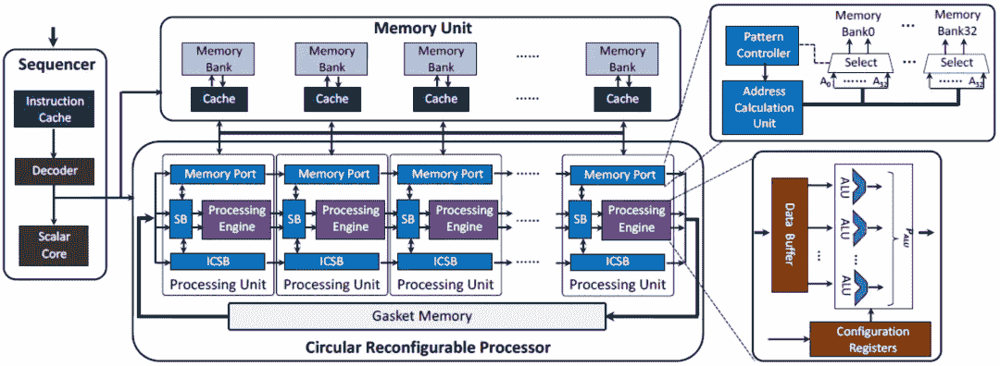

### MIT研究揭示AI训练数据来源受限的趋势

https://mp.weixin.qq.com/s/MypgPc4lWW7UHh2oCQmGBQ

AI 系统的高性能依赖于充足、高质量的训练数据，但最近 MIT 等机构的研究发现，曾经免费提供的数据在多个方面变得难以获取。随着 GenAI 产品的研究和开发变得广泛，训练数据的抓取许可问题受到了更多关注。研究人员发现，`C4`、`RefineWeb`、`Dolma` 等开源数据集所爬取的网站正在加快收紧许可协议。这种趋势不仅影响商用 AI 模型的训练，也对学术界和非营利机构的研究造成了障碍。该研究由 MIT Media Lab、Wellesley 学院和 AI 初创公司 Raive 等机构的 4 位团队主管进行。论文地址和数据分析过程已公开。研究结果显示，AI 数据共享空间的限制正在激增，许可的不对称性和不一致性日益明显，网络爬取的公开训练语料中的内容特征存在差异，且网络数据与对话式 AI 的常见用例不匹配。研究方法包括对网站的服务条款和机器人排除协议进行了分析。论文共调查了 3 个数据集的网站来源，并对随机采样的域名进行了人工标注。研究结果预测了数据限制的持续增加，指出不同组织的 AI agent 在许可程度上存在差异，且 `robots.txt` 和服务条款常常存在矛盾。此外，网页数据与 AI 模型的实际用途不匹配。研究讨论了 AI 公司绕过 `robots.txt` 抓取数据的问题，并强调了需要一个更灵活的协议来反映网站所有者的意愿。

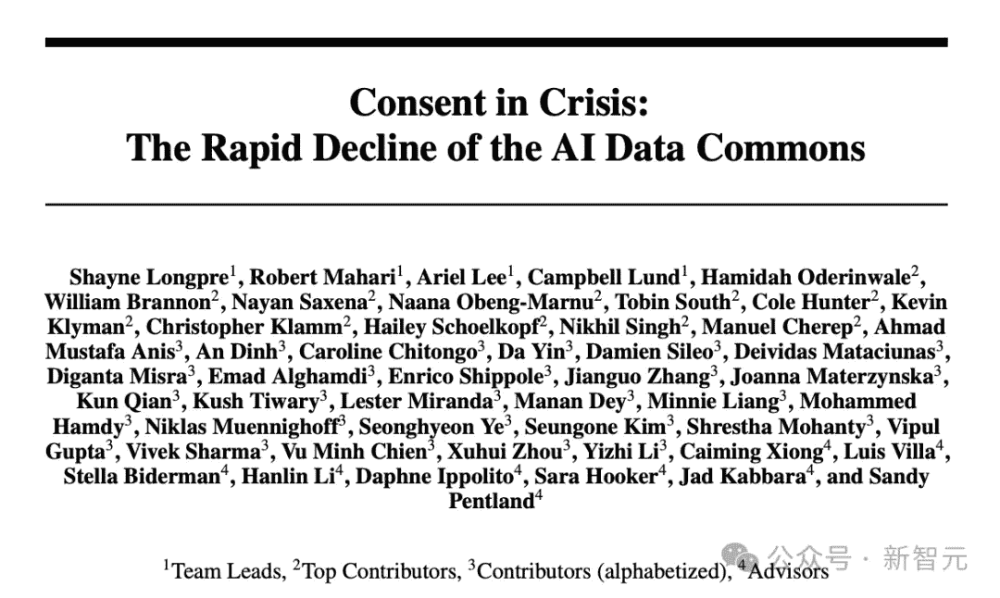

### LLM端侧部署新范式T-MAC开源

https://mp.weixin.qq.com/s/9gPydt8Suuhc-zS-FvqdaA

由微软亚洲研究院、中国科学技术大学和中国科学院大学的研究人员共同开发了 T-MAC，这是一种创新的基于查找表（LUT）的计算方法，专为在 `CPU` 上高效执行低比特大型语言模型（LLMs）推理而设计。`T-MAC` 无需权重反量化，支持混合精度矩阵乘法（`mpGEMM`），显著降低了推理开销并提升了计算速度。与依赖专用加速器（如 `NPU` 和 `GPU`）的大模型部署不同，`T-MAC` 可以仅利用 `CPU` 部署 LLMs，推理速度甚至能够超过同一片上的专用加速器。实验结果显示，在 Surface AI PC 上，`3B BitNet-b1.58` 模型的生成速率可达每秒 48 个 token，`2bit 7B llama` 模型的生成速率可达每秒 30 个 token，`4bit 7B llama` 模型的生成速率可达每秒 20 个 token，这些性能甚至超越了 `NPU`。在 `Raspberry Pi 5` 上，`T-MAC` 针对 `3B BitNet-b1.58` 也能达到每秒 11 个 token 的生成速率。`T-MAC` 的计算性能会随着比特数的降低而线性提高，这一点在基于反量化去实现的 `GPU` 和 `NPU` 中是难以观察到的。`T-MAC` 的关键创新在于采用基于查找表（LUT）的计算范式，而非传统的乘累加（MAC）计算范式，这样可以消除反量化操作，并且减少了乘法和加法操作的数量。`T-MAC` 还具有显著的功耗优势，降低了能耗，并为其它应用留下了计算资源。研究人员还深入探究了基于查找表的计算数据流，设计了高效的数据结构和计算流程，包括将 LUT 存入片上内存，改变矩阵 `axis` 计算顺序，为查表单独设计最优矩阵分块方式，以及对 `Intel/ARM` `CPU` 的针对性优化。

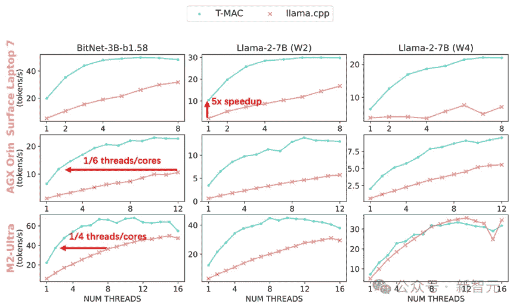

## 推特

### Jason Wei：我的竞争优势在于我愿意坐下来彻底调试并完全理解代码

https://x.com/_jasonwei/status/1823067805748728051

一位年轻的OpenAI工程师的鼓舞人心的话：“我为什么到目前为止表现得不错？我不认为自己比别人更聪明或更有经验。但我的竞争优势在于我愿意坐下来彻底调试并完全理解代码。我愿意熬夜完成工作，无论花多长时间。因为我愿意这样做，所以我不怕任何基础设施，我知道我可以构建任何东西。”

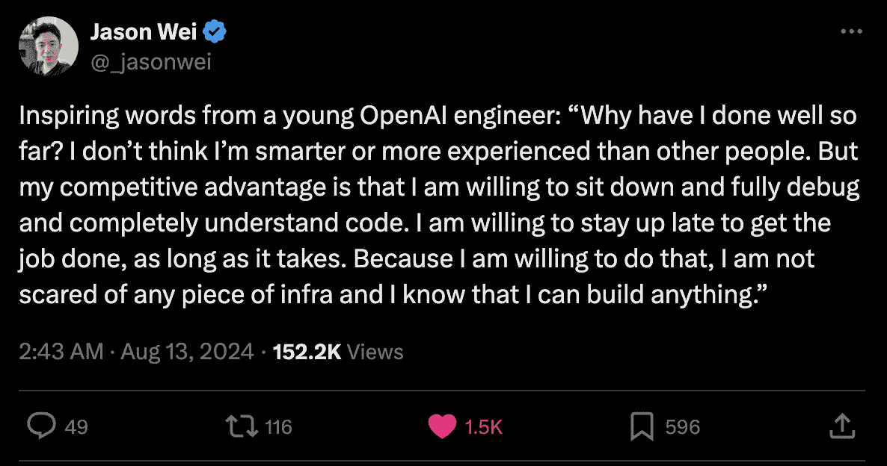

### Perplexity宣布和Polymarket合作：在Perplexity搜索时，你会看到新闻摘要与实时概率预测相结合

https://x.com/perplexity_ai/status/1823029449534615705

我们很高兴宣布与@Polymarket的合作。现在，当你在Perplexity上搜索事件时，你会看到新闻摘要与实时概率预测相结合，例如选举结果、市场趋势等。

[ssstwitter.com_1723543822643.mp4](https://internal-api-drive-stream.feishu.cn/space/api/box/stream/download/all/LDAob7ehvoiks2xVKaucmjwfnah)

### ElevenStudios 分享 AI配音服务Demo：已经与世界上一些顶级创作者合作上线

https://x.com/elevenlabsio/status/1823069272228450507

推出ElevenStudios——我们全方位管理的AI配音服务。

我们已经与世界上一些顶级创作者合作上线：

`@ColinandSamir` `@Youshaei` `@Dope_As_Usual` `@Drewbinsky` `@AliAbdaal` `@HarryStebbings`

[ssstwitter.com_1723544114416.mp4](https://internal-api-drive-stream.feishu.cn/space/api/box/stream/download/all/Y2wgb6j56oj1FXxlLPvcxdn3nSf)

### Falcom Mamba：7B开放获取模型，注意力自由，无论上下文大小只需要恒定时间生成令牌

https://x.com/osanseviero/status/1823000588029743324

Falcon Mamba🪿🐍新的7B开放获取模型，来自TII⚡️

- 注意力自由 -> 可以缩放任意序列长度
- 恒定的时间来生成一个新的令牌，无论上下文大小!
- 强大的指标 vs 类似规模的模型

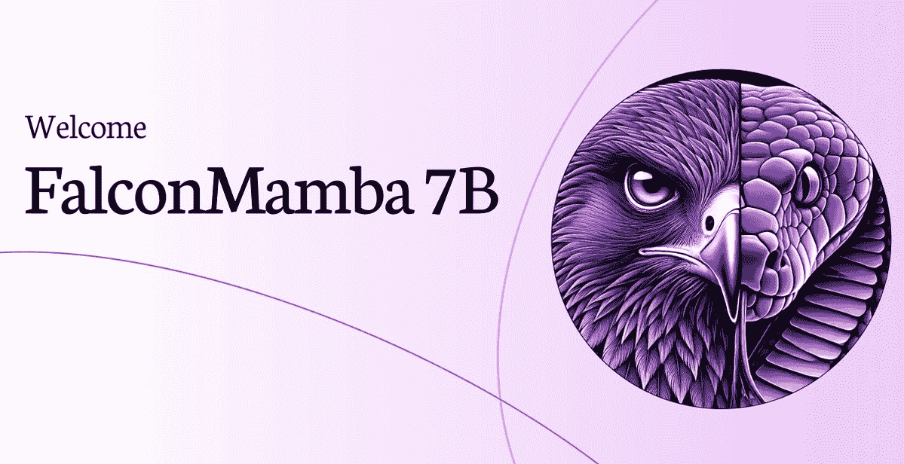

## 论文

### `VisualAgentBench`：朝向将大型多模态模型作为视觉基础智能体

贡献人：

链接：http://arxiv.org/abs/2408.06327v1

大型多模型（LMM）开启了人工智能的新时代，将语言和视觉能力合并，形成高度能力的视觉基础智能体。这些智能体被认为在许多任务上表现出色，可能接近泛化人工智能。然而，现有基准未能充分挑战或展示LMM在复杂真实环境中的全部潜力。为了填补这一空白，我们引入了`VisualAgentBench`（`VAB`），一个专门设计用于训练和评估LMM作为视觉基础智能体的全面而开创性的基准，包括具体化、图形用户界面和视觉设计等多样情景，任务旨在探究LMM对理解和互动能力的深度。通过对九个专有LMM API和八个开放模型的严格测试，我们展示了这些模型的明显且仍在发展的智能体能力。此外，`VAB`通过混合方法构建了一个轨迹训练集，包括基于程序的求解器、`LMM`智能体引导和人类示范，促进了LMM的行为克隆以获得实质性的性能提升。我们的工作不仅旨在基准现有模型，还为未来发展为视觉基础智能体奠定坚实基础。代码、训练和测试数据以及部分微调开源LMM可在 https://github.com/THUDM/VisualAgentBench 上找到。

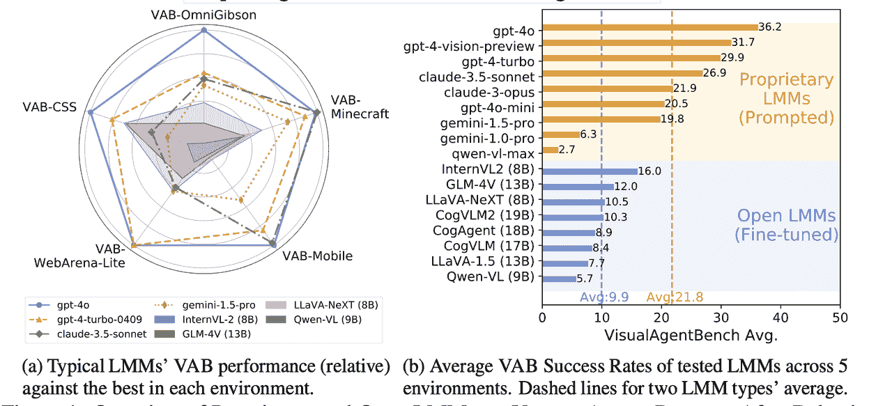

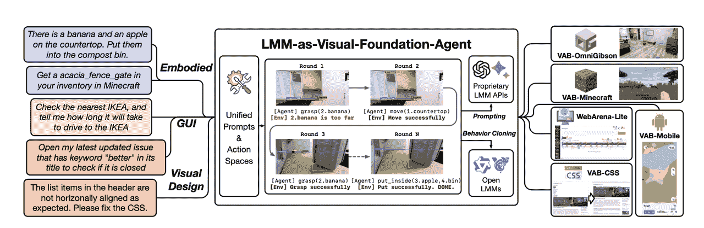

### 能否依赖LLM智能体来起草长期规划？让我们以TravelPlanner为例。

贡献人：

链接：http://arxiv.org/abs/2408.06318v1

大型语言模型（LLMs）由于其有前途的泛化和涌现能力，将自主智能体推向人工通用智能（AGI）更近。然而，对基于LLM的智能体行为表现、潜在失败原因以及如何改进它们的研究不足，尤其是在要求严格的真实世界规划任务中。本文通过使用一个现实基准`TravelPlanner`的研究努力填补这一空白，代理商必须满足多个约束条件以生成准确的计划。我们利用这个基准来解决四个关键研究问题：（1）LLM智能体在涉及推理和规划时是否足够强大，能够应对冗长且嘈杂的情境？（2）少量提示是否会对长情境中的LLM智能体的表现产生不利影响？（3）我们可以依靠细化来改进计划吗？（4）微调LLMs同时进行积极和消极反馈是否会带来进一步的改善？我们全面的实验表明，首先，尽管LLMs能够处理大量参考信息和少量示例，但它们经常无法关注长情境的关键部分；其次，它们仍然难以分析长计划，并且无法提供准确的细化反馈；第三，我们提出了利用积极和消极反馈的反馈感知微调（`FAFT`），与监督微调（`SFT`）相比，取得了显著的进展。我们的研究结果为社群提供了关于与真实世界规划应用相关各个方面的深入见解。

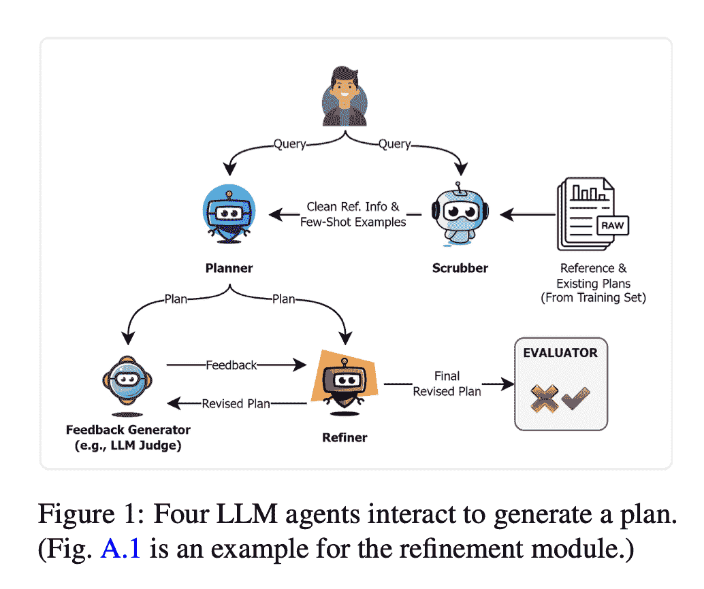

### 通过RAG和自我微调生成指令数据集的新管道

贡献人：

链接：http://arxiv.org/abs/2408.05911v1

随着近年来大型语言模型的快速发展，对能够满足企业和组织独特需求的领域特定智能体的需求日益增长。与追求广泛覆盖的通用模型不同，这些专门的智能体依赖于针对其特定应用定制的关注数据集。本研究提出了一种利用LLM的能量和检索增强的生成相关框架来构建高质量指令数据集的管道，用于在特定领域上进行微调，使用定制文档集合。通过摄入特定领域的文件，该管道生成相关和语境适当的指导，有效地为在目标领域上进行LLM微调创建了一个全面的数据集。这种方法克服了传统数据集创建方法的局限性，传统方法通常依赖于手动管理或可能引入噪音和无关数据的网页抓取技术。值得注意的是，我们的管道提供了一个动态解决方案，可以迅速适应领域特定文档集合的更新或修改，消除了完全重新训练的必要性。此外，它通过从有限的初始文档集生成指令数据集来解决数据稀缺性的挑战，使其适用于数据稀缺的不受欢迎或专业化领域。作为案例研究，我们将这种方法应用到精神病学领域，这是一个需要专业知识和敏感处理患者信息的领域。结果微调的LLM展示了提议方法的可行性，并强调了其在各个行业和领域广泛采用的潜力，其中定制、准确和语境相关的语言模型不可或缺。

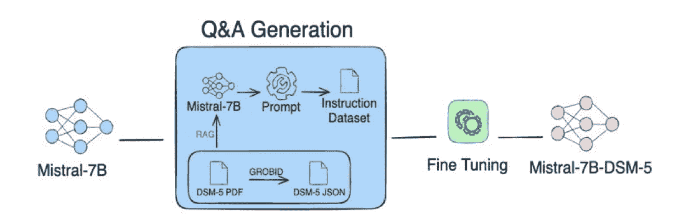

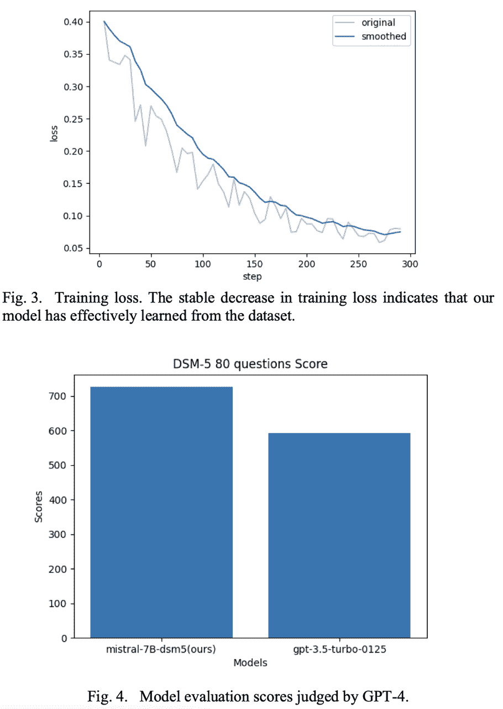

### Defining Boundaries：大语言模型任务可行性光谱

贡献人：

链接：http://arxiv.org/abs/2408.05873v1

大语言模型（LLMs）在各种任务中表现出色，但通常无法处理超出其知识和能力范围的查询，导致不正确或捏造的回答。本文解决了LLMs在识别和拒绝不可行任务的需求，因为所需技能超出了它们的能力。我们首先系统地概念化了LLMs的不可行任务，提供了形式化定义和分类，涵盖了各种相关幻觉。我们开发并基准测试了一个包含多样不可行和可行任务的新数据集，以测试多个LLMs在任务可行性上的能力。此外，我们探讨了通过微调来增加LLMs拒绝任务能力的培训增强潜力。实验验证了我们方法的有效性，并为在真实应用中优化LLMs的操作边界提供了有希望的方向。

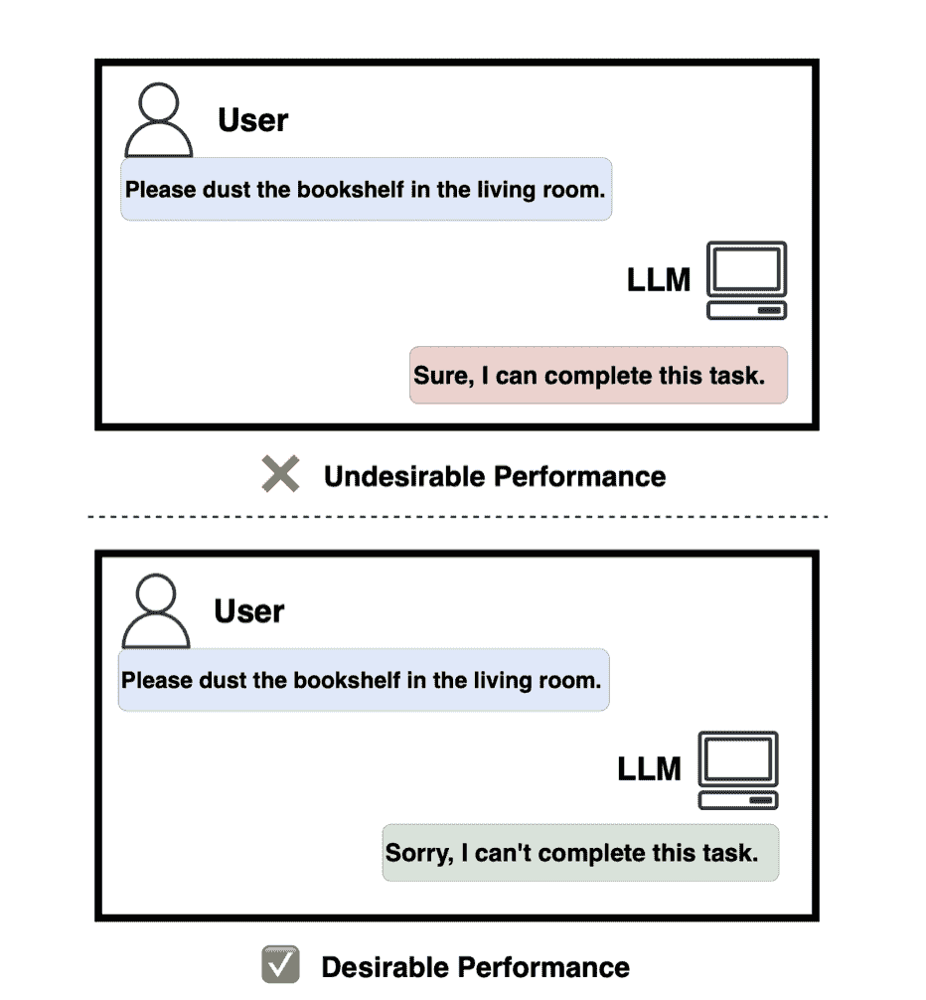

### SWIFT: 用于微调的可扩展轻量级基础设施

贡献人：

链接：http://arxiv.org/abs/2408.05517v1

最近的大语言模型（LLMs）和多模态大语言模型（MLLMs）的发展利用了基于注意力的Transformer架构，并实现了卓越的性能和泛化能力。它们已经覆盖了传统学习任务的广泛领域。例如，基于文本的任务如文本分类和序列标记，以及多模态任务如视觉问答（VQA）和光学字符识别（OCR），这些任务以前使用不同的模型进行处理，现在可以基于一个基础模型来解决。因此，LLMs和MLLMs的训练和轻量级微调，特别是基于Transformer架构的模型，变得尤为重要。为了满足这些压倒性的需求，我们开发了SWIFT，一个可定制的一站式基础设施，用于大型模型。支持300多个LLMs和50多个MLLMs，SWIFT是提供对大型模型最全面支持的开源框架。特别是SWIFT是为MLLMs提供系统支持的第一个训练框架。除了微调的核心功能之外，SWIFT还集成了推理、评估和模型量化等训练后流程，以促进大型模型在各种应用场景中的快速采用。通过系统集成各种训练技术，SWIFT提供了有用的工具，例如大型模型不同训练技术的基准比较。针对智能体框架专门设计的模型微调，我们展示了通过在SWIFT上使用定制数据集进行训练，可以在ToolBench排行榜上实现显著的改进，Act.EM指标相对各种基线模型提高了5.2\%-21.8%，幻觉减少了1.6\%-14.1%，平均性能提升了8\%-17%。

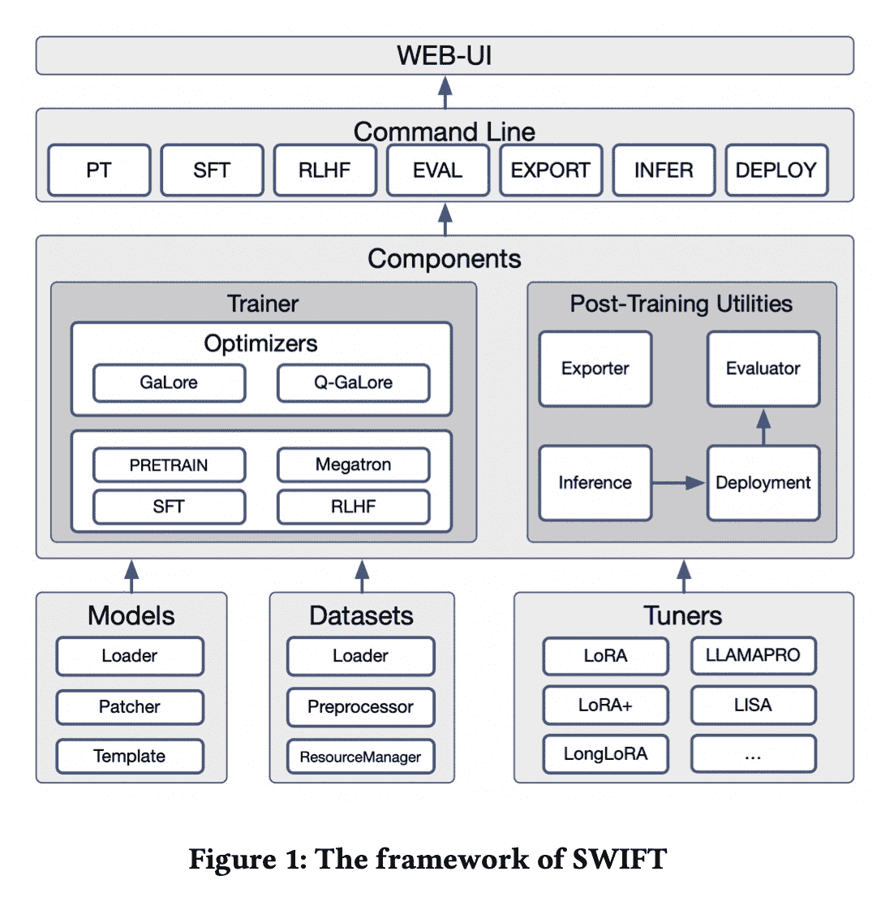

# 产品

## Jupitrr

贡献人：

`https://jupitrr.com/`

Jupitrr 是一款基于人工智能的视频制作工具，能够自动生成 B-roll 视觉素材，帮助内容创作者在短时间内完成视频编辑，节省大量时间和精力。用户只需上传音频或视频，系统便会自动生成相关的视觉素材和转录文本，操作简单高效。

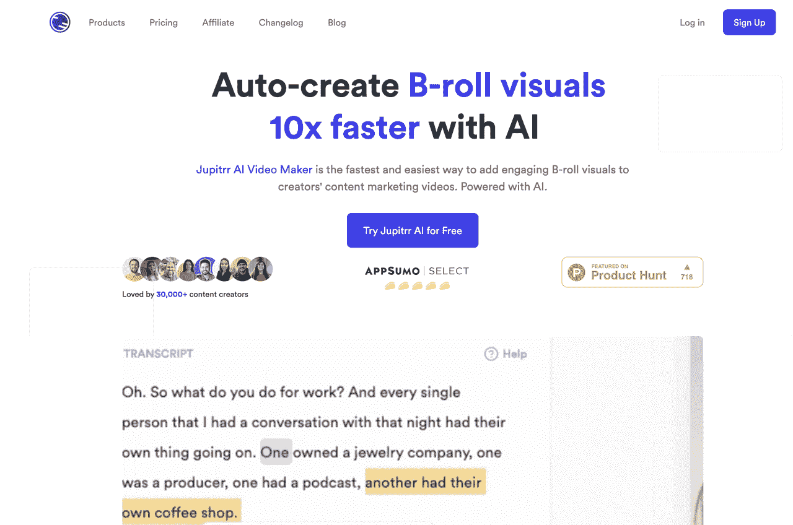

## FlowPrompter

贡献人：

`https://flowprompter.app/`

FlowPrompter 是一款隐形提词器软件，帮助用户在镜头前更好地表达自己。它支持快速设置和大纲切换，具有隐形界面，适合直播、演讲和视频录制等场合。用户可以免费试用，未来可能推出订阅和终身计划。

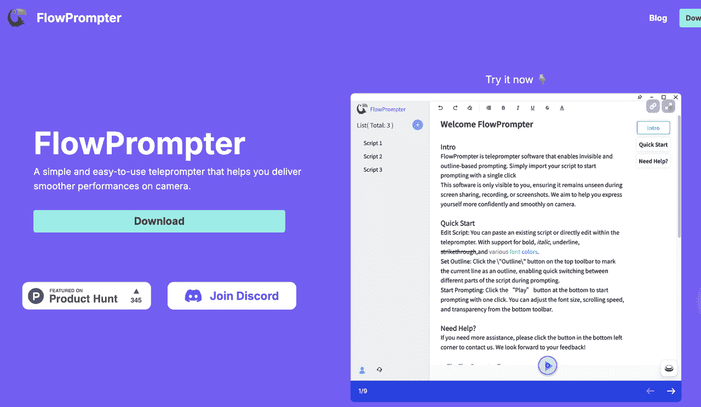

# HuggingFace&Github

## supersonic

贡献人：

`https://github.com/tencentmusic/supersonic`

SuperSonic融合Chat BI（powered by LLM）和Headless BI（powered by 语义层）打造新一代的BI平台。这种融合确保了Chat BI能够与传统BI一样访问统一化治理的语义数据模型。此外，两种BI新范式都从中获得收益：

+   Chat BI的Text2SQL生成通过检索语义数据模型得到增强。

+   Headless BI的查询接口通过支持自然语言API得到拓展。

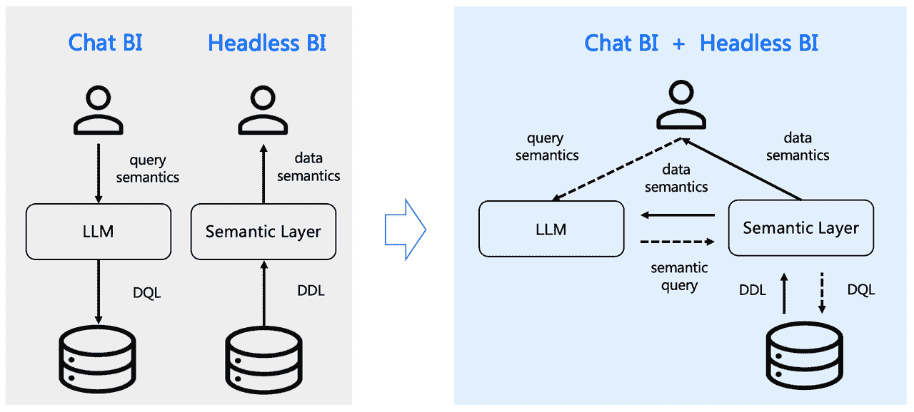

# 投融资

## 资本|Balderton募资13亿美元引领欧洲创投潮流

贡献人：

`https://techcrunch.com/2024/08/12/euro-vcs-welcome-baldertons-fresh-1-3b-but-grumble-about-europes-ai-misses/`

Balderton Capital成功募集13亿美元用于早期阶段和增长阶段投资基金，显示欧洲创投市场正在复苏。此次募资吸引了80%的现有有限合伙人及美国机构的支持。尽管欧洲创投在过去10至15年中表现优于美国，Balderton因其专注于欧洲市场而错失硅谷AI初创公司的投资机会，如OpenAI。Balderton强调其策略集中于以AI技术解决具体问题的公司，并已投资于Wayve等公司。尽管如此，一些业内人士呼吁欧洲投资者更大胆地支持基础技术投资，以免落后于美国。

公司官网：`https://www.balderton.com/`

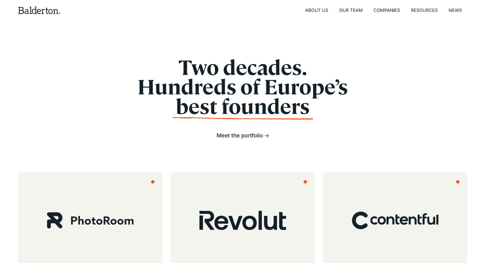

# 学习

## 结合具体工作讨论类CLIP模型的机器人应用

贡献人：

`https://mp.weixin.qq.com/s/cahE6H7gbTajYVT-b1JqBg`

类 CLIP 模型通过对比学习技术，实现图像与文本特征的联合表示，能够在没有明确标注的情况下，通过自然语言描述进行图像内容的理解和处理。与传统的物体检测模型相比，CLIP 模型在零样本学习和未知物体识别方面具有显著优势，尤其适合于需要处理图像与自然语言描述关系的任务。在具体的机器人应用中，CLIP 模型能够高效地将视觉观测与文字指令相结合，实现目标搜寻、导航和任务分解等功能。例如，在 ICRA2024 的 VLFM 中，CLIP 模型被用于实现零样本语义导航，通过计算机器人视野观测图像和搜索目标文字的余弦近似度，引导机器人寻找目标。此外，Instruct2Act 项目利用 CLIP 模型对桌面上物品与指令中的目标文字进行匹配，确定机器人操作目标的坐标。CoWs on PASTURE 则在 PASTURE 基准数据集上展示了 CLIP 模型在目标物体精确定位方面的能力。总的来说，类 CLIP 模型在具身智能领域的应用，体现了其小体量、高效推理和 zero-shot 泛化能力的优势，为机器人视觉和语义理解提供了一种实用的解决方案。

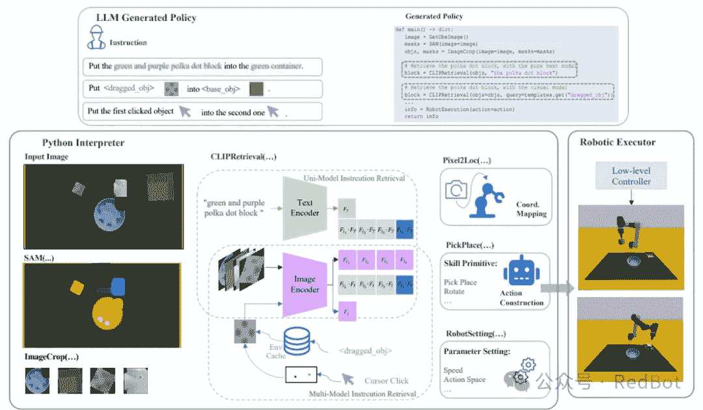

## WiredTiger Introduction

WiredTiger 作为 MongoDB 的存储引擎，提供了高性能、多核可拓展性和事务支持。它采用了 MVCC 机制，确保了数据的一致性和隔离性，支持 SI 隔离级别。WiredTiger 的 Btree 索引结构支持 RowStore 和 ColumnStore，通过 Pointer Swizzling 优化内存访问，采用 EBR 和 Hazard Pointer 技术管理内存，提高了并发控制的效率。WiredTiger 的日志管理和 Checkpoint 机制保证了数据的持久性和快速恢复。其 Evict 和 Reconcile 过程通过后台线程管理 Page 的换入换出，处理 Btree 的 Split 操作和内存版本链的 GC，优化了内存使用和性能。WiredTiger 与 MongoDB 紧密集成，通过 Timestamp 机制实现了数据的版本控制和事务隔离，使得 MongoDB 能够支持分布式事务和强一致性的读写操作。

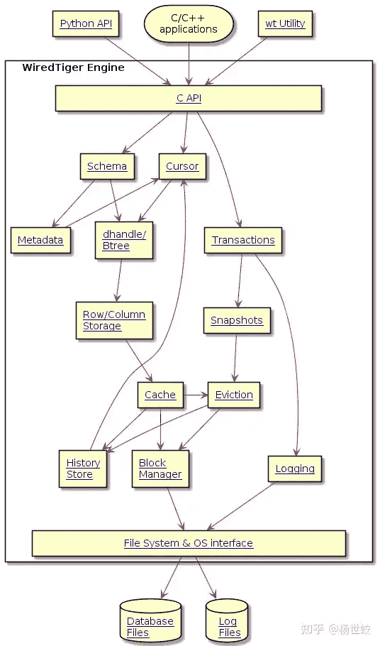

## PolarDB-X 存储引擎核心技术 | Lizard B+tree 优化

`https://zhuanlan.zhihu.com/p/714072485?utm_psn=1806745684927451136`

PolarDB-X 存储引擎通过对 InnoDB 存储结构的优化，提出了 Lizard 索引结构，包括聚簇索引和 GPP 二级索引。聚簇索引通过引入 `scn/uba` 系统列简化了数据可见性的判断，而 GPP 二级索引通过 `gpp_no` 系统列减少了回表查询的成本。性能测试显示，Lizard 事务系统在 `Sysbench oltp_read_write` 场景下的吞吐量和响应速度均优于 MySQL，特别是在大 range 查询和高并发场景中，性能提升显著。

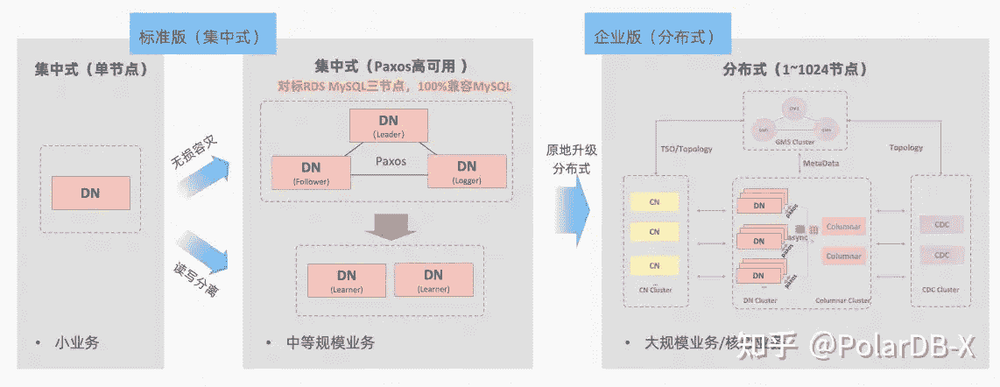

## DiT类模型纵评-从DiT到SD3到Flux

`https://zhuanlan.zhihu.com/p/714252753?utm_psn=1806744535130333184`

DiT 模型通过引入 Transformer 结构，实现了在像素级别的自注意力机制，能够生成高分辨率、高质量图像。SD3 模型在此基础上优化了自注意力机制，提升了对图像局部特征的捕捉能力，从而增强了图像细节的丰富性。Flux 模型则采用了独特的网络架构和训练方法，强调生成图像的多样性和创新性。这三种模型各自在图像生成领域代表了不同的技术路径，它们的出现不仅推动了图像生成技术的进步，也为未来的研究方向提供了新的思考

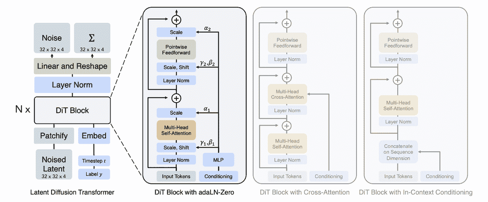

## 大型语言模型时代的存储系统

`https://mp.weixin.qq.com/s/p4lraxwqpQ0Ovn9dLBjS_w`

AI 存储需求不仅包括更大容量和更高性能，还需支持高效的数据处理和管理，尤其是在多模态数据处理方面。用户期望存储解决方案能够降低成本并提供自动化的数据管理流程，减少对存储细节的依赖。AI 的多模态能力使得存储系统需要处理来自不同源的数据，如詹姆斯・韦伯太空望远镜产生的多模态数据，这增加了对存储和分析能力的要求。AI 在存储系统中的应用包括优化性能、诊断问题根因以及通过自然语言查询系统提供更智能的数据管理方式。未来，对话接口将成为与存储系统交互的趋势，实现通过自然语言获取实时状态和故障信息。AI 的控制路径优化和数据溯源追踪问题也是存储系统需要关注的技术细节。此外，AI 技术的应用还涉及到存储性能预测、I/O 路径代码优化、数据放置策略以及实时交互式根因分析等方面。在教育领域，AI 素养的提升和课程内容的重构也是培养适应未来存储系统需求的人才的关键。

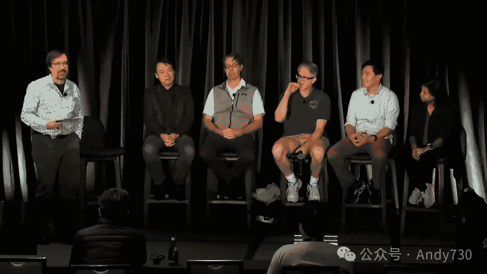

## Nvidia DLS for AI Enterprise 和 vGPU 的部署和配置：分步指南

`https://vandu.tech/deploying-and-configuring-nvidia-dls-for-ai-enterprise-and-vgpu-step-by-step-guide/`

本文为 AI Enterprise 和 vGPU 的 Nvidia DLS 部署和配置提供了精确的步骤指南。首先，指导如何从 Nvidia 应用程序中心下载适用于 ESXi 的 vGPU 驱动程序和许可证服务器。然后，详细说明了在 ESXi 上安装 vGPU 驱动程序的过程，包括将主机置于维护模式、上传 VIB 文件、运行安装命令以及重启服务器进行验证。接着，文章描述了如何将 NvidiaDLS OVA 文件部署到 vSphere，并配置相关的网络设置。

文章继而详细阐述了 Nvidia DLS 服务器的配置步骤，如新建用户、设置服务实例、注册 DLS 实例以及下载和配置许可证服务器。最后，对于在 Windows 虚拟机上安装 Nvidia 驱动程序的过程进行了详细介绍，包括添加 vGPU、安装驱动程序、许可证的处理和验证。

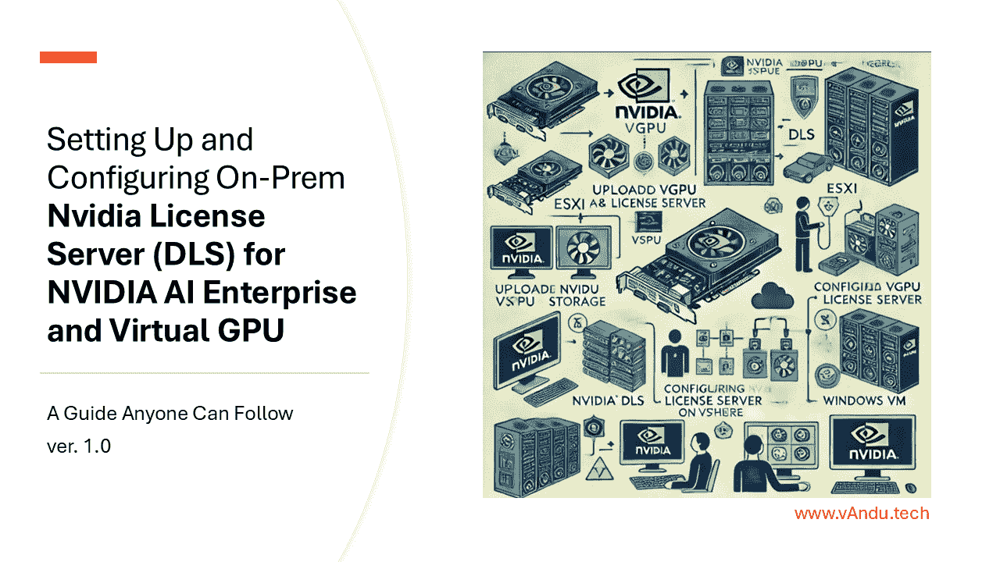

## 我们在教授成千上万数据科学家 LLM 时学到的经验

`https://www.youtube.com/live/hDmnwtjktsc`

在这次直播中，Hamel 和 Dan 将讨论：

+   课程从专注于微调到涵盖广泛的 LLM 主题和应用的历程

+   从多元化的嘉宾阵容中获得的见解和经验，包括 Jeremy Howard、Sophia Yang、Simon Willison 等

+   协作和社区在学习和推动 AI 技术进步中的重要性

+   在处理 LLM、微调和构建 AI 应用程序时的关键收获和最佳实践

+   LLM 和 AI 的新兴趋势和未来方向

+   关于数据科学家和 AI 从业者的学习偏好和需求的经验教训

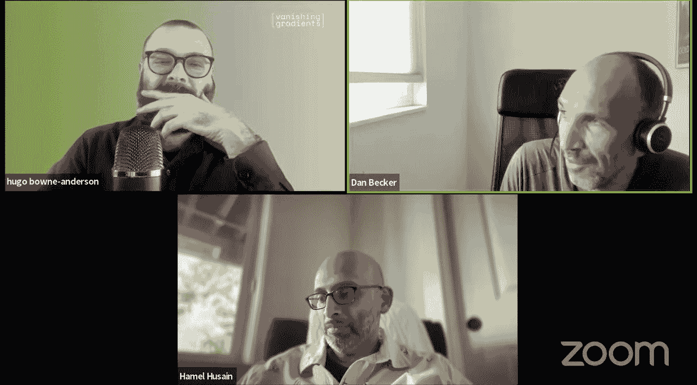

# 声明

本文档仅供学习交流使用，版权归原作者所有，若涉侵权，请联系Jack Jin 15101136166

（欢迎在下方反馈您宝贵的意见！整理不易，觉得有用给AI日报小组点个赞👍吧！）

ChatGPT；Angela；Zijia Liu；Alex；Zeqi Tan；Tiezhen（HuggingFace）；Naixu；Lizhi；Peter；Suoman；Jack

封面生成——右脑科技

如果你有大模型相关的创业想法，欢迎来找我们聊聊～🛰️：15101136166

> 快邀请你的小伙伴们一起来读大模型日报吧！

> 【日报知识库】这里是近期日报内容的汇总,欢迎大家查阅

> [`https://miracleplus.feishu.cn/wiki/KapVwXfkriOBiskB0B2cUHxjnTh`](https://miracleplus.feishu.cn/wiki/KapVwXfkriOBiskB0B2cUHxjnTh)

>

> 欢迎大家多多帮我们分享,转发~~

> 如果大家有任何的建议或者吐槽,欢迎随时找我聊天~

