# 奇绩大模型日报（8月 15日）

> 来源：[https://miracleplus.feishu.cn/docx/PODLdVtZmoCZizxihEqcfqqTnR0](https://miracleplus.feishu.cn/docx/PODLdVtZmoCZizxihEqcfqqTnR0)

## 潜空间活动报名

> 潜空间系列活动第三季第三期开启报名！
>
> 本期活动将在**8月24日** **10:00 am**开始，嘉宾是**童晟邦**。**童晟邦，纽约大学博士，伯克利人**工智能实验室（BAIR）研究员， OpenAI 超对齐奖学金获得者。他将和大家探讨视觉在多模态大模型中扮演的角色。
>
> 除嘉宾分享外，每期设置了【匹配合伙人 Cofounder Matching】环节。你可以和 GenAI 时代最有活力的创业者和研究者线下面对面交流，将有机会找到志同道合、有共同创业梦想的小伙伴。
>
> 报名通道已开启，欢迎扫描下方二维码报名。

## 推特

### AI + Web3初创Sahara AI 融资4300万美元：带入一个开放、公平、安全的AI未来

https://x.com/SaharaLabsAI/status/1823708561517764866

Sahara AI成功筹集了4300万美元，用于构建协作型AI经济体！

由@PanteraCapital、@BinanceLabs 和 @polychain 共同领投，此次融资将我们带入一个开放、公平、安全的AI未来，通过我们的去中心化AI区块链平台实现。

我们还看到了来自@SamsungNext、@Sequoia、@matrixvc、@daofive、@geek_cartel、@NomadCapital_io、@SCB10X_OFFICIAL、@CanonicalCrypto、@mirana、@ForesightVen、@aegis_ventures、@DispersionVC、@tangent_xyz、@alumniventures等的参与。

此外，我们很自豪能够得到AI领域最聪明的头脑的支持，包括：

+ 来自@MothersonGroup 的 Laksh Vaaman Sehgal

+ 来自@AnthropicAI 和 @StanfordAILab 的 Rohan Taori (@rtaori13)

+ 来自@NousResearch 的 Teknium (@Teknium1)

+ 来自@togethercompute 的 Vipul Prakash (@vipulved)

+ 来自@midjourney 的 Elvis Zhang (@elvzhangg)，等等

无论你是AI爱好者、数据科学家、商业领袖，还是对技术改变世界的潜力充满热情的人，协作型AI经济体都有你的一席之地！

阅读更多关于如何加入我们的使命：

http://saharalabs.ai/blog/sahara-ai-raise-43m

[qZ9lFaoxuWvvJE8f.mp4](https://internal-api-drive-stream.feishu.cn/space/api/box/stream/download/all/M25nbkdLHovCCXx4eGQcNjwpni5)

### Anthropic大更新：Claude可以进行提示缓存，使用更长、更具指导性的提示即时微调模型响应

https://x.com/AnthropicAI/status/1823751314444021899

使用Claude进行提示缓存。

缓存允许您使用更长、更具指导性的提示即时微调模型响应——同时最多减少90%的成本。

现在在Anthropic API的测试版中可用。

### 《提高LLM应用的准确性》：创建评估数据集来测量模型准确性、添加提示工程和自我反思、微调模型等

https://x.com/AndrewYNg/status/1823759268937650528

学习一种开发模式，以系统地提高LLM应用的准确性和可靠性，在我们的新短期课程中，与@LaminiAI和@Meta合作建立的《提高LLM应用的准确性》，由Lamini的CEO @realSharonZhou 和Meta的合作工程高级总监 @asangani7 教授。（披露：我是Lamini的投资者。）

调整LLM应用的路径可能很复杂。在这门课程中，你将学习一系列系统的步骤来提高准确性，通过减少幻觉：

- 创建评估数据集来测量模型准确性
- 添加提示工程和自我反思
- 微调你的模型，包括“记忆调整”，这是一种在LLM中嵌入事实的新方法

使用Llama 3-8B参数模型，你将：

- 构建一个具有自定义模式的文本到SQL代理，并模拟它产生幻觉的情况
- 理解指令微调与记忆微调的区别，指令微调是对预训练LLM给出遵循的指令
- 了解如何通过性能高效的微调（PEFT）技术，如低秩适应（LoRA）将训练时间减少100倍，以及记忆专家混合（MoME）进一步减少训练时间

我很欣赏Meta发布了Llama的开放模型家族——这门课程展示了开发者可以用这些模型做的独特类型的工作。

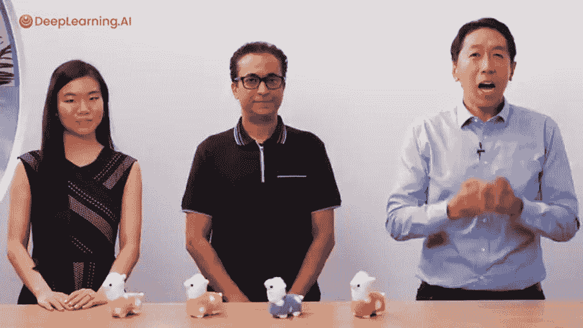

[ssstwitter.com_1723720328116.mp4](https://internal-api-drive-stream.feishu.cn/space/api/box/stream/download/all/NQnNbzZPLoR8E1x5l2OcgefznQg)

### Bihan分享语音到语音管道迭代：延迟可达500毫秒

https://x.com/eustachelb/status/1823817160210440196

介绍我们的第一个语音到语音管道迭代 🗣️。

选择你想要的LLM，并与之对话，延迟可达500毫秒！谁说我们需要语音到语音模型快速呢？

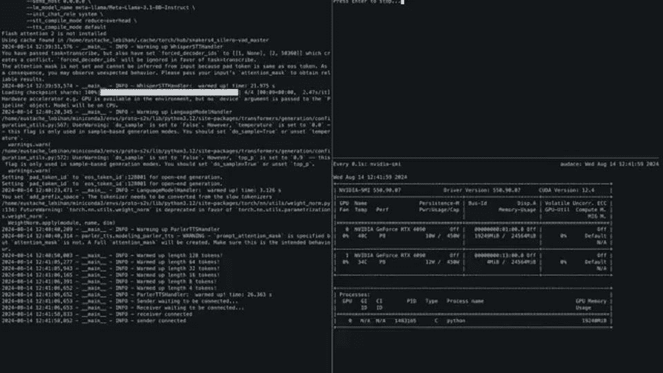

[ssstwitter.com_1723720659955.mp4](https://internal-api-drive-stream.feishu.cn/space/api/box/stream/download/all/DCcgbQwH6oBba2xWZHpcn7Wnn8d)

### 3D导出功能：将任何图像转换为3D资产

https://x.com/skirano/status/1823778193972576521

在 @everartai 上推出3D导出功能 🧊

现在，您可以将任何图像转换为3D资产，以便与您喜爱的工具一起使用。

此视频中的生成是实时的。

就是这么快。⚡️

结合使用FLUX 1. Pro，您将获得一款适用于任何类型资产的惊人工具。

[ssstwitter.com_1723720784855.mp4](https://internal-api-drive-stream.feishu.cn/space/api/box/stream/download/all/IbRObW7lqoK4GwxzoDbcOdv2n3f)

### Subform：用于分支和混合AI聊天的画布

https://x.com/bnj/status/1823784845879005407

介绍Subform——一个用于分支和混合AI聊天的画布。

仅用两周时间和400美元的Claude积分，加上血汗和泪水就构建完成

[ssstwitter.com_1723721127182.mp4](https://internal-api-drive-stream.feishu.cn/space/api/box/stream/download/all/IpDCbQbGxo19NwxioSkcIQxlnog)

## 资讯

### 创业一年，人间三年

https://zhuanlan.zhihu.com/p/714533901?utm_psn=1807446872983478272

李沐在文章中分享了他创业一年的经历，体验到了时间的加速效应，感觉像是人生中经历了三年。他谈到了命名公司时的困惑与灵感，融资过程中的起伏，以及 GPU 采购时的挑战与成功。在商业和技术层面，他强调了自定义大型语言模型（LLM）的重要性，以及公司在行业中的定位和发展。同时，他也反思了如果更加积极地融资，可能会获得更多资金的机会。技术上，他描述了对 LLM 认知的四个阶段，从最初的震撼到后来的深入研究和定制模型的成功，最终实现了与行业领头羊相当甚至更优的技术水平。最后，李沐提出了他对未来智能体的愿景，即作为人类的陪伴，不仅具备高情商和智商，还能够提供情感和知识上的支持。他认为，生产工具的发展将使人类更加个体化和独立，而智能体能够填补这种孤独带来的空缺。在团队和个人追求方面，他强调了团队的重要性以及内心动机对于创业成功的影响。

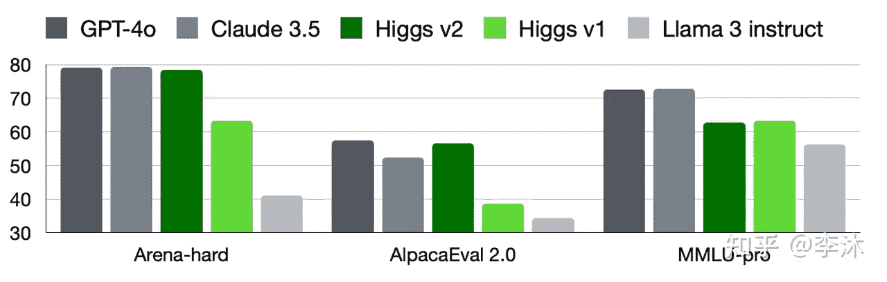

### GitHub 全球宕机，Copilot 瘫痪！开发者光明正大摸鱼

https://mp.weixin.qq.com/s/wweSVOjs1jCZLWKPpKMdDA

GitHub 近期遭遇全球性宕机，影响了其网站及多项服务，包括 Copilot，虽后续系统恢复正常。宕机期间，用户无法访问主网站，显示错误消息。受影响的服务包括 pull requests、GitHub Pages 和 API。事件迅速扩散，超过 1 万用户受牵连。GitHub 在 2018 年被微软收购，用户数从不到 4000 万增长至 7300 多万，但宕机事件频发，尤其在 2018 年和 2021 年发生了严重的中断，导致开发者对 GitHub 的信任下降。用户通过社交平台表达了对 GitHub 服务不稳定性的不满，认为即使是短时间的中断也是不可接受的。

### ACL主席：ACL不是AI会议

https://mp.weixin.qq.com/s/9M50mfCiH3HF-UzKTRsLgA

ACL 主席 Emily M. Bender 在 ACL 2024 大会上指出，ACL 大会是计算语言学和自然语言处理领域的顶级国际会议，而非 AI 会议。她强调 ACL 的核心在于语言技术和计算语言学，并批评了 AI 领域的一些不良研究实践，如过度追求与 SOTA 模型的比较评估和基准测试的不当使用。Bender 主张 CL/NLP 研究应关注技术的适用性、对人类语言行为的理解、以及科学研究的可复制性和可重现性。她认为 ACL 应该是一个促进跨学科研究、关心语言群体的平台，并提供对社会影响的理性讨论。这一观点引发了社交平台上的广泛讨论，有人认为这种分割没有必要，而另一些人则理解 Bender 的立场，担心 AI 的风头可能会使其他领域的研究受到冷落

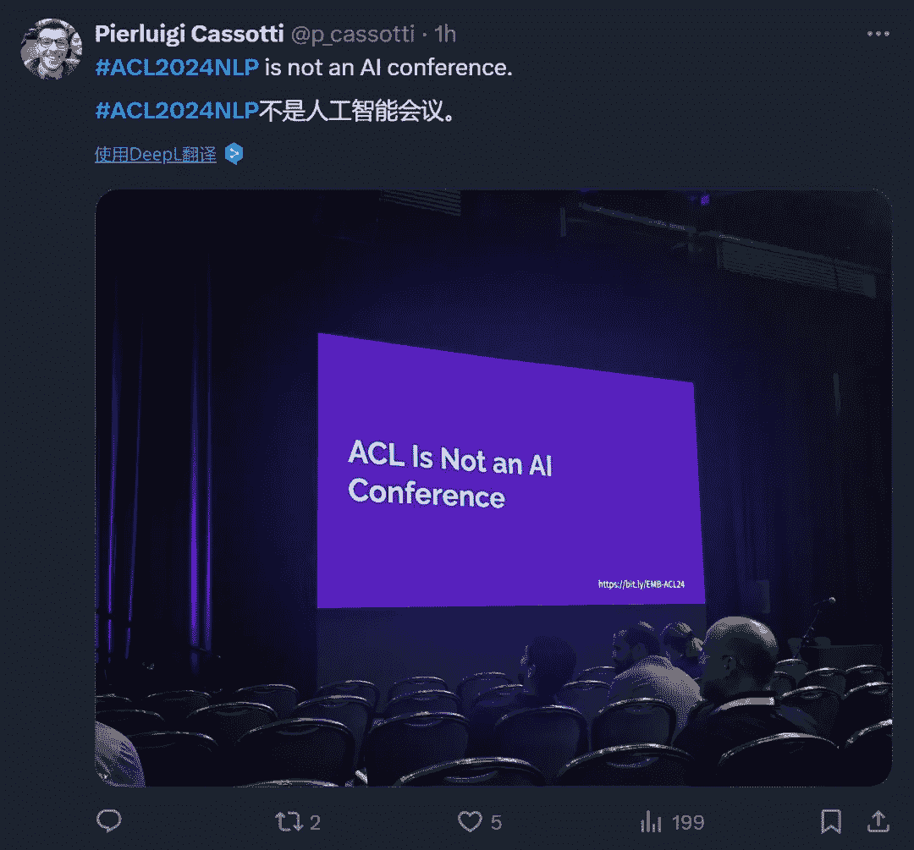

### ACL 2024大奖揭晓！全华人团队用AI破解3000年前甲骨文密码

https://mp.weixin.qq.com/s/CJEDRuEb19buOOk4FsvQNQ

ACL 2024 大会揭晓了多项关键研究成果，特别是全华人团队利用扩散模型成功破译 3000 年前甲骨文的工作。该团队开发了「Oracle Bone Script Decipher」（OBSD），通过基于条件扩散的策略生成了破译线索，为古代语言分析提供了新方法。此外，研究人员还探讨了大型语言模型的记忆特性，发现模型的记忆性能随模型大小、数据顺序和学习率而变化，且具有一定的可预测性。Cohere 公司发布的 Aya 模型覆盖了超过 101 种语言，显著超越了现有开源模型，为多语言语言模型的研究提供了新的基准。另一研究探讨了 Transformer 模型在学习复杂函数时的偏差和局限性，指出这些偏差与模型的损失景观密切相关。

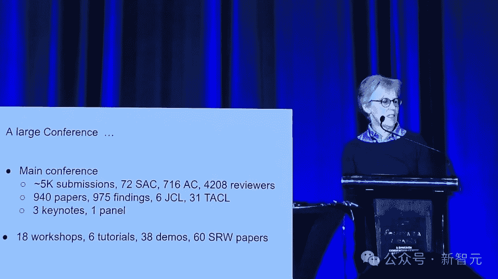

### Chrome安卓或遭剥离，AI训练数据被迫共享

https://mp.weixin.qq.com/s/16ig3q2jkR7kevfHJ7wfHg

谷歌可能因违反反垄断法而面临分拆，包括与 Chrome 和安卓操作系统的解绑，以及被迫共享 AI 训练数据。这将是自 80 年代 AT&T 分拆以来最重大的企业分拆。谷歌搜索引擎市场份额约为 91%，长期保持在约 90%，而次一位的微软 Bing 仅占不到 4%。谷歌通过与苹果、三星等公司的协议，将其搜索引擎作为默认选项预装于设备上，维持其市场霸权。美国司法部胜诉，联邦法官裁定谷歌违反反垄断法，可能导致谷歌剥离安卓或 Chrome 浏览器。此外，司法部考虑要求谷歌与竞争对手分享数据，以促进市场公平竞争。如果分拆执行，将对谷歌的广告业务和市值产生深远影响。谷歌还可能被迫出售 AdWords 广告平台，或者提供互通操作，使其在其他搜索引擎上可用。此外，谷歌可能需要为其 AI 产品和搜索新功能的开发提供解释，以抵御垄断争议。

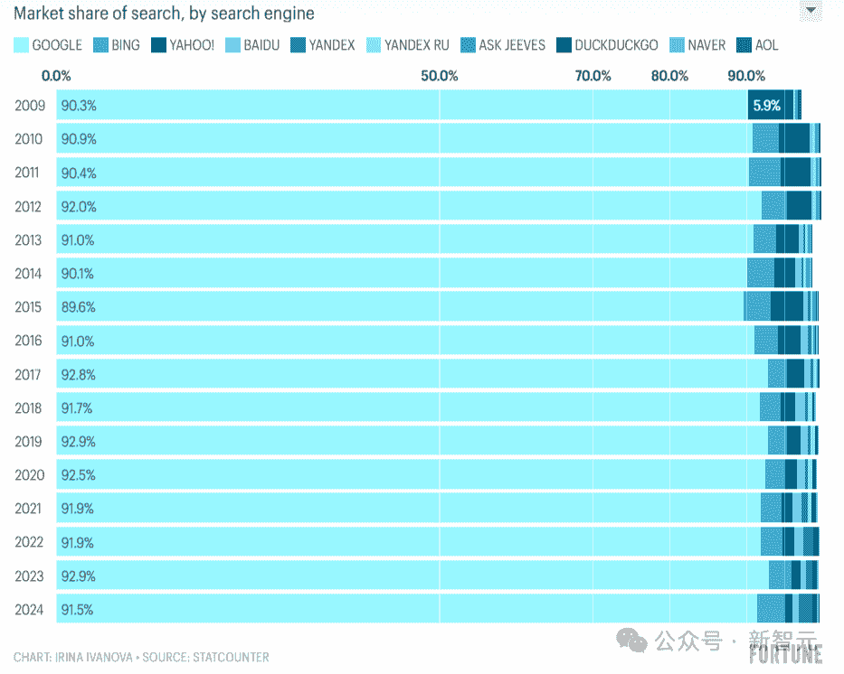

### 专访大象机器人 CEO 宋君毅：从机械臂到轮式人形机器人，差异化才能突围

https://mp.weixin.qq.com/s/sU2ZrURDVUd-91rHoeUuQw

大象机器人 CEO 宋君毅在机器人领域的创业旅程，从 2016 年开始，经历了从工业机械臂到轻量型机械臂、机器宠物，再到人形机器人的多次业务转型。他坚持技术自研，不断调整产品布局，以适应市场需求和竞争环境。在 2020 年，推出的桌面级六轴机械臂 myCobot 使公司实现了亏转盈。随后，公司扩展了轻量级机械臂和机器宠物系列，并在 2024 年全面布局人形机器人。宋君毅认为，人形机器人的未来市场前景广阔，重点在于性价比和应用场景的拓展。通过深入理解用户需求，大象机器人致力于推动人形机器人的商业化落地，以实现公司的持续发展和转型。

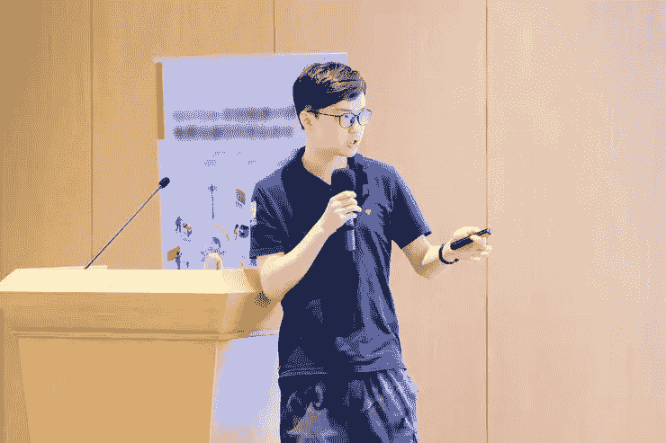

## 论文

### Aquila2 技术报告

贡献人：

链接：http://arxiv.org/abs/2408.07410v1

本文介绍了Aquila2系列，其中包含参数为70、34和7亿的各种双语模型。这些模型是基于一个名为HeuriMentor（HM）的创新框架训练的，该框架提供了对模型收敛的实时洞察，并增强了训练过程和数据管理。HM系统包括自适应训练引擎（ATE）、训练状态监视器（TSM）和数据管理单元（DMU），允许精确监控模型的训练进度，并实现数据分配的有效优化，从而增强训练效果。广泛的评估显示，Aquila2模型系列在英文和中文基准上表现出色。具体而言，当量化为Int4时，Aquila2-34B的性能仅略有下降。此外，我们已经公开发布了我们的训练代码和模型权重，以支持正在进行的研究和应用程序开发。

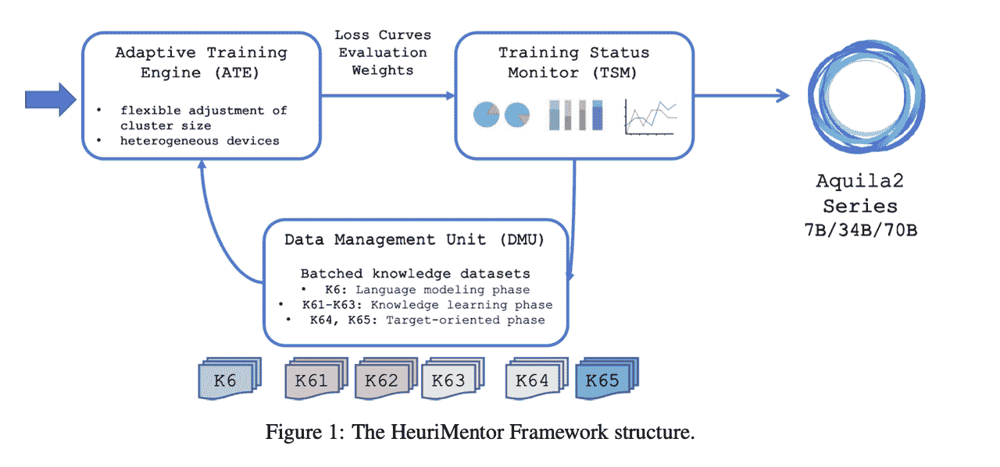

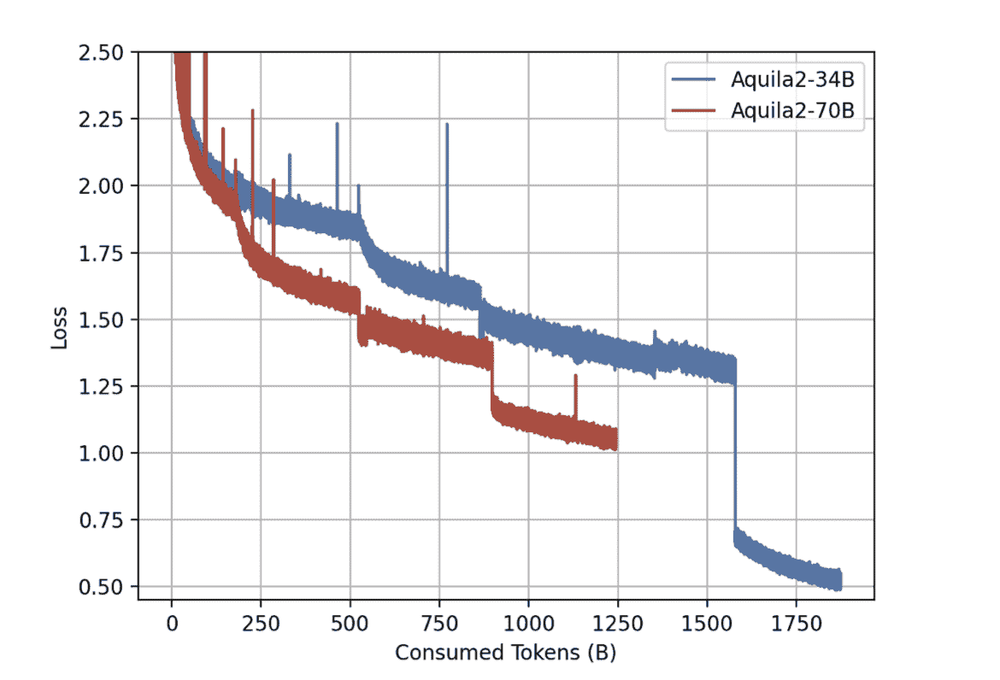

### DataVisT5: 一个用于联合理解文本和数据可视化的预训练语言模型

贡献人：

链接：http://arxiv.org/abs/2408.07401v1

数据可视化(DV)是提高传达大数据背后见解效率的基本和前提工具，在现实数据驱动的世界中被广泛接受。DV中的任务自动化，如将自然语言查询转换为可视化(即文本到可视化)，从可视化生成解释(即可视化到文本)，以自由形式回答与DV相关的问题(如FeVisQA)，以及解释表格数据(即表格到文本)，对推动该领域至关重要。尽管存在潜力，但预训练语言模型(PLMs)如T5和BERT在DV中的应用受到高成本和处理跨模态信息挑战的限制，导致对PLMs在DV中的研究较少。我们引入DataVisT5，这是一种专为DV量身定制的新型PLM，通过混合目标预训练和多任务微调策略增强了T5架构，将文本和DV数据集整合在一起，以有效解释跨模态语义。在公共数据集上进行的广泛评估表明，DataVisT5在各种与DV相关的任务上始终优于当前最先进的模型。我们期待DataVisT5不仅将激发对垂直PLMs的进一步研究，还将拓展PLMs的应用范围。

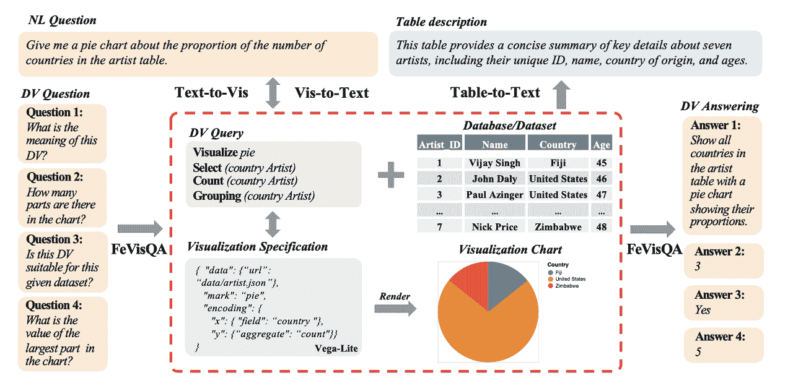

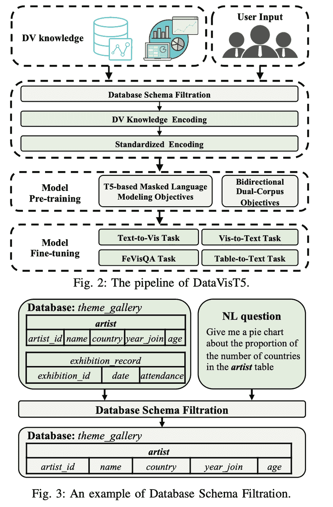

### MathScape：通过分层基准评估多模态数学场景中的MLLMs

贡献人：

链接：http://arxiv.org/abs/2408.07543v1

随着多模态大语言模型（MLLMs）的发展，多模态模型在数学问题领域的评估已经成为一个有价值的研究领域。多模态视觉-文本数学推理是评估MLLMs理解和复杂多步定量推理能力的关键指标。然而，先前的多模态数学基准测试并未充分整合视觉和文本信息。为了弥补这一空白，我们提出了MathScape，一个强调理解和应用综合视觉和文本信息的新基准测试。MathScape旨在评估基于照片的数学问题场景，通过分类层次方法评估MLLMs的理论理解和应用能力。我们对11种先进的MLLMs进行了多维度评估，发现我们的基准测试即使对于最复杂的模型也具有挑战性。通过分析评估结果，我们找到了MLLMs的局限性，为提升模型性能提供了宝贵的见解。

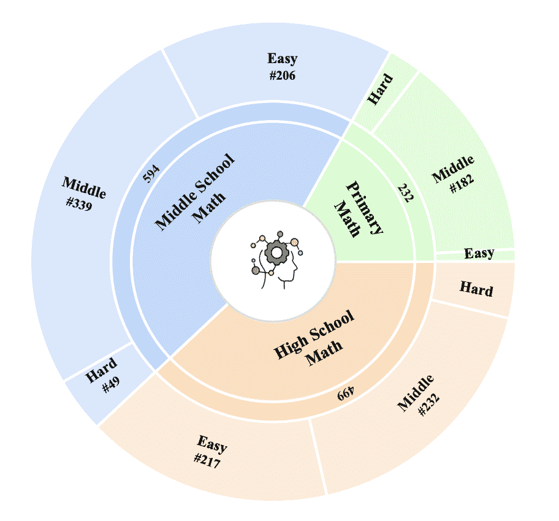

### 训练后的稀疏关注与双重稀疏

贡献人：

链接：http://arxiv.org/abs/2408.07092v1

# 摘要

摘要：大语言模型的推理过程速度慢且占用内存，其中关键瓶颈之一是过多的`Key-Value`（`KV`）缓存访问。本文引入了“双稀疏”技术，这是一种新颖的后训练稀疏注意力技术，旨在通过减少`KV`缓存访问来缓解这一瓶颈。双稀疏结合了`token`稀疏，专注于仅利用重要`token`进行自注意力计算，以及通道稀疏，一种利用重要特征通道来识别重要`token`的方法。我们的关键观点是通道稀疏的模式相对静态，允许我们使用离线校准使其在运行时更加高效，从而实现精确和高效的重要`token`识别。此外，该方法可与卸载技术相结合，实现显著的内存使用减少。实验结果表明，双稀疏技术可以在各种任务中实现最低影响的\(\frac{1}{16}\)`token`和通道稀疏，包括`wiki-2` perplexity、键值检索和长上下文基准测试，模型包括`Llama-2-7B`、`Llama-2-70B`和`Mixtral-8x7B`。在`GPU`上，它在注意力运算速度上提高了最多14.1倍，并在端到端推理上提高了1.9倍。通过卸载技术，在长度为256K的情况下，它相比最先进的解决方案实现了16.3倍的解码速度加速。我们的代码可以在`https://github.com/andy-yang-1/DoubleSparse`上公开获取。

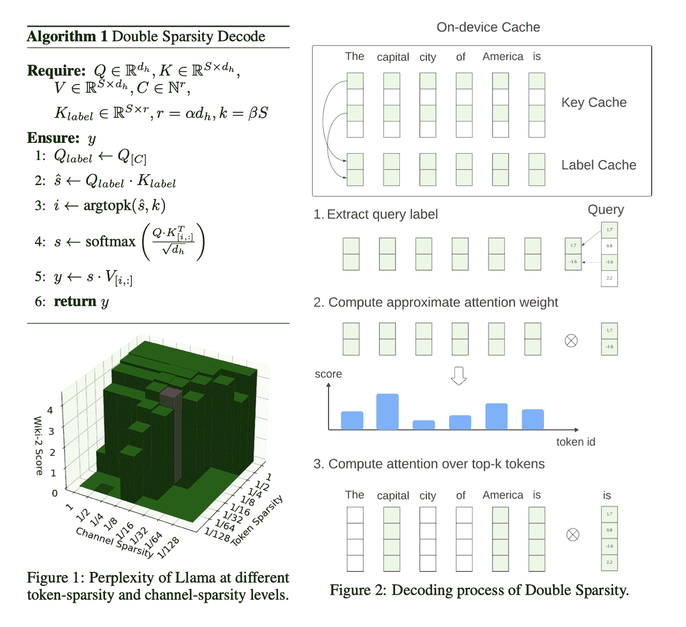

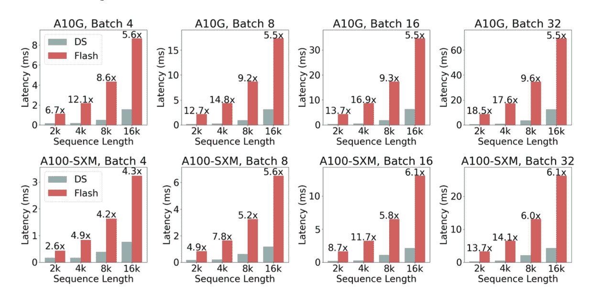

## MathBridge: 一个用于将数学表达式翻译为公式图片的大规模数据集

贡献人：

链接：`http://arxiv.org/abs/2408.07081v1`

理解文本形式中包含数学表达式的句子存在重大挑战。为了解决这一问题，强调了将这些表达式转换为公式图像的重要性。为了开发文本到图像转换系统，我们可以将该过程分为文本到`LaTeX`和`LaTeX`到图像转换两部分，后者由现有的各种`LaTeX`引擎管理。然而，前者的方法受到了文本到`LaTeX`配对数据严重稀缺的严重阻碍，在该领域中存在重大挑战。在这种情况下，我们提出了`MathBridge`，这是第一个将数学英语转换为`LaTeX`的大规模数据集，旨在为未来文本到`LaTeX`翻译研究建立健全的基准。`MathBridge`包含约2300万个`LaTeX`公式，配对对应的口语英语表达式。通过包括微调和数据测试在内的全面评估，我们发现`MathBridge`显著增强了预训练语言模型在文本到`LaTeX`翻译方面的能力。具体来说，对于`T5-large`模型，`sacreBLEU`分数从4.77提高到46.8，表明了实质性的增强。我们的发现表明有必要为文本到`LaTeX`转换评估制定一个新的度量标准。

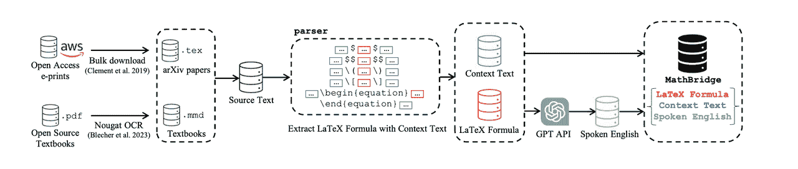

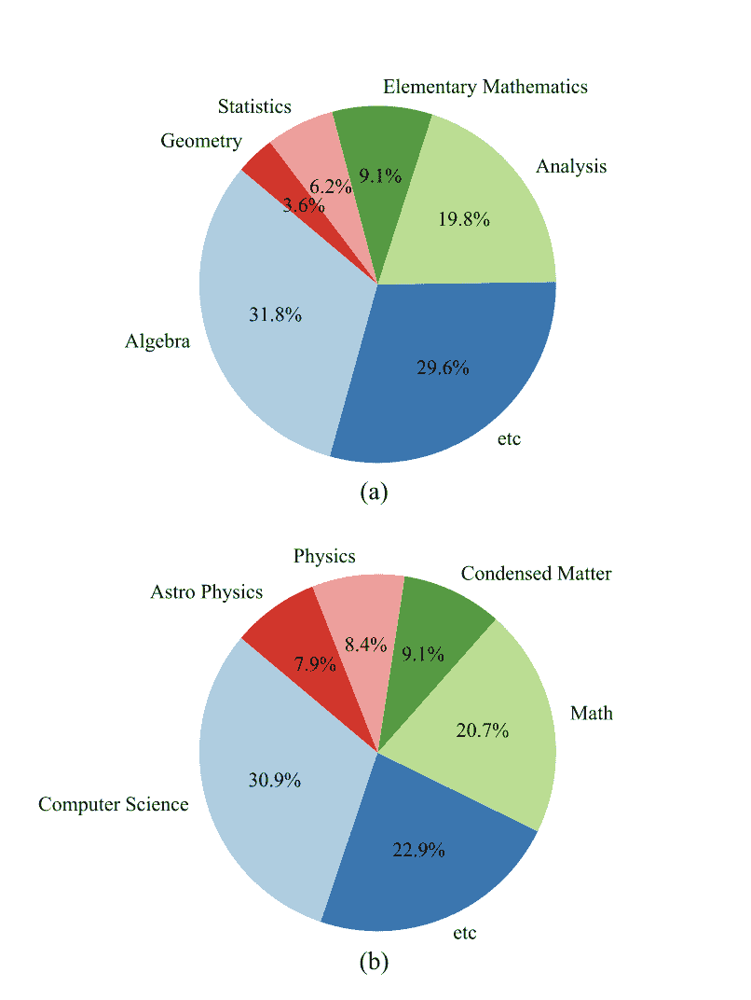

# 产品

## GCA

贡献人：

`https://gca.dev/`

`GCA`（`GPT` 计算机助手）是一个开源框架，帮助用户为产品创建高度自定义的智能系统，支持 `Windows`、`Linux` 和 `MacOS`。它提供丰富的 `API` 和代理基础设施，适用于 `B2B SaaS`、`电子商务`和开发工具等多种场景，能够快速响应用户需求，提升 `AI` 输出质量，推动 `AI` 技术的民主化。

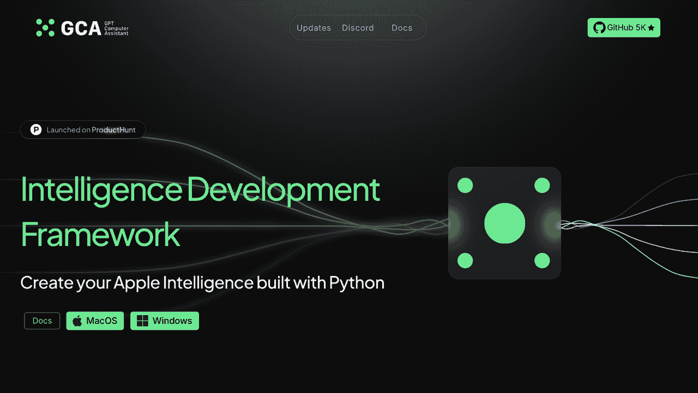

## ToonTalk

贡献人：

`https://apps.apple.com/us/app/toontalk-ai-chat-for-kids/id6504600938`

`ToonTalk` 是一款专为儿童设计的 `AI` 朋友，能够分享有趣的故事、回答孩子的疑问，并鼓励语音互动，减少屏幕时间。它具有安全性和教育性，提供父母控制功能，帮助家长更好地理解孩子的情感和需求。

# HuggingFace&Github

## ai-toolkit

贡献人：

`https://github.com/ostris/ai-toolkit`

这个项目是一个 `AI` 工具包，提供了一个基于 `PyTorch` 的 `Stable Diffusion` 训练框架，支持 `LoRA`、`LoCON` 等模型训练和微调，支持自定义扩展，可以方便地开发和共享自定义训练和处理功能。

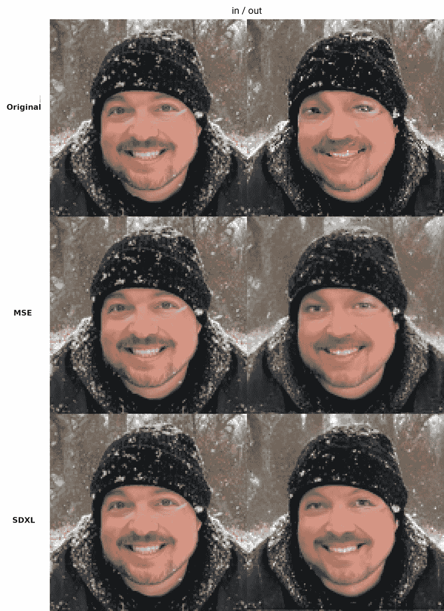

## SlotLifter

贡献人：

`https://slotlifter.github.io/`

`SlotLifter` 是一种新颖的对象中心辐射模型，解决场景重建和分解的挑战。它通过插槽引导特征提升的方法，将对象中心学习表示与基于图像的渲染方法结合起来。`SlotLifter` 在四个具有挑战性的合成数据集和四个复杂的真实世界数据集上，展示了在场景分解和新视角合成方面的先进性能，显著超越了现有的 3D 对象中心学习方法。

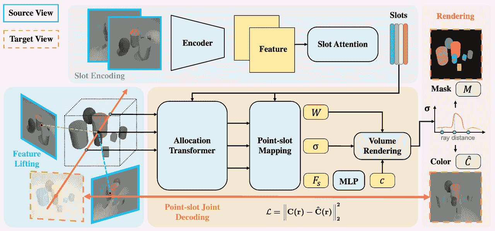

# 投融资

## 李飞飞创立的AI初创公司World Labs获1亿美元融资，估值超10亿美元

`https://techcrunch.com/2024/08/14/nea-led-a-100m-round-into-fei-fei-lis-new-ai-startup-now-valued-at-over-1b/`

著名斯坦福大学`AI`教授李飞飞创立的`World Labs`在成立仅四个月内获得了两轮融资。最新一轮融资由`NEA`领投，金额达1亿美元，使公司估值超过10亿美元。此前的第一轮融资在4月份进行，估值为2亿美元，投资方包括`Andreessen Horowitz`和`Radical Ventures`。`World Labs`致力于开发三维物理建模的`AI`技术，用于游戏和机器人领域。

## EliseAI获7500万美元融资，用于开发房产管理AI工具

`https://techcrunch.com/2024/08/14/eliseais-chatbots-for-property-owners-nets-it-75m-in-funding/`

`EliseAI`公司在`D`轮融资中获得7500万美元，估值达到10亿美元。本轮融资由`Sapphire Ventures`领投，参与方包括`Point72 Private Investments`、`Divco West`等。资金将用于招聘、`AI`研发、产品开发和市场拓展。`EliseAI`计划扩展至医疗领域，并推出了`HealthAI`产品。此轮融资使该公司总筹资额达到1.4亿美元。

公司官网：`https://www.eliseai.com/`

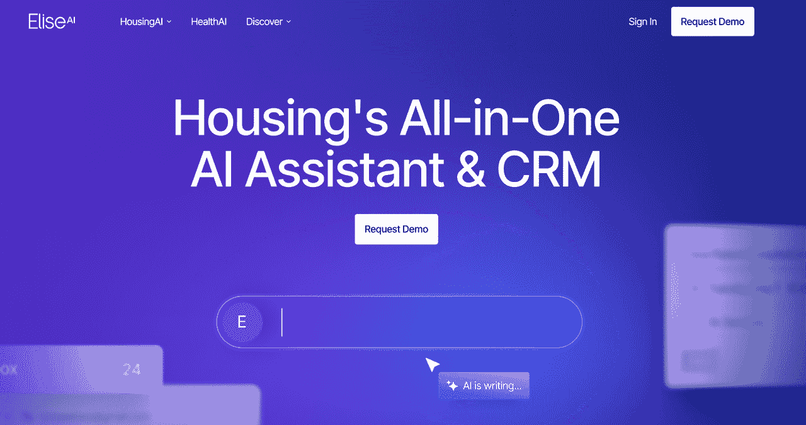

# 学习

## LLM做Sentence Embedding的通用方案

贡献人：

`https://zhuanlan.zhihu.com/p/710746339?utm_psn=1807450427349938176`

文章探讨了利用大型语言模型（`LLM`）进行句子嵌入的通用方案，强调了现有检索模型在主题检索通用性方面的不足。作者提出了直接使用 `LLM` 生成句子嵌入的方法，通过在输入前添加提示（`Prompt`），并以最后一个词的最后一层输出为嵌入表示。文章引用了两篇论文，分别提出了伪装的思维链（`Pretended CoT`）和知识增强（`Knowledge Enhancement`）技术，以及使用元任务（`meta-tasks`）引导模型生成多维表示。实验结果显示，该方法在多数数据集上与无监督微调的自编码模型相当，且具有更高的通用性。模型大小对结果的影响随着模型规模从 `350m` 增加到 `1.3b` 而显著，但在 `13b` 以上时，性能提升减缓。在主题分类实战中，作者使用了科大讯飞的长文本分类数据集，尝试了不同的 `Prompt` 设计，但效果有限。在句对匹配任务中，`LLM` 的初始准确率为 0.74，表现不俗，但仍有改进空间。文章还提供了代码实现，展示了如何使用 `LLM` 生成句子嵌入。

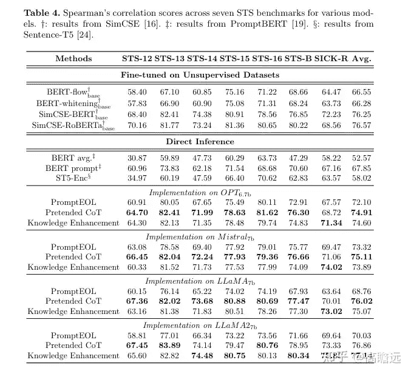

## 透过机器狗狗眼看世界

`https://zhuanlan.zhihu.com/p/714633069?utm_psn=1807448777948274688`

文章主要阐述了通过机器狗视频传输系统实现远程无线遥控的技术实现。首先，介绍了在 `NVIDIA Orin` 主板上配置 `Python` 环境，包括安装 `cyclonedds 0.10.x` 版本和 `unitree_sdk2_python`。然后，详细展示了编写的第一个程序，该程序能够实时从机器狗眼拍摄的视频并上传到云端服务器。接着，探讨了消息队列的技术选择，包括使用 `ZeroMQ` 的 `req/rep` 模式解决动态公网 `IP` 地址问题，并采用了 `imagezmq` 库简化视频传输流程。最后，介绍了第二个和第三个程序，分别运行在云端服务器和其他电脑上，实现了多设备视频流的实时接收和传输。

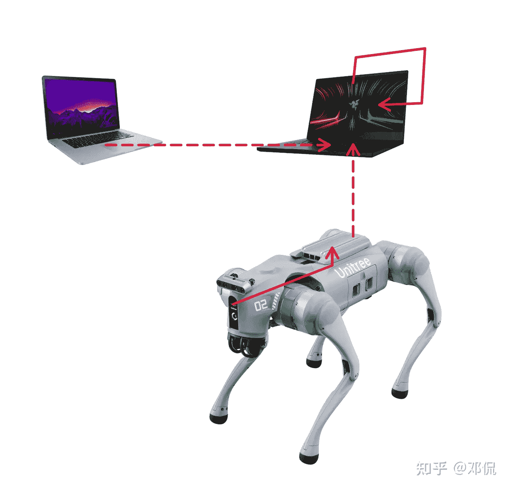

## 强哥的Chisel基础课（上）

`https://zhuanlan.zhihu.com/p/714627332?utm_psn=1807449210456530945`

强哥的 `Chisel` 基础课（上）详细阐述了 `Chisel` 硬件描述语言的核心概念和技术细节。文章首先介绍了 `Chisel` 的基础元素，如变量、常量、数据类型，并深入讲解了常量的定义方法，包括位宽和类型的指定。接着，文章重点介绍了 `Wire`、`Reg` 和 `IO` 的使用，这些是构建硬件电路的基础，并分别对应 `Verilog` 中的 `wire`、`reg` 和端口。文章还涵盖了信号连接的多种方式，例如使用 `Cat` 进行拼接、`Mux` 进行选择、`when`和`switch`进行条件分支，以及如何通过`printf`进行调试。此外，文章还探讨了模块的创建与调用，包括参数化设计、时钟和复位处理，以及如何通过测试确保电路逻辑的正确性。

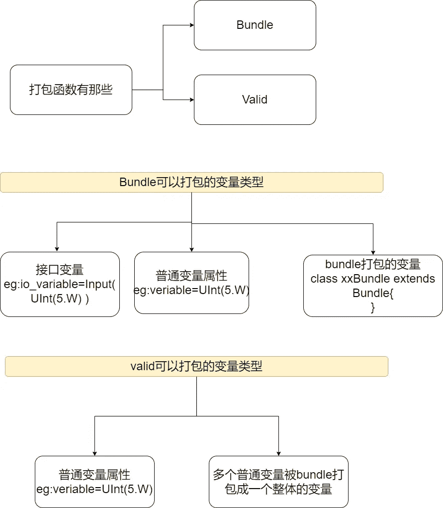

## FlashAttention fp8实现（ada架构）

`https://zhuanlan.zhihu.com/p/712314257`

`FlashAttention` 算法在 `FP8` 精度下的实现，通过精确控制数据类型和内存访问模式，大幅度降低了内存占用和计算资源需求。该算法优化了自注意力机制的计算流程，通过减少冗余计算和内存读写次数，提升了计算效率。在 `ada` 架构上的应用中，`FlashAttention` 利用了 `FP8` 精度的优势，进一步压缩了模型参数，提高了模型在不同硬件平台上的运行速度和适应性。技术细节上，算法通过精心设计的量化策略和矩阵乘法优化，确保了在低精度下的模型性能不受影响，同时通过动态精度切换，适应了不同任务的精确度要求。

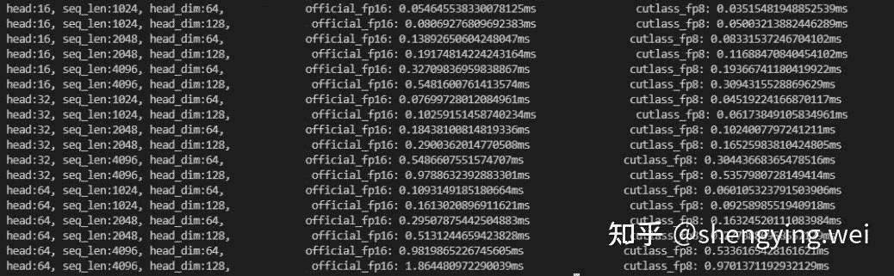

## 开源模型 Function Call 方案梳理

`https://zhuanlan.zhihu.com/p/713937194?utm_psn=1807335090205884419`

文章主要探讨了开源模型 `Function Call` 的实现方案，详细介绍了 `Llama 3.1`、`Mistral Large 2`、`glm-4-9b-chat` 和 `Qwen 2` 模型在工具调用方面的技术细节。`Llama 3.1` 采用特殊 `tokens` 辅助对话和工具调用，包括`<|begin_of_text|>`、`<|end_of_text|>`等，并支持四种角色（`system`、`assistant`、`user`、`ipython`），其中 `ipython` 角色用于标记工具调用结果。该模型通过 `SFT` 和 `DPO` 训练增强了工具调用能力，其中 `SFT` 训练集包含约 21.9% 的推理和工具使用数据。`Mistral Large 2` 通过`<|begin_of_text|>`、`<|end_of_text|>`等 tokens 处理 `function call`，而 `glm-4-9b-chat` 模型则使用`<|observation|>`标记工具执行结果。`Qwen 2` 模型则通过 `Qwen-Agent` 实现 `function calling`，该模型的 chat template 中没有 tool 相关的 tokens，但可以通过 system prompt 中的工具信息生成工具调用命令。文章还讨论了如何构造 single-step 和 multi-step tool use 数据集，以及如何通过 `DPO` 训练来提升模型性能。

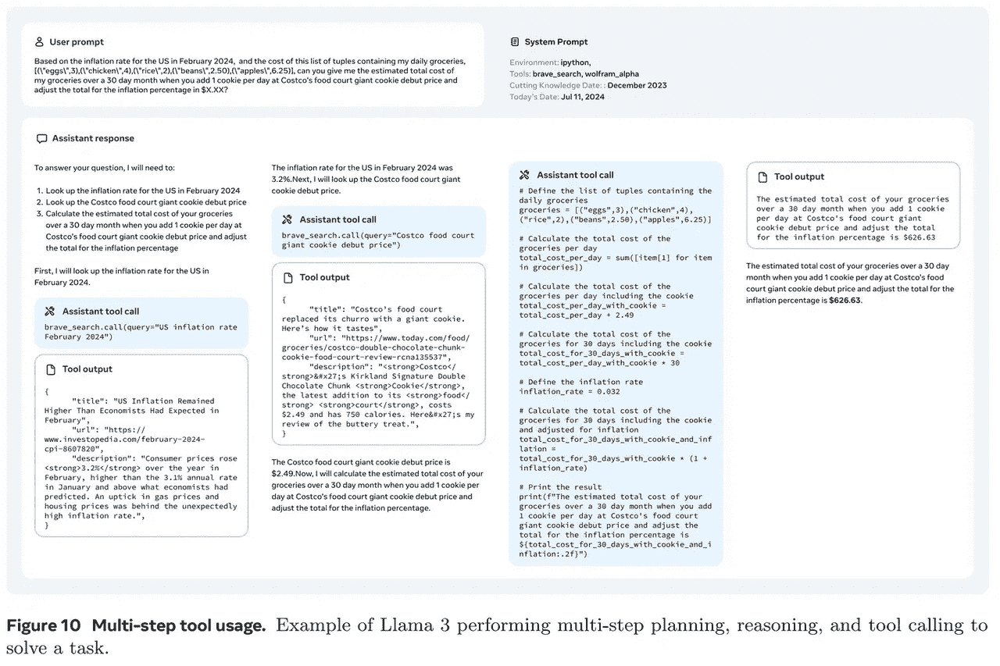

## Megatron-LM训练的大模型如何分组？

`https://zhuanlan.zhihu.com/p/695581654?utm_psn=1807446674806804480`

`Megatron-LM` 大模型训练采用模型并行、数据并行和流水线并行三种并行策略，以处理大规模数据和模型。模型并行通过将模型的层或参数分布到多个 `GPU` 上，减少每个 `GPU` 的内存需求，使得可以处理的模型规模超出单个 `GPU` 的限制。数据并行则是通过在多个 `GPU` 上复制模型，并将数据集划分为小批量，每个 `GPU` 独立处理不同的小批量，从而提高训练速度。流水线并行结合了前两种方法的优势，将模型分为几个阶段，每个阶段在不同的 `GPU` 上并行执行，同时保持数据的连续性，提高了训练的效率和速度。此外，`Megatron-LM` 还支持自动混合精度（`Automatic Mixed Precision, AMP`）训练，通过在训练过程中同时使用 `FP16` 和 `FP32` 两种精度，减少了内存使用和计算时间，同时保持了数值精度。

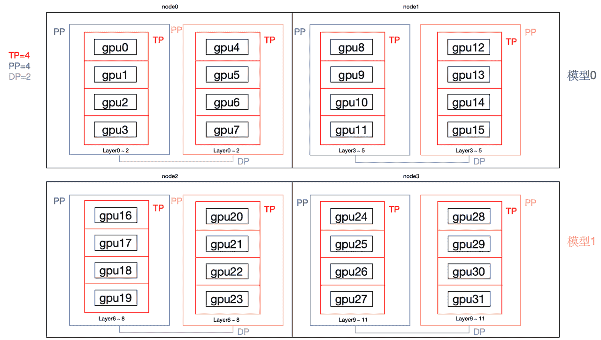

## 模型大一统！统一PGMs, Kernel SVMs, MLP与KAN调和多项式网络

`https://zhuanlan.zhihu.com/p/714333976?utm_psn=1807340060548411394`

`RPN`（`Reconciled Polynomial Network`）是一种新型深度学习模型，旨在统一多种机器学习模型，如 `PGMs`、`Kernel SVMs`、`MLP` 和 `KAN`。它基于泰勒展开定理，通过数据扩展和参数调和函数的内积，以及剩余函数，来逼近底层函数，有效处理 “维度灾难” 问题，提高模型准确性。`RPN` 的架构通用，适用于连续函数拟合、离散数据分类、概率关系推理等任务。通过特定的组件函数选择，`RPN` 能够将多种模型统一到一个标准表示中，实现模型的跨模态泛化和高效的分类。文章还提供了一个名为 `TINYBIG` 的工具包，用于实现和实验 `RPN` 模型，并讨论了 `RPN` 的多层架构、多头和多通道结构，以及嵌套和扩展扩展函数的应用，这些技术细节体现了 `RPN` 在灵活性和适应性方面的优势。此外，作者从生物神经科学的角度探讨了 `RPN` 模型，指出 `RPN` 与大脑的层次化结构和信息处理机制相似，为模型设计提供了新的视角。

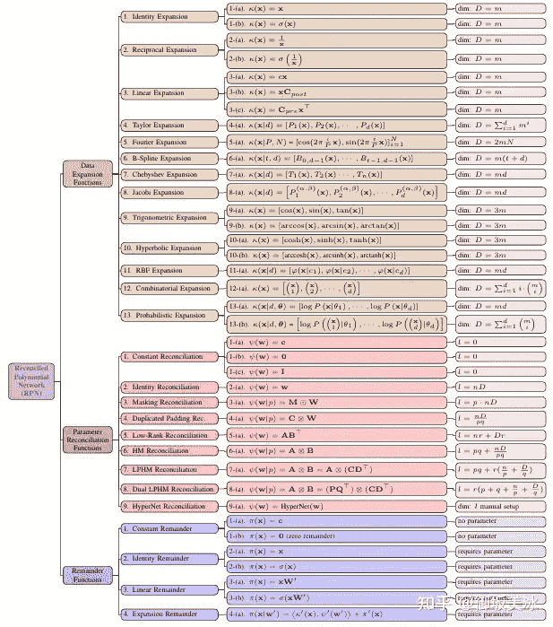

## 具身智能赛道，如何评价一家好的机器人创业公司？

`https://zhuanlan.zhihu.com/p/707555371?utm_psn=1807330237832376322`

在具身智能赛道上，评价一家好的机器人创业公司需关注其技术实力和创新能力。首先，团队成员应具备机器人技术、人工智能、机械设计等领域的专业知识和丰富经验。其次，公司的技术创新应能够解决实际问题，如通过算法优化提高机器人的运动精度和智能化水平。此外，技术应用的广泛性和深度也是评价的关键，例如在传感器融合、机器视觉、自然语言处理等方面的突破。商业模式的成熟度体现在其能否将技术创新转化为市场上具有竞争力的产品和服务，并实现商业化。最终，公司的技术实力和市场表现将直接影响其在具身智能领域的领导地位和长远发展前景。

# 声明

本文档仅供学习交流使用，版权归原作者所有，若涉侵权，请联系`Jack Jin 15101136166`

（欢迎在下方反馈您宝贵的意见！整理不易，觉得有用给`AI`日报小组点个赞👍吧！）

`ChatGPT`；`Angela`；`Zijia Liu`；`Alex`；`Zeqi Tan`；`Tiezhen`（`HuggingFace`）；`Naixu`；`Lizhi`；`Peter`；`Suoman`；`Jack`

封面生成——右脑科技

如果你有大模型相关的创业想法，欢迎来找我们聊聊～🛰️：`15101136166`

> 快邀请你的小伙伴们一起来读大模型日报吧！

> 【日报知识库】这里是近期日报内容的汇总,欢迎大家查阅

> [大模型日报知识库(分享版)](https://miracleplus.feishu.cn/wiki/KapVwXfkriOBiskB0B2cUHxjnTh)

>

> 欢迎大家多多帮我们分享,转发~~

> 如果大家有任何的建议或者吐槽,欢迎随时找我聊天～

