# 奇绩大模型日报（8月 16日）

> 来源：[https://miracleplus.feishu.cn/docx/R24SdjGWjojISCxY88rce9gAnTt](https://miracleplus.feishu.cn/docx/R24SdjGWjojISCxY88rce9gAnTt)

# 📡潜空间活动报名

> 潜空间系列活动第三季第三期开启报名！

> 本期活动将在**8月24日** **10:00 am**开始，嘉宾是**童晟邦**。**童晟邦，纽约大学博士，伯克利人**工智能实验室（BAIR）研究员， OpenAI 超对齐奖学金获得者。他将和大家探讨视觉在多模态大模型中扮演的角色。

> 除嘉宾分享外，每期设置了【匹配合伙人 Cofounder Matching】环节。你可以和 GenAI 时代最有活力的创业者和研究者线下面对面交流，将有机会找到志同道合、有共同创业梦想的小伙伴。

> 报名通道已开启，欢迎扫描下方二维码报名。

# 资讯

### 2024年未来科学大奖

贡献人：

https://mp.weixin.qq.com/s/tdB--t3Dg4aC4TQCHO739Q

[北京时间 8](https://mp.weixin.qq.com/s?search_click_id=7145948866317296875-1723789481836-5942024247&__biz=Mzg5MTc2NTkxOA==&mid=2247507665&idx=1&sn=201518eff4db052499f1ad77879ea5fb&chksm=ce4f54b1cde2d8aa42631189b34e9f2d0efc230b7d9247c9aa736cc98e5f495a19ef28a63487&key=daf9bdc5abc4e8d0a8a14cdd1c3b181bd9db5124e0818e40f3379c367a4339999c316b7c40c88bc0d0cb59e1582c9b6f9aaa94246fc446fee2577c32b6084d19aa9b7fa17ae6b86763d2562b16f8703f0071161a7badecbedd32054f2e829288f537a0fac39cc09394595930ca0fb4f4abb4582ac07a00312c2195ecf4a6bf1a&ascene=0&uin=MTQ3MzY4Mzk1&devicetype=Windows+11+x64&version=63090b19&lang=zh_CN&exportkey=n_ChQIAhIQvmNGNR3IRfOyw11pVDAHGBLlAQIE97dBBAEAAAAAAMqXL403p🐧AAAAOpnltbLcz9gKNyK89dVj0weZm5VX83NBLXuTLViSXhFJeSfiQR%2BUhBBYx7EAGXTINOyKeXRebL8avYx3QBBTa9fWeo8cfHNBYutO7R%2FkSa7VCPKOWcMwW3AHqBU94vYfirCj0dY5tZLTG4ZffxCbQAnPNSlYORbBaGeCzyuMKs20I27GdtAXYorT1oVKk1hSWKniQpvR1LPTZwLDhWrWJGm6jeDv9C0ZjShFVmC7n%2FqiGpXG6ytLjGmrrATi7pmfqyXPlU7fRjyaOwVOqPVs%3D&acctmode=0&pass_ticket=6zXmC1qMI67SeYmtV8fLWWb4ShO2tVhYHe23KRegIhPLMfOKpSs%2FSbviSTAMFaPg&wx_header=1&fasttmpl_type=0&fasttmpl_fullversion=7340264-zh_CN-zip&fasttmpl_flag=1)[ 月 ](https://mp.weixin.qq.com/s?search_click_id=7145948866317296875-1723789481836-5942024247&__biz=Mzg5MTc2NTkxOA==&mid=2247507665&idx=1&sn=201518eff4db052499f1ad77879ea5fb&chksm=ce4f54b1cde2d8aa42631189b34e9f2d0efc230b7d9247c9aa736cc98e5f495a19ef28a63487&key=daf9bdc5abc4e8d0a8a14cdd1c3b181bd9db5124e0818e40f3379c367a4339999c316b7c40c88bc0d0cb59e1582c9b6f9aaa94246fc446fee2577c32b6084d19aa9b7fa17ae6b86763d2562b16f8703f0071161a7badecbedd32054f2e829288f537a0fac39cc09394595930ca0fb4f4abb4582ac07a00312c2195ecf4a6bf1a&ascene=0&uin=MTQ3MzY4Mzk1&devicetype=Windows+11+x64&version=63090b19&lang=zh_CN&exportkey=n_ChQIAhIQvmNGNR3IRfOyw11pVDAHGBLlAQIE97dBBAEAAAAAAMqXL403p🐧AAAAOpnltbLcz9gKNyK89dVj0weZm5VX83NBLXuTLViSXhFJeSfiQR%2BUhBBYx7EAGXTINOyKeXRebL8avYx3QBBTa9fWeo8cfHNBYutO7R%2FkSa7VCPKOWcMwW3AHqBU94vYfirCj0dY5tZLTG4ZffxCbQAnPNSlYORbBaGeCzyuMKs20I27GdtAXYorT1oVKk1hSWKniQpvR1LPTZwLDhWrWJGm6jeDv9C0ZjShFVmC7n%2FqiGpXG6ytLjGmrrATi7pmfqyXPlU7fRjyaOwVOqPVs%3D&acctmode=0&pass_ticket=6zXmC1qMI67SeYmtV8fLWWb4ShO2tVhYHe23KRegIhPLMfOKpSs%2FSbviSTAMFaPg&wx_header=1&fasttmpl_type=0&fasttmpl_fullversion=7340264-zh_CN-zip&fasttmpl_flag=1)16 日，2024 年未来科学大奖生命科学奖、物质科学奖[、数](https://mp.weixin.qq.com/s?search_click_id=7145948866317296875-1723789481836-5942024247&__biz=Mzg5MTc2NTkxOA==&mid=2247507665&idx=1&sn=201518eff4db052499f1ad77879ea5fb&chksm=ce4f54b1cde2d8aa42631189b34e9f2d0efc230b7d9247c9aa736cc98e5f495a19ef28a63487&key=daf9bdc5abc4e8d0a8a14cdd1c3b181bd9db5124e0818e40f3379c367a4339999c316b7c40c88bc0d0cb59e1582c9b6f9aaa94246fc446fee2577c32b6084d19aa9b7fa17ae6b86763d2562b16f8703f0071161a7badecbedd32054f2e829288f537a0fac39cc09394595930ca0fb4f4abb4582ac07a00312c2195ecf4a6bf1a&ascene=0&uin=MTQ3MzY4Mzk1&devicetype=Windows+11+x64&version=63090b19&lang=zh_CN&exportkey=n_ChQIAhIQvmNGNR3IRfOyw11pVDAHGBLlAQIE97dBBAEAAAAAAMqXL403p🐧AAAAOpnltbLcz9gKNyK89dVj0weZm5VX83NBLXuTLViSXhFJeSfiQR%2BUhBBYx7EAGXTINOyKeXRebL8avYx3QBBTa9fWeo8cfHNBYutO7R%2FkSa7VCPKOWcMwW3AHqBU94vYfirCj0dY5tZLTG4ZffxCbQAnPNSlYORbBaGeCzyuMKs20I27GdtAXYorT1oVKk1hSWKniQpvR1LPTZwLDhWrWJGm6jeDv9C0ZjShFVmC7n%2FqiGpXG6ytLjGmrrATi7pmfqyXPlU7fRjyaOwVOqPVs%3D&acctmode=0&pass_ticket=6zXmC1qMI67SeYmtV8fLWWb4ShO2tVhYHe23KRegIhPLMfOKpSs%2FSbviSTAMFaPg&wx_header=1&fasttmpl_type=0&fasttmpl_fullversion=7340264-zh_CN-zip&fasttmpl_flag=1)学[与计算](https://mp.weixin.qq.com/s?search_click_id=7145948866317296875-1723789481836-5942024247&__biz=Mzg5MTc2NTkxOA==&mid=2247507665&idx=1&sn=201518eff4db052499f1ad77879ea5fb&chksm=ce4f54b1cde2d8aa42631189b34e9f2d0efc230b7d9247c9aa736cc98e5f495a19ef28a63487&key=daf9bdc5abc4e8d0a8a14cdd1c3b181bd9db5124e0818e40f3379c367a4339999c316b7c40c88bc0d0cb59e1582c9b6f9aaa94246fc446fee2577c32b6084d19aa9b7fa17ae6b86763d2562b16f8703f0071161a7badecbedd32054f2e829288f537a0fac39cc09394595930ca0fb4f4abb4582ac07a00312c2195ecf4a6bf1a&ascene=0&uin=MTQ3MzY4Mzk1&devicetype=Windows+11+x64&version=63090b19&lang=zh_CN&exportkey=n_ChQIAhIQvmNGNR3IRfOyw11pVDAHGBLlAQIE97dBBAEAAAAAAMqXL403p🐧AAAAOpnltbLcz9gKNyK89dVj0weZm5VX83NBLXuTLViSXhFJeSfiQR%2BUhBBYx7EAGXTINOyKeXRebL8avYx3QBBTa9fWeo8cfHNBYutO7R%2FkSa7VCPKOWcMwW3AHqBU94vYfirCj0dY5tZLTG4ZffxCbQAnPNSlYORbBaGeCzyuMKs20I27GdtAXYorT1oVKk1hSWKniQpvR1LPTZwLDhWrWJGm6jeDv9C0ZjShFVmC7n%2FqiGpXG6ytLjGmrrATi7pmfqyXPlU7fRjyaOwVOqPVs%3D&acctmode=0&pass_ticket=6zXmC1qMI67SeYmtV8fLWWb4ShO2tVhYHe23KRegIhPLMfOKpSs%2FSbviSTAMFaPg&wx_header=1&fasttmpl_type=0&fasttmpl_fullversion=7340264-zh_CN-zip&fasttmpl_flag=1)[机科学](https://mp.weixin.qq.com/s?search_click_id=7145948866317296875-1723789481836-5942024247&__biz=Mzg5MTc2NTkxOA==&mid=2247507665&idx=1&sn=201518eff4db052499f1ad77879ea5fb&chksm=ce4f54b1cde2d8aa42631189b34e9f2d0efc230b7d9247c9aa736cc98e5f495a19ef28a63487&key=daf9bdc5abc4e8d0a8a14cdd1c3b181bd9db5124e0818e40f3379c367a4339999c316b7c40c88bc0d0cb59e1582c9b6f9aaa94246fc446fee2577c32b6084d19aa9b7fa17ae6b86763d2562b16f8703f0071161a7badecbedd32054f2e829288f537a0fac39cc09394595930ca0fb4f4abb4582ac07a00312c2195ecf4a6bf1a&ascene=0&uin=MTQ3MzY4Mzk1&devicetype=Windows+11+x64&version=63090b19&lang=zh_CN&exportkey=n_ChQIAhIQvmNGNR3IRfOyw11pVDAHGBLlAQIE97dBBAEAAAAAAMqXL403p🐧AAAAOpnltbLcz9gKNyK89dVj0weZm5VX83NBLXuTLViSXhFJeSfiQR%2BUhBBYx7EAGXTINOyKeXRebL8avYx3QBBTa9fWeo8cfHNBYutO7R%2FkSa7VCPKOWcMwW3AHqBU94vYfirCj0dY5tZLTG4ZffxCbQAnPNSlYORbBaGeCzyuMKs20I27GdtAXYorT1oVKk1hSWKniQpvR1LPTZwLDhWrWJGm6jeDv9C0ZjShFVmC7n%2FqiGpXG6ytLjGmrrATi7pmfqyXPlU7fRjyaOwVOqPVs%3D&acctmode=0&pass_ticket=6zXmC1qMI67SeYmtV8fLWWb4ShO2tVhYHe23KRegIhPLMfOKpSs%2FSbviSTAMFaPg&wx_header=1&fasttmpl_type=0&fasttmpl_fullversion=7340264-zh_CN-zip&fasttmpl_flag=1)奖三大奖项获奖名单正式揭晓。邓宏魁因开创了利用化学方法将体细胞重编程为多能干细胞，改变细胞命运和状态方面的杰出工作获得生命科学奖；张涛、李亚栋因对“单原子催化”的发展和应用作出了开创性贡献获得物质科学奖；孙斌勇因在李群表示论上作出了杰出贡献获得数学与计算机科学奖。

### 知网状告AI搜索：搜到我家论文题目和摘要，你侵权了！

https://mp.weixin.qq.com/s/QeV4pwTS871b25mfr49OSQ

知网对秘塔 AI 搜索提出侵权指控，认为其未经授权收录和展示知网的学术文献题录及摘要。秘塔 AI 搜索认为文献摘要和题录应具有独立性，并强调知识的价值在于流动。为避免法律纠纷，秘塔决定不再收录知网文献数据，并转向其他知识库合作。网友普遍认为 AI 搜索仅提供入口，不构成侵权。此事引发学术资料版权保护的广泛讨论。

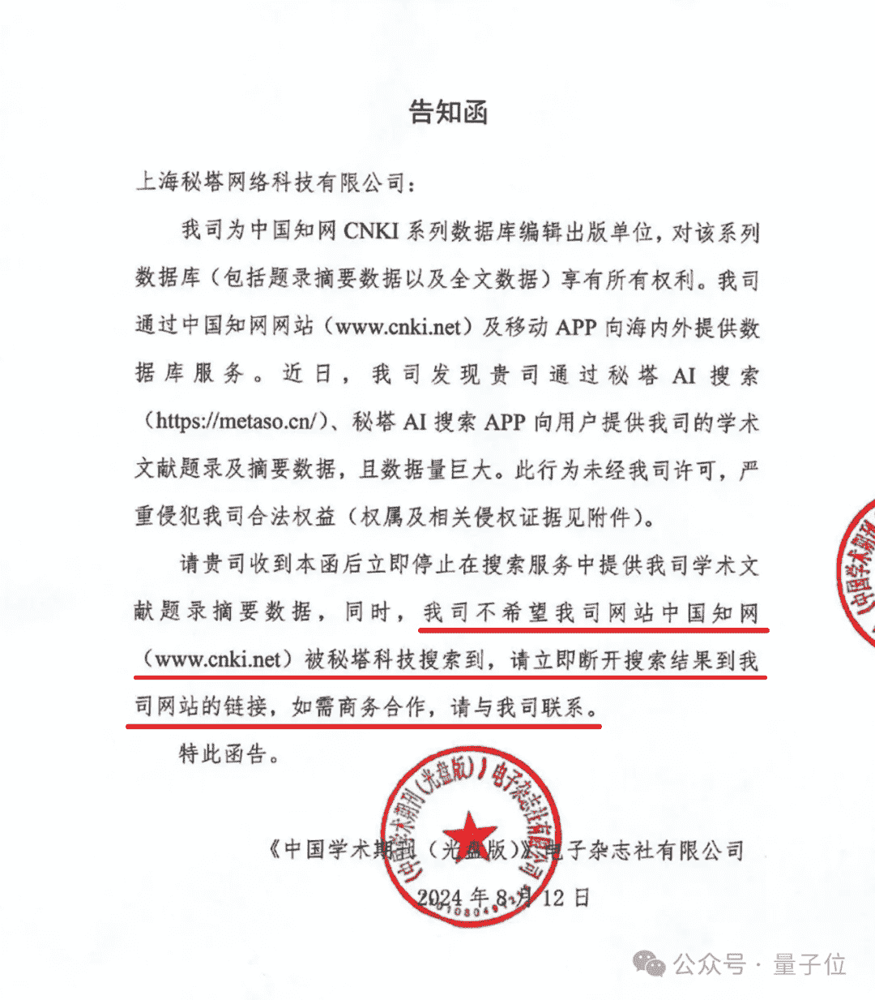

### “在线版FLUX”已支持ControlNet，开箱即用，在线训练LoRA模块

https://mp.weixin.qq.com/s/-zvtyCBERMQa0IxT8OpBAA

“在线版 FLUX” 最新支持了 ControlNet 和 LoRA 功能，实现了开箱即用，无需用户自行配置。用户可以在 fal.ai 平台上直接使用这些高级功能，甚至还能在线训练并分享自己的 LoRA 模型。本文通过实例展示了如何利用 ControlNet 进行精细的图像控制，以及如何通过 LoRA 模块实现不同风格的图像转换。尽管 fal.ai 提供的服务是收费的，但 FLUX 模型本身是免费开源的，可以自行部署。

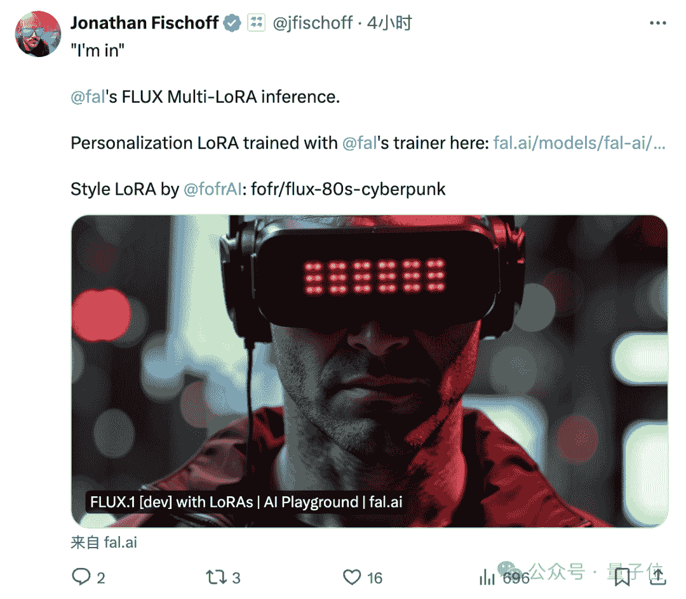

### Tavus团队打造1秒内延迟体验，获红杉与YC力挺

https://mp.weixin.qq.com/s/9Gfb-2efkKsjryNsmnMDUQ

Tavus公司推出了一个先进的对话视频 AI，能够实现几乎无延迟（<1 秒）的视频通话。该 AI 具备听、看、说、有形象的能力，可在网页端体验。基于自研的Phoenix-2模型，该技术结合了 3D 模型和 2D GANs，创造出高保真的视频内容，并且在数据处理、内存使用、计算复杂度等方面优于前代技术。Tavus的 AI 支持多种语言，但目前试用版本中无法使用中文。该公司获得了红杉 YC 等知名机构的投资

### 大神Karpathy给大模型「SQL注入」攻击

https://mp.weixin.qq.com/s/d460H-Z8SLUqp5PZZKVpMA

大神 Andrej Karpathy 揭示了大模型在处理特殊 token 时可能遭受类 SQL 注入攻击的安全漏洞。他建议在 tokenizing 时禁用自动添加特殊 token，并通过代码显式添加，以确保 LLM 的安全性。Karpathy 认为，大约一半的现有代码可能存在此类问题，甚至包括经过严格测试的 ChatGPT。他提倡遵循「最小特权」原则，仅在必要时添加特殊 token，以降低潜在风险。

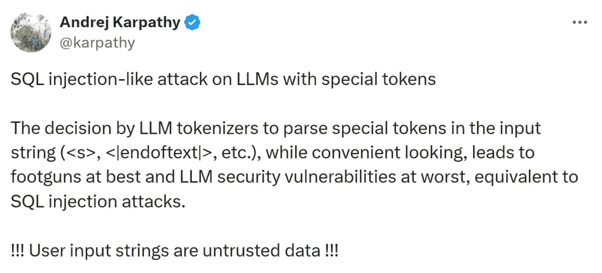

### 第四范式上半年营收同比增长27%，核心业务收入增长65.4%

https://mp.weixin.qq.com/s/1m0Rs0cKxjYxAhziPo4MyQ

第四范式上半年财报显示，总营收同比增长 27.1%，达到 18.67 亿元，其中核心业务 “先知 AI 平台” 收入同比增长 65.4%，占比 67.0%。公司强化研发投入，费用率达到 45.5%，经调净亏损额同比收窄 4.0%。在客户多元化和行业领导地位巩固方面，第四范式覆盖 14 大行业，总用户数 185 个，标杆用户数 86 个，平均收入同比增长 26.9%。

通过 “先知 Inside” 模式，公司推出超 30 款 AI 产品，涵盖大模型语音合成、物理仿真等多领域，在企业中实现多场景应用。行业大模型已在 14 大行业落地，包括交通运输、金融等

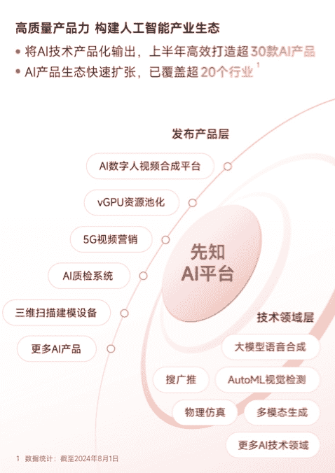

### 鄂维南院士：数学与人工智能

https://mp.weixin.qq.com/s/s7okAqfDqixMdjbpp43Z8g

鄂维南院士在《数学与人工智能》报告中指出，数学与人工智能深度融合，推动了人工智能的快速发展。从早期数学家的研究到当前人工智能在各领域的应用，如 AlphaGo、Alpha Geometry 和 AlphaFold2，都体现了数学在人工智能中的核心作用。然而，目前人工智能技术路线，特别是 OpenAI 等公司的大规模投资模式，并不适合中国，因为这需要巨大的算力和资源支持，而中国在人才培养、算力资源对接以及底层创新体系建设方面存在挑战。鄂维南院士强调，中国应从基本原理出发，探索人工智能的底层逻辑，建立完整的人工智能底层创新体系，并从整个计算产业的角度规划人工智能战略，实现人力资源和算力资源的有效对接，以确保人工智能的持续进步和长期发展

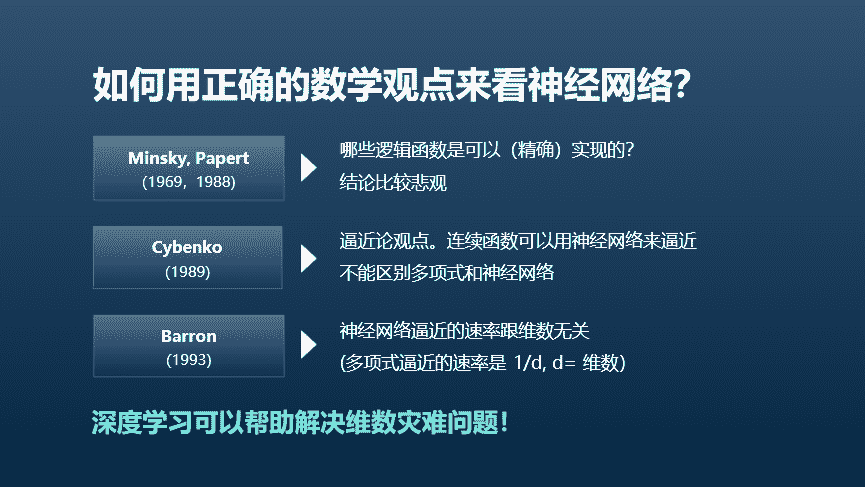

### 核心Python开发者被停职3个月！执行工作组透明度遭质疑

https://mp.weixin.qq.com/s/RP9sGUfQMi-uzXagkufEag

Python 核心开发者 Tim Peters 因违反《行为准则》被停职三个月，引发对 Python 软件基金会执行工作组透明度和《行为准则》执行方式的质疑。这些行为包括发布情绪化帖子、辩护有争议概念、使用冒犯性语言等，被认为损害了社区和谐与包容性。Tim Peters 对治理过程中的保密性提出异议，认为执行过程缺乏透明度。Python 社区内部对于是否应该将 “Python 老前辈” 视为极端保守主义的恶棍存在分歧。一些开发者担心《行为准则》的执行可能对职业生涯产生毁灭性影响，而 Python 软件基金会的成员认为责任在于个人行为。学术研究指出，《行为准则》在管理开源软件项目中虽有积极作用，但也面临挑战，需要在惩罚潜在的冒犯性言论与鼓励包容性参与之间找到平衡。

# 推特

### Midjourney新网页编辑器：将之前许多单独的图像操作合并到一个统一的界面中

https://x.com/midjourney/status/1824247046045569516

我们今天将发布一个新的网页编辑器。这将之前许多单独的图像操作合并到一个统一的界面中。更多内容即将推出。

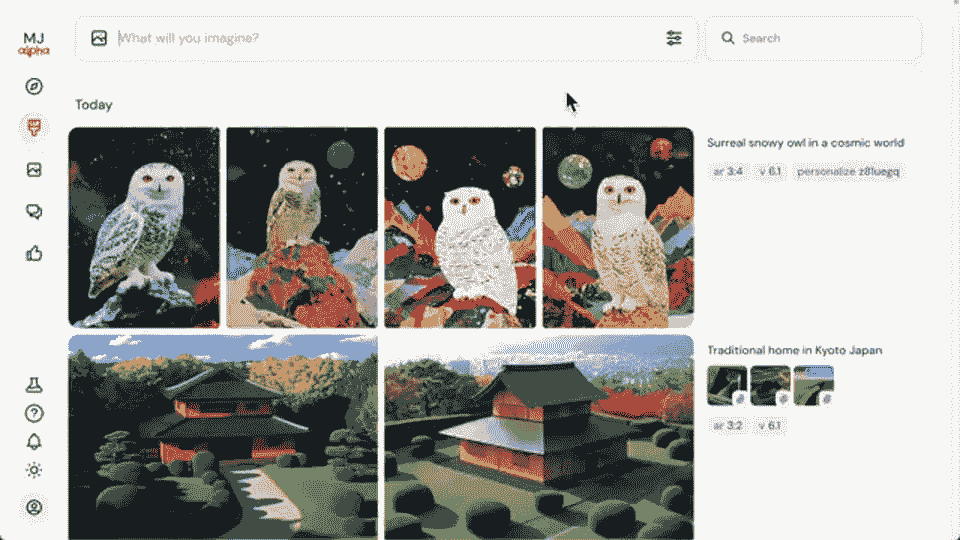

[ssstwitter.com_1723791649526.mp4](https://internal-api-drive-stream.feishu.cn/space/api/box/stream/download/all/GwN3buwv2odrxJxwxsycrmyYnic)

### 使用结构化权重修剪和知识蒸馏精炼Llama3.1 8B为Llama-3.1-Minitron 4B

https://x.com/AIatMeta/status/1824133790224224291

使用结构化权重修剪和知识蒸馏，@NVIDIAAI 研究团队将 Llama 3.1 8B 精炼为新的 Llama-3.1-Minitron 4B。

他们将在 @huggingface 上发布新模型，并分享了他们是如何做到的深入解析 ➡️ https://go.fb.me/b2h2c8

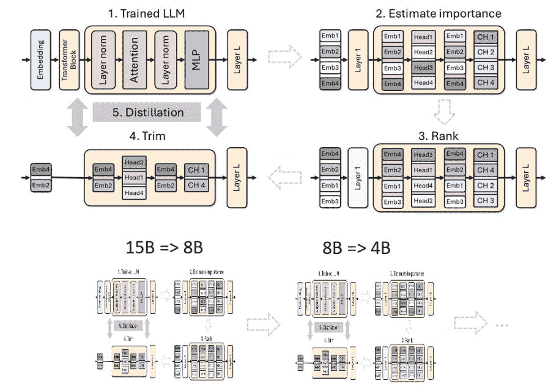

### WH分享关于旋转位置嵌入：理解RoPE是理解最新架构中gpt2视频的下一步

https://x.com/nrehiew_/status/1824080075345830039

关于旋转位置嵌入（RoPE）的一些笔记 :)

如果你通过 @karpathy 的 gpt2 视频学习了Transformers模型，理解 RoPE 将是理解最新架构（例如 Llama 3）的一个好的下一步。

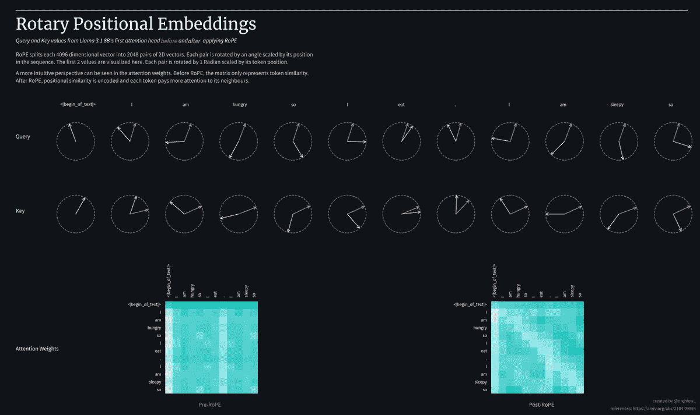

### Bliar开源数字足迹导出器：从 Notion、ChatGPT、Twitter 等平台导出您的数据，并将数据转换为适合大型语言模型（LLM）的格式

https://x.com/JackBlair87/status/1824168218476548488

我们正在开放我们的数字足迹导出器的源代码。

它可以自动从 Notion、ChatGPT、Twitter 等平台导出您的数据，并将数据转换为适合大型语言模型（LLM）的格式。

它类似于 @firecrawl_dev，但用于您的个人数据。

非常适合制作一个（真正有用的）AI助手。

（很快将集成 @ollama 👀）

优点：

1.  一键导出

1.  抓取您的认证数据

1.  完全在设备上操作

1.  数据归您所有

⭐️ 给我们的仓库加星：https://github.com/CEREBRUS-MAXIMUS/Surfer-Data

更多信息：https://surfsup.web.app

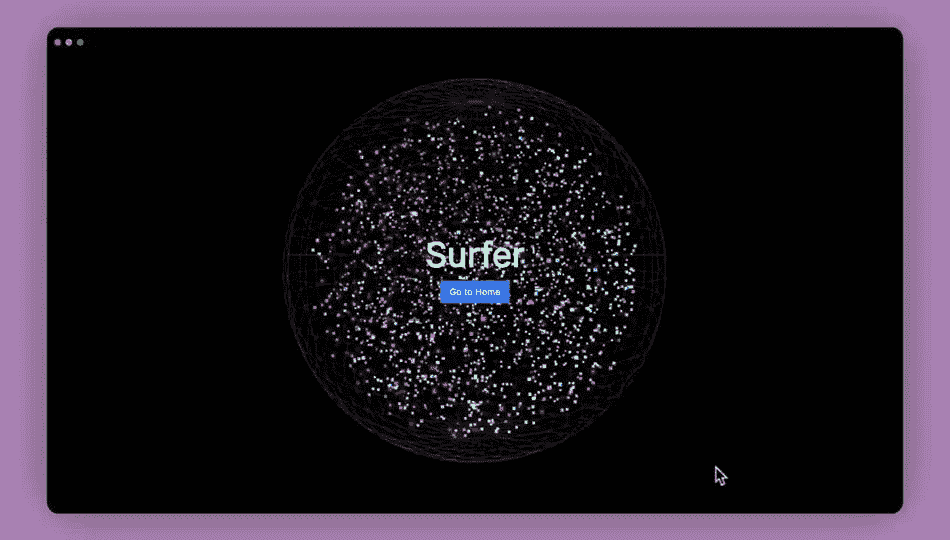

[ssstwitter.com_1723809998272.mp4](https://internal-api-drive-stream.feishu.cn/space/api/box/stream/download/all/OVakbMqwZo1CysxjHOGc5MagnSb)

# 论文

### ScalingFilter：通过反向利用缩放定律评估数据质量

贡献人：

链接：http://arxiv.org/abs/2408.08310v1

高质量数据对于大型语言模型的预训练性能至关重要。不幸的是，现有的质量过滤方法依赖于已知的高质量数据集作为参考，这可能引入潜在偏见并影响多样性。本文提出了ScalingFilter，一种新颖的方法，根据两个在相同数据上训练的语言模型之间的困惑度差异评估文本质量，从而消除了过滤过程中参考数据集的影响。理论分析表明ScalingFilter相当于对缩放定律的逆利用。通过在相同数据源上使用不同质量过滤器处理的数据训练具有13亿参数的模型，我们发现ScalingFilter可以提高预训练模型在下游任务中的零次性能。为了评估质量过滤引入的偏见，我们引入了语义多样性，一种利用文本嵌入模型进行语义表示的度量。大量实验证明语义多样性是数据集多样性的可靠指标，而ScalingFilter在下游性能和语义多样性之间实现了最佳平衡。

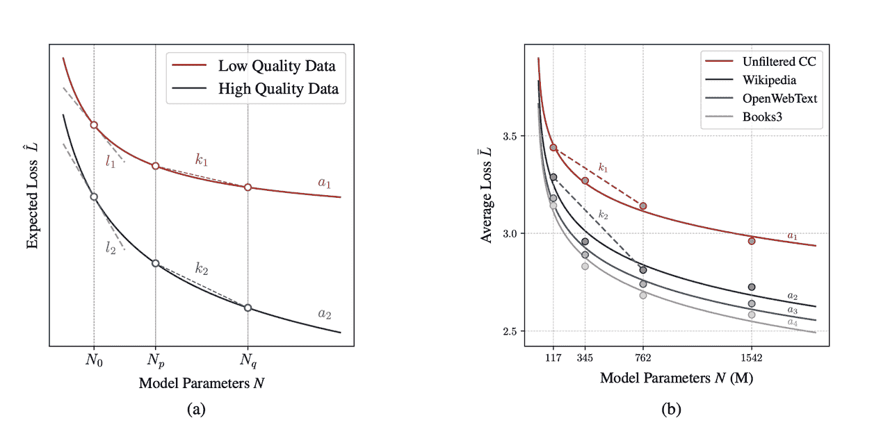

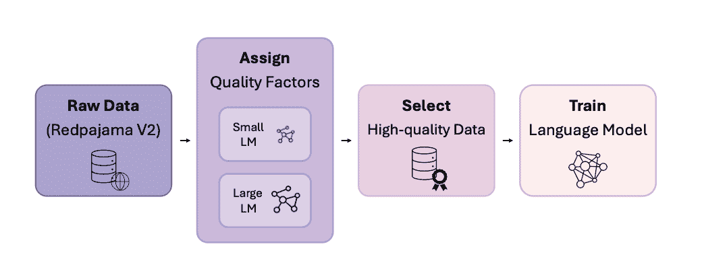

### **DeepSeek-Prover-V1.5：利用**证明助手反馈进行强化学习和蒙特卡洛树搜索

贡献人：

链接：http://arxiv.org/abs/2408.08152v1

我们介绍DeepSeek-Prover-V1.5，这是一个专为Lean 4中定理证明而设计的开源语言模型，通过优化训练和推理过程来增强DeepSeek-Prover-V1。该模型在DeepSeekMath-Base上进行预训练，专门针对正式数学语言，并使用增强的形式定理证明数据集进行监督微调。通过来自证明助手反馈的强化学习（RLPAF）进一步改进模型。除了DeepSeek-Prover-V1的单次全程证明生成方法，我们提出了RMaxTS，这是一种使用内在奖励驱动的探索策略的蒙特卡洛树搜索变体，用于生成多样的证明路径。DeepSeek-Prover-V1.5在高中级miniF2F基准测试集（63.5%）和本科水平ProofNet基准测试集（25.3%）上取得显著改进，实现了新的最先进成果。

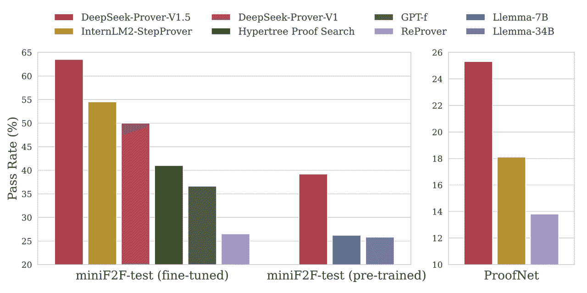

### AgentCourt：用对抗进化律师智能体模拟法庭

贡献人：

链接：http://arxiv.org/abs/2408.08089v1

摘要：本文介绍了一个[名为智能体法庭的模拟系统，模拟了整个法庭过](https://github.com/relic-yuexi/AgentCourt%E3%80%82)[程](https://github.com/relic-yuexi/AgentCourt%E3%80%82)。法官、原告律师、辩护律师等都是由大语言模型（LLMs）驱动的自主智能体。我们的核心目标是让律师智能体通过法庭过程模拟学会如何辩论案件，并提高其整体法律技能。为了实现这一目标，我们提出了一种对抗进化的方法来培养律师智能体。智能体法庭可以基于知识库和LLM模拟法庭听证会的发生和发展，律师智能体可以不断学习和积累经验。模拟实验表明，在智能体法庭中，两个律师智能体参与了一千场对抗性法律案件后（对于现实世界律师来说可能需要十年），与进化前相比，进化的律师智能体在处理法律任务的能力上表现出持续改进。为了提高实验结果的可信度，我们邀请了一组专业律师来评估我们的模拟。评估表明，进化的律师智能体在反应速度、专业知识和逻辑严密性方面取得了显著进步。这项工作为推进LLM驱动的智能体技术在法律情景中的应用铺平了道路。源代码请访问 https://github.com/relic-yuexi/AgentCourt。

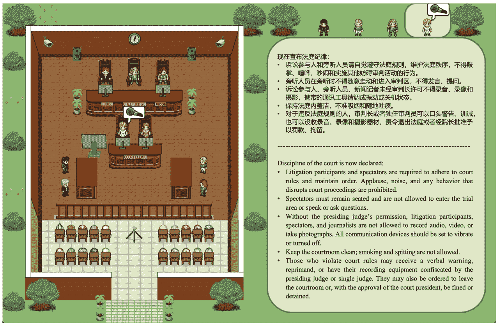

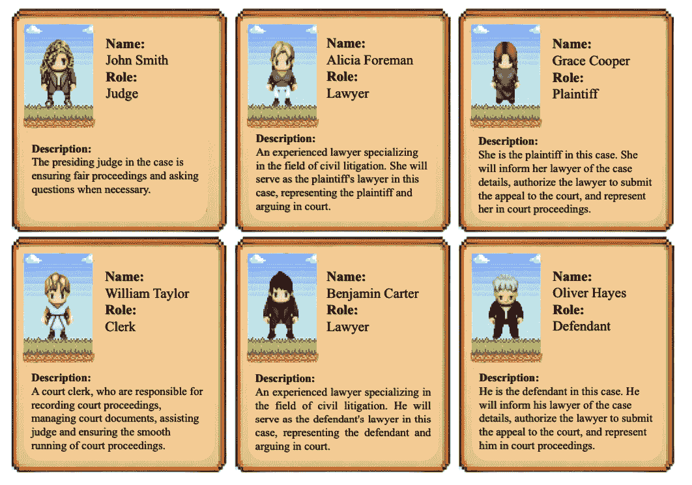

### RAGChecker: 诊断检索增强生成的微调框架

贡献人：

链接：http://arxiv.org/abs/2408.08067v1

尽管检索增强生成（RAG）在利用外部知识方面表现出有希望的能力，但由于RAG的模块化性质、长篇回复的评估以及测量的可靠性，对RAG系统的全面评估仍具有挑战性。在本文中，我们提出了一个细化的评估框架RAGChecker，该框架整合了一套检索和生成模块的诊断性指标。元评估验证了RAGChecker与人类判断具有显著更好的相关性，超过其他评估指标。利用RAGChecker，我们评估了8个RAG系统，并对其性能进行了深入分析，揭示了RAG架构设计选择中的见解性模式和权衡。RAGChecker的指标可以指导研究人员和实践者开发更有效的RAG系统。

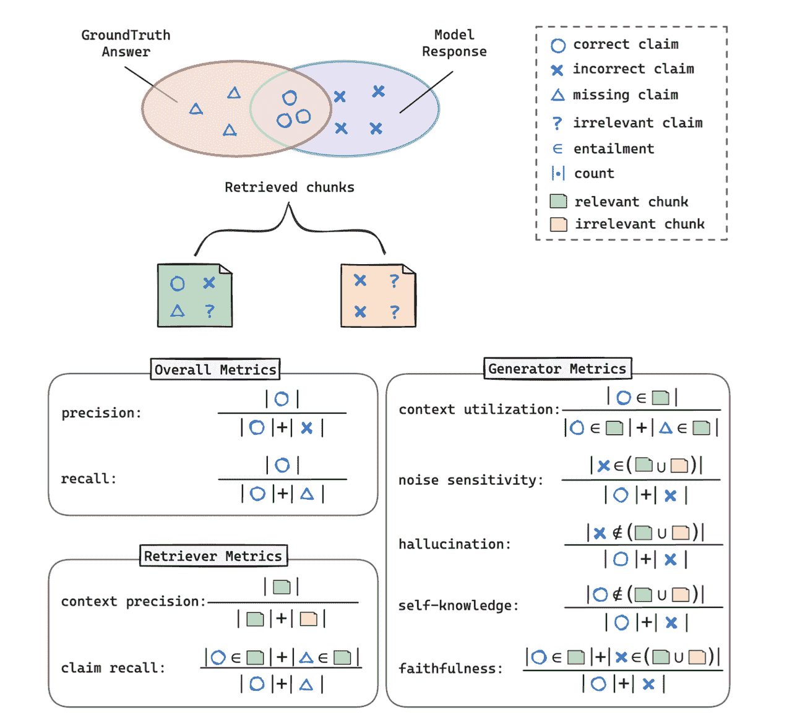

### **利用网络爬虫数据进行高质量微调**

贡献人：

链接：http://arxiv.org/abs/2408.08003v1

大多数大型语言模型使用昂贵的人工注释数据或GPT-4生成数据进行微调，这不能保证在特定领域的性能。我们认为，尽管网络抓取的数据通常存在格式错误导致语义不准确，但它仍然可以作为特定领域高质量监督微调的宝贵来源，而不依赖于像GPT-4这样的先进模型。为此，我们通过将网络抓取的数据与较小的高质量数据集进行对齐，自动创建配对训练数据集。通过在这个数据集上训练语言模型，我们可以将具有不规则格式的网络数据转换为高质量数据。我们的实验表明，用模型转换后的数据训练可以取得更好的结果，在中国数学问题上平均得分超过仅使用高质量数据训练的9.4%。此外，我们的7B模型表现优于几个大于32B的开源模型，并超过了著名的闭源模型，如GPT-3.5，突出了我们方法的有效性。

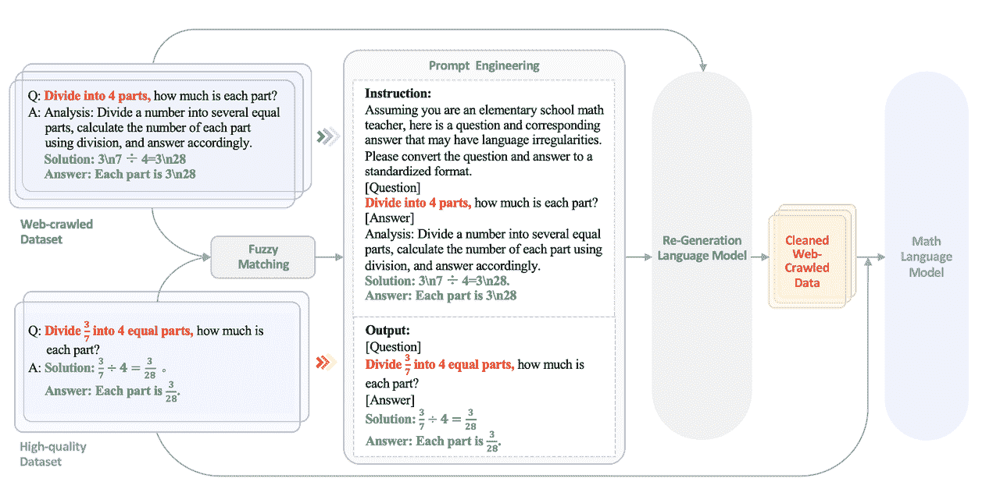

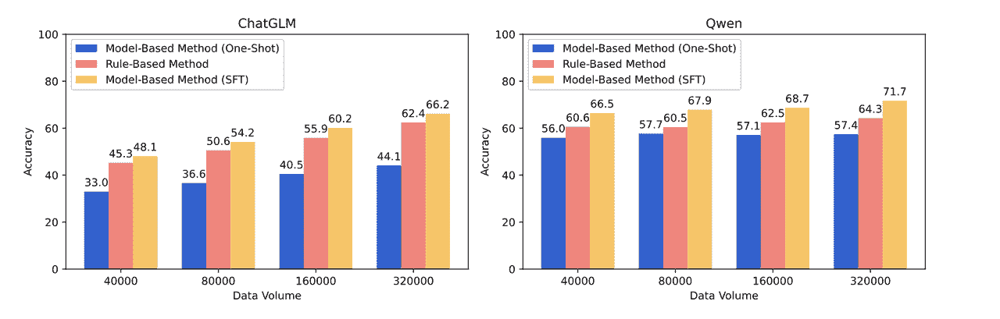

### 大语言模型能理解符号图形程序吗？

贡献人：

链接：http://arxiv.org/abs/2408.08313v1

评估大语言模型（LLMs）的能力通常具有挑战性，部分原因是很难找到它们在训练期间未接触过的任务。我们通过转向一个新任务来解决这一挑战：专注于符号图形程序，这是一种流行的图形内容表示方法，用于过程生成视觉数据。LLMs在程序合成方面表现出令人兴奋的潜力，但它们是否理解符号图形程序？我们通过回答与图形内容相关的问题来描述LLMs对符号程序的理解能力。这项任务具有挑战性，因为仅通过符号程序很难回答问题，但通过人类实验验证，从相应的图形内容中回答这些问题很容易。为了理解符号程序，LLMs可能需要具备在没有直接访问已呈现的视觉内容的情况下想象相应图形内容的能力。我们利用这项任务创建了一个大型基准来评估LLMs对符号图形程序的语义理解能力。我们评估当前的LLMs，并发现这项任务可以区分现有的LLMs，而被认为擅长推理的模型表现更好。最后，我们介绍了符号指令微调（SIT）来提高这种能力。具体而言，我们查询GPT4-o生成的问题和图像，然后对LLM进行微调。我们还发现SIT数据可以提高LLMs的一般指令遵循能力。

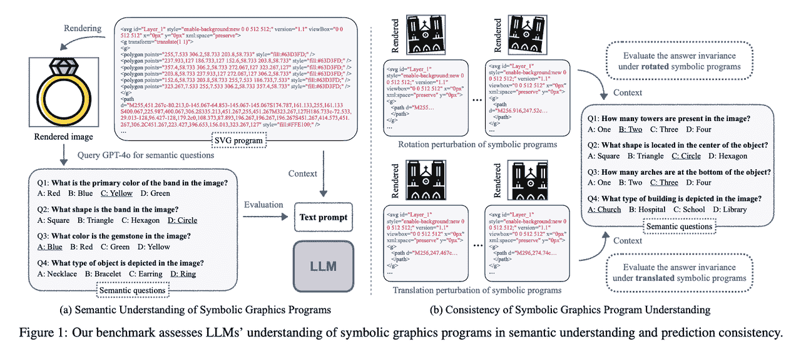

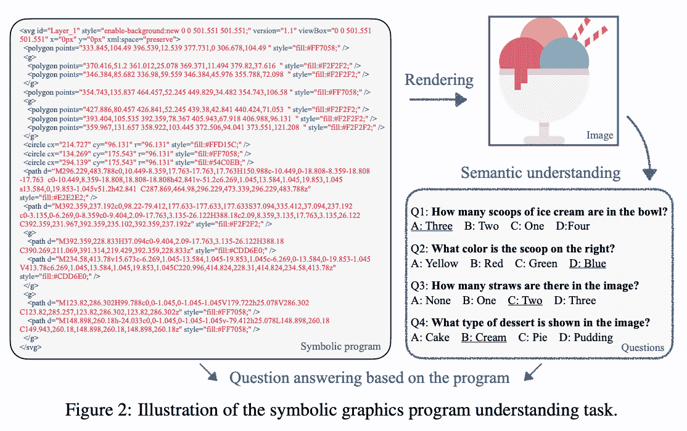

### 代码的自然语言概要：LLM 时代的文学编程

贡献人：

链接：http://arxiv.org/abs/2408.04820v1

我们提议将自然语言概述作为一种新颖的模态和交互界面，为开发人员在整个软件开发过程中提供AI辅助。代码函数的自然语言概述包括用简明散文写成的多个语句，这些语句将代码划分并以文学编程的风格总结其主要思想。关键是，我们发现现代LLM在实践中可以生成准确且高质量的自然语言概述。此外，自然语言概述实现了代码和自然语言之间的双向同步，允许对其中一个的更改自动反映在另一个中。我们讨论了自然语言概述的许多用例：它们可以加快对代码和差异的理解和导航，简化代码维护，增强代码搜索，引导代码生成等。然后，我们提出并比较了多种LLM提示技术以生成概述，并邀请专业开发人员评判概述质量。最后，我们提出两个案例研究，应用自然语言概述于代码审查和恶意软件检测的困难任务。

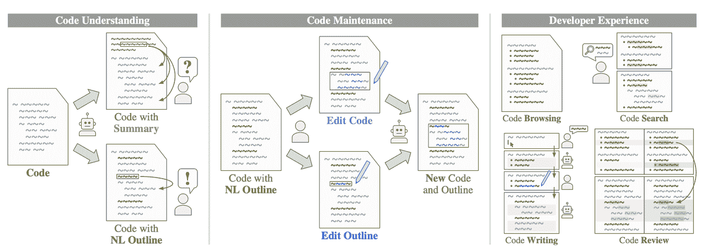

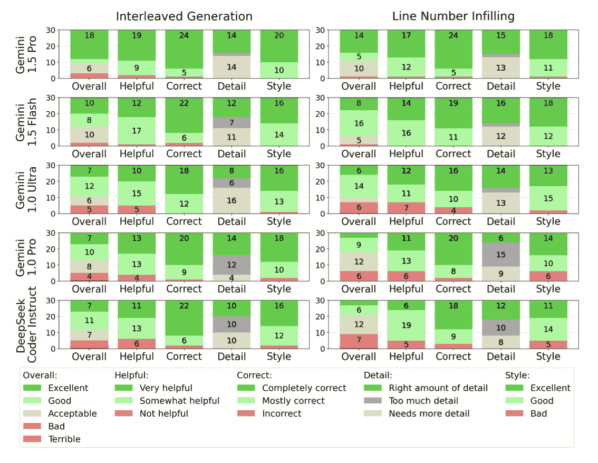

### **BAM！Just Like Th**at：混合专家模型的简单高效参数循环利用

贡献人：

链接：http://arxiv.org/abs/2408.08274v1

摘要：混合专家（MoE）框架已经成为大语言模型的流行架构，因为其相比密集模型具有更出色的性能。然而，在大规模环境中从头训练MoEs成本过高。现有方法通过独立预训练多个密集专家模型并使用它们初始化MoE来缓解这一问题。我们提出了BAM（Branch-Attend-Mix），这是一个简单而有效的方法，可以充分利用专门的密集模型，不仅使用它们的前馈网络（FFN）来初始化MoE层，还利用专家的注意力参数完全，通过将它们初始化为注意力混合（MoA）层的软变体。我们探索了两种方法来循环利用注意力参数：1）从密集模型初始化单独的注意力专家，包括所有注意力参数，以获得最佳模型性能；2）跨所有专家共享关键和值参数，以促进更好的推理效率。为了进一步提高效率，我们采用并行注意力变换器架构到MoEs中，允许同时计算注意力专家和FFN专家。我们在包含从5.9亿到20亿参数的种子模型上进行的实验表明，BAM在模糊度和下游任务性能方面均超越了基线，在相同的计算和数据约束条件下。

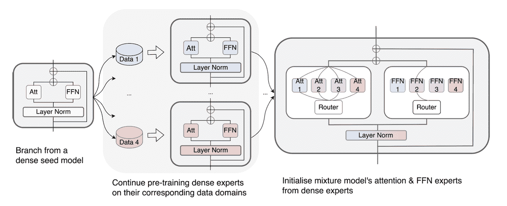

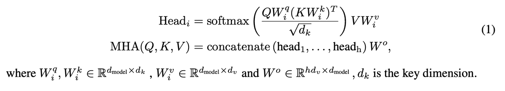

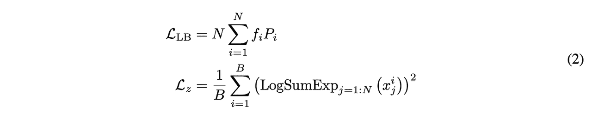

# 产品

### ShellMate AI

贡献人：

https://www.deepspring.ai/shellmate

ShellMate AI 是一款开源的 Mac 终端生产力工具，利用 OpenAI 的技术自动检测和修复错误，能够观察用户的操作，检测错误，并提供修复建议，甚至可以推荐用户尚未执行但应该执行的命令。

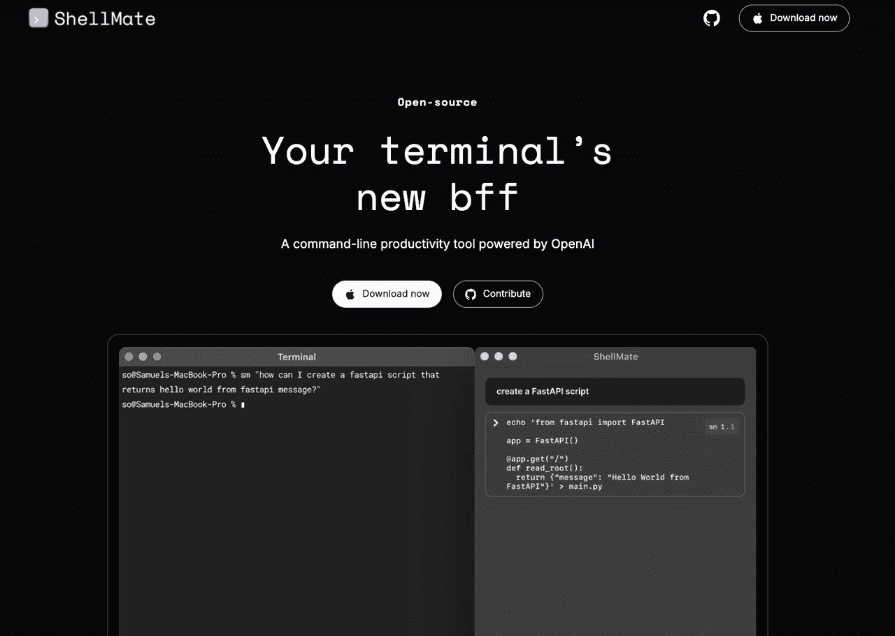

# HuggingFace&Github

### Generative photomontage

贡献人：

https://lseancs.github.io/generativephotomontage/

Generative Photomontage（生成式照片拼贴）是一种结合摄影和计算机生成技术的艺术形式，通过算法自动融合多张图像，创造出独特的视觉作品。它允许艺术家探索新的创意表达方式，具有高度的多样性和互动性。

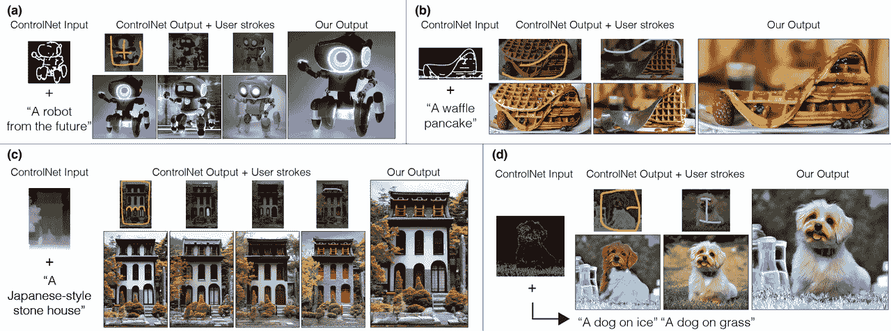

### Boreal

贡献人：

https://huggingface.co/kudzueye/Boreal

Boreal 是一个提升 Flux-Dev 模型真实感的实验性图像生成模型，通过使用“Boring Reality”数据集，目标是减少浅景深、增加动态姿势和改进皮肤纹理，从而生成更复杂和真实的图像。

# 投融资

### CodeRabbit获1600万美元融资，推动AI代码审查自动化

贡献人:

https://techcrunch.com/2024/08/15/coderabbit-raises-16m-to-bring-ai-to-code-reviews

CodeRabbit在A轮融资中获得1600万美元，由CRV领投，Flex Capital和Engineering Capital参与。本次融资使其总融资额接近2000万美元。公司计划将资金用于扩展销售和市场团队，并进一步开发产品，特别是在安全漏洞分析、依赖管理、代码重构、单元测试生成和文档生成方面。CodeRabbit的AI平台旨在通过先进的AI推理自动化代码审查，以减少人工投入，并提升代码质量。目前，已有600家组织正在使用其服务，并正在与多家财富500强公司进行试点合作。

公司官网：https://coderabbit.ai/

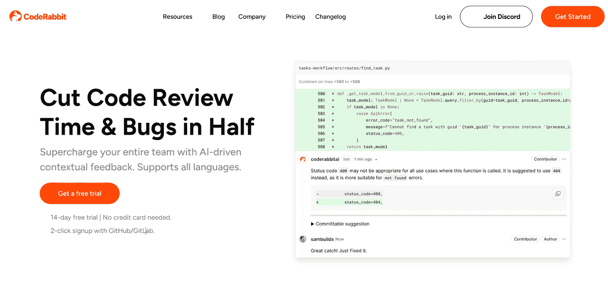

### 51WORLD完成2亿元Pre-IPO轮融资，计划赴港上市

https://news.pedaily.cn/202408/538663.shtml

51WORLD近日完成了2亿元Pre-IPO轮融资，由南宁焕新资本投资。公司计划通过18C章程在香港主板上市。51WORLD成立于2015年，专注于数字孪生产品和解决方案，核心技术包括3D图形、物理仿真和AI。此次融资将助力公司进一步拓展其数字孪生平台和相关技术产品。公司此前还推出了“地球克隆计划”，致力于在虚拟世界中复刻地球，打造超大型仿真模拟器。

公司官网：https://www.51world.com.cn/

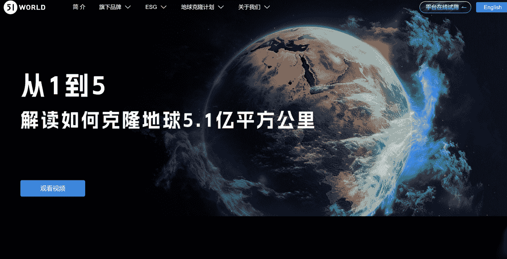

# 学习

### 带你一周攻克GPU设计的仿真篇

贡献人：

https://zhuanlan.zhihu.com/p/714713119?utm_psn=1807773312627109888

文章深入探讨了 GPU 设计中的仿真技术，强调了仿真在验证 GPU 性能和功能正确性中的核心作用。首先，介绍了仿真的基本概念和在 EDA 流程中的位置，然后详细阐述了仿真环境的搭建，包括硬件和软件的配置要求。接着，文章重点介绍了测试用例的设计原则和方法，以及如何利用仿真工具进行效率的测试和调试。此外，作者分享了如何通过性能分析来优化仿真过程，包括并行计算、资源分配和时序分析等技术细节。最终，通过对仿真结果的精确分析，确保 GPU 设计能够满足设定的性能指标和功能要求。

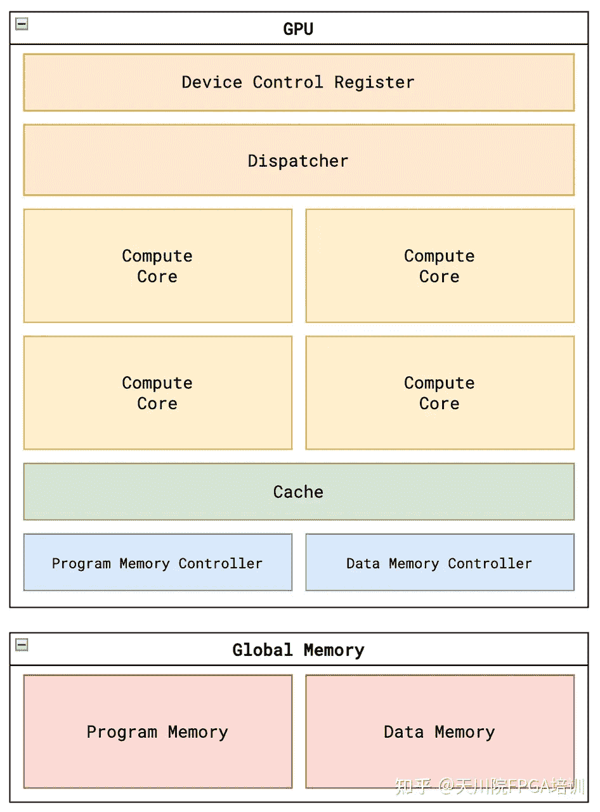

### 大模型推理加速与工程化-技术积累文档

https://zhuanlan.zhihu.com/p/714176844?utm_psn=1807770811123240960

本文梳理了大模型推理加速与工程化的关键技术，突出了模型剪枝、量化、知识蒸馏等优化手段，以及硬件加速和模型压缩在提升推理效率中的作用。工程化实践流程的强调，包括模型选择、性能评估和部署优化，确保了模型在实际应用中的高效运行。通过案例分析，文章展示了优化后的大模型在推理加速方面的实际效果，并指出了未来工作的发展趋势，即自动化流程的建设和模型优化的标准化。

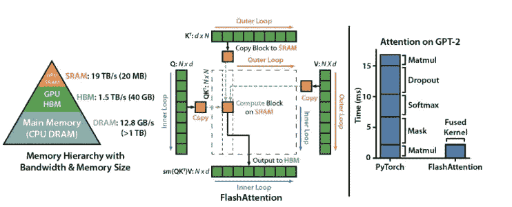

### 芯片漫谈 —— 一文搞懂芯片复位与RDC设计

https://zhuanlan.zhihu.com/p/688124932?utm_psn=1807772674409246721

芯片复位设计是确保芯片正常运行的基础，它涉及到将芯片内部逻辑初始化到预设状态。复位设计分为同步复位、异步复位和全局复位，每种方式都有其特定应用和挑战，如复位树构建和信号传播延迟。在设计中，需要特别注意复位域之间的时序问题，这直接关系到芯片的稳定性和性能。RDC（Reset Domain Crossing）设计解决了不同复位域间数据传输的一致性和完整性问题。为了确保数据的正确传输，设计者可能会采用同步 FIFO、异步 FIFO 或四相手 shake 协议等技术手段。

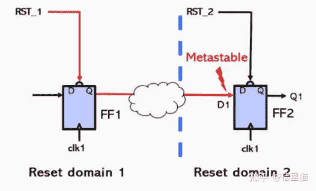

### 【VLM】详解视觉语言模型原理及代码，以DeepSeek-VL为例

https://zhuanlan.zhihu.com/p/713126534?utm_psn=1807770594416148480

视觉语言模型（VLM）是一种结合计算机视觉与自然语言处理的先进技术，能够有效地理解和生成图像与文本的内容。VLM 通过大规模的图像文本数据集进行预训练，学习到跨模态的表示，从而实现图像与文本之间的深度融合。在 DeepSeek-VL 的实现中，模型采用了多层 Transformer 架构，通过自注意力和交叉注意力机制，实现了图像特征和文本特征的精细编码。此外，DeepSeek-VL 还引入了对抗训练和多任务学习策略，以提高模型的泛化能力和鲁棒性。

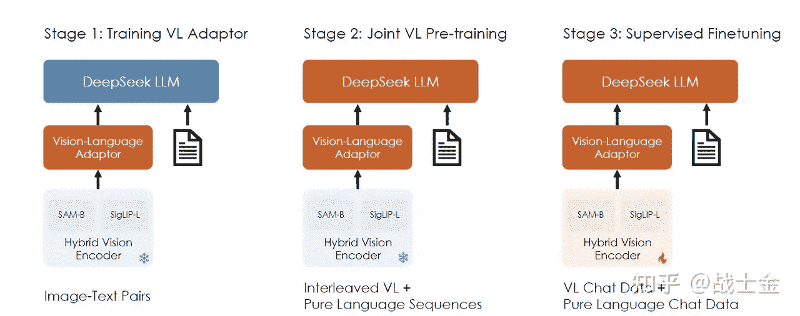

### TensorFlow 分布式训练的线性加速实践

https://zhuanlan.zhihu.com/p/34172340?utm_psn=1807766101800669184

文章探讨了 TensorFlow 分布式训练的实践，特别是 Ring Allreduce 算法在提高同步更新效率方面的应用。详细说明了 Ring Allreduce 算法如何通过环形通信结构实现参数同步，每个节点只需与其左右相邻的节点通信，使得通信量与节点数量无关，从而实现线性加速。此外，文章还讨论了使用 Kubernetes 进行集群管理和调度，TensorFlow 作为深度学习框架，以及 Horovod 在分布式训练中的集成方式，这些技术组合使得分布式训练更加高效。实验结果显示，Horovod 在多机多卡环境下能够实现接近理想的线性加速比，大幅提升了训练速度和资源利用率。

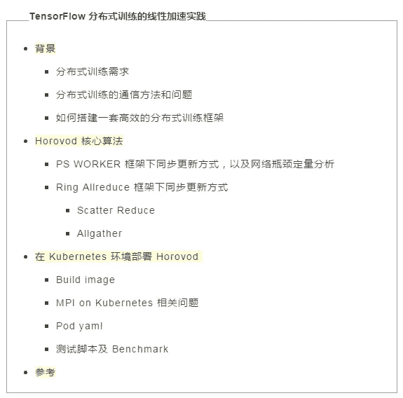

### Arm架构CPU服务器

https://zhuanlan.zhihu.com/p/491218425?utm_psn=1807764762144153600

Arm 架构 CPU 服务器以其高效的能耗性能比例，在数据中心和云服务领域崭露头角。其设计优势体现在低功耗、高集成度和优异的性价比上。Arm 服务器采用了精简指令集（RISC）设计，使得其在处理并发任务时具有出色的表现。此外，Arm 服务器支持广泛的软件生态系统，包括主流的操作系统和开发工具，确保了良好的兼容性和扩展性。在技术细节上，Arm 处理器通过对特定工作负载的优化，如网络、存储和多媒体处理，实现了更高的性能。与传统的 x86 架构相比，Arm 服务器在处理大数据和人工智能计算任务时，能够提供更高的计算效率和更低的能耗消耗。此外，Arm 服务器还支持先进的虚拟化和容器化技术，为现代软件部署提供了灵活的解决方案。

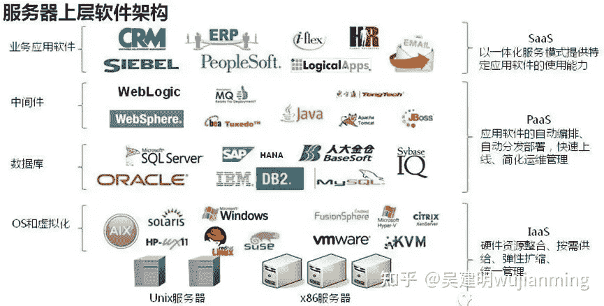

### 聊聊端到端与下一代自动驾驶系统

https://zhuanlan.zhihu.com/p/692302970?utm_psn=1807766753587126273

文章探讨了端到端自动驾驶系统的概念和实践，强调了系统从传感器数据直接输出车辆控制信号的重要性，并指出端到端系统的核心在于提供无损的感知信息传递。文章指出端到端系统并非全面解决方案，传统方法在动态交互场景中依然有效。同时，文章揭示了端到端自动驾驶中的误区，如将大模型和纯视觉作为必要条件，并强调了实现 L3 级别以上自动驾驶的挑战。此外，提出了渐进式端到端方案，以克服现有系统架构的局限性。文章还强调，即使在数据驱动的时代，仍需依赖传统的优化算法来处理复杂的行驶场景。

### 迈向自动驾驶2.0时代

https://zhuanlan.zhihu.com/p/714648576?utm_psn=1807766308156227585

自动驾驶技术从 1.0 时代的初步商用应用，逐步演进至 2.0 时代，后者更注重智能化和系统整合。在技术细节上，自动驾驶 2.0 时代的核心是人工智能和机器学习算法的融合，这些算法能够提升车辆的环境感知、决策制定和执行能力。具体到车辆的硬件，这包括高精度的传感器（如激光雷达、毫米波雷达和摄像头），以及高性能的计算单元，它们共同构成了自动驾驶系统的感知层。在软件层面，深度学习技术被用于处理和解释大量的传感器数据，以实现准确的行人、车辆和道路标志的识别。此外，自动驾驶汽车还需要与交通基础设施和其他车辆进行通信，这就要求具备先进的车联网（V2X）技术。安全性是自动驾驶技术的基石，因此系统的鲁棒性和故障恢复机制也是技术开发的重点。

# 声明

本文档仅供学习交流使用，版权归原作者所有，若涉侵权，请联系Jack Jin 15101136166

##

（欢迎在下方反馈您宝贵的意见！整理不易，觉得有用给AI日报小组点个赞👍吧！）

ChatGPT；Angela；Zijia Liu；Alex；Zeqi Tan；Tiezhen（HuggingFace）；Naixu；Lizhi；Peter；Suoman；Jack

封面生成——右脑科技

如果你有大模型相关的创业想法，欢迎来找我们聊聊～🛰️：15101136166

> 快邀请你的小伙伴们一起来读大模型日报吧！

> **【日报****知识库****】**这里是近期日报内容的汇总,欢迎大家查阅

> [大模型日报知识库(分享版)](https://miracleplus.feishu.cn/wiki/KapVwXfkriOBiskB0B2cUHxjnTh)

>

> 欢迎大家多多帮我们分享,转发~~

> 如果大家有任何的建议或者吐槽,欢迎随时找我聊天~

