# 奇绩大模型日报（8月 19日）

> 来源：[https://miracleplus.feishu.cn/docx/T4b6dscueovN1ZxjDwcc3VV6nRg](https://miracleplus.feishu.cn/docx/T4b6dscueovN1ZxjDwcc3VV6nRg)

# 奇绩行研开放岗位

---

**奇绩创坛****由陆奇博士**于2019年创立，使命是在源头最大化驱动创新。奇绩研究组将研究模型理论、到投研战略分析、市场策划等不同背景的同学聚在一起，搭建GenAI时代独特的跨界人才社群。

## 🚀F**24实习岗位**

##### [行研-学术科研人才交流组实习生](https://miracleplus.feishu.cn/docx/Yn6rdf2iOoY2Rcx8yVNcUBYRnch#part-QkMcdeJmuob9uvxvV3qcLSzHn8g)

##### 行研-GenAI研究岗位-战略分析（偏产品）

##### Web / AI 全栈开发工程师实习生

## **火热开放中🚀**

##### 行研-GenAI研究岗位-前沿学术探索

##### 行研-GenAI研究岗位-战略分析（偏咨询）

##### 创新活动产品运营 （大模型系列活动产品运营）

> **点击**相关岗位可查看对应**岗位需求【JD】；**相关岗位投递请**添加微信💻【**sunjiajunspace】

> ‼️欢迎**推荐/自荐**，期待在**奇绩创坛**遇见更好的你‼️

---

# 📡潜空间活动报名

> 潜空间系列活动第三季第三期开启报名！

> 本期活动将在**8月24日** **10:00 am**开始，嘉宾是**童晟邦**。**童晟邦，纽约大学博士，伯克利人**工智能实验室（BAIR）研究员， OpenAI 超对齐奖学金获得者。他将和大家探讨视觉在多模态大模型中扮演的角色。

> 除嘉宾分享外，每期设置了【匹配合伙人 Cofounder Matching】环节。你可以和 GenAI 时代最有活力的创业者和研究者线下面对面交流，将有机会找到志同道合、有共同创业梦想的小伙伴。

> 报名通道已开启，欢迎扫描下方二维码报名。

# 资讯

###  AI+AR产品发布、《黑神话》上线，看好游戏和XR内容关注度上行

https://mp.weixin.qq.com/s/vmni3AlOTReGrHXWgmuMog

中信建投证券研究部在其最新报告中，针对游戏和 XR 内容关注度的上升趋势进行了分析。报告特别强调了《黑神话：悟空》游戏的爆款效应，IGN 等媒体对其高分评测，认为这将持续推动游戏关注度的提升。此外，报告预测 AI+AR 产品在第二季度将有重要进展，Meta 可能在 9 月发布其 AR 眼镜，该产品预计将融合语音助手 Meta AI，具备实时翻译、环境分析等 AI 功能，以及 3D 虚拟显示和手势控制等新特性，这将极大提升内容产业链的关注度。在出版领域，尽管受到反腐和调出指数等因素的影响，出版业务仍被视为重点推荐，尤其是在快速消化大量信息的今天，出版行业的核心业绩驱动因素依然稳健。报告还提到了影视行业，预计下周上映的《刺猬》和《逆鳞》等新片将使得票房保持稳定，同时国庆档定的 7 部电影将进一步吸引观众关注。在技术细节方面，报告指出，AI 技术的发展可能会受到生成式 AI 技术发展不及预期、产品研发难度大、营销买量成本上升等风险的影响。同时，出版和影视行业也面临着版权保护力度不足、知识产权未明确划分、IP 影响力下降等挑战。

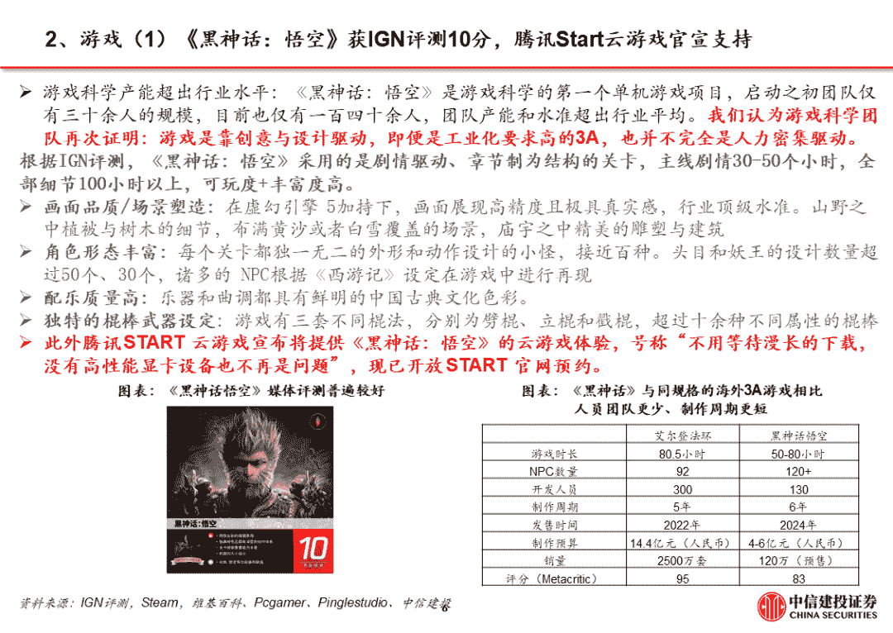

### 首届RL领域会议：Barto、Sutton、Sliver师徒3代，7篇杰出论文奖，独有论文评审机制公布。

https://mp.weixin.qq.com/s/F-re7v00ZmM-HjdWpKsJBQ

首届强化学习会议（RLC）在美国马萨诸塞大学举办，颁发了 7 个组别的杰出论文奖项，并推出了一种创新的论文评审机制。该机制强调方法论的严谨性，通过高技术门槛、高质量评论和分工评审减轻审稿人负担，旨在提高学术论文的质量和审稿的透明度。获奖论文涵盖了强化学习理论、应用、实证方法、经验资源、开创性视野、科学理解和研究支持工具等多个方面，展现了该领域的最新研究成果和应用进展。其中，斯坦福大学的华人学者 Wanqiao Xu 和 Shi Dong 合作的论文，以及其他多篇论文，分别在各自的领域内提出了创新性的方法和理论，为强化学习的发展做出了重要贡献。

### AI短剧平台SkyReels正式发布

https://mp.weixin.qq.com/s/Ds_jM-Eu-YYBG9ePkkNOpQ

昆仑万维集团发布了 AI 短剧平台 SkyReels，该平台集成了视频大模型与 3D 大模型技术，实现了从剧本到视频的全流程自动化创作。SkyReels 通过 SkyScript、StoryboardGen、Sky3DGen 等自研大模型，提供高质量的剧本、分镜、3D 内容生成，以及人物表演等服务。

### 微调Flux

https://mp.weixin.qq.com/s/aRTmFqoNXe1M6Pq8s9FlVQ

Flux 自推出以来，迅速成为开源 AI 界的新宠，开发者们利用 LoRA 微调技术，创造出多样化的图像风格和场景，如漫威英雄、时装走秀、不同艺术风格等。Flux 的出现不仅使得 AI 图像生成技术达到了新的高度，还为内容创作者提供了强大的工具。例如，Rundown AI 的创始人 Rowan Cheung 使用 Flux 和 LoRA 技术，将自己变身为漫威英雄，并制作了相应的视频。此外，Flux 的可玩性和灵活性也得到了广泛体现，开发者们可以通过微调模型，实现从动画涂鸦到现实主义的多种风格转换。网友们对 Flux 的热情不仅体现在图像生成上，还包括视频制作、风格探索等多个方面。Flux 的微调过程相对简单，不需要大量的算力和数据，即使是个人开发者也能进行二次创作。

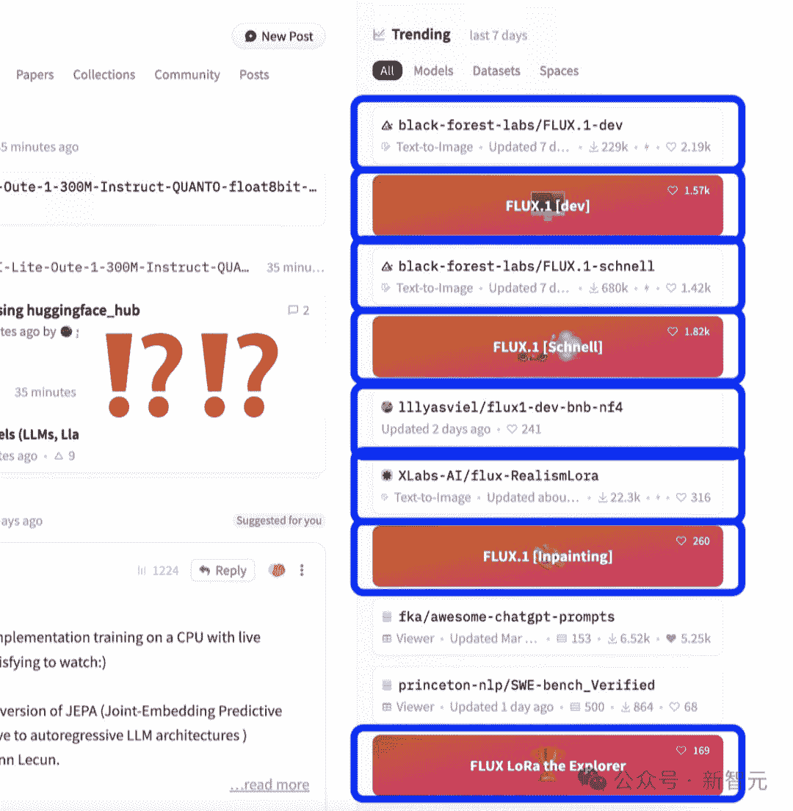

### 星尘智能 Astribot S1

https://mp.weixin.qq.com/s/k81NE3bOxEIVw_3-eJY-Kg

国产人形机器人 Astribot S1 由星尘智能公司研发，近期发布并在世界机器人大会上展示。该机器人以其人形上半身和轮式底盘的设计，能够独立自主地完成多项复杂任务，如演奏扬琴、泡功夫茶、做华夫饼、练习咏春拳和投篮，甚至能够远程逗猫。Astribot S1 的技术细节包括其 7 自由度的单臂与人类相同，手部具有 2 根机械手指，能够完成精细的操作。运动精度达到 0.03mm，力控精确，能够适应不同材料和形状的工具。其刚柔耦合传动机构设计确保了操作的安全性和精度，同时通过模块化设计提高了机器人的可维护性和适应性。

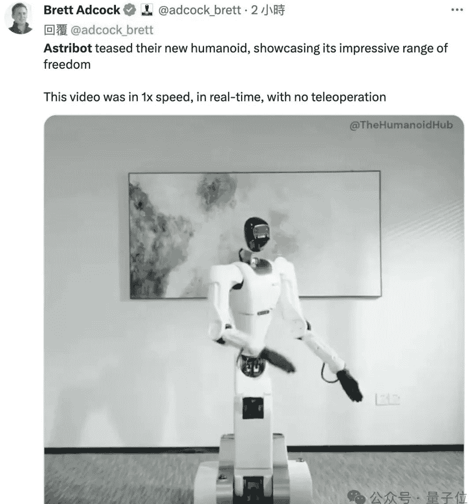

### 阿里发布通用多模态大模型mPLUG-Owl3 | 开源

https://mp.weixin.qq.com/s/QmxsPMe0wDElJwaUvwd9Tw

阿里巴巴团队推出的 mPLUG-Owl3 是一个通用多模态大模型，它能够在 4 秒内理解一部 2 小时的电影，显著提高了推理效率。该模型基于 LLaVA-Next-Interleave，减少了 First Token Latency，增强了对多图和长视频的处理能力。mPLUG-Owl3 采用了 Hyper Attention 模块，实现了视觉和文本特征的并行交互，而不影响语言模型的序列容量。此外，模型还引入了多模态交错的旋转位置编码 MI-Rope，以及 Attention mask 技术，以更好地理解多模态输入。实验结果表明，mPLUG-Owl3 在多模态 Benchmarks 上达到了 SOTA 水平，特别是在长视频理解方面，它在 LongVideoBench 榜单上取得了 52.1 分的成绩，显示出其在处理长序列视觉数据时的卓越性能和抗干扰能力。

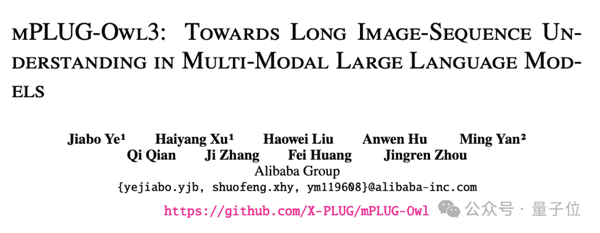

# 推特

### 最好的Google搜索工程解析：对成千上万份泄露的Google法院文件进行逆向工程得出

https://x.com/deedydas/status/1825211069574623533

最好的Google搜索工程解析刚刚发布。

这是通过对成千上万份泄露的Google法院文件进行逆向工程得出的。

我知道大家都觉得“Google真恶心，搜索太烂了”，但在大约25年内，没有其他公司拥有真正的网络规模搜索引擎。这是软件工程师必读的内容。

---

George Hotz评论：

问题在于，现在的互联网不再愿意被索引。未来的Google将非常擅长抓取孤立的数据，比如Instagram、X（原Twitter）、Reddit、Discord、YouTube和TikTok。

想象一下，如果有人基于这些数据构建了一个真正的搜索引擎，我愿意每月付$50。

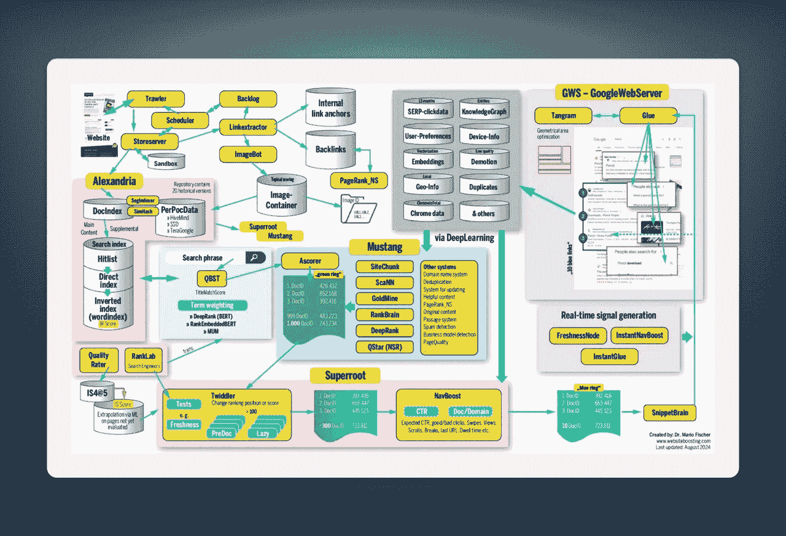

### Ekenstam分享：15个月内LLMs的ELO排名

https://x.com/LinusEkenstam/status/1825442212533977222

仅仅在15个月内，LLMs的ELO排名发生了这样的变化 🤯

未来充满了未知与惊喜！

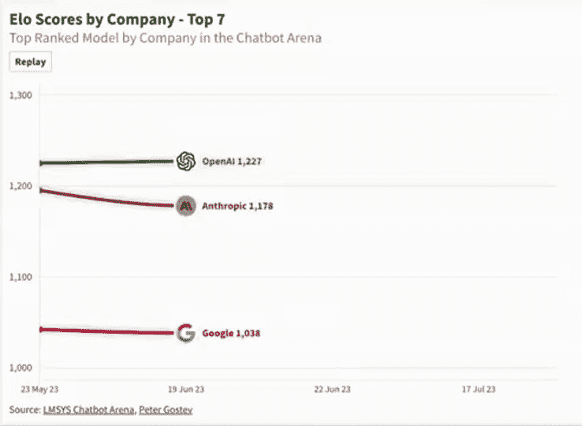

[ssstwitter.com_1724057531062.mp4](https://internal-api-drive-stream.feishu.cn/space/api/box/stream/download/all/Lq7PboktNoDHqNxvzGlcHWHRnPb)

### MrNeRF：辐射场的未来是生成式AI

https://x.com/janusch_patas/status/1825151053781745723

辐射场的未来是生成式AI！

为了展示其潜力，我拍摄了一个物体在90-120度之间的两个角度的图像，创建了一个平滑的插值，然后训练了一个3D高斯溅射（3DGS）场景。

以下是实现这一目标的简短教程：

1.  **拍摄图像**：围绕一个物体拍摄三张图像，每张图像的角度间隔为120度。

1.  **使用视频生成AI工具**：应用提示词：“静止场景。相机平滑地沿弧线移动。” 来插值这些图像。

我使用的是Luma的Dreammachine，但其他工具如RunwayML也支持这一过程。

2a. **可选挑战**：使用扩展功能将第三张图像加入到视频中。你还可以尝试用1、2、3号图像闭环，再回到1号图像。然而，这需要三个处理步骤。

1.  **训练3DGS模型**：将生成的视频插入你最喜欢的3DGS训练器中。

为了方便，我使用了Luma，但其他选项也非常出色。如果有的话，你还可以使用NeRFstudio的gsplat。

1.  （可选步骤）：在这个帖子中分享你的结果！

这种方法的一个很酷的特点是，即使在拥挤的环境中也可以轻松捕捉场景。只需等待人或移动物体从照片中消失——通常捕捉三张不受干扰的图像是可行的。

此外，你可以尝试提示“移除人、移动物体和动物”，以进一步提升结果。

想象一下未来，你可以拍摄几张场景的图像，然后将其用作你最喜欢的3D游戏中的环境，甚至可以改变电影的整个场景设置！

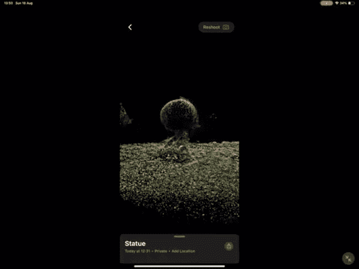

[ssstwitter.com_1724067762669.mp4](https://internal-api-drive-stream.feishu.cn/space/api/box/stream/download/all/I6zabpV3fofVuGxF5fIckRZmn3g)

### Perplexity AI：正在运行 nextjs 的App Router

https://x.com/rauchg/status/1825146808500121932

Perplexity.ai 现在正在运行 @nextjs 的App Router。如果你觉得它已经很快了，那就继续关注吧……

这非常令人兴奋，因为App Router和RSC的灵感之一就是要将像Google搜索和Facebook这样的系统所拥有的极具动态渲染能力民主化。

当你搜索“旧金山天气”或“奥运奖牌排行榜”时，Google能够动态渲染并流式传输数据，以及客户端从未见过或下载过的UI。与SPA或其他整体构建的应用程序不同，产品团队能够在不担心影响系统其他部分速度的情况下发布和试验他们的工作。

在LLM驱动的系统背景下，这种按需生成的UI比以往任何时候都更为重要。迫不及待想看到Perplexity能走多远。

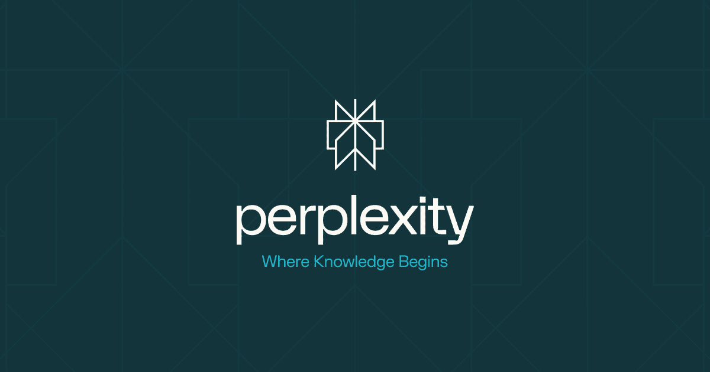

# 论文

### Ex3: 通过提取、扩展和拓展实现自动小说写作

贡献人：

链接：http://arxiv.org/abs/2408.08506v1

摘要：使用人工智能生成小说等长文本一直是一个挑战。一种常见的方法是使用大型语言模型(LLMs)构建一个分层框架，先规划再写作。尽管生成的小说达到了足够的长度，但在情节逻辑连贯性和吸引力以及人物和事件描写方面存在不足，最终影响了整体叙事质量。本文提出了一种名为“提取卓越并扩展”的方法。Ex3首先从原始小说数据中提取结构信息。通过将这种结构信息与小说数据结合，精心制作了一个遵循指示的数据集。然后利用这个数据集微调LLM，旨在实现卓越的生成性能。在最后一个阶段，部署了一种类似树状的扩展方法，以促进任意长度的小说生成。与以前的方法进行评估显示Ex3能够产生更高质量的长篇小说。

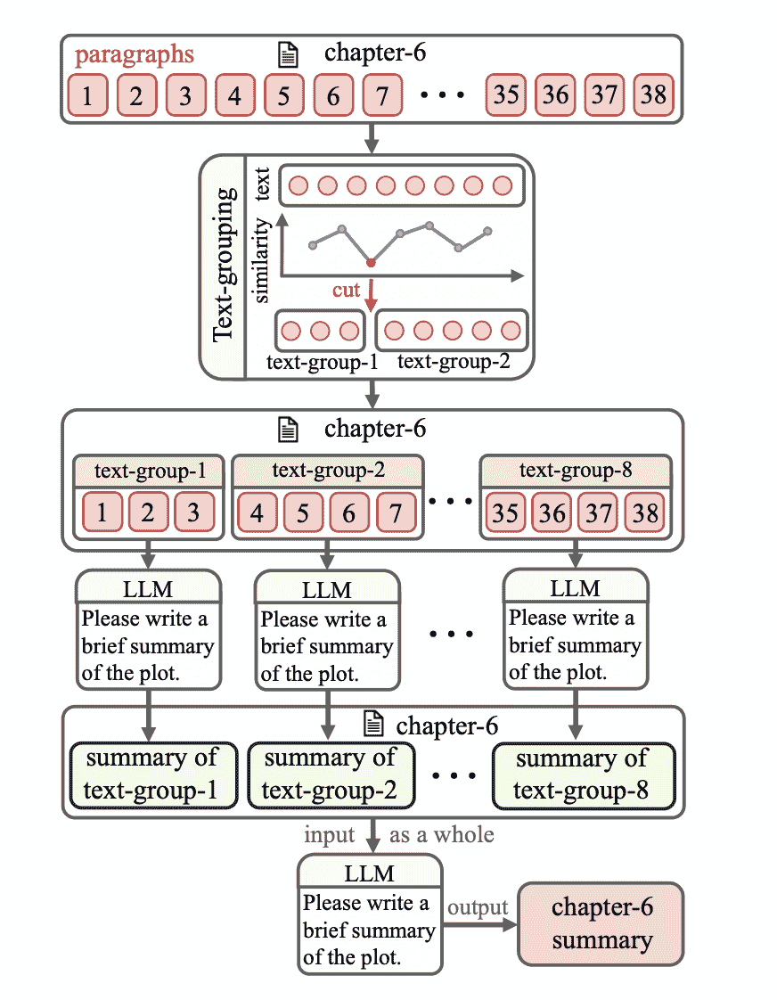

### JPEG-LM：LLM作为具有规范编解码表示的图像生成器

贡献人：

链接：http://arxiv.org/abs/2408.08459v1

近期关于图像和视频生成的工作一直在采用自回归 LL 模型架构，因为它的普适性和潜在易于集成到多模态系统中。将自回归训练在语言生成中应用到视觉生成的关键是离散化——将连续数据如图像和视频表示为离散令牌。我们提出直接将图像和视频建模为通过标准编解码器（如 JPEG、AVC/H.264）保存在计算机上的压缩文件。通过在不经过任何视觉特定修改的默认 LLama 架构下，从头开始预训练 JPEG-LM 生成图像（和 AVC-LM 作为概念验证生成视频），直接输出 JPEG 和 AVC 格式的压缩文件字节。图像生成的评估显示，这种简单直接的方法比基于像素建模和复杂的向量量化基线更有效（我们的方法在 FID 上减少了 31%）。我们的分析显示，JPEG-LM 在生成长尾视觉元素方面具有特殊优势。总的来说，我们表明使用标准编解码器表示有助于降低语言生成和视觉生成之间的障碍，促进多模态语言/图像/视频 LL 模型的未来研究。

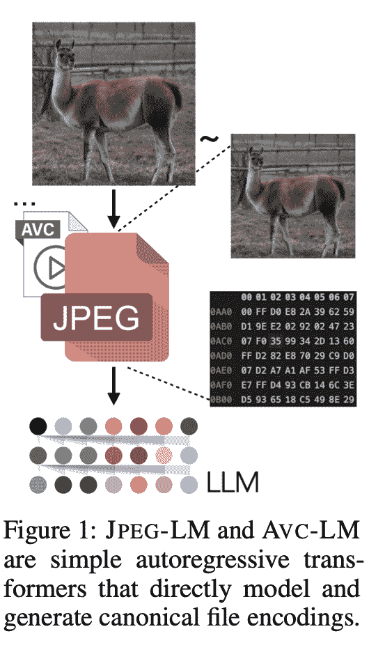

### xGen-MM（BLIP-3）: 一系列开放的大型多模态模型

贡献人：

链接：http://arxiv.org/abs/2408.08872v1

这份报告介绍了xGen-MM（也称为BLIP-3），这是一个开发大型多模态模型（LMMs）的框架。该框架包括精心策划的数据集、训练配方、模型架构和一套LMMs。xGen-MM，简称xGen-MultiModal，扩展了Salesforce xGen在基础AI模型上的倡议。我们的模型经过严格的评估，涉及单一和多图像基准测试。我们的预训练基础模型展示了强大的上下文学习能力，指导调整的模型在与类似规模模型的开源LMMs中展现出竞争力。此外，我们引入了一个带有DPO的安全调整模型，旨在减轻幻觉等有害行为，并提高安全性。我们开源我们的模型、精心策划的大规模数据集和微调代码库，以促进LMM研究的进一步发展。相关资源将在我们的项目页面上提供。

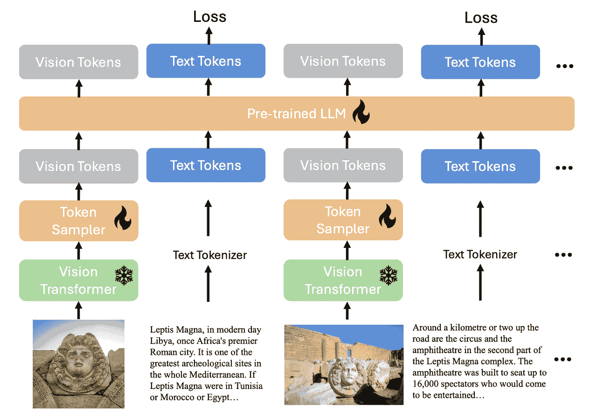

### **Evaluating the Evalu**ator：衡量LLM对任务评估指令的遵循

贡献人：

链接：http://arxiv.org/abs/2408.08781v1

摘要：LLMs作为评判者是一种近来流行的方法，用LLMs自动评估来替代人类评判（Zheng等，2024年）。由于RLHF（从人类反馈强化学习）的广泛应用，预计最先进的LLMs如GPT4和Llama3在需要质量判断，如文本连贯性时，与人类偏好强烈一致。虽然这看起来有益，但尚不清楚LLMs作为评判者是否仅基于提示中的指令进行评估，还是体现了其对类似微调数据的高质量数据的偏好。为了调查LLMs作为评判者的提示对AI评判与人类评判的一致性有多少影响，我们分析了几个LLMs作为评判者的逐渐增加的目标评估质量水平的提示。此外，我们将与使用模型困惑度作为质量指标的无提示方法进行比较。我们整合了一组常用于最先进的LLMs评估的质量标准分类，并将其作为模型作为评判者的严格基准。总体而言，我们显示，LLMs作为评判者仅在高度详细的提示中获益有限，并且困惑度有时可能比提示更好地与人类判断一致，特别是在文本质量方面。

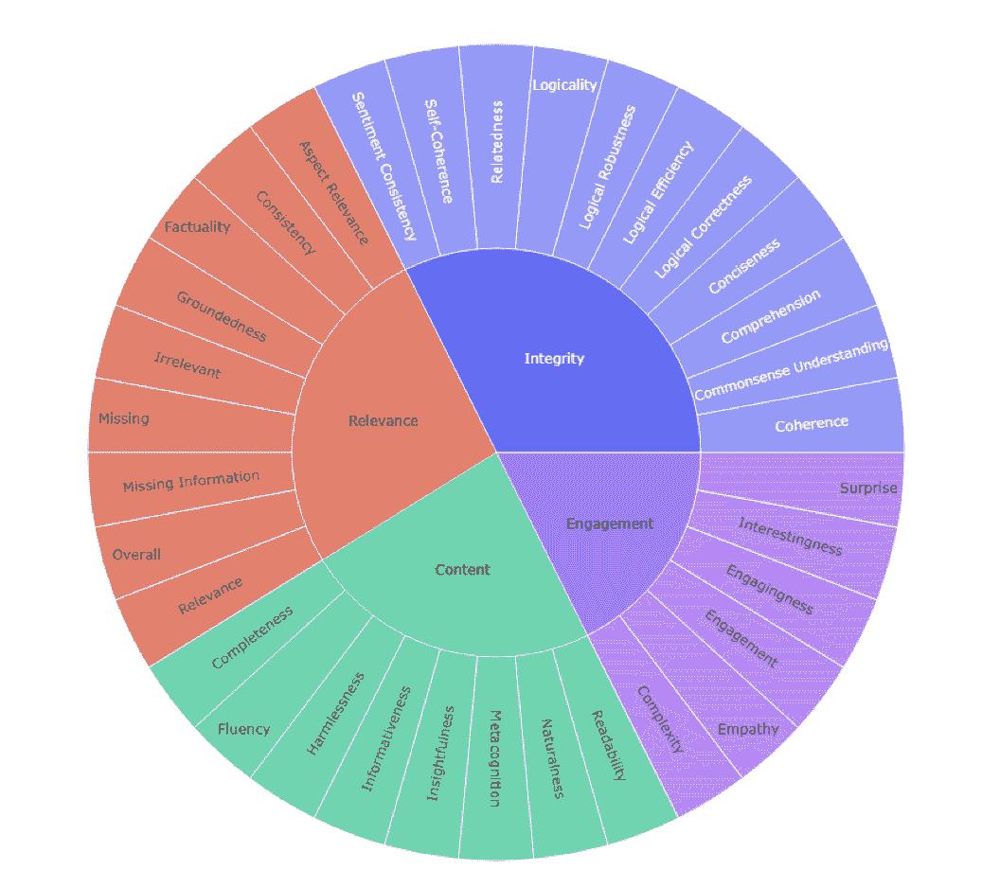

### CodeMirage：LLM 生成的代码中的幻觉

贡献人：

链接：http://arxiv.org/abs/2408.08333v1

大型语言模型（LLMs）在程序生成和无代码自动化方面显示出了巨大的潜力。然而，LLMs容易生成幻觉，即它们生成听起来合理但实际错误的文本。尽管最近关于LLM在文本生成中出现幻觉的研究激增了，但同样的幻觉现象也可能在代码生成中发生。有时生成的代码可能存在语法或逻辑错误，以及更高级的问题，如安全漏洞、内存泄漏等。鉴于广泛使用LLMs以提高代码生成效率和发展效率，有必要研究代码生成中的幻觉。据我们所知，这是第一次尝试研究由LLMs生成的代码中的幻觉。我们首先介绍了代码幻觉定义和全面的代码幻觉类型分类。我们提出了第一个用于代码幻觉的基准CodeMirage数据集。这个基准包含了从两个基本数据集HumanEval和MBPP中生成的1,137个Python编程问题的GPT-3.5生成的幻觉代码片段。然后，我们提出了代码幻觉检测的方法论，并使用一次性提示实验了开源LLMs，如CodeLLaMA以及OpenAI的GPT-3.5和GPT-4模型。我们发现，GPT-4在HumanEval数据集上表现最佳，并在MBPP数据集上与精细调整的CodeBERT基线表现相当。最后，我们讨论了代码幻觉的各种缓解策略，并总结了我们的工作。

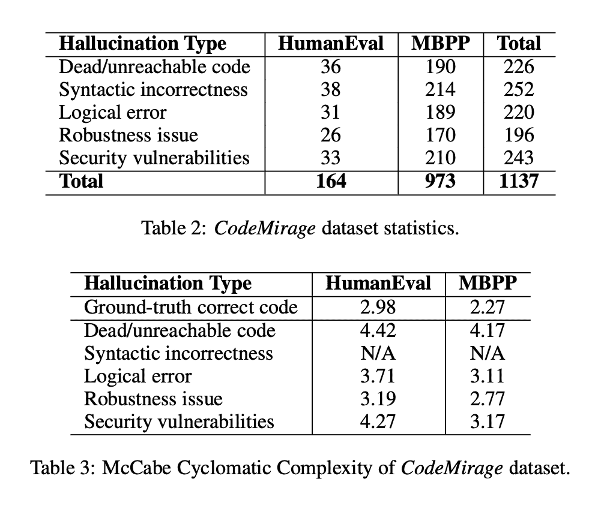

### **视觉智能体作为快速和缓慢思考者**

贡献人：

链接：http://arxiv.org/abs/2408.08862v1

实现人类水平智能需要细化系统1和系统2思维之间的认知区别。当代由大语言模型驱动的人工智能展现出类似人类的特质，但仍未达到真正认知水平。我们介绍了FaST，将快速和慢速思维机制融入视觉智能体中，通过切换适配器动态选择系统1/2模式，针对不同任务复杂度调整解决问题方法。FaST通过调整模型置信度和整合新的上下文数据来应对不确定和未知物体。我们倡导一种灵活系统、层次化推理能力和透明的决策管道设计，促进其在视觉智能中模拟人类认知过程的能力。实证结果表明，FaST在视觉问答和理由分割任务上优于多个基线，达到80.8%准确率和48.7% GIoU得分，展示了其卓越性能。广泛测试验证了FaST核心组件的有效性和鲁棒性，展示了其推进认知视觉智能体发展的潜力。

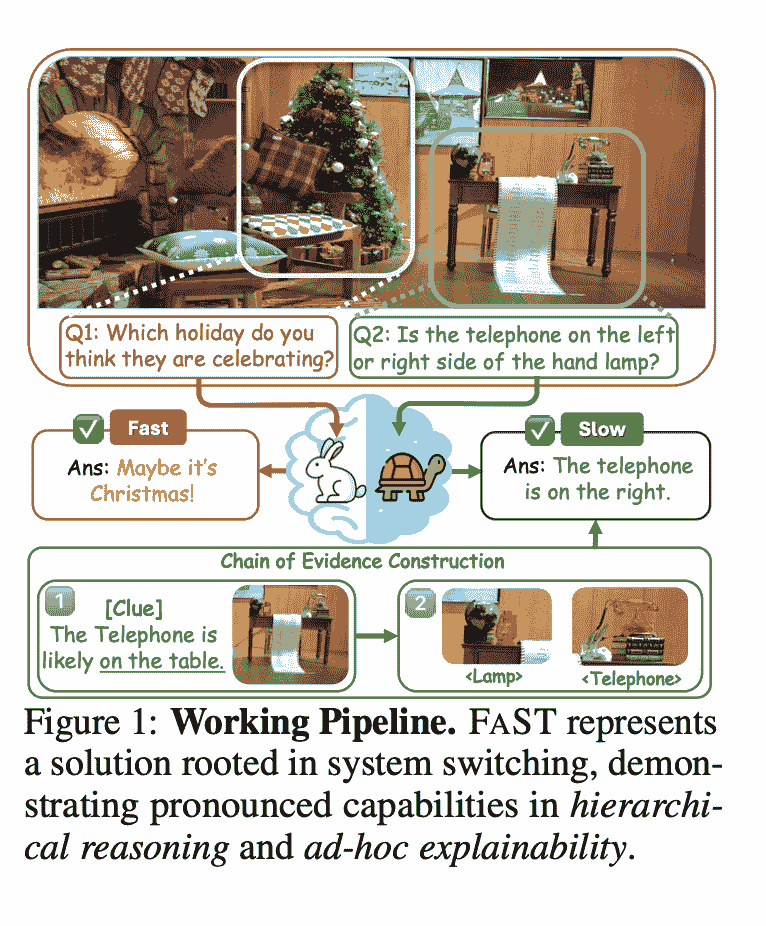

# 产品

### peakHint

贡献人：

https://www.speakhints.com/

SpeakHints 是一款由人工智能驱动的实时语音助手，为用户提供私人化的发言建议。它可以在在线会议、演讲、面试、电话通话等各种口语场合中，持续显示下一步该说什么的提示。该工具特别适合那些在表达时感到困难的人，帮助他们更自信地进行交流

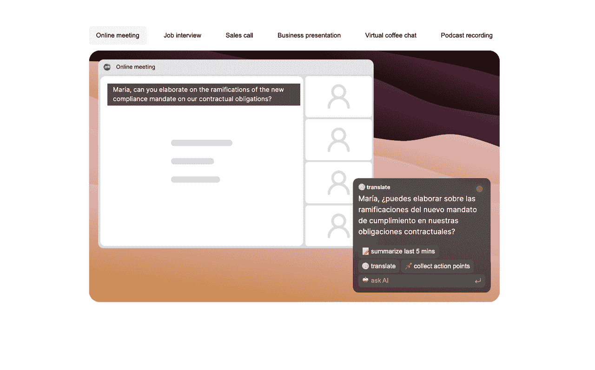

# HuggingFace&Github

### FancyVideo

贡献人：

https://fancyvideo.github.io/

FancyVideo 是一种创新的文本到视频生成模型，通过引入跨帧文本指导模块（CTGM），实现了帧特定的文本控制。该模型包含时间信息注入器、时间关联细化器和时间特征增强器，显著提高了视频生成的动态性和一致性，取得了在 EvalCrafter 基准测试中的最佳表现。

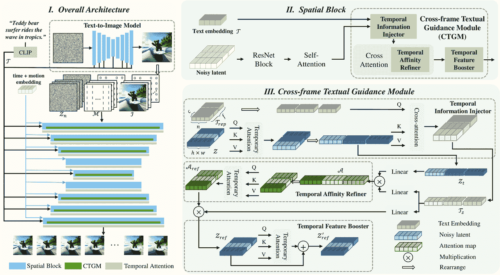

### Minitron-4B-Base

贡献人：

https://huggingface.co/nvidia/Minitron-4B-Base

Minitron-4B-Base 是由 NVIDIA 开发的大型语言模型，通过对 Nemotron-4 15B 模型进行修剪获得，使用 940 亿个标记进行了持续训练。与从零开始训练相比，它在训练效率和成本上显著优化，MMLU 分数提高了 16%，并与其他社区模型相当。Minitron-4B-Base 采用了 3072 的模型嵌入大小、32 个注意力头和 9216 的 MLP 中间维度，并使用了分组查询注意力（GQA）和旋转位置嵌入（RoPE）。

# 投融资

### 亚马逊收购AI公司Perceive

贡献人：

https://seekingalpha.com/news/4141249-amazon-to-buy-ai-company-perceive-from-xperi

亚马逊（AMZN）已同意以8000万美元现金收购AI处理器Ergo的开发商Perceive Corporation，该公司是Xperi的子公司，Xperi拥有约76%的股份。Perceive专注于边缘推理解决方案。此次交易采用资产购买协议形式，并包含防止Xperi和Perceive在收购后三年内从事某些业务活动的条款。Perceive成立于2018年，拥有44名员工，预计大多数员工将在收购后加入亚马逊。交易预计将在90天内完成，但若遇到监管条件，可能延迟至六个月。

公司官网：https://perceive.io/

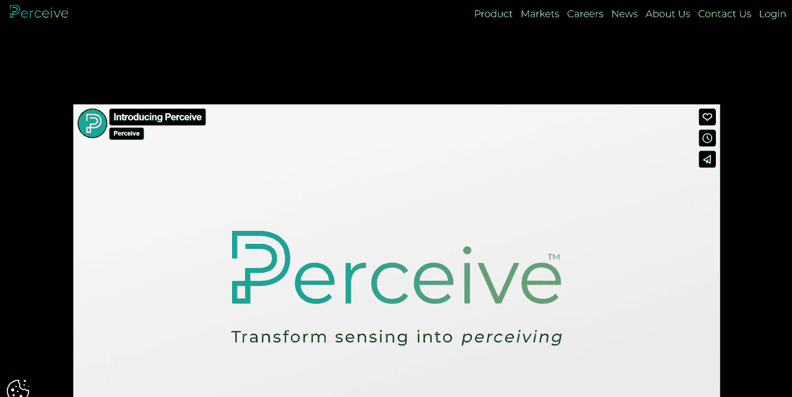

# 学习

### 视频生成数据集

贡献人：

https://zhuanlan.zhihu.com/p/715133956?utm_psn=1808859036759769089

本文详细介绍了三个先进的 Text-To-Video 数据集：VIDGEN-1M、Panda-70M 和 MiraData，以及 MMtrail 数据集。VIDGEN-1M 由复旦大学研发，采用了 Coarse Curation、Captioning 和 Fine Curation 三个步骤，利用 PySceneDetect 进行场景切换检测，LAION Aesthetics 评估视频美学，CLIP 提取视频特征进行分类，以及 RAFT 模型计算视频动态特征。Panda-70M 由 Snap 提出，通过 ImageBind 提取视频特征，并采用多模态模型生成标题，使用 UMT 模型优化标题，同时通过 student captioning model 降低计算成本。MiraData 由腾讯推出，其构建过程与 Panda-70M 类似。MMtrail 数据集则特别地包含了视频的音乐描述。

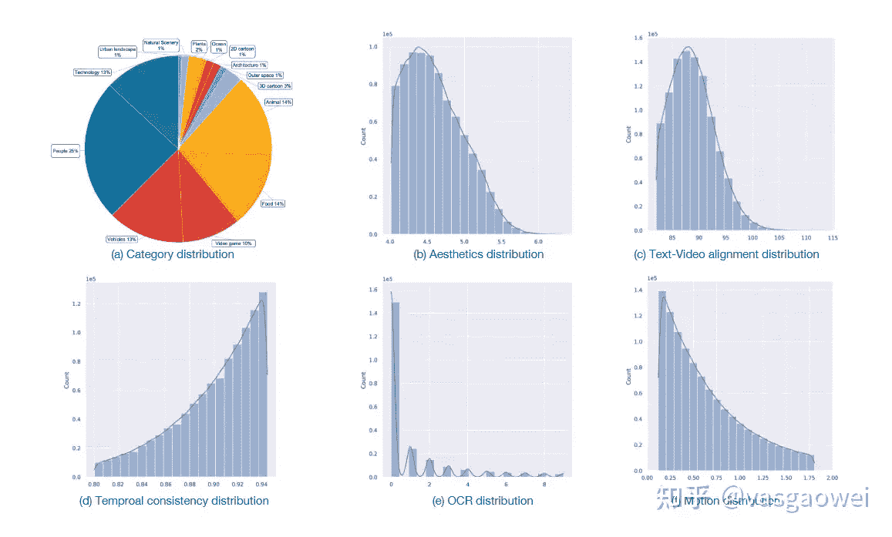

### 九大服务架构性能优化方式

https://zhuanlan.zhihu.com/p/714063070?utm_psn=1808850879484399618

本文深入探讨了服务架构性能优化的关键技术细节，包括接口设计、异步通信、数据预加载与缓存、数据存储优化、负载均衡、服务降级与熔断、CDN 应用、算法与逻辑优化，以及监控与分析。通过合理设计服务接口，减少不必要的复杂度，提高通信效率。采用异步通信模式，有效避免了线程阻塞，提升了系统的并发处理能力。数据预加载和缓存策略减少了数据访问延迟，改善了用户体验。优化数据存储结构和索引，提高了数据库查询效率。负载均衡技术实现了请求的合理分配，提升了系统的抗压能力。服务降级和熔断机制保护了系统在部分服务失效时的稳定性。CDN 的使用缩短了数据传输距离，降低了访问延迟。优化算法和逻辑减少了计算消耗，提高了处理速度。最后，通过监控和分析工具收集性能数据，有助于发现并解决性能瓶颈。

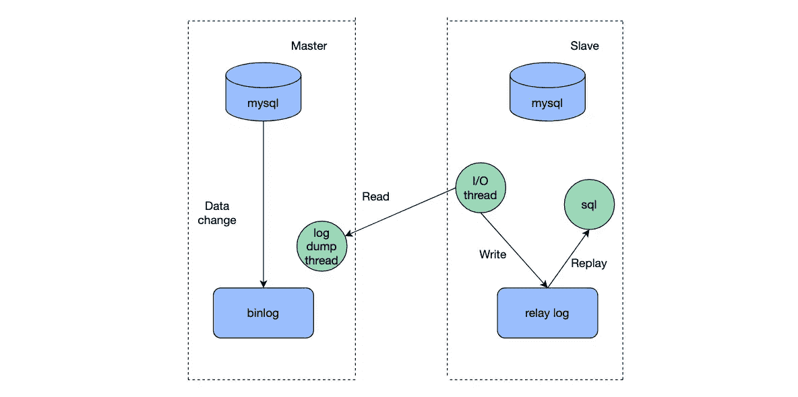

### Intel QPI 简介

https://zhuanlan.zhihu.com/p/715143312?utm_psn=1808858369160769536

Intel QPI（QuickPath Interconnect）是一种高速、低延迟的点对点连接技术，用于替代传统的 Front Side Bus。它在多核处理器中实现了更高效的核心间通信，提供了更大的数据传输带宽，支持多种系统拓扑结构，并通过增强缓存一致性和预取机制，优化了系统性能。QPI 技术的关键在于其点对点的连接方式，能够为每个处理器提供独立的数据通道，从而减少了延迟，提高了并行处理能力。此外，QPI 的链路宽度和频率可以根据系统需求进行调整，以适应不同的性能要求。

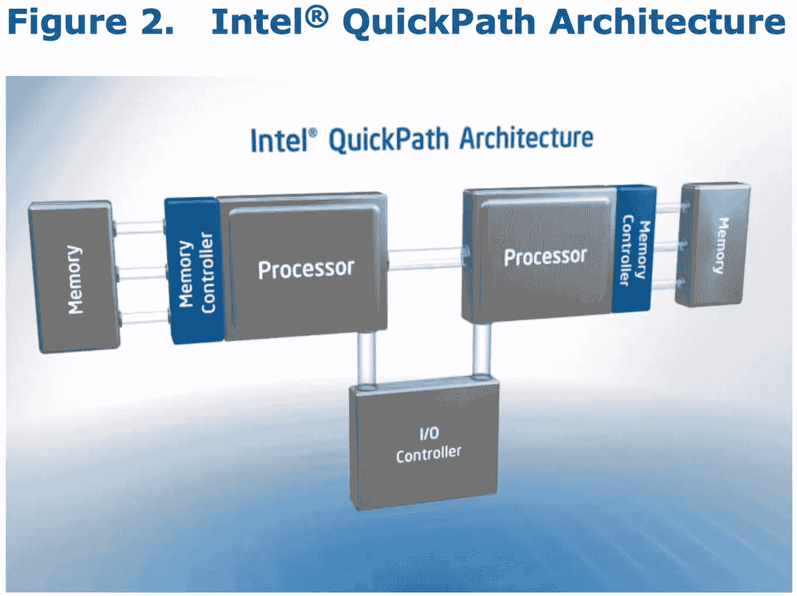

### LLM数据合成之后训练篇

https://zhuanlan.zhihu.com/p/715155768?utm_psn=1808756264282492929

大型语言模型（LLM）的训练涉及数据合成、预训练、微调和部署几个关键阶段。在数据合成后，预训练阶段通过大规模文本学习语言结构，需要精心设计的任务和丰富的计算资源。微调阶段则根据具体任务调整模型参数，以提升特定领域的性能。部署后，模型需要持续监控，根据实际应用反馈进行优化。

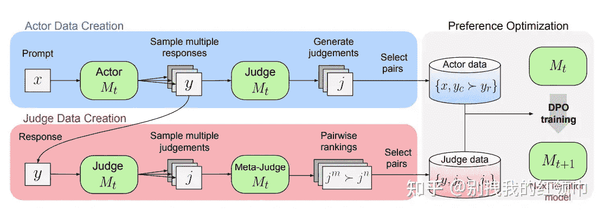

### GPU 硬件学习记录

https://zhuanlan.zhihu.com/p/715139527?utm_psn=1808860609233690624

本文梳理了从极简到现代 GPU 架构的学习路径，重点介绍了 GPU 硬件的关键组成部分，包括极简 GPU 架构的核心组件如 Device Control Register、Dispatcher、Global Memory 等，以及 Compute Core 的线程架构，如 Scheduler、Fetcher 等。详细阐述了极简 GPU 架构的指令集 ISA 和执行流程，包括 FETCH、DECODE 等步骤，并通过 matadd.asm 和 matmul.asm 两个 Kernel 示例展示了矩阵加法和乘法的实现。同时，文章还探讨了现代 GPU 架构中的高级特性，如多层 Cache、Shared Memory、Memory Coalescing、Pipelining、Warp Scheduling 和同步屏障等

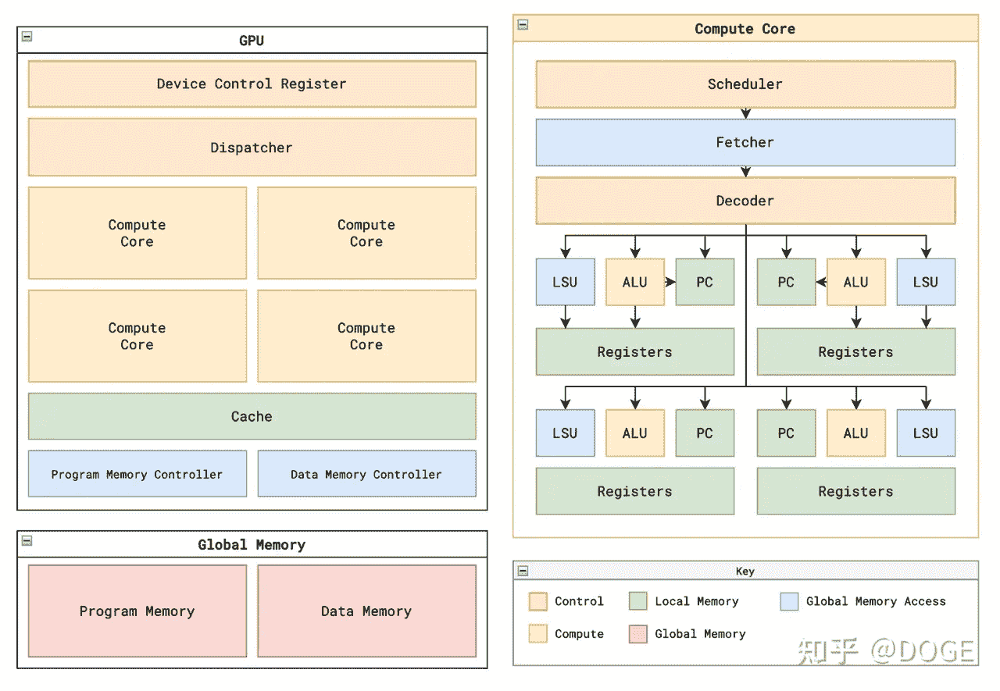

### Reverse/Forward KL散度与online/offline偏好优化

https://zhuanlan.zhihu.com/p/709565824?utm_psn=1808760228340170752

文章探讨了在大型语言模型（LLM）偏好优化中，反向 / 正向 KL 散度的概念及其在 online/offline 算法中的应用。正向 KL 散度（Forward KL）通常用于分布匹配，但在 LLM 的 open-ended tasks 中可能不适宜，因为它可能会分配概率给不希望的回答区域。相比之下，反向 KL 散度（Reverse KL）要求模型在真实分布较大的区域也要有较高的概率，这在处理多模式任务时更为合适。文章指出，on-policy sampling 能在高奖励区域偏离初始策略时提供有效的性能改善，而 negative gradient 可以加快模型收敛速度，增强正确回答的概率。此外，PPO 方法通过最小化与最优策略的 Reverse KL，虽然可能降低多样性，但增强了泛化能力。DPO 方法在数据集之外的回答可能性，因为它并没有对未 cover 到的区域施加约束。文章最终提出了在 SFT 基础上进行 Importance Sampling 来估计 Reverse KL 的方法，以实现 LLM 偏好对齐。

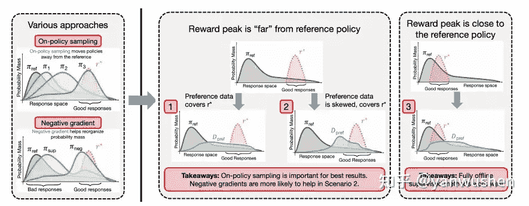

### 【滴水研究】智能时代纪事：人形机器人产业研究（上篇）

https://mp.weixin.qq.com/s/bCnDYO7DlLGbCTntIAzZLA

人形机器人产业的发展历程从古代的 “机器武士” 延续至今日的智能人形机器人，技术从单纯的机械结构发展到融合 AI 技术的智能系统。目前，人形机器人在感知、决策和执行方面取得了显著进展，其中感知系统着重于提升触觉和视觉传感器的精度；决策系统则依赖于 AI 算法和操作系统来实现智能决策；执行系统关注关节减速器、丝杠和电机等关键零部件的性能优化。在技术细节上，力 / 力矩传感器和柔性触觉传感器的发展对于提升机器人的交互能力至关重要。此外，NVIDIA 等公司提供的机器人解决方案，如 AI 算法、计算平台和仿真工具，推动了人形机器人技术的进步。未来，人形机器人产业将继续在智能化、人性化和商业化方面取得新的突破，同时也面临着安全性和伦理性的挑战。

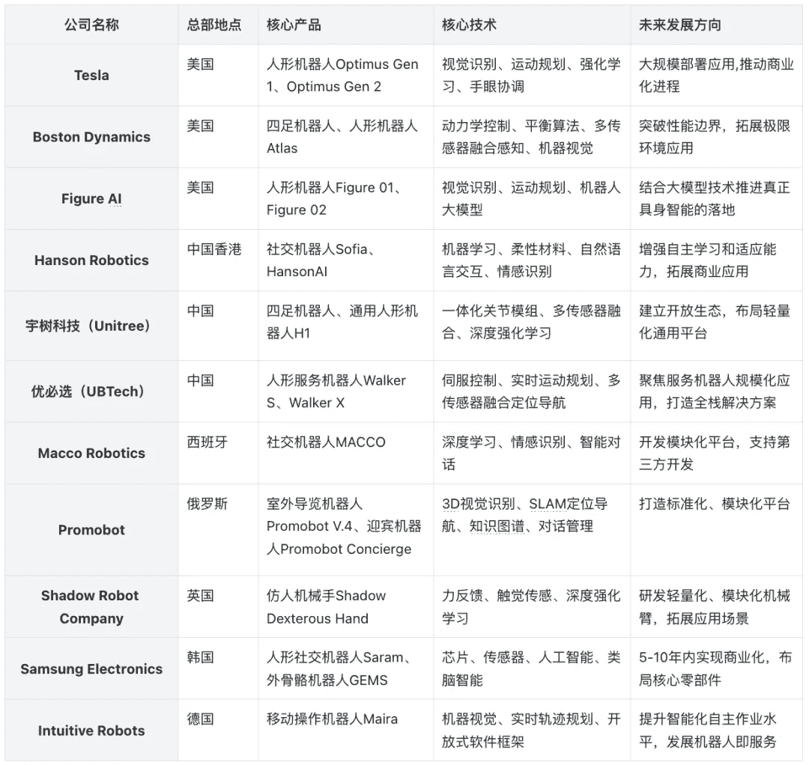

### 揭秘MenteeBot人形机器人与AI融合之道

https://mp.weixin.qq.com/s/XFYMyLVY-QAEAj6awlQMTA

MenteeBot 人形机器人由 Mentee Robotics 开发，集成了 AI 大脑和端到端平台，实现了从口头命令到复杂任务的完整端到端循环。该机器人在模拟器中进行深入训练，通过学习修正策略和领域随机化技术，有效克服了模拟与现实之间的差距。Mentee Robotics 采用了基于 NERF 的世界地图、路径跟随策略和神经辐射场（NeRFs）等感知策略，以及特定的导航策略，使得 MenteeBot 能够在现实世界中进行高效的导航和任务执行。

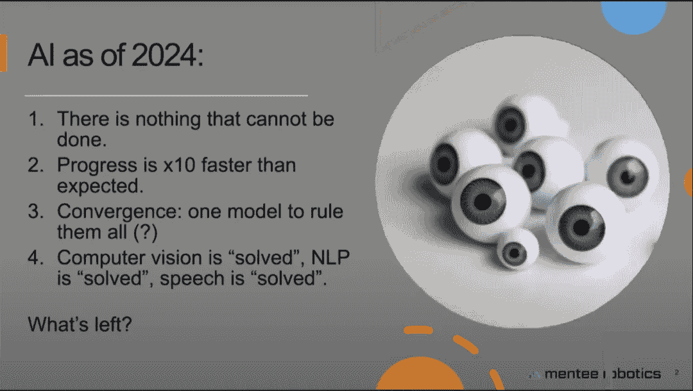

# JD附件：

## 行研-学术科研人才交流组实习生

【你将会做】

1.  旁听（后期主导）与前沿 AI Researchers、前沿论文作者的会议，整理会议纪要；

1.  协助行研团队整理和触达GenAI方向的人才信息，Mapping；

1.  撰写行研报告，参与行研团队的博士们的AI组会；

【你需要具备】

1.  对 GenAI 有兴趣，能够完成前沿技术人才的mapping，快速学习AI各个领域的技术概要，主要方向为：世界模型, AI4S, AI4code, ML理论, RAG, Agent, 具身, LMM, MLSys, 芯片等；

1.  有技术背景或投行和券商实习经验的优先；

1.  有较强的抗压能力，具有较强的自我驱动力，注重细节，Team的工作强度会比较高，晚上会加班；

1.  能够尽快入职，且保证北京线下每周工作至少5天，能够持续四个月以上，中途无需长期请假者优先。

【福利】参与AI系列前沿活动：潜空间大咖分享（往期嘉宾包含月之暗面Kimi、RabbitR1、Luma.ai等）、黑客松、Unconference

## 行研-GenAI研究岗位——前沿学术探索

【你将会做】

1.  与奇绩创坛行研团队（来自MIT、CMU、哈佛、NUS、清华的Researchers）一起梳理、研究从模型、算力到应用体系的前沿进展。

1.  进行前沿论文分析，密切地与全球范围AI创业者、研究员、科学家等群体交流；

1.  参与内部论文组会+报告：探索大模型的“物理学”；具身的ScalingLaw；多模态的BackBone；超长上下文的实现路径；算法系统co-design的下一代模型架构，等前沿GenAI话题

【你需要具备】

1.  对GenAI前沿各个方向（预训练、后训练、算力、系统、具身等）有极强的好奇心，对创新创业有热情；

1.  PHD优先，专业方向包括不限于LLM、LMM、MLSys、具身等（一线公司的行业研究或大厂经历可兼职）；

1.  每周投入不少于8小时工作时间，持续三个月以上，中途无需长期请假者优先。

【岗位地点】支持线上

## 行研-GenAI研究岗位——战略分析（偏咨询）

【你将会做】

1.  敏锐跟踪赛道变化，通过与创业者、研究员等访谈输出行业洞察

1.  面向投资团队/外部LP/政府输出清晰的研究策略；

1.  参与撰写尽职调查报告、投资项目 GTM 研究等，包括市场调研、竞争分析、目标市场定位等；

1.  积极参与投资研究工作，完成海外和国内行业的mapping，分析公司并整合信息。

【你需要具备】

1.  对大模型领域有热情，熟悉头部AI产品和热门赛道研究（关注大模型上下游的投资方向，包括但不限于大模型应用、LLMOps、Agent平台、具身、AI硬件、算力基建等）

1.  有一定的商业分析经验、咨询、VC实习背景、在读MBA等；

1.  熟悉数据分析，PPT能力突出、python优先考虑；

1.  能够保证线下每周工作至少 4 天，持续四个月以上，中途无需长期请假。

【岗位地点】北京线下

## 行研-GenAI研究岗位——战略分析（偏产品）

【你将会做】

1.  进行的 AI 产品侧研究洞察，敏锐跟踪赛道变化，与产品人、投资人、创业者、研究员等访谈，输出投资洞察与策略；

1.  积极参与投资研究工作，完成海外和国内行业的mapping，分析公司并整合信息。

1.  参与撰写尽职调查报告，投资项目GTM研究等，包括市场调研、竞争分析、目标市场定位等。

【你需要具备】

1.  对大模型领域有热情，熟悉头部AI产品和热门赛道研究（关注大模型上下游的投资方向，包括但不限于大模型应用、LLMOps、Agent平台、具身、AI硬件、算力基建等）

1.  有 VC 实习背景者，或者产品经理实习经验者优先；

1.  熟悉数据分析、python 技术者优先；

1.  能够保证线下每周工作至少 4 天，持续四个月以上，中途无需长期请假者优先。

【实习时间】北京线下

## 全栈开发（工程师）实习生

### Web 全栈开发实习生

【你将会做】

1.  使用 Python Flask 或者 Django 框架进行后端开发，以及使用前端框架进行前端开发，参与奇绩行研团队的行业研究数据库产品的搭建与维护；

1.  与团队合作，完成产品的前端以及后端代码设计、测试及维护，保证代码质量；

1.  负责部分前后端代码的优化和重构，保证代码的可扩展性；

1.  参与行研团队的日常 AI 技术研讨会。

【你需要具备】

1.  独立开发能力强，会 Web 全栈技术的同时对产品设计有 sense，审美强。

1.  具有较强的自我驱动力、热爱挑战和创新、工作勤奋、注重细节、责任心强、结果导向。

1.  掌握以下前端技术：

+   精通HTML 、 CSS 、 JavaScript 等前端技术，对 Web 标准有深入理解；

+   熟悉一种或多种前端框架，如 Angular 、 React 、 Vue 等；

+   能够脱离框架开发前端复杂交互效果；

+   熟悉浏览器开发工具，如 Chrome DevTools 、 Firefox 开发者工具等；

+   熟悉前端性能优化技术和常见的安全防护措施（如XSS、CSRF）；

+   需要一定的设计与审美来保证前端界面的美观，以及与负责产品的同学的基本沟通能力。

1.  掌握以下后端技术：

+   精通python编程语言，拥有丰富的后端开发经验，熟悉 Python 的后端开发框架 flask 或者 Django；

+   熟练掌握至少一种关系型数据库（MySQL、PostgreSQL）和NoSQL数据库（MongoDB、Redis）；

+   熟练使用 Docker 进行应用的容器化部署，理解Docker镜像和容器的基本原理，能够编写 Dockerfile 构建镜像，使用 Docker Compose 编排多容器应用，了解容器的网络、存储和安全管理，具备解决容器化过程中常见问题的能力；

1.  有较强的抗压能力，能够接受加班。

1.  能够尽快入职，且保证每周至少5天工作，至少持续四个月整，中途无需长期请假。

【岗位地点】北京线下

### **AI 全栈工程师实习生**

【你将会做】

1.  开发创业信号看板，通过 AI Agent 的方式自动寻找可能改变世界的创业者们；

1.  参与技术创业者和奇绩校友企业的沟通，了解如何用技术让生活变得更美好。

【你需要具备】

1.  熟悉 python 基本语法、Flask 或者 Django 后端框架；

1.  熟悉 LangChain 等大模型开发框架；

1.  熟悉 Agent 框架、RAG、Agentic Workflow、Multi Agent、Memory、Tool Using 等 Agent 工作流；

1.  了解前端开发框架，如 React、Vue 等；

1.  熟悉爬虫开发框架，如 BeautifulSoup、Selenium 等；

1.  熟悉 RPA 开发；

1.  有较强的抗压能力，能够接受加班；

1.  加分项：具有产品开发实践经验，有创业经验。

【岗位地点】北京线下

## 创新活动产品运营 （大模型系列活动产品运营）

【你将会做】

1.  参与奇绩大模型系列活动的运营、渠道推广及增长，例如奇绩潜空间、AI Unconference（大模型创业者自组织会议）等系列活动。

1.  制定并执行市场推广计划，包括市场调研、竞争分析、目标市场定位等，协助完成 AI 方向专题研究。

1.  管理产品发布周期，包括产品定位、信息传递、推广活动的策划与实施，以及收集与分析用户活动反馈。

1.  设计并实施营销活动，利用社交媒体和其他在线平台推广产品，增加曝光度，并跟踪分析营销效果，不断优化策略以提升用户参与度和转化率。

【你需要具备】

1.  具备活动组织和运营经验，举办或参与过大型创业活动/大模型主题活动者优先；

1.  对前沿科技充满好奇心和热情，了解AI、LLM、MLSys等领域；

1.  具备创新思维和解决问题的能力；

1.  具有项目管理、增长运营、新媒体运营或广告投放相关经验者优先；

1.  够保证线下每周工作 5 天，持续四个月以上，中途无需长期请假者优先。

【岗位地点】北京线下

##

# 声明

本文档仅供学习交流使用，版权归原作者所有，若涉侵权，请联系Jack Jin 15101136166

##

（欢迎在下方反馈您宝贵的意见！整理不易，觉得有用给AI日报小组点个赞👍吧！）

ChatGPT；Angela；Zijia Liu；Alex；Zeqi Tan；Tiezhen（HuggingFace）；Naixu；Lizhi；Peter；Suoman；Jack

封面生成——右脑科技

如果你有大模型相关的创业想法，欢迎来找我们聊聊～微信：15101136166

> 快邀请你的小伙伴们一起来读大模型日报吧！

> **【日报****知识库****】**这里是近期日报内容的汇总,欢迎大家查阅

> [大模型日报知识库(分享版)](https://miracleplus.feishu.cn/wiki/KapVwXfkriOBiskB0B2cUHxjnTh)

>

> 欢迎大家多多帮我们分享,转发~~

> 如果大家有任何的建议或者吐槽,欢迎随时找我聊天~

