# 奇绩大模型日报（8月 20日）

> 来源：[https://miracleplus.feishu.cn/docx/Ko2WdIYVYo1yMdxfDKicASL9nVc](https://miracleplus.feishu.cn/docx/Ko2WdIYVYo1yMdxfDKicASL9nVc)

# 📡潜空间活动报名

> 潜空间系列活动第三季第三期开启报名！

> 本期活动将在**8月24日** **10:00 am**开始，嘉宾是**童晟邦**。**童晟邦，纽约大学博士，伯克利人**工智能实验室（BAIR）研究员， OpenAI 超对齐奖学金获得者。他将和大家探讨视觉在多模态大模型中扮演的角色。

> 除嘉宾分享外，每期设置了【匹配合伙人 Cofounder Matching】环节。你可以和 GenAI 时代最有活力的创业者和研究者线下面对面交流，将有机会找到志同道合、有共同创业梦想的小伙伴。

> 报名通道已开启，欢迎扫描下方二维码报名。

# 资讯

### 《黑神话：悟空》石破天惊，RTX 4090D飞越花果山

https://mp.weixin.qq.com/s/_b5XI5sTqQmZpmRCRO5p_w

《黑神话：悟空》游戏自发布以来，以其卓越的销售业绩和高质量的游戏体验，成为中国游戏产业的新高 lights。游戏在预售阶段即突破了中国游戏预售记录，并在全球最大的游戏平台 Steam 上获得了前所未有的成功，包括下载带宽和销量双双创纪录。这一成就得益于游戏的精湛制作和创新技术，如全景光追和 DLSS 3，后者由英伟达的 AI 技术驱动，极大地提升了画面效果和性能。

测评:https://zhuanlan.zhihu.com/p/715545277?utm_psn=1809283235395530753

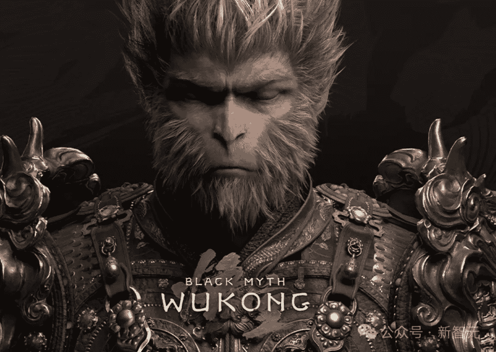

### Qwen2-Math可玩Demo，阿里多模态模型加持，中文适用

https://mp.weixin.qq.com/s/90Uz9w6od9gkEfnqiL_P5Q

数学大模型 Qwen2-Math 由阿里千问大模型团队发布，其 Demo 支持中文提问，并通过 OCR 技术处理数学问题截图或扫描件。该模型包括 72B、7B 和 1.5B 三个参数量版本，其中 72B 版本的 Instruct 版本在代数、几何、计数与概率、数论等多种数学问题上达到 84% 的准确率，在 MATH 数据集上超越了 GPT-4o 等竞争模型。尽管目前主要针对英文场景，但 Qwen2-Math 也能够用英文回答中文提问，并且正在开发中英双语版本。未来，阿里计划将多模态能力和数学推理能力进一步整合，以提供更加强大的解题能力。不过，模型在处理某些复杂问题时可能会出错，如几何题或 OCR 识别错误导致的问题

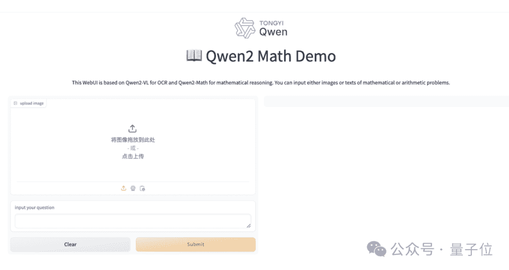

### 哈萨比斯：谷歌想创造第二个Transformer，还想把AlphaGo和Gemini强强联合

https://mp.weixin.qq.com/s/3kXKmXE5txhM5Wq4jHratw

谷歌 DeepMind 计划创造下一代 Transformer，并打算将 AlphaGo 与 Gemini 等多模态模型强强联合，以推动人工智能的突破。DeepMind 联合创始人 Demis Hassabis 认为，尽管 AI 在短期内可能被过度炒作，但从长远来看，它是被低估的。他强调了 AI 领域需要更好的基准测试，特别是在多模态理解、长期记忆和推理能力等方面。谷歌计划结合其在游戏智能体和大语言模型方面的专业知识，开发具备更强智能体行为的系统。

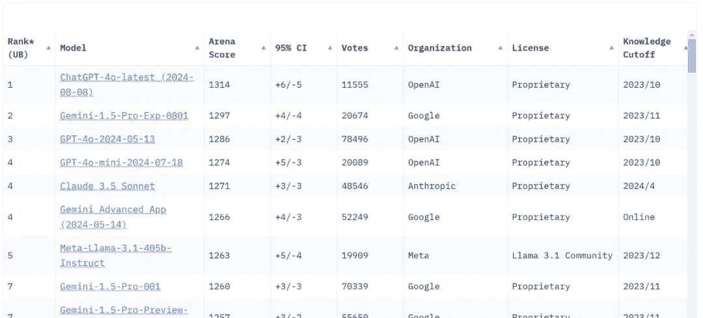

### UBC 研究：AI 自我进化设计新路径

https://mp.weixin.qq.com/s/IjNLHLov8UyAiRGDkf_XTA

UBC 华人研究团队开发了智能体自动化设计系统（ADAS），通过元智能体搜索算法实现 AI 自我设计和迭代。该系统能够创建新的智能体构建模块，或优化现有模块的组合方式。实验显示，ADAS 设计的智能体在数学、阅读和推理等领域的基准测试中，性能超越了传统人工设计的智能体。尤其在数学能力上，准确率提升了 25.9%。这些智能体还展现出跨领域和跨模型的泛化能力，能够在不同的 AI 模型和任务之间迁移。

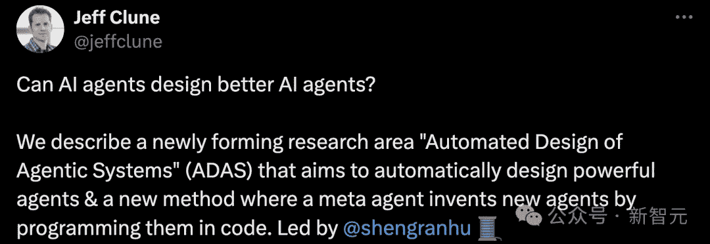

### 树莓派5推出2GB版本：比4GB版便宜16%，除内存外几乎无减配

https://mp.weixin.qq.com/s/gsPDIT4H1XJ0dqX2ZZE_Wg

树莓派 5 推出 2GB 版本，以更低的价格吸引预算有限的用户，性能测试显示在日常使用和轻度多任务处理上与高配版本相当，但在内存密集型任务上存在限制。树莓派官方认为 2GB 内存对于大多数用户来说是足够的，并且可能会推出更低配的 1GB 版本。同时，新的微控制器 Pico 2 也上市，提供了更多的接口和存储选项。

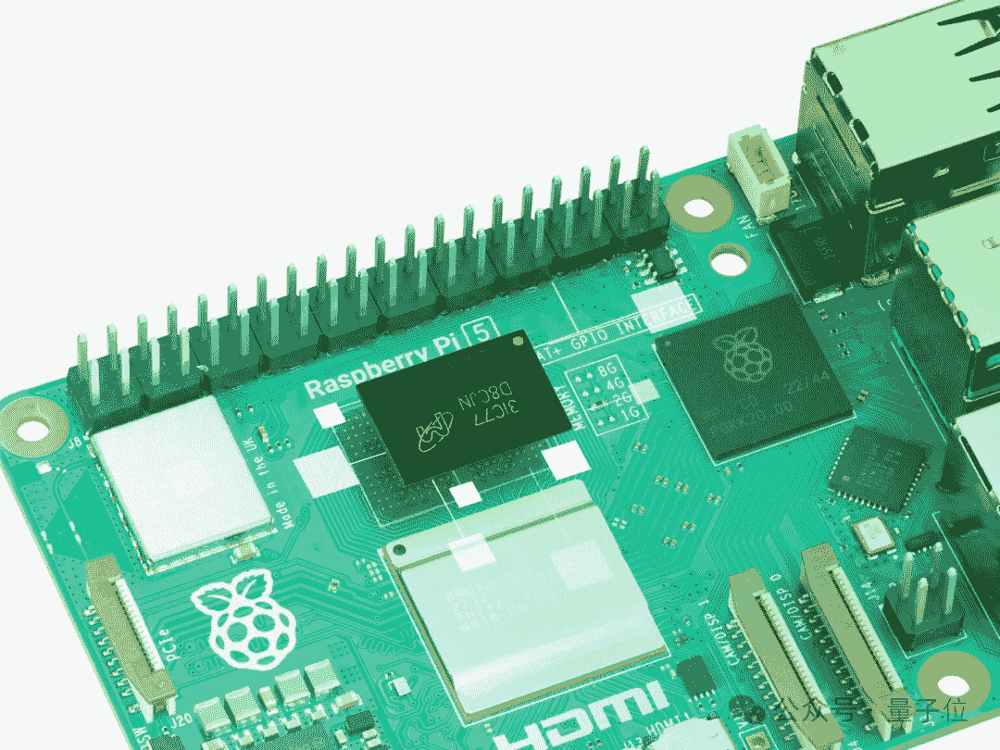

# 推特

### Unitree G1 量产版：性能更强，外观更加出色

https://x.com/UnitreeRobotics/status/1825435336736120880

Unitree G1 量产版，跃向未来！

在过去的几个月里，Unitree G1 机器人已经升级为量产版本，性能更强，外观更加出色，并且更加符合量产要求。希望你们喜欢它。🥳

#Unitree #AGI #具身AI #AI #类人机器人 #双足机器人 #世界模型

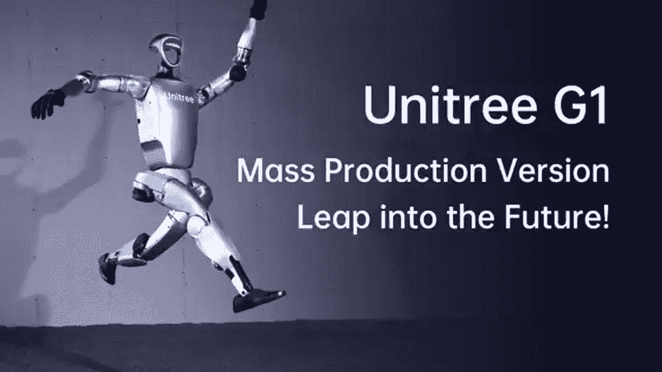

[ssstwitter.com_1724146552621.mp4](https://internal-api-drive-stream.feishu.cn/space/api/box/stream/download/all/BDA6bANf7oeiyix3Ur5caSxanjh)

### 最新DiffusionKit：与MLX结合使用时，Flux Schnell速度提升了30%，并且占用更少的内存

https://x.com/awnihannun/status/1825546558739517643

最新的DiffusionKit与MLX结合使用时，Flux Schnell速度提升了30%，并且占用更少的内存！

运行以下命令安装更新：pip install -U diffusionkit

在我的32GB M1 Max笔记本上生成高质量图像不到一分钟：

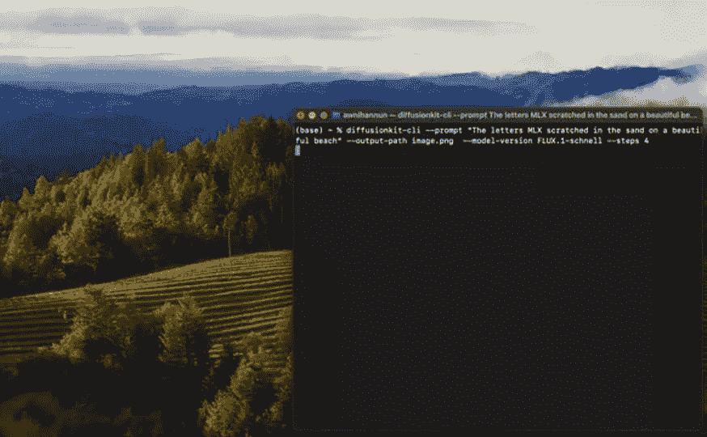

[ssstwitter.com_1724151012759.mp4](https://internal-api-drive-stream.feishu.cn/space/api/box/stream/download/all/X17XbMXgVo4W3TxuO5kcsbUZnzc)

### 高热度视频：AI产生前端代码

https://x.com/webdevcody/status/1825386539154550992

WebDevCody：前端开发者正式“玩完了”

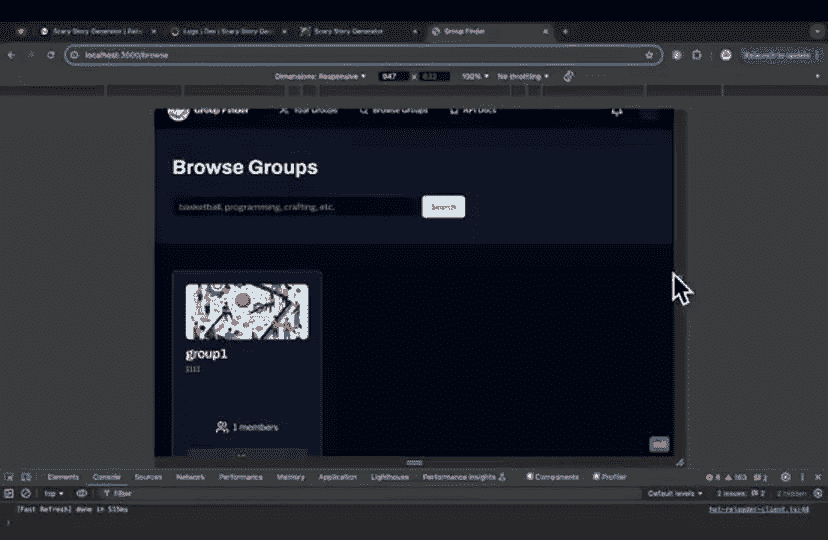

[ssstwitter.com_1724063572206.mp4](https://internal-api-drive-stream.feishu.cn/space/api/box/stream/download/all/VV7obsz7xoWqOQxBwFpcgAa3nPf)

### 震惊！八岁小孩在AI的帮助下，45分钟能构建什么？Ricky分享自己的女儿编程课亮点

https://x.com/rickyrobinett/status/1825581674870055189

一个8岁的孩子在AI的帮助下，45分钟内能构建什么？

我的女儿一直在使用@cursor_ai学习编程，她的进步令人惊叹🤯

以下是她第二次编程课的亮点。在45分钟内，她构建了一个由@CloudflareDev Workers AI驱动的聊天机器人👀

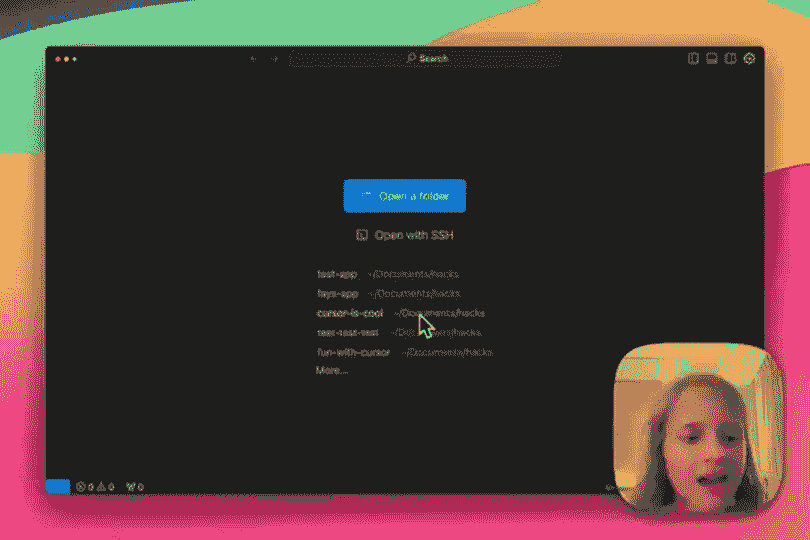

[ssstwitter.com_1724114334106.mp4](https://internal-api-drive-stream.feishu.cn/space/api/box/stream/download/all/EMDfbNDUUohLo6xaB9McXETAnKL)

### Marafioti分享：为HF的语音到语音添加Mac支持

https://x.com/andi_marafioti/status/1825562455935770846

为HF的语音到语音添加Mac支持！🔥

模块化管道可以在你的MacBook上运行类似GPT-4的体验，100%私密！延迟低至1秒！⚡️

我们将最好的MLX模型集成在一个包中：

+   语音活动检测：Silero VAD v5

+   语音转文本（STT）：Lightning Whisper MLX

+   语言模型（LLM）：MLX LM

+   文本转语音（TTS）：MeloTTS

同时支持CUDA GPU，使用相同的代码库，你现在可以在笔记本电脑上开发应用程序，并将其部署在云端！

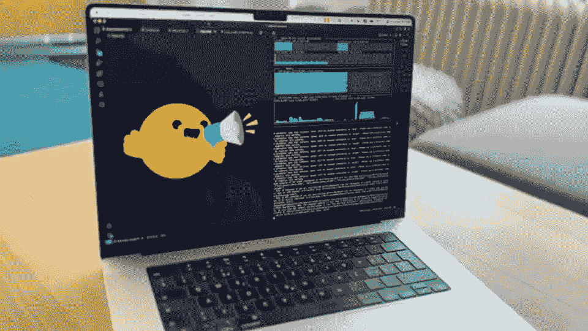

[ssstwitter.com_1724151607701.mp4](https://internal-api-drive-stream.feishu.cn/space/api/box/stream/download/all/Vn8DbR18FoWbNzxF912cf1Onn4g)

# 论文

### KAN 2.0: 科尔莫哥洛夫-阿诺德网络遇见科学

贡献人：

链接：http://arxiv.org/abs/2408.10205v1

摘要：人工智能和科学之间存在一种固有的不兼容性，今天的人工智能主要基于连接主义，而科学依赖符号主义。为了桥接这两个世界，我们提出了一个框架，通过 Kolmogorov-Arnold Networks (KANs) 来无缝地整合人工智能和科学。这个框架强调了KANs在科学发现的三个方面的用途：识别相关特征、揭示模块化结构和发现符号公式。这种协同作用是双向的：从科学到KAN（将科学知识整合到KANs中），以及从KAN到科学（从KAN中提取科学洞见）。我们在pykan包中突出了一些主要的新功能：(1) MultKAN：带有乘法节点的KANs。 (2) kanpiler：将符号公式编译成KANs的KAN编译器。 (3) tree converter：将KANs（或任何神经网络）转换为树状图。基于这些工具，我们展示了KANs发现各种物理定律的能力，包括守恒量、Lagrange函数、对称性和本构定律。

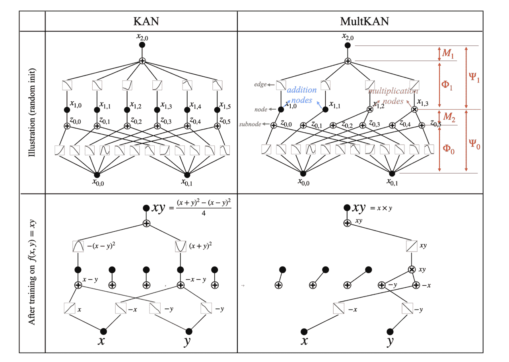

### Transformers to SSMs：将二次知识提炼为次二次模型

贡献人：

链接：http://arxiv.org/abs/2408.10189v1

Transformer架构已成为诸如语言建模等领域的主导范式，但由于其二次时间复杂度的自注意力，在许多推理设置中存在问题。最近提出的次二次架构，例如Mamba，显示出了希望，但它们被预训练时所使用的计算资源远远少于最强Transformer模型。在这项工作中，我们提出了一种方法，能够将预训练的Transformer架构蒸馏成诸如状态空间模型（SSM）之类的替代架构。我们方法的关键思想是，我们可以将Transformer和SSM都视为在token序列上应用不同形式的混合矩阵。因此，我们可以通过匹配SSM中不同粒度的内容来逐渐蒸馏Transformer架构。我们的方法名为MOHAWK，能够仅使用3B个token蒸馏基于Phi-1.5架构的Mamba-2变种（Phi-Mamba），以及使用5B个token蒸馏混合版本（Hybrid Phi-Mamba）。尽管使用的训练数据量不到通常训练模型所需数据的1%，Phi-Mamba在性能上明显优于所有以往的开源非Transformer模型。MOHAWK使得SSM这样的模型能够利用在训练基于Transformer的架构时投入的计算资源，为构建这类模型开辟了新的途径。

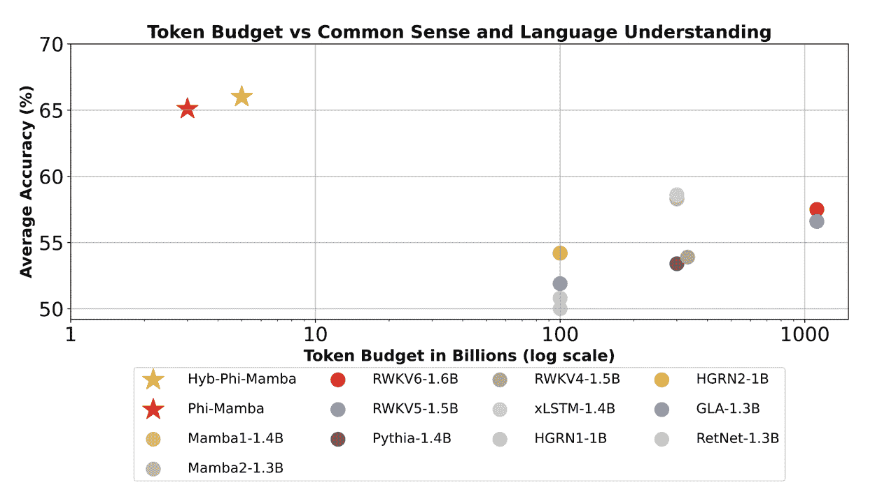

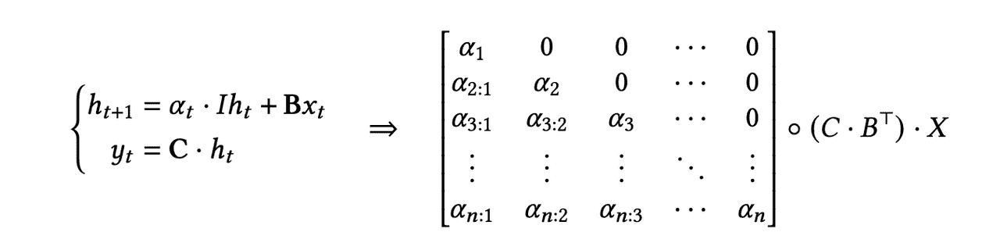

### Narrowing the Focus：为预训练模型学习优化器

贡献人：

链接：http://arxiv.org/abs/2408.09310v1

在现代深度学习中，模型通过应用梯度更新来学习，优化器根据各种统计数据转换更新。优化器通常是手动设计的，调整超参数是训练过程的重要部分。学习优化器显示了一些初步的潜力，但通常作为通用优化机制不成功应用到每个问题上。本研究探索了一个不同的方向：我们不是学习通用优化器，而是将它们专门用于特定的训练环境。我们提出了一种新颖的优化器技术，它学习了一个层特定的线性组合，由一组基本优化器提供的更新方向，有效地调整其策略以适应特定的模型和数据集。在图像分类任务上评估时，这种专门的优化器显著优于传统的现成方法，如Adam，以及现有的一般学习优化器。此外，它表现出与模型初始化、在看不见的数据集上评估和训练持续时间超出其元训练范围的稳健泛化能力。

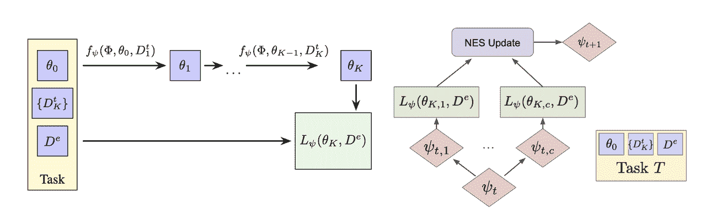

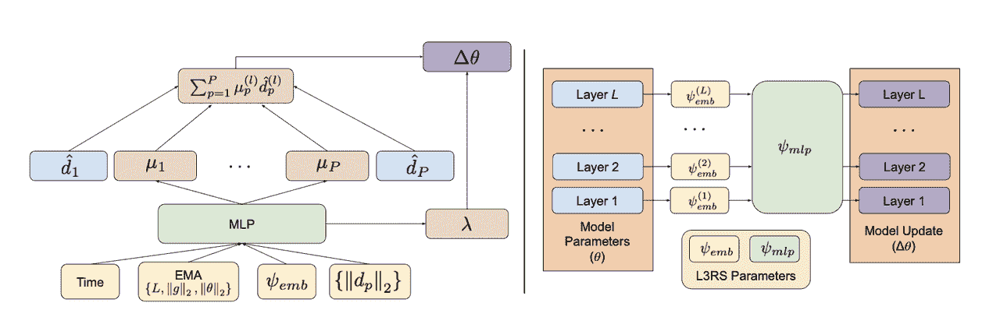

### BLADE: 为数据驱动科学基准测试智能体的语言模型

贡献人：

链接：http://arxiv.org/abs/2408.09667v1

数据驱动的科学发现需要科学领域知识、统计专业技能以及对数据语义的理解进行迭代整合，以做出精细的分析决策，例如关于应考虑哪些变量、转换和统计模型。具备规划、记忆和代码执行能力的大语言模型智能体有潜力支持数据驱动科学。然而，在开放式任务上评估智能体很具挑战性，因为存在多种有效方法、部分正确步骤以及表达相同决策的不同方式。为了解决这些挑战，我们提出了BLADE，一个用于自动评估智能体多方面方法的基准。BLADE包括12个数据集和研究问题，取自现有科学文献，其基本真相由专家数据科学家和研究人员进行独立分析而收集。为了自动评估智能体的响应，我们开发了相应的计算方法，将不同分析表示与基本真相匹配。虽然语言模型具有相当多的世界知识，但我们的评估表明，它们通常受限于基本分析。然而，能够与底层数据互动的智能体在其分析决策方面表现出改进但仍不理想的多样性。我们的工作使得能够评估用于数据驱动科学的智能体，并为研究人员提供对智能体分析方法的深入洞见。

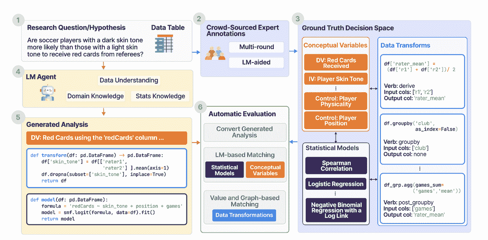

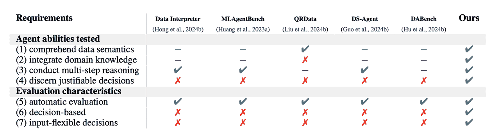

### **SkyScript-100M：用于短剧的**1000,000,000对剧本和拍摄剧本

贡献人：

链接：http://arxiv.org/abs/2408.09333v1

摘要：生成包含场景和拍摄语言等信息的高质量短剧本对于短剧本的生成至关重要。我们从互联网上收集了6,660部受欢迎的短剧集，平均每部有100集，总共有约80,000个短剧本，总时长约2,000小时，总共10 TB。我们对每一集进行关键帧提取和注释，获得约10,000,000个拍摄脚本。基于我们自主开发的大型短剧本生成模型SkyReels，对提取的拍摄脚本进行100次脚本恢复。这产生了一个包含1,000,000,000对短剧的剧本和拍摄脚本的数据集，名为SkyScript-100M。我们对SkyScript-100M与现有数据集进行了详细比较并展示了一些更深入的见解。研究人员可以在SkyScript-100M的基础上实现几个更深入和更具影响力的剧本优化目标，这可能推动整个文本到视频领域的范式转变，显著推进短剧视频生成领域的发展。数据和代码可在https://github.com/vaew/SkyScript-100M获得。

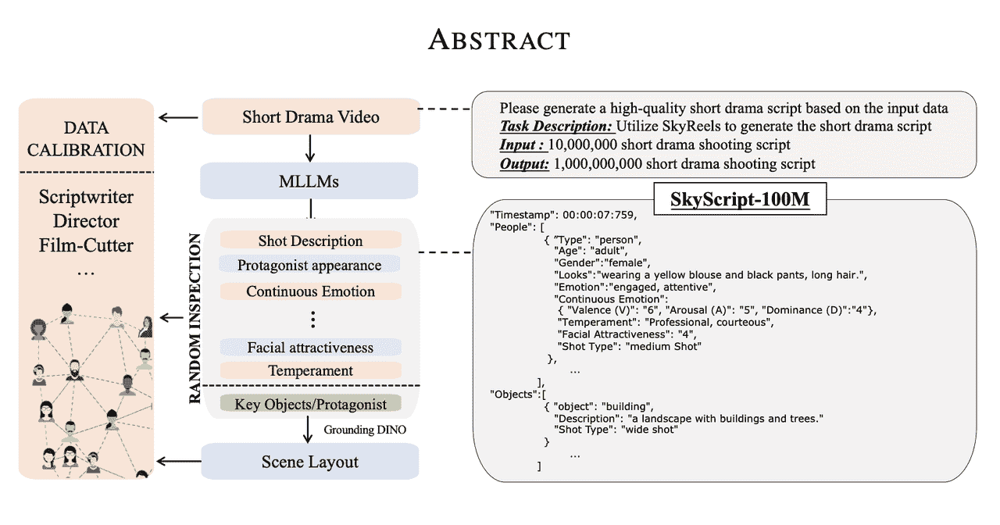

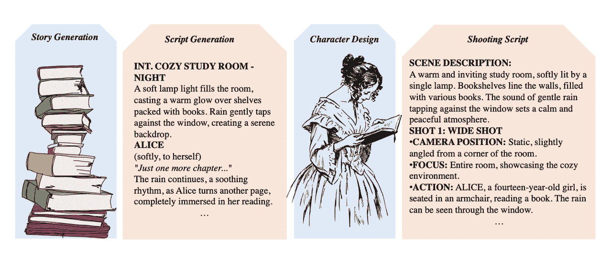

### **See What LLMs Cannot A**nswer：揭示LLM弱点的自我挑战框架

贡献人：

链接：http://arxiv.org/abs/2408.08978v1

摘要：大语言模型（LLMs）的出色表现持续超越许多人工设计的基准，对评估LLMs的缺陷提出了新的挑战。设计任务并找到LLMs的限制变得越来越重要。本文研究了一个问题，即LLM是否能够从其错误中发现自己的局限性。为此，我们提出了一个带有人机协同的自我挑战评估框架。从GPT-4无法回答的种子实例开始，我们提示GPT-4总结错误模式，并结合人类反馈对其进行改进，用于生成更具挑战性的数据，进行迭代。最终形成了8种不同的模式，如文本操作和带有假设的问题。我们建立了一个名为SC-G4的基准，包括1,835个由GPT-4使用这些模式生成的实例，并具有人类注释的标准回答。SC-G4作为一个具有挑战性的基准，可以详细评估LLMs的能力。我们的结果显示，SC-G4中仅有44.96％的实例可以被GPT-4正确回答。有趣的是，我们的初步研究表明，这些错误模式也对其他LLMs构成挑战，如Claude-3和Llama-3，并且不能通过微调完全解决。我们的工作首次证明了LLMs能够自主识别其固有缺陷，并为未来动态和自动评估提供见解。

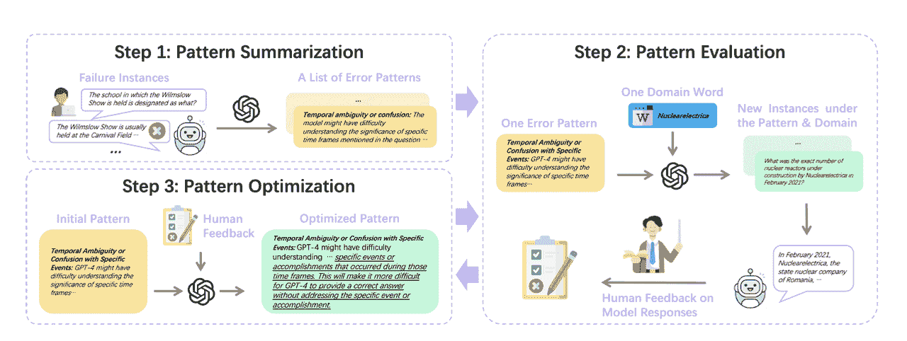

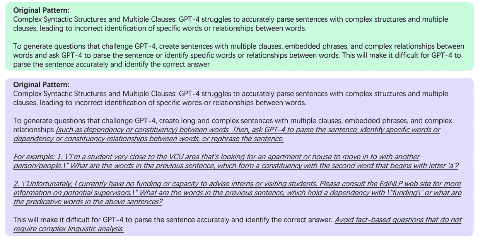

### LONGVILA：为长视频扩展长上下文视觉语言模型

贡献人：

链接：http://arxiv.org/abs/2408.10188v1

长上下文能力对于多模态基础模型至关重要。我们推出了LongVILA，这是一个面向长上下文视觉语言模型的全栈解决方案，包括系统、模型训练和数据集开发。在系统方面，我们引入了第一个支持长上下文训练和推理的Multi-Modal Sequence Parallelism（MM-SP）系统，可以在256个GPU上进行2M上下文长度的训练。此外，它还与Hugging Face Transformers完美集成。对于模型训练，我们提出了一个包括对齐、预训练、上下文扩展和长短联合监督微调的五阶段流水线。关于数据集，我们精心构建了大规模视觉语言预训练数据集和长视频指令跟随数据集，以支持我们的多阶段训练过程。这一全栈解决方案将VILA的可行帧数提高了128倍（从8增加到1024帧），将长视频字幕得分从2.00提高到3.26（1.6倍），在1400帧视频（274k上下文长度）中实现了99.5％的准确率。

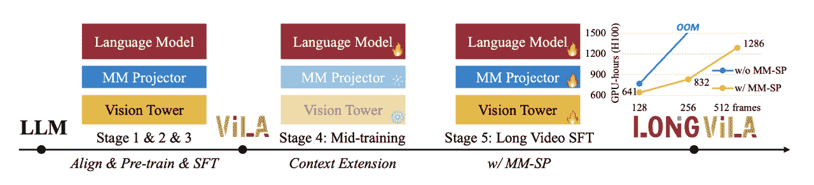

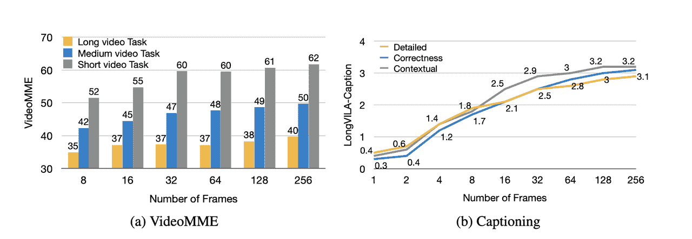

# 产品

### Coldreach

贡献人：

https://coldreach.ai/

Coldreach （YC W23） 是一款利用 AI 技术帮助销售团队找到准备购买的潜在客户的工具。它通过分析公开信息（如工作描述、招聘历史、新闻等）来识别客户的需求信号，从而提高销售会议的预约率。Coldreach 希望可以帮助销售团队更高效地识别和接触那些真正需要其产品的客户。

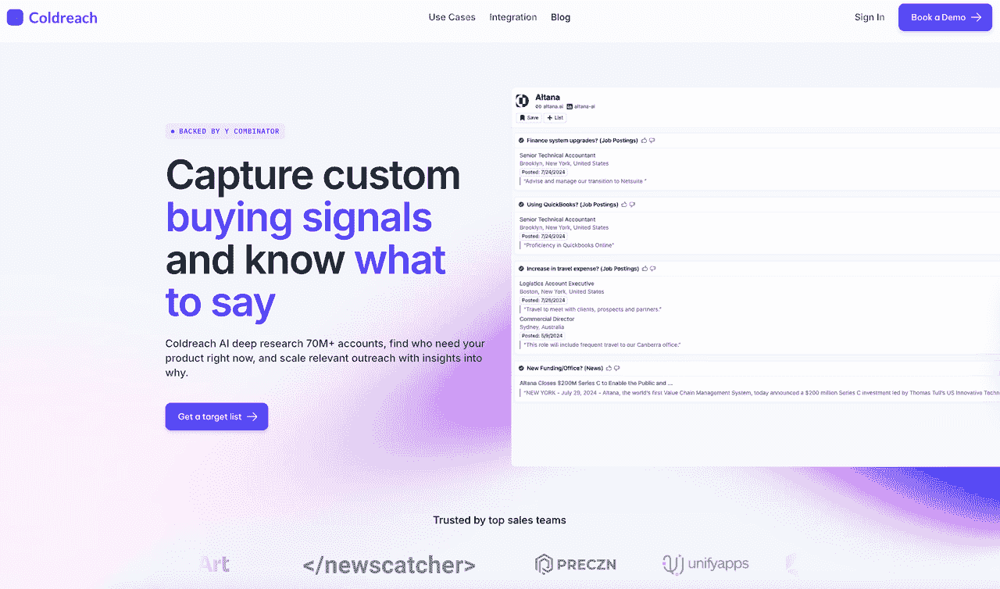

### Hamming AI

贡献人：

https://hamming.ai/

Hamming AI（YC S24）是一款专注于语音代理的自动化测试工具。它可以比手动拨打电话快 100 倍地测试 AI 语音代理，创建类似 Character.ai 的角色和场景，并同时进行数百个电话呼叫，以发现语音代理中的错误。用户可以获得详细的分析报告，以便改进其系统。例如，某客户正在为快餐连锁店构建 LLM 驱动的自助点餐语音代理，其关键绩效指标（KPI）是订单准确性。该系统需要能够灵活处理饮食限制和客户在点餐过程中可能的出现的题外话。

### Ellipsis

贡献人：

https://www.ellipsis.dev/

Ellipsis 是一款 AI 驱动的 GitHub 机器人，提供自动化代码审查和一键修复功能，能够快速捕捉逻辑错误和安全问题。用户只需打开拉取请求即可获得审查反馈，Ellipsis 还可以根据团队的风格指南进行代码检查。

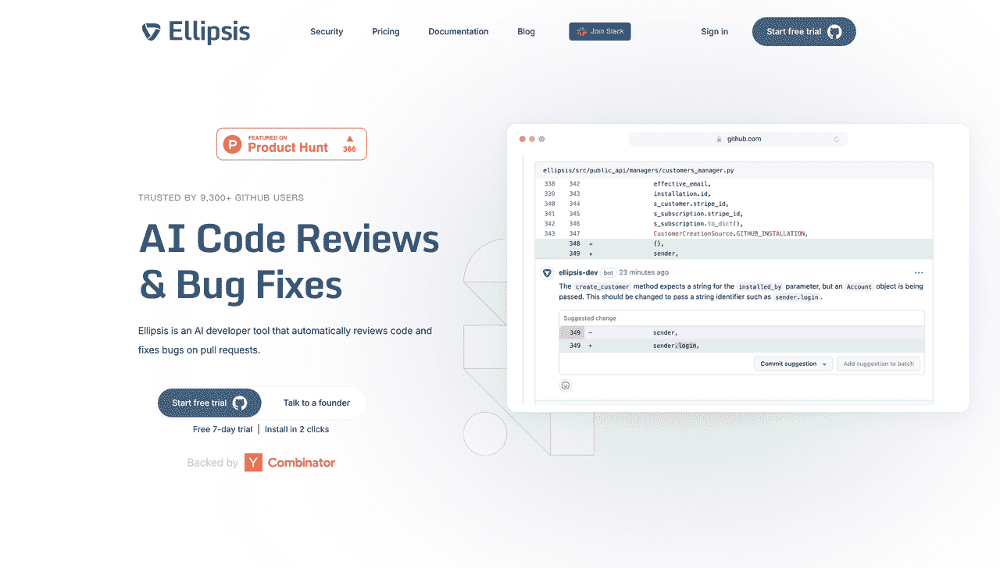

# HuggingFace&Github

### LongWriter

贡献人：

https://github.com/THUDM/LongWriter

LongWriter 是一个基于大语言模型的长文本生成工具，可以生成超过 10,000 字的长篇内容。这个项目主要包含以下内容：

1.  开源了两个预训练模型： LongWriter-glm4-9b 和 LongWriter-llama3.1-8b，分别基于 GLM-4-9B 和 Meta-Llama-3.1-8B 进行微调。

1.  提供了部署 LongWriter 模型的代码示例，包括使用 transformers 库和 vllm 库。

1.  开源了 AgentWrite，一个自动化的超长输出数据构建管道。

1.  提供了 LongBench-Write 和 LongWrite-Ruler 两个评估基准，用于测试模型的输出质量和长度。

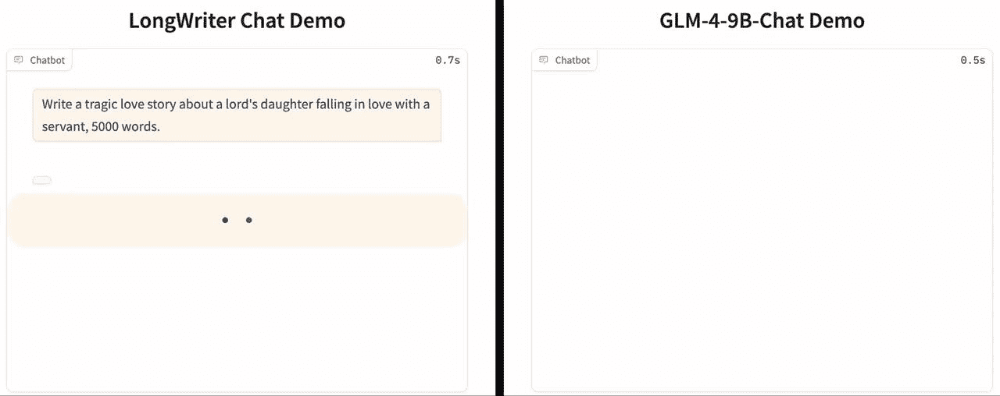

[357120414-c7eedeca-98ed-43ec-8619-25137987bcde.mp4](https://internal-api-drive-stream.feishu.cn/space/api/box/stream/download/all/X2USbjKFdoV610xzsKccP7bIn0d)

### TurboEdit

贡献人：

https://betterze.github.io/TurboEdit/

TurboEdit 是 Adobe Research 发布的一种高效的图像编辑技术，通过少量步骤实现精确修改，结合图像反演和文本引导，允许用户快速改变特定属性。它提供实时编辑体验，速度快且精度高，超越传统的多步骤扩散编辑方法。

# 投融资

### AMD收购ZT Systems，扩大AI生态系统布局

https://techcrunch.com/2024/08/19/amd-to-acquire-infrastructure-player-zt-systems-for-4-9b-to-amp-up-its-ai-ecosystem-play/

AMD宣布以49亿美元收购ZT Systems，此次交易以现金和股票形式进行，并包括高达4亿美元的绩效附加款。ZT Systems专注于AI、云计算和通用计算的基础设施设计，曾在2023年通过债务融资筹集了8.5亿美元。此次收购旨在增强AMD在AI系统设计方面的能力，助其扩大芯片销售与生态系统影响力。ZT Systems将成为AMD数据中心解决方案业务的一部分，预计交易将在2025年上半年完成。

公司官网：https://ztsystems.com/

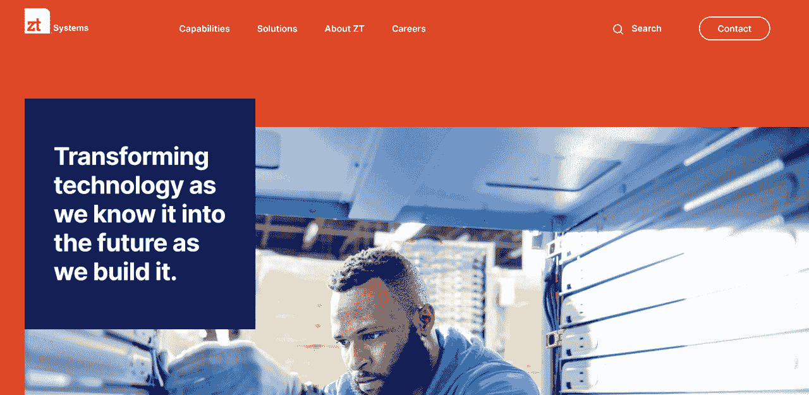

# 学习

### 对话赵行、庄子文：机器人跑酷和自动驾驶——机器人数据从哪里来

https://mp.weixin.qq.com/s/50OrmGYK_-pnYn5oakGRRA

在机器人学习领域，目前尚缺普遍认可的数据集和评价标准，尤其在动态高难度任务如机器人公园和自动驾驶中。研究人员面临的挑战包括机器人操作的低成功率，这导致了对性能评估的复杂性。为了克服这些难题，研究者们往往在简化环境下进行系统测试，但这可能会降低机器人在复杂真实场景中的适应性。此外，由于忽略了动态因素，如物体突然掉落，许多机器人操作任务在视频展示时需要加速播放，以示更流畅的动作。

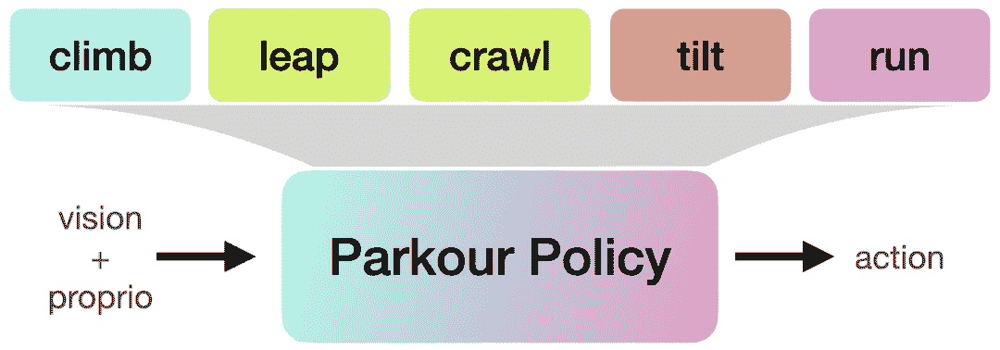

### 怎样进行大模型应用程序中的意图识别

https://zhuanlan.zhihu.com/p/679040557?utm_psn=1809167619061862402

文章深入探讨了大模型应用程序中的意图识别技术。首先，强调了采用合适的数据预处理技术，如分词、去除停用词等，以提高模型训练效率。其次，详细介绍了深度学习模型在意图识别中的应用，如卷积神经网络（CNN）和循环神经网络（RNN）的结构和特点，以及如何利用预训练模型如 BERT 进行特征提取。此外，文章还讨论了模型优化策略，例如使用正则化技术防止过拟合，以及通过调整超参数来提升模型性能。最后，文章指出了模型部署后的监控和迭代优化的重要性，以适应不断变化的用户需求和数据分布。

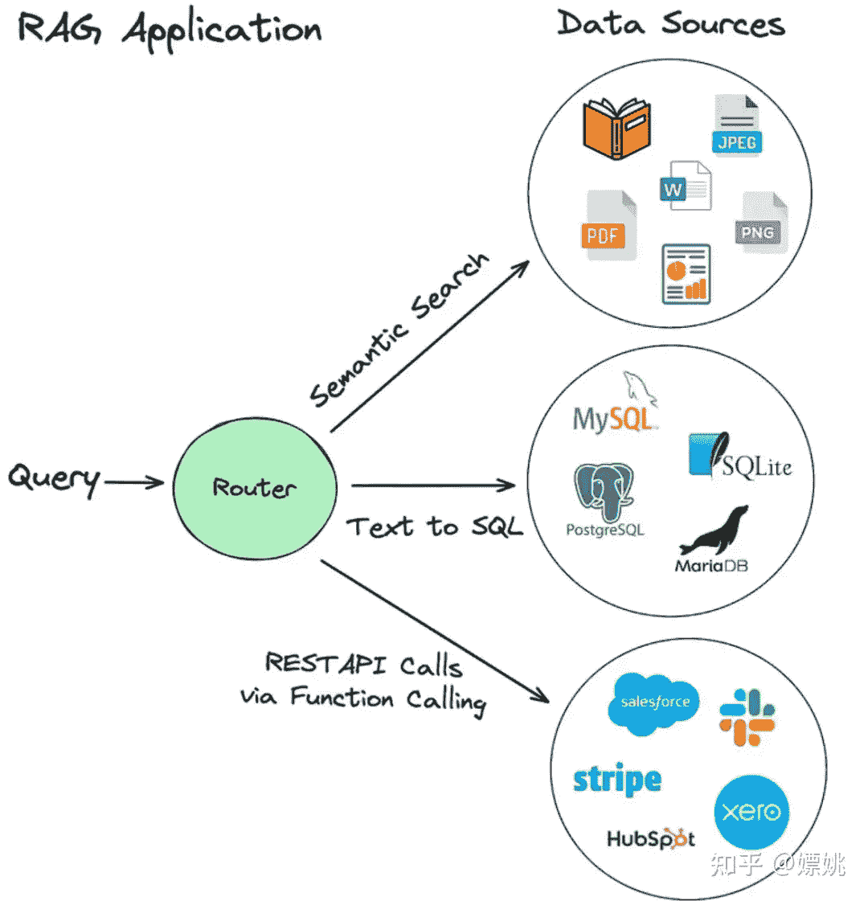

### MQA/GQA/YOCO/CLA/MLKV笔记: 层内和层间KV Cache共享

https://zhuanlan.zhihu.com/p/697311739?utm_psn=1809168998669090818

KV Cache 在深度学习模型中是用于存储关键和值的临时数据结构，对于提升模型性能和优化内存使用至关重要。在 Transformer 模型的自注意力机制中，KV Cache 用于存储每个头部的键（K）、值（V）数据，这些数据在计算注意力时会被多次访问。为了减少内存占用，提出了层内和层间 KV Cache 共享的策略。层内共享通过在同一层级内多次利用相同的 KV 数据减少内存消耗，而层间共享则是在不同层级之间复用 KV 数据。这些优化策略不仅提高了内存使用效率，还缩短了模型的推理时间。在实际应用中，需要平衡共享策略与模型性能之间的关系，以确保模型的准确性不会因为过度的内存优化而受到影响。技术细节上，实现 KV Cache 共享需要对数据流进行精确控制，确保数据在各层级之间的正确传递和更新。此外，还需要考虑到不同硬件平台上的内存访问特性，以实现最佳的性能优化。

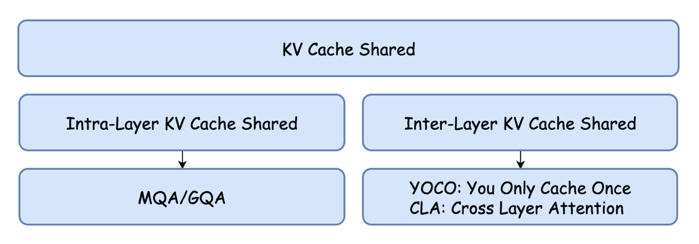

### LLM微调经验&认知-2

https://zhuanlan.zhihu.com/p/676723672?utm_psn=1809169396737900547

快乐子涵酱在文章中总结了对大型语言模型（LLM）微调的实践经验，特别是在连续预训练（CPT）、超 vised fine-tuning（SFT）以及 low-rank adaptation（Lora）等方面的技术细节。他强调了 CPT 在引入新知识时的重要性，并指出在数据集较小时，应谨慎选择学习率和 warmup_ratio，以避免模型能力的损失。在 SFT 阶段，作者提出了对于小数据集可以通过增加训练轮次来提高模型性能的观点。此外，文章探讨了不同的技术路线，包括 CPT 与 SFT 的混合训练方法，以及 Lora 在微调过程中的应用。作者认为，尽管 Lora 可以减少显存消耗，但在提升模型性能方面并不优于全参数微调。在实验中，作者还发现数据质量对模型性能的影响大于数据量，并对 DPO 和 RLHF 在模型训练中的作用进行了讨论。文章最后提到，通过 system prompt 对特定任务进行隔离，以及在 SFT 中使用大量低质量数据，也能意外地提升模型性能。

### LLM推理加速：decode阶段的Attention在GPU上的优化

https://zhuanlan.zhihu.com/p/715348837?utm_psn=1809165447347699712

文章深入探讨了在 GPU 上优化大型语言模型（LLM）推理过程中 decode 阶段 Attention 机制的技术细节。作者指出，Attention 计算在 decode 阶段是计算密集型的，且受限于 memory bandwidth 和 compute throughput。为了解决这一问题，提出了重排 memory layout 的方法，以优化 memory access 模式，并充分利用 GPU 的 tensor core 加速矩阵乘法运算。此外，文章还探讨了如何通过调整 block size 和实施 loop unrolling 技术来减少控制流开销，进一步提升计算效率。实验结果证明了这些优化策略能够显著提高 Attention 计算的性能，为 LLM 推理提供了实际的加速方案。

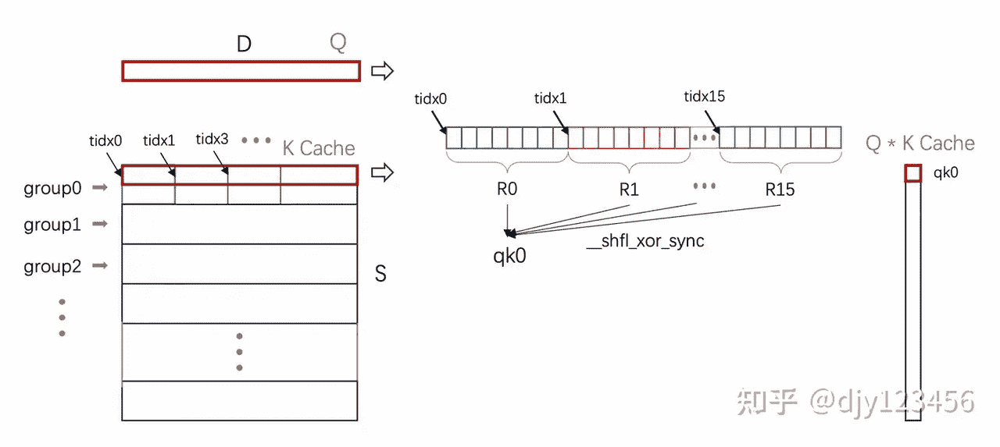

### 10倍加速LLM计算效率：消失的矩阵乘

https://mp.weixin.qq.com/s/vXU7u13tFGapUoI-ih485A

文章探讨了一种创新的无矩阵乘法语言模型，旨在提高计算效率，特别是在大型模型如 ChatGPT 中。该模型通过采用三值权重、无矩阵乘法词元混合器（MLGRU）和无矩阵乘法通道混合器（MatMul-free GLU）等技术，成功地消除了计算密集型的矩阵乘法操作。三值权重简化了权重计算，将传统的乘法操作转化为加法或减法。MLGRU 通过逐元素操作更新隐藏状态，而不是依赖于矩阵乘法，从而提高了并行计算能力。通道混合器使用了具有三值权重的 BitLinear 层和门控线性单元（GLU），后者控制信息流动，进一步优化了模型的计算成本。

为了解决内存瓶颈问题，文章提出了融合 BitLinear 层，这一层将 RMSNorm 和量化合并为一个操作，直接在 GPU 的共享内存（SRAM）中执行，减少了多个内存级别之间的数据传输。此外，模型还采用了量化技术，将激活值的精度降低到 8 位，以及直通估计器（STE）技术，实现了在三值权重和量化引入的不可微分操作中进行反向传播。这些技术的结合，使得无矩阵乘法模型在性能上与传统的 Transformer 模型相当，同时显著降低了内存消耗和计算成本，为大规模应用提供了可能。文章还讨论了如何通过更大的学习率和特定的学习率调度器，适应无矩阵乘法模型的学习动态。

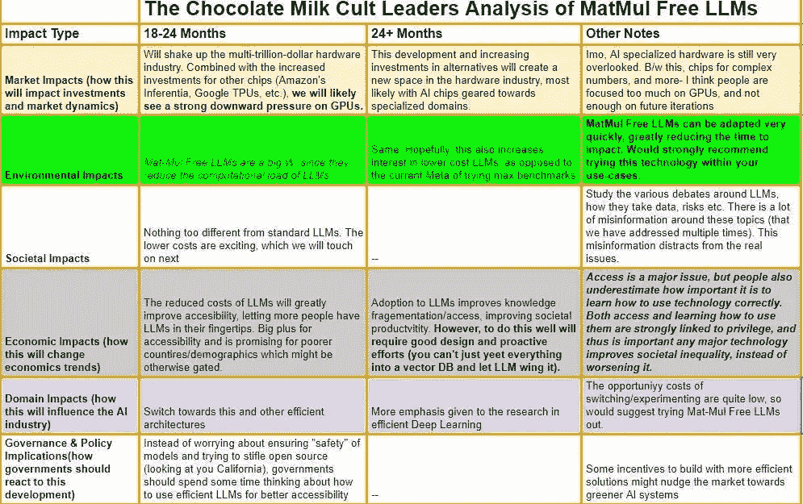

### 智元机器人：人形机械臂专利解析

https://mp.weixin.qq.com/s/ssWYyxskp5sceC9sAHdW8g

智元机器人推出的新型机械臂专利技术，通过引入线性执行器和联动杆，巧妙地实现了关节支架的转动，优化了传统机械臂的结构。这种设计减少了减速器的依赖，从而简化了机械臂的结构，降低了其质量，提高了传动的响应速度。此外，该专利还采用了第二关节支架和旋转执行器的创新设计，增强了机械臂的灵活性和操作范围，能够适应更复杂的多方向转动需求。技术细节上，机械臂的输出端通过移动带动联动杆转动，进而驱动关节支架转动，实现了精确控制。

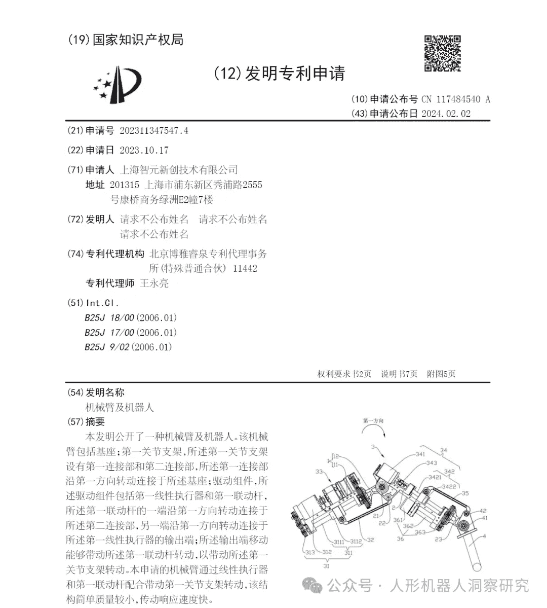

# 🚀招聘公告

---

**奇绩创坛****由陆奇博士**于2019年创立，使命是在源头最大化驱动创新。奇绩研究组将研究模型理论、到投研战略分析、市场策划等不同背景的同学聚在一起，搭建GenAI时代独特的跨界人才社群。

**F24实习岗位**

##### [行研-学术科研人才交流组实习生](https://miracleplus.feishu.cn/docx/Yn6rdf2iOoY2Rcx8yVNcUBYRnch#part-QkMcdeJmuob9uvxvV3qcLSzHn8g)

##### 行研-GenAI研究岗位-战略分析（偏产品）

##### Web / AI 全栈开发工程师实习生

**火热开放中**

##### 行研-GenAI研究岗位-前沿学术探索

##### 行研-GenAI研究岗位-战略分析（偏咨询）

##### 创新活动产品运营 （大模型系列活动产品运营）

> **点击**相关岗位可查看对应**岗位需求【JD】；**相关岗位投递请**添加🛰️💻【**sunjiajunspace】

> ‼️欢迎**推荐/自荐**，期待在**奇绩创坛**遇见更好的你‼️

---

# 声明

本文档仅供学习交流使用，版权归原作者所有，若涉侵权，请联系Jack Jin 15101136166

##

（欢迎在下方反馈您宝贵的意见！整理不易，觉得有用给AI日报小组点个赞👍吧！）

ChatGPT；Angela；Zijia Liu；Alex；Zeqi Tan；Tiezhen（HuggingFace）；Naixu；Lizhi；Peter；Suoman；Jack

封面生成——右脑科技

如果你有大模型相关的创业想法，欢迎来找我们聊聊～🛰️：15101136166

> 快邀请你的小伙伴们一起来读大模型日报吧！

> **【日报****知识库****】**这里是近期日报内容的汇总,欢迎大家查阅

> [大模型日报知识库(分享版)](https://miracleplus.feishu.cn/wiki/KapVwXfkriOBiskB0B2cUHxjnTh)

>

> 欢迎大家多多帮我们分享,转发~~

> 如果大家有任何的建议或者吐槽,欢迎随时找我聊天~

