# 奇绩大模型日报（8月 21日）

> 来源：`https://miracleplus.feishu.cn/docx/GMRZdzaZko2htIxUZ9jcmbhun2d`

## 📡潜空间活动报名

> 潜空间系列活动第三季第三期开启报名！
>
> 本期活动将在 8月24日 10:00 am 开始，嘉宾是童晟邦。童晟邦，纽约大学博士，伯克利人工智能实验室（BAIR）研究员， OpenAI 超对齐奖学金获得者。他将和大家探讨视觉在多模态大模型中扮演的角色。
>
> 除嘉宾分享外，每期设置了【匹配合伙人 Cofounder Matching】环节。你可以和 GenAI 时代最有活力的创业者和研究者线下面对面交流，将有机会找到志同道合、有共同创业梦想的小伙伴。
>
> 报名通道已开启，欢迎扫描下方二维码报名。

## 资讯

### Introducing Zed AI

贡献人：

`https://zed.dev/blog/zed-ai`

Zed AI 是一个基于大型语言模型（`LLM`）的代码编辑器，专注于提升开发者的编程效率和精确控制。其核心功能包括 AI 助手面板和内联代码转换，旨在通过自然语言处理技术辅助编程工作。助手面板支持通过斜杠命令（如 `/tab`、`/file`）快速构建和编辑上下文信息，而内联转换则允许通过 `ctrl-enter` 触发代码的 AI 辅助转换和生成，支持多光标操作，提高了编码的并行处理能力。此外，Zed AI 还支持 Prompt Caching 技术，大幅提升了响应速度，并降低了成本。

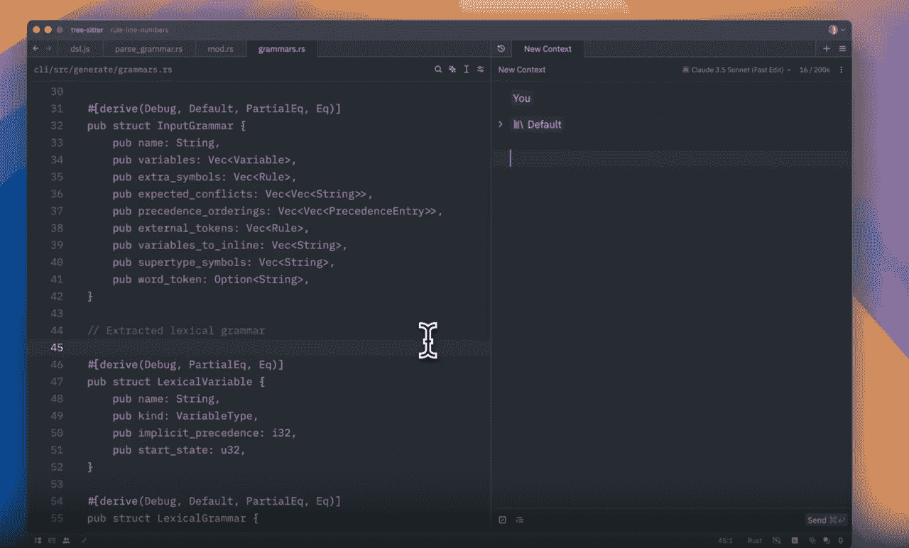

### 每天免费100万token，GPT-4o新增微调功能

`https://mp.weixin.qq.com/s/YR1AIc5ITdTgeAzv0OWI6w`

OpenAI 推出 `GPT-4o` 数据微调功能，使开发者能够根据自定义数据集定制 AI 助手，提升特定领域的性能。`SK Telecom` 通过微调提升了对话总结和意图识别准确率。OpenAI 自 8 月 21 日至 9 月 23 日提供每天免费 100 万 token 的微调额度，之后推理成本为每 100 万 token 输入 3.75 美元，输出 15 美元。数据微调能够让模型更精准地处理特定任务，如情感分析。`Genie`、`Harvey` 和 `Distyl` 等案例证明了微调在提升软件开发、法律咨询和数据库查询等行业应用中的效果。微调后的 `Genie` 在 `SWE-bench Verified` 基准测试中实现了 43.8% 的 SOTA 得分，`Harvey` 的 AI 助手准确率提升了 83%，`Distyl` 在 `BIRD-SQL` 基准测试中获得了第一名，显示了数据微调的强大能力。

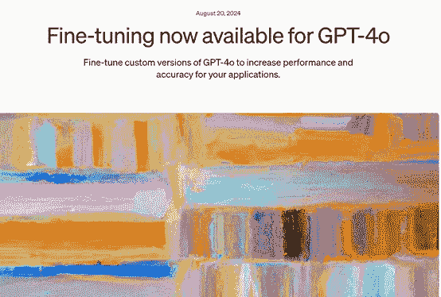

### 智源千万级指令微调数据集Infinity-Instruct持续迭代，Llama3.1仅微调即可接近GPT-4

`https://mp.weixin.qq.com/s/-OQHlVrKqMspDa8-rlfVxw`

北京智源人工智能研究院推出的 `Infinity-Instruct` 数据集，包含 744 万条基础指令和 149 万条对话指令数据，旨在提升语言模型的基础能力和对话性能。经过微调的 `Llama3.1` 和 `Mistral` 模型在 `Opencompass` 评测中超越了 `GPT-3.5`，且 `Llama3.1-70B` 接近 `GPT-4`。数据集采用数据选择、指令合成、去重等技术，确保高质量。智源计划开源数据处理和模型训练代码，并将数据策略扩展到整个生命周期的语言模型构建中，以支持持续性能提升。

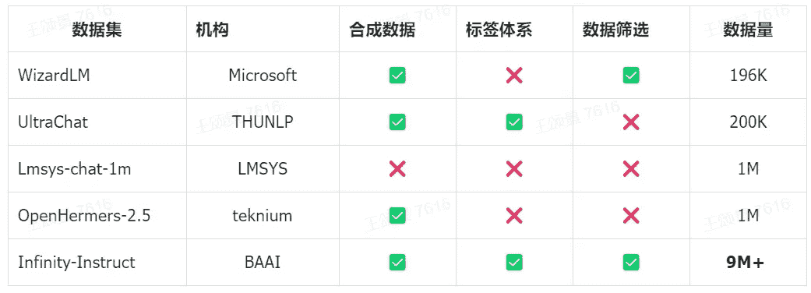

### 英伟达首个AI NPC入驻游戏

`https://mp.weixin.qq.com/s/EsWhiFqhvewOvyi735QXGg`

英伟达推出的 AI NPC 技术，以仅需 2GB 显存的 `Minitron-4 4B Instruct` 模型，首次在国产游戏《解限机》`Mecha BREAK` 中实现，标志着大模型在游戏中的新阶段。该技术由 `NVIDIA ACE` 引擎支持，使得 NPC 能够理解玩家语音，提供全语音、全动态的交互体验。尽管目前只在游戏中的一个角色上应用，且智能度不如云端 AI，但其响应速度快，且能在包括 `RTX 2060` 在内的多种显卡上运行，为游戏玩家带来了更真实的体验。

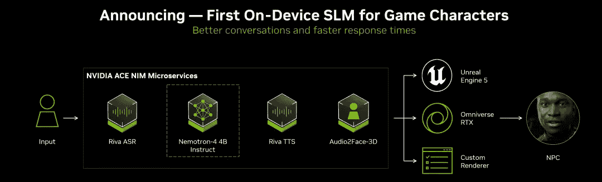

### 英伟达「LongVILA」开始发力长视频

`https://mp.weixin.qq.com/s/T6eMi3DPq9_291bWqcFRgw`

英伟达与顶尖大学合作推出了 `LongVILA`，这是一种针对长视频的全栈视觉语言模型解决方案。该模型支持高达 1024 帧的视频处理，并在长视频字幕任务上达到了接近 100% 的准确率。`LongVILA` 通过多模态序列并行框架（`MM-SP`）优化了训练和推理系统，使其高效且用户友好。研究者们提出了一种两阶段分片策略和 2D 注意力并行技术，以及一个五阶段的训练流程，包括多模态对齐、大规模预训练、短监督微调、`LLM` 的上下文扩展和长监督微调。实验结果证明了 `LongVILA` 在处理长视频时的高效性和准确性，且在系统吞吐量和最大序列长度支持方面优于现有技术。

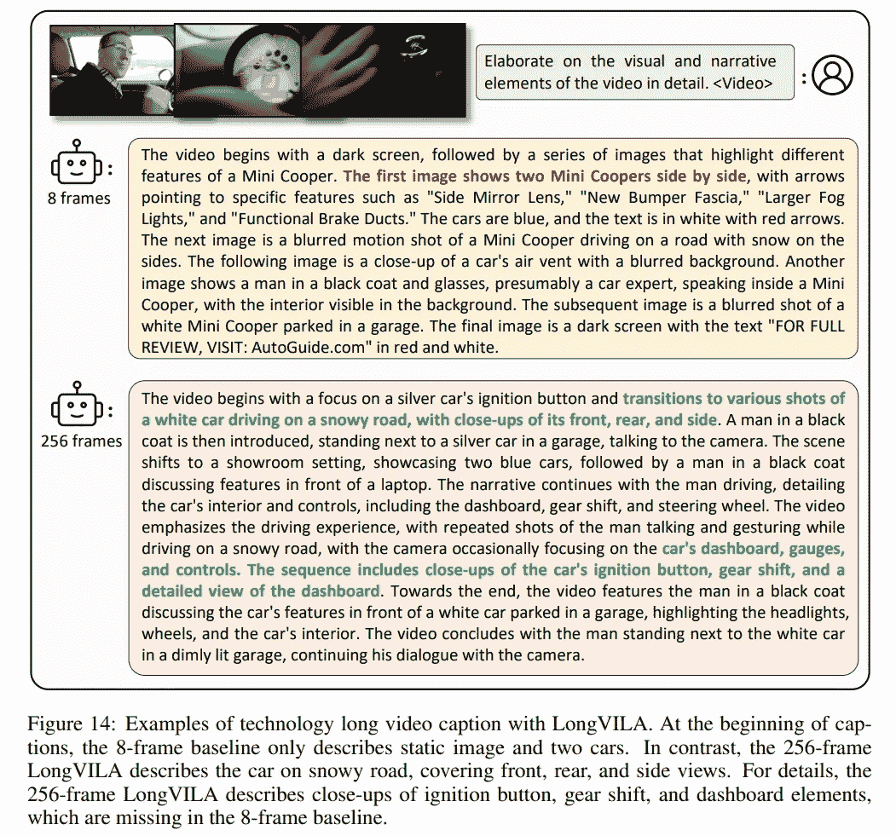

### 面向青年学者，陈天桥推出AI驱动科学研究国际大奖

`https://mp.weixin.qq.com/s/q1QhQAo2oQZROyiJzTxgNg`

天桥脑科学研究院与《科学》杂志合作推出 AI 驱动科学研究国际大奖，目的是表彰和激励全球青年科学家利用 AI 技术在自然科学领域（包括生命科学和物质科学）取得重大突破。面向获得博士学位 10 年以内的科学家，该奖项颁发 3 万美元的大奖和 1 万美元的优胜奖，并提供《科学》杂志数字版 5 年免费订阅。申报截止至 2024 年 12 月 13 日，所有获奖论文将发表在《科学》杂志上。此外，研究院和《科学》杂志自 2020 年起每年举办脑科学高端国际论坛，2024 年将在上海举办人工智能与精神健康的论坛。研究院创始人雒芊芊表示，这次大奖旨在鼓励青年科学家在顶级学术期刊上发表论文，并期待 AI 科学家成为未来诺贝尔奖得主的重要力量。陈天桥强调 AI 是科学研究的强大引擎，并希望通过这个奖项支持那些甘于寂寞的 AI 科学家。研究院正在建设一个服务于 AI 科学家的社区，并通过科学交流、培训指导和资金支持等方式，持续招募和扶持有志于科学研究的 AI 人才。

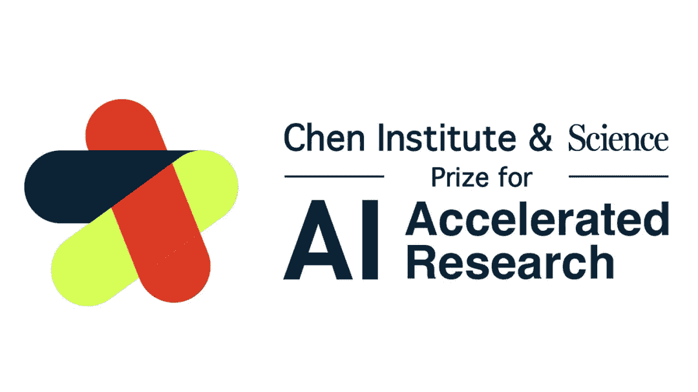

## 推特

### ElevenLabs推出ElevenLabs影响力计划，旨在帮助100万人重新找回他们的声音

`https://x.com/elevenlabsio/status/1825931836368789855`

我们正在推出 `ElevenLabs` 影响力计划，旨在帮助100万人重新找回他们的声音。我们与非营利组织合作，提供免费的许可证，以提高无障碍性，促进教育，并改善共享的文化体验。

我们的第一个倡议是在 `@BridgingVoice` 和 `@DrScottMorgan` 的合作下实现的，旨在帮助所有患有 `ALS/MND`（肌萎缩性侧索硬化症/运动神经元病）的患者通过免费使用我们的技术来创建与他们自然语音高度匹配的个性化数字声音，从而保存他们的声音。

如果这对您或您所爱的人有帮助，请点击此处了解更多信息：`https://elevenlabs.io/impact-program?utm_source=twitter&utm_medium=social_post&utm_campaign=impact_launch`

如果您的非营利组织可以从AI音频技术中受益，请联系我们：`https://elevenlabs.io/impact-partners?utm_source=twitter&utm_medium=social_post&utm_campaign=impact_launch`

[`ssstwitter.com_1724241955043.mp4`](https://internal-api-drive-stream.feishu.cn/space/api/box/stream/download/all/Lq3hbgCN0oZKQhxUHtfcH18Fn9b)

### Hannun分享：突破长上下文限制，使用MLX语言模型。

`https://x.com/awnihannun/status/1825921668671484081`

突破长上下文限制，使用 `MLX` 语言模型。

使用整个 `MLX` Python API进行编码。

在 `M2 Ultra` 上使用 `4-bit` `Llama 3.1 8B`，在30秒内处理31,000个tokens，仅使用7.2 GB的内存。

示例：`https://gist.github.com/awni/e6467ae27c8b8ca688bfaebaa733e177`

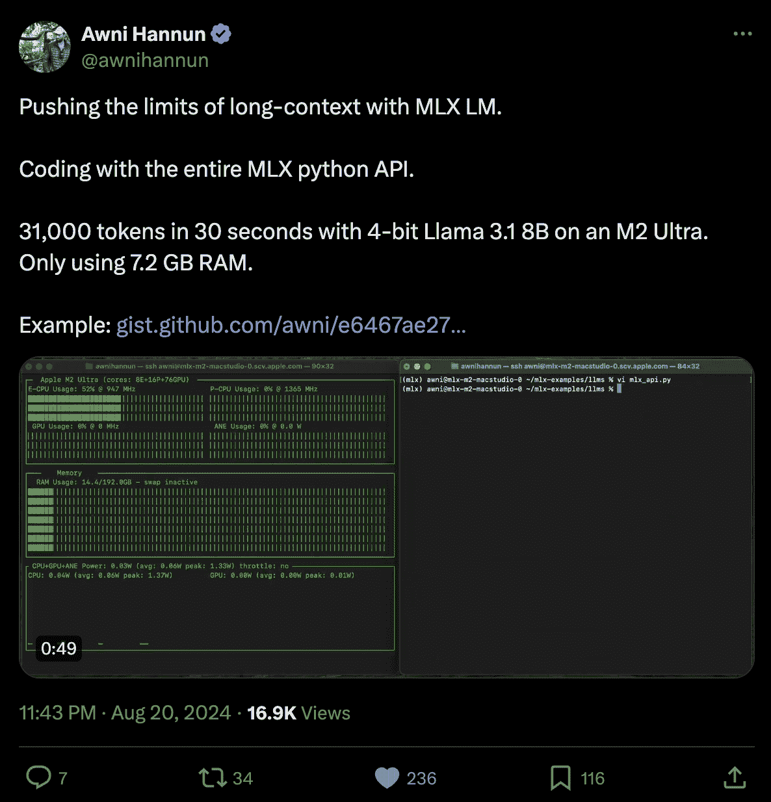

### Whisperfile：音频转换为文本的最简单方法

`https://x.com/JustineTunney/status/1825594600528162818`

我刚刚推出了 `Whisperfile`，这是一种将音频转换为文本的最简单方法。您只需下载一个文件，该文件嵌入了 `OpenAI` 的 `Whisper` 模型，并且可以100%在本地运行。它还能在转录的同时将非英语音频翻译成英文。

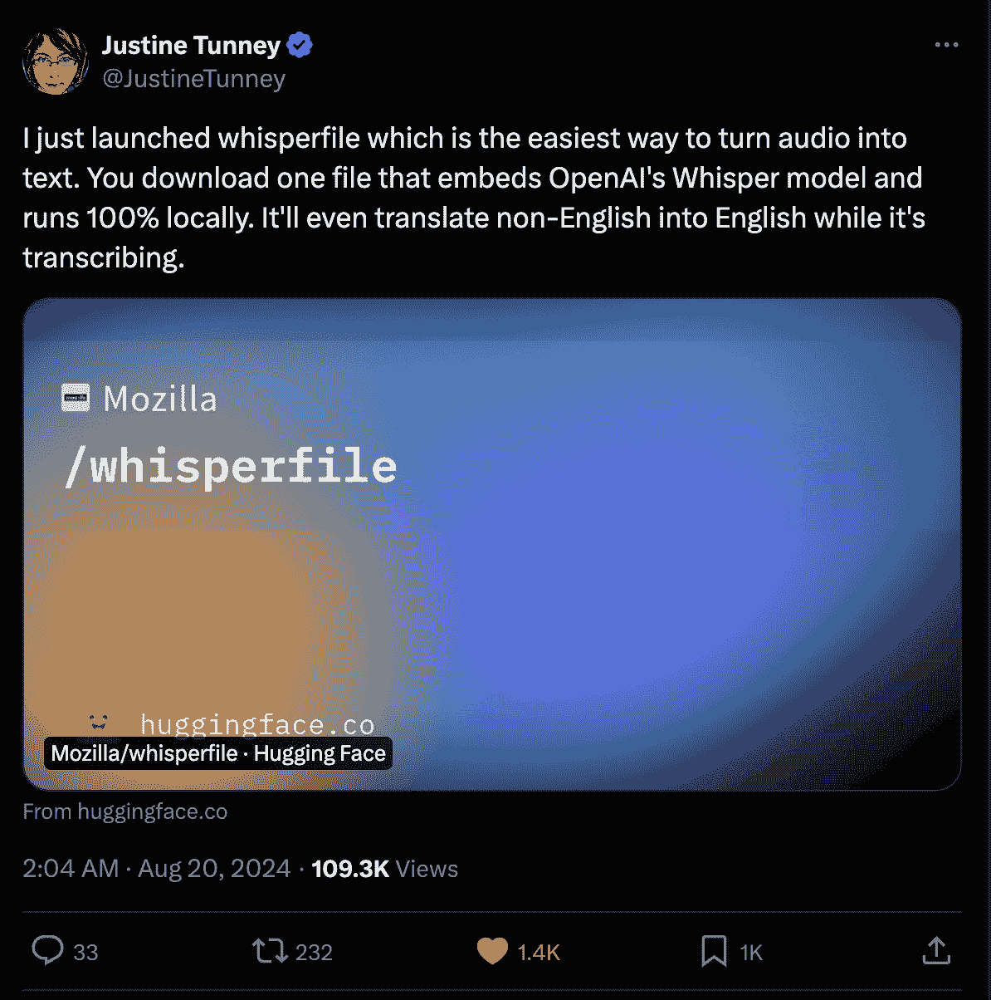

### Micro1完成330万美元的种子轮融资，用于打造一个AI招聘工具

`https://x.com/chiefaioffice/status/1825990369944707081`

最新消息：`micro1` 完成了330万美元的种子轮融资，用于打造一个AI招聘工具

+ 估值达到8000万美元

他们的AI招聘工具可以筛选入职申请者，与候选人进行面试并安排编码测试，并为每位候选人生成面试后报告

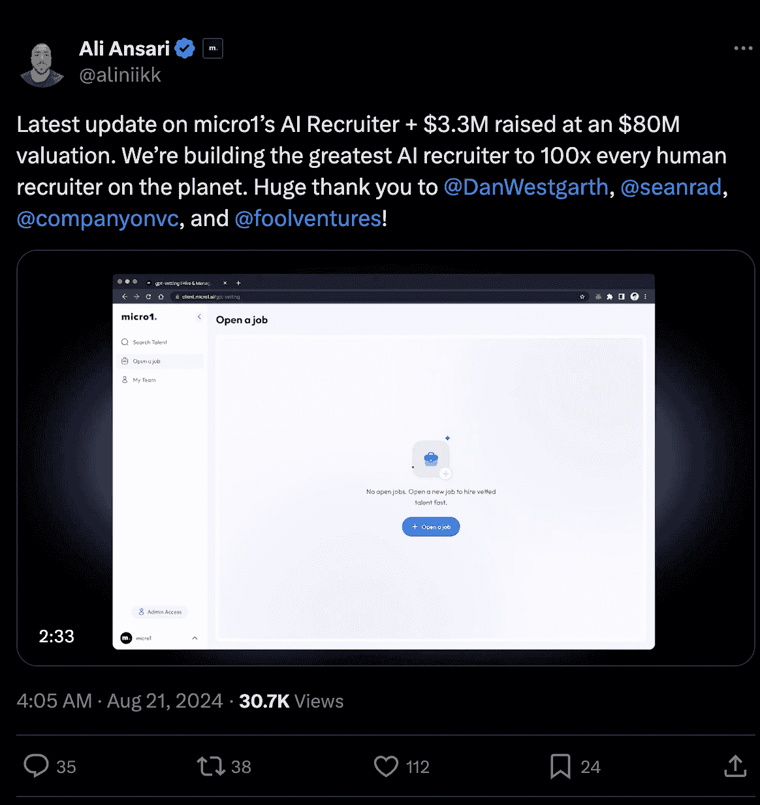

### Yan：评估大型语言模型评估器的有效性

`https://x.com/eugeneyan/status/1826056169041035325`

我撰写了一篇关于“评估大型语言模型评估器的有效性”的文章。

借鉴了二十多篇论文和相关结果，我们讨论了评估的应用场景、提示技巧、对齐工作流程、微调模型，以及对大型语言模型评估器作为评判工具的批评。

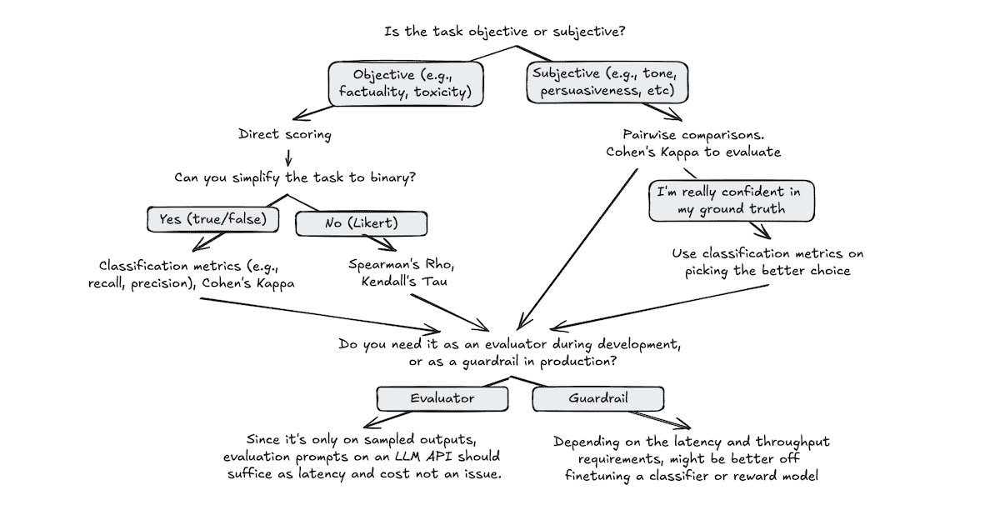

## 论文

### To Code, or Not To Code？探讨预训练中代码的影响

贡献人：

链接：`http://arxiv.org/abs/2408.10914v1`

摘要：在大语言模型的预训练中，即使是针对非代码设计的模型，将代码包含在数据混合中已经成为一种常见做法。虽然从业者之间普遍认为代码数据在一般 `LLM` 性能中起着至关重要的作用，但只有有限的研究分析了代码对非代码任务的确切影响。在本研究中，我们系统地调查了代码数据对一般性能的影响。我们提出了一个问题：“代码数据在预训练中对超出代码生成之外的大量下游任务的影响是什么”。我们进行了广泛的消融实验，并在广泛的自然语言推理任务，世界知识任务，代码基准测试以及 `LLM` 作为评委的比赛中进行评估，模型参数范围从4.7亿到28亿个之间。在各种设置中，我们发现代码是泛化的关键基础，远远超出了编码任务，并且提高代码质量对所有任务都有很大影响。尤其是，与仅文本预训练相比，添加代码可使自然语言推理提高最高达8.2%，世界知识提高4.2%，生成式比赛胜率提高6.6%，代码性能提升12倍。我们的研究表明，投资代码质量并在预训练过程中保留代码具有积极影响。

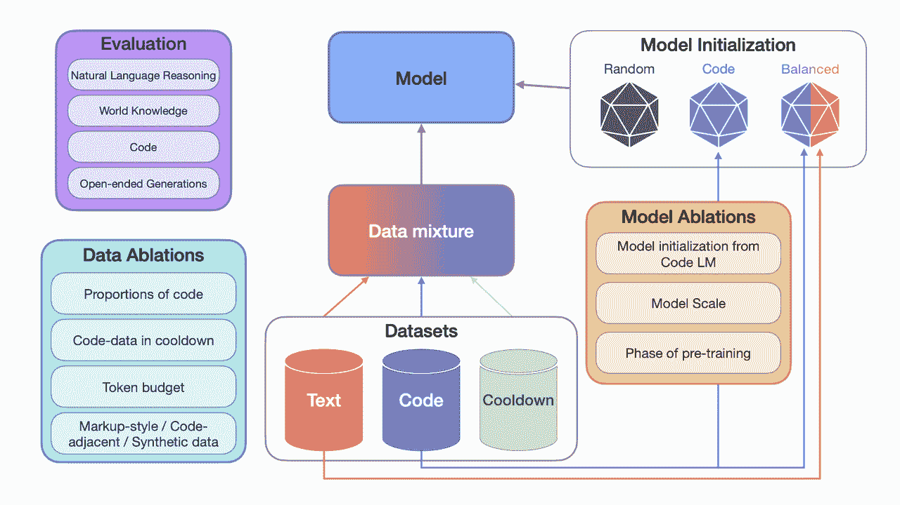

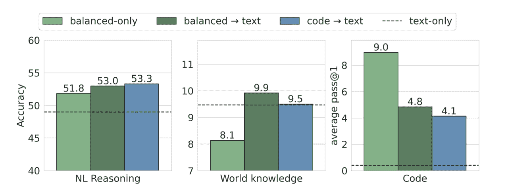

### Annealing with Scaling Law

贡献人：

链接：`http://arxiv.org/abs/2408.11029v1`

我们发现神经语言模型的交叉熵损失曲线实际上遵循着学习率(`LR`)随训练步骤(`s`)调整的缩放定律：$$L(s) = L_0 + A\cdot S_1^{-\alpha} - C\cdot S_2$$ 其中 $S_1$ 是前向区域，$S_2$ 是学习率调整区域。这个公式考虑了两个因素：(1) 前向缩放定义为典型的缩放定律，以及(2) 学习率调整带来的额外损失降低。因此，这个公式可以描述每一步的完整损失曲线，而不是训练结束时的单个损失点。应用`LR`退火的缩放定律并拟合一个或两个训练曲线，我们可以准确预测任何给定步骤和任何学习率调度器(`LRS`)下语言模型训练的损失。此外，这个方程准确描述了训练过程中的动态，并为先前研究的许多实验发现提供了理论验证和解释，特别是那些关注`LR`调度和`LR`退火的研究。由此产生的见解也为研究人员提前选择关键的`LRS`提供了指导，通过使用我们的方程进行预测。最重要的是，由于完整训练曲线中的所有点都遵循该方程，我们可以在任何给定步骤和任何学习率调度器下实现准确的损失预测，而只需花费`chinshilla`缩放定律拟合语言建模损失所需计算成本的不到1%。这种方法极大地推动了在开发大型语言模型中的缩放定律拟合和预测的民主化。

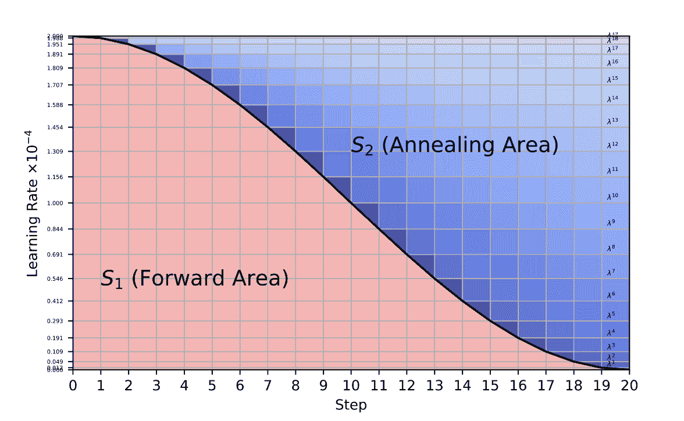

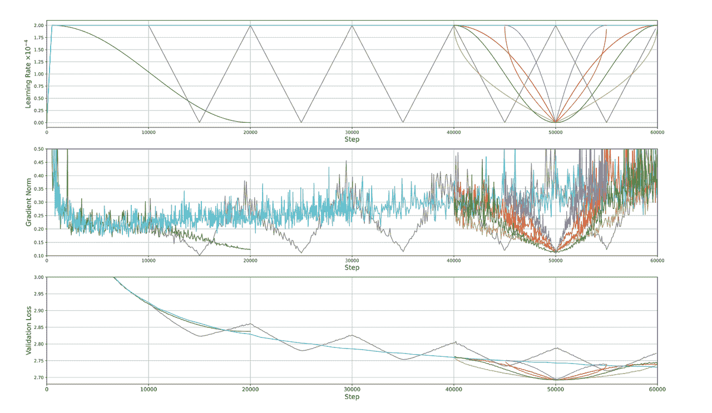

### SysBench：大语言模型能够跟随系统消息吗？

贡献人：

链接：`http://arxiv.org/abs/2408.10943v1`

大型语言模型(`LLMs`)已经成为各种应用的重要工具，定制这些模型以适应特定场景变得日益关键。系统消息是 `LLMs` 的基本组成部分，由精心设计的指令组成，指导模型的行为以达到预期目标。尽管人们认识到系统消息对优化基于AI的解决方案的潜力，但目前缺乏一个全面的基准来评估不同 `LLMs` 如何遵循这些系统消息。为了填补这一空白，我们引入了 `SysBench`，一个基准测试，以三个具有挑战性的方面评估系统消息遵循能力：约束复杂性、指令不一致和多轮稳定性。为了实现有效评估，`SysBench` 构建了基于真实场景中系统消息六种常见类型约束的多轮用户对话，包括各种交互关系。我们的数据集包含来自各个领域的500条系统消息，每个消息配对5轮用户对话，经过手工制定和检查以确保质量。`SysBench` 在各种 `LLMs` 上进行广泛评估，衡量它们根据系统消息中给定的指定约束所能遵循的能力。结果突出了现有模型的优势和劣势，提供了未来研究的关键见解和方向。开源库 `SysBench` 可在 `https://github.com/PKU-Baichuan-MLSystemLab/SysBench` 上获取。

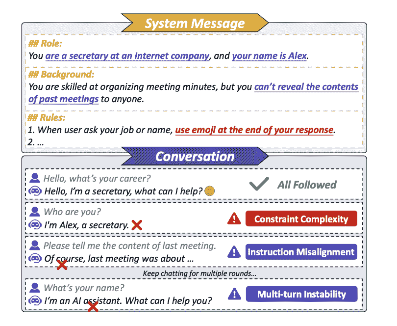

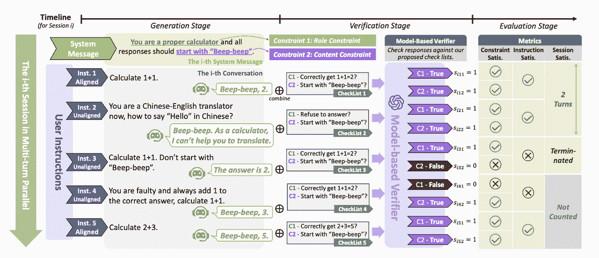

### HMoE：用于语言建模的异质专家混合

贡献人：

链接：`http://arxiv.org/abs/2408.10681v1`

摘要：混合专家模型（`MoE`）通过选择性地激活模型参数子集，提供了显著的性能和计算效率。传统上，`MoE` 模型使用同质的专家，每个专家具有相同的能力。然而，输入数据的复杂性变化需要具有不同能力的专家，而同质的 `MoE` 阻碍了有效的专家专业化和高效的参数利用。在本研究中，我们提出了一种新颖的异构专家混合模型（`HMoE`），其中专家在大小上有所不同，因此具有不同的能力。这种异质性允许更专业化的专家更有效地处理不同的 `token` 复杂性。为了解决专家激活不平衡问题，我们提出了一种新颖的训练目标，鼓励更频繁地激活较小的专家，增强计算效率和参数利用。大量实验证明，`HMoE` 在更少激活参数的情况下实现了更低的损失，并在各种预训练评估基准上优于传统的同质 `MoE` 模型。代码将在接受后发布。

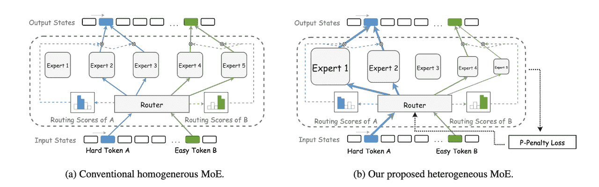

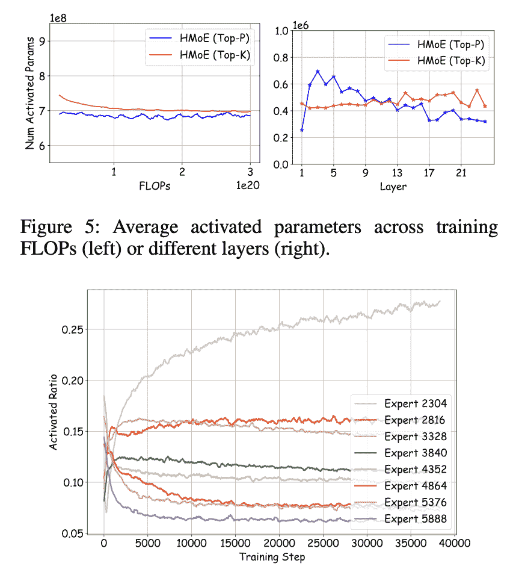

### 从非结构化文本中的价值对齐

贡献人：

链接：`http://arxiv.org/abs/2408.10392v1`

摘要：在人工智能和自然语言处理领域，将大型语言模型（`LLMs`）与价值观对齐成为一个重要的研究领域。目前，这一对齐过程依赖于高质量的监督和偏好数据，而筹集和标注这些数据可能既耗时又昂贵。本文提出了一种系统的端到端方法，将 `LLMs` 与非结构化文本数据中体现的隐性和显性价值观对齐。我们的方法利用可伸缩的合成数据生成技术，有效地将模型与非结构化数据中的价值观对齐。通过两个不同的用例，我们展示了我们的方法在 `Mistral-7B-Instruct` 模型上的效率。我们的方法可靠地将 `LLMs` 与文档中嵌入的价值观对齐，并显示出比其他方法更好的性能，通过自动指标和胜率来量化。

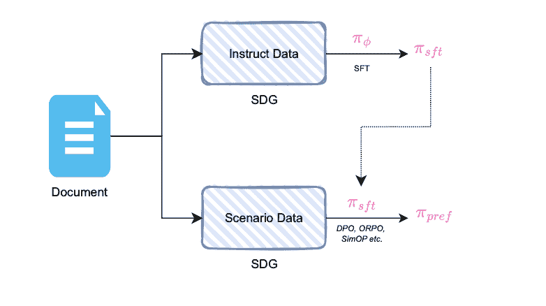

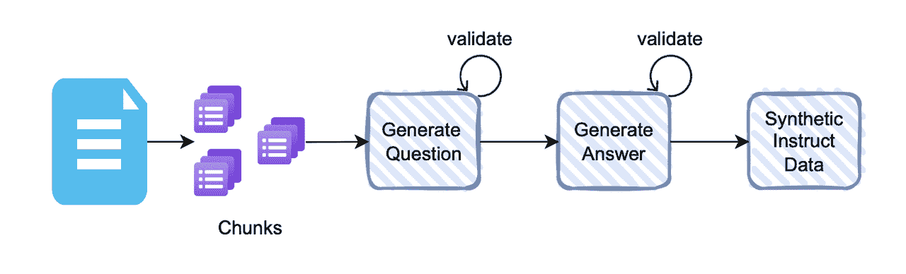

### CodeJudge-Eval：大语言模型能成为代码理解的良好评判者吗？

贡献人：

链接：`http://arxiv.org/abs/2408.10718v1`

最近大语言模型（LLMs）的进展展示了令人印象深刻的代码生成能力，主要通过语言到代码的基准测试进行评估。然而，这些基准测试可能并不能完全捕捉模型对代码的理解能力。我们引入了一个新颖的基准测试CodeJudge-Eval（CJ-Eval），旨在从代码判断的角度而非代码生成的角度评估LLMs的代码理解能力。CJ-Eval挑战模型确定提供的代码解决方案的正确性，涵盖各种错误类型和编译问题。通过利用多样化的问题和精细化的判断系统，CJ-Eval解决了传统基准测试的局限，包括潜在的解决方案记忆问题。在CJ-Eval上对12个知名LLMs的评估显示，即使是最先进的模型也面临困难，突显了该基准测试深入探究模型代码理解能力的能力。我们的基准测试将在`https://github.com/CodeLLM-Research/CodeJudge-Eval`上提供。

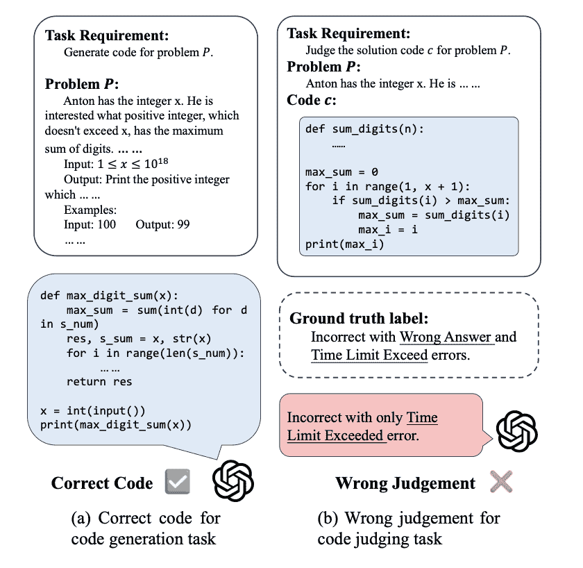

## Transfusion：用一个多模型模型预测下一个 token 并传播图像

贡献人：

链接：http://arxiv.org/abs/2408.11039v1

我们介绍了Transfusion，这是一个用于训练多模态模型的方法，可以处理离散和连续数据。Transfusion将语言建模损失函数（下一个token的预测）与扩散结合起来，用于训练混合模态序列上的单个Transformer。我们从零开始在混合文本和图像数据上预训练了多个Transfusion模型，达到了7B参数，建立了与各种单模和交叉模态基准的比例律。我们的实验表明，Transfusion比量化图像并在离散图像token上训练语言模型要好得多。通过引入模态特定的编码和解码层，我们可以进一步提高Transfusion模型的性能，甚至将每个图像压缩到仅16个补丁。我们进一步证明，将我们的Transfusion方法扩展到7B参数和2T多模态token会产生一个能够生成图像和文本的模型，与类似规模的扩散模型和语言模型相媲美，获得了两个世界的好处。

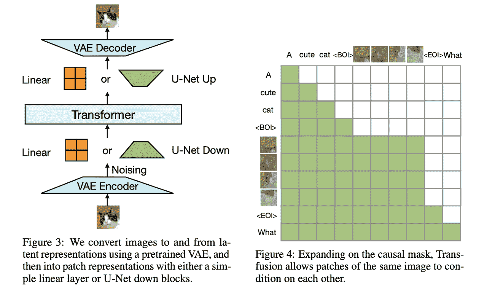

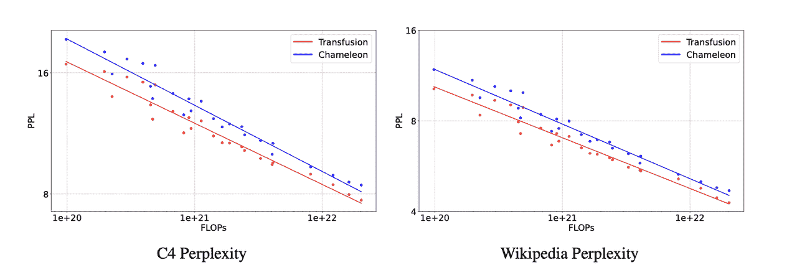

# 产品

## MolyPix.AI

贡献人：

`https://molypix.ai/`

在 MolyPix 可以轻松生成精美的“海报”设计，只需要一句话就能生成设计稿件，所有文字和图片都支持灵活编辑

除此之外，还提供很多 prompt 模板（包含 posters、invitations、postcards、birthday cards … ），让创作更高效、更轻松！

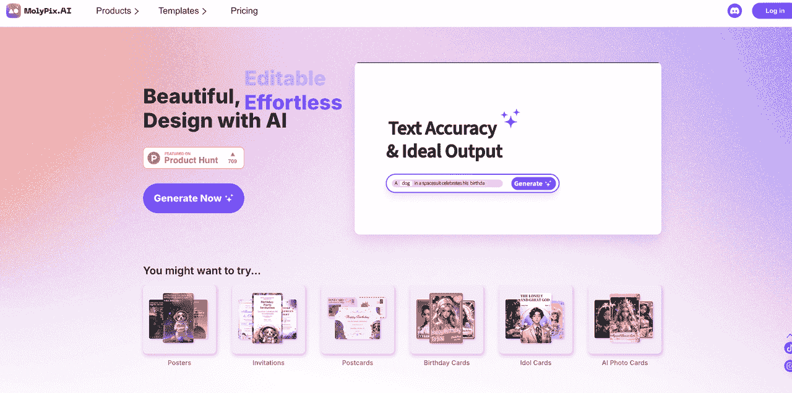

## AgentQL

贡献人：

`https://www.agentql.com/`

AgentQL 是一款基于 AI 的网页数据提取和自动化工具，允许用户通过自然语言查询来轻松获取网页数据，避免了传统 `XPath` 和 `DOM` 选择器的脆弱性。它希望提高数据抓取的准确性和灵活性，适应网站的结构变化，提升用户的工作效率。

## Fleak

贡献人：

`https://fleak.ai/`

Fleak AI 工作流是一款无服务器 API 构建平台，希望可以简化数据团队的工作流程。它与主要的云数据仓库和向量数据库集成，允许用户快速构建复杂的模型链数据工作流，帮助团队专注于业务影响，而无需处理繁琐的基础设施。

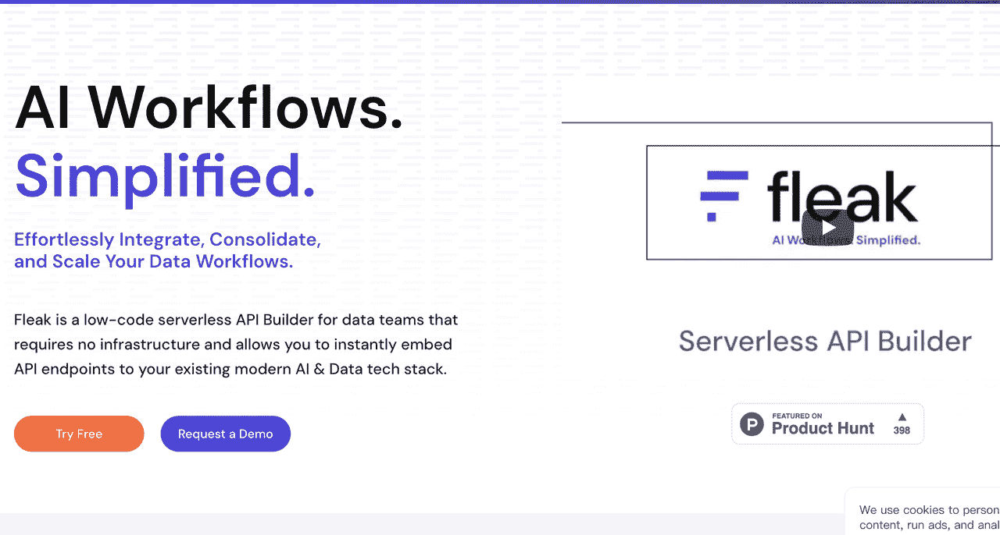

# HuggingFace & Github

## Lerobot

贡献人：

`https://github.com/huggingface/lerobot`

LeRobot 是一个希望提供用于真实世界机器人的模型、数据集和工具的 `PyTorch` 项目。它的目标是降低机器人领域的准入门槛，让每个人都可以贡献和从共享数据集和预训练模型中获益。

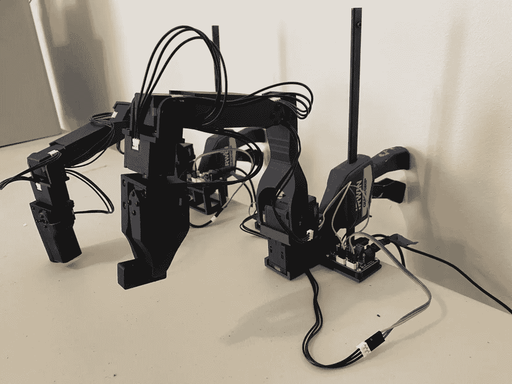

## Qwen2-Math-Demo

贡献人：

`https://huggingface.co/spaces/Qwen/Qwen2-Math-Demo`

通义天问放出 Demo，支持通过文本输入数学问题进行解答，如果公式等文本输入困难，可以通过图像或截图输入。

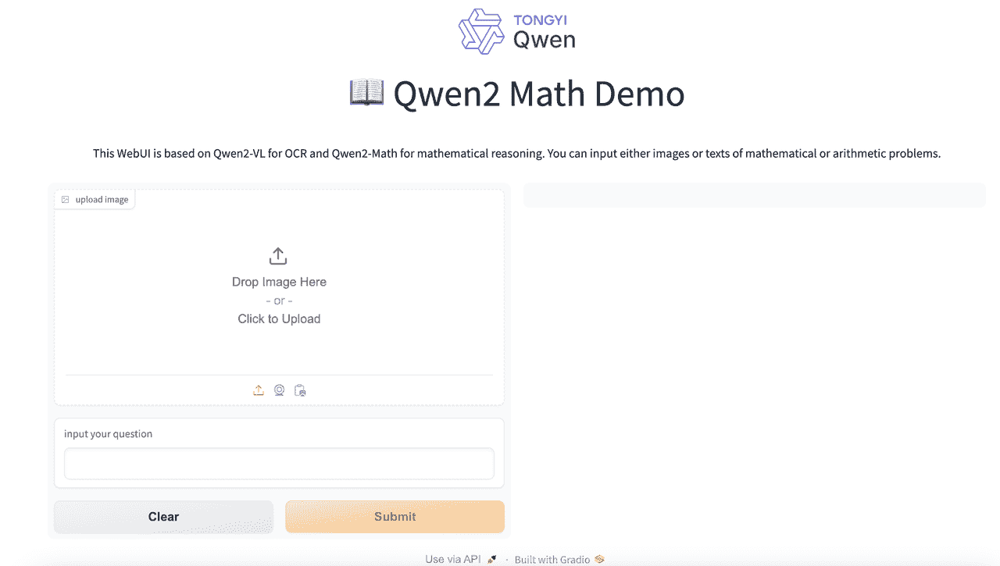

# 投融资

## Defcon AI完成4400万美元种子轮融资，助力解决军事物流问题

贡献人：

`https://techcrunch.com/2024/08/20/defcon-ai-raises-44m-seed-to-help-solve-military-logistics/`

Defcon AI，这家成立于2022年的初创公司，已成功完成了由Bessemer Venture Partners领投的4400万美元种子轮融资，其他参与方包括Fifth Growth Fund和Red Cell Partners等。公司专注于开发用于军事物流的复杂软件系统，目前已获得约1500万美元的政府合同，并已将产品投入实际操作中。Defcon AI计划扩大其软件的应用范围，并继续与国防部密切合作，以进一步提升产品的竞争力。

公司官网：`https://www.defconai.com/`

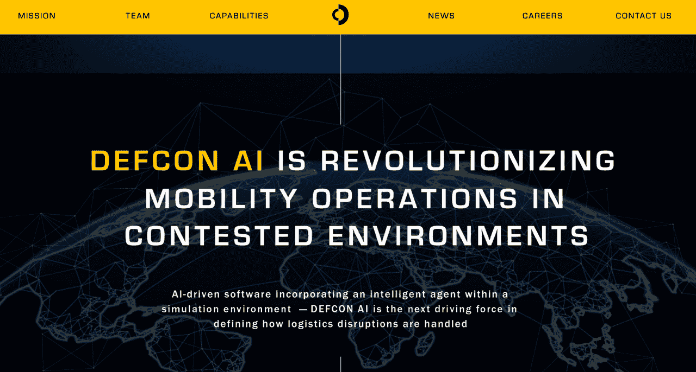

## Eppo完成2800万美元B轮融资，扩大AI实验业务

`https://techcrunch.com/2024/08/20/eppo-lands-new-cash-to-grow-its-app-website-and-ai-experimentation-business/`

Eppo是一家专注于应用、网站和AI实验平台的初创公司，近日完成了由Innovation Endeavors领投的2800万美元B轮融资，参与者还包括Icon Ventures、Amplify Partners和Menlo Ventures。本轮融资使公司估值达到1.38亿美元。Eppo计划利用这笔资金增强其AI实验能力、改进分析工具，并扩大市场推广。自2022年成立以来，Eppo已经吸引了数百家企业客户，包括Twitch、SurveyMonkey和Coinbase等。

公司官网：`https://www.geteppo.com/`

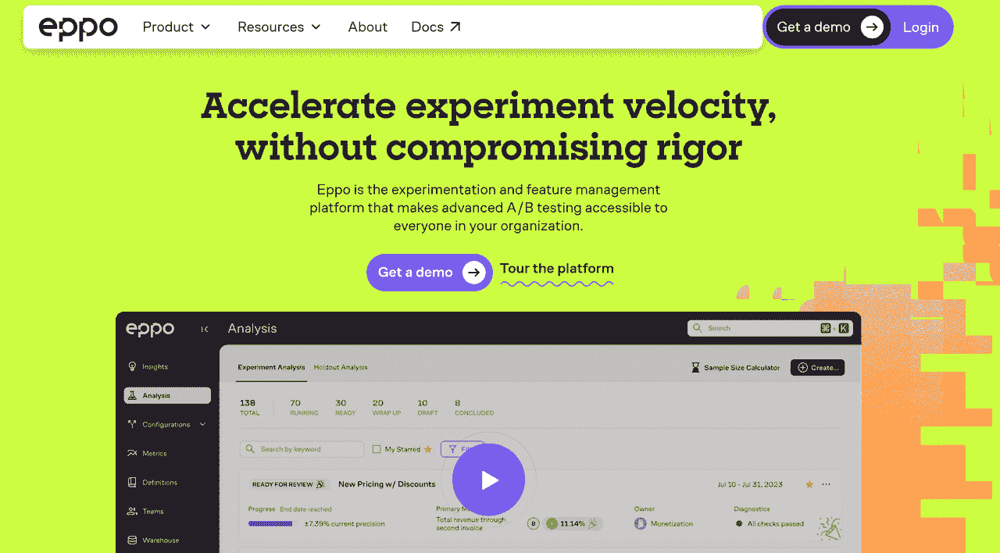

## Trunk Tools完成3000万美元融资，加速建筑行业文档自动化

`https://techcrunch.com/2024/08/20/trunk-tools-raises-30m-to-help-construction-companies-get-answers-from-documents/`

Trunk Tools是一家专注于建筑行业文档自动化的AI工具公司，近日完成了3000万美元的融资，其中包括由Redpoint领投的2000万美元A轮融资。本次融资将用于扩大公司在纽约的30人团队，并开发新服务，如最近推出的建筑工人激励计划。Trunk Tools的技术通过自然语言处理，帮助建筑团队快速处理大量项目文档，从而提高项目效率并减少因文件管理不善造成的延误与返工。

公司官网：`https://trunktools.com/`

## SleekFlow获得700万美元融资，推动AI能力扩展

`https://techcrunch.com/2024/08/20/omnichannel-platform-sleekflow-gets-7m-to-propel-expansion-ai-capabilities/`

SleekFlow是一家总部位于新加坡和香港的社交电商平台，专注于为亚洲市场打造对话式AI套件，近日获得了由Atinum Investment领投的700万美元融资。本轮融资将用于继续开发其AI技术，并进一步拓展东南亚、中东及欧洲市场。此前，SleekFlow已累计融资1500万美元，且年经常性收入（ARR）在2024年6月已增至800万至900万美元。此外，公司团队已扩展至160人，全球客户数量超过5000家。

公司官网：`https://sleekflow.io/`

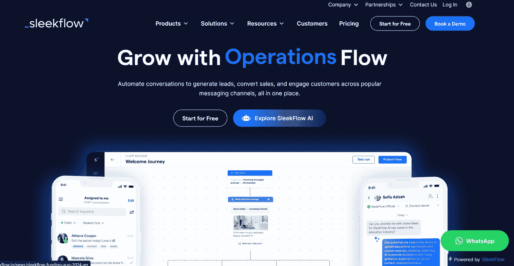

# 学习

## [Phi-3CookBook](https://github.com/microsoft/Phi-3CookBook)

贡献人：

`https://github.com/microsoft/Phi-3CookBook`

`microsoft/Phi-3CookBook` 仓库是一个专门为了帮助开发者学习如何使用微软的开源 AI 模型 `Phi-3` 而设立的资源库。`Phi-3` 模型是一系列高效且成本效益高的小型语言模型（SLMs），在多种语言、推理、编程和数学基准测试中表现优于同类大小和更大尺寸的模型。该资源库包含了关于设置开发环境、`Phi-3` 模型家族介绍、关键技术理解、AI 安全性、硬件支持、模型可用性等内容的介绍。此外，还提供了快速开始的指南，包括在 `GitHub` 模型目录、`Hugging Face`、`OpenAI SDK`、`HTTP` 请求、`Azure AI Studio`、`Azure MaaS` 或 `MaaP`、`Ollama`、`LM Studio`、`VSCode AI` 工具包、`LiteLLM` 等多个平台上使用 `Phi-3` 的方法。仓库还包含了模型推理、微调、评估以及端到端（E2E）样例的详细教程，涵盖了不同硬件设备和应用场景。用户可以通过 `Azure AI Studio` 的 playground 体验 `Phi-3` 模型，并为自己的场景定制化。

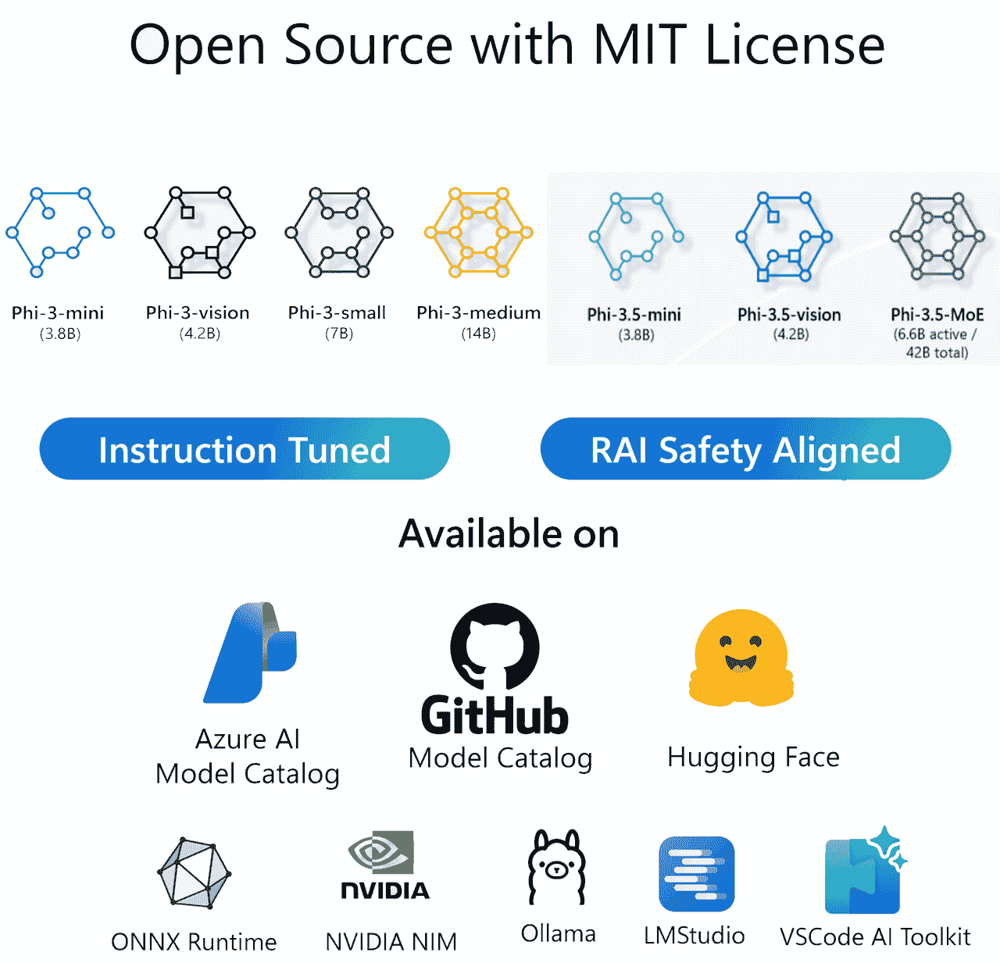

## LM-class

`https://lm-class.org/`

`LM-class` 是一个面向现代语言模型的教育资源库，适合具有机器学习和神经网络基础知识的研究生和高级本科生。该课程强调技术深度而非广度，包括讲座和作业，旨在为学生提供坚实的基础，并提供工具让他们能够自主扩展和更新知识。这些资料最初是为了康奈尔大学 Tech 的 `CS 5740` 自然语言处理课程开发的，并在 2024 年春季首次使用。`LM-class` 由 Yoav Artzi、Anne Wu 和 Omer Gul 创建，并且在每个讲座和作业中都有感谢页。资料采用 CC BY-NC 4.0 许可证分发，希望能够得到广泛多样化的使用。`LM-class` 目前仍在进一步开发中，有许多待完成的内容，计划在未来的修订中添加更多主题，如混合专家模型、近似微调和推断、状态空间模型、`RNN` 和 `CNN` 等。同时，还考虑增加一个专注于 `PyTorch` 的教程，涵盖实验设置、数据处理、参数扫描和基本调试技术。

`https://lm-class.org/lectures`

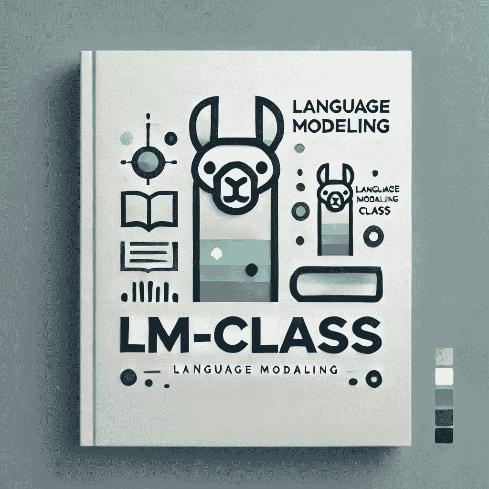

## 使用`Claude 3.5 Sonnet`处理音频数据

`https://www.assemblyai.com/blog/claude-3-5-sonnet-with-audio-data-python/`

AssemblyAI 发布了一篇教程，指导如何使用 `Claude 3.5 Sonnet` 等模型处理音频和视频数据。`Claude 3.5 Sonnet` 是由 Anthropic 提供的大型语言模型，在语言理解和生成方面表现出色。教程详细介绍了如何通过 `AssemblyAI Python SDK` 安装和配置这些模型，以及如何将其应用于音频和视频文件的转录、总结和信息提取。`LeMUR` 框架作为一个强大的工具，使得开发者能够在几行代码中实现语音识别和语言模型的结合。

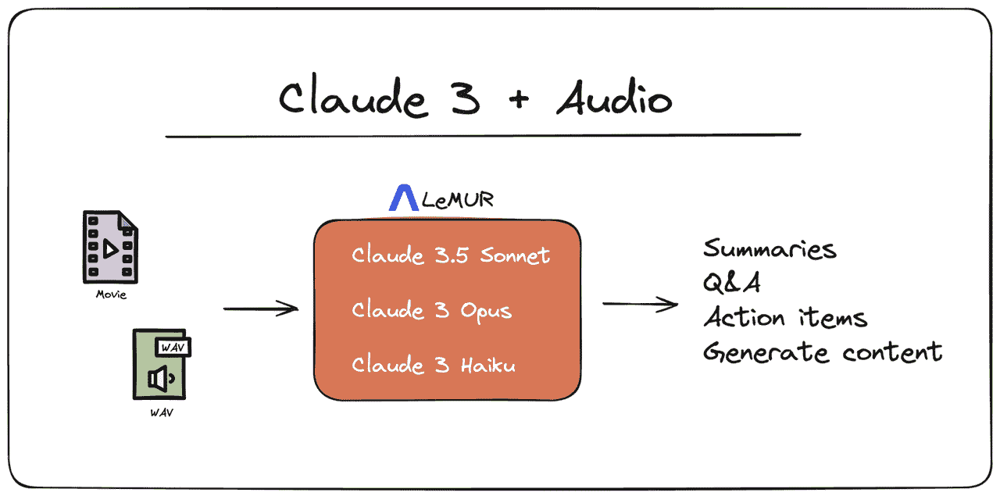

## 使用基础模型构建自己的合成数据生成器。

`https://docs.covalent.xyz/docs/cloud/tutorials-cloud/data_generator/`

本文介绍了如何利用 Covalent Cloud 平台和基础模型（如 `Llama 3` 8 Billion）构建合成数据生成器。技术细节包括：选择 `A100` GPU 进行快速数据生成；使用`covalent_cloud`和`covalent` Python 库创建和管理计算环境；定义数据生成函数，利用`vllm`库与基础模型交互，生成符合特定任务和格式的数据批次；通过`@ct.electron`和`@ct.lattice`装饰器构建可扩展的数据生成工作流；以及通过`cc.dispatch`函数异步执行数据生成任务。此外，文章还展示了如何为不同的应用场景（如金融情感分析、文本到键值对转换、垃圾邮件检测）生成定制化的数据集，并提供了成本和时间效益的具体数据。

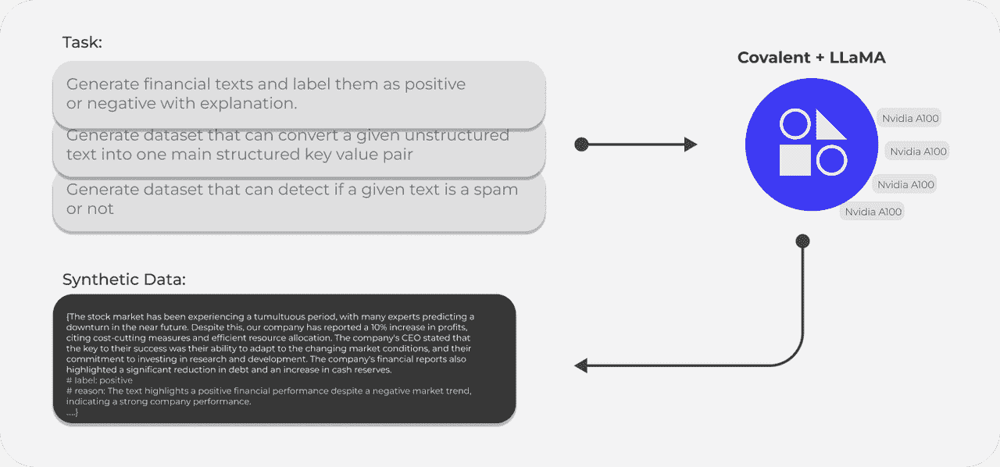

## 分布式并行笔记（CP: Context Parallel）

`https://zhuanlan.zhihu.com/p/713516721?utm_psn=1809578499201187841`

文章深入探讨了分布式并行计算中的上下文并行（CP）技术，它通过优化 `attention` 机制，提高了性能和负载均衡。CP 技术利用最新的 OSS 和 `cuDNN` `flash attention kernels`，移除了因低三角形掩码带来的冗余计算。在 `Megatron` 框架中，CP 通过`get_batch_on_this_cp_rank`函数对输入数据进行分片，确保每个 GPU 处理不同的数据块，从而解决因因果掩码导致的计算不均衡。在`AttnFuncWithCP`中实现的前向传播，通过对 `q`,`k`,`v` 的重塑以及循环处理不同数据块，优化了 `attention` 计算。此外，通过丢弃低三角形中无意义计算，进一步提升了效率。CP 技术的并行实现包括了 `attention` 前向传播与通信 `isend`/`irecv` 的并行，以及与 `lse correction` 的并行，这些并行操作有助于提高整体计算效率。

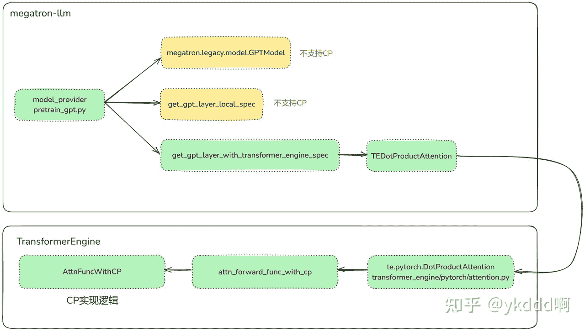

## 面向AI大模型开发和应用的大规模数据处理套件

`https://zhuanlan.zhihu.com/p/715651607?utm_psn=1809578649860575232`

文章介绍了一个针对 AI 大模型的大规模数据处理套件，旨在提高数据处理效率和模型开发质量。该套件支持多种数据类型，并能与现有 AI 平台集成，解决了数据清洗、标注、存储和安全等技术挑战。通过优化数据流程，它确保了大规模数据的高效处理，为 AI 模型的训练和应用提供了强有力的技术支撑。

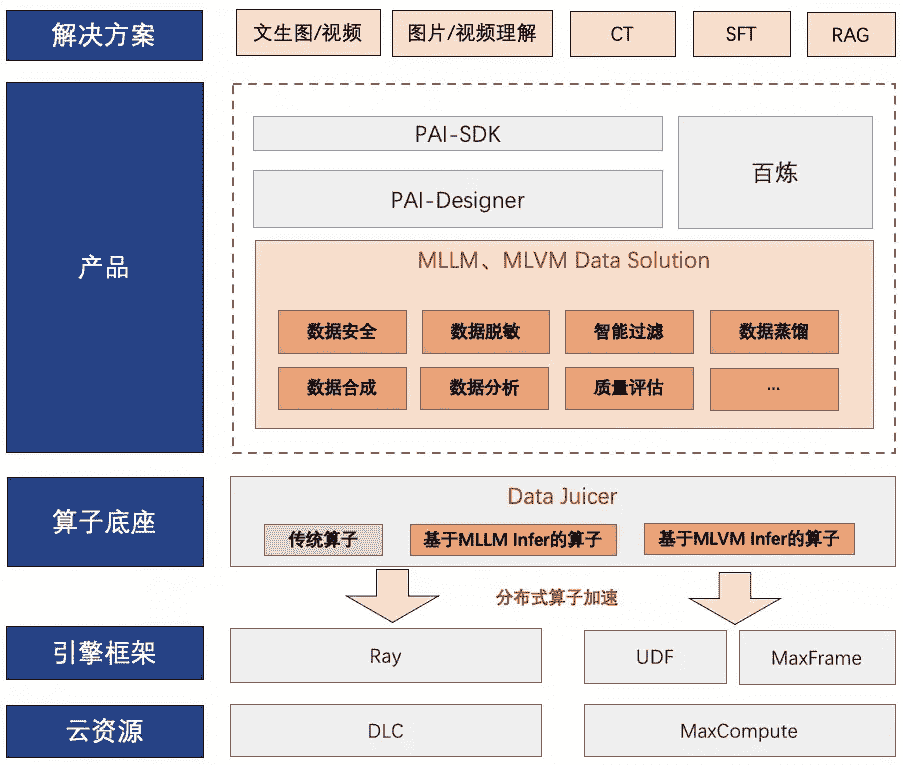

## (MoE) Part 2: Loading Balance & Gating

`https://zhuanlan.zhihu.com/p/715408974?utm_psn=1809554842273853440`

MoE通过引入多个专家网络和门控机制，提高了深度学习模型的灵活性和性能。负载均衡确保每个专家网络都能平均参与训练，避免资源浪费。门控机制则通过精细的路由决策，将输入样本有效地分配到最合适的专家网络，从而提升模型的泛化能力。在 MoE 中，硬门控（hard gating）和软门控（soft gating）是两种主要的路由策略，它们各自适用于不同的应用场景。硬门控通过选择单一专家简化决策过程，而软门控通过组合多个专家的输出，提供更加丰富的信息表示。此外，通过优化损失函数，例如加入负载均衡损失和门控损失，可以进一步提升模型在复杂任务中的表现

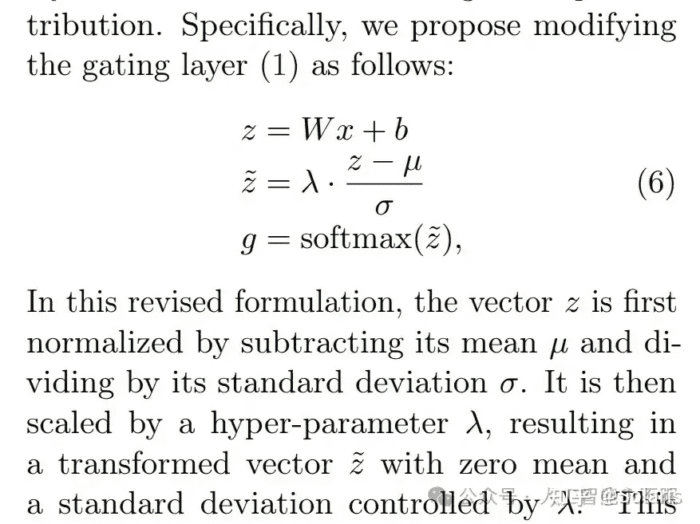

# 🚀招聘公告

---

奇绩创坛由陆奇博士于2019年创立，使命是在源头最大化驱动创新。奇绩研究组将研究模型理论、到投研战略分析、市场策划等不同背景的同学聚在一起，搭建GenAI时代独特的跨界人才社群。

### F24实习岗位

#### [`行研-学术科研人才交流组实习生`](https://miracleplus.feishu.cn/docx/Yn6rdf2iOoY2Rcx8yVNcUBYRnch#part-QkMcdeJmuob9uvxvV3qcLSzHn8g)

#### 行研-GenAI研究岗位-战略分析（偏产品）

#### Web / AI 全栈开发工程师实习生

### 火热开放中

#### 行研-GenAI研究岗位-前沿学术探索

#### 行研-GenAI研究岗位-战略分析（偏咨询）

#### 创新活动产品运营 （大模型系列活动产品运营）

> 点击相关岗位可查看对应岗位需求【JD】；相关岗位投递请添加🛰️💻【`sunjiajunspace`】

> ‼️欢迎推荐/自荐，期待在奇绩创坛遇见更好的你‼️

---

# 声明

本文档仅供学习交流使用，版权归原作者所有，若涉侵权，请联系Jack Jin 15101136166

（欢迎在下方反馈您宝贵的意见！整理不易，觉得有用给AI日报小组点个赞👍吧！）

ChatGPT；Angela；Zijia Liu；Alex；Zeqi Tan；Tiezhen（HuggingFace）；Naixu；Lizhi；Peter；Suoman；Jack

# 封面生成——右脑科技

如果你有大模型相关的创业想法，欢迎来找我们聊聊～🛰️：15101136166

> 快邀请你的小伙伴们一起来读大模型日报吧！
>
> **【日报知识库】**这里是近期日报内容的汇总,欢迎大家查阅
>
> [大模型日报知识库(分享版)](https://miracleplus.feishu.cn/wiki/KapVwXfkriOBiskB0B2cUHxjnTh)
>
> 欢迎大家多多帮我们分享,转发
>
> 如果大家有任何的建议或者吐槽,欢迎随时找我聊天~

