# 奇绩大模型日报（8月 22日）

> 来源：[https://miracleplus.feishu.cn/docx/ERSHdYaPbo1KvQxBUgjcPF3nnah](https://miracleplus.feishu.cn/docx/ERSHdYaPbo1KvQxBUgjcPF3nnah)

# 📡潜空间活动报名

> 潜空间系列活动第三季第三期开启报名！

> 本期活动将在**8月24日** **10:00 am**开始，嘉宾是**童晟邦**。**童晟邦，纽约大学博士，伯克利人**工智能实验室（BAIR）研究员， OpenAI 超对齐奖学金获得者。他将和大家探讨视觉在多模态大模型中扮演的角色。

> 除嘉宾分享外，每期设置了【匹配合伙人 Cofounder Matching】环节。你可以和 GenAI 时代最有活力的创业者和研究者线下面对面交流，将有机会找到志同道合、有共同创业梦想的小伙伴。

> 报名通道已开启，欢迎扫描下方二维码报名。

# 推特

### Lex Fridman访谈Pieter Levels

https://twitter.com/lexfridman/status/1825994852376420479

我(Lex Fridman)与Pieter Levels的对话，他是一位自学成才的开发人员和企业家，他设计、编程、运输和运营了40多家初创公司，其中许多都取得了巨大的成功。在大多数情况下，他都是自己完成的，同时在 40 多个国家和 150 多个城市过着数字游牧生活。这是一次有趣而鼓舞人心的对话！

### Gemini API支持1000页的PDF分析

https://twitter.com/OfficialLoganK/status/1825976844228694168

我们刚刚在 Google AI Studio 和 Gemini API 中将最大 PDF 页面上传大小增加到 1,000 页或 2GB（高于 300 页）。

我们使用文本理解和 Gemini 的原生多模态功能来处理这些文档（每页 1 张图片）。

**评论**：想象一下，如果我们可以自由地访问优秀的教科书并将它们加载到 Gemini 中！对于谷歌来说，可能有一种类似于Spotify的商业模式。Oreilly 已经通过每月订阅和访问其目录来做到这一点。

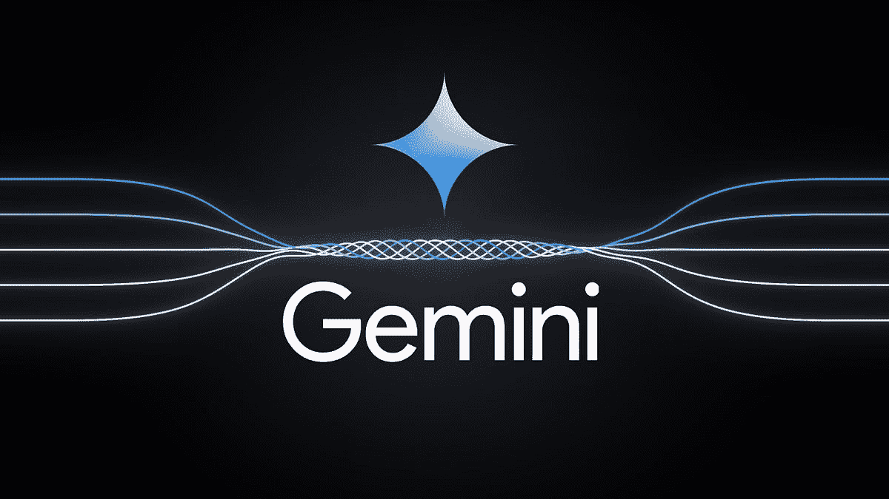

### Phi-3.5-MoE 在基准测试中击败 Llama 3.1 8B

https://twitter.com/rohanpaul_ai/status/1825984804451463210

微软在刚刚发布的 phi 3.5 中取得了如此惊人的结果：mini+MoE+vision。

Phi-3.5-MoE 在基准测试中击败 Llama 3.1 8B

当然，Phi-3.5-MoE 是 42B 参数的 MoE，在生成过程中激活了 6.6B

而 Phi-3.5 MoE 在推理能力上优于其他几个更大的模型，仅次于 GPT-4o-mini。

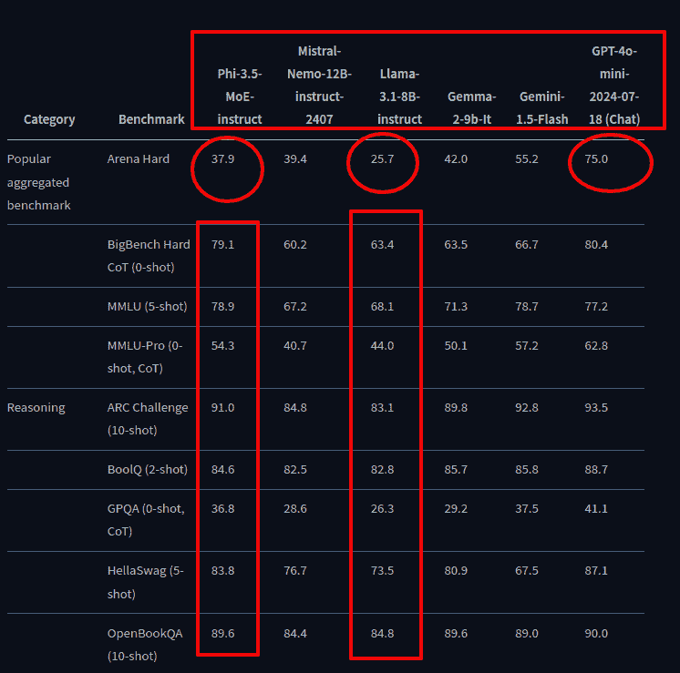

### 观点：英伟达正在防止单级化AGI，也在减缓AGI的规模发展

https://twitter.com/DanHendrycks/status/1825926885370728881

https://twitter.com/teortaxesTex/status/1770308598393966921

NVIDIA 正在创造一场并驾齐驱的竞争（OpenAI、xAI、Meta、Microsoft 等）。对于英伟达来说，每一个新的竞争对手都是另外数十亿美元的收入。正因为如此，我们还没有看到下一代（>10^26 FLOP）模型。

黄仁勋的政策不仅仅是卖给出价最高的人，这是我们对抗赢家通吃的AGI螺旋式上升的最后一道防线，在这种螺旋式上升中，内部筹码在终结之前占据主导地位。

**评论**：因此，山姆·奥特曼（Sam Altman）希望自己生产芯片。

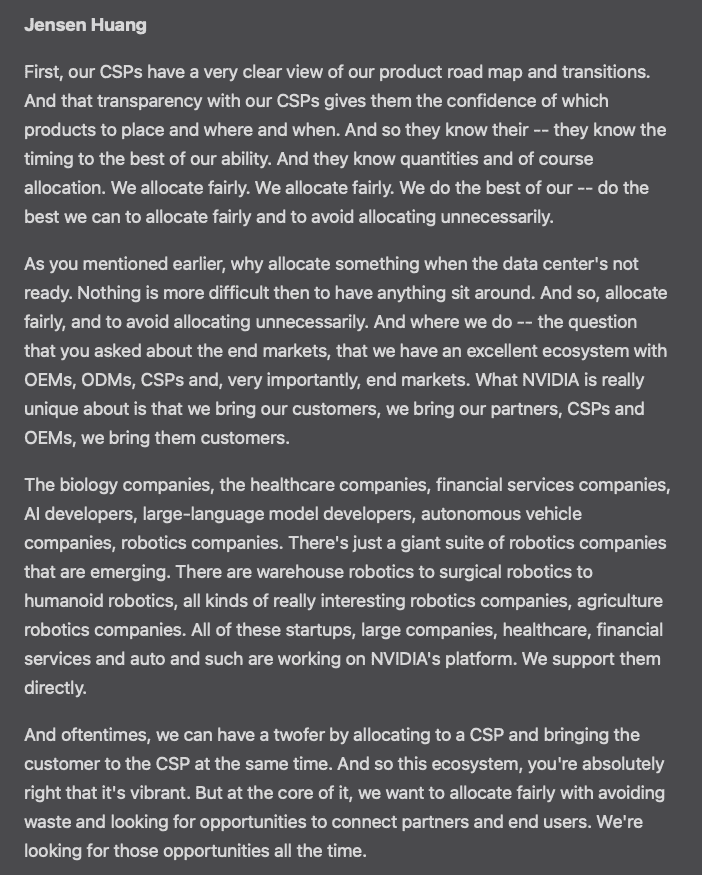

# 资讯

### a16z又发榜了

https://a16z.com/100-gen-ai-apps-3/

报告显示，AI 技术在消费者产品中的应用迅速增长，新兴 AI 创意工具尤其受欢迎。报告揭示了 ChatGPT 在用户参与度方面的领先地位，同时 Perplexity 和 Anthropic 的 Claude 等竞争者也有显著表现。字节跳动推出多个 AI 产品，包括教育平台和通用助手，进一步扩大了其在 AI 领域的影响力。此外，AI 在美学和约会领域的应用也初现端倪，新兴产品如 LooksMax AI 和 RIZZ 吸引用户关注。Discord 平台的 AI 应用流量成为评估产品增长潜力的重要指标

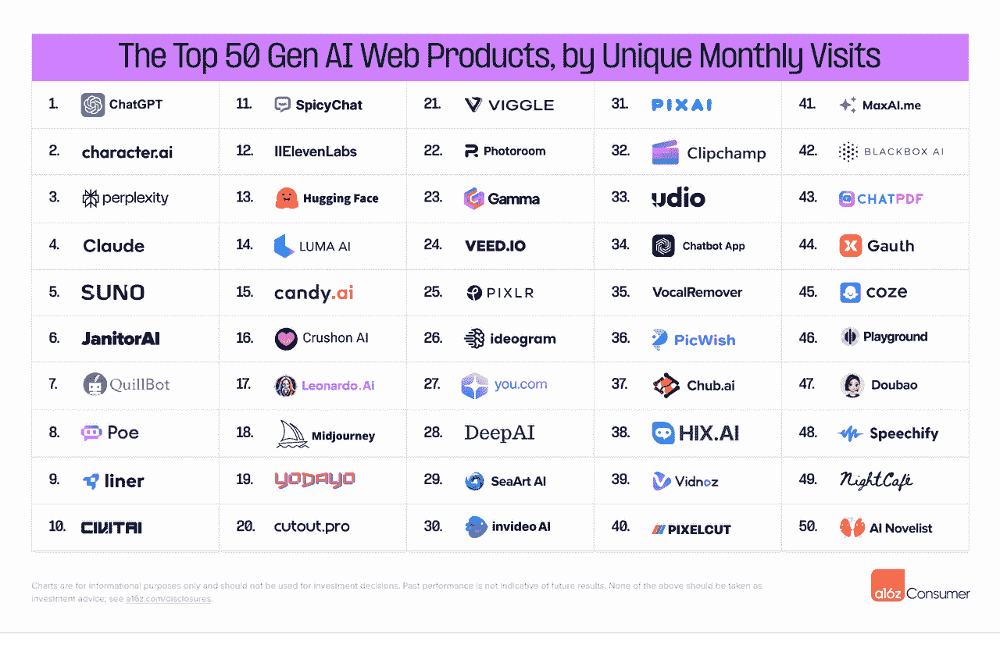

### Anthropic的Claude应用收入突破100万美元，但仍远落后于竞争对手

https://techcrunch.com/2024/08/21/anthropics-claude-surpasses-1m-in-mobile-app-revenue/

Anthropic的AI应用Claude在16周内实现了移动应用收入突破100万美元，其中近一半的收入来自美国用户。虽然Claude在这一领域取得了初步成功，但与主要竞争对手ChatGPT相比仍有较大差距，后者仅用了三周时间就达到了同样的收入水平。此外，Claude在全球的下载量和收入排名也远低于ChatGPT。尽管如此，Claude仍然在与其他AI应用的竞争中表现出色，超过了微软的Copilot和Perplexity等对手。

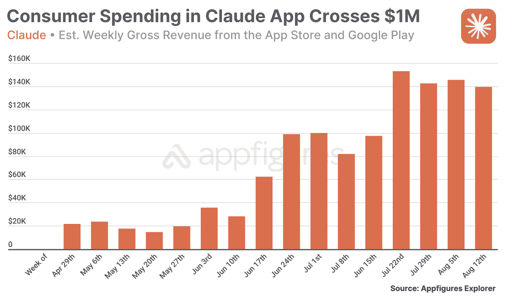

### 逛遍世界机器人大会：27款人形机器人爆场

https://mp.weixin.qq.com/s/Ca99fyWZYmOtEqyzZsILrQ

2024 年世界机器人大会在北京亦庄拉开帷幕，吸引了众多参观者。大会的主要亮点是 27 款人形机器人的展示，它们展现了从念诗、跳舞到下棋的多样化技能。此外，机械臂的 “刀群舞” 增添了科技感，而商用服务机器人如优必选 Walker S 系列、擎朗智能的酒店、医院解决方案等，已经在实际场景中实现了应用。北京市副市长靳伟强调了北京在机器人产业发展中的领先地位，并表示将继续支持产业的发展，目标是打造全球的机器人产业高地。

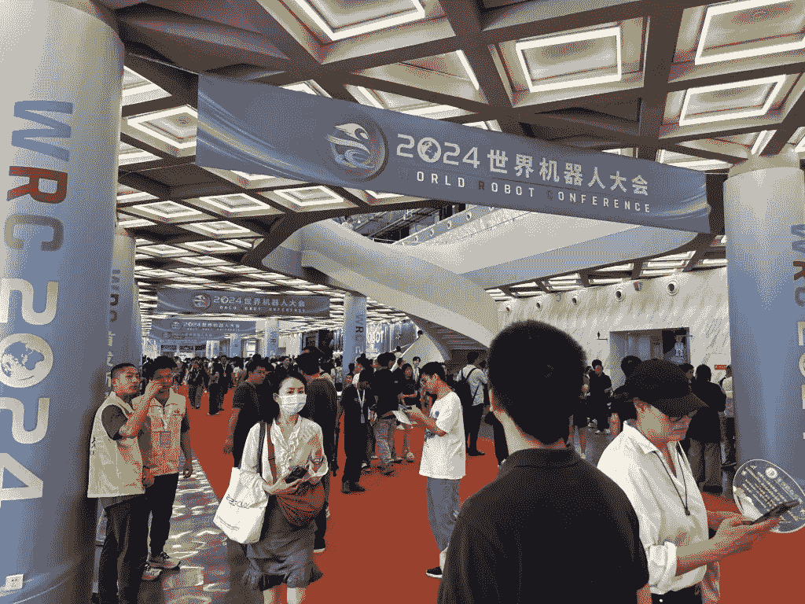

### Seed-ASR如何突破语音识别瓶颈

https://mp.weixin.qq.com/s/4eUPcojYxNWlBZCFDhop6A

豆包大模型团队在 2024 年火山引擎 AI 创新巡展上海站推出了 Seed-ASR 技术，该技术采用大语言模型，实现了高精度的语音识别，支持多种语言和方言，并具备上下文感知能力。Seed-ASR 通过基于人名和专业名词的上下文推理，以及对五种方言混合聊天的准确识别，展现了其卓越的性能。技术细节上，Seed-ASR 的开发包括编码器的自监督学习、监督微调、上下文微调和强化学习。其中，编码器 LUISE 利用 BERT 的自监督学习框架，通过掩码语言预测捕捉语音信号。监督微调阶段，模型将音频编码器与大语言模型连接，实现语音到文本的准确映射。上下文微调和强化学习进一步提升了模型在复杂语音环境下的理解和识别能力。实验结果显示，Seed-ASR 在中英文测试集上的单词错误率较之前代模型有显著下降，且在主观评价中也获得了与人类转录员相当的主观可理解性。

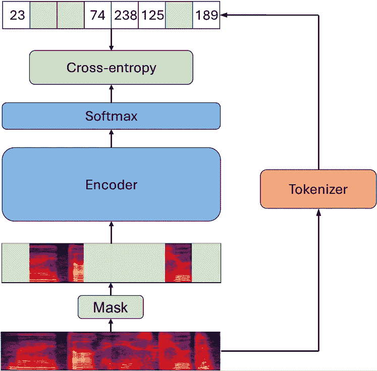

### 分布式人工智能盛会 DAI 2024 征稿

https://mp.weixin.qq.com/s/8RPZuK4DJJx295MobPS-Rw

AI 2024 将聚焦于分布式人工智能（Distributed Artificial Intelligence, DAI）的创新与应用，特别强调智能体（Agent）技术在自然语言交互、知识推理、任务规划等方面的巨大潜力。会议将在 2024 年 12 月 18 日至 12 月 22 日在新加坡举行，邀请到了国际知名学者和业界领袖，包括强化学习之父 Richard S. Sutton、UC 伯克利的 Sergey Levine、DeepMind 的 Georgios Piliouras 以及昆仑 2050 全球研究院的颜水成等人。此外，会议还特别设立了 "Agent Day"，旨在展示智能体技术在各行各业的实际应用和与人类互动的创新案例。会议征稿主题广泛，涵盖了 Agent 合作、人机交互、单 / 多智能体学习、计算博弈论、经济学与计算等多个领域。

https://www.zhihu.com/pin/1808937209040097280

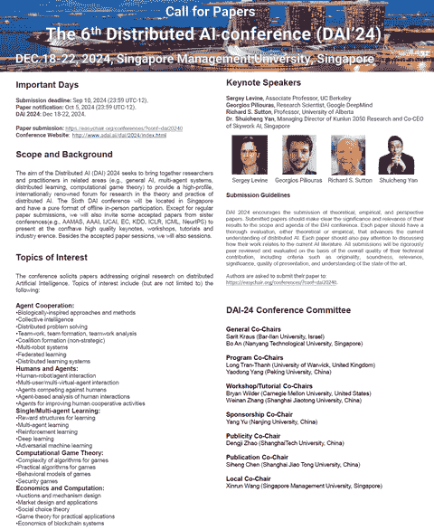

# 论文

### FocusLLM: 通过并行解码扩展LLM的上下文

贡献人：

链接：http://arxiv.org/abs/2408.11745v1

加强LLM能够利用[长上下文的有用信息对于许多下游应](https://github.com/leezythu/FocusLLM)用至关重要。然而，传统Transformer架构要实现长上下文长度需要大量的训练和推断资源。本文提出了FocusLLM，一个旨在扩展任何仅解码器LLM的上下文长度的框架，使模型能够专注于来自非常长序列的相关信息。FocusLLM通过根据模型原始上下文长度将长文本输入分成块来处理，以减轻注意力分散问题。然后，它将局部上下文附加到每个块作为提示，基于一种新颖的并行解码机制从每个块中提取关键信息，并最终将提取的信息集成到局部上下文中。FocusLLM以出色的训练效率和通用性脱颖而出：用远低于以前方法的训练成本训练8K输入长度，FocusLLM在下游长上下文任务中表现出优秀性能，并在处理大量长文本（甚至达到400K令牌）时保持强大的语言建模能力。我们的代码可在 https://github.com/leezythu/FocusLLM 上找到。

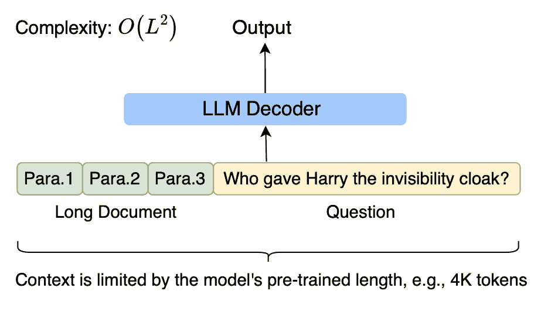

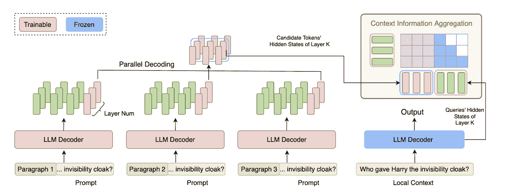

### **智能体提升语义代码搜索**

贡献人：

链接：http://arxiv.org/abs/2408.11058v1

代码搜索是许多程序员在解决问题时经常需要执行的关键任务。当前的方法学在处理包含一些模糊或需要与代码库相关的额外上下文的提示时往往无法准确执行。我们介绍了使用检索增强生成（RAG）智能体的方法，将信息注入用户提示，使其更好地输入到嵌入模型中。通过利用RAG，智能体可以使用来自GitHub存储库的相关细节增强用户查询，使其更具信息性和上下文对齐。此外，我们引入了一种多流集成方法，当与智能体工作流配对时，可以获得改进的检索准确性，我们将其部署在名为repo-rift.com 的应用程序上。在CodeSearchNet数据集上的实验结果表明，RepoRift显著优于现有方法，在Success@10 的成功率达到78.2％，在Success@1 的成功率达到34.6％。这项研究在语义代码搜索方面取得了实质性进展，突出了智能智能体LLM和RAG提升代码检索系统的潜力。

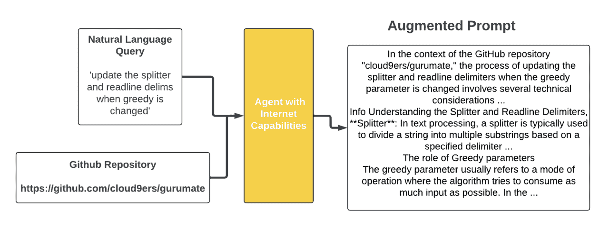

### Mistral-SPLADE: 用于更好学习的稀疏检索的LLMs

贡献人：

链接：http://arxiv.org/abs/2408.11119v1

学习稀疏检索器（LSR）已经发展成一种有效的检索策略，可以弥合传统基于关键字的稀疏检索器与基于嵌入式密集检索器之间的差距。在其核心，学习稀疏检索器试图从查询和/或文档中学习最重要的语义关键词扩展，以促进具有重叠关键词扩展的更好检索。我们提出使用仅解码器模型学习语义关键词扩展。我们认为，仅解码器模型在看到更高数量的数据后，更适合学习改进检索所需的关键词扩展。我们利用Mistral作为骨干来开发类似于SPLADE的学习稀疏检索器，并在经常用于训练文本嵌入模型的子集上对其进行训练。我们的实验支持假设，基于仅解码器大型语言模型（LLM）的稀疏检索模型超越了现有LSR系统的性能，包括SPLADE及其所有变体。基于LLM的模型（Echo-Mistral-SPLADE）现在被确定为BEIR文本检索基准测试的最先进学习稀疏检索模型。

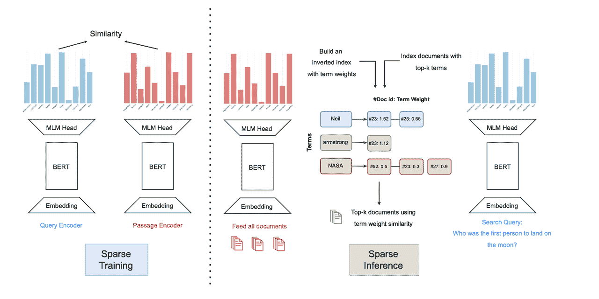

### **LLM Pruning and Distillation in** Practice：Minitron方法

贡献人：

链接：http://arxiv.org/abs/2408.11796v1

我们提出了一个关于压缩Llama 3.1 8B和Mistral NeMo 12B模型到4B和8B参数的全面报告，使用剪枝和蒸馏。我们探讨了两种不同的剪枝策略：(1)深度剪枝和(2)联合隐藏/注意力/MLP（宽度）剪枝，并在LM评估工具中的常见基准上评估结果。然后将模型与NeMo Aligner对齐，并在定制的版本中进行测试。这种方法从Llama 3.1 8B生成了一个引人注目的4B模型，从Mistral NeMo 12B生成了一流的Mistral-NeMo-Minitron-8B（缩写为MN-Minitron-8B）模型。我们发现，即使没有访问原始数据，微调教师模型对蒸馏数据集也是有益的。我们在Hugging Face上以自由授权发布我们的基础模型权重。

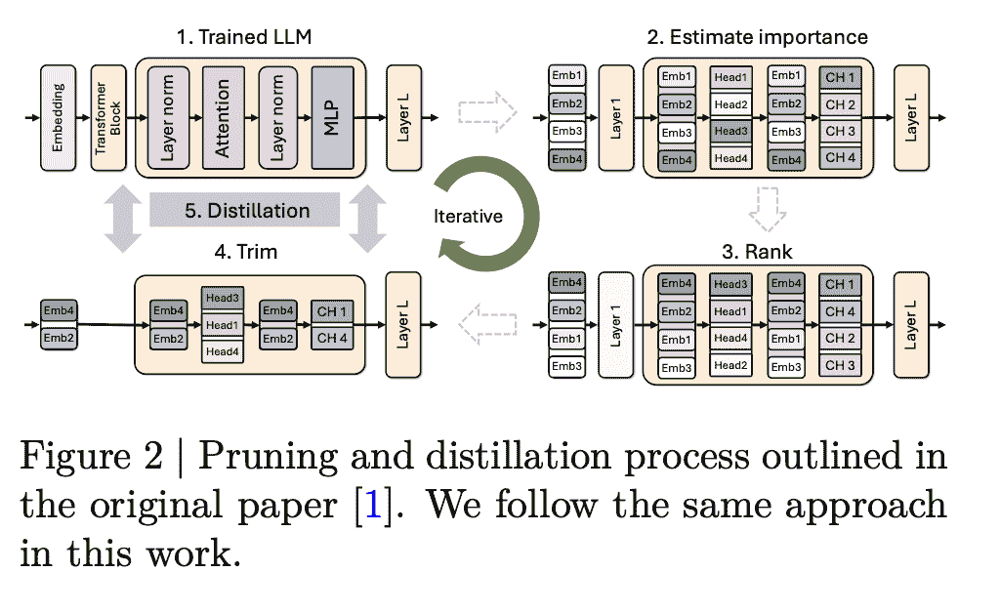

# 产品

### Contacted.io

贡献人：

https://contacted.io/

Contacted.io 是一个 AI 驱动的平台，希望可以通过提供全面的内容和 SEO 报告，帮助企业优化其在线表现。该平台为用户提供量身定制的建议，支持多种网站平台，且无需专业编码技能，致力于以实惠的价格提升网站的搜索引擎排名和客户吸引力。

### DiD video-translate

贡献人：

https://www.d-id.com/video-translate

D-ID Video Translate 是一款可以快速将视频翻译成多种语言，支持语音克隆和精确的唇动同步的AI 工具。用户只需一次上传即可生成多语种视频，节省时间和成本，帮助内容创作者更好地触达全球受众。

# HuggingFace&Github

### TableBench

贡献人：

https://tablebench.github.io/

TableBench 是一个评估大型语言模型在表格数据处理能力的基准测试，涵盖18个领域和四个主要类别，专注于表格问答能力。它旨在缩小学术与实际应用之间的差距，并推出了基于 TableInstruct 训练的 TableLLM，性能与 GPT-3.5 相当。实验结果显示，尽管已有进展，现有模型仍需提升以满足真实世界的需求。

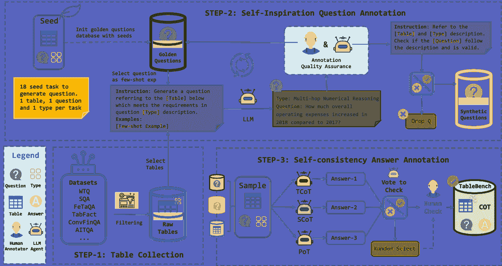

### Phi-3.5-vision-instruct

贡献人：

https://huggingface.co/microsoft/Phi-3.5-vision-instruct

Phi-3.5-vision 是一个轻量级的多模态模型，支持128K上下文长度，专注于高质量的文本和视觉数据。它适用于商业和研究用途，能够处理图像理解、光学字符识别、多图像比较等任务。模型经过监督微调和偏好优化，确保安全性和指令遵循。最新版本提升了多帧图像理解能力，并在多个基准测试中表现优异。

### LLM-TPU

贡献人：

https://github.com/sophgo/LLM-TPU

本项目实现了在算能BM1684X芯片上部署各类开源生成式AI模型,以LLM为主。通过TPU-MLIR编译器将模型转换成bmodel,并采用C++代码将其部署到PCIE环境或者SoC环境。

# 投融资

### Story获8300万美元融资，估值达22.5亿美元，构建内容IP区块链平台

https://techcrunch.com/2024/08/21/story-raises-83m-at-a-2-25b-valuation-to-build-a-blockchain-for-the-business-of-content-ip-in-the-age-of-ai/

Story公司宣布完成8300万美元的B轮融资，估值达到22.5亿美元。领投方为a16z的加密部门和Polychain Capital，参与者包括Stability AI的SVP Scott Trowbridge和K11创始人郑志刚等。Story旨在通过区块链技术打造一个内容IP管理平台，使创作者能够更有效地追踪和管理其知识产权。该平台已在封闭测试中吸引了超过200个团队注册，计划在今年晚些时候商业化推出。

公司官网：https://www.story.foundation/

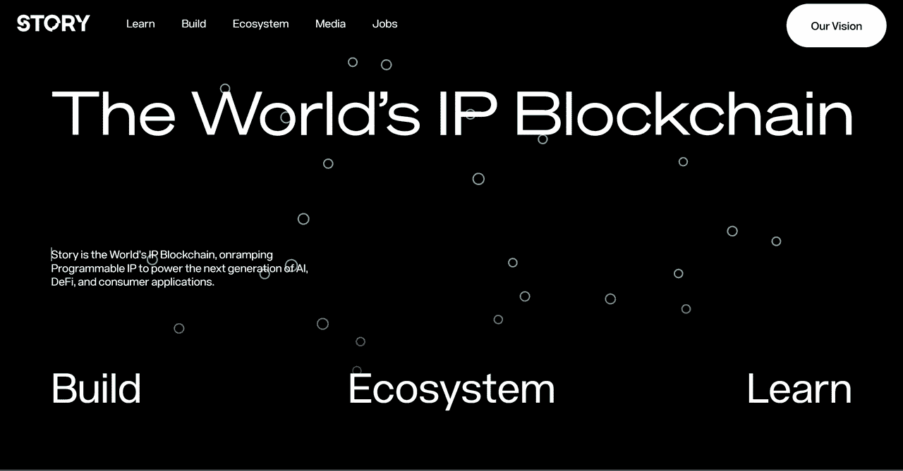

### Skyfire推出AI代理支付网络，完成850万美元种子轮融资

https://techcrunch.com/2024/08/21/skyfire-lets-ai-agents-spend-your-money/

Skyfire公司推出了一款为AI代理设计的支付网络，使其能够自主完成交易。Skyfire的支付网络通过分配数字钱包和设定支出限制，保障AI代理的安全性。公司通过区块链技术将美元转换为数字稳定币USDC，以支持支付。Skyfire刚刚完成850万美元的种子轮融资，投资方包括Neuberger Berman、Inception Capital和Arrington Capital。公司计划将该协议开放给所有企业使用，推动AI代理支付的普及。

公司官网：

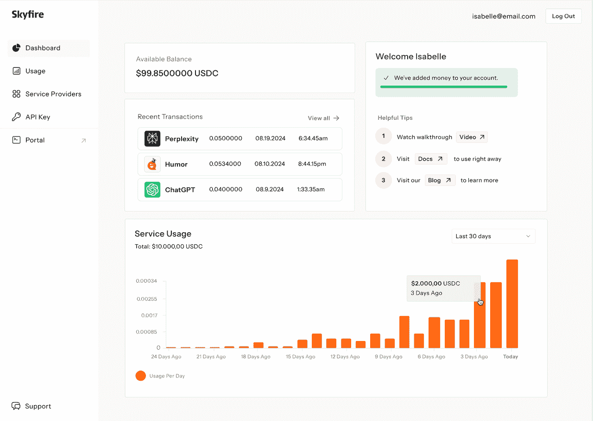

### D-ID推出AI视频翻译工具，包含语音克隆和唇形同步功能

https://techcrunch.com/2024/08/21/d-id-launches-an-ai-video-translation-tool-that-includes-voice-cloning-and-lip-sync/

D-ID公司最新推出了一款AI视频翻译工具，能够翻译视频并同步克隆发言者的声音和唇形。该技术基于D-ID此前的AI技术开发。2022年，D-ID获得了2500万美元的B轮融资，主要用于扩展其AI视频技术在美国企业客户中的应用。新工具将帮助客户在全球市场中降低本地化成本，同时提升视频的多语言传播能力。

公司官网：https://www.d-id.com/

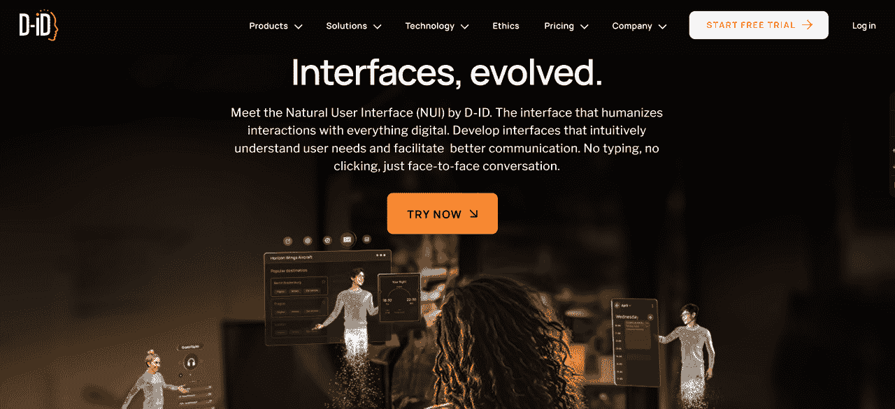

# 学习

### 聊聊大模型推理中的 KVCache 之异构缓存

贡献人：

https://zhuanlan.zhihu.com/p/714288577?utm_psn=1809955077189926913

文章首先介绍了 KVCache 的基本原理，即通过存储中间计算结果来减少重复计算，从而节省时间和资源。接着，文章深入讨论了如何针对不同的硬件平台（如 CPU、GPU、TPU 等）优化缓存策略，以及如何通过动态缓存管理技术，根据实际推理任务的需求灵活调整缓存使用。此外，文章还分析了异构缓存在大模型推理中面临的挑战，包括内存容量限制、访问延迟问题以及多设备协同的复杂性。最后，文章提出了未来发展的方向，指出需要进一步研究智能化的缓存管理算法，以实现更高效的资源利用和更快的推理速度。

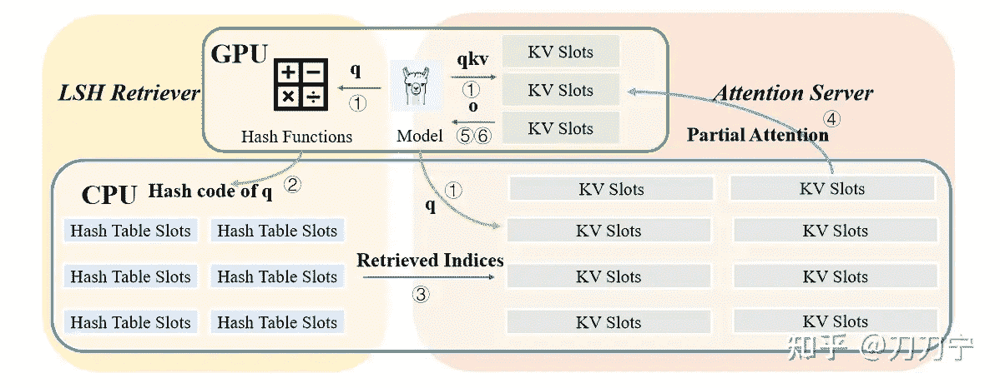

### QServe推理服务加速源码解析

https://zhuanlan.zhihu.com/p/712659371?utm_psn=1809853541231235074

QServe 推理服务通过多线程和异步 I/O 优化了并发处理能力，提升了推理速度。核心代码分析显示，请求处理流程从接收到响应均采用高效的异步处理机制。模型热加载和版本管理功能支持无需服务中断即可更新模型，增强了系统的灵活性。性能监控和日志记录确保了服务的稳定性和问题追踪。

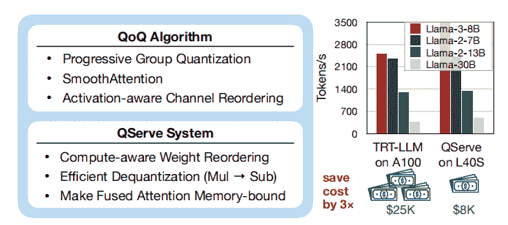

### 详解MS的GraphRAG的实现流程

https://zhuanlan.zhihu.com/p/715724188?utm_psn=1809656205997637634

微软的 GraphRAG 模型是一个图谱增强的生成模型，它通过将文档分割成文本单元并进行嵌入，实现了对实体和关系的提取。该模型采用 Leiden 层次化社区检测算法来识别图谱中的社区结构，并通过 Node2Vec 算法将图谱节点转换为向量空间中的表示，以提升查询和推理的效率。在文档处理阶段，GraphRAG 不仅将文档与文本单元关联，还为整个文档生成了向量表示，这一过程通过对文档重新分块并对每个块进行加权平均嵌入来完成。此外，GraphRAG 能够将 CSV 格式数据的额外字段信息（如作者、日期、类别等）整合到文档的向量表示中，增强了模型在分类、推荐和个性化分析方面的能力。最后，该模型还支持通过 UMAP 等降维技术进行可视化，使得图谱数据能够以二维或三维形式直观展示。

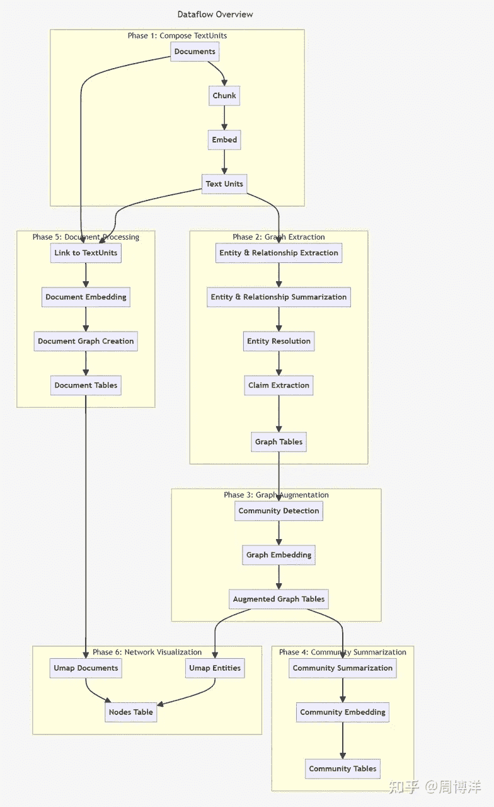

### Flux.1 作为最强的文生图模型，本地应该如何最快，最轻量化的运行？

https://www.zhihu.com/question/663658504/answer/3601659956?utm_psn=1809652318314041344

Flux.1 由 Black Forest Labs 团队开发，是一个基于 Stable Diffusion 3 的文生图模型，具有三种变体：FLUX.1 [pro]、FLUX.1 [dev] 和 FLUX.1 [schnell]，均拥有 12B 参数。该模型在架构上做了升级，包括 RoPE 和 Parallel Attention 等改进，被认为是扩散模型技术发展的一个里程碑事件。Flux.1 的参数量级接近 Llama2-13B，与一年前常用的 LLM 模型相当，且首次实现了开源扩散模型达到 10B 量级。大模型和长序列的特点导致 Flux.1 推理延迟较高，即使在 A100 显卡上，生成 2048px 图片也需要 10 秒钟。此外，生成超过 2048px 的图片时 VAE 部分会出现 OOM 问题。Flux.1 Pro 版本定向售卖给了 PaaS 公司，而其他版本可通过 Replicate 和 Fal.ai 使用。

为了解决 Flux.1 的性能问题，xDiT 项目提供了一个 DiT 并行推理框架，支持多种并行方法，包括 Data Parallel、Sequence Parallel、PipeFusion、CFG Parallel、Tensor Parallel 和 DistriFusion。对于高清图片的 VAE Decoder 部分，xDiT 也提供了 Patch Parallel 和 Chunked Input 的并行方案，以避免 OOM 问题。通过 xDiT 的并行技术，可以显著降低推理延迟，例如在 8xA100 (80GB) NVLink 互联的机器上，生成 1024px 图片仅需 0.93 秒钟，相比单卡加速 4.2 倍。对于更高分辨率的图片，加速效果更为明显。

Flux.1 的出现对 DiTs 结构的发展具有历史性的意义，xDiT 希望在并行推理角度继续推进，实现 Flux.1 的实时低成本推理。未来的工作包括支持 PipeFusion、优化 Parallel VAE、使用 torch.compile 加速单卡计算以及支持 ComfyUI、LoRA、ControlNet、Flux 量化等。

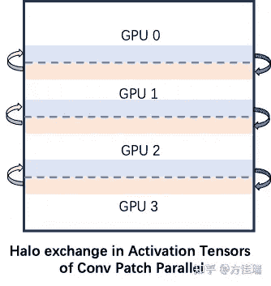

### 从工程师的角度看大模型训练

https://zhuanlan.zhihu.com/p/715712057?utm_psn=1809652072846598146

作者朱小霖通过对大模型训练流程的深入理解，分享了从工程师角度出发的大模型训练经验。文章首先指出，大模型训练通常需要研究人员提供研究目标和实验方案，以及工程师提供稳定的集群和高效的训练框架。然而，作者所在的团队缺乏研究人员，但有经验丰富的工程师。在这样的前提下，作者提出将大模型训练问题转化为三个搜索问题：搜索合适的模型配置、训练超参以及数据约束。这样，大模型训练就转变为传统的工程问题，关键在于如何快速且高效地进行搜索。作者提出了加快实验速度和减少实验量的几种方法，如优化训练框架、优化任务提交流程、设置合理的初值和增加基准测试等。通过这些工程手段，作者的团队成功地搜索到了较优的模型配置，并通过实践验证了这种方法的有效性。作者还强调了数据团队的重要性，以及如何控制打标数据的偏差。最后，作者认为，即使没有研究人员，通过工程化的方法和丰富的经验，也能训练出不错的模型。

### NVM Express @ FMS 2024（PPT）

https://mp.weixin.qq.com/s/LrCMnMGCQ9bP9852EipoaQ

NVMe Express 技术作为高性能存储的核心，在最新的 2.1 规范中进行了更新，支持了 CXL 接口，并在 Windows 中实现了创新性应用。该技术在安全性方面得到加强，引入了每 I/O 密钥和 Fabric 安全增强等特性。NVMe 启动规范的改进，包括对 IPV4/IPV6 DHCP 标识符的支持和错误码的优化。NVMe-oF 自动发现简化了配置过程，集中式发现控制器提升了发现信息管理效率。NVMe-MI 带外管理增强了高可用性和异步事件通知。此外，NVMe 实时迁移和高可用性特性的开发，为数据迁移和系统管理提供了新的解决方案。NVMe 技术社区不断推动新技术的发展，如计算存储和灵活数据布局，同时维护和更新现有规范，确保 NVMe 技术在 AI、云计算、客户端和企业级存储领域的广泛应用和前瞻性发展。

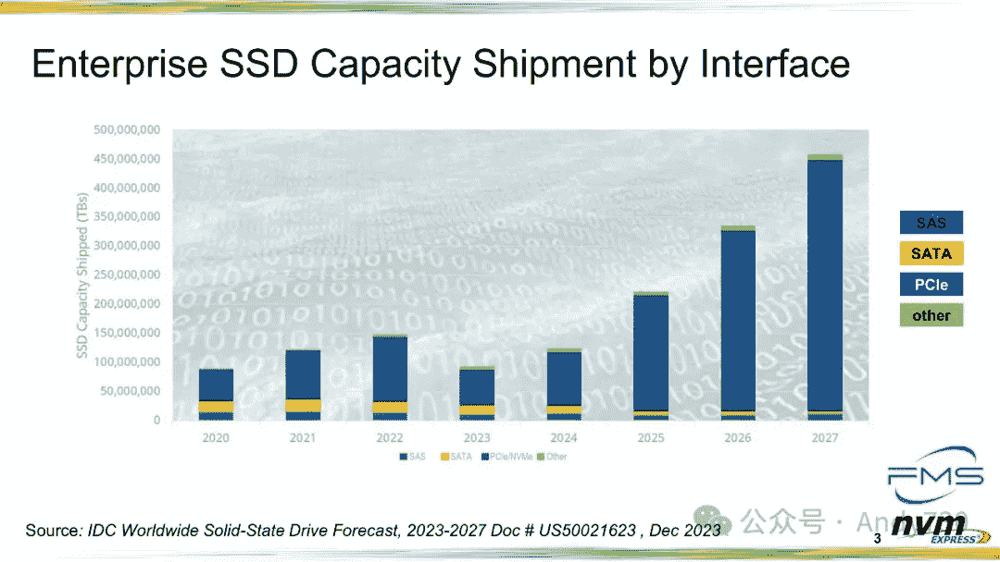

### 十家国产AI芯片厂商产品大揭秘（阉割版）-昇腾、海光、天数智芯...

https://mp.weixin.qq.com/s/PDGf316ZaMnPut2M2wnmVw

文章详细介绍了十家国内 AI 芯片厂商的产品特性和市场表现，包括华为昇腾、海光 DCU、天数智芯、摩尔线程、沐曦、寒武纪、昆仑芯、壁仞科技、燧原科技和太初元пе等。这些厂商的产品在 AI 计算性能、显存容量、接口技术等方面取得了一定的进步，部分高端芯片的算力已与国际先进水平相当。然而，国内厂商在卡间通信和大规模集群构建方面仍面临技术挑战，缺乏与 NVIDIA 的 NVLink/NVSwitch 相匹配的解决方案。

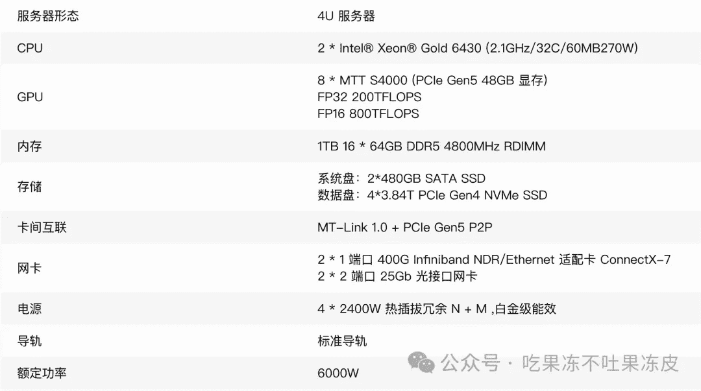

### AlphaGeometry：Nature 2024，奥数界的AI大师 2

https://mp.weixin.qq.com/s/h1jthMfRTxua5zjrabFd9w

AlphaGeometry 是一种基于人工智能的几何定理证明系统，它通过结合符号推理引擎和大语言模型（LLM），成功解决了国际数学奥林匹克竞赛（IMO）中的几何问题。该系统采用了大规模的合成数据生成技术，通过在合成证明上的预训练和针对需要辅助构造的子集的微调，提高了证明的准确性和效率。AlphaGeometry 在 IMO-AG-30 基准测试上取得了最佳结果，解决了 25 个问题，超越了传统的计算机代数方法和搜索基线。系统使用了一种专门的几何表示法，能够适应大多数 IMO 几何问题，并且通过符号推理引擎进行逻辑和数值验证。代数推理部分通过高斯消元法和混合整数线性规划来处理等式和几何常数，从而推导出新的等式。此外，AlphaGeometry 通过回溯算法提取最小前提，确保证明的简洁性和可解释性。系统的框架可以泛化到其他数学领域，为自动定理证明提供了一个通用的指导框架。

https://mp.weixin.qq.com/s/cPCKOzJYbxIptf2g8hMCIA

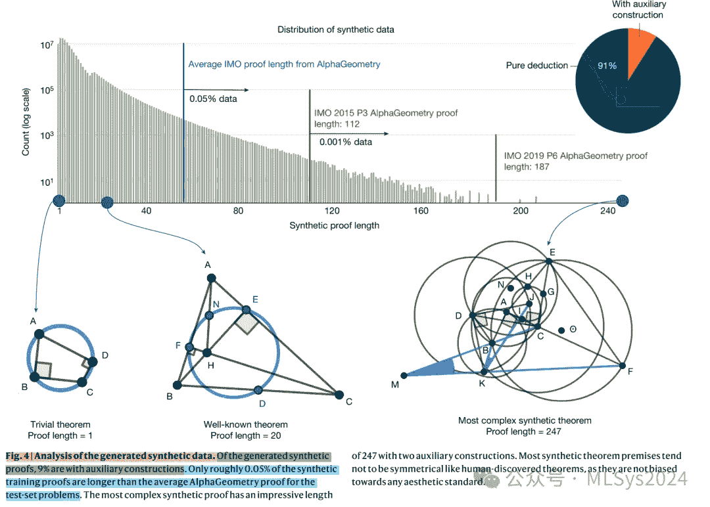

# 🚀招聘公告

**奇绩创坛****由陆奇博士**于2019年创立，使命是在源头最大化驱动创新。奇绩研究组将研究模型理论、到投研战略分析、市场策划等不同背景的同学聚在一起，搭建GenAI时代独特的跨界人才社群。

**F24实习岗位**

##### [行研-学术科研人才交流组实习生](https://miracleplus.feishu.cn/docx/Yn6rdf2iOoY2Rcx8yVNcUBYRnch#part-QkMcdeJmuob9uvxvV3qcLSzHn8g)

##### 行研-GenAI研究岗位-战略分析（偏产品）

##### Web / AI 全栈开发工程师实习生

**火热开放中**

##### 行研-GenAI研究岗位-前沿学术探索

##### 行研-GenAI研究岗位-战略分析（偏咨询）

##### 创新活动产品运营 （大模型系列活动产品运营）

> **点击**相关岗位可查看对应**岗位需求【JD】；**相关岗位投递请**添加🛰️💻【**sunjiajunspace】

> ‼️欢迎**推荐/自荐**，期待在**奇绩创坛**遇见更好的你‼️

---

# 声明

本文档仅供学习交流使用，版权归原作者所有，若涉侵权，请联系Jack Jin 15101136166

##

（欢迎在下方反馈您宝贵的意见！整理不易，觉得有用给AI日报小组点个赞👍吧！）

ChatGPT；Angela；Zijia Liu；Alex；Zeqi Tan；Tiezhen（HuggingFace）；Naixu；Lizhi；Peter；Suoman；Jack

封面生成——右脑科技

如果你有大模型相关的创业想法，欢迎来找我们聊聊～🛰️：15101136166

> 快邀请你的小伙伴们一起来读大模型日报吧！

> **【日报****知识库****】**这里是近期日报内容的汇总,欢迎大家查阅

> [大模型日报知识库(分享版)](https://miracleplus.feishu.cn/wiki/KapVwXfkriOBiskB0B2cUHxjnTh)

>

> 欢迎大家多多帮我们分享,转发~~

> 如果大家有任何的建议或者吐槽,欢迎随时找我聊天~

