# 奇绩大模型日报（8月 23日）

> 来源：[https://miracleplus.feishu.cn/docx/SmyOdFNZUotLnuxXbOicxssOn3c](https://miracleplus.feishu.cn/docx/SmyOdFNZUotLnuxXbOicxssOn3c)

## 📡潜空间活动报名

> 潜空间系列活动第三季第三期开启报名！

> 本期活动将在**8月24日** **10:00 am**开始，嘉宾是**童晟邦**。**童晟邦，纽约大学博士，伯克利人**工智能实验室（BAIR）研究员， OpenAI 超对齐奖学金获得者。他将和大家探讨视觉在多模态大模型中扮演的角色。

> 除嘉宾分享外，每期设置了【匹配合伙人 Cofounder Matching】环节。你可以和 GenAI 时代最有活力的创业者和研究者线下面对面交流，将有机会找到志同道合、有共同创业梦想的小伙伴。

> 报名通道已开启，欢迎扫描下方二维码报名。

## 资讯

### 田渊栋新小说《破晓之钟》

`https://mp.weixin.qq.com/s/Ufq_CK5MIFkr86pK45TpMA`

田渊栋在AI领域拥有深厚的背景，曾参与谷歌无人车和围棋AI项目，现在在Meta担任研究科学家。他的小说《破晓之钟》以科幻的形式探讨了AI、智能体、元宇宙等前沿技术，并反思了科技发展的未来走向。

### Noam Shazeer出任Gemini联合技术主管

`https://mp.weixin.qq.com/s/EE3CjahM4S94ZOopDnioYA`

Noam Shazeer，被认为对 `Transformer` 模型贡献最大的作者之一，近期被曝重返谷歌，并担任 `Gemini` 项目的联合技术主管。`Gemini` 项目被视为与 OpenAI 的 `GPT` 模型直接竞争的关键项目。在这一变动之前，谷歌以约 179 亿元的价格收购了 `Character.AI`，这是一个由 Shazeer 和 Daniel De Freitas 共同创立的 AI 独角兽公司。尽管 `Character.AI` 的大部分团队仍然致力于产品的构建，但核心团队包括两位创始人已经回归谷歌。Shazeer 曾是谷歌的员工，与 Freitas 共同开发了语言模型 `LaMDA`，并在离开谷歌后创立 `Character.AI`，旨在进一步研究个性化的超级智能。

### DeepMind精确计算量子激发态，登Science

**`FermiNet`和激发态问题**：

+   `FermiNet`之前主要用于建模大量电子的量子基态，但在处理激发态时，现有方法的效果不佳。激发态在物理学和化学中非常重要，但精确计算这些状态的特性面临巨大挑战。

**新方法的提出**：

+   DeepMind提出了一种基于变分蒙特卡罗（`VMC`）的新算法，该算法无自由参数，也不需要正交化，将问题转化为寻找扩展系统基态的问题。

+   这种方法结合了神经网络的灵活性和数学洞察力，能够准确计算一系列分子的激发能量和振荡器强度。

**实验与结果**：

+   研究人员在多个基准系统上测试了新方法的准确性，发现`NES-VMC`方法在从单个原子到复杂分子（如苯、乙烯）的系统上表现出极高的精度。

+   在一些具有挑战性的系统中，`NES-VMC`的结果与高精度方法如多参考组态相互作用（`MR-CI`）结果高度一致，甚至超越了以前的黄金标准计算。

**应用前景**：

+   `NES-VMC`方法是一种无参数且数学上合理的激发态变分原理，适用于任何量子汉密尔顿量和任何神经网络模型。这一技术的突破为未来解决多体量子力学中的复杂问题开辟了新的可能性。

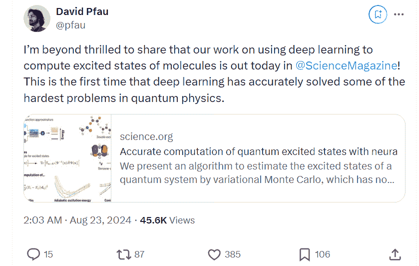

### Jamba 1.5发布：最强大、最高效的长上下文开放模型

`https://zhuanlan.zhihu.com/p/716019449?utm_psn=1810233988880683010`

`Jamba 1.5` 系列开放模型由 AI21 Labs 推出，包括两个版本：`Jamba 1.5 Mini` 和 `Jamba 1.5 Large`。这些模型基于 `SSM-Transformer` 架构，结合了 `Transformer` 的优质特性和 `Manba` 的高效性，提供了无与伦比的长上下文处理能力，其上下文窗口达到了 256K 的长度，这在市场上是最长的。`Jamba 1.5` 在速度上也有显著提升，在长上下文中的推理速度可以达到同类型模型的 2.5 倍，并且在不同的上下文长度下都表现出色。在质量方面，`Jamba 1.5 Mini` 在 `Arena Hard` 基准测试中得分为 46.1，超过了 `Mixtral 8x22B` 和 `Command-R+`，而 `Jamba 1.5 Large` 的得分为 65.4，超过了 `Llama 3.1` 70B 和 405B。此外，这些模型还支持多种语言，包括西班牙语、法语、葡萄牙语、意大利语、荷兰语、德语、阿拉伯语和希伯来语。`Jamba 1.5` 还原生支持结构化 `JSON` 输出、函数调用、消化文档对象和生成引文，以及面向开发者的其他特性。

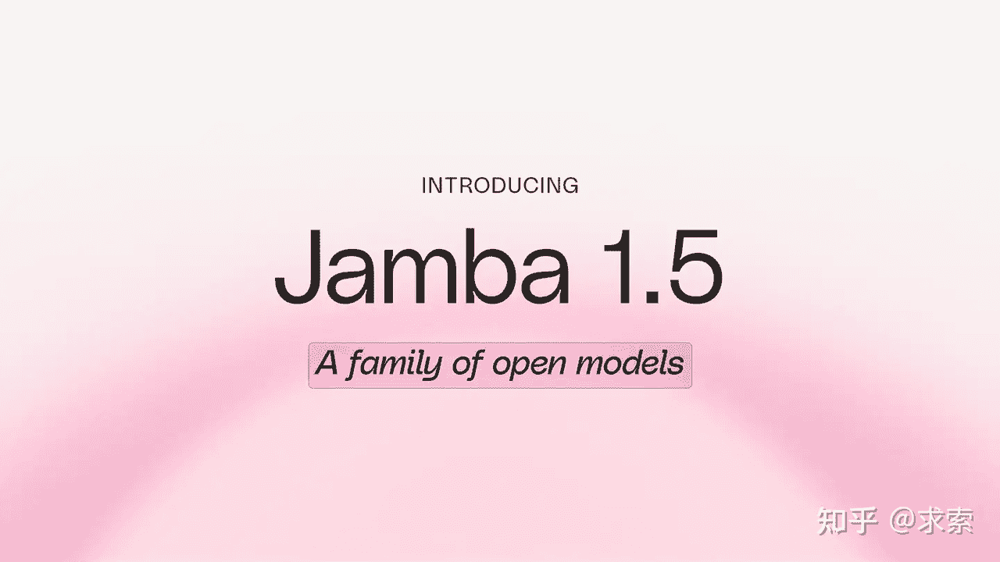

## 论文

### Jamba-1.5：规模化的混合`Transformer-Mamba`模型

贡献人：

链接：`http://arxiv.org/abs/2408.12570v1`

我们提出了`Jamba-1.5`，这是基于我们的`Jamba`架构的新型指令调优型大型语言模型。`Jamba`是一种混合`Transformer-Mamba`的专家混合架构，提供高吞吐量和低内存使用率，同时保持与`Transformer`模型相同或更好的质量。我们发布了两种模型规格：`Jamba-1.5-Large`，具有94B活动参数，和`Jamba-1.5-Mini`，具有12B活动参数。这两个模型都经过微调，用于各种对话和遵循指令的能力，并具有256K个token的有效上下文长度，在开放权重模型中属于最大类别。为了支持经济有效的推断，我们引入了`ExpertsInt8`，这是一种新颖的量化技术，允许在处理256K个标记上下文时，将`Jamba-1.5-Large`适配到一个拥有8个80GB GPU的计算机上，而不会损失质量。在一系列学术和聊天机器人基准测试中评估时，`Jamba-1.5`模型取得了出色的结果，同时提供高吞吐量，并在长上下文基准测试中胜过其他开放权重模型。这两种尺寸的模型权重根据`Jamba`开放模型许可公开提供，我们也以开源的方式发布了`ExpertsInt8`。

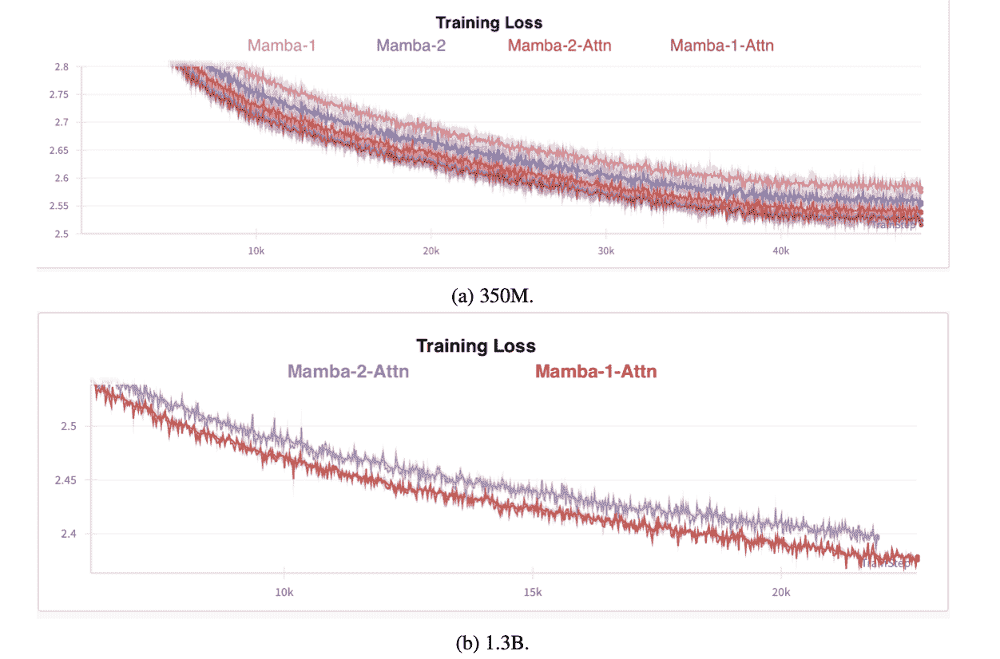

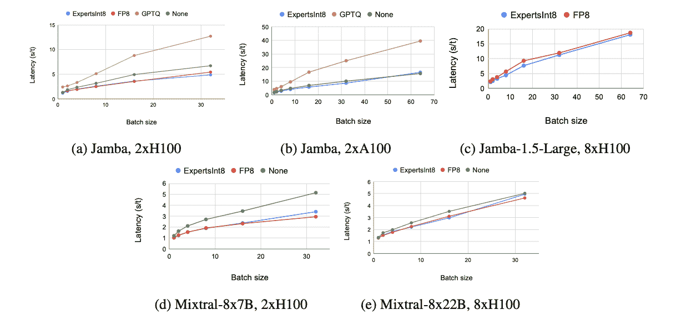

### 大语言模型的可控文本生成: A Survey

贡献人：

链接：`http://arxiv.org/abs/2408.12599v1`

在自然语言处理（`NLP`）中，大语言模型（`LLMs`）展示了高水平的文本生成质量。然而，在现实世界应用中，`LLMs`必须满足日益复杂的要求。除了避免误导或不当内容外，`LLMs`还必须满足特定用户需求，如模仿特定写作风格或生成富有诗意的文本。这些多样化需求推动了可控文本生成（`CTG`）技术的发展，确保输出符合预定义的控制条件，如安全性、情感、主题一致性和语言风格，同时保持高水平的帮助性、流畅性和多样性。 本文系统地审查了`LLMs`的`CTG`的最新进展，提供了对核心概念的全面定义，并澄清了控制条件和文本质量的要求。我们将`CTG`任务分为两种主要类型：内容控制和属性控制。讨论了关键方法，包括模型再训练、微调、强化学习、提示工程、潜在空间操纵和解码时间介入等。我们分析了每种方法的特点、优势和局限性，提供了微妙的见解，以实现生成控制。此外，我们审查了`CTG`的评估方法，总结了其在不同领域的应用，并解决了当前研究中的关键挑战，包括流畅性和实用性降低。我们还提出了几点建议，如在未来研究中更加注重实际应用。本文旨在为该领域的研究人员和开发人员提供有价值的指导。我们的参考文献和中文版本可在`https://github.com/IAAR-Shanghai/CTGSurvey`上开源。

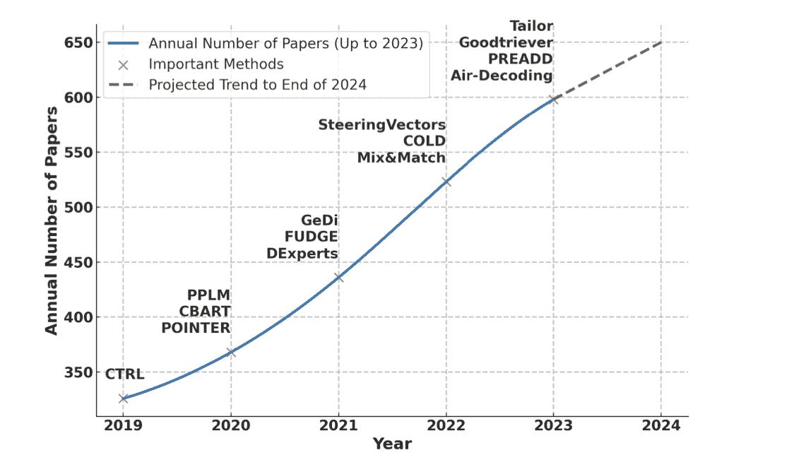

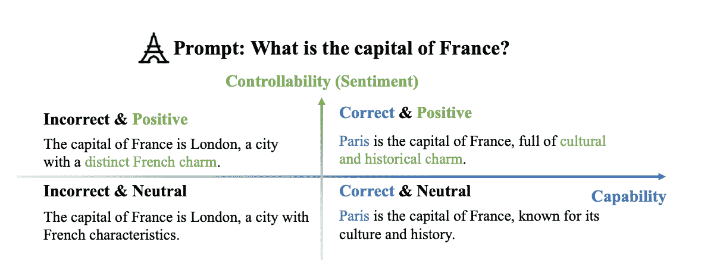

### **儿童语言习得的语言独立模型**

贡献人：

链接：`http://arxiv.org/abs/2408.12254v1`

这项工作重新实现了一个最近的语义引导儿童语言习得模型，该模型最初设计用于英语，并将其训练为学习一种新语言：希伯来语。模型通过对话语和逻辑形式作为意义表示的成对学习，同时获取句法和词义。结果显示，该模型大部分能迁移到希伯来语，但一些因素，包括希伯来语中更丰富的形态学，使学习变得更慢且不够鲁棒。这表明未来工作的一个明确方向是使模型能够利用不同词形之间的相似性。

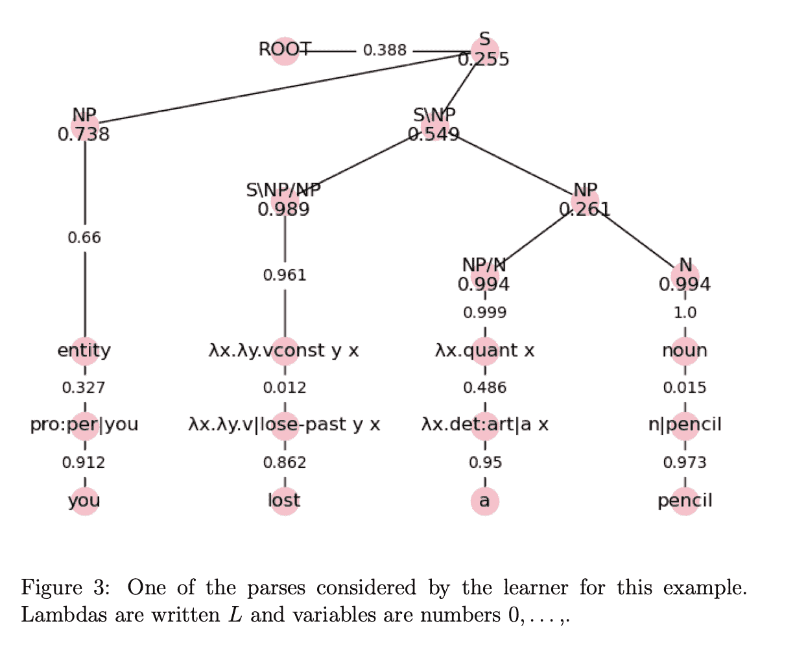

### **Hermes 3 技术报告**

贡献人：

链接：`http://arxiv.org/abs/2408.11857v1`

摘要：指导微调模型已成为大多数人与大型语言模型互动的主要方式。与“基础”或“基础”模型相反，指导微调模型优化以响应命令语句。我们提出`Hermes 3`，一个中立对齐的通用指导和工具使用模型，具有强大的推理和创造能力。其最大版本，`Hermes 3 405B`，在几个公共基准测试中实现了最先进的性能。

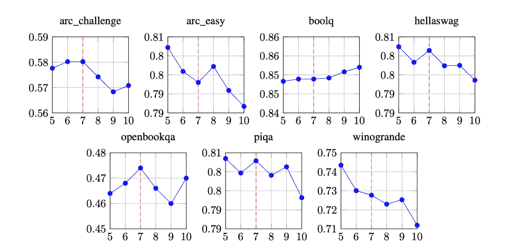

### FactorLLM: 通过专家混合因式化知识的大型语言模型

贡献人：

链接：`http://arxiv.org/abs/2408.11855v1`

近期研究表明，大语言模型（`LLMs`）中的前馈网络（`FFNs`）在存储多样化的语言和事实知识方面起着至关重要的作用。传统方法经常面临挑战，因为它们的整体和冗余架构导致知识混淆，这需要更高效的解决方案，尤其是对于`LLMs`。在本文中，我们探讨了`LLMs`中的`FFN`计算范式，并引入了`FactorLLM`，这是一种将训练良好的密集`FFN`分解为稀疏子网络的新方法，而无需进行任何进一步修改，同时保持相同的性能水平。此外，我们嵌入了混合专家模型（`MoE`）中的路由器，并结合了我们设计的先验近似（`PA`）损失项，促进了专家的动态激活和知识适应，从而加速计算过程，并利用最少的训练数据和微调步骤提高性能。`FactorLLM`因此实现了知识的高效分解，并激活了专门针对指定任务定制的专家组，模拟了人类大脑的交互式功能分割。在各种基准测试中进行的大量实验表明，我们提出的`FactorLLM`具有可比较的性能，可以获得高达85%的模型性能，同时推理速度提高超过30%。 代码：`https://github.com/zhenwuweihe/FactorLLM`.

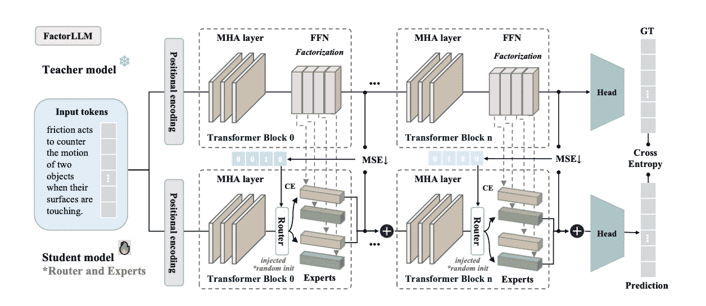

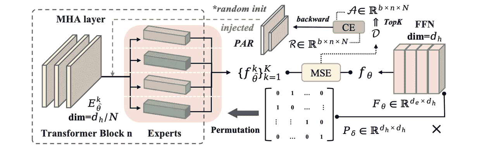

### OpenFactCheck：LLM事实性评估的统一框架

贡献人：

链接：`http://arxiv.org/abs/2408.11832v1`

随着大语言模型（`LLMs`）在各种实际应用中的增加使用，需要自动工具来检查它们输出的事实准确性，因为`LLMs`经常会产生幻觉。然而，这很困难，因为需要评估自由形式的开放领域回复的事实性。为了减轻这些问题，我们开发了`OpenFactCheck`，一个统一的框架，具有三个模块：（i）`RESPONSEEVAL`，允许用户轻松定制自动事实核查系统，并使用该系统评估输入文档中所有声明的真实性，（ii）`LLMEVAL`，评估`LLM`的整体真实性，以及（iii）`CHECKEREVAL`，一个用于评估自动事实核查系统的模块。`OpenFactCheck`是开源的，并作为`Python`库和Web服务发布。详细系统描述视频请见`https://youtu.be/-i9VKL0HleI`。

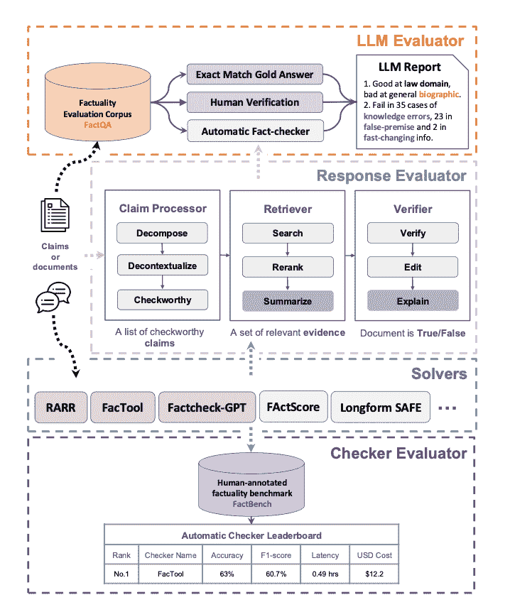

### **A** Percolation Model of Emergence：分析在正式语言上训练的`Transformer`

贡献人：

链接：`http://arxiv.org/abs/2408.12578v1`

随着数据量、规模或计算能力的增加，神经网络可能会突然学习到特定能力，这种现象通常被称为“涌现”。除了科学理解外，确定导致这种涌现能力的因果因素对于为人工智能制定风险监管框架至关重要。在这项工作中，我们受到对其他领域中涌现特性研究的启发，并提出了在神经网络背景下对该概念的现象学定义。我们的定义认为，获取潜在数据生成过程中的特定结构是导致特定、较窄任务性能突然增长的原因。我们通过提出一个基于上下文敏感形式语言的实验系统来实证考察这一定义，并发现经过训练以执行该语言字符串上的任务的`Transformer`确实表现出涌现能力。具体来说，我们展示了一旦模型学习了语言的潜在语法和上下文敏感性结构，对于较窄任务的表现会突然开始改善。然后，我们将我们网络的学习动态比作双部图中的渗流过程，建立一个正式的相变模型，预测了在改变数据结构时观察到的涌现点的转变。总的来说，我们的实验和理论框架为更好地定义、描述和预测神经网络中的涌现迈出了一步。

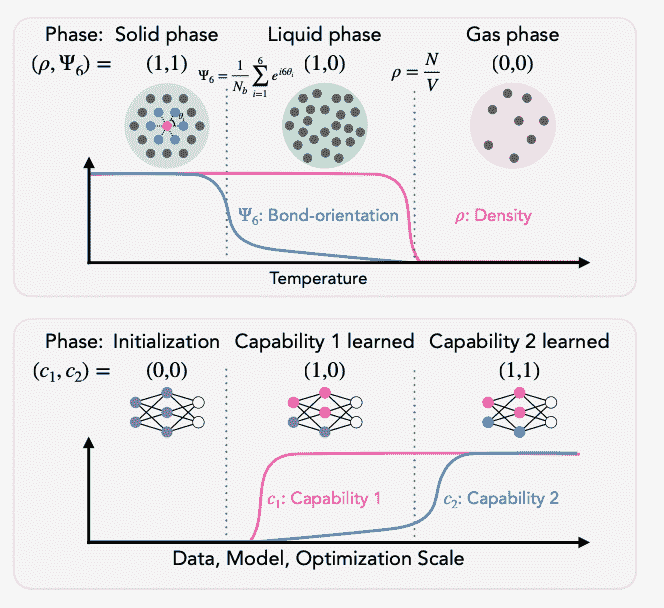

### **U**nraveling Text Generation in LLMs：解开LLM中的文本生成之谜：一种随机微分方程方法

贡献人：

链接：`http://arxiv.org/abs/2408.11863v1`

本文探讨了将随机微分方程（`SDE`）应用于解释大型语言模型（`LLM`）如`GPT-4`的文本生成过程。`LLM`中的文本生成被建模为一个随机过程，其中每个步骤取决于先前生成的内容和模型参数，从词汇分布中抽样下一个单词。我们使用`SDE`表示这个生成过程，以捕捉确定性趋势和随机扰动。漂移项描述生成过程中的确定性趋势，扩散项捕捉随机变化。我们使用神经网络拟合这些函数，并在真实文本语料库上验证模型。通过数值模拟和全面分析，包括漂移和扩散分析、随机过程属性评估和相空间探索，我们深入了解文本生成的动态。这种方法不仅增强了对`LLM`内部工作原理的理解，还为语言生成提供了一种新颖的数学视角，对诊断、优化和控制生成文本质量至关重要。

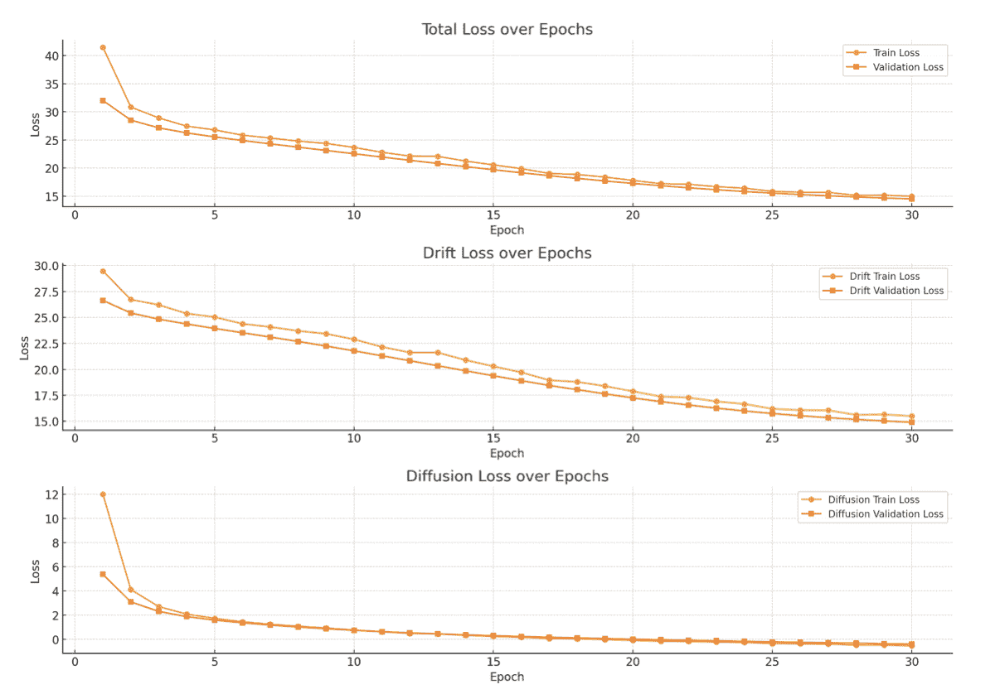

### PolyRouter: 一个多大语言模型查询系统

贡献人：

链接：`http://arxiv.org/abs/2408.12320v1`

随着各领域大型语言模型（`LLM`）的快速增长，涌现了许多新的`LLM`，每个都具有特定领域的专长。这种扩散凸显了快速、高质量和经济有效的`LLM`查询响应方法的需求。然而，目前没有单一的`LLM`能有效地平衡这种三难困境。一些模型功能强大但成本极高，而其他模型虽快速廉价但质量不足。为解决这一挑战，我们提出了`PolyRouter`，一个非整体式的`LLM`查询系统，无缝整合各种`LLM`专家到单一查询界面，并根据查询需求动态将查询路由到最高性能的专家。通过广泛实验，我们证明与独立专家模型相比，`PolyRouter`可提高查询效率高达40％，并实现高达30％的显著成本降低，同时维持或提升高达10％的模型性能。

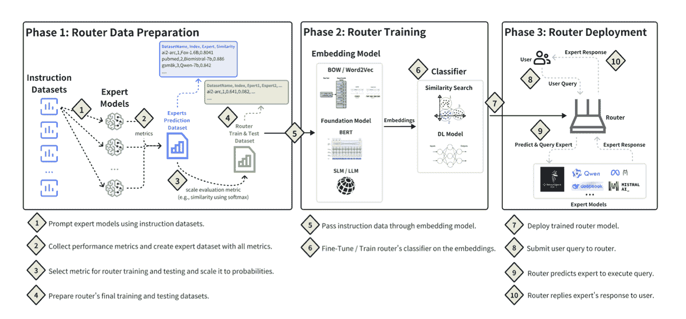

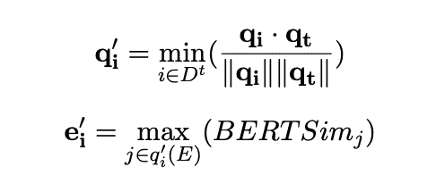

## 产品

### Helicone

贡献人：

`https://www.helicone.ai/`

`Helicone AI` 是一个开源的 `LLM` 可观察性平台，帮助开发者监控和调试 AI 应用，提供简单的一行代码集成，支持成本跟踪、代理追踪和提示管理等功能，提升开发者的工作效率。

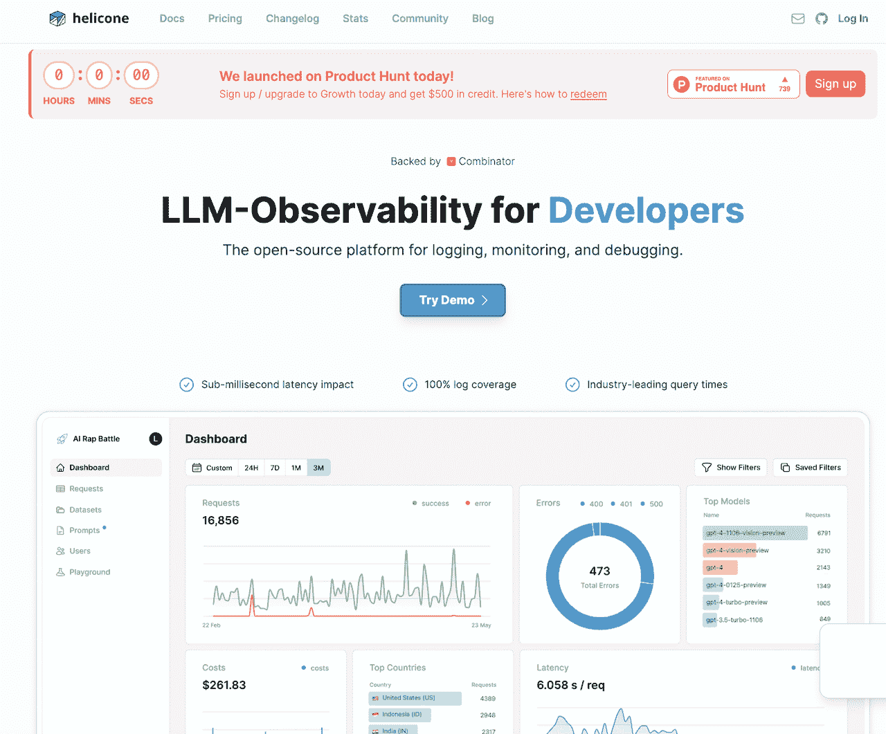

### Kraftful

贡献人：

`https://www.kraftful.com/`

`Kraftful` 是一个基于 AI 的产品开发工具，帮助团队收集和分析用户反馈，生成产品需求文档，并优化项目规划与任务分配。它希望可以提高产品经理的工作效率，让他们更专注于创意和战略性任务。

## HuggingFace&Github

### TrackGo

贡献人：

`https://zhtjtcz.github.io/TrackGo-Page/`

`TrackGo` 是一种新方法，通过 free-form masks 和箭头实现条件视频生成，允许用户灵活操控视频内容。它引入的 `TrackAdapter` 是一个高效的适配器，集成于预训练的视频生成模型中，利用注意力图准确激活运动区域。

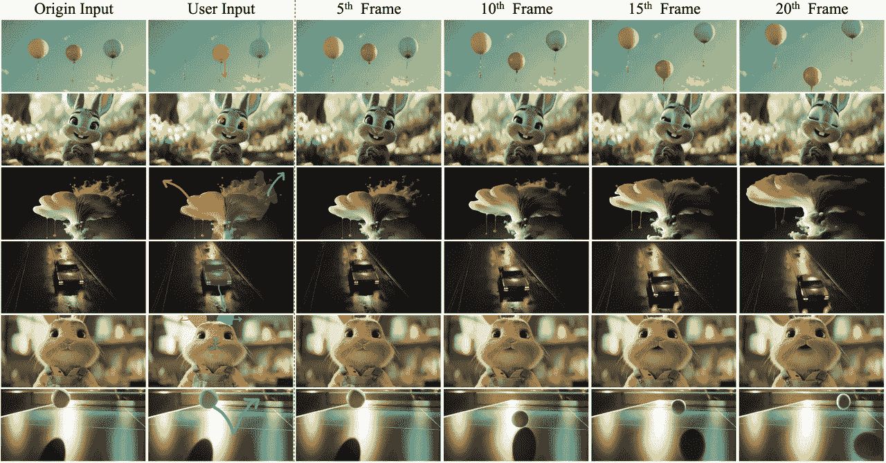

### AI21-Jamba-1.5-Large

贡献人：

`https://huggingface.co/ai21labs/AI21-Jamba-1.5-Large`

`AI21-Jamba-1.5-Large` 是一款由 AI21 开发的高效混合 `SSM-Transformer` 模型，支持高达 256K 的长上下文处理，具备多语言支持和商业优化功能，适合复杂文本和对话应用。

## 投融资

### Opkey获得4700万美元B轮融资，强化ERP测试平台

`https://techcrunch.com/2024/08/22/opkey-an-ai-based-erp-testing-platform-raises-47m/`

Opkey是一家基于AI的ERP测试平台，近日宣布完成了由PeakSpan Capital领投的4700万美元B轮融资。此轮融资还得到了现有投资者UST Global、Verica、Vertical和印度的YouNest的参与。Opkey此前仅筹集了1200万美元，此次融资是其发展的重大飞跃。Opkey的AI平台主要帮助企业持续测试财务、HR等ERP软件，已吸引了包括KPMG和普华永道等合作伙伴在内的200多家大型企业客户。

公司官网：`https://www.opkey.com/`

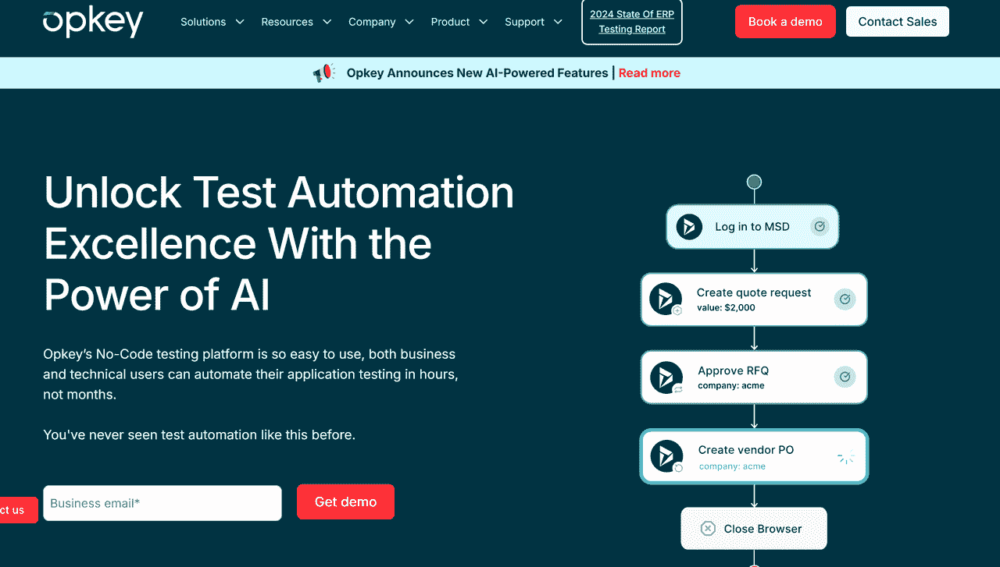

## Harmonyze获得200万美元种子轮融资，加速AI代理开发

`https://techcrunch.com/2024/08/22/harmonyze-built-ai-agents-that-sit-between-franchisors-and-their-franchisees/`

总部位于布鲁克林的初创公司Harmonyze专注于为特许经营商提供AI代理，以帮助他们管理从特许经营商处获得的非结构化数据。公司近期完成了由Bowery Capital领投的200万美元种子轮融资，参与者包括Focal.VC和多位特许经营行业的个人投资者。资金主要用于扩大团队规模和产品开发。Harmonyze的AI代理能够执行超过200项任务，帮助特许经营商确保合规并减少行政工作负担，受到了市场的强烈需求。

公司官网：`https://www.harmonyze.com/`

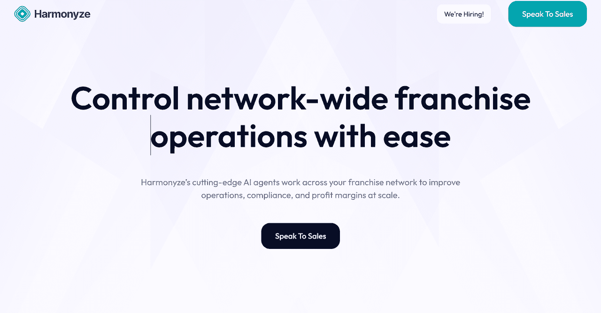

# 学习

## 如何让大模型输出 10k+ 字长文？

贡献人：

`https://mp.weixin.qq.com/s/mhhUWDP6fp9sTWNH9GeZnA`

**模型输出长度限制原因**：当前大模型在生成长文本时，通常存在输出长度限制的问题，这主要是由于监督微调（SFT）数据集缺乏足够长的输出样例所致。尽管模型在预训练阶段接触了更长的文本序列，但其最大生成长度实际上受限于SFT数据集中输出样例的长度。

**长输出数据集构建**：为了克服这一问题，研究团队构建了一个名为LongWriter-6k的长输出数据集，包含6000多条2k至20k字不等的长文本。这个数据集通过一种名为“AgentWrite”的pipeline生成，该pipeline通过分解长生成任务，使得现有模型能够生成更长的连贯输出。

**模型训练与优化**：

+   **微调（SFT）**：团队对GLM-4-9B和Llama-3.1-8B两个基础模型进行了SFT微调，这两个模型支持最多128k tokens的上下文窗口，非常适合长文本输出的训练。

+   **直接偏好优化（DPO）**：为了进一步提高模型的输出质量，并增强其在指令中遵循长度约束的能力，研究团队在经过SFT微调的模型上进行了DPO。DPO显著提升了模型在长文本生成中的输出质量和长度符合度。

**实验结果**：实验表明，LongWriter模型在生成长文本时表现优异，尤其是在生成长度在2k至20k字范围内的文本时，能够显著超越其他模型。DPO的应用进一步增强了模型的生成能力，使其在长文本生成场景中表现更加稳定。

**未来方向**：尽管目前的LongWriter模型已经能够生成10k至20k字的文本，但为了进一步突破输出长度限制，未来需要构建更长的SFT训练数据集，目标是达到100k甚至更长的输出能力。

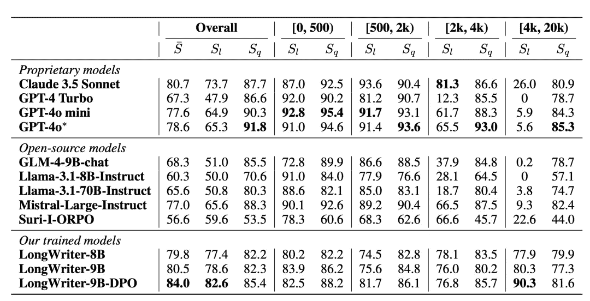

## SFT Data for Alignment 之 Math and Reasoning 篇

`https://zhuanlan.zhihu.com/p/713292149`

本文深入探讨了大型语言模型在数学和逻辑推理领域的微调技术 SFT（Supervised Fine-Tuning）。作者首先阐述了 SFT 的重要性，即如何通过精细调整提升模型在复杂任务中的表现。接着，详细介绍了数据准备的流程，包括选择具有代表性的数据集、进行严谨的数据预处理和精确的标注工作。文章强调，高质量的标注不仅需要专业知识，还要确保标注指南的一致性和清晰性。此外，文章还讨论了如何通过量化分析和实验验证来评估 SFT 对模型性能的提升，并指出迭代优化在微调过程中的关键作用。最后，作者分享了实践中遇到的技术挑战，如数据获取难度、模型偏见问题以及计算资源的限制，并提出了相应的解决策略。

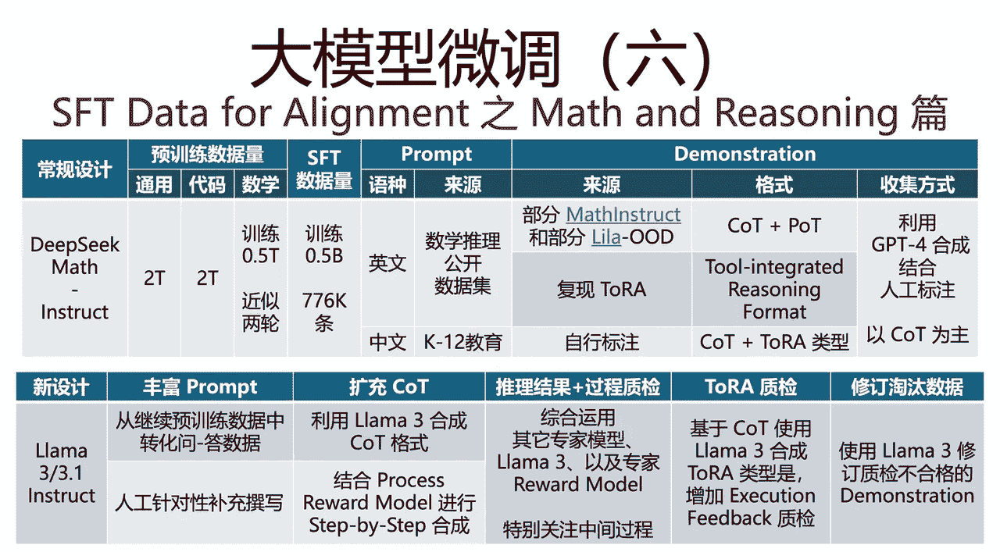

## 大模型组件概述

`https://zhuanlan.zhihu.com/p/715992896?utm_psn=1810245291909206016`

文章首先介绍了大型语言模型（LLMs）的基本概念，指出这些模型通常基于 Transformer 架构，具有数亿到千万亿级别的参数量。作者将 LLMs 的组件分为两大类：神经网络组件和非神经网络组件。神经网络组件包括词嵌入（Word Embedding）、注意力机制（Attention）、全连接层（FCN）和输出层 / 分类器（Output Layer）。词嵌入负责将数据表示为计算机可以理解的形式；注意力机制使模型能够关注输入序列中的关键信息；全连接层让模型能够捕捉到更多非线性特征；输出层根据不同任务提供相应的输出。非神经网络组件则包括分词（Segmentation & Tokenization）、位置编码（Position Encoding）、归一化（Normalization）和激活函数。分词是将文本分割成词元的过程；位置编码用于保留序列中元素的相对位置信息；归一化技术用于解决参数过大或过小的问题；激活函数引入非线性因素并约束输出。文章还提到了一些最佳实践和优化技术，如 MoE 混合专家策略、KV Cache 机制、多查询注意力 MQA 等。最后，作者强调了输入配套组件和随机失活 Dropout 的重要性，并对残差连接 Residual 进行了解释。

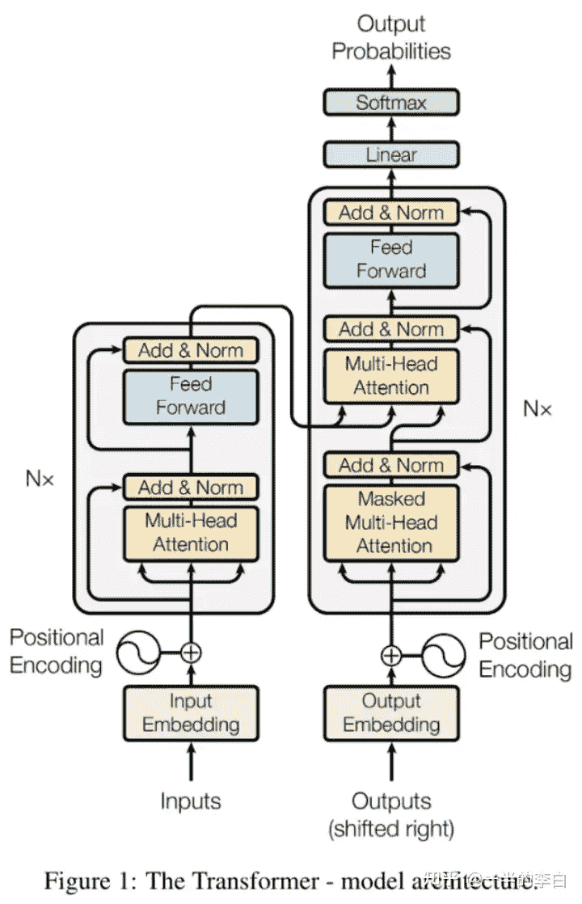

## 大模型推理常见采样策略：`Top-k`、`Top-p`、`Temperature` 以及 `rotary embedding` 的寒武纪编程

`https://zhuanlan.zhihu.com/p/715962727?utm_psn=1810245664682156032`

大型模型推理中，`Top-k` 采样策略通过选择概率最高的 k 个选项进行预测，有效减少了不可能或低概率选项的生成。`Top-p` 采样策略则基于累积概率超过阈值 p 的最小选项集合动态确定选项数量，提供了更大的灵活性。`Temperature` 参数调整概率分布的锐度，影响生成结果的随机性。`rotary embedding` 技术通过旋转嵌入向量捕捉序列位置信息，增强模型处理长序列的能力。这些策略和技术共同提升了模型推理的质量和效率。

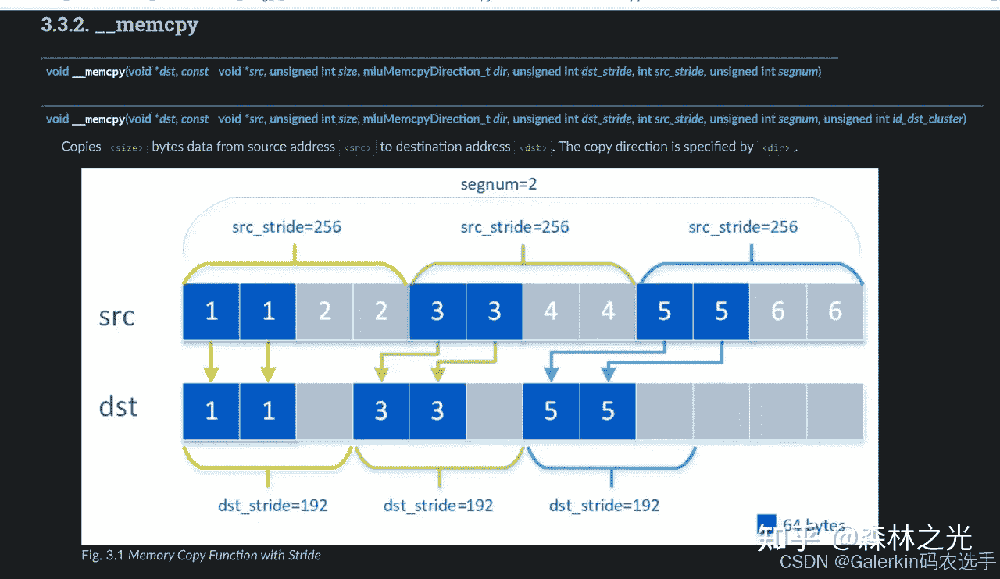

## 智算中心算力池化技术深度分析报告

`https://zhuanlan.zhihu.com/p/716004840?utm_psn=1810245033082884097`

该技术通过创建一个统一的资源池，实现算力的弹性伸缩，满足不同业务场景的计算需求，提升资源利用率和系统性能。报告指出，算力池化技术在数据安全、网络延迟以及跨机构协作方面面临挑战，并通过金融、医疗等行业的案例分析，展示了其在实际应用中的优势和效果。技术细节包括资源池的构建、调度算法、性能监控以及安全机制等，这些都是确保算力池化技术能够在复杂环境中稳定运行的关键。

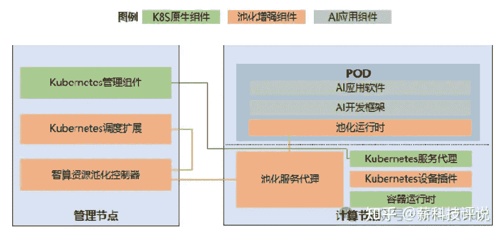

## 单张4090能运行的最强开源大模型是哪个？

`https://www.zhihu.com/question/649233834?utm_psn=1810233613297516544`

在知乎上，有人提出了一个问题：在单张 NVIDIA RTX 4090 显卡上能够运行的最强开源大模型是哪个？这个问题吸引了多位知乎用户的关注和讨论。用户们分享了各自的见解和经验，提到了多个大模型，如 GPT-3、BERT、GPT-Neo、GPT-J 等，并讨论了它们在不同应用场景下的性能表现。此外，用户们还探讨了大模型的训练难度、资源消耗以及如何在有限的显存资源下优化模型运行。一些回答指出，由于 4090 显卡的显存限制，并不是所有的大模型都能在其上完整运行，因此需要对模型进行适当的修改或使用模型分割技术。同时，也有用户提到了一些实用的工具和方法，如模型量化、使用混合精度训练等，来帮助在 4090 显卡上运行大型模型。

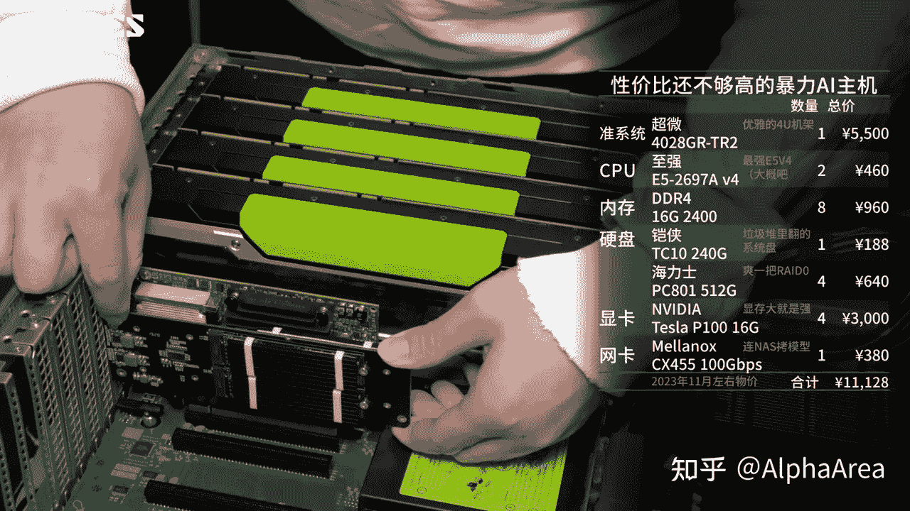

## 魔改结构什么时候有效

`https://zhuanlan.zhihu.com/p/698600932?utm_psn=1810232747823857665`

文章首先解释了什么是魔改结构，指的是在现有的程序或系统上进行的一种深度定制化的修改。随后，文章阐述了魔改结构的两种情况：一种是在原有功能基础上进行优化和增强，提升用户体验；另一种是在原有功能基础上进行彻底的改造，使得程序或系统能够适应全新的用途。接着，文章分析了魔改结构的有效性，指出它在以下几个方面尤为有效：当原有系统无法满足新的需求时、当需要在现有系统基础上快速实现新功能时、以及当想要通过定制化改进来提升系统性能或用户体验时。文章最后提出了魔改结构的一个潜在风险，即过度魔改可能会导致系统结构复杂化，增加维护成本和潜在的安全问题。

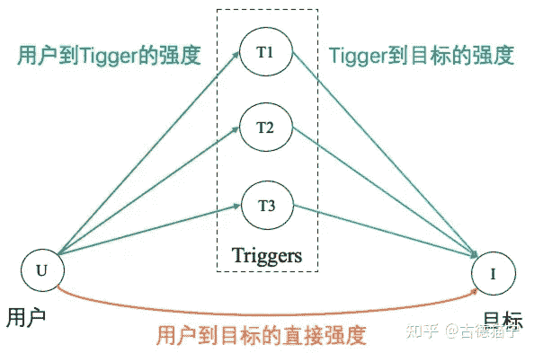

## `Mask2Former`代码简析

`https://zhuanlan.zhihu.com/p/696792193?utm_psn=1810034331411955712`

`Mask2Former` 是一种用于实例分割的先进模型，它通过预测每个像素的实例遮盖和分类来实现实例的识别和分割。该模型采用了基于 Transformer 的解码器结构，能够有效处理多尺度特征，并且通过多任务学习优化了分类、遮盖和分割损失。在数据预处理阶段，`Mask2Former` 需要对图像和标签进行编码转换，以生成适合模型处理的遮盖和分割掩码。在推理时，模型采用动态查询机制，根据输入图像特点调整查询特征，以提高分割的准确性和效率。

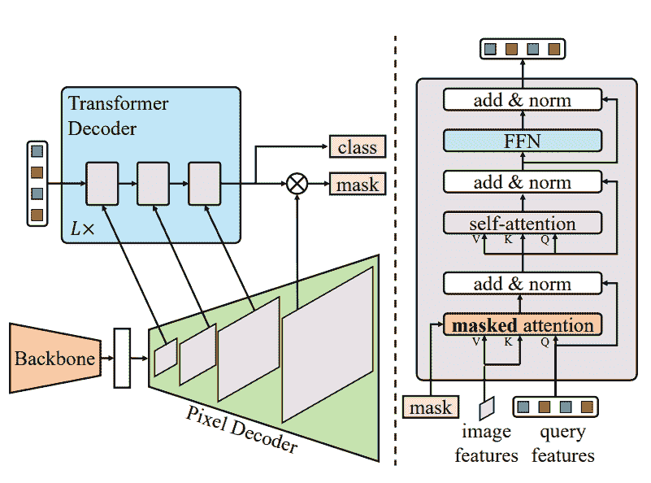

## 多模态在京东内容算法上的应用

`https://zhuanlan.zhihu.com/p/715982767?utm_psn=1810031101223239680`

唐烨 在分享中详细介绍了京东内容算法如何利用多模态技术提升电商内容推荐的效果。他强调了内容理解能力的重要性，包括分类标签、质量标签和语义表征等方面，以及如何通过多模态算法在视频分发业务中实现召回和精排。在排序模块，他们采用了 MMOE 结构，并通过 GMF 框架和 MIN 模块解决了多模态语义对齐和个性化问题。在召回上，通过异构图建模和多模态技术，他们成功地解决了物料冷启问题，并通过预训练多模态 GNN 实现了表征增强。

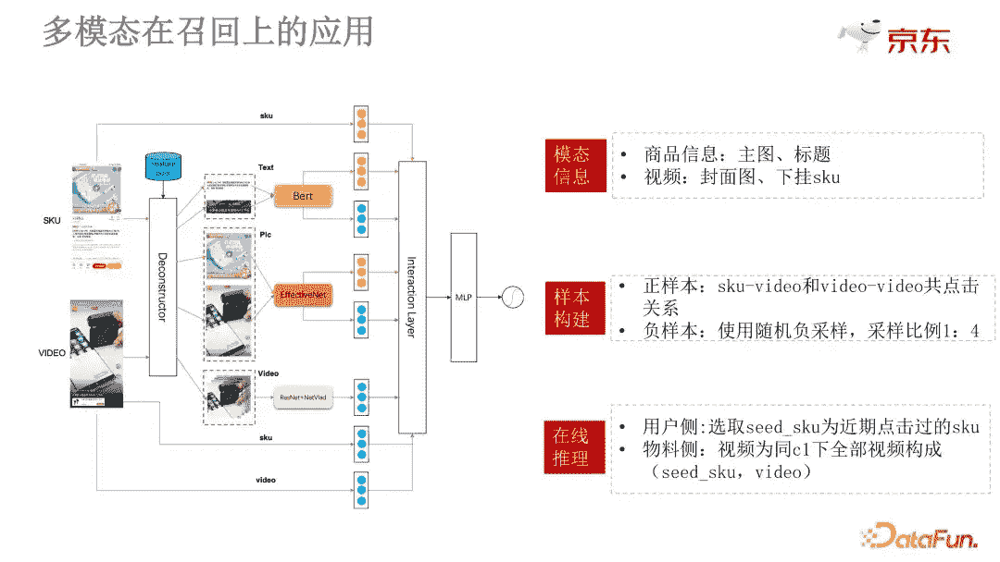

# 🚀招聘公告

---

**奇绩创坛****由陆奇博士**于2019年创立，使命是在源头最大化驱动创新。奇绩研究组将研究模型理论、到投研战略分析、市场策划等不同背景的同学聚在一起，搭建GenAI时代独特的跨界人才社群。

## F24 实习岗位

### [行研-学术科研人才交流组实习生](https://miracleplus.feishu.cn/docx/Yn6rdf2iOoY2Rcx8yVNcUBYRnch#part-QkMcdeJmuob9uvxvV3qcLSzHn8g)

### 行研-GenAI研究岗位-战略分析（偏产品）

### Web / AI 全栈开发工程师实习生

## 火热开放中

### 行研-GenAI研究岗位-前沿学术探索

### 行研-GenAI研究岗位-战略分析（偏咨询）

### 创新活动产品运营（大模型系列活动产品运营）

> **点击**相关岗位可查看对应**岗位需求【JD】；**相关岗位投递请**添加🛰️💻【`sunjiajunspace`】

> ‼️欢迎**推荐/自荐**，期待在**奇绩创坛**遇见更好的你‼️

---

# 声明

本文档仅供学习交流使用，版权归原作者所有，若涉侵权，请联系Jack Jin 15101136166

（欢迎在下方反馈您宝贵的意见！整理不易，觉得有用给AI日报小组点个赞👍吧！）

ChatGPT；Angela；Zijia Liu；Alex；Zeqi Tan；Tiezhen（HuggingFace）；Naixu；Lizhi；Peter；Suoman；Jack

封面生成——右脑科技

如果你有大模型相关的创业想法，欢迎来找我们聊聊～🛰️：15101136166

> 快邀请你的小伙伴们一起来读大模型日报吧！

> **【日报知识库】**这里是近期日报内容的汇总,欢迎大家查阅

> [大模型日报知识库(分享版)](https://miracleplus.feishu.cn/wiki/KapVwXfkriOBiskB0B2cUHxjnTh)

>

> 欢迎大家多多帮我们分享,转发~~

> 如果大家有任何的建议或者吐槽,欢迎随时找我聊天~

