# 奇绩大模型日报（8月 26日）

> 来源：[https://miracleplus.feishu.cn/docx/WYwFdHUlNoVMhXxtG8pcy1kdnfh](https://miracleplus.feishu.cn/docx/WYwFdHUlNoVMhXxtG8pcy1kdnfh)

# 📡潜空间活动报名

> **潜空间系列活动重磅回归！**

> 本期活动将在**9月6日** **14:00**开始，我们邀请到的嘉宾是**闫俊杰。**他**是MiniMax 创始人兼 CEO，是中国第一梯**队的大模型创业者，目前 MiniMax 估值超 25 亿美元。他将和大家探讨Intelligence with everyone ：对 AGI 0-1 的探索与实践。

> 除嘉宾分享外，每期设置了【匹配合伙人 Cofounder Matching】环节。你可以和 GenAI 时代最有活力的创业者和研究者线下面对面交流，将有机会找到志同道合、有共同创业梦想的小伙伴。

> 报名通道已开启，欢迎扫描下方二维码报名。

# 资讯

### 黑神话悟空背后140人：十年磨一剑

https://mp.weixin.qq.com/s/_Zip_O52GpH6e-84krb-0Q

《黑神话：悟空》作为中国首款顶级3A游戏大作，迅速引爆全球，创造多项纪录，背后的开发团队引发广泛关注。游戏科学创始人冯骥带领的团队由仅140人组成，核心成员平均合作超过10年，多数来自腾讯背景。冯骥在大学时因热爱游戏而放弃考研，最终进入游戏行业。团队曾开发多款游戏，但都未达到预期。直至《黑神话：悟空》的筹备启动，团队通过发布演示视频吸引人才，并最终获得成功。

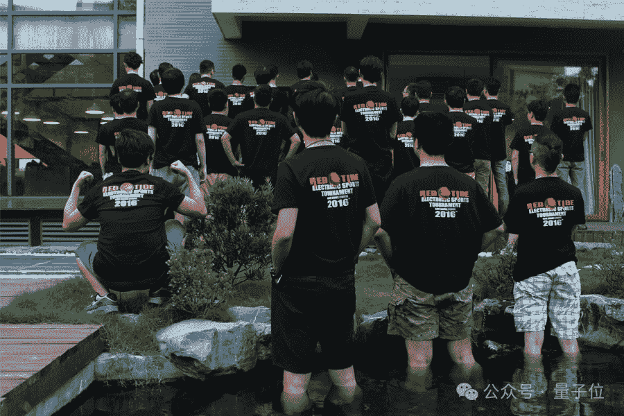

### 出门问问半年报：AIGC收入同比增长123.8%，收入占比提升超33个百分点

https://mp.weixin.qq.com/s/PbANpQsxDhyLkvtJjRiETw

1.  **业务转型与收入增长**：出门问问成功从传统AI项目转型至AIGC业务，2024年上半年AIGC收入同比增长123.8%，占总收入的56.7%。公司通过完善AIGC产品生态，实现规模化增长，特别是在AI配音、数字人生成、AI交互平台等方面。

1.  **“产模结合”策略**：公司采用“产模结合”的策略，即产品与模型一体化，显著提高了效率，形成了“数据飞轮”效应。这种策略适合国内的大模型创业，有助于模型和产品的自我迭代。

1.  **多模态AIGC产品矩阵**：出门问问开发了多模态的AIGC产品矩阵，包括语音、视频大模型，推出了如WetaAvatar4.0数字人、实景行走数字人等技术产品，展现了语音到视频翻译的能力，符合多模态技术发展趋势。

1.  **ToSMB/ToPC商业模式**：公司构建了独特的ToSMB（中小企业）和ToPC（专业消费者）商业模式，避免了传统ToB项目制的弊端，并与大模型的垂直整合紧密结合，提升用户体验，增加营收。

1.  **技术合作与生态布局**：出门问问与钉钉、华为云、腾讯云等建立战略合作，同时保持与英伟达、Google和高通等国际科技公司的长期合作，丰富了技术生态资源。

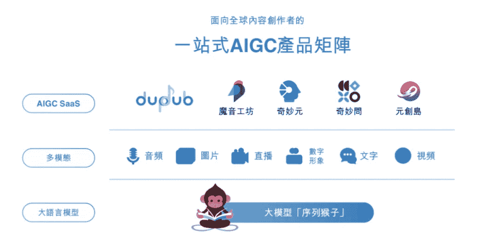

### 飞书多维表格产品模块负责人、字节Web Infra性能与体验负责人陆续加入AFFiNE，定位知识工作者的AI OS

https://mp.weixin.qq.com/s/RdUqWxW05G2-AF3GZggwrA

**核心团队背景**：

+   钱卓群：曾任职于字节跳动、阿里巴巴、Shopee等知名企业，负责过飞书多维表格产品模块，并在Teambition、阿里云等项目中担任关键产品角色。

+   龙逸楠：曾在Teambition负责前端架构，后加入字节跳动负责TikTok Web的架构设计和性能优化，在Vercel主导开发了Turbopack和Next.js项目。

**AFFiNE的技术定位**：

+   AFFiNE致力于打造知识工作者的AI OS，将文档、多维表格、白板和项目管理等多种模态融合，形成一体化解决方案。

+   基于CRDTs的多模态数据可自由流动与转化，允许用户在不同模块间调用AI功能，实现真正的AI Copilot。

**技术创新与影响力**：

+   AFFiNE的AI功能与各个模块深度融合，为知识工作者提供随时随地的AI支持。

+   项目在GitHub上已获得38K Stars，成为全球最热的开源项目之一，展示了其在AI、图形学和富文本编辑等领域的技术优势。

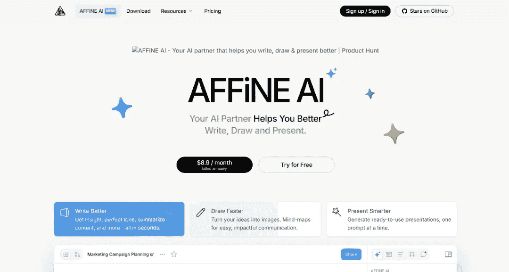

###  中国人工智能学会推荐会议期刊发布

https://caai.cn/index.php?s=/home/article/detail/id/4024.html

2024年8月24日，中国人工智能学会（CAAI）在西安成功举办了“智慧党建论坛——2024人工智能产学融合创新论坛”。在此论坛上，CAAI副理事长刘成林研究员发布了《中国人工智能学会推荐国际学术会议和国际/国内期刊目录》。该目录旨在为人工智能领域的研究人员提供指导，帮助他们更好地进行学术交流并推动职业发展。

该目录经过2023年6月成立的专家组的努力，将智能科学与技术的基础理论、机器学习、自然语言处理等11个细分领域的期刊和会议进行了分类。目录分为A类、B类和C类三档，A类代表顶尖的学术会议或期刊，B类为国际上广泛认可的重要会议或期刊，C类为国际学术界所认可的交流平台。

目录共推荐了418个学术会议及刊物，包括158个国际学术会议、239个国际期刊和21个国内期刊。这份目录将定期更新，并邀请学术界的专家和学者提供反馈，以确保其准确性和公正性。这份推荐目录为人工智能领域的研究提供了宝贵的参考资源，但并不作为唯一的学术评价标准。

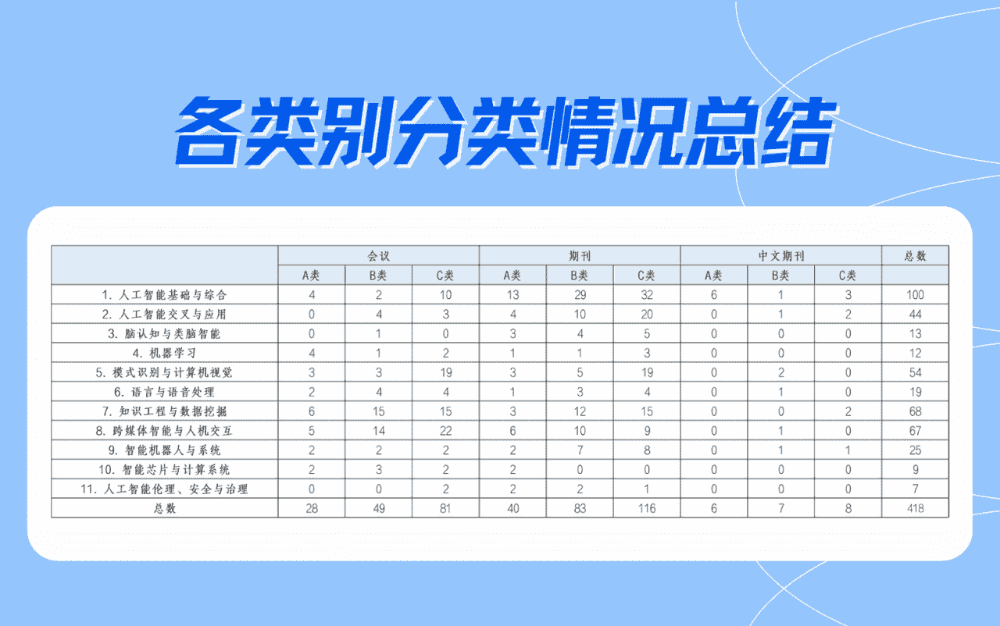

### 2024 RISC-V 中国峰会圆满落幕

https://mp.weixin.qq.com/s/5F08wlGHMwKI375Mu8qJPg

2024年第四届 RISC-V 中国峰会于8月21日至23日在杭州成功举办，吸引了RISC-V 国际基金会、百余家重点企业及研究机构的参与，共有约3000人现场出席，并举办了超过20场同期活动。此次峰会聚焦RISC-V技术的最新进展与未来发展，强调了RISC-V在开源、灵活性、可扩展性及其在AI、服务器等领域的应用前景。众多行业领袖和专家发表了演讲，讨论了RISC-V生态的构建、标准化、商业化应用，以及其在高性能领域的突破。大会还见证了多款基于RISC-V技术的新产品发布

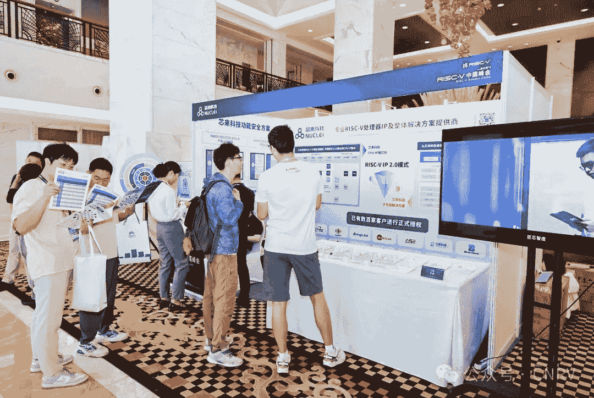

### 英伟达的全栈式收购战略

https://mp.weixin.qq.com/s/RR_DqtXi6lxCPP0C92ihEg

**收购频率加快**：英伟达在过去四个月内以每月一家企业的速度进行收购，主要集中在AI和数据中心领域，这符合其近年来的收购趋势。

**软硬件全栈式收购**：英伟达的收购策略注重全栈式布局，旨在提供端到端的解决方案，从数据中心管理软件到深度学习开发平台，覆盖了数据中心高效运作的重要环节，降低了客户的总拥有成本和总运营成本。

**战略性布局**：英伟达通过收购拓展新业务领域，如模型小型化、深度学习开发平台、自动驾驶等，展现出向平台型企业转型的趋势。

**历史收购回顾**：文章回顾了英伟达自1999年以来的多次重大收购案例，包括GPU领域的早期收购、移动设备市场的尝试、以及近期对AI和数据中心相关企业的收购。这些收购不仅扩展了英伟达的技术实力，也加强了其在全球市场的影响力。

**未来展望**：随着英伟达加快收购步伐，其软硬件兼顾的策略和端到端解决方案的追求，正在不断扩大其行业护城河，巩固其在AI和数据中心领域的领先地位。

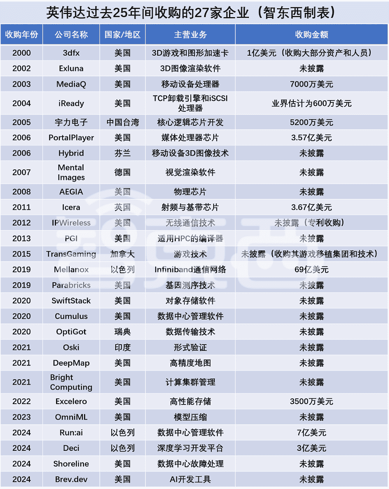

### AI服务器连接器及线缆迎升级

https://mp.weixin.qq.com/s/v5L86LjC6HLYnTPxWFIb8Q

文章探讨了英伟达新一代Blackwell GPU及其相关的NVLink 5.0/NVSwitch 4.0互联技术的发布，对AI服务器连接器及线缆提出了更高的性能需求。文章重点分析了这些新技术在总线速率提升和服务器架构升级方面的影响，并测算了NVL72/NVL36*2单方案中连接器及线缆的价值量，分别为72万元和78万元。主要变化包括总线传输速率的提升，连接器和线缆性能需求的增加，以及NVLink和NVSwitch技术的迭代。这些升级将对服务器底层硬件的市场需求产生重大影响。

1.  **技术升级**：英伟达新一代GPU和互联技术的发布，推动了总线速率和服务器架构的双重升级，对连接器及线缆的性能提出更高要求。

1.  **市场需求增长**：由于新技术的应用，连接器和线缆的市场需求将显著增加，特别是在高性能计算和AI服务器领域。

1.  **成本测算**：NVL72/NVL36*2单方案中，连接器及线缆的价值量分别为72万元和78万元，显示出市场对高端连接器及线缆产品的强烈需求。

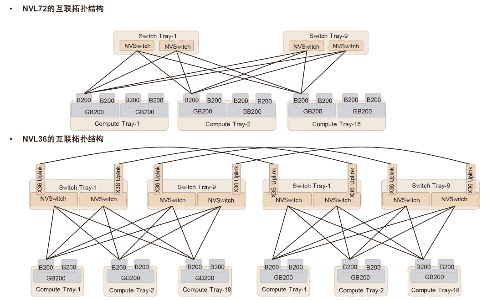

# 推特

### 从零开始评估：一本为AI工程师打造的大型语言模型系统评估的数字指南

https://x.com/eugeneyan/status/1827863486162260084

这是@sridatta 和 @iamwil 关于评估的精彩介绍。他们显然在这方面投入了大量的心血，内容组织得非常有条理，并配有大量插图。

在60页的内容中，他们解释了模型评估与系统评估、氛围检查和基于属性的测试、设计评估标准、对齐LLM评估器、如何通过各种指标衡量对齐度、如何分析评估以改进我们的系统等等。

现在我只需将大家引导到 https://forestfriends.tech，而不用自己动手写了，哈哈。

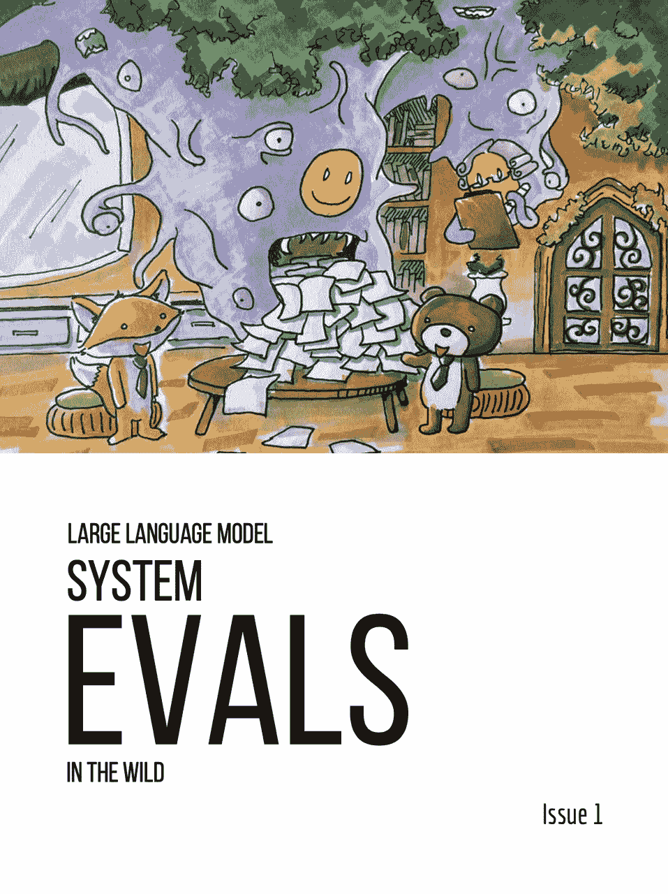

### Anna Rahn亲手演示的多层感知器视频

https://x.com/ProfTomYeh/status/1827705383009259789

Anna Rahn亲手演示的多层感知器（MLP）视频 ✍️

Anna为我春季学期的计算机视觉课程制作了这个简短的视频。结合我昨天发布的电子表格练习，我希望它们能帮助更多人理解深度神经网络！

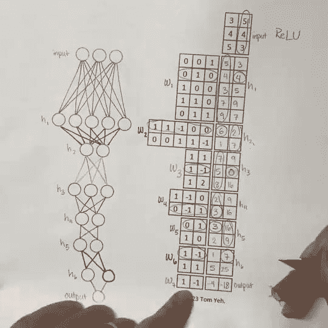

[ssstwitter.com_1724652043405.mp4](https://internal-api-drive-stream.feishu.cn/space/api/box/stream/download/all/V2OObWVoFoxhHNx73vAcwsqjnsb)

### 在你的电脑上本地托管开源的Llama 3.1，并通过任何连接本地网络的设备运行它

https://x.com/Saboo_Shubham_/status/1827533121169805430

在你的电脑上本地托管开源的Llama 3.1，并通过手机或连接到本地网络的其他设备运行它（100%免费且离线）。

https://x.com/localghost/status/1827043200995094665/video/1

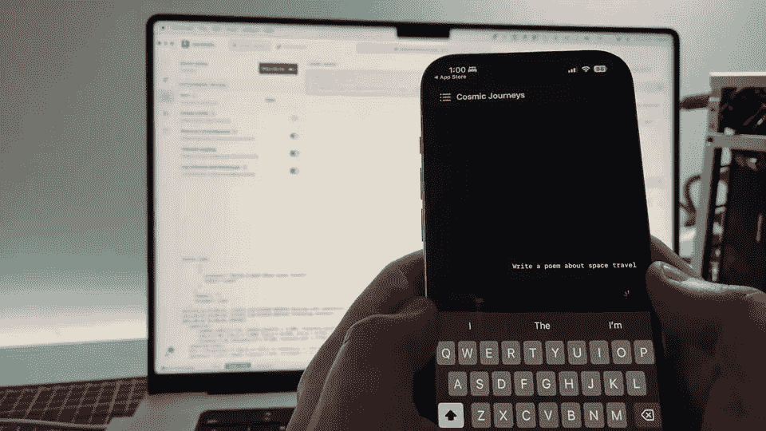

[ssstwitter.com_1724652172302.mp4](https://internal-api-drive-stream.feishu.cn/space/api/box/stream/download/all/JgprbywHFoebG9xRCbRcHZ6an1f)

### Avante.nvim: 为模仿Cursor AI IDE行为而设计的Neovim插件

https://x.com/yacineMTB/status/1827731549422329936

avante.nvim 是一个为模仿Cursor AI IDE行为而设计的Neovim插件。它为用户提供AI驱动的代码建议，并能够轻松将这些建议直接应用到源文件中。

avante.nvim:

+   就像Cursor，但你不需要登录就能编辑文本

+   就像Cursor，但你不需要启动网页浏览器来使用它

+   就像Cursor，但你可以通过SSH使用它

+   就像Cursor，但你可以使用任何你想要的LLM

+   就像Cursor，但它是免费的

对比avante.nvim（Claude-3.5-sonnet） 🥰

项目网址: https://github.com/yetone/avante.nvim

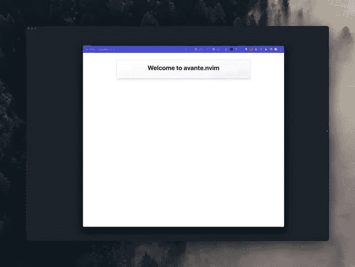

[ssstwitter.com_1724652252702.mp4](https://internal-api-drive-stream.feishu.cn/space/api/box/stream/download/all/O74IbTxbCo15e0xd1zVcHbhZnOh)

### 推特热议表情包：与Claude一起编程

https://x.com/jahvascript/status/1827480248319160378

推特热议表情包：与Claude一起编程

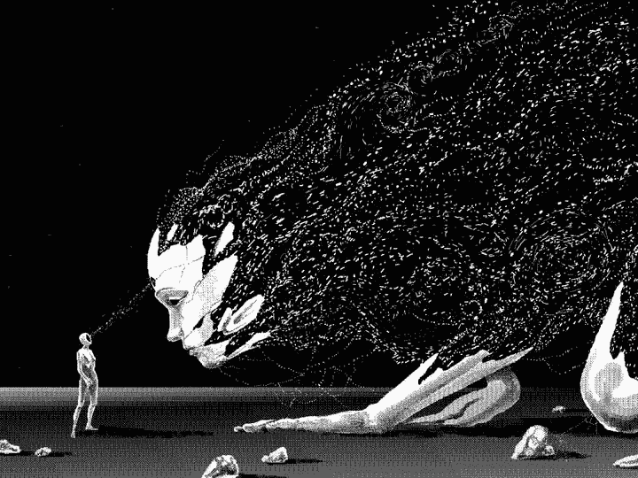

[jahvascript - 1827480248319160378.mp4](https://internal-api-drive-stream.feishu.cn/space/api/box/stream/download/all/WniYbmqTSo5bkXxymU1cap8Lnbd)

# 论文

### 扩散模型是如何学习进行因式分解和合成的

贡献人：

链接：http://arxiv.org/abs/2408.13256v1

扩散模型能够生成照片级别的图像，结合训练集中可能不常见的元素，展示了组合泛化的能力。然而，复合性的精确机制以及通过训练如何获得仍然难以捉摸。受认知神经科学方法启发，我们考虑一个高度简化的设置，以研究扩散模型是否学习了语义上有意义且分解的可组合特征表示，并确定其学习时间。我们在训练生成各种形式的2D高斯数据的条件降噪扩散概率模型（DDPMs）进行了广泛的受控实验。我们发现，模型学习了分解但不完全连续的流形表示形式，用于对数据潜在变化的连续特征进行编码。通过这样的表示，模型展示了更优越的特征组合性，但在涉及未知特征值的插值方面表现出有限能力。我们的实验结果进一步表明，扩散模型可以在少量组合示例的情况下实现组合性，暗示了训练DDPMs的一种更有效的方法。最后，我们将扩散模型中的流形形成与物理学中的渗透理论相联系，为分解表示学习的突然发生提供了洞察力。因此，我们的彻底的玩具实验有助于更深入地理解扩散模型如何捕捉数据中的组合结构。

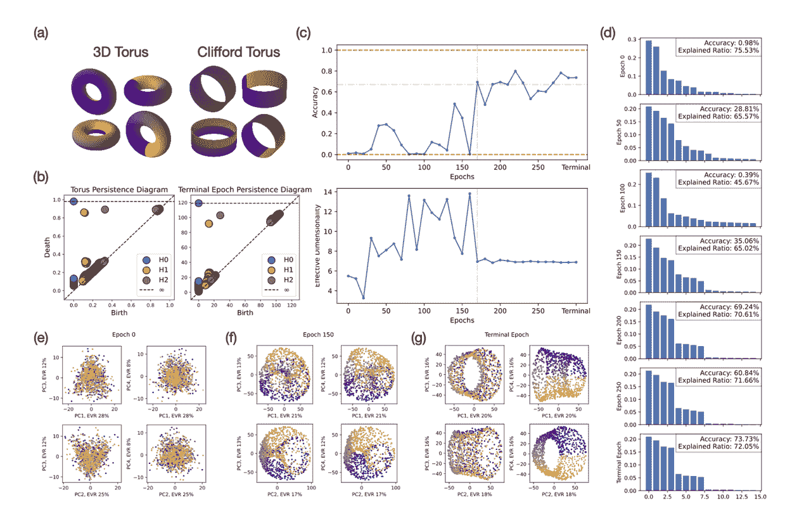

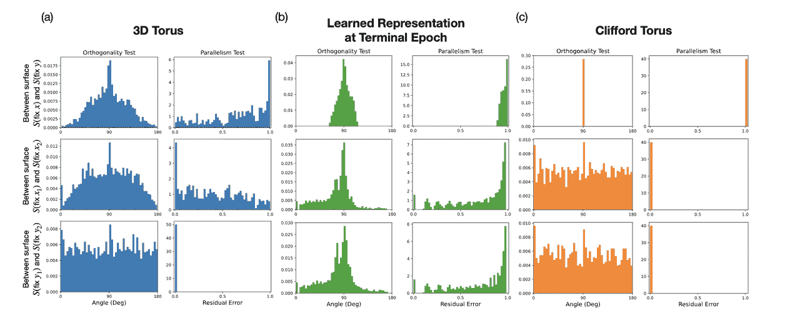

### **LLM作为智能体在LLM对齐任务**中的系统评估：可解释指标和多样化提示模板

贡献人：

链接：http://arxiv.org/abs/2408.13006v1

摘要：最近，像GPT-4这样的商业大语言模型 (LLMs) 被用来评估和比较不同的LLM对齐方法，这些方法旨在使LLM与人类偏好对齐。然而，LLM评判者的偏见和不一致的决策被认为降低了LLM评判的可信度。我们在这项工作中系统评估了LLM评判者在对齐任务中的性能，并提出了改进理论可解释性的评估指标，以及解决LLM内部不一致性的可靠性指标。我们开发了一个框架，评估、比较和可视化LLM评判者的可靠性和对齐性，以提供有助于选择LLM评判者的信息观察。我们的结果表明，提示模板对LLM评判者表现有显著影响，同时测试的LLM评判者与人类评估者之间的对齐水平中等。

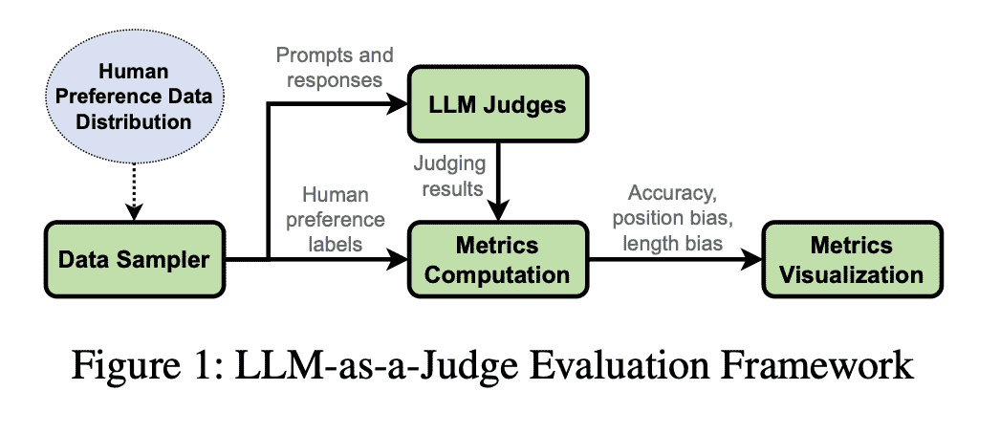

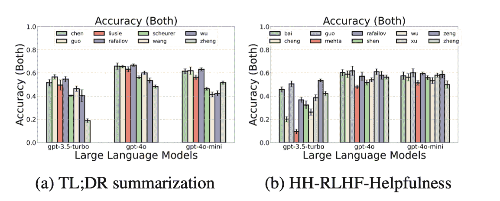

### 多层Transformer的梯度可以在几乎线性时间内进行近似求解

贡献人：

链接：http://arxiv.org/abs/2408.13233v1

摘要：流行的Transformer结构中自注意机制的二次计算复杂度给训练和推理带来了显著挑战，特别是在效率和内存需求方面。为了解决这些挑战，本文介绍了一种新颖的快速计算方法，用于多层Transformer模型中的梯度计算。我们的方法可以在几乎线性时间$n^{1+o(1)}$内计算整个多层Transformer模型的梯度，其中$n$是输入序列的长度。这一突破显著降低了与传统二次时间复杂度相关的计算瓶颈。我们的理论适用于任何损失函数，并在整个模型中保持有界的近似误差。此外，我们的分析可以适用于包含许多实用子模块的多层Transformer模型，如残差连接、因果掩码和多头注意力。通过提高大语言模型中梯度计算的效率，我们希望我们的工作能根据我们的理论结果促进更有效的长上下文语言模型的训练和部署。

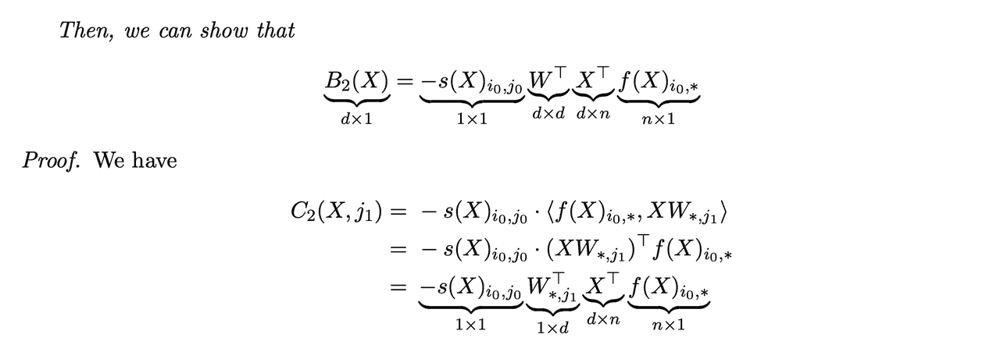

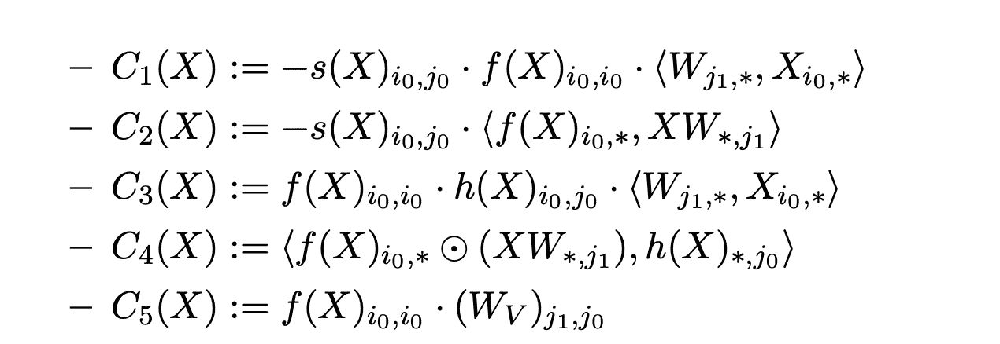

### LLM是否能成为基于提示工程的良好路径规划器？缓解路径规划的虚幻感

贡献人：

链接：http://arxiv.org/abs/2408.13184v1

摘要：大语言模型（LLMs）中的空间推理是具有实体智能基础。然而，即使在简单的迷宫环境中，LLMs仍然在长期路径规划中遇到挑战，主要受空间错觉和长期推理中的环境不一致错觉的影响。为了解决这一挑战，本研究提出了一种创新模型，即空间到关系转换和课程Q学习（S2RCQL）。为了解决LLMs的空间错觉，我们提出了空间到关系方法，将空间提示转化为实体关系和代表实体关系链的路径。这种方法充分发挥了LLMs在顺序思考方面的潜力。最终，我们提出了一种基于Q学习的路径规划算法，以减轻LLMs的环境不一致错觉，增强了LLMs的推理能力。通过将状态-动作的Q值作为提示的辅助信息，我们纠正了LLMs的错觉，从而引导LLMs学习最佳路径。最后，我们提出了一种基于LLMs的逆向课程学习技术，以进一步减轻环境不一致的错觉。通过降低任务难度并利用成功经验，LLMs可以迅速积累成功经验，并用于解决更复杂的任务。我们基于百度自主开发的LLM ERNIE-Bot 4.0进行了全面实验。结果显示，与先进的提示工程相比，我们的S2RCQL在成功率和最优率方面实现了23%到40%的改进。

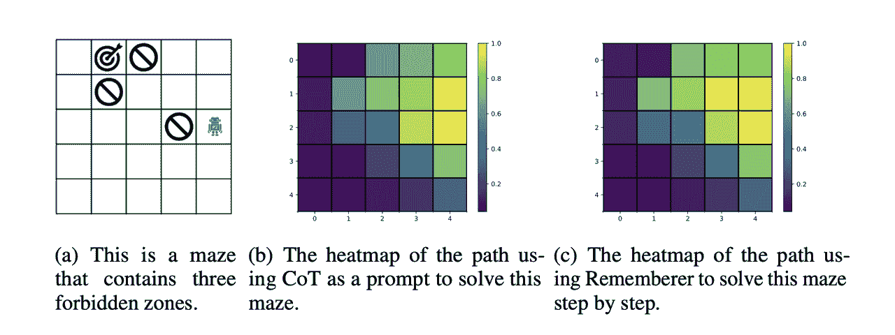

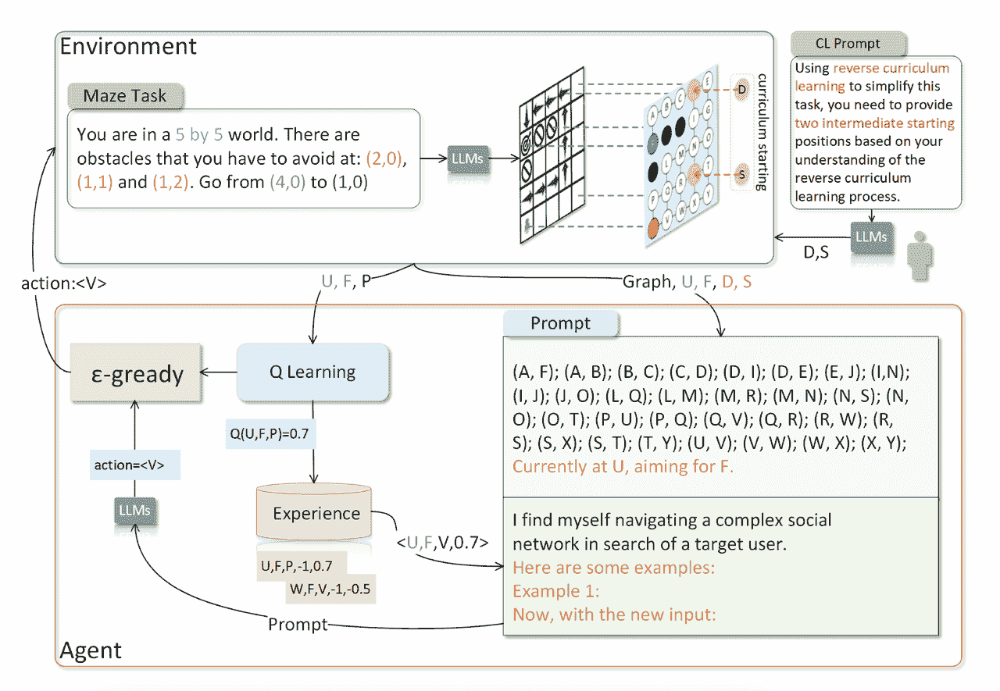

### **多模态对比上下文学习**

贡献人：

链接：http://arxiv.org/abs/2408.12959v1

快速增长的大语言模型（LLMs）的使用突显了无梯度上下文学习（ICL）的重要性。然而，解释它们的内部工作仍然具有挑战性。本文介绍了一种新型的多模态对比上下文学习框架，以增强我们对LLMs中ICL的理解。首先，我们提出了对比学习为基础的ICL在现实世界环境中的解释，将关键值表示的距离作为ICL的差异化因素。其次，我们开发了一个分析框架，以解决多模态输入格式化对现实世界数据集的偏见。我们展示了ICL示例的有效性，即使在未见格式中表示时，基线性能很差。最后，我们提出了一种即时的ICL方法（文本锚定ICL），在检测仇恨表情包等任务中展示了有效性，这是典型ICL由于资源限制而难以处理的任务。对多模态数据集进行的大量实验表明，我们的方法在各种情境下显著提升了ICL的性能，如挑战性任务和资源受限环境。此外，它为LLMs中上下文学习的机制提供了宝贵的见解。我们的发现对于开发更具可解释性、高效性和鲁棒性的多模态人工智能系统具有重要意义，尤其是在挑战性任务和资源受限环境中。

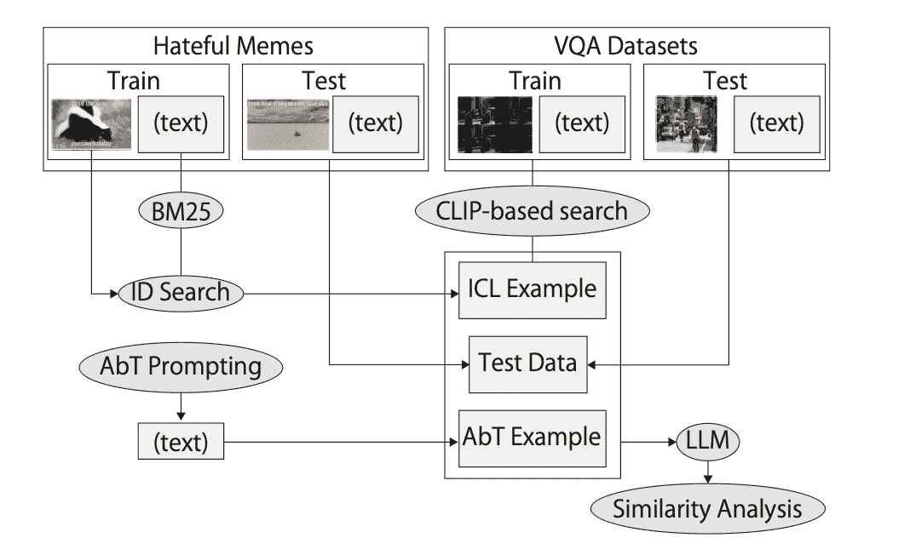

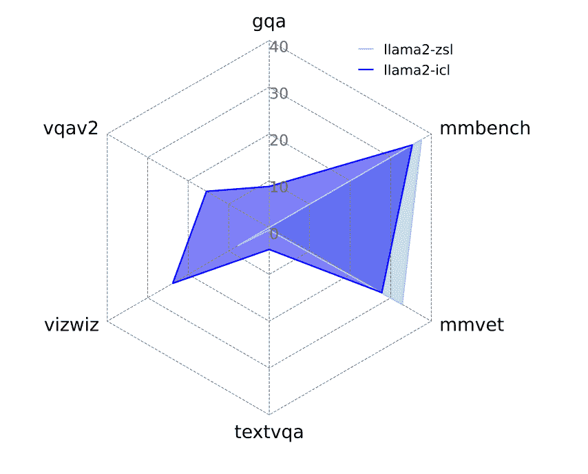

# 产品

### Seven24

贡献人：

https://www.seven24.ai/

Seven24.ai 是一款利用 AI 捕捉用户反馈并将其转化为可执行任务的工具。用户可以实时收集反馈，系统会分析并按重要性排序，帮助团队高效处理用户意见。该工具支持文本和音频反馈，且易于导入现有数据，适用于各种场景，如网络应用和实体店。

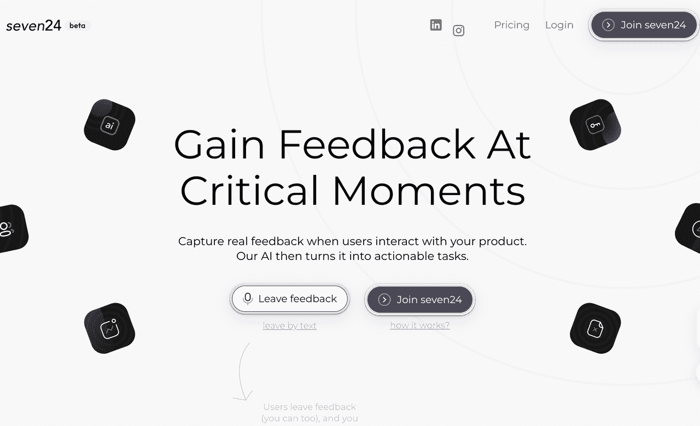

# HuggingFace&Github

### DreamCinema

贡献人：

https://liuff19.github.io/DreamCinema/

DreamCinema 是一个创新的电影转移框架，利用生成式人工智能简化电影制作，主要通过提取经典镜头中的人类和相机姿态、生成高质量的 3D 角色，并应用结构引导的运动转移策略来实现用户友好的电影创作。

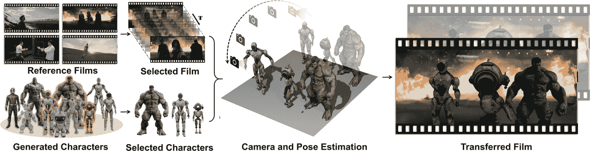

### miniG

贡献人：

https://huggingface.co/CausalLM/miniG

miniG 是一个基于超过 1.2 亿条数据合成数据集训练的模型，支持文本和图像输入，具有 1M 的上下文窗口和 9B 的模型参数。尽管未完全对齐人类偏好，但它在性能上具有一定优势。该模型建议使用标准化的推理实现，以避免性能下降，并提供具体的推理参数以减少幻觉结果。

# 学习

### LLM Decode GQA & GEMV算子性能分析（二）

贡献人：

https://zhuanlan.zhihu.com/p/715609504?utm_psn=1811339742626856960

1. **GEMV算子性能预估**

在LLM解码阶段，GEMV算子实际运行的是规模较小的GEMM（矩阵乘矩阵）运算。通过Roofline模型分析，GEMM算子的算术强度与A100 GPU的峰值计算能力和显存带宽进行了对比，推测出这些运算大多属于“Memory Bound”，即性能主要受限于显存带宽，而非计算能力。以LLaMA 2 70B TP=8的推理场景为例，推算出其GEMM算子运行时间约为11.4微秒，但实测结果却接近18微秒。

2. Roofline分析与实测结果差异

实测结果显示，GEMM算子的实际算术强度远高于预估值，但仍未达到A100的计算资源饱和点。通过Nsight Compute的Roofline分析，发现算术强度为63.81，大约是预估的4倍，这主要是由于cuBLAS层面对小规模M维度的GEMM算子进行了填充（padding）操作，导致了额外的浮点运算。

3. **性能瓶颈分析**

进一步的分析发现，尽管GEMM算子属于Memory Bound，但其显存带宽利用率仅为1.03TB/s，远低于峰值2TB/s。通过调研GEMM算子的调度器和Warp状态，发现硬件资源利用率不足是主要瓶颈，每个调度器仅能调度1.2个warp，而warp的CPI高达8个周期，这表明算子执行过程中大量时间处于等待内存操作的状态。

4. **并发度与负载不均衡的影响**

通过调整GEMM算子的N维度发现，增加并发度（即增加Grid大小）能够提升显存带宽利用率，但同时也引入了负载不均衡问题。特别是在跨越特定Grid大小时，部分SM（流处理器）的负载显著增加，导致整体性能下降。实验验证了在Grid大小跨越A100 SM数量倍数时（如108或216），负载不均衡问题更加严重，从而拖累了算子的性能。

5. **总结与建议**

文章最后总结指出，A100 GPU在处理小规模Batch和低延迟推理任务时，性能受限于显存带宽和硬件资源利用率，实际表现未达预期。相比之下，L20类GPU虽然规格不如A100，但在小规模GEMV运算中的性能利用率更高，性价比可能更优。这一分析对当前流行的分离式部署方案如Splitwise等也提供了有效性验证。

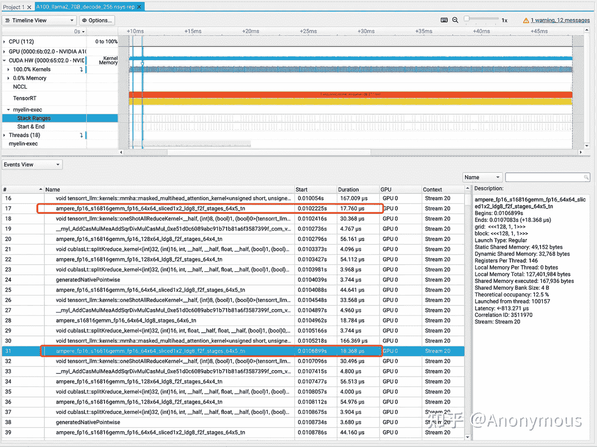

### LLM实践--Hugingface&vLLM + Spark集群

https://zhuanlan.zhihu.com/p/715290922?utm_psn=1811339369920991232

本文介绍了如何利用Spark框架在GPU集群上进行大规模LLM推理，结合Huggingface和vLLM库实现高效的模型推理。本文详细描述了在创业公司资源有限的情况下，如何通过配置Spark集群来充分利用机器的CPU和内存资源，尤其是针对GPU资源的分配与管理。

1.  **Spark环境搭建**：包括安装JDK、下载与配置Spark、以及安装英伟达的Spark-Rapids插件，用于GPU资源的管理。

1.  **Spark配置**：通过配置conf/spark-env.sh文件设置Spark路径、通信端口、Python环境以及资源限制，确保每台机器的CPU、内存和GPU资源得到合理分配。

1.  **任务提交与执行**：

+   **CPU任务**：利用Spark和Huggingface的AutoTokenizer批量处理文本数据，将明文转为Token。

+   **GPU任务**：两种示例，一是利用Huggingface模型进行推理，二是通过vLLM库实现大模型推理。配置了Spark任务与GPU资源的对应关系，确保每个任务能够高效利用GPU资源。

1.  **vLLM推理示例**：采用vLLM实现并行化的LLM推理，通过Tensor并行技术和自定义的SamplingParams控制推理输出，适用于处理复杂的大规模生成任务。

### AI芯片-NPU详解（Google TPU）

https://zhuanlan.zhihu.com/p/715462467?utm_psn=1811334633968775169

文章详细阐述了从 Google TPU v1 到 TPU v4 的演进过程，包括每一代 TPU 的技术参数、性能提升、以及在 AI 计算中的应用场景。TPU v1 作为第一代 AI 芯片，采用了脉动阵列和低精度计算等创新技术，专注于推理任务。TPU v2 则在此基础上增加了训练能力，引入了 BFloat16 数据格式和可编程的向量存储区，提高了芯片的灵活性和性能。TPU v3 进一步提升了计算能力和内存带宽，芯片性能有显著提升。TPU v4 作为最新一代产品，采用了更先进的 7 纳米工艺，MXU 数量翻倍，缓存内存和内存带宽均有大幅提升，同时引入了光电路交换机和稀疏结构硬件支持，极大地提升了大模型推理的效率和性能。

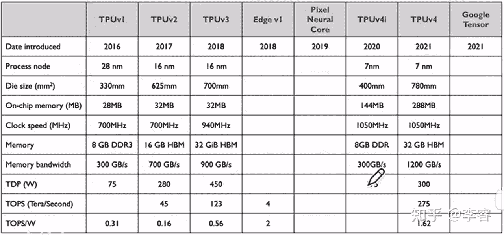

### 澜舟智库，知识搜索问答到底被大模型赋能了什么？

https://zhuanlan.zhihu.com/p/710587718?utm_psn=1811334131474362369

**召回排序优化**：通过引入RAG（Retrieval-Augmented Generation）机制，将搜索流程分为召回、重排序和大模型精排三个阶段，提升搜索结果的准确性和用户满意度。

**多轮对话改写**：针对多轮对话中的省略和指代问题，提出了基于COT（Chain-of-Thought）技术的改写策略，显著提升了系统的上下文理解能力。

**表格数据智能问答**：通过表格预处理优化和精细化监督微调（SFT），增强了大模型对复杂表格数据的理解和问答能力。

**深度问答**：构建了自动化Multi-Agent流程，集成多个模块（如素材检索、大纲生成、答案生成等），提升了深度问答的准确性和效率。

**答案溯源**：采用分离式架构，结合ngram算法和SFT微调的大模型，实现高效且精准的答案溯源。

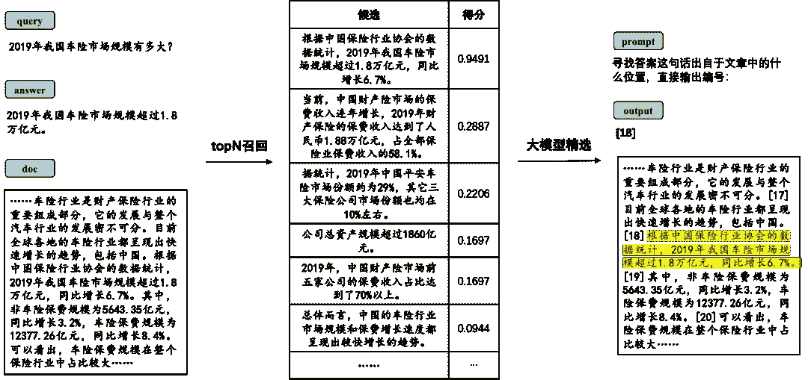

### 多模态大模型: 盘点&Highlights part1.5——从LLaVA-NeXT到LLaVA-OneVision

https://mp.weixin.qq.com/s/sBBICue-kpfYxfkSM_cpwg

文章介绍了多模态大模型LLaVA系列的最新进展，主要聚焦于LLaVA-NeXT及其后续工作如LLaVA-OneVision。文中提供了技术细节和开发过程的深入分析，分为以下几个关键部分：

1.  LLaVA-NeXT-Video：该模型将LLaVA-NeXT的图像处理能力扩展到视频处理，提出了如AnyRes技术从图像到视频的应用、线性缩放技术以增加抽帧频率等创新点，显著提升了视频理解的效果。

1.  **LLaVA-NeXT的消融实验**：通过一系列实验验证了模型在不同配置下的性能表现，得出了一些关键结论，如LLM的扩展对效果提升显著，但边际效应递减；视觉编码器的学习率要比LLM小5-10倍；提高数据质量能直接提升模型效果。

1.  LLaVA-NeXT-Interleave：该工作针对多图像、视频和3D任务提出了新的训练方法，采用了多图像数据的混合策略，并在实验中发现混合多图像插入策略效果最佳，此外还尝试了LLaVA-NeXT-Video中的池化技术，但效果不如预期。

1.  **LLaVA-OneVision**：作为LLaVA系列的集大成之作，整合了LLaVA-NeXT系列的所有技术，并通过使用高质量数据集和改进的AnyRes技术，进一步提升了模型在多种视觉任务上的泛化能力。

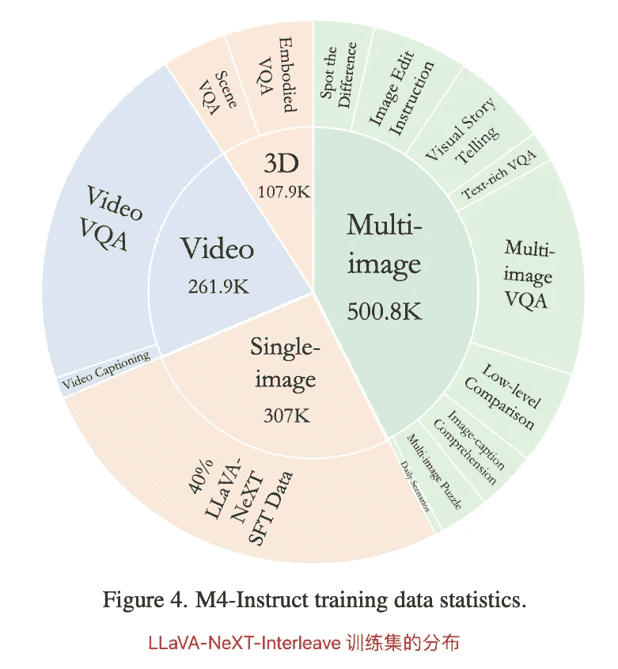

### 预训练阶段数据详解

https://zhuanlan.zhihu.com/p/716331881?utm_psn=1811151517538996224

随着“预训练+微调/提示”范式的普及，预训练数据的质量和规模对模型的性能至关重要。文章通过LLaMa 3技术报告为例，阐述了使用15.6T Tokens数据进行训练，特别是在数据去重、过滤等处理上采用了质量分类器模型，突显了数据工程在LLM训练中的核心地位。

文章对预训练数据集进行了分类，主要包括通用预训练数据集和特定领域预训练数据集。通用预训练数据集涵盖网页、书籍、学术材料、代码等多种文本来源，而特定领域的数据集则根据领域需求进行定制，如金融、医疗、法律等。此外，文章还描述了预训练数据的处理步骤，包括数据收集、过滤、去重、标准化及审核，强调了通过模型或启发式方法提升数据质量的重要性。

最后，文章还分析了预训练数据集的发展趋势，指出自BERT以来，预训练语料库的数量迅速增加，并在2023年经历了爆炸性增长。这反映了LLM领域对多类别数据和高质量数据处理的日益重视。通过图表展示了不同数据类型、构建方法、语言和领域的数据集分布，显示了通用语料库的广泛应用和特定领域语料库在应用场景中的重要性。

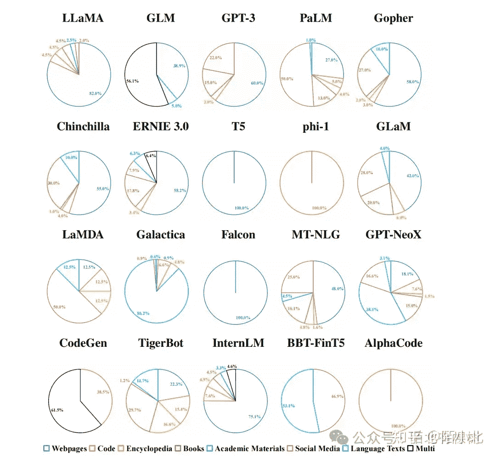

### CMU 10-414 Deep Learning System Assignments hw3 实验笔记

https://zhuanlan.zhihu.com/p/716400560?utm_psn=1811146788939374592

这篇实验笔记详细记录了CMU 10-414深度学习系统课程中HW3的实现过程，聚焦于手动构建CPU和GPU版本的底层NDArray库，而不依赖现有的高效库。实验分为多个部分，从Python数组操作、CPU后端的紧凑性和逐元素操作、到GPU后端的CUDA实现，各个部分详细描述了底层实现的技术细节。

1.  **Python数组操作**：实现了reshape、permute、broadcast_to等函数，通过调整内存布局和步长，实现了对数组形状和维度的灵活操作。

1.  **CPU后端实现**：

+   **紧凑性和setitem**：通过索引遍历和步长转换，将数据紧密排列并实现赋值操作，采用了循环展开的策略来处理多维数组的遍历。

+   **逐元素和标量操作**：引入模板和宏简化代码，注册了常见的算子如乘法、除法、对数、指数等操作。

1.  **CUDA后端实现**：

+   **紧凑性和setitem**：实现了在CUDA环境下的内存紧凑排列和赋值操作，使用了索引到内存位置的转换。

+   **逐元素和标量操作**：通过模板和设备函数实现了一系列算子，优化了代码结构以适应CUDA的并行计算模型。

+   **矩阵乘法**：通过共享内存、线程协作和分块技术实现了高效的矩阵乘法，虽然调试过程中遇到了不少挑战，但最终成功实现了优化的CUDA版本矩阵乘法。

最后，作者总结了在实现CUDA代码过程中遇到的挑战和解决思路，特别是在矩阵乘法的实现中，通过理解理论课程中的伪代码并结合实际编程，最终克服了困难。

# 🚀招聘公告

---

**奇绩创坛****由陆奇博士**于2019年创立，使命是在源头最大化驱动创新。奇绩研究组将研究模型理论、到投研战略分析、市场策划等不同背景的同学聚在一起，搭建GenAI时代独特的跨界人才社群。

🚀F**24实习岗位**

##### [行研-学术科研人才交流组实习生](https://miracleplus.feishu.cn/docx/Yn6rdf2iOoY2Rcx8yVNcUBYRnch#part-QkMcdeJmuob9uvxvV3qcLSzHn8g)

##### 行研-GenAI研究岗位-战略分析（偏产品）

##### Web / AI 全栈开发工程师实习生

**火热开放中🚀**

##### 行研-GenAI研究岗位-前沿学术探索

##### 行研-GenAI研究岗位-战略分析（偏咨询）

##### 创新活动产品运营 （大模型系列活动产品运营）

> **点击**相关岗位可查看对应**岗位需求【JD】；**相关岗位投递请**添加🛰️💻【**sunjiajunspace】

> ‼️欢迎**推荐/自荐**，期待在**奇绩创坛**遇见更好的你‼️

---

# 声明

本文档仅供学习交流使用，版权归原作者所有，若涉侵权，请联系Jack Jin 15101136166

##

（欢迎在下方反馈您宝贵的意见！整理不易，觉得有用给AI日报小组点个赞👍吧！）

ChatGPT；Angela；Zijia Liu；Alex；Zeqi Tan；Tiezhen（HuggingFace）；Naixu；Lizhi；Peter；Suoman；Jack

封面生成——右脑科技

如果你有大模型相关的创业想法，欢迎来找我们聊聊～🛰️：15101136166

> 快邀请你的小伙伴们一起来读大模型日报吧！

> **【日报****知识库****】**这里是近期日报内容的汇总,欢迎大家查阅

> [大模型日报知识库(分享版)](https://miracleplus.feishu.cn/wiki/KapVwXfkriOBiskB0B2cUHxjnTh)

>

> 欢迎大家多多帮我们分享,转发~~

> 如果大家有任何的建议或者吐槽,欢迎随时找我聊天~

