# 奇绩大模型日报（8月 29日）

> 来源：[https://miracleplus.feishu.cn/docx/KFbodFFLNouIuGxCd5rctHpKn1e](https://miracleplus.feishu.cn/docx/KFbodFFLNouIuGxCd5rctHpKn1e)

# 📡潜空间活动报名

> **潜空间系列活动重磅回归！**

> 本期活动将在**9月6日** **14:00**开始，我们邀请到的嘉宾是**闫俊杰。**他**是MiniMax 创始人兼 CEO，是中国第一梯**队的大模型创业者，目前 MiniMax 估值超 25 亿美元。他将和大家探讨Intelligence with everyone ：对 AGI 0-1 的探索与实践。

> 本次**仅开放北京线下活动**，望理解。我们将在会后48h内，整理会议纪要的精彩内容第一时间分享。

> 除嘉宾分享外，每期设置了【匹配合伙人 Cofounder Matching】环节。你可以和 GenAI 时代最有活力的创业者和研究者线下面对面交流，将有机会找到志同道合、有共同创业梦想的小伙伴。

> 报名通道已开启，欢迎扫描下方二维码报名。

# 资讯

### OpenAI即将完成新一轮融资！估值超过1000亿美元

https://techcrunch.com/2024/08/28/openai-reportedly-in-talks-to-close-new-funding-round-at-100b-valuation/

**据彭博**社报道，OpenAI即将完成新一轮融资，由Thrive Capital领投，估值超过 1000 亿美元。Thrive 将在本轮融资中投资约 10 亿美元。OpenAI 首席财务官Sarah Friar周三在一份备忘录中告诉员工，公司正在寻求新资本，但没有透露细节。

知情人士去年年底向彭博新闻社透露，OpenAI 至少从 12 月就开始接触投资人，预期以 1000 亿美元或以上的估值进行融资。

知情人士称，Friar 在给员工的备忘录中表示，这笔融资将支持公司的计算能力和其他运营费用。另外，OpenAI 计划在今年晚些时候举行一场招标活动，员工将有机会出售部分股份。

Thrive Capital 是一家成立于2009年的风投公司，总部位于纽约。该公司专注于投资互联网、软件和技术赋能领域的公司。据PitchBook的数据，Thrive Capital至今已经进行了393项投资 。

**20**24年8月18日的报道显示，Thrive Capital最近完成了其第九期旗舰基金的募集，募集金额超过50亿美元，这将是当年募集金额最高的风险投资基金之一，仅次于a16z上半年募集的72亿美元基金 。

此外，Thrive Capital的创始人约书亚·库什纳（Joshua Kushner）是一位85后新生代投资人，他也是亿万富翁家族库什纳家族的一员，家族拥有大型房地产开发商库什纳集团。

2023年10月，Thrive Capital曾牵头从OpenAI的员工处购买老股，估值为800亿美元。

相关链接：https://www.bloomberg.com/news/articles/2024-08-28/openai-nears-funding-round-at-more-than-100-billion-valuation?srnd=phx-technology

### MidJourney进军硬件市场，引发业界关注

https://techcrunch.com/2024/08/28/midjourney-says-its-getting-into-hardware/

MidJourney，这家以AI图像生成平台闻名的公司，近日宣布将进军硬件领域。据报道，该公司在没有接受任何风险投资的情况下，年收入已超过2亿美元。MidJourney的新硬件团队将设立在旧金山，这一消息在社交平台X上公布。

关于MidJourney可能涉足的硬件方向，业内推测与该公司2月份招聘的Ahmad Abbas有关。Abbas此前曾参与苹果Vision Pro混合现实头显的开发，而MidJourney的CEO David Holz也是硬件领域的老手，曾共同创立了Leap Motion，一家专注于动作跟踪外设的公司。

尽管MidJourney因其AI训练方法正面临法律诉讼，该公司仍在持续开发AI模型，涉及视频和3D生成。硬件的开发或许与这些努力有关，可能用于提升其AI模型的性能或用户体验。

### NVIDIA发布2025财年第二季度财报

https://nvidianews.nvidia.com/news/nvidia-announces-financial-results-for-second-quarter-fiscal-2025

2024年8月28日，NVIDIA公布了截至2024年7月28日的2025财年第二季度财报，报告显示该公司在多个方面创下新纪录。本季度总收入达到300亿美元，较上一季度增长15%，同比增长122%。数据中心业务收入达到263亿美元，同比增长154%。此外，NVIDIA的GAAP和非GAAP稀释每股收益分别为0.67美元和0.68美元，同比分别增长168%和152%。

**主要业绩亮点**

+   **数据中心业务**：数据中心收入创纪录，达到263亿美元，同比增长154%。NVIDIA的H200 Tensor Core和Blackwell架构在MLPerf基准测试中表现出色，进一步提升了公司的技术领先地位。

+   **游戏和AI PC**：本季度游戏收入为29亿美元，同比增长16%。NVIDIA还推出了ACE和Project G-Assist等AI技术，进一步增强了游戏体验。

+   **专业可视化**：收入为4.54亿美元，同比增长20%，推出了用于OpenUSD的生成式AI模型，以加速工业数字孪生和机器人开发。

+   **汽车与机器人**：汽车业务收入达到3.46亿美元，同比增长37%。NVIDIA还展示了Isaac机器人平台在全球领先企业中的应用。

**股东回报与展望** NVIDIA在上半年通过股票回购和现金分红向股东返还了154亿美元。公司董事会批准了额外500亿美元的股票回购授权。本季度，NVIDIA的现金股息为每股0.01美元。此外，公司预计2025财年第三季度收入将达到325亿美元，并继续保持强劲的利润率。

**新产品与技术**

NVIDIA推出了包括Blackwell系统和Spectrum-X以太网平台在内的多项新产品，并宣布与Hugging Face合作推出推理服务，加速生成式AI的应用。

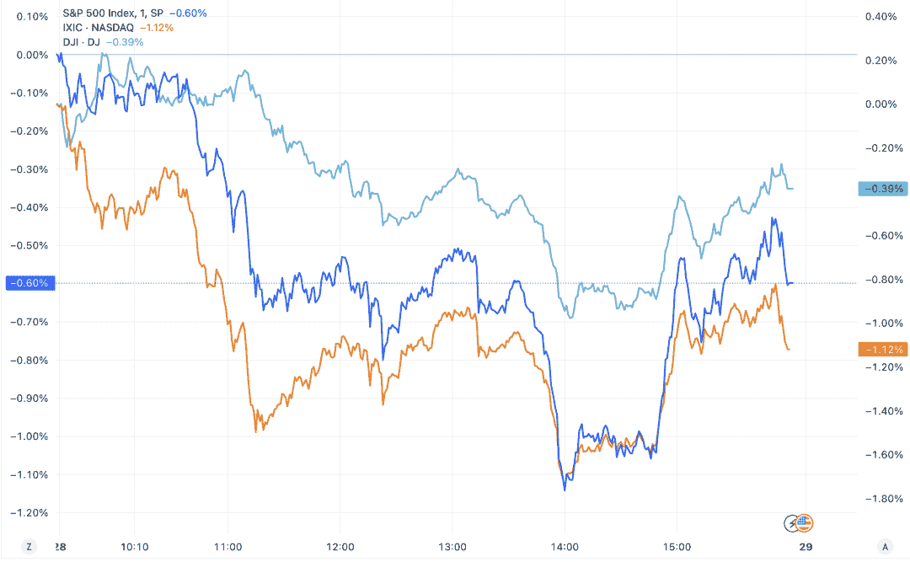

### AI推理竞争白热化：Nvidia Blackwell、AMD、Google及新兴公司首秀MLPerf基准测试

https://mp.weixin.qq.com/s/cx-otFn6orFeEEZZqEt3kw

近日，ML Commons发布了最新一轮的AI推理竞赛MLPerf Inference v4.1结果。此次比赛首次包含了Nvidia全新Blackwell芯片、AMD Instinct加速器、Google Trillium加速器以及初创公司UntetherAI的产品。尽管Nvidia在AI训练领域仍然占据主导地位，但在推理方面，其他公司尤其是在能效方面正在逐步赶上。

Nvidia的Blackwell芯片在大语言模型（LLM）问答任务中表现突出，其单个加速器性能较之前的版本提升了2.5倍。Blackwell成功的原因之一是其首次在MLPerf基准测试中展示了4位浮点精度运算，这大幅提高了计算速度。同时，Blackwell芯片的内存带宽几乎翻倍，达到8TB/s，相比前代H200的4.8TB/s有显著提升。此外，Blackwell支持多达18个NVLink连接，带宽总量达到1.8TB/s，进一步增强了其扩展能力。

Untether AI凭借其speedAI240 Preview芯片在能效方面表现尤为出色。该芯片采用“内存计算”架构，将处理器与内存单元直接相邻分布，大幅减少了数据传输所需的时间和能量消耗。在MLPerf的图像识别任务中，Untether AI的芯片在每瓦特查询次数上远超Nvidia的H200，展示了显著的能效优势。此外，该芯片在低功耗情况下的延迟性能也显著优于Nvidia的L40S。

虽然Cerebras和FuriosaAI未参与此次MLPerf竞赛，但两家公司分别在IEEE Hot Chips会议上推出了新的推理芯片。Cerebras的新服务CS3在LLM生成速度上自称超越Nvidia H100七倍。而FuriosaAI则展示了其第二代芯片RNGD，采用独特的张量收缩处理器（TCP）架构，在推理过程中更高效地利用张量的并行性和数据重用能力。

链接：https://spectrum.ieee.org/new-inference-chips

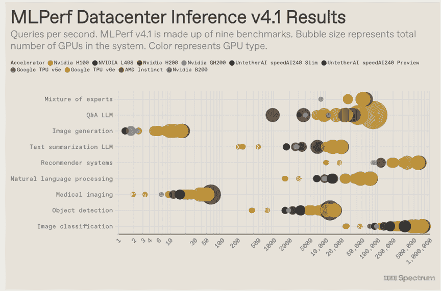

### RL教父Sutton持续反向传播算法登Nature

https://mp.weixin.qq.com/s/jeqXj3ez5DbItS7RpoVaSg

这篇《Nature》发表的研究论文《Loss of plasticity in deep continual learning》探讨了深度学习在持续学习环境中的可塑性丧失问题。传统深度学习方法通常在训练阶段更新网络权重，而在使用或评估阶段则保持权重不变，这与许多需要持续学习的应用程序不符。研究发现，标准的深度学习方法在持续学习环境中逐渐失去可塑性，最终表现与浅层网络无异。通过实验，研究表明，只有通过持续向网络注入多样性的算法，才能维持可塑性。

研究提出了「持续反向传播算法」，这是反向传播的一种变体，旨在通过随机初始化部分神经元来维持网络的可塑性和学习能力。实验结果显示，常规的梯度下降方法不足以应对持续学习的需求，需要引入随机、非梯度的成分以保持可变性。研究使用经典的 ImageNet 数据集，通过设计一系列二元分类任务，展示了在持续学习中标准深度学习方法的性能下降问题。

该研究发现，一些流行的方法如 Adam、Dropout 和归一化实际上加剧了可塑性的丧失，而 L2 正则化在某些情况下可以减少这种损失。此外，持续反向传播通过选择性地重新初始化低效单元，并结合传统反向传播和随机性成分，有效地保持了网络的学习能力。研究还通过对 CIFAR-100 数据集进行类别增量学习的实验，验证了持续反向传播算法在多任务环境中的优势。最终，该方法在各类实验中表现出了优异的学习效果，为解决持续学习中的可塑性丧失问题提供了新的思路。

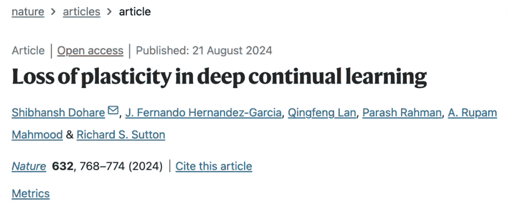

### 陶哲轩IMO演讲全文

https://mp.weixin.qq.com/s/GjJgHnl6tBBN1cRzDLXYag

陶哲轩在IMO 2024演讲中，回顾了计算机和人工智能在数学研究中的应用历程，并展望了未来的发展。他强调，虽然AI在数学领域的作用日益显著，但人类的洞察力和创造力依然不可替代。演讲内容涵盖了从早期机械计算到现代AI辅助的演变过程。

他特别提到现代AI工具，如DeepMind的AlphaGeometry，以及形式化证明助手（如Lean）的发展。陶哲轩还分享了一些重要的数学突破，如四色定理和开普勒猜想的计算机辅助证明，展示了AI如何帮助处理复杂的数学问题。

然而，他也指出AI的局限性，目前的AI在数学研究中主要扮演辅助角色。尽管AI可以生成有价值的数学猜想，证明过程仍需要人类的介入。陶哲轩对未来充满期待，他认为随着AI技术的发展，将来有可能实现规模更大、更复杂的数学运算，开启数学研究的新篇章。

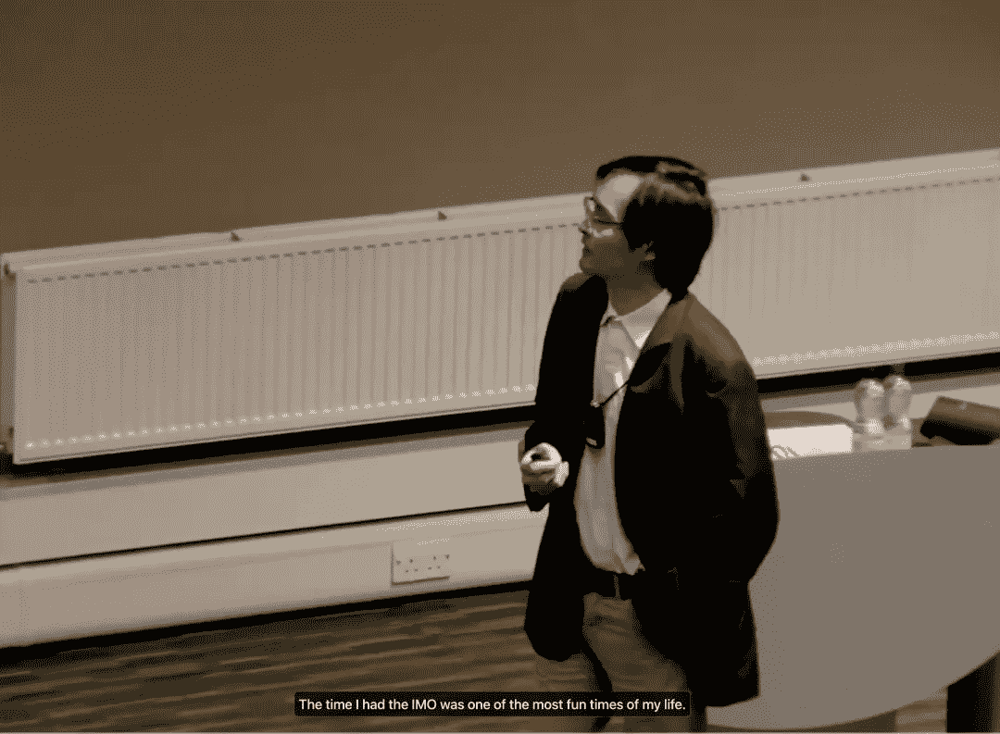

# 推特

### 24小时内自动申请了1000份工作并获得了50次面试机会：LinkedIn_AIHawk，批量申请的同时保证质量

https://x.com/rohanpaul_ai/status/1828598009673683347

有人使用AI机器人在24小时内自动申请了1000份工作，并获得了50次面试机会！🤯

而且这个机器人的代码在GitHub上是开源的。👨‍🔧

这个工具可以自动化你的LinkedIn求职和申请流程。

+   扫描符合你条件的职位空缺，

+   使用LinkedIn的“Easy Apply”功能进行职位申请，

+   生成定制的简历，

+   使用大语言模型（LLM）个性化回应雇主问题，

+   可以批量申请，同时保持质量控制，

+   安全管理你的数据，并与OpenAI的API集成，提供AI驱动的功能。

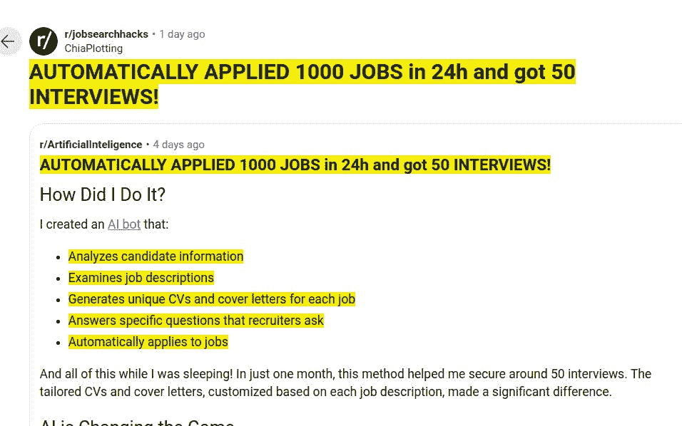

### 利用Gemini进行大型多模态模型提示

https://x.com/AndrewYNg/status/1828844538712224137

探索我们全新短课程《利用Gemini进行大型多模态模型提示》，由Erwin Huizenga与@googlecloud合作授课，了解最先进的多模态提示技术。

本课程中的一个有趣见解是：在多模态模型中，提示结构至关重要。例如，在输入文本信息（如患者的病史）之前输入图像（如X光片），可以增强模型对视觉数据的上下文理解和解释能力。在其他场景下，例如图像描述，先放置图像可能会产生更好的效果。多模态模型的行为与纯文本大语言模型不同，有效的提示方式取决于您使用的模型类型。在本课程中，您将学习如何有效地为Gemini模型进行提示。

Gemini的多模态功能还使AI应用开发有了新的方法，例如：

+   Gemini库支持各种视频格式（MP4、MOV、MPEG），简化了这些格式的应用程序开发。

+   大上下文窗口（可达100万个token）使得处理大量内容成为可能，例如同时分析多个50分钟的视频。

+   函数调用功能将实时数据（如当前汇率）集成到模型的响应中。

本课程通过实际案例展示了如何构建多模态应用，包括能够同时分析文本和图表的文档分析器、从多个小时的视频中提取并标记特定信息的视频内容提取器、以及自动化处理收据图像并核对公司政策的费用报告系统。

[ssstwitter.com_1724919122334.mp4](https://internal-api-drive-stream.feishu.cn/space/api/box/stream/download/all/SzHvbM9pDo9D1qx76SscHkcKnvg)

### 发布TB-OCR-preview：端到端OCR模型，能够同时处理文本、数学LaTeX和Markdown格式

https://x.com/hu_yifei/status/1828870309857915341

发布TB-OCR-preview：一个端到端OCR模型，能够同时处理文本、数学LaTeX和Markdown格式。它可能是学术论文OCR的最新顶尖模型（MIT许可证下发布）。

运行该模型仅需4-bit，约需~2.8GB的VRAM，且几乎没有性能下降。

+   针对学术论文的内部基准测试结果：WER = 0.04，MER = 0.04，CER = 0.01

+   模型以一段文本作为输入，返回干净的Markdown输出。

+   标题以##标记。

+   数学表达式保证被括号\(...\) \[...\]包裹，便于解析。

+   该模型不需要行检测或数学公式检测。

这是一个预览模型，用于验证从合成数据管道生成的数据集的质量。预览模型仅使用了~25万对图文配对数据（约5000万tokens）。

当前模型基于Phi-3.5-vision。性能更强的小型模型目前正在训练或测试中。

HF模型页面：https://huggingface.co/yifeihu/TB-OCR-preview-0.1

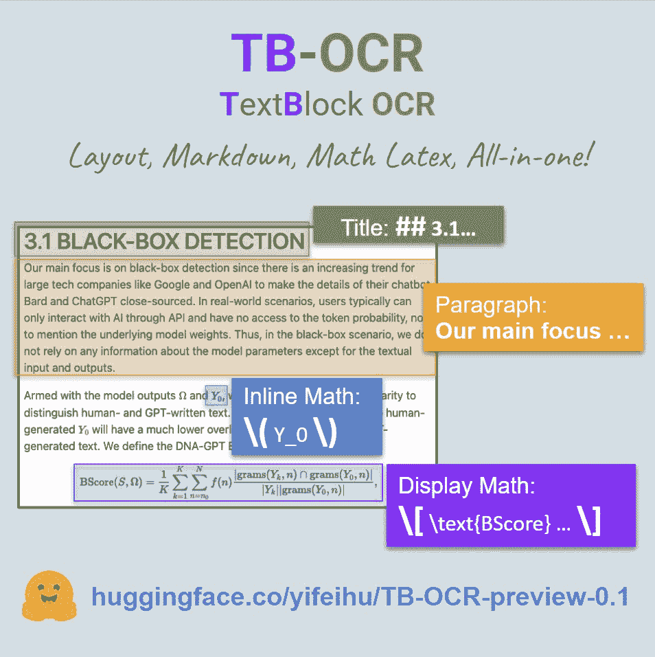

### Cartesia AI：我们的团队率先开发了一种极为高效的AI架构——状态空间模型

https://x.com/cartesia_ai/status/1828500784033735156

今天，我们揭开了迈向普及人工智能旅程中的一个重要里程碑：**AI On-Device**。

我们的团队率先开发了一种极为高效的AI架构——状态空间模型（SSMs）。现在，我们已经在边缘设备上进行了优化和部署。我们相信，AI的未来将在您的设备上运行，这样它可以持续处理，同时保证可靠性、隐私性和安全性。

阅读我们的完整博客文章：http://cartesia.ai/blog/on-device

# 论文

### 高效的大语言模型调度：通过学习排序实现

贡献人：

链接：http://arxiv.org/abs/2408.15792v1

摘要：在大语言模型（LLM）推断中，通常将LLM请求的输出长度视为先验未知。因此，大多数LLM服务系统采用简单的先来先服务（FCFS）调度策略，导致头阻塞（HOL）和降低吞吐量和服务质量。本文重新审视这一假设--尽管预测每个请求的确切生成长度是不可行的，但可以使用学习排名预测批量请求中输出长度的相对等级。排名信息为调度请求提供了有价值的指导。基于这一洞见，我们开发了一种新颖的LLM推断和服务调度器，可以更好地逼近最短作业优先（SJF）调度比现有方法更好。我们将这个调度器与最先进的LLM服务系统集成，并在几个重要应用中显示出显著的性能提升：聊天机器人服务延迟降低了2.8倍，合成数据生成吞吐量提高了6.5倍。我们的代码可在https://github.com/hao-ai-lab/vllm-ltr.git获取。

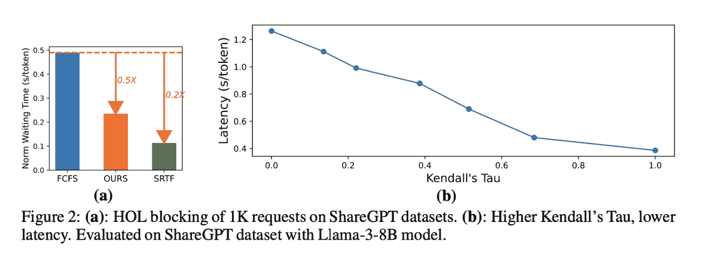

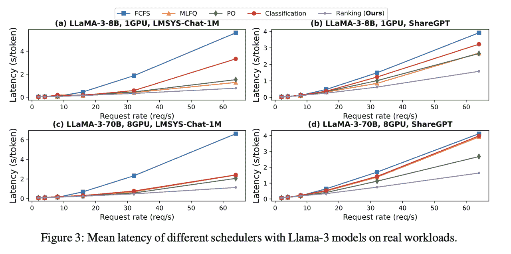

### 自回归模型在Ising临界点附近的路径依赖

贡献人：

链接：http://arxiv.org/abs/2408.15715v1

自回归模型是一类生成模型，根据先前的输入概率地预测序列的下一个输出。自回归序列在本质上是一维的，这对于语言任务来说很自然，因此是现代架构（如循环神经网络（RNN）和Transformer）的重要组成部分。然而，当语言模型用于预测不是本质上一维的物理系统的输出时，就会出现哪种自回归序列选择最优的问题。本文研究了在二维（2D）Ising模型中重建关键相关性，使用在热相变附近获取的二进制自旋数据训练的RNN和Transformer。我们比较了对有限大小2D格点强加了多种不同1D自回归序列的训练性能。我们发现，具有长1D段的路径比更好保留2D局部性的填充曲线更有效地训练自回归模型。我们的结果说明，在训练物理任务的现代语言模型时，选择最佳自回归序列顺序可能非常重要。

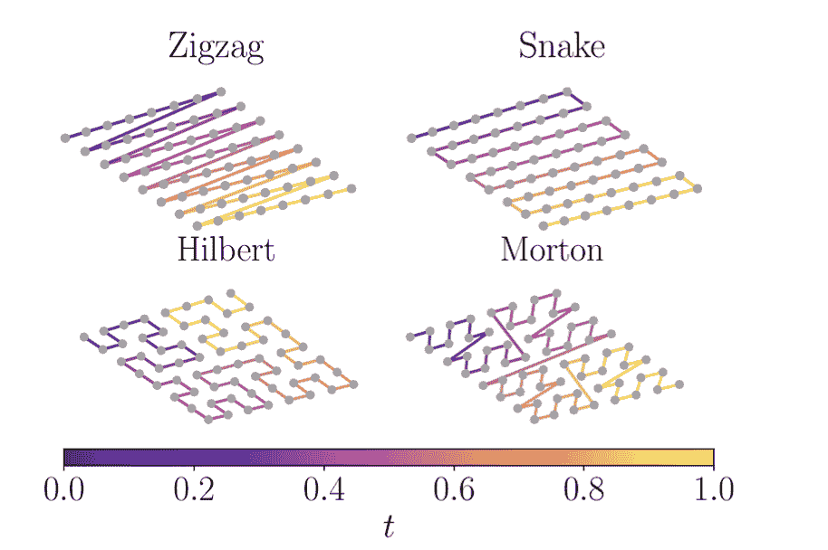

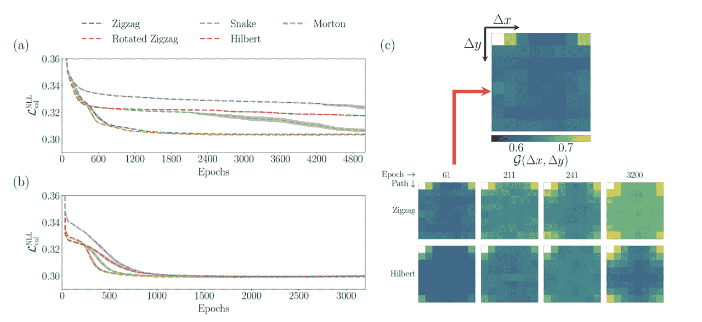

### 避免生成模型作家停滞问题的方法：通过嵌入微调进行涌现

贡献人：

链接：http://arxiv.org/abs/2408.15450v1

摘要：生成图像模型自问世以来已成为全球现象。从新艺术的可能性到新的滥用向量，许多新的能力已经变得可用。处理生成模型的挑战性问题之一是特别控制生成过程，以预防特定生成类别或实例。有几个原因可能导致人们希望控制生成模型的输出，从隐私和安全问题到应用程序限制或用户偏好。我们提出了一种方法，通过针对潜在扩散图像生成模型，使其能够避开不需要的概念（当检测到模型输出时），同时产生输出。我们重点关注缓解像图像记忆这样的问题，通过定性和定量评估证明了我们方法的有效性。我们的方法成功防止生成已记忆的训练图像，同时保持与未经修改的模型相当的图像质量和相关性。

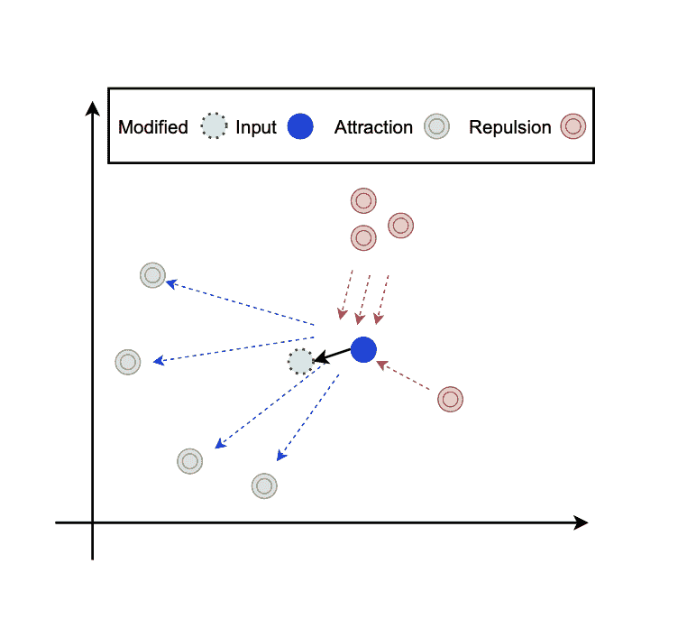

### Eagle：探索带有多种编码器的多模态大语言模型设计空间

贡献人：

链接：http://arxiv.org/abs/2408.15998v1

摘要：在多模式大语言模型（MLLMs）中，准确解释复杂视觉信息的能力至关重要。最近的研究表明，增强视觉感知显著降低幻觉，提高对分辨率敏感任务（如光学字符识别和文档分析）的表现。最近的一些MLLMs使用多种视觉编码器实现了这一目标。尽管它们取得了成功，但在关键方面，如专家选择和多个视觉专家的整合，缺乏系统性比较和详细的消融研究。这项研究广泛探索了使用多种视觉编码器和分辨率的MLLM设计空间。我们的发现揭示了几个潜在的原则，这些原则适用于各种现有策略，导致了一种简化但有效的设计方法。我们发现，简单地从一组互补的视觉编码器中连接视觉token与更复杂的混合架构或策略一样有效。我们还引入了Pre-Alignment来弥合视觉焦点编码器和语言token之间的差距，增强模型的连贯性。最终的MLLM家族Eagle在主要MLLM基准测试中超越了其他领先的开源模型。模型和代码：https://github.com/NVlabs/Eagle

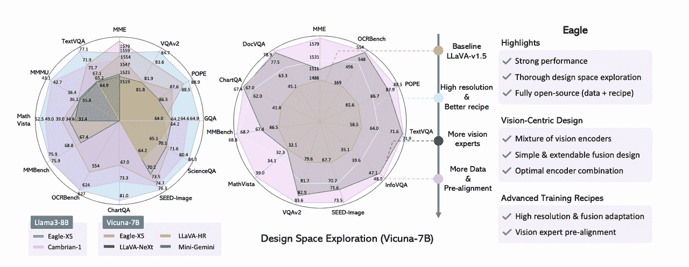

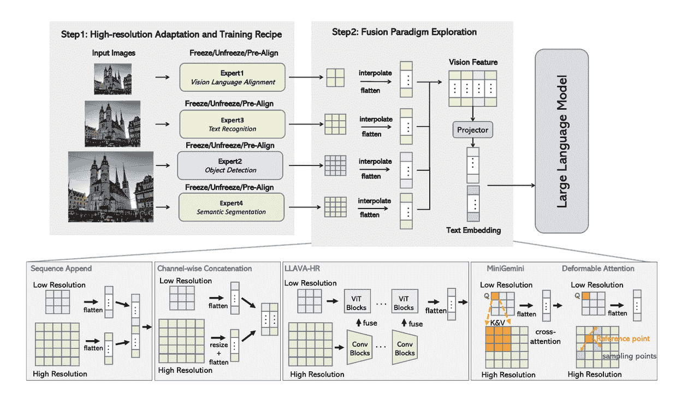

### CoGen: 结合理解和生成学习反馈

贡献人：

链接：http://arxiv.org/abs/2408.15992v1

具有语言理解和生成能力的系统可以从两者之间的紧密联系中受益。这项工作研究了将理解和生成紧密结合，重点是不断从与用户的互动中学习。我们提出了技术，紧密整合了这两种能力，用于学习和推理。我们将研究定位在双方参考游戏中，并使用各种模型与人类用户进行成千上万次的互动，同时从互动反馈信号中学习。我们展示了随着时间的推移性能的显着提升，理解生成耦合导致绝对性能提升高达26％，准确性比非耦合系统提高高达17％。我们的分析还显示，耦合对系统的语言具有实质性的定性影响，使其显著更具人类化。

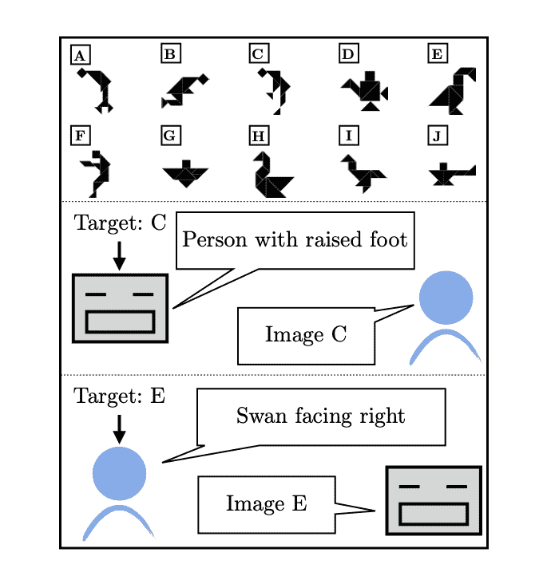

### WILDFEEDBACK：将LLMs与现场用户互动和反馈对齐

贡献人：

链接：http://arxiv.org/abs/2408.15549v1

随着大语言模型（LLMs）的不断进步，将这些模型与人类偏好对齐已经成为一个关键挑战。传统的对齐方法依赖于人类或LLM注释的数据集，受限于资源密集型、固有主观性和放大模型偏见的风险。为了克服这些限制，我们引入了WildFeedback，这是一个利用实时用户交互创建更准确反映真实人类价值观的偏好数据集的新框架。WildFeedback通过三个步骤运行：反馈信号识别、偏好数据构建和用户引导评估。我们将这一框架应用于大量用户-LLM对话的语料库，产生了一个反映真实用户偏好的丰富偏好数据集。通过识别和分类自然对话中的反馈信号，该数据集捕捉了用户偏好的细微差别，从而实现了更具代表性和上下文敏感性的对齐数据构建。我们广泛的实验表明，通过采用WildFeedback微调的LLMs展现出显著改进的对齐，不仅可以从传统基准和我们提出的用户引导评估中看出。通过整合实际用户的实时反馈，WildFeedback解决了困扰现有方法的可伸缩性、主观性和偏见挑战，这标志着向开发更具响应性的LLMs迈出了重要一步，以满足其用户多样化和不断发展的需求。总之，WildFeedback为将LLMs与真正人类价值观对齐提供了一个强大且可扩展的解决方案，为用户中心的语言模型的开发和评估设立了新的标准。

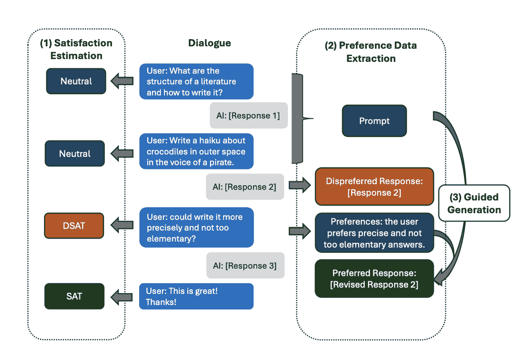

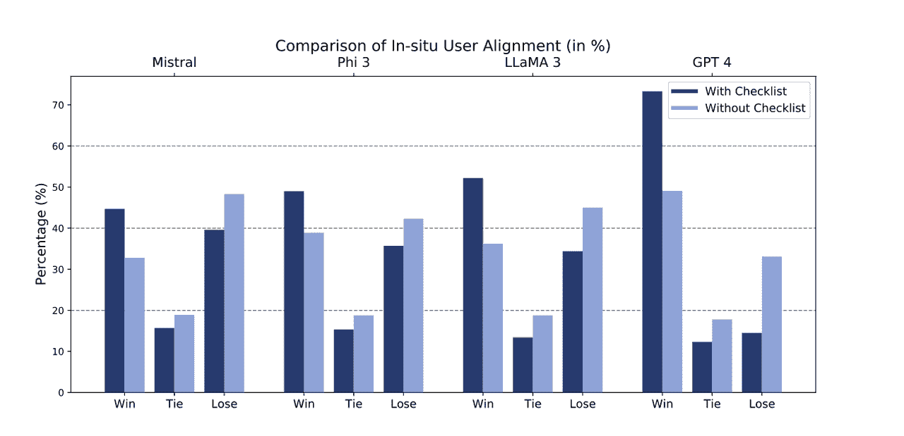

### ReMamba：为Mamba装备有效的长序列建模

贡献人：

链接：http://arxiv.org/abs/2408.15496v1

摘要：尽管Mamba架构在短文本自然语言处理任务上表现出优越的推理效率和竞争性能，但实证证据表明，与基于Transformer的模型相比，它在理解长文本方面的能力有限。在本研究中，我们调查了Mamba模型的长文本效率问题，并提出了ReMamba，它增强了Mamba理解长文本的能力。ReMamba在两阶段重新转发过程中结合了选择性压缩和适应技术，产生了极小额外推理成本开销。在LongBench和L-Eval基准测试上的实验结果表明，ReMamba的有效性，分别比基线提高了3.2和1.6点，并且几乎达到了相同大小的Transformer模型性能水平。

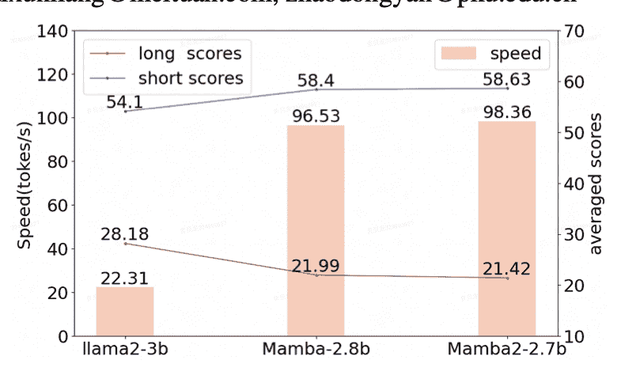

### 下一个token预测的隐式几何：从语言稀疏模式到模型表示

贡献人：

链接：http://arxiv.org/abs/2408.15417v1

下一个令牌预测（NTP）在大文本语料库上已成为训练大语言模型的首选范式。然而，NTP如何影响将语言模式映射到所得模型表示的几何属性仍不清楚。我们将大语言模型的培训框架描述为对稀疏概率标签向量的软标签分类，结合允许无限制生成上下文嵌入的解析近似。这种方法将NTP训练链接到在逻辑域中受秩约束、核范数正则化的优化，提供了一个框架来分析词和上下文嵌入的几何性质。在大型嵌入空间中，我们发现NTP隐性偏好学习具有稀疏加低秩结构的逻辑。虽然稀疏部分捕捉上下文-单词对的共现频率，但在训练进行时逐渐成为主导的正交低秩分量仅取决于共现矩阵的稀疏模式。因此，当投影到适当的子空间时，当跟随相同下一个令牌集的上下文的表示坍缩时，我们将此现象称为子空间坍缩。我们在合成和小规模真实语言数据集上验证了我们的发现。最后，我们概述了旨在加深对NTP对语言模式和规律学习影响的理解的潜在研究方向。

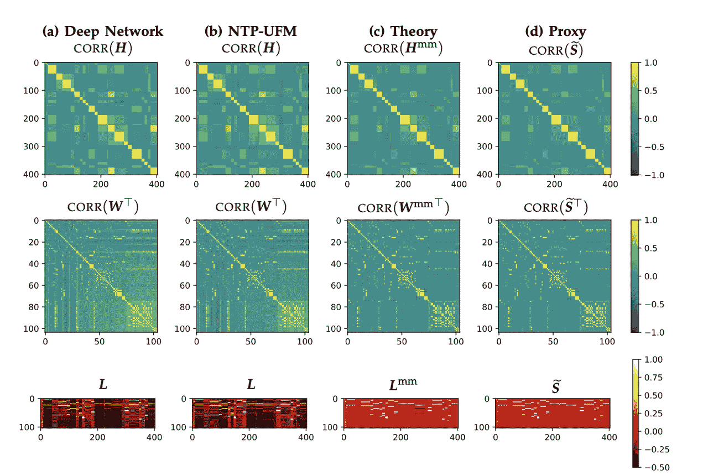

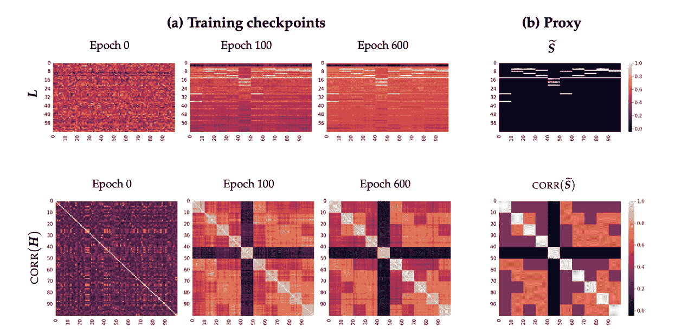

### 当代LLM研究中的奇迹、规律和缺陷

贡献人：

链接：http://arxiv.org/abs/2408.15409v1

我们对当代大语言模型（LLM）研究背后的科学方法论进行了批判性检查。我们根据典型的良好研究标准（如存在统计测试和可重现性）评估了超过2,000项研究工作，并与争议核心相关的论点进行交叉验证（如涌现行为的声明、LLM的使用作为评估器）。我们发现多种趋势，如涌现行为声明减少、伦理放弃声明的存在，以及LLM作为评估器的兴起。本文强调了该领域需更多的审慎和严谨。批判性阅读和熟悉文献对于遵循负责任、道德、可重现、系统性和开放接受批评的科学方法的基本原则至关重要。

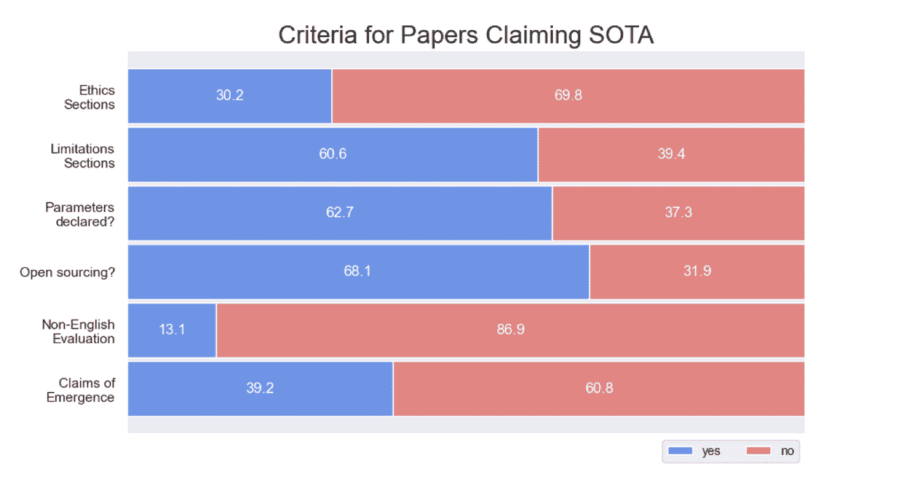

### LOGICGAME：大语言模型基于规则推理能力的基准测试

贡献人：

链接：http://arxiv.org/abs/2408.15778v1

大语言模型（LLMs）在各种任务中展示出了显著的能力，展现出了复杂的问题解决能力。理解和执行复杂规则，以及多步规划，对于逻辑推理至关重要，对于实际LLM智能体和决策系统也至关重要。然而，将LLMs作为有效的基于规则的执行者和规划者进行评估仍然未被充分探讨。在本文中，我们介绍了LogicGame，这是一个新颖的基准，旨在评估LLMs的全面规则理解、执行和规划能力。与传统基准不同，LogicGame提供了包含一系列规则的各种游戏，这些游戏具有初始状态，需要模型理解和应用预定义规定以解决问题。我们创建了模拟场景，模型在其中执行或规划操作以实现特定结果。这些游戏场景专门设计为通过仅依靠预定义规则来区分逻辑推理和纯粹知识。这种分离允许对基于规则的推理能力进行纯粹评估。评估不仅考虑最终结果，还考虑中间步骤，提供了对模型性能的综合评估。此外，这些中间步骤是确定性的，可以自动验证。LogicGame定义了包含从简单规则应用到复杂推理链的不同难度级别的游戏场景，以精确评估模型在规则理解和多步执行上的表现。利用LogicGame，我们测试了各种LLMs，并发现了它们在基于规则的逻辑推理能力方面的显著不足。

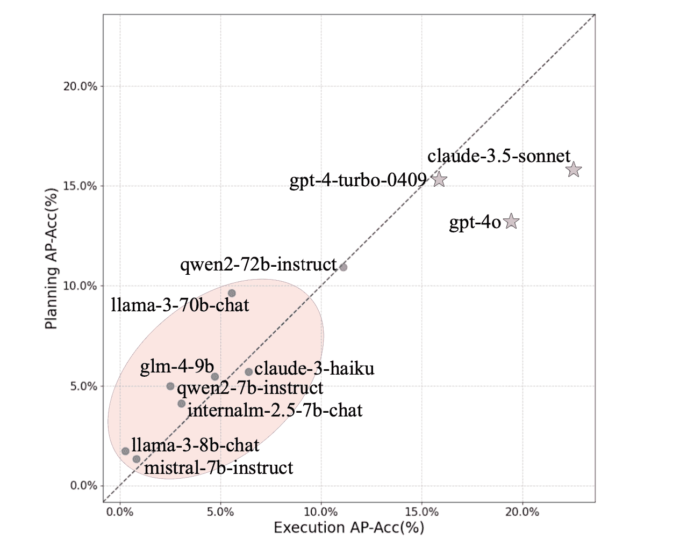

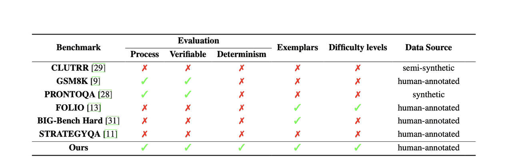

# 产品

### GoMarble

贡献人：

https://adsanalyzer.gomarble.ai/

GoMarble 的 AI 广告分析工具可以快速分析视频和静态广告，帮助用户识别有效元素和不足之处。用户上传广告后，系统会生成详细报告，适用于数字营销人员和创意策略师。

### GPTEngineer

贡献人：

https://gptengineer.app/

gptengineer.app 是一个快速原型设计工具，允许用户通过自然语言创建网页应用。它支持实时迭代、与 GitHub 的双向同步，并能一键部署到生产环境，旨在帮助开发者更高效地构建和发布应用。

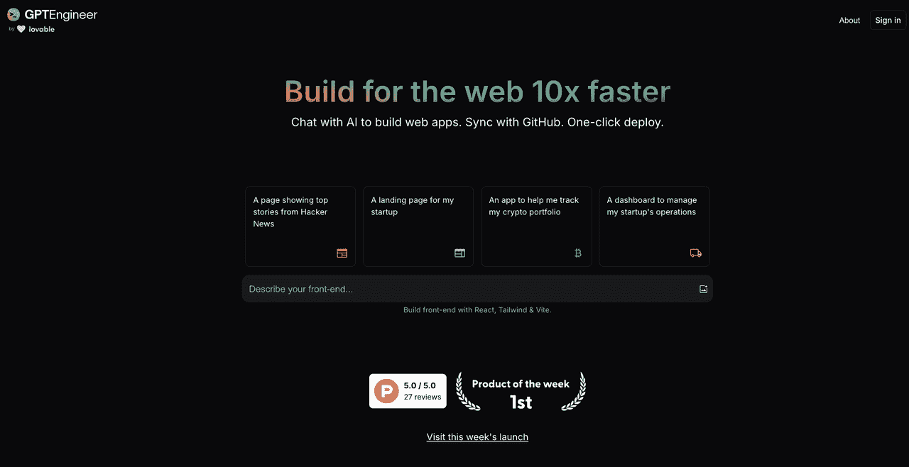

### Hyper-SD

贡献人：

https://huggingface.co/ByteDance/Hyper-SD

Hyper-SD 是一种新型的扩散模型加速技术，提高图像合成的效率和质量。它基于多个模型的提炼，包括 FLUX.1-dev、SD3-Medium、SDXL Base 1.0 和 Stable-Diffusion v1-5。Hyper-SD 提供了多种 LoRA（Low-Rank Adaptation）检查点，支持不同的推理步数和引导尺度，以便用户根据需求灵活调整模型的性能。

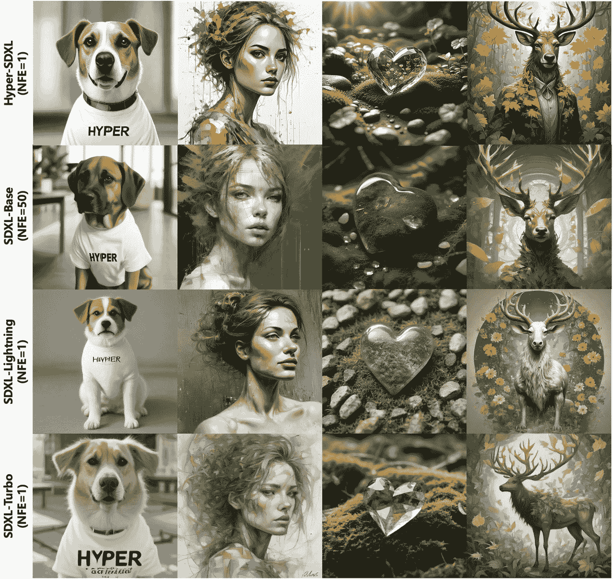

### GameNGen

贡献人：

https://gamengen.github.io/

GameNGen是一个全新的游戏引擎，完全由神经模型驱动，能够在复杂环境中实现实时交互，支持长时间轨迹的高质量模拟。它可以以每秒超过20帧的速度交互模拟经典游戏《DOOM》，并且其下一帧预测的峰值信噪比（PSNR）为29.4，接近有损JPEG压缩的效果。人类评审者在区分游戏短片和模拟短片时，仅略微优于随机猜测。

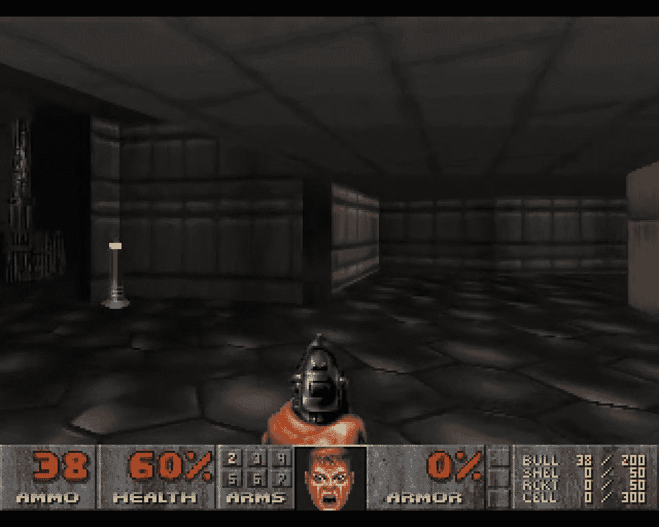

### K-Sort-Arena

贡献人：

https://huggingface.co/spaces/ksort/K-Sort-Arena

高效评估平台，采用 K 级比较，允许 K 个模型参与混战，包括 Midjourney-v6.0，FLUX.1-pro，FLUX.1-dev 等模型。

# 投融资

### Scale Venture Partners宣布对Bland的投资，支持语音AI自动化领域的领先者

https://www.scalevp.com/insights/announcing-our-investment-in-bland/

Scale Venture Partners宣布其对Bland公司的A轮投资。Bland是一家在语音AI自动化领域的领先企业，致力于将最新的语音AI研究产品化，并为客户提供独立且灵活的呼叫操作自动化解决方案。通过此次融资，Bland将扩大其在市场中的表现，特别是在语音交互自动化方面进一步投入研发，提升产品的复杂处理能力和人性化对话体验。

Bland的独特之处在于其Zapier风格的工作流程构建器Pathways，使非技术用户也能自行创建功能强大的定制语音机器人。此次融资将用于加大对基础设施的投资，加快呼叫速度，并提升AI代理处理复杂客户请求的能力。Scale对Bland在语音AI产品化方面的成功印象深刻，并期待通过此次投资推动Bland的进一步发展。

公司官网：https://www.bland.ai/

### Attio成功融资3300万美元，加速下一代CRM的构建

https://attio.com/blog/attio-raises-33-million-in-funding

Attio宣布成功完成了3300万美元的融资，以加速其构建新一代客户关系管理系统（CRM）的愿景。此次融资由现有投资者Redpoint Ventures、Balderton Capital和Point Nine领投，新增投资者01 Advisors也参与其中。Attio计划利用这笔资金进一步推动其CRM产品的开发，特别是将人工智能（AI）深度集成到系统中，以彻底重塑CRM市场。

Attio的创始人Nicolas Sharp表示，CRM市场正处于变革的关键时刻，传统的CRM系统已经无法满足现代业务的需求。Attio致力于从根本上重新设计CRM系统，基于强大的AI数据模型，提供具有高度灵活性和效率的客户管理解决方案。此次融资将使Attio在这一领域的创新和发展更加快速，为客户提供更强大的工具和服务。

公司官网：https://attio.com/

### 旧金山AI黑客马拉松催生的创业公司Agency完成260万美元融资

https://techcrunch.com/2024/08/28/san-franciscos-ai-hackathons-agency-lets-you-see-what-your-ai-agents-do/

近日，一家名为Agency的初创公司宣布完成了260万美元的Pre-seed融资，投资方包括645 Ventures和Afore Capital。该公司源自旧金山的一次AI黑客马拉松，由联合创始人Alex Reibman、Adam Silverman和Shawn Qiu共同创立，主要为开发者提供工具来观察和调试AI代理（AI agents）的行为，确保这些代理不会出现异常操作。Agency的核心产品是AgentOps平台，目前已有数千个团队每月使用该平台进行多设备管理和代理行为分析。公司还与Cohere和Mistral等AI模型开发商合作，帮助客户监控和管理AI代理的互动和成本。

公司官网：https://www.agen.cy/

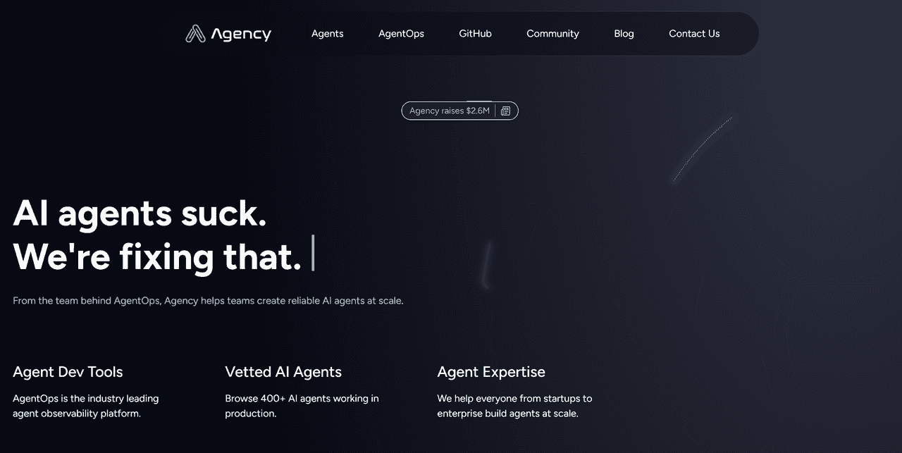

# 学习

### 为什么 RoPE 在长序列中难以维持长期衰减

贡献人：

https://zhuanlan.zhihu.com/p/717174366?utm_psn=1812506558237638656

在这篇博客中，我们探讨了 RoPE 存在的一个潜在限制原因：它在超出其训练长度的长序列中难以维持长期衰减。这一问题可能源于在复数平面上 \( W_Q x \) 和 \( W_K y \) 之间钝角的比例较高（POCP）。为了验证这一假设，我们进行了实验，使用了随机初始化的 \( W_Q x \) 和 \( W_K y \)，以及从不同模型中随机选择的 \( W_Q x \) 和 \( W_K y \)。实验结果表明，POCP 显著影响了模型在长上下文中维持长期衰减的能力。此外，针对长上下文的训练后处理主要降低了模型的 POCP。我们还讨论了模型的高 POCP 如何导致 RoPE 难以维持长期衰减，以及其对 RoPE 在训练过程中观察到的上下文窗口之外进行泛化的困难的影响。

原链接： https://difficult-link-dd7.notion.site/a40396b3205849fe84f9810c8a175856?v=f4e0c4586d3247ed8bea3dd00f044bad

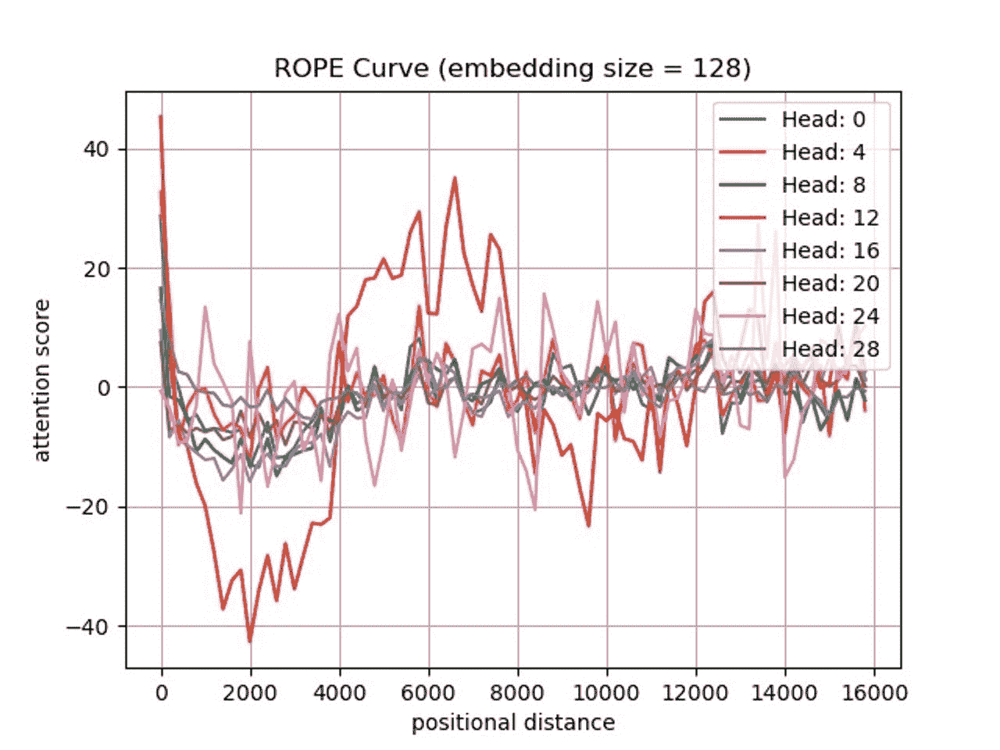

### 阿里PAI-ChatLearn：大规模 Alignment高效训练框架正式开源

https://zhuanlan.zhihu.com/p/717112741?utm_psn=1812473435542122496

阿里云PAI团队推出了PAI-ChatLearn，一种高效的大规模Alignment训练框架，并已开源。PAI-ChatLearn旨在解决多模型计算和数据交互所带来的挑战，特别是在强化学习从人类反馈（RLHF）等新兴训练范式中的应用。它通过抽象和解耦模型计算逻辑，实现灵活的资源分配和并行调度策略。

ChatLearn支持多种训练方法，包括RLHF、DPO、OnlineDPO、GRPO等，并允许用户自定义训练流程。它集成了多种分布式加速引擎，如Megatron-LM和DeepSpeed，支持高效的模型并行计算和资源管理。与现有的SOTA系统相比，ChatLearn在7B+7B和70B+70B规模的模型训练中分别实现了115%和208%的性能提升，并且能够支持300B+300B的更大规模训练。

该框架还支持了Qwen大模型的Alignment训练，在Qwen2-72B和Qwen2-Math-Instruct等任务中取得了领先的效果。未来，ChatLearn将继续扩展对更多模型和后端的支持，并优化性能和接口，简化用户操作。

### 本地 1M 长文本推理，最高 10X 提速 - KTransformers (3)

https://zhuanlan.zhihu.com/p/717118974?utm_psn=1812468728161525763

本文介绍了如何利用 KTransformers 框架，通过优化 attention 稀疏性加速长文本推理。主要使用 InternLM2.5-7B-Chat-1M 模型进行实验，展示了如何在单张 24GB 显卡 + CPU/DRAM 环境下实现 128K 乃至 1M 上下文的高效推理，并在性能上显著超越 llama.cpp。

关键技术在于利用注意力机制中的稀疏性，仅关注少数高分的 token，从而减少计算量并提高效率。KTransformers 实现了稀疏 attention 算子框架，能在保持精度的同时大幅降低计算开销。实验表明，该框架在 128K 场景下的生成速度是 llama.cpp 的 7.1 倍，1M 场景下达到了 10 倍。此外，还在多个基准测试上取得了几乎全绿的高分表现，证明了其有效性。

论文调研部分提到了多种稀疏 attention 方法，例如 H2O、InfLLM、Quest、SnapKV 等。KTransformers 结合这些方法，通过分块管理 KVCache 并选取代表 token，进一步优化了推理速度和精度。例如，InfLLM 采用外部记忆模块和语义块管理，而 Quest 则通过块内 token 的最大值和最小值进行关键 token 的检索。SnapKV 进一步优化了注意力分布，使推理过程更高效。

通过实验，KTransformers 展示了其在 128K 和 1M 长文本推理中的优势，尤其是在处理复杂任务时，通过灵活配置不同的代表 token 选择策略，使得推理速度和精度达到了更高的水平。总之，KTransformers 提供了一套在本地设备上有效加速长文本推理的解决方案，并且未来还有进一步优化的潜力。

### tensor core实现矩阵乘法和C=AB.T

https://zhuanlan.zhihu.com/p/717067259?utm_psn=1812474525012590592

Tensor Core 是 NVIDIA GPU 中用于加速矩阵乘法的硬件单元，专为小矩阵（例如16×8×16）乘法设计。每个 Warp 可以并行处理一个 M-K-N 为 16×8×16 的小矩阵乘法。对于更大矩阵的计算，Tensor Core 会将其分块为多个小矩阵，并通过循环累积子矩阵的计算结果。例如，计算 M-K-N 为 32×16×64 的矩阵乘法需要多个 Warp 同时进行，Warp 通过读取不连续的内存区域，执行小矩阵乘法，并累加结果。

**线程簇（Warp）分工**

在矩阵乘法中，每个线程块包含多个 Warp，Warp 是处理的最小单元。Warp 通过二维索引重排（例如 warpIdx, warpIdy）负责特定行和列的计算。Warp 专门处理矩阵 A 的行和矩阵 B 的列，一个线程簇负责16行或16列的计算。通过重排线程簇的索引，可以有效地分配计算任务，确保每个线程块能够处理整个矩阵的一部分。最终，所有线程块的结果汇总，得到完整的矩阵乘法结果。

Share Memory 的使用

为了优化性能，可以利用 Share Memory 存储小矩阵片段。线程首先将 A 和 B 的子矩阵加载到 Share Memory 中，再通过 Tensor Core 进行矩阵乘法。每个 Warp 内的32个线程处理 [16,8] 的子矩阵，通过提前将子矩阵数据存入 Share Memory，提高了数据读取效率。这个过程中，数据存取与矩阵乘法同步进行，确保计算结果的准确性。

Tensor Core 实现 C=AB.T

实现 C=AB.T 的最简单方法是将矩阵 B 先转置，再利用 Tensor Core 进行标准矩阵乘法。然而，更高效的方式是利用 Tensor Core 的列优先读取原则，这相当于在计算过程中自动完成转置。这样，在计算 A@B.T 时，矩阵 B 的数据按列优先加载，无需显式转置。这个技巧充分利用了硬件特性，提高了计算效率。

### LLM 推理引擎新玩家 NanoFlow

https://zhuanlan.zhihu.com/p/716883022?utm_psn=1812279201589510145

NanoFlow，这是一种新型的服务框架，利用设备内并行性，通过操作协同调度来重叠单个设备内的计算、内存和网络资源的使用。为了利用设备内并行性，NanoFlow引入了两个关键创新：首先，NanoFlow将请求按操作粒度拆分为纳米批次，打破了LLM推理中顺序操作的依赖关系，从而实现资源使用的重叠；然后，为了从重叠中获益，NanoFlow采用操作级流水线与执行单元调度，将设备的功能单元划分开来，并在每个单元中同时执行不同的操作。

NanoFlow通过参数搜索算法自动设置流水线，这使得NanoFlow能够轻松移植到不同的模型上。我们在NVIDIA GPU上实现了NanoFlow，并对LLaMA-2-70B、Mixtral 8×7B、LLaMA-3-8B等多个流行模型的端到端服务吞吐量进行了评估。在实际工作负载下，NanoFlow相比最先进的服务系统提供了1.91倍的吞吐量提升，在移植的模型上实现了59%至72%的最优吞吐量。

原文链接：https://arxiv.org/abs/2408.12757

### 金融大模型数据治理与应用创新

https://zhuanlan.zhihu.com/p/717190801?utm_psn=1812507162808815617

1.  **金融数据生产现状：**
当前金融数据生产存在人工成本高、数据时效性差、数据质量控制难等问题。生产流程包括数据采集、解析、NLP域抽取等环节，虽然引入了AI辅助，但整体仍以人工为中心。

1.  **AI原生下的金融数据生产：**
AI原生数据生产方式转变为以AI为核心，AI在数据管理业务中起主导作用。关键改变包括：输入输出内容从简单预测转变为复杂问答，交互方式从UI交互转变为自然语言交互，prompt知识输入重新定义了人工价值。大模型应用下，增强检索（RAG）和Agent编排成为关键技术，前者放大模型能力，后者丰富模型功能，适用于多种场景。

1.  **数据治理领域的AI应用：**
AI时代，数据治理与大模型互为促进，治理好数据能提升模型效果，进而催生更多应用场景。数据治理的挑战包括缺乏全局视野、忽视实际应用、安全性不足等。基于AI大模型的数据治理架构强调全域风控、隐私保护，并采用“湖仓一体”的数据存储模式，适应多种类型数据的统一管理。企业级私域大模型的数据治理应用关注合规性、模型透明性和一致性，并通过以数据为中心构造AI应用，提高生产力和风控水平。

1.  **多模态文档理解：**
基于OCR的多模态文档理解结合了图表、文本的向量化，采用交叉注意力机制提升理解能力，对清晰文档效果显著，但对低质量文档仍需改进。

1.  Multi-Agent智能投顾应用：
通过数据工程与Multi-Agent结合，智能投顾系统实现了从AI原子能力向系统能力的突破，能够在复杂金融场景中提供高价值的投资建议，提升了AI的实际应用效能。

# 招聘公告

---

**奇绩创坛****由陆奇博士**于2019年创立，使命是在源头最大化驱动创新。奇绩研究组将研究模型理论、到投研战略分析、市场策划等不同背景的同学聚在一起，搭建GenAI时代独特的跨界人才社群。

## 🚀F**24实习岗位**

##### [行研-学术科研人才交流组实习生](https://miracleplus.feishu.cn/docx/Yn6rdf2iOoY2Rcx8yVNcUBYRnch#part-QkMcdeJmuob9uvxvV3qcLSzHn8g)

##### 行研-GenAI研究岗位-战略分析（偏产品）

##### Web / AI 全栈开发工程师实习生

## **火热开放中🚀**

##### 行研-GenAI研究岗位-前沿学术探索

##### 行研-GenAI研究岗位-战略分析（偏咨询）

##### 创新活动产品运营 （大模型系列活动产品运营）

> **点击**相关岗位可查看对应**岗位需求【JD】；**相关岗位投递请**添加🛰️💻【**sunjiajunspace】

> ‼️欢迎**推荐/自荐**，期待在**奇绩创坛**遇见更好的你‼️

---

# 声明

本文档仅供学习交流使用，版权归原作者所有，若涉侵权，请联系Jack Jin 15101136166

##

（欢迎在下方反馈您宝贵的意见！整理不易，觉得有用给AI日报小组点个赞👍吧！）

ChatGPT；Angela；Zijia Liu；Alex；Zeqi Tan；Tiezhen（HuggingFace）；Naixu；Lizhi；Peter；Suoman；Jack

封面生成——右脑科技

如果你有大模型相关的创业想法，欢迎来找我们聊聊～🛰️：15101136166

> 快邀请你的小伙伴们一起来读大模型日报吧！

> **【日报****知识库****】**这里是近期日报内容的汇总,欢迎大家查阅

> [大模型日报知识库(分享版)](https://miracleplus.feishu.cn/wiki/KapVwXfkriOBiskB0B2cUHxjnTh)

>

> 欢迎大家多多帮我们分享,转发~~

> 如果大家有任何的建议或者吐槽,欢迎随时找我聊天~

