# 奇绩大模型日报（8月 30日）

> 来源：[https://miracleplus.feishu.cn/docx/A6y6dcsDzonzLVxhXVkcGbAUnih](https://miracleplus.feishu.cn/docx/A6y6dcsDzonzLVxhXVkcGbAUnih)

# 📡潜空间活动报名

> **潜空间系列活动重磅回归！**

> 本期活动将在**9月6日** **14:00**开始，我们邀请到的嘉宾是**闫俊杰。**他**是MiniMax 创始人兼 CEO，是中国第一梯**队的大模型创业者，目前 MiniMax 估值超 25 亿美元。他将和大家探讨Intelligence with everyone ：对 AGI 0-1 的探索与实践。

> 本次**仅开放北京线下活动**，望理解。我们将在会后48h内，整理会议纪要的精彩内容第一时间分享。

> 除嘉宾分享外，每期设置了【匹配合伙人 Cofounder Matching】环节。你可以和 GenAI 时代最有活力的创业者和研究者线下面对面交流，将有机会找到志同道合、有共同创业梦想的小伙伴。

> 报名通道已开启，欢迎扫描下方二维码报名。

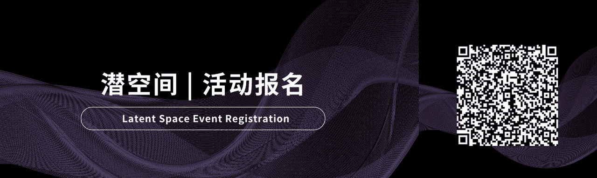

# 推特

### OpenAI与美国AI安全研究所达成协议，对未来的模型进行预发布测试

https://x.com/sama/status/1829205847731515676

我们很高兴与美国AI安全研究所达成协议，对我们未来的模型进行预发布测试。

出于多种原因，我们认为在国家层面进行这项工作非常重要。美国需要继续引领潮流！

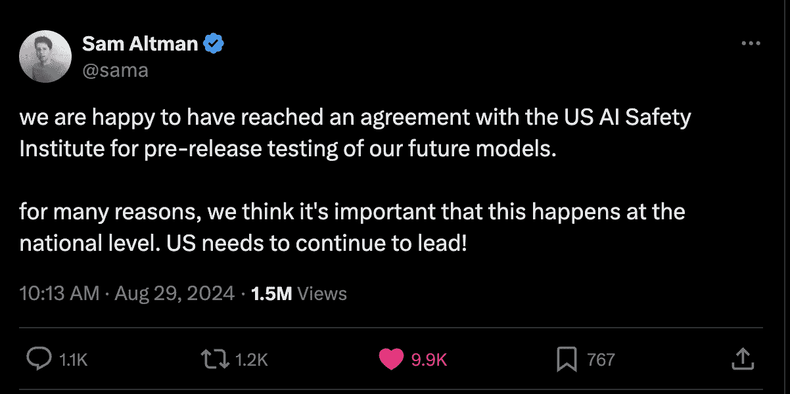

### 吴恩达：AI代币价格骤降的驱动力与未来展望

https://x.com/AndrewYNg/status/1829190549842321758

在OpenAI最近降价之后，GPT-4o的代币现在每百万代币的成本为4美元（使用假设80%输入代币和20%输出代币的混合费率）。GPT-4在2023年3月首次发布时每百万代币的成本为36美元。这17个月内的价格下调对应每年约79%的降幅。(4/36 = (1 - p)^{17/12})

正如你所见，代币价格正在迅速下降！推动价格下降的一个因素是诸如Llama 3.1这样的开源模型的发布。如果API提供商（包括Anyscale、Fireworks、Together AI等初创公司以及一些大型云计算公司）无需担心收回模型开发成本，他们可以直接在价格以及速度等少数其他因素上进行竞争。

此外，由Groq（快速生成代币领域的领先者）、Samba Nova（以每秒114个代币的惊人速度提供Llama 3.1 405B代币）以及晶圆级计算初创公司Cerebras（本周刚宣布了一项新服务）等公司带来的硬件创新，以及半导体巨头NVIDIA、AMD、Intel和Qualcomm的技术进步，也将推动进一步的价格下降。

在构建应用程序时，我发现根据技术的发展方向而设计比仅仅根据过去的技术状况更为有用。基于多家软件和硬件公司的技术路线图——包括改进的半导体、更小的模型以及推理架构中的算法创新——我相信代币价格将继续快速下降。

这意味着，即使你构建了一个经济性不佳的代理工作负载，随着代币价格的下降，它在某个时间点可能会变得经济可行。如我之前所写，能够处理大量代币对代理工作负载尤其重要，这些负载在生成结果之前必须多次调用模型。此外，即使是代理工作负载，对于许多应用来说已经相当实惠。比如，你构建了一个帮助人类工作的应用程序，它持续使用每秒100个代币：按每百万代币4美元计算，你每小时仅需花费1.44美元——这远低于美国和许多其他国家的最低工资标准。

那么AI公司应该如何准备？

+   首先，我听到很多团队在实际进行成本计算时，发现LLM使用成本如此之低时感到惊讶。对于许多应用来说，优化成本并不值得花费太多精力。因此，最重要的是，我建议团队专注于构建有用的应用程序，而不是优化LLM成本。

+   其次，即使某个应用程序现在运行成本略高，但考虑到未来的价格降低，它可能值得部署。

+   最后，随着新模型的发布，定期检查应用程序是否应切换到新模型（无论是从同一提供商的旧模型切换到新模型，例如从GPT-4切换到最新的GPT-4o-2024-08-06，还是切换到不同的提供商），以利用价格下降和/或能力提升，可能是值得的。

由于现在有多个提供商托管Llama 3.1和其他开源模型，如果你使用其中一个模型，可能无需过多测试就可以在提供商之间切换（尽管具体实现细节——特别是量化，确实意味着不同的模型提供版本在性能上存在差异）。不幸的是，在模型切换过程中，一个主要障碍仍然是实施评估的难度，因此在更换新模型后进行回归测试以确保应用程序仍然能够正常运行可能会很具挑战性。然而，随着评估科学的进步，我对这一过程变得更加容易持乐观态度。

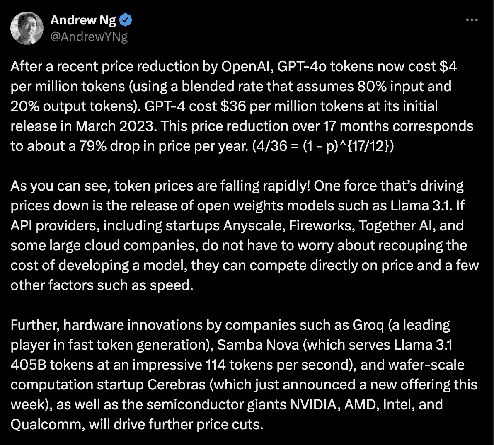

### 全新Playground：像专业人士一样设计图形

https://x.com/Suhail/status/1829187297612574894

我很兴奋地介绍全新Playground，让你像专业人士一样设计图形，无论是T恤、徽标还是社交媒体帖子，甚至发明新的表情包。我们最新的图像基础模型Playground v3（测试版）支持这一切，现在就可以访问playground.com，没有等待名单。你可以通过简单的图形文本生成，轻松表达自我，编辑图像就像与设计师对话一样。我们还提供了一个模板库，让你从一张出色的图像开始创作。此外，你可以上传任何在互联网上找到的灵感图像，进行修改，而无需学习如何编写提示词。还可以将你创作的图像公共链接分享给朋友，让他们也参与创作，重混并制作出属于自己的设计。

[ssstwitter.com_1725000723406.mp4](https://internal-api-drive-stream.feishu.cn/space/api/box/stream/download/all/QZPpbRTWUoOirExfvW7cTsVfnSg)

### 吴恩达再呼吁阻止加州的SB 1047：这项法案实际上会让AI变得更不安全

https://x.com/AndrewYNg/status/1829218674806583779

还有时间阻止加州的SB 1047法案成为法律。我在《时代周刊》上撰文阐述了为什么这项法案会阻碍开发者，实际上会让AI变得更不安全。我们应该监管的是有害的AI应用，而不是通用型AI模型。

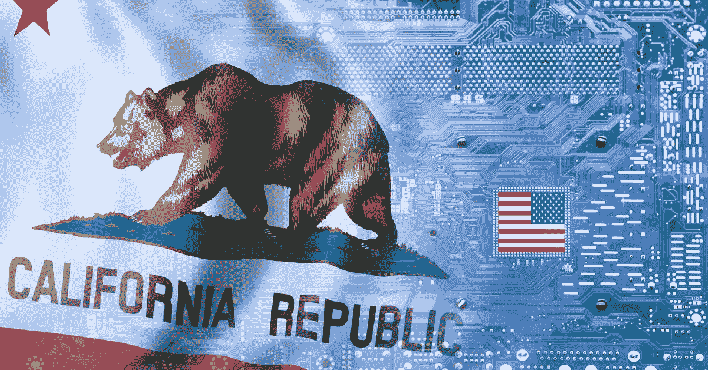

### Qwen2-VL发布：基于Qwen2构建的最新视觉语言模型版本

https://x.com/Alibaba_Qwen/status/1829187276179681634

今天我们非常激动地宣布发布Qwen2-VL！具体来说，我们在Apache 2.0许可证下开源了Qwen2-VL-2B和Qwen2-VL-7B，并且我们还提供了我们最强大的Qwen2-VL-72B的API！想了解更多关于这些模型的信息，请随时访问我们的：

博客: https://qwenlm.github.io/blog/qwen2-vl/

GitHub: https://github.com/QwenLM/Qwen2-VL

HF: https://huggingface.co/collections/Qwen/qwen2-vl-66cee7455501d7126940800d

ModelScope: https://modelscope.cn/organization/qwen

Qwen2-VL是我们基于Qwen2构建的最新视觉语言模型版本。它具有以下特点：

+   各种分辨率和比例的图像的最先进理解能力：Qwen2-VL在视觉理解基准测试中达到了最先进的性能，包括MathVista、DocVQA、RealWorldQA、MTVQA等。

+   20分钟以上视频的理解：Qwen2-VL能够理解超过20分钟的视频，为基于视频的高质量问答、对话、内容创作等提供支持。

+   可操作手机、机器人等设备的代理：凭借复杂推理和决策能力，Qwen2-VL可以与手机、机器人等设备集成，根据视觉环境和文本指令自动操作。

+   多语言支持：为了服务全球用户，除了英文和中文外，Qwen2-VL现在还支持图像内不同语言文本的理解，包括大多数欧洲语言、日语、韩语、阿拉伯语、越南语等。

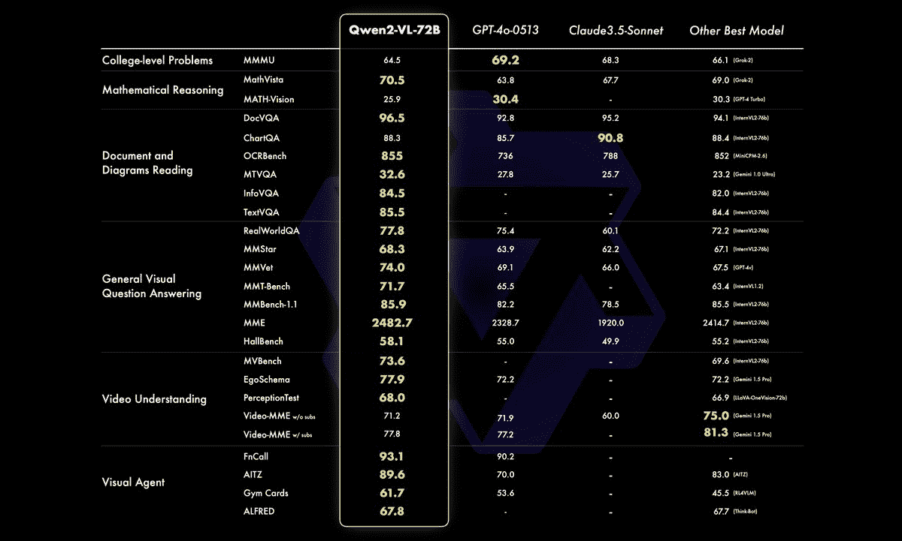

### 不久之后，每个人都会有朋友一起玩游戏：强大mc自主代理试玩视频

https://x.com/nicochristie/status/1829175868352278761

这里有一个两分钟的试玩视频，展示了最强大的自主代理在玩游戏时的表现。

人与代理之间的差距正在迅速缩小。不久之后，每个人都会有朋友一起玩游戏。

立即注册加入我们的封闭测试，或评论以获取邀请。

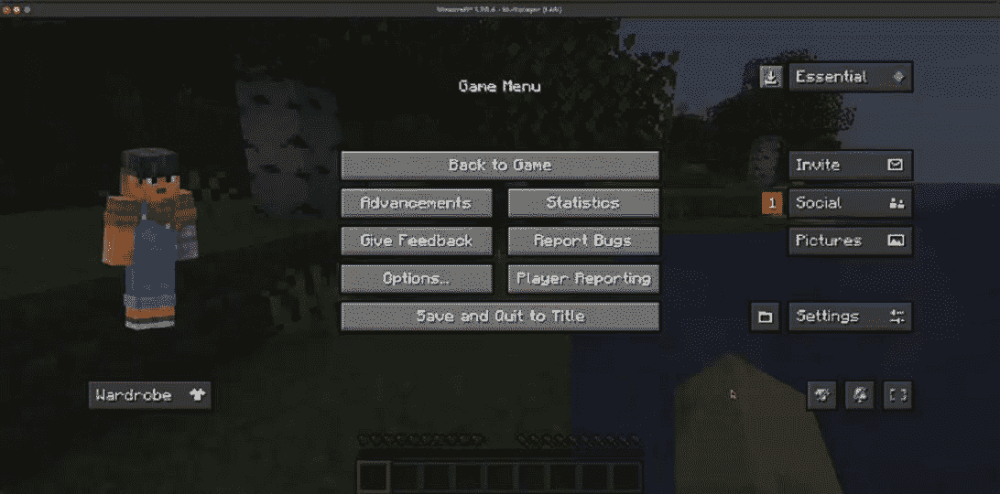

[ssstwitter.com_1725001009769.mp4](https://internal-api-drive-stream.feishu.cn/space/api/box/stream/download/all/YMNCbspYho0zlDx9PgwcVj5unGf)

# 资讯

### Llama：开源界的领导者，推动Token价格持续下降

https://mp.weixin.qq.com/s/ZWBqFlqYoIIfa1KdKaVWtQ

Llama模型自问世一年半以来，已稳居开源界的顶端。截至目前，Llama模型在开源平台Hugging Face的下载量接近3.5亿次，是去年同期的10倍。2023年2月，Llama 1首次亮相，至今已发展为一个面向开发者的强大生态系统，吸引了大公司、小公司和研究机构的广泛使用。

随着Llama 3.1在今年5月发布，云服务商对模型API的调用需求翻倍增长。Meta的主要云服务提供商从2024年1月至7月，Llama的每月token使用量增长了10倍。Llama模型的广泛开源不仅拉低了token价格，还促使各大软硬件公司展开竞争，通过技术创新进一步降低了模型使用成本。

此外，Meta正在挑战ChatGPT的市场地位，致力于将Meta AI打造成全球使用量最多的AI助手。到目前为止，Meta AI已拥有至少4亿月活跃用户，正迅速成为ChatGPT的强劲竞争对手。

Llama的成功显示了开源AI的强大影响力，同时也引领了token价格的持续下降，使得AI技术变得更加经济可行。

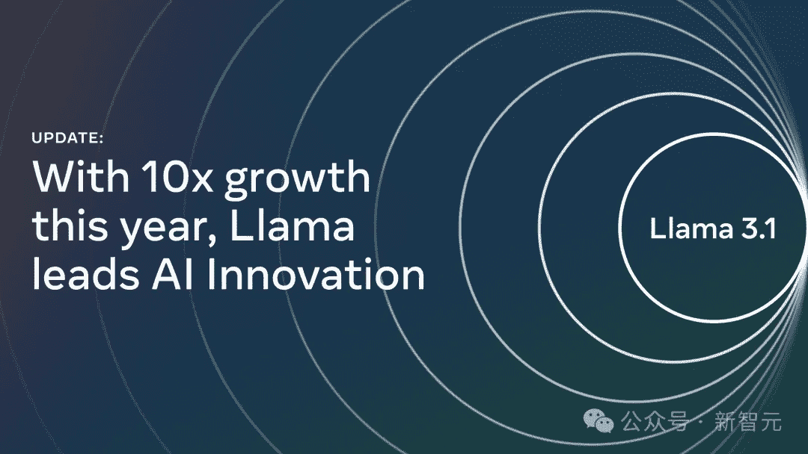

### Gemini AI平台推出Gems定制助手，Imagen 3图像生成全面开放

https://mp.weixin.qq.com/s/4gYFpljgF64vA5ojulEmYQ

谷歌最近对其Gemini AI平台进行了重大升级，推出了全新的Gems定制助手，并全面开放了Imagen 3图像生成模型的使用。此次更新标志着谷歌在AI领域的又一次重要进展，旨在与其他科技巨头展开更激烈的竞争。

Imagen 3在5月的I/O开发者大会上首次亮相，经过几个月的测试，如今终于向所有用户开放。Imagen 3不仅提升了图像生成质量，还首次支持生成人物图像。用户可以通过简单的文本提示，生成高质量的图像，甚至可以指定特定的风格，如写实风景、油画或异想天开的场景。

为了应对公众对深度伪造和错误信息的担忧，谷歌在Imagen 3中引入了安全措施，例如SynthID水印。此外，Imagen 3在生成特定历史场景时，也会遵守谷歌的AI规则，以避免不准确的种族和历史再现。

与此同时，谷歌推出了专门化的AI助手Gems，支持Gemini Advanced，为企业和商业用户提供服务。Gems可以根据特定任务进行定制训练，用户可以创建“数字专家”，例如编码导师或营销策略师。这一功能旨在克服通用语言模型的局限性，为用户提供更加实用和高效的解决方案。

### Deepfake引发韩国新一轮舆论风暴，未成年人受害严重

https://mp.weixin.qq.com/s/hMd80uXmQjkYoBs0Y80_qg

近日，韩国爆发了一起涉及Deepfake的严重犯罪事件，被网友称为“韩国N号房2.0”。这一事件引发了广泛的社会关注，并迅速登上各大平台的热搜榜单。

事件始于韩国两名毕业生自2021年7月起，利用Deepfake合成色情内容，并通过Telegram进行传播，受害女性多达61人，其中包括12名首尔大学的学生。这一案件揭示了Deepfake技术在韩国的泛滥，仅是冰山一角。

根据韩国妇女人权研究所的数据，自今年年初以来，已有781名Deepfake受害者在线求助，其中36.9%为未成年人。更令人震惊的是，一个与Deepfake相关的Telegram聊天室竟吸引了22万名用户，他们通过篡改妇女和女孩的照片来创建并分享伪造的图像，受害者包括大学生、教师，甚至军人。

随着舆论的发酵，韩国政府已采取措施，计划将Deepfake犯罪的刑期从5年提高到7年，并成立特别工作组应对此类犯罪。然而，随着Deepfake技术的进化，其应用范围和潜在威胁正在迅速扩大。面对这一挑战，社会呼吁加强技术监管与道德标准，以应对Deepfake带来的安全隐患。

此外，科技巨头们也在积极开发检测工具，以帮助识别和防止Deepfake的滥用。这场技术与伦理的较量，正日益成为社会关注的焦点。

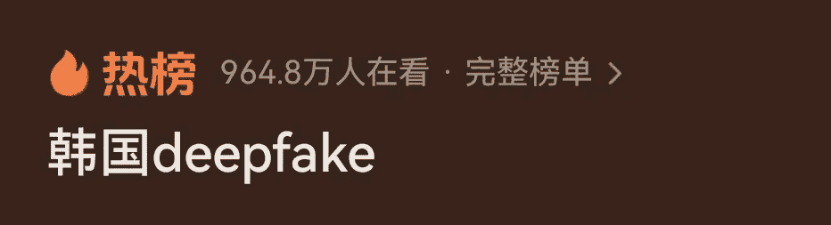

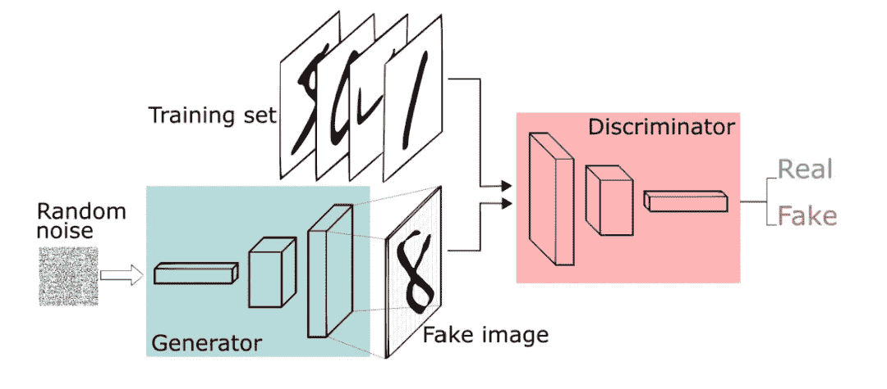

### 蔡浩宇新AI创业项目Anuttacon揭示

https://mp.weixin.qq.com/s/nKXq0cnExMwUdOGljthEI

米哈游创始人蔡浩宇在2023年卸任后，启动了新AI项目Anuttacon，旨在利用AI为游戏玩家创造前所未有的互动娱乐体验。Anuttacon的注册地与米哈游新加坡总部相同，且其核心团队成员与米哈游有紧密联系。公司目前主要在旧金山湾区招聘，并设有圣克拉拉办事处。

Anuttacon的团队汇集了顶尖人才，包括前微软亚洲研究院的图形学大佬童欣、大模型研究专家吴箫剑和Yunzhe Tao，以及曾任B站游戏和直播负责人的王宇阳。这些人的加入，使得Anuttacon备受业内关注。

蔡浩宇的公开言论表明，AI已经彻底改变了游戏行业，他认为未来只有最顶尖的团队和个人创作的游戏才能生存，中间层的从业者可能需要考虑转行。Anuttacon或将成为他口中的“前0.0001%”的代表，而米哈游可能承担起为99%用户提供游戏创作平台的任务。

相关讨论：https://www.zhihu.com/question/665473124/answer/3609513487

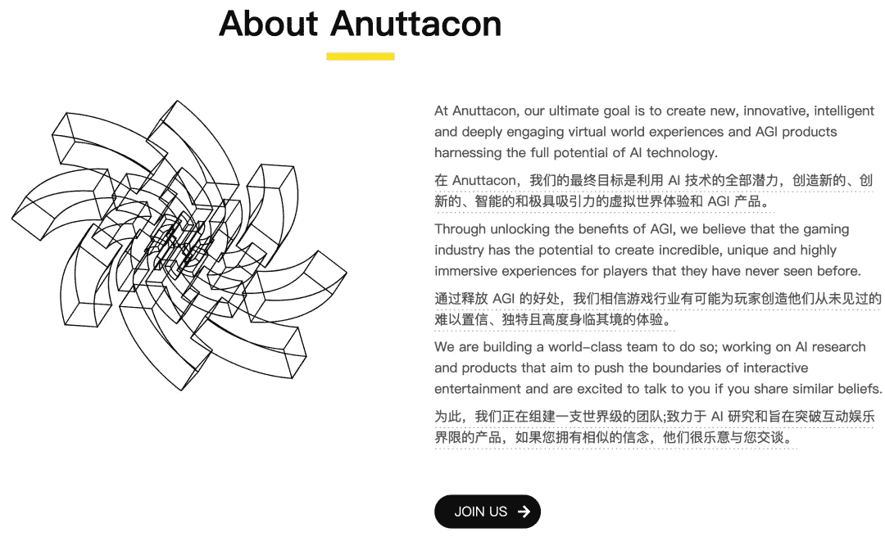

### Runway突然删库跑路

https://mp.weixin.qq.com/s/TkS59NHOw68gHlvG8kUITA

2024年8月30日，知名AI视频创企Runway悄然删除了其在Hugging Face和GitHub上的所有开源模型，包括广受关注的Stable Diffusion v1.5。目前，这些项目主页只剩下“404”错误页面和简单的说明，引发了广泛关注和猜测。

Runway以视频生成产品闻名，其开源图像生成模型并非主力业务，但这种突然的删除行为让人感到意外且不解。官方社交平台上依旧保持“岁月静好”的氛围，未透露任何相关信息。

目前，删除原因主要有两种猜测：一是与合作伙伴Stability AI之间的利益纠纷，二是由于涉及到版权侵权问题，Runway可能在“销毁证据”以规避法律风险。

**利益纠纷猜测：** Stable Diffusion模型由Stability AI、慕尼黑大学和Runway共同研发，曾因知识版权问题在开源发布时遭遇波折。双方对删库的原因各执一词，Stability AI的CEO Emad Mostaque与Runway CEO的沟通不畅，进一步加剧了矛盾。

**侵权风险猜测：** Runway及Stability AI等公司因涉嫌在训练模型时侵犯艺术家的版权而面临集体诉讼。随着美国法院允许进入证据列举阶段，Stable Diffusion可能成为关键证据，Runway的删库行为被怀疑是为了“销毁证据”。

不论真相如何，Runway的突然行动对开源社区和使用这些模型的开发者造成了巨大困扰，迫使他们寻求替代方案，调整工作流程。这一事件也引发了关于去中心化模型权重托管解决方案的讨论。

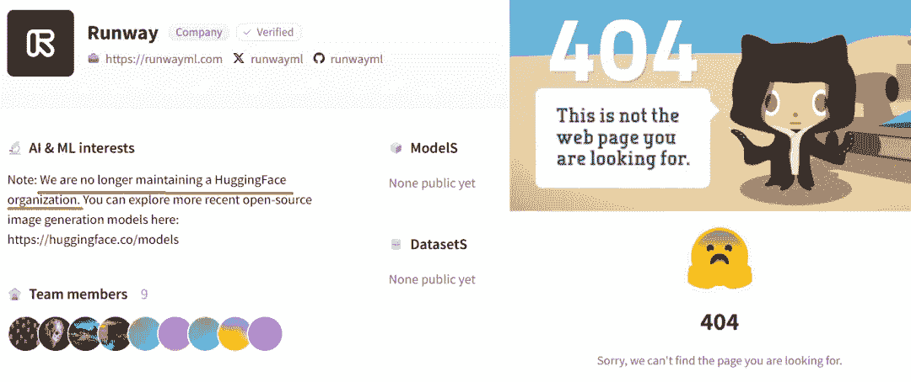

### 阿里发布开源多模态模型Qwen2-VL

https://mp.weixin.qq.com/s/42M913ulJ_P3E8-CYeqrsA

阿里巴巴新发布的Qwen2-VL多模态模型在图像和长视频理解任务中表现卓越，达到了SOTA（最先进技术）水平，甚至在大部分指标上超过了GPT-4o等闭源模型。

Qwen2-VL具备强大的多模态能力，能够实时读取摄像头或电脑屏幕进行文字形式的视频对话，还能作为Agent与环境进行互动，操作机械臂或手机等设备。此次发布的Qwen2系列包括2B、7B和72B三个版本，2B和7B版本已经开放下载并支持免费商用，72B版本通过API提供服务。

在实际应用中，Qwen2-VL展现了多种能力，如识别花卉种类、提取多语言文本、解读复杂数学公式等。在视频处理方面，Qwen2-VL最长可以分析20分钟以上的视频内容，支持总结与细节提问。模型的多模态推理能力也非常强大，能够解决代码和数学问题。

Qwen2-VL在架构上引入了多项创新，如支持动态分辨率的图像输入和多模态旋转位置嵌入（M-ROPE），进一步增强了模型的多模态处理能力。整体而言，Qwen2-VL在多语言、多场景的测试中表现优异，展现了超越GPT-4o和Claude3.5-Sonnet的综合实力。

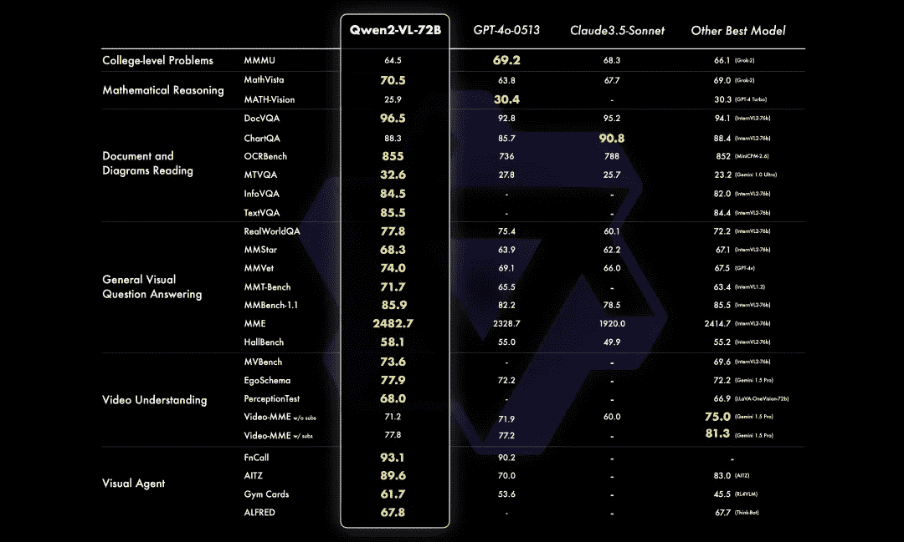

### 印度信实工业年度大会聚焦AI发展计划

https://techcrunch.com/2024/08/29/ai-dominates-india-reliance-annual-general-meeting/

印度市值最高的公司信实工业（Reliance Industries）在其第47届年度大会上展示了对人工智能（AI）领域的强烈兴趣。在大会中，董事长穆克什·安巴尼（Mukesh Ambani）及其他高管在两小时内提到AI近30次，详细介绍了公司计划如何将AI技术整合到其电信、零售和能源等业务领域。

信实工业宣布计划在古吉拉特邦贾姆纳加尔建设大型AI数据中心，这些中心将由公司的绿色能源资源供电，旨在降低AI推理成本，促进AI应用的普及。此外，信实电信部门Jio正开发一套名为“Jio Brain”的综合AI工具，以加速AI在其运营和其他信实公司中的应用。公司还将与Jio学院合作开发AI人才培养项目。

在本次大会上，信实还宣布将向Jio用户提供高达100 GB的免费云存储服务，预计将在十月的排灯节期间推出。同时，信实还展示了JioPhoneCall AI服务，这是一款通话录音和转录工具，并推出了Jio TvOS操作系统，该系统将配备AI语音助手。

尽管印度在AI竞赛中起步较晚，但最近一年，包括信实工业和塔塔集团在内的财团，以及一些初创公司，已经在开发AI应用和基础设施方面展开了大量活动。然而，信实在大会上并未提及备受期待的Jio和信实零售的首次公开募股（IPO）计划。市场分析人士预计，信实可能会在明年以超过1100亿美元的估值上市Jio，信实零售的估值也已达到1000亿美元。

### 苹果和英伟达或将成为OpenAI的下一批重要投资者

https://techcrunch.com/2024/08/29/apple-and-nvidia-could-be-openais-next-big-investors/

据报道，苹果和英伟达正在与OpenAI洽谈参与其下一轮融资，这轮融资可能使OpenAI的估值达到1000亿美元。据《纽约时报》消息，Thrive Capital可能会主导此次交易，而微软作为OpenAI的现有大股东（持股49%），也有可能参与。

尽管OpenAI今年的年化收入已超过34亿美元，但预计到今年年底其亏损将达到50亿美元，这主要是由于其AI训练和人力资源扩展的高成本所致。OpenAI与苹果和英伟达均有深厚的合作关系。OpenAI主要依赖英伟达的GPU进行AI模型训练，而苹果今年早些时候同意将ChatGPT整合到其即将推出的AI功能套件“Apple Intelligence”中。

这轮融资对于OpenAI至关重要，尤其是在该公司急需资金支持其快速扩张的情况下。如果苹果和英伟达加入，这将进一步巩固OpenAI在AI领域的领先地位，并为其未来的发展提供强有力的支持。

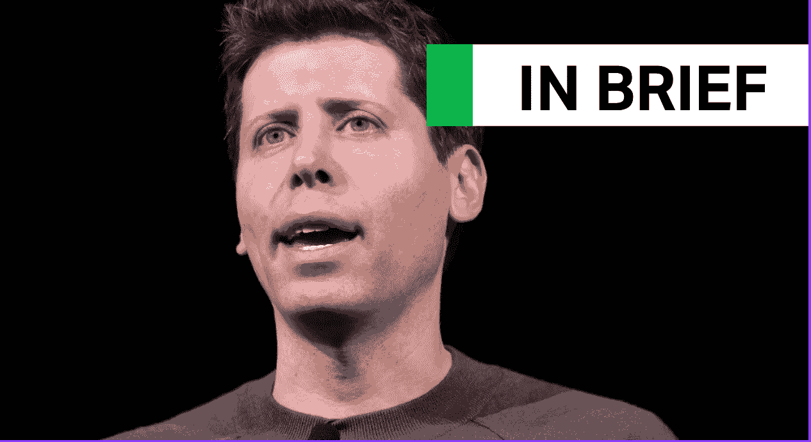

# 产品

### CompanyGPT 2.0

贡献人：

https://crustdata.com/company_gpt

CompanyGPT 是基于 GPT 模型的定制化人工智能解决方案，希望可以帮助企业提升客户服务、市场营销、内容生成和数据分析等方面的效率，能够理解行业术语和公司文化。

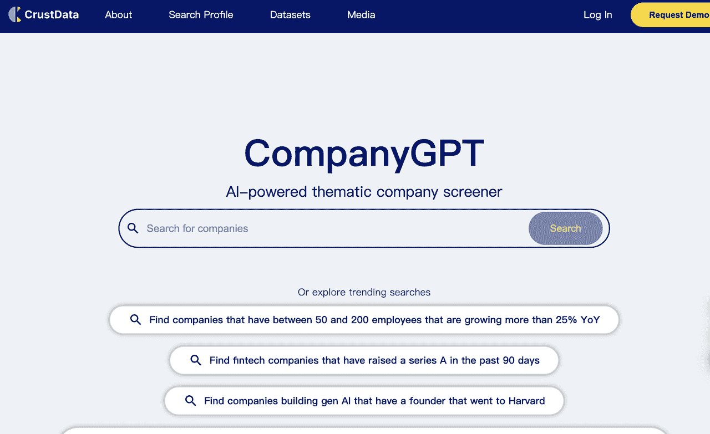

### Creatify-2.0

贡献人：

https://creatify.ai/creatify-2.0

Creatify 2.0 是一款 AI 驱动的应用，能够通过简单的提示一键生成病毒视频广告，适用于社交媒体和 A/B 测试。它提供多种功能，如 AI 短视频制作、编辑、定制头像等，帮助用户提升参与度和转化率，已吸引超过 40 万创作者和品牌使用。

# HuggingFace&Github

### AppFlowy

贡献人：

https://github.com/AppFlowy-IO/AppFlowy

AppFlowy 是一个开源的 Notion 替代品，为个人和企业提供一个功能强大、数据安全、跨平台的协作工作空间。它由 Flutter 和 Rust 构建，提供了可扩展和可定制的功能，让用户能够根据自己的需求创建应用程序。

### CogVideoX-5b

贡献人：

https://huggingface.co/THUDM/CogVideoX-5b

CogVideoX是清影的开源视频生成模型，分为两种版本：CogVideoX-2B和CogVideoX-5B。前者为入门级，兼顾兼容性，后者在视频生成质量和视觉效果上更为出色。模型支持多种推理精度（如FP16和BF16），并在显存消耗和推理速度上有不同表现。使用diffusers库进行部署时，用户可通过指定提示词生成视频，并可进行量化以降低内存需求。

[361438140-cf5953ea-96d3-48fd-9907-c4708752c714.mp4](https://internal-api-drive-stream.feishu.cn/space/api/box/stream/download/all/G6SxbirSooXywwxRQWIclVDgnof)

# 投融资

### a16z投资Pylon：推动B2B客户管理新纪元

https://a16z.com/announcement/investing-in-pylon/

著名风险投资公司Andreessen Horowitz（a16z）近日宣布参与Pylon的A轮融资，Pylon是一家致力于优化B2B客户关系管理的初创公司。Pylon通过整合Slack、Teams、电子邮件和其他通信渠道，提供了一个统一的界面，帮助客户支持团队更有效地管理和解决客户问题。

Pylon的产品能够识别消息的性质，并自动标记问题，甚至将新信息发送至Jira或Linear等项目管理工具。公司计划将其平台打造成从售前到售后的一站式客户管理系统，提升企业客户的整体体验。

Pylon由Marty Kausas、Robert Eng和Advith Chelikani创立，已经吸引了包括Deel、Hightouch和Anyscale等在内的数百家初创企业和大型企业使用。本轮融资的资金将用于进一步推动Pylon的发展，使其成为快速增长的B2B企业的关键支持工具。a16z对Pylon团队的产品直觉和客户关注度印象深刻，并期待他们在客户旅程管理领域取得更大的成就。

公司官网：https://usepylon.com/

### Magic筹集3.2亿美元融资，估值或超预期

https://techcrunch.com/2024/08/29/generative-ai-coding-startup-magic-lands-320m-investment-from-eric-schmidt-atlassian-and-others/

生成式AI编程初创公司Magic近期获得了3.2亿美元的巨额融资，本轮融资由前谷歌CEO埃里克·施密特（Eric Schmidt）领投，其他投资者包括Alphabet旗下的CapitalG、Atlassian、Elad Gil、Jane Street、Nat Friedman和Daniel Gross、红杉资本等。本轮融资将Magic的总融资额提升至4.65亿美元，使其跻身融资金额较高的AI编程初创公司行列。

据报道，Magic原本计划以15亿美元的估值募集2亿美元，最终超额完成了融资目标，尽管目前尚未确认最新估值。值得注意的是，Magic还宣布与Google Cloud合作，在Google Cloud Platform上构建两台超级计算机，这些计算机将使用Nvidia的H100 GPU和下一代Blackwell芯片。

Magic由Eric Steinberger和Sebastian De Ro于2022年创立，公司专注于开发AI驱动的工具，帮助软件工程师编写、审核、调试和规划代码。这些工具类似于自动化的编程助手，能够理解和学习不同编程项目的上下文。Magic的创新之一在于其模型的超长上下文窗口，最新的LTM-2-mini模型具有1亿个token的上下文窗口，这是目前商业模型中最大的。

尽管Magic目前还没有收入，但其瞄准的AI编程工具市场预计到2032年将达到271.7亿美元。投资者认为，尽管存在安全性、版权和可靠性问题，这一市场仍具有巨大潜力。Magic的目标远不止是自动化常规的软件开发任务，公司在官网上提到了向AGI（通用人工智能）迈进的愿景，未来计划进一步扩展团队，特别是在网络安全、工程、研究和系统工程领域。

公司官网：https://magic.dev/

https://magic.dev/blog/100m-token-context-windows

### Codeium完成1.5亿美元融资，估值达12.5亿美元

https://techcrunch.com/2024/08/29/github-copilot-competitor-codeium-raises-150m-at-a-1-25b-valuation/

AI编程助手Codeium近日宣布完成1.5亿美元C轮融资，本轮融资由General Catalyst领投，现有投资者Kleiner Perkins和Greenoaks也参与了此轮融资，使公司估值达到12.5亿美元。本次融资使Codeium自成立以来的总融资额接近2.43亿美元。

Codeium的联合创始人兼CEO Varun Mohan表示，尽管公司尚未动用今年1月获得的6500万美元B轮融资，本轮资金将主要用于研发和业务扩展。Codeium成立于2021年，初期聚焦于GPU优化和虚拟化，随后在2022年转型为AI编程助手，主打生成式AI技术。

Codeium目前支持约70种编程语言，并已吸引了超过70万用户和1000家企业客户。为了赢得更多市场份额，Codeium提供了免费版本，并推出自托管选项以保障客户数据安全。

面对AI编程工具市场的激烈竞争，Codeium的营收已经达到八位数，公司计划在2025年将员工规模从80人扩大到120人。尽管与GitHub Copilot的一百八十万付费用户相比还有差距，但随着AI编程工具市场预计到2032年达到271.7亿美元，Codeium在这一领域的潜力巨大。

公司官网：https://codeium.com/

# 学习

### 最前沿——基础模型和多模态交互（1）：单义之韵的放大——挖掘 Claude 3 Sonnet 的内在精髓

https://zhuanlan.zhihu.com/p/717161553?utm_psn=1812561658918359040

**稀疏自编码器的应用**：稀疏自编码器通过将模型的激活分解为更易解释的部分，从而提取出具有单一语义的特征。这些特征能在多个抽象概念和具体实例中泛化，例如涉及名人、城市、编程错误等多种特征。

**特征与模型行为的关系**：研究表明，这些提取出的特征不仅能解释模型的语义表示，还能通过特征控制（Feature Steering）实验直接影响模型的行为。例如，通过调整特征的激活值，可以引导模型生成特定类型的输出，这为理解和干预模型行为提供了新的方法。

**技术挑战与扩展性**：在更大规模的模型上应用稀疏自编码器面临计算资源的挑战。研究发现，特征的提取和解释依赖于模型的规模和特征的复杂性。此外，特征之间的交叉层重叠问题（cross-layer superposition）对模型的解码过程带来挑战，需进一步研究解决。

**特征的多样性与可解释性**：研究揭示了大量丰富多样的特征，从简单的地理位置到复杂的代码错误检测。这些特征在不同语言和模态下表现出一致性，证明了特征的广泛性和深度。

### 推理时拆分大Batch以重叠SDPA和Linear，可能更快

https://zhuanlan.zhihu.com/p/716205919?utm_psn=1812553687295483904

文章分析了在不同硬件配置下，利用线性计算与Scaled Dot Product Attention (SDPA) 计算的访存与计算负载的分布，以期在推理过程中实现更高的效率。

以Llama-3.1-8B模型为例，作者假设参数和KV Cache均为8bit量化，并忽略了除了线性计算和SDPA之外的其他开销。在实际推理过程中，线性计算和SDPA分别表现出计算受限和访存受限的特性。通过将batch拆分成两部分并交替执行线性计算和SDPA，理论上可以缩短推理时间。具体计算显示，在理想情况下，总耗时可以减少到0.019531秒。

此外，文章还讨论了更复杂的场景，例如在H100计算卡上执行1024 token的推理任务，以及在8卡系统上推理Llama-3.1-70B模型时的情况。通过这些讨论，作者指出了当访存带宽与计算能力不平衡时，简单的重叠策略效果有限，可能需要更激进的优化手段如chunked prefill或更大的模型。

最后，文章还提出了一种更复杂的并行计算方法，即在两张显卡之间分配奇偶层的Linear参数和KV Cache，来进一步优化资源利用率。这种方法虽然增加了通信开销，但有可能通过提高计算与访存的重叠程度来弥补这一点。

### 大模型在小爱同学应用实践

https://zhuanlan.zhihu.com/p/717208684?utm_psn=1812555970498400258

大模型意图分发

意图分发是将用户的查询（query）分发到相应的垂直领域模型（agent）进行深入理解。该环节面临两个挑战：一是模型需要具备相关知识，二是要在200ms内完成意图分发。为此，小米尝试了使用大模型的Prompt Engineering，但效果有限，最终通过微调大模型，提升了中长尾query的理解能力。

大模型垂域意图理解

在垂域意图理解中，小爱同学采用了Function Calling的方式，借助大模型对API进行调用和参数识别。关键挑战在于确保大模型100%遵循指令，并优化推理效率。为解决推理耗时问题，小米采用了类似LLMCompiler的并行执行方式，并通过大模型微调和推理优化，提升了多轮query的满足率。

大模型回复生成

大模型在生成回复时，面临时效性、长上下文理解、以及指令遵循等挑战。小米通过RAG（检索增强生成）技术外挂知识库，并结合大模型的微调，提升了回复的精准性和用户体验。具体步骤包括单能力数据优化、数据混合训练、以及偏好数据构建。未来，小米探索使用多模态大模型实现端到端理解，但目前仍采用分而治之的框架。

### LLM 系列超详细解读 (十一)：大语言模型中的超大激活值

https://zhuanlan.zhihu.com/p/689959264?utm_psn=1812555287237885952

**位置与性质**：超大激活值在LLM中的特定层和特征维度中出现，通常在模型的早期层出现，并在后期减少。这些激活值虽然数量极少，但在模型计算中至关重要，类似于固定的偏置项。

**功能与影响**：超大激活值在自注意力机制（Self-Attention）中显著影响注意力的分布，集中在相关的tokens上，形成隐式的偏置项。作者通过干预实验表明，设置这些激活值为零会导致模型性能严重下降，而将其设置为均值则不会显著影响性能，这进一步证明了其作为偏置项的功能。

**与异常特征的区别**：超大激活值与LLM中的异常特征不同，它们在channel维度上不重叠，并且超大激活值是标量而非向量。

视觉Transformer中的表现：类似于LLM，视觉Transformer（如CLIP和DINOv2）中也存在超大激活值，这些激活值同样充当关键的偏置项。特别地，注册标记（Register tokens）在视觉Transformer中也表现出类似的功能。

### 长文详解--LLM高效预训练(一)

https://zhuanlan.zhihu.com/p/716976401?utm_psn=1812274671460151297

1.  **从小到大** 通过复用小模型的参数来初始化大模型，可以有效加速大模型的训练。方法如Net2Net、Stacking及其改进版Stacking 2.0等，都通过逐步扩展小模型的层数或宽度，实现了高效的模型训练。Net2Net通过function-preserving initialization (FPI) 使得大模型继承了小模型的部分知识，而Stacking则通过复制小模型的层级结构，快速构建更深的模型。

1.  **从大到小** “从大到小”策略主要通过剪枝、蒸馏等方法，将大模型的知识迁移到小模型中。Sheared LLaMA等方法通过结构化剪枝，降低模型参数量，同时保留性能。Weight Subcloning通过直接从大模型中选择重要的神经元，用于初始化小模型，显著提升了小模型的预训练速度。

1.  **从密集到稀疏** 对于需要混合专家模型（MoE）训练的场景，可以利用现有的密集模型作为初始化基础，快速扩展到稀疏模型。Sparse Upcycling通过将密集模型的部分层替换为MoE层，实现了在相同计算资源下更高效的模型训练。

### 增强大模型智能：数学推理能力的提升策略与实践

https://zhuanlan.zhihu.com/p/717002127?utm_psn=1812276074937212929

大语言模型的训练过程可分为四个阶段：预训练、监督微调（SFT）、奖励模型训练以及人工反馈强化学习（RLHF）。预训练阶段是最为消耗资源的，通常需要大量GPU和长时间的训练。SFT阶段旨在优化模型的指令对齐能力。训练奖励模型和进行RLHF进一步增强模型在指令处理和人类偏好理解方面的能力。

为了增强模型的数学推理能力，构建了混合指令系统，其中逻辑推理通过思维链（CoT）模式处理，而复杂计算则采用程序思维（PoT）模式。为了补充数学数据的不足，采用了合成数据技术，通过自指令（Self Instruct）方法扩展高质量数学指令，并利用模型的多样性和质量筛选机制生成更广泛的训练数据。

在模型训练中，特别是在RFT（拒绝采样）阶段，通过较小参数模型如LLaMA生成和筛选推理路径，并通过Reward Model和Critique Model进行质量过滤和多样性选择，以提升模型的推理能力。DPO和PPO方法在优化模型表现时，也展示了其在处理复杂问题方面的潜力，尤其是在数学推理任务中。最终，通过动态loss加权方法，进一步提升了模型在处理难题时的表现。

### sft 的局限性

https://zhuanlan.zhihu.com/p/717275921?utm_psn=1812771850553524224

1.  **缺乏负反馈机制**：SFT 的训练过程是基于条件概率的学习，模型只知道哪些 token 是正确的，但无法识别错误的 token。这导致模型可能会提高错误 token 的概率，因为它无法直接学习到这些 token 是错误的。这种缺乏负反馈机制的问题使得模型难以避免生成错误的结果。

1.  **单向注意力的局限性**：SFT 训练中，模型只能关注前面的 token，无法“向后看”。这放大了 transformer 结构的单向性缺陷，尤其在处理含有否定意义的句子时，模型可能会错误地增加错误 token 的概率，因为它无法利用句子后半部分的信息进行校正。而 RLHF 通过 reward_model 提供反馈，可以有效弥补这种局限性。

1.  **局部训练与全局优化的差异**：SFT 是一种局部的、有偏的训练方法，只关注每个 token 的局部信息，因此训练上限较低。而 RLHF 在更新每个 token 的概率时，考虑了整个句子的上下文信息，因而可以实现更高的训练上限。此外，RLHF 的损失函数是加权的，相较于 SFT 的平均损失，能够更精准地优化模型的表现。

# 招聘公告

---

**奇绩创坛****由陆奇博士**于2019年创立，使命是在源头最大化驱动创新。奇绩研究组将研究模型理论、到投研战略分析、市场策划等不同背景的同学聚在一起，搭建GenAI时代独特的跨界人才社群。

## 🚀F**24实习岗位**

##### [行研-学术科研人才交流组实习生](https://miracleplus.feishu.cn/docx/Yn6rdf2iOoY2Rcx8yVNcUBYRnch#part-QkMcdeJmuob9uvxvV3qcLSzHn8g)

##### 行研-GenAI研究岗位-战略分析（偏产品）

##### Web / AI 全栈开发工程师实习生

## **火热开放中🚀**

##### 行研-GenAI研究岗位-前沿学术探索

##### 行研-GenAI研究岗位-战略分析（偏咨询）

##### 创新活动产品运营 （大模型系列活动产品运营）

> **点击**相关岗位可查看对应**岗位需求【JD】；**相关岗位投递请**添加微信💻【**sunjiajunspace】

> ‼️欢迎**推荐/自荐**，期待在**奇绩创坛**遇见更好的你‼️

---

# 声明

本文档仅供学习交流使用，版权归原作者所有，若涉侵权，请联系Jack Jin 15101136166

##

（欢迎在下方反馈您宝贵的意见！整理不易，觉得有用给AI日报小组点个赞👍吧！）

ChatGPT；Angela；Zijia Liu；Alex；Zeqi Tan；Tiezhen（HuggingFace）；Naixu；Lizhi；Peter；Suoman；Jack

封面生成——右脑科技

如果你有大模型相关的创业想法，欢迎来找我们聊聊～微信：15101136166

> 快邀请你的小伙伴们一起来读大模型日报吧！

> **【日报****知识库****】**这里是近期日报内容的汇总,欢迎大家查阅

> [大模型日报知识库(分享版)](https://miracleplus.feishu.cn/wiki/KapVwXfkriOBiskB0B2cUHxjnTh)

>

> 欢迎大家多多帮我们分享,转发~~

> 如果大家有任何的建议或者吐槽,欢迎随时找我聊天~

