# 奇绩大模型日报（8月 31日-9月1日）

> 来源：[https://miracleplus.feishu.cn/docx/BD5xdURn2or3g5x9Q4wcq42WnIf](https://miracleplus.feishu.cn/docx/BD5xdURn2or3g5x9Q4wcq42WnIf)

# 📡潜空间活动报名

> **潜空间系列活动重磅回归！**

> 本期活动将在**9月6日** **14:00**开始，我们邀请到的嘉宾是**闫俊杰。**他**是MiniMax 创始人兼 CEO，是中国第一梯**队的大模型创业者，目前 MiniMax 估值超 25 亿美元。他将和大家探讨Intelligence with everyone ：对 AGI 0-1 的探索与实践。

> 本次**仅开放北京线下活动**，望理解。我们将在会后48h内，整理会议纪要的精彩内容第一时间分享。

> 除嘉宾分享外，每期设置了【匹配合伙人 Cofounder Matching】环节。你可以和 GenAI 时代最有活力的创业者和研究者线下面对面交流，将有机会找到志同道合、有共同创业梦想的小伙伴。

> 报名通道已开启，欢迎扫描下方二维码报名。

#

# 资讯

### 亚马逊聘用机器人AI初创公司Covariant创始人

贡献人：

https://techcrunch.com/2024/08/31/amazon-hires-the-founders-of-robotics-ai-startup-covariant/

亚马逊于8月31日宣布，已聘用了机器人AI初创公司Covariant的三位创始人——Pieter Abbeel、Peter Chen和Rocky Duan——以及该公司大约四分之一的员工。此外，亚马逊还签署了一项非独占许可协议，可以使用Covariant的机器人基础模型。

Covariant此前致力于为机器人创建人工智能模型，特别是在仓库环境中应用的机器人手臂。亚马逊计划将这些AI技术整合到其现有的机器人队列中，以提高性能并为客户创造实际价值。

这种招聘策略与亚马逊此前对Adept AI初创公司创始人的类似操作相似，被业内称为“反向收购”。这种策略可以在不完全收购现有初创公司的情况下，获得新的技术和人才。

Covariant将继续在Ted Stinson和Tianhao Zhang的领导下运营，公司表示将继续致力于将Covariant Brain技术应用到全球各行业的生产环境中，包括服装、健康美容、杂货和制药等领域。

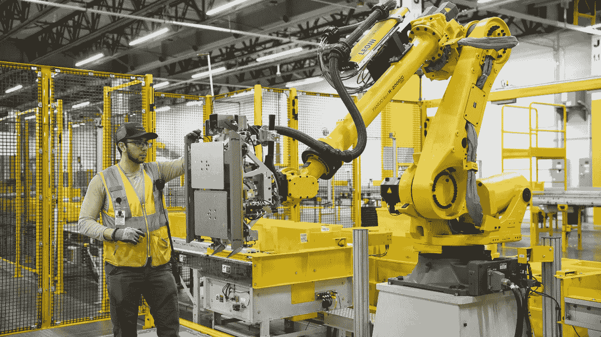

### NightCafe：早于Midjourney的AI艺术创作平台仍然活跃

贡献人：

https://techcrunch.com/2024/08/31/before-midjourney-there-was-nightcafe-and-its-still-kicking/

NightCafe是由澳大利亚凯恩斯的Elle和Angus Russell夫妇创办的AI艺术生成平台，虽然没有Midjourney那样广为人知，但它在成立五年来取得了显著成功。NightCafe最初是一个提供AI生成艺术品的网站，但因用户对购买壁画的需求不足，最初的商业模式失败。然而，通过引入图像生成信用系统和整合先进的AI模型，NightCafe迅速实现盈利。

目前，NightCafe拥有超过2500万用户，生成了接近十亿张图像。其收入模式包括按需购买图像生成积分和订阅服务。尽管AI艺术领域竞争激烈，NightCafe通过聚合多种AI模型并构建强大的社区，成功吸引了大批忠实用户。

NightCafe在法律和内容监管方面面临挑战，尤其是在版权问题上。平台通过严格的审核制度和内容报告机制，尽量规避法律风险。尽管如此，NightCafe仍面临AI艺术领域潜在的法律变革带来的不确定性。

尽管如此，NightCafe保持了稳健的增长，并计划继续专注于为用户提供丰富的AI模型选择和良好的社区体验，而非追求外部投资或扩展企业级产品。

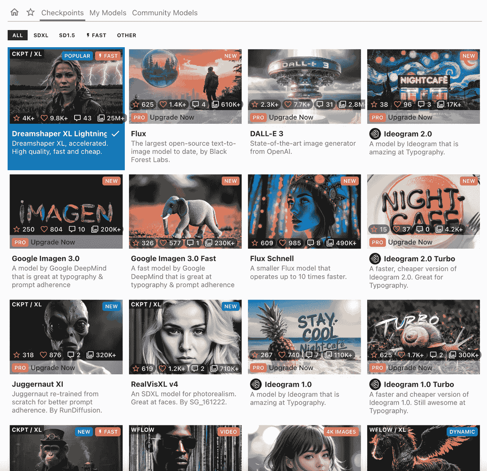

### OpenAI加持，1X消费级人形机器人亮相

贡献人：

https://mp.weixin.qq.com/s/9a9LTR1Jmd3pjVbuL2JHiQ

OpenAI 支持的机器人创业公司 1X 推出了专为家庭设计的双足人形机器人原型 NEO Beta。NEO 身高 165 厘米，体重 30 公斤，步行速度可达 2.5 英里/小时，跑步速度 7.5 英里/小时，运行时间为 2 到 4 小时。NEO 具备高承重能力，可执行复杂家务，如整理高脚杯、做饭递送物品等，且全程静音，主要通过眼神和手势与用户沟通。NEO 的设计模仿人类肌肉组织结构，既强壮又温和，能够自然地在实际空间中导航，并适应复杂环境。

1X 强调 NEO 的安全性，计划在部分家庭中部署少量 NEP 装置进行研究和开发，收集重要反馈。NEO 的设计基础源于 1X 早期产品 EVE，在此基础上进一步成熟，适用于安保、物流、制造等行业，并具备为行动不便者提供支持的潜力。1X 结合具身人工智能技术，致力于打造通用家庭机器人，使其不断学习和改进，逐渐融入人类生活环境。

1X 于 2014 年成立，并与 OpenAI 合作，将人工智能与机器人技术相结合，专注于安全且实用的家庭机器人产品。近期，1X 获得了来自 OpenAI 的巨额投资支持，进一步推动了人形机器人技术的发展。

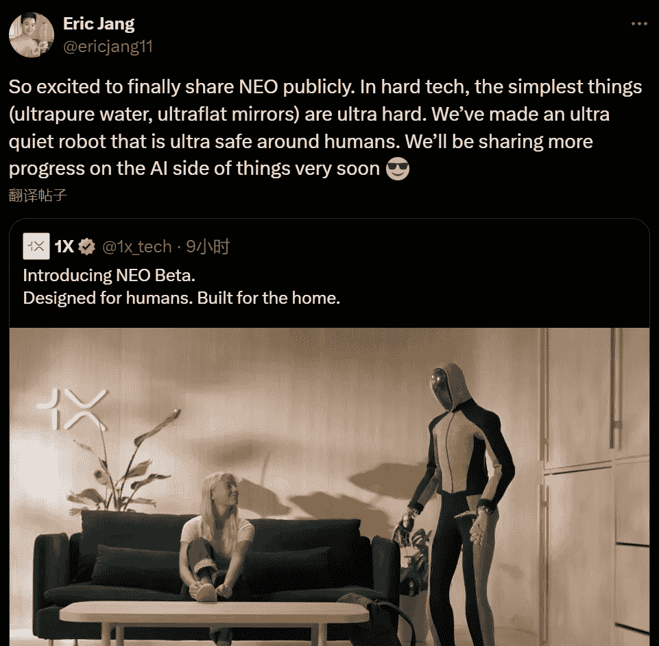

### 用 100 条轨迹数据，你也可以训练一个抓取乐高积木的机器人

贡献人：

https://mp.weixin.qq.com/s/GnrEPlKt-8CPhrMcwGRfaA

HuggingFace 的机器人科学家 Remi Cadene 展示了如何通过 100 条轨迹数据，在 Mac 或 PC 上训练数小时，创建一个可以抓取乐高积木的机械臂。这表明机器人技术的入门门槛远比想象中更低。Cadene 领导的 LeRobot 项目基于全球最大的众包机器人数据集，旨在将 AI 应用于现实世界，推动开源机器人技术的发展。通过详尽的教程和视频指导，用户可以轻松订购、组装和训练 Koch v1.1 机器人，实现自主操作。LeRobot 已在开源社区引起反响，并计划推出更实惠和强大的机器人模型，以推动机器人领域的进一步发展。

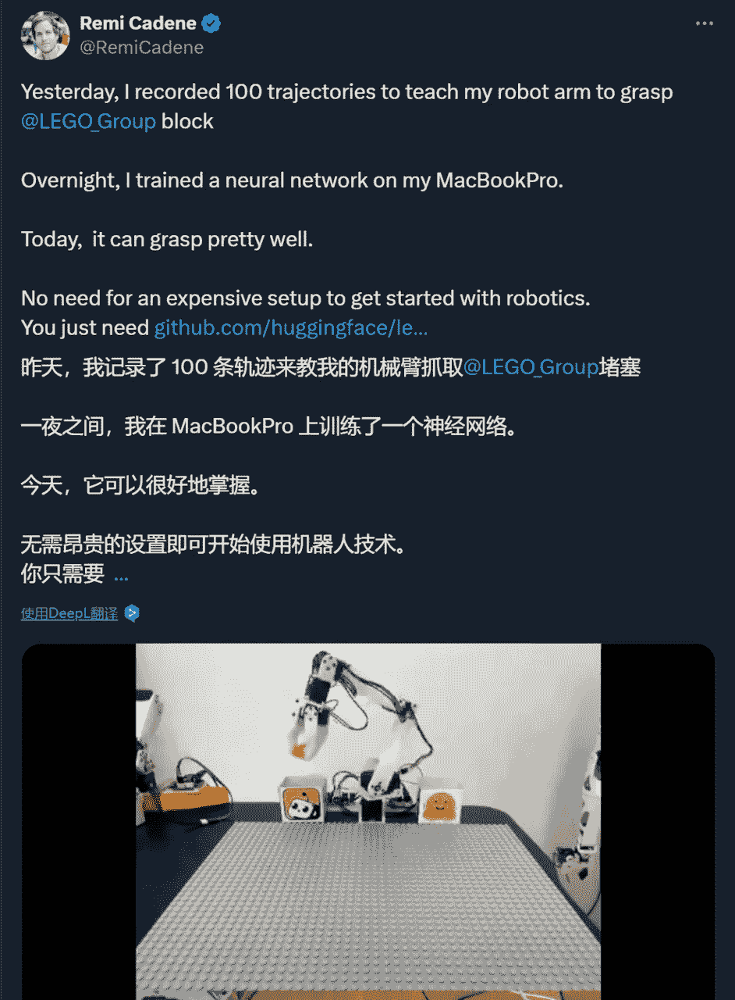

### 对话前总教练罗博深：不看好AI教育，不建议AI辅助学数学

贡献人：

https://mp.weixin.qq.com/s/BVyuq9bugfvhJpkLV3G8GA

在中国奥数队的五连冠被美国队终结后，美国前奥数教练罗博深（Po-shen Loh）成为焦点。他在执教期间带领美国队取得多次胜利，并被认为是美国奥数崛起的关键人物。今年虽然他已不再担任教练，但仍在幕后为美国队提供支持。

罗博深专注于数学、概率论和计算机科学，并在教育领域表现出色。他对AI在教育中的应用持谨慎态度，认为AI虽然在解题上表现优异，甚至超越了人类选手，但数学的核心在于思考与逻辑，而非单纯依赖AI。他强调教育应回归人本质，通过独立思考与合作解决问题，培养学生的好奇心和探索精神。

在教育模式的创新上，罗博深创建了一个由高中生为更小的学生直播授课的项目。这一项目将数学教育与娱乐结合，通过培养高中生的表达能力和共情力，推动他们成为更具影响力的未来领导者。罗博深的目标是通过这个系统，实现教育的规模化，帮助更多青少年在AI时代中成长为有责任感和人性关怀的优秀人才。他希望这种教育模式能够加速教育系统的迭代，让更多学生受益，并最终培养出关注人类福祉的未来精英。

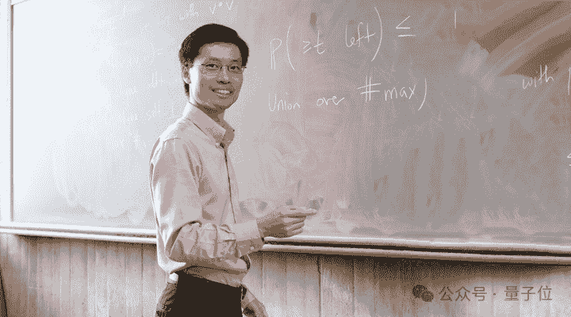

# 推特

### NEO Beta机器人：为人类设计，为家庭打造

https://x.com/1x_tech/status/1829567690681307284

推出NEO Beta。

为人类设计，为家庭打造。

---

高赞评论：这里面绝对是个人！

[ssstwitter.com_1725038929036.mp4](https://internal-api-drive-stream.feishu.cn/space/api/box/stream/download/all/AyuebioKzonTBkxYaVmcQZAUnyd)

### Raschka分享为期3小时的编码研讨会，内容包括如何实现、训练和使用LLMs

https://x.com/rasbt/status/1829832551906574474

如果你这个周末有时间深入了解大型语言模型（LLMs）并想理解它们的工作原理，我准备了一个为期3小时的编码研讨会，内容包括如何实现、训练和使用LLMs:

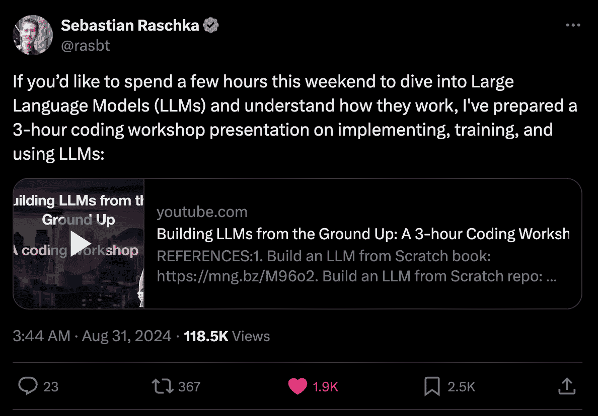

### Cheema分享：对比Apple M芯片和H100

https://x.com/ac_crypto/status/1829881505012990100

关于Apple M芯片的功耗效率。

使用MLX后端的 @exolabs_ 可以让每台MacBook Pro M3 Max的GPU达到接近100%的利用率。该GPU拥有128GB的内存（带宽约400GB/s），功耗约为40瓦，fp16性能约为30 TFLOPs。

MacBook Pro M3 Max GPU的性能指标如下：

+   每瓦性能：0.75 TFLOPs 每瓦

+   每瓦内存：3.2 GB 每瓦

+   每瓦内存带宽：10 GB/s 每瓦

H100 GPU拥有80GB的内存（带宽约2000GB/s），功耗约为700瓦，fp16性能约为1000 TFLOPs。

H100的性能指标如下：

+   每瓦性能：1.42 TFLOPs 每瓦（+89%）

+   每瓦内存：0.11 GB 每瓦（-96%）

+   每瓦内存带宽：2 GB/s 每瓦（-80%）

虽然H100的每瓦性能远高于MacBook Pro M3 Max GPU，但在每瓦内存和每瓦内存带宽方面，MacBook表现显著更优。

在内存或内存带宽成为瓶颈的工作负载中，MacBook的效率要高得多。例如，MoE推理（批处理大小=1）需要大量的GPU内存来保持所有专家模型在GPU内存中，但只需要较少的FLOPs，因为任何时候只有1到2个模型在运行。

如果你需要最大化原始计算能力，选择H100。如果不是，Apple硬件可能值得考虑。

感谢 @kuzco_xyz 提供的mactop工具以及 @awnihannun 提供的MLX工具。

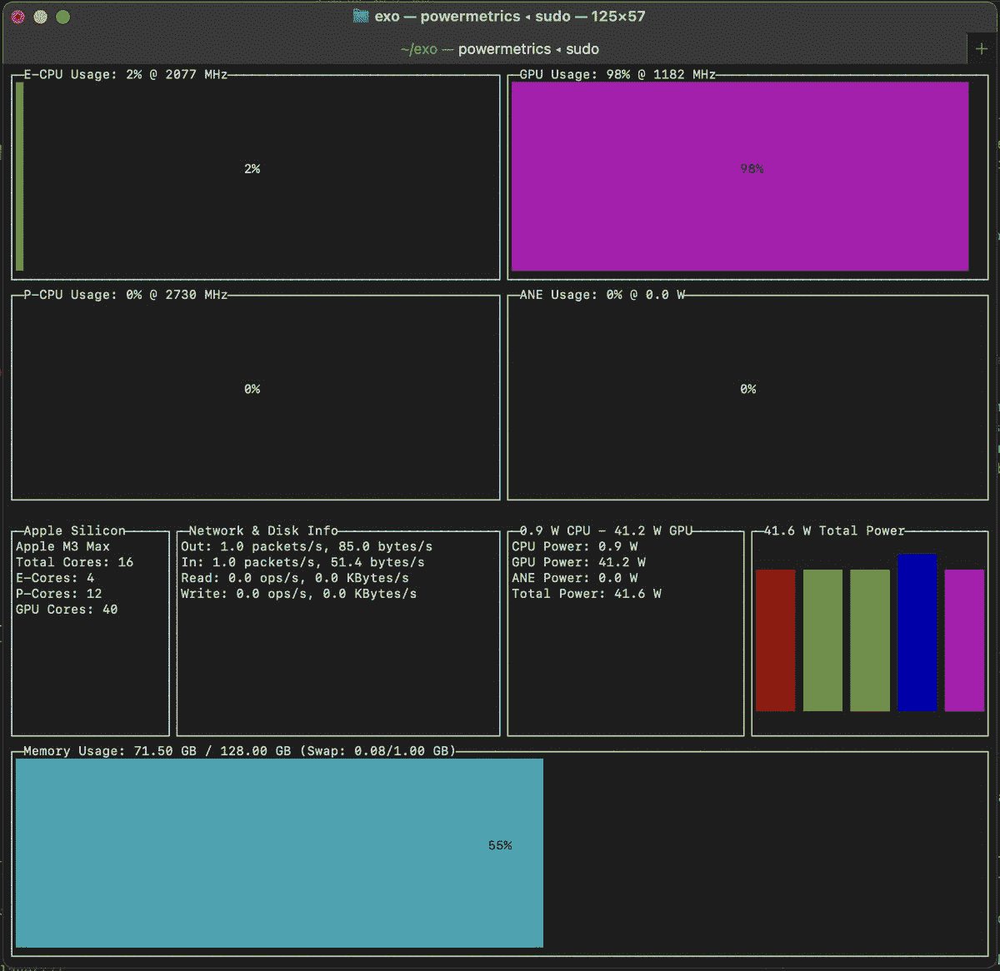

### CodeHagen：1.5小时为Propdock完成仪表盘，点击任意商业物业，一键计算整个物业，分析数据并自行输入

https://x.com/CodeHagen/status/1829857742409916716

我用了1.5小时做的… 🤯

@cursor_ai + @v0 让初步的MVP开发速度超快。我在1.5小时内为Propdock制作了这个仪表盘。

◆ 点击任意商业物业 🇧🇻

◆ 一键计算整个物业

◆ 分析数据并自行输入

该项目是开源的，如果你有兴趣，可以查看 ✨

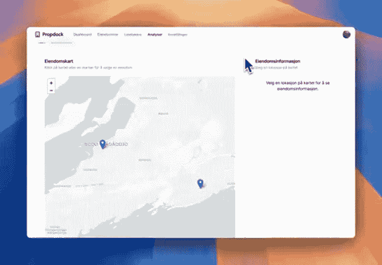

[ssstwitter.com_1725172077901.mp4](https://internal-api-drive-stream.feishu.cn/space/api/box/stream/download/all/HjoWbP2XkoK7dGxnp4ccP5HEnBf)

### SkalskiP分享足球AI可视化视频：这可能是我迄今为止制作的最酷的足球AI可视化

https://x.com/skalskip92/status/1829531618169729269

这可能是我迄今为止制作的最酷的足球AI可视化。

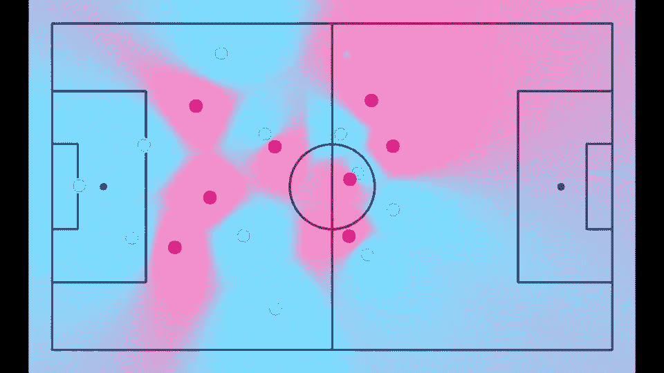

[ErwhqQeb6qJIyXFM.mp4](https://internal-api-drive-stream.feishu.cn/space/api/box/stream/download/all/J8LTb9RlPoxoaPxMswxcHh1SnOd)

### 关于变压器中的多层感知层，以及大型语言模型可能如何存储事实

https://x.com/3blue1brown/status/1829860398197346352

Grant Sanderson：我刚刚发布在YouTube上的视频摘录（关于Transformer中的多层感知层，以及大型语言模型可能如何存储事实）

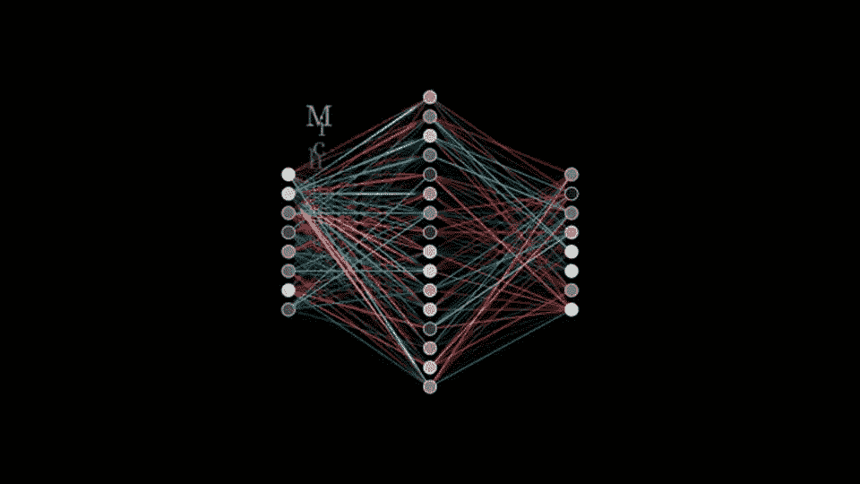

[ssstwitter.com_1725115191835.mp4](https://internal-api-drive-stream.feishu.cn/space/api/box/stream/download/all/VO0dbCcBMoewLWxDzOZcq4FynIH)

# 产品

### SeekAll

贡献人：

https://seekall.ai/

SeekAll 是一款 Chrome 扩展程序，简化用户在多个平台上进行搜索的过程。它允许用户通过单击一次按钮，在各种 AI 搜索引擎和传统搜索引擎上同时获取结果。

### Elisi

贡献人：

https://www.elisiapp.com/

Elisi 是一款 AI 驱动的目标管理应用，希望可以帮助用户提高生产力和克服拖延。它提供个性化服务、任务实时反馈和进度跟踪等，将科学方法和正念练习相结合，帮助用户制定可行的行动步骤，在过程中帮用户提升自信心并实现目标。

# HuggingFace&Github

### BaichuanSEED

贡献人：

https://baichuanseed.github.io/

BaichuanSEED 是一个基于大规模数据处理预训练的 7B 参数语言模型，希望可以提供与先进商业语言模型相媲美的性能。其在多个基准测试中展现出一致性和可预测性，并探讨了在数学和编码等下游任务中的可优化潜力。

### kotaemon

贡献人：** **

https://github.com/Cinnamon/kotaemon

kotaemon 是一个开源的 RAG（检索增强型生成）文档问答工具。它提供了一个干净、可定制的聊天界面，适用于希望对文档进行问答的用户，以及希望构建专属 RAG 的开发人员。

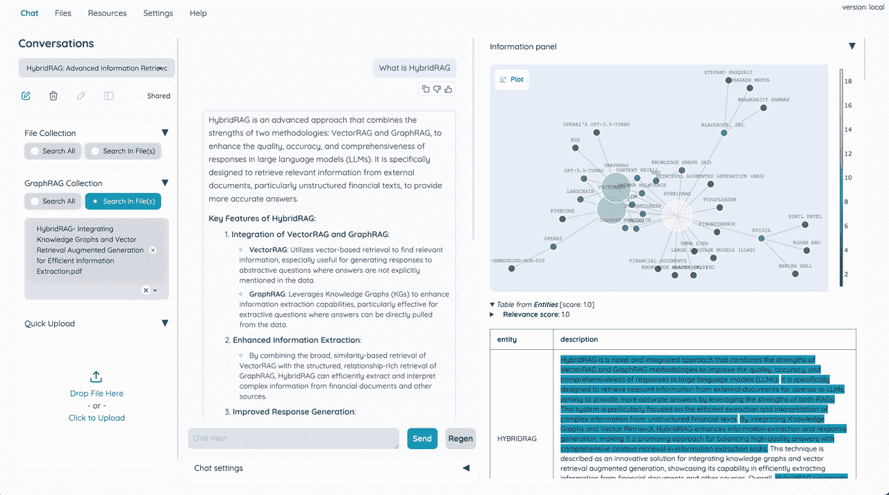

# 投融资

### Jam & Tea工作室利用生成式AI赋能NPC，推动游戏行业革新

贡献人：

https://techcrunch.com/2024/08/30/jam-and-tea-gaming-studio-leveraging-generative-ai-to-power-npcs/

Jam & Tea工作室是一家由前Riot Games员工创立的游戏初创公司，专注于通过生成式AI技术，革新玩家与非玩家角色（NPC）的互动方式。工作室近期宣布了其首款游戏《Retail Mage》，该游戏运用了生成式AI工具来增强游戏机制、内容生成、对话和物品生成等方面的体验。

在融资方面，Jam & Tea工作室已经获得了来自London Venture Partners的315万美元种子轮融资，其他参与投资的还包括Sisu Game Ventures和1Up Ventures。公司计划在今年晚些时候进行新一轮融资，以进一步推动其产品开发和市场扩展。

Jam & Tea的商业模式将通过售卖游戏本体和额外游戏包来实现盈利，初期游戏售价为15美元，并计划在未来几年内实现跨平台功能。此外，工作室还在开发另一个更为复杂的项目“Project Emily”，旨在展示其更广泛的技术应用和叙事野心。

Jam & Tea的八人团队目前面临巨大挑战，但通过抢占生成式AI技术的先机，工作室希望在未来游戏行业中占据一席之地。

公司官网：https://www.jamandtea.studio/

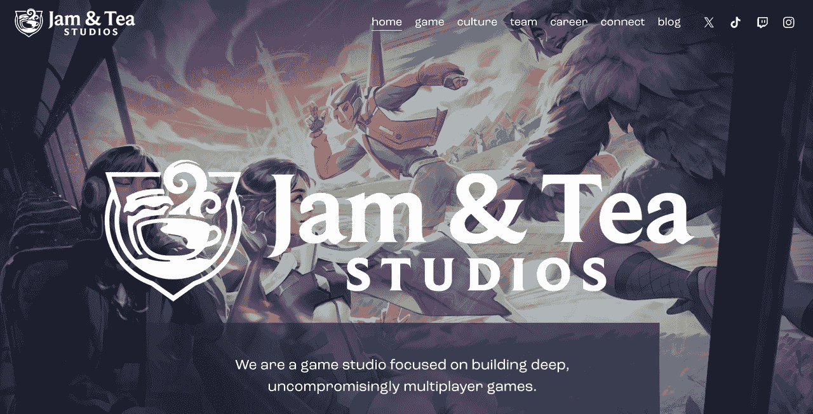

### Y Combinator S24：拆解顶级初创公司

贡献人：

https://goldenpineapple.substack.com/p/y-combinator-s24-breaking-down-the

+   **NextUI**：一个基于React和Tailwind CSS构建用户界面的工具包，提供了自动暗模式和可访问性功能。

+   **Wordware**：一个在线平台，允许非技术专家和AI工程师使用普通英语和代码混合开发AI工具。

+   **Unriddle**：一个研究助手，帮助学者在科学论文中快速找到并理解见解，加速研究进程。

+   **Undermind**：为专家设计的搜索引擎，旨在解决复杂的高风险问题。

+   **Comfy Deploy**：用于团队构建和部署AI驱动的视频和图像项目的平台。

+   **BeeBettor**：一个为体育博彩者提供研究、分析和出售博彩见解的平台。

+   **Merse**：一个将音频融入漫画创作和体验的平台，让角色以不同语言发声并添加音效。

+   **Laminar AI**：一个用于构建和测试AI应用的工具，提供了直接生成代码和高级评估工具。

+   **Mito Health**：根据血液测试创建健康计划的服务，提供个性化的补充建议、饮食和锻炼计划。

+   **Autarc**：一个集成CRM、规划和设计工具的平台，通过AI和LiDAR技术简化热泵安装过程。

在创始人背景方面，近50%的创始人曾在全球最知名的公司工作，27%来自谷歌、亚马逊、Meta、微软和苹果等五大科技巨头。此外，约15%的创始人毕业于斯坦福、MIT、CMU和乔治亚理工等顶尖科技大学。

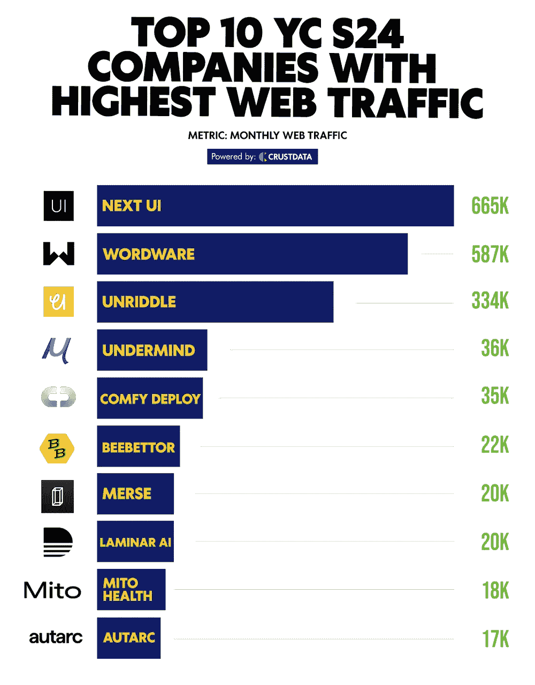

# 学习

### Minimax Link伙伴日学习笔记

贡献人:

https://www.zhihu.com/pin/1813367383781433344?native=1&scene=share&utm_psn=1813519125974228993

[#LLM](https://www.zhihu.com/topic/20660508)[ 部分

](https://www.zhihu.com/topic/25902433)1. minimax 每天全线消耗 3 万亿 tokens。

2. 用 linear attention+moe  结构增加上下文长度，降低推理成本。minimax 推测 OpenAI 也是这么做的。

3. linear attention 的训练，推理的工程挑战都不一样。

4. linear attention 序列并行方法需要重新设计，采用类似 ring 方式，但通信量和序列长度无关。

5. linear attention 计算速度快于标准注意力，通信极易成瓶颈，训练算法的的 optimizer 需要修改成异步的，来重叠通信与计算。

6. linear attention 推理没有 kvcache。不需要投机采样，也没有现在流行的 kvcache 为中心的各种优化，比如 pd 分离，prefix cache 之类的。

7. linear 推理可以实现近乎无限上下文，而且历史信息就是 K× V  大小O(d^2)，存储特别少。

8. 有 TNL(minimax 的 linear attention 结构名称)的 scaling law 实验。

交流完挺震撼的，如果 llm 未来都变成 linear attention 的话，搞 llm kvcache 优化的，搞大带宽芯片的，可能都白忙活了。

#多模态 部分

1. 现场有一个视频生成剪辑炸场，大家在视频号能看到。

2. 生成5s 720p 的视频demo展示需要三四分钟。DiT实时推理还任重道远，xDiT 大有可为！

3. 音乐生成也需要DiT。

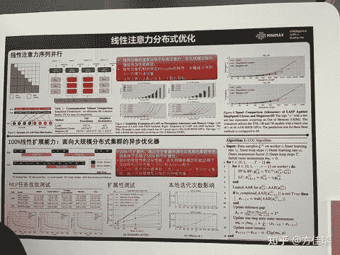

### Image Tokenizer与Autoregressive Image Generation

贡献人：

https://zhuanlan.zhihu.com/p/707759472?utm_psn=1813307767139729408

**技术背景**：目前在生成领域，图像和视频的生成主要依赖于扩散模型（Diffusion），而文本生成则由自回归模型（LLM）主导。扩散模型在连续空间中进行建模，而自回归模型则在离散空间中进行下一个Token的预测。这种技术上的差异带来了设计统一的多模态大模型（如Any2Any）的挑战。

**现有解决方案**：部分研究（如Chameleon和Unified-IO）尝试将图像编码为离散的Token，并通过自回归方式训练。Unidiffuser则使用扩散模型来建模各种概率分布，以实现Any2Any的生成。这些方法展示了整合图像和文本生成技术的不同思路。

Image Tokenizer设计：文章探讨了将图像像素直接离散化处理（类似于将文本单词转换为Token）的可能性。为了解决直接离散化导致的问题，如分辨率过高和分类不适配等，VQVAE提出了一种通过压缩图像并离散化其低维表示的方法。

**自回归图像生成**：为了有效地将离散化后的图像Token进行自回归生成，文章介绍了跨注意力机制与多尺度生成模型（如VAR）的应用。VAR通过多尺度的VQGAN编码，使得生成过程更高效并具有较强的扩展性。

**VQ替代方案**：作者讨论了Vector Quantization (VQ) 的局限性，并提出取消VQ，直接使用连续向量进行自回归生成的可能性。通过Kaiming的研究，表明在没有VQ的情况下，仍然可以通过扩散损失来有效地计算条件概率分布。

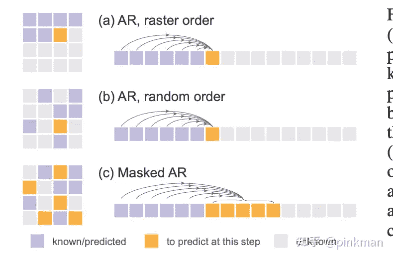

### 阿里开源视觉多模态模型 Qwen2-VL，技术能力如何？

贡献人：

https://www.zhihu.com/question/665704731?utm_psn=1813306893352968193

Qwen2-VL 的主要技术特点包括：

1.  **动态分辨率支持**：能够处理任意分辨率的图片，解决了传统图像处理需要固定大小的问题。这使得模型在视觉任务中更为灵活，尤其是在理解长达20分钟以上的视频时表现突出。

1.  多模态旋转位置嵌入（M-ROPE）：通过将旋转嵌入分解为时间、高度和宽度三部分，模型可以更好地捕捉和整合一维文本、二维图像以及三维视频的位置信息，大大提升了复杂场景的处理能力。

1.  **广泛的多语言支持**：除了中文和英文外，Qwen2-VL 还支持大多数欧洲语言、日语、韩语、阿拉伯语、越南语等。这使得模型在全球范围内的适用性更广泛。

1.  **模型结构**：采用了 ViT 加 Qwen2 的串联结构，在不同规模的模型上都使用了 600M 的 ViT，支持图像和视频的统一输入，并实现了原生动态分辨率的全面支持，图像被转换为动态数量的 tokens，最小只占 4 个 tokens。

该模型还通过实际测试展示了其在图片信息抽取、计算、OCR 识别和表格结构化输出方面的强大能力，虽然在一些复杂任务中仍有改进空间，但整体表现优异，尤其是在中文任务上领先于许多闭源模型。

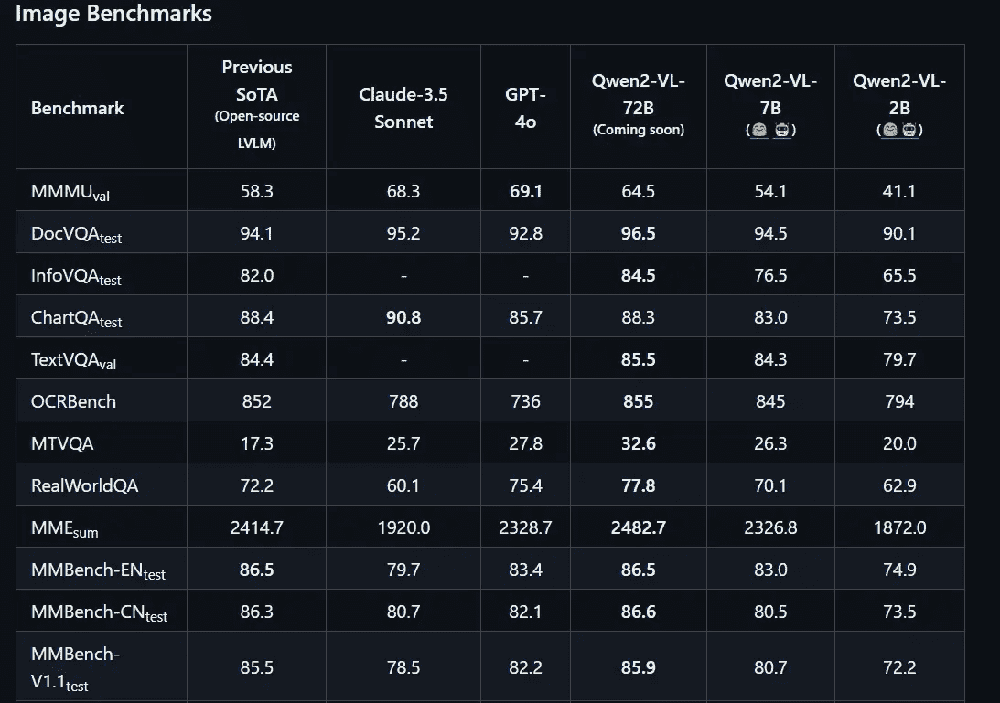

### MAGPIE: 通过无提示对齐的LLM从零开始合成对齐数据

贡献人：

https://zhuanlan.zhihu.com/p/717562402?utm_psn=1813306215532457984

研究团队利用对齐模型（如Llama-3-Instruct）的自回归特性，通过输入简单的模板提示，让模型自主生成用户查询和响应，进而构建庞大的指令数据集。该方法避免了传统数据生成方式中对提示工程和种子问题的依赖，大大提高了生成数据的多样性和质量。

MAGPIE成功生成了400万个指令-响应对，并从中筛选出30万个高质量实例用于对模型的微调。实验结果显示，使用MAGPIE数据微调的模型在多个基准任务上表现优异，甚至在某些情况下超过了使用1000万个数据点进行监督微调的官方模型。此外，MAGPIE数据在指令优化（SFT）和偏好优化（如UltraFeedback）的组合任务中，也表现出色。

MAGPIE的技术创新在于其无需人工干预的完全自动化流程，通过直接利用LLM的预定义模板生成指令和响应数据。与传统方法相比，MAGPIE不仅降低了数据生成的成本，还提升了数据的覆盖范围和任务多样性，尤其是在复杂推理任务和多轮对话任务中表现突出。

在技术细节方面，MAGPIE利用了LLM的自回归生成能力，在输入简单模板的情况下，生成高度多样化和复杂的指令数据。该方法不仅适用于现有的开源模型（如Llama-3-8B），还能够扩展到其他基础模型上，如Qwen1.5，证明了其在不同模型框架下的广泛适用性和高效性。

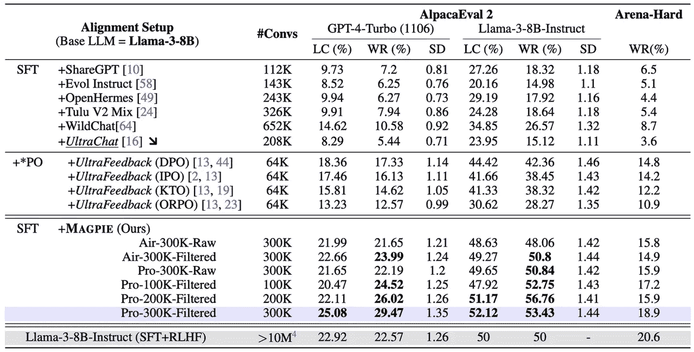

### LLM 推理/训练 I/O Pattern初探

贡献人：

https://zhuanlan.zhihu.com/p/717560804?utm_psn=1813305085435981824

1.  LLM 推理应用

+   **Syscall Trace分析**：记录了72713行系统调用，其中与模型文件和文件系统相关的仅3079行，主要涉及openat、statx、mmap、fstat等系统调用。发现LLM推理中大量使用mmap系统调用进行匿名内存映射，futex调用频率极高，但其主要用于线程同步，较少涉及底层文件系统交互。

+   **mmap细节**：mmap与munmap调用时间差非常短，约为1.97毫秒，无法解释大模型（如20G）如何在如此短的时间内加载至显存。

+   **Blktrace分析**：总I/O请求主要集中在4KB、128KB和256KB，写操作的I/O大小集中在4KB和512KB，读写操作表现出高度随机性。

1.  LLM 训练应用

+   **Syscall Trace分析**：训练阶段包括模型定位、加载至显存以及保存checkpoint等操作，主要使用stat、lseek、read等系统调用。不同于预期的顺序读取，实际发现大量随机读取操作，系统频繁调用lseek调整文件读取位置。

+   **Blktrace分析**：训练过程中I/O请求主要集中在4KB、128KB和512KB，顺序读写操作占大多数。训练数据写入时占用了显著的I/O带宽，每次训练完成后将显存中的数据写入文件系统。

1.  I/O 特征总结

+   **推理应用**：随机读写操作占主导，特别是在访问大模型时，推测是由于系统通过索引机制进行数据读取，非顺序读取。

+   **训练应用**：顺序读写占主导，读写字节比接近1:2，符合模型读入与训练数据写入的预期。随机写的比例较低，但其对性能的影响值得进一步研究。

1.  后续建议

作者提出需要进一步研究索引文件以及PyTorch的源码，尤其是如何通过索引文件将大模型有效加载至显存。此外，由于syscall trace中没有发现传统的阻塞I/O或异步I/O调用，建议深入分析PyTorch是如何处理大模型加载的底层机制。

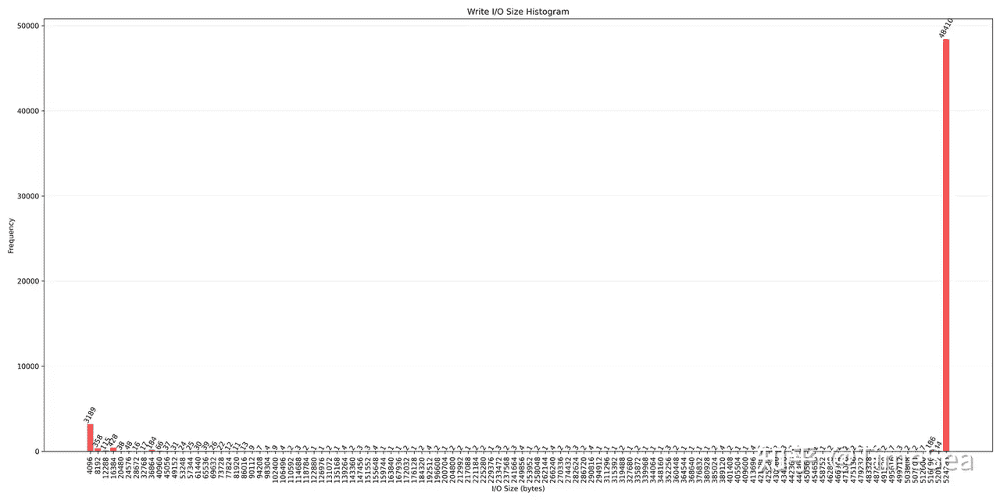

### 存储 IO 性能优化策略、方案与瓶颈分析

贡献人：

https://zhuanlan.zhihu.com/p/717518412?utm_psn=1813531135659098112

1.  **IO模型特性**：不同应用的IO特性各异，需针对性优化。

1.  **性能指标**：主要指标为吞吐量、IOPS和延时，需根据应用场景选取并优化。

1.  **优化策略**：

+   **存储设备**：选择适合的磁盘类型和优化缓存机制。

+   **网络**：提高带宽，减少延时。

+   **传输协议**：选择高效协议。

+   **主机与应用层**：调整系统配置，优化数据库查询和索引。

1.  **数据库瓶颈**：关系型数据库的IO瓶颈常在日志写入，需优化硬件与操作系统配置。

1.  **Queue-Depth管理**：队列深度影响并发IO性能，但需避免过高导致的QFULL问题。

整体优化需综合各层面的性能需求和瓶颈分析，实现高效存储IO性能。

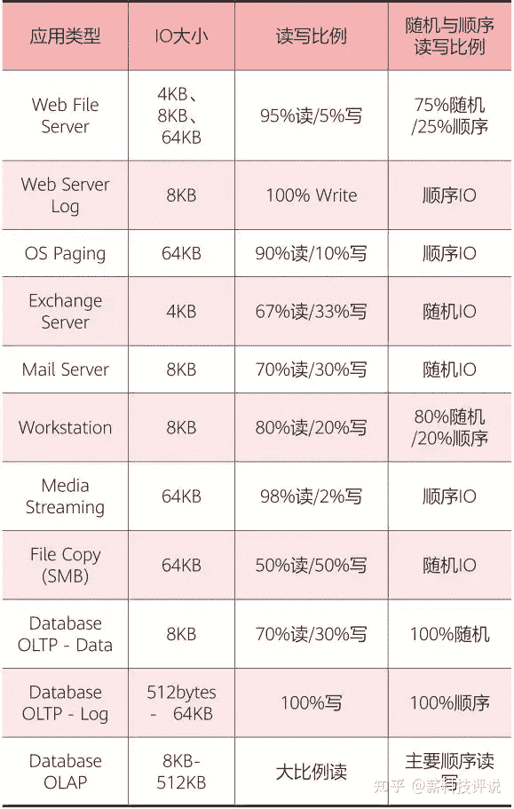

### Intel 微架构的演进

https://zhuanlan.zhihu.com/p/571333092?utm_psn=1813175575130550272

本文概述了Intel微架构的演进，重点突出各代技术创新：

+   **80486（1989年）**：首次集成片上缓存和数学协处理器，提升浮点计算性能。

+   **P5（1993年）**：引入超标量处理和分支预测，但存在BTB局限性。

+   **P6（1995年）**：支持乱序执行，改进指令解码和寄存器管理，显著提升处理效率。

+   **NetBurst（2000年）**：采用长流水线，专注于高频率，但复杂结构导致性能瓶颈。

+   Pentium M（2003年）：优化功耗与性能，改进µop融合和分支预测，适用于移动设备。

+   **Yonah（2006年）**：引入双核和SSE3指令集，改进分支预测但仍存在误预测损失。

+   **Core（2006年）**：重大升级，支持64位，提升每瓦性能，通过Macro-Ops Fusion优化执行效率。

+   Sandy Bridge（2011年）：引入AVX指令集和µOP缓存，优化环形总线，实现性能与功耗平衡。

+   **Skylake（2015年）**：前端和乱序执行全面升级，提升多线程处理性能。

+   SunnyCove（2019年）：10nm制程，高乱序执行能力，增强前端与重命名器，提升整体性能。

+   Golden Cove（2021年）：进一步优化分支预测和重排序，提升多线程环境下的执行效率。

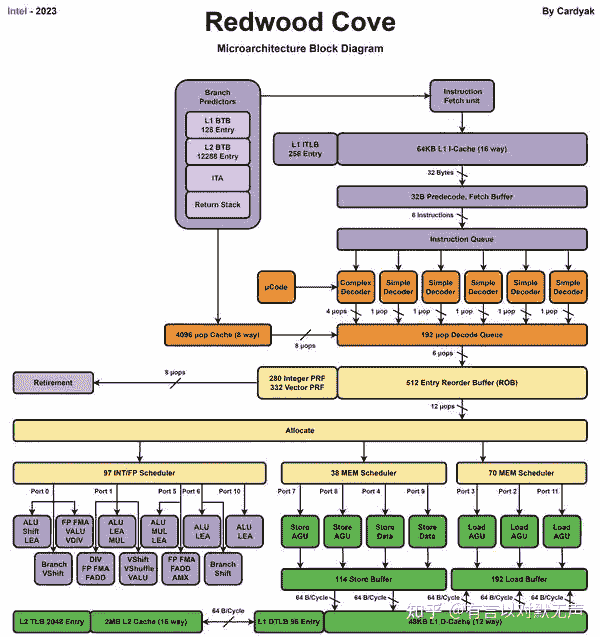

### 大模型训练：如何优化MFU

贡献人：

https://zhuanlan.zhihu.com/p/717509355?utm_psn=1813307829840388096

Model FLOPs Utilization（MFU）是衡量大模型训练效率的重要指标。其计算方法通常包括对模型FLOPs的估计，除以设备数、理论算力和每个迭代的时间。例如，在64卡A100上训练GPT-175B模型时，MFU可估算为50%，与精确公式计算结果接近。

MFU的分数受三大因素影响：1）Matmul算子的效率，例如在A100上Matmul算子效率可达83.3%；2）Matmul算子的比重，优化小算子通过算子融合策略提升Matmul比重；3）实际计算比例，反映所有算子的计算时间占总训练时间的比例，其中通信开销、流水线并行中的bubble开销等非计算部分也起重要作用。

在实际操作中，优化MFU的关键在于针对这三项指标进行监督和改进。尤其是对于不成熟的硬件系统或新模型结构，Matmul和FlashAttention算子在特殊情况下可能表现不佳，非融合算子也可能导致性能问题。因此，除了常规的工程优化，还需在通信隐藏和bubble填充等系统挑战上持续改进，以实现更高的MFU分数。

### 【滴水研究】智能时代纪事：人形机器人产业研究（下篇）

贡献人：

https://mp.weixin.qq.com/s/JT50Q55eOCPx-1gQvc6O-Q

本文详细分析了人形机器人产业的技术难点及市场前景，强调了多学科交叉的复杂性与挑战。

在感知层，触觉传感器阵列、六维力/力矩传感器及高精度关节位置传感器是关键技术难点，需要新材料开发和传感器的优化设计。在执行层，面临高功率密度电机、行星减速器、谐波减速器和柔性关节设计制造等挑战，要求在有限空间内实现高效、稳定的动力传递。

机械结构方面，仿生关节设计和轻量化结构优化是重点，采用拓扑优化和新材料来减轻重量，并实现模块化、可重构设计。运动学/动力学层面，实时运动规划和鲁棒稳定控制是难点，需要处理复杂环境下的动态运动控制问题。

控制系统方面，高实时性嵌入式平台和多模态传感器融合是核心，特别是自适应力/阻抗控制，实现柔顺的环境交互。人工智能算法层面，基于视觉的目标检测与定位、基于触觉的物体识别与操作是重点，强化学习与模仿学习对提升机器人自主性至关重要。

市场分析显示，人形机器人在3D任务、高危险性工作、灾难救援等领域有巨大潜力，但目前市场仍处于早期阶段，成本和技术是主要限制因素。未来发展依赖于技术进步和成本降低，市场需求的逐步扩大将推动产业链成熟。

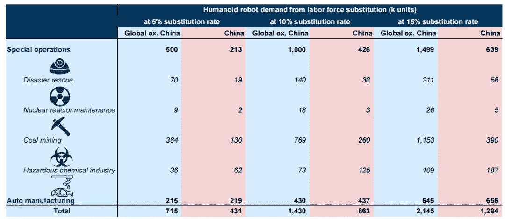

# 招聘公告

---

**奇绩创坛****由陆奇博士**于2019年创立，使命是在源头最大化驱动创新。奇绩研究组将研究模型理论、到投研战略分析、市场策划等不同背景的同学聚在一起，搭建GenAI时代独特的跨界人才社群。

## 🚀F**24实习岗位**

##### [行研-学术科研人才交流组实习生](https://miracleplus.feishu.cn/docx/Yn6rdf2iOoY2Rcx8yVNcUBYRnch#part-QkMcdeJmuob9uvxvV3qcLSzHn8g)

##### 行研-GenAI研究岗位-战略分析（偏产品）

##### Web / AI 全栈开发工程师实习生

## **火热开放中🚀**

##### 行研-GenAI研究岗位-前沿学术探索

##### 行研-GenAI研究岗位-战略分析（偏咨询）

##### 创新活动产品运营 （大模型系列活动产品运营）

> **点击**相关岗位可查看对应**岗位需求【JD】；**相关岗位投递请**添加🛰️💻【**sunjiajunspace】

> ‼️欢迎**推荐/自荐**，期待在**奇绩创坛**遇见更好的你‼️

---

# 声明

本文档仅供学习交流使用，版权归原作者所有，若涉侵权，请联系Jack Jin 15101136166

##

（欢迎在下方反馈您宝贵的意见！整理不易，觉得有用给AI日报小组点个赞👍吧！）

ChatGPT；Angela；Zijia Liu；Alex；Zeqi Tan；Tiezhen（HuggingFace）；Naixu；Lizhi；Peter；Suoman；Jack

封面生成——右脑科技

如果你有大模型相关的创业想法，欢迎来找我们聊聊～🛰️：15101136166

> 快邀请你的小伙伴们一起来读大模型日报吧！

> **【日报****知识库****】**这里是近期日报内容的汇总,欢迎大家查阅

> [大模型日报知识库(分享版)](https://miracleplus.feishu.cn/wiki/KapVwXfkriOBiskB0B2cUHxjnTh)

>

> 欢迎大家多多帮我们分享,转发~~

> 如果大家有任何的建议或者吐槽,欢迎随时找我聊天~

