# 奇绩大模型日报（7月 31日）

> 来源：[https://miracleplus.feishu.cn/docx/Ev42dtNTOomFUXxuL1icJvluny0](https://miracleplus.feishu.cn/docx/Ev42dtNTOomFUXxuL1icJvluny0)

# 资讯

### OpenAI 推出 ChatGPT 高级语音模式

贡献人：

https://techcrunch.com/2024/07/30/openai-releases-chatgpts-super-realistic-voice-feature/

OpenAI 最近向其付费用户推出了 ChatGPT 的高度逼真语音功能。这一创新意味着 ChatGPT 能够以几乎不可区分于人类的声音与用户进行交流，极大提升了用户体验。该功能的实现依赖于深度学习技术和大量语音数据的训练。目前，这项功能仅对付费用户开放，但 OpenAI 计划逐步向更多用户提供。同时，OpenAI 致力于保护用户隐私和数据安全，确保在提供高级语音交互体验的同时，维护用户信任。

### 腾讯机器狗登上Nature子刊封面，将RL和生成预训练模型引入机器人研究

贡献人：

https://mp.weixin.qq.com/s/9HE90ZHtwaNgu8zOeFJ51w

腾讯 Robotics X 实验室的研究成果被发表在《Nature Machine Intelligence》上，通过结合预训练 AI 模型和强化学习技术，赋予四足机器狗 Max 类似动物的灵活性和自主决策能力。研究分为三个阶段：首先通过动作捕捉系统收集真狗运动姿态数据，构建模仿学习任务，将数据抽象到深度神经网络中；其次，将机器狗的灵动姿态与外界感知相结合，让其适应复杂环境；最后，实现策略学习，使机器狗能够端到端解决复杂任务。实验室还设计了双狗障碍追逐比赛，验证了机器狗在推理和决策方面的能力。

https://tencent-roboticsx.github.io/lifelike-agility-and-play/

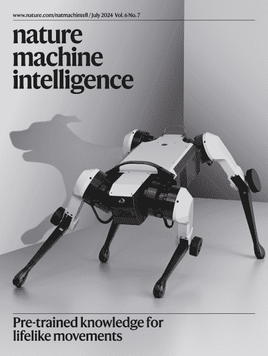

### 斯坦福团队自主研发AI手术机器人，精细操作突破医疗难题

贡献人：

https://mp.weixin.qq.com/s/Gpj71vx37skw8JPTMH9ogQ

斯坦福大学和约翰霍普金斯大学的研究团队开发了 AI 达芬奇机器人，通过模仿学习使其能够自主完成外科手术的基本操作，如组织提取、针头拾取和缝合打结。该机器人在实验中展现了高精度的自主操作能力，并能在未知场景中进行泛化应用。研究者们通过使用图像作为输入，并采用 Transformer 架构的 ACT 模型来训练策略，克服了达芬奇系统正向运动学不精确的问题。此外，达芬奇机器人还表现出了在腕式摄像机监控下学习外科手术操作任务的能力，以及在面对环境扰动时的重试和重复性能力。

https://surgical-robot-transformer.github.io/

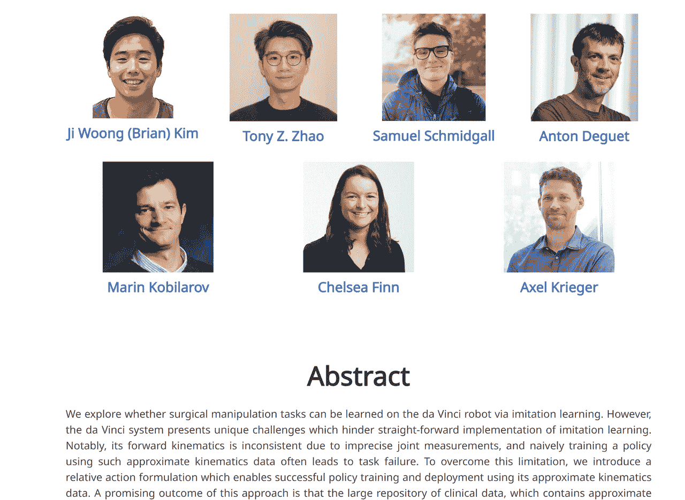

### 是谁在为xAI构建那个拥有10万GPU的集群呢？

贡献人：

https://www.nextplatform.com/2024/07/30/so-who-is-building-that-100000-gpu-cluster-for-xai/

Elon Musk 控制的公司，包括 SpaceX、Tesla 和 X（原称 Twitter），对于 AI 或 HPC 项目都有巨大的 GPU 需求。由于 GPU 供应紧张，Musk 不得不决定如何分配有限的 GPU 资源。2018 年，Musk 因为 AI 模型的巨额投资和治理问题而离开了他共同创立的 OpenAI，随后 Microsoft 投入资金。为了竞争，Musk 在 2023 年 3 月创立了 xAI，并在 5 月获得了 60 亿美元的 Series B 融资，总共筹集了 64 亿美元。此外，Musk 从 Tesla 获得了一个 450 亿美元的薪酬包裹，可以用来增加 GPU 资源。xAI 已经推出了 Grok-0、Grok-1 和 Grok-1.5 等 AI 模型，并计划在 8 月发布 Grok-2，以及在年底之前发布 Grok-3，后者需要 100,000 个 H100 GPU 进行训练。最初，xAI 与 Oracle 谈判 GPU 容量，但交易未成，导致 Musk 转而在田纳西州的梅姆菲斯建立自己的数据中心。预计这个超级计算机集群将在 2025 年完全部署。SuperMicro 可能提供了水冷系统的服务器，而 Nvidia 和 Juniper Networks 分别提供了后端（东西向）和前端（南北向）网络。至于存储，Vast Data 可能参与了这个项目。

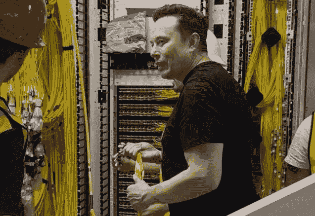

### 国家队AI“大战”巴黎

贡献人：

https://mp.weixin.qq.com/s/BWwvzkeVnlQ5WlbuQ8fsyg

巴黎奥运会大规模采用 AI 技术，从赛前训练、赛中直播到赛后传播，全面提升了体育竞技的质量与观众体验。AI 技术不仅帮助运动员进行个性化训练，还为观众提供了沉浸式观赛和互动体验的新途径。例如，阿里云的 “子弹时间” 技术和商汤科技的 AR 技术，使得比赛精彩瞬间得以更加生动地呈现。此外，智能助手如字节跳动的豆包等，也为观众提供了与名人畅聊奥运话题的平台。

### Midjourney v6.1上线

贡献人：

https://mp.weixin.qq.com/s/9LNAhiugcTy_CKwSFxtXWg

Midjourney 的最新版本 v6.1 近期发布并迅速获得了极大的关注和热度。这个版本在多个方面进行了升级，包括更强的一致性、更高的图像质量、更准确的细节理解、更快的生成速度、更高的文本准确性、个性化模型和代码版本控制，以及引入了新的 - q2 模式等。用户对于 v6.1 版本的人像生成能力给予了高度评价，认为其真实性和生成的物体合理性都有显著提升。尽管如此，v6.1 在处理群像时仍然面临挑战，尤其是在生成大量人物时，可能会出现错误和扭曲。

### 融合Rust和大模型，vivo打造AI操作系统

贡献人：

https://mp.weixin.qq.com/s/MNq6Q5idzUdjKFd_tqBJ8A

ivo 推出的蓝河操作系统（BlueOS）是一款针对大模型时代的 AI 操作系统，它通过融合 Rust 语言和大模型技术，提升了系统的安全性、智能性和流畅性。该系统支持多模态交互，能够进行复杂的意图识别，并为开发者提供了新的应用开发范式。蓝河操作系统的设计理念是为了实现智能化、安全化和流畅化的目标，它在架构上采用了 Rust 语言，以确保更高效、更安全的操作体验。在 AI 时代的背景下，操作系统需要进行技术迭代，以适应 AI 能力的提升和用户需求的变化。

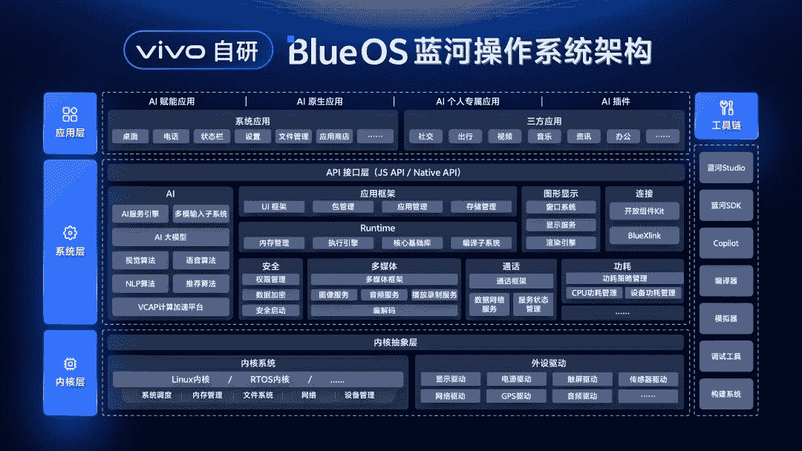

# 推特

### 吴恩达从领导AI基金中学到的反直觉最佳实践：在构建AI应用程序时，我们更倾向于在一个具体的想法上工作

https://x.com/AndrewYNg/status/1818320842654371918

AI在各种应用中的实用性为创业创造了许多机会。在这里，我想分享一个我从领导AI基金（一家已经与卓越的企业家们合作创建了数十家初创公司的风险工作室）中学到的可能有些违反直觉的最佳实践。在构建AI应用程序时，我们更倾向于在一个具体的想法上工作，这意味着我们设想的特定产品有足够的细节，可以为特定的目标用户构建。

一些设计理念认为你不应该从一开始就设想一个具体的产品。相反，他们建议从需要解决的问题开始，然后仔细研究市场，才能制定出具体的解决方案。这样做的原因是：产品规范越具体或精确，越有可能偏离目标。然而，我发现有一个具体的目标可以让你走得更快，并在过程中更快地发现和解决问题。如果这个想法被证明是有缺陷的，快速执行会让你更早发现这些缺陷，而这些知识和经验将帮助你转向另一个具体的想法。

具体性的一个测试是你是否已经详细指定了这个想法，以至于一个产品/工程团队可以构建一个初始原型。例如，“AI用于畜牧业”是不具体的；它很模糊。如果你要求一个工程师构建这个，他们将很难知道要构建什么。同样，“AI用于畜牧业中的牲畜跟踪”仍然很模糊。有太多的方法来实现这一点，大多数合理的工程师不知道要构建什么。但“应用面部识别技术识别奶牛并监控它们在农场上的移动”足够具体，一个优秀的工程师可以迅速从现有的选项中选择（例如，首先尝试哪种算法，使用什么相机分辨率，等等），以便我们相对高效地评估：

+   技术可行性：例如，为人脸开发的面部识别算法是否适用于奶牛？（事实证明它们确实适用！）

+   商业可行性：这个想法是否增加了足够的价值，值得构建？（与农民交谈可能会迅速发现像RFID这样的解决方案更简单且更便宜。）

明确具体的想法——尽管比模糊的想法更容易出错——需要更多的勇气。想法越具体，越可能有点偏离，特别是在细节上。AI用于畜牧业的总体领域似乎很有前途，肯定会有好的方法将AI应用于畜牧业。相比之下，指定一个具体的想法，更容易被否定，这很可怕。

好处是具体产品愿景的清晰度让团队执行得更快。初创公司成功的一个强有力的预测指标是其完成任务的速度。这就是为什么具有清晰愿景的创始人往往备受青睐；清晰的愿景有助于推动团队朝着特定方向前进。当然，愿景必须是好的，总是有高效地构建没人想买的东西的风险！但如果一个初创公司长时间没有形成明确的具体愿景，它不太可能成功。

如果你能以一种不伤害他人的方式朝着具体的目标前进，这样做会让你更有效地获得关键反馈，并在必要时更早地改变方向。（《The Batch》之前的一封信也讨论了在何时采用“准备，开火，瞄准”的方法更好。）有利于这种方法的一个因素是实验和迭代的低成本。这对于许多AI应用程序来说越来越是这样，但对于深度技术AI项目可能不完全如此。

我意识到这个建议与设计思维中的常见做法相悖，后者警告不要过早地跳到解决方案，而是倡导花时间了解终端用户，深入了解他们的问题，并头脑风暴出一系列解决方案。如果你一开始没有任何想法，那么这样的扩展过程可能是产生好想法的好方法。此外，保持想法的开放性对于好奇心驱动的研究可能是好的，在只有模糊方向的情况下投资于深度技术的追求可能在长期内带来巨大回报。

如果你在考虑启动一个新的AI项目，考虑是否能提出一个具体的愿景来执行。即使最初的愿景不完全正确，快速迭代会让你更早地发现这一点，而这些学习将让你转向另一个具体的想法。

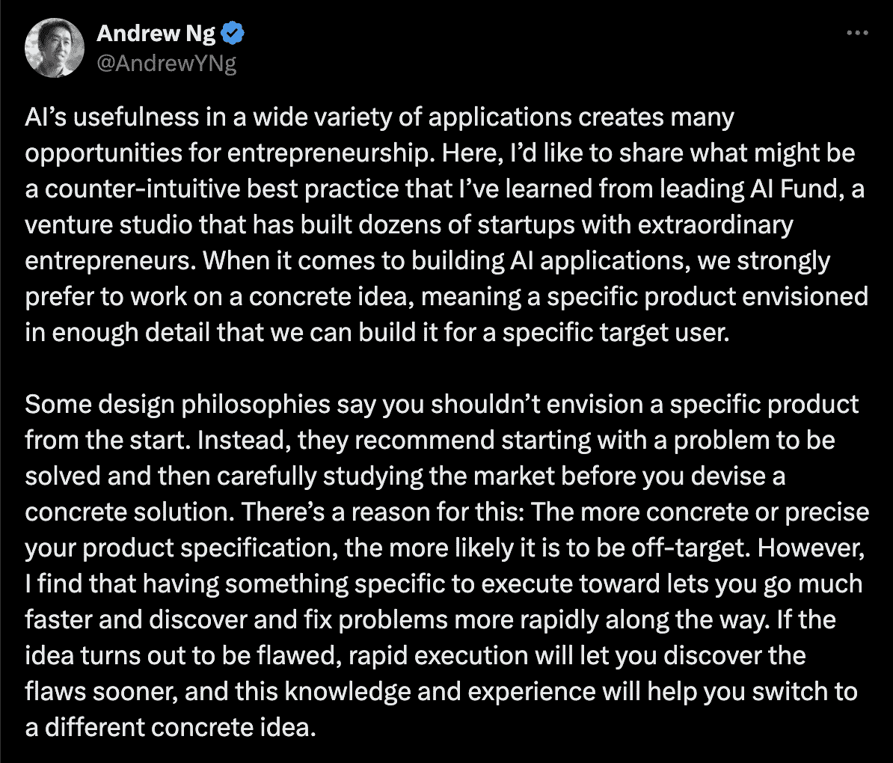

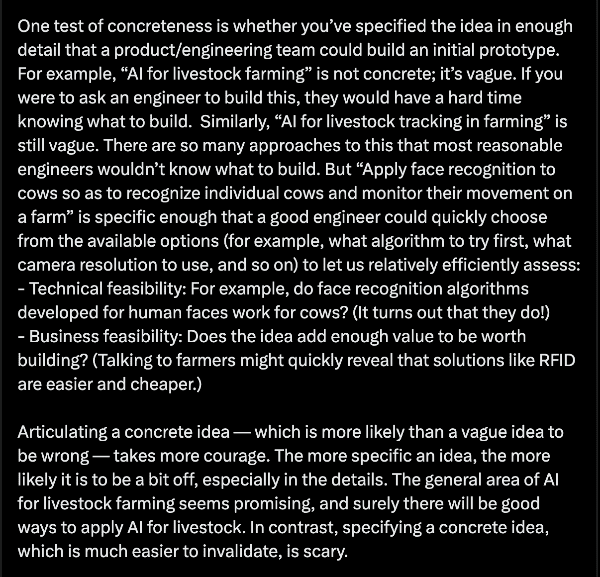

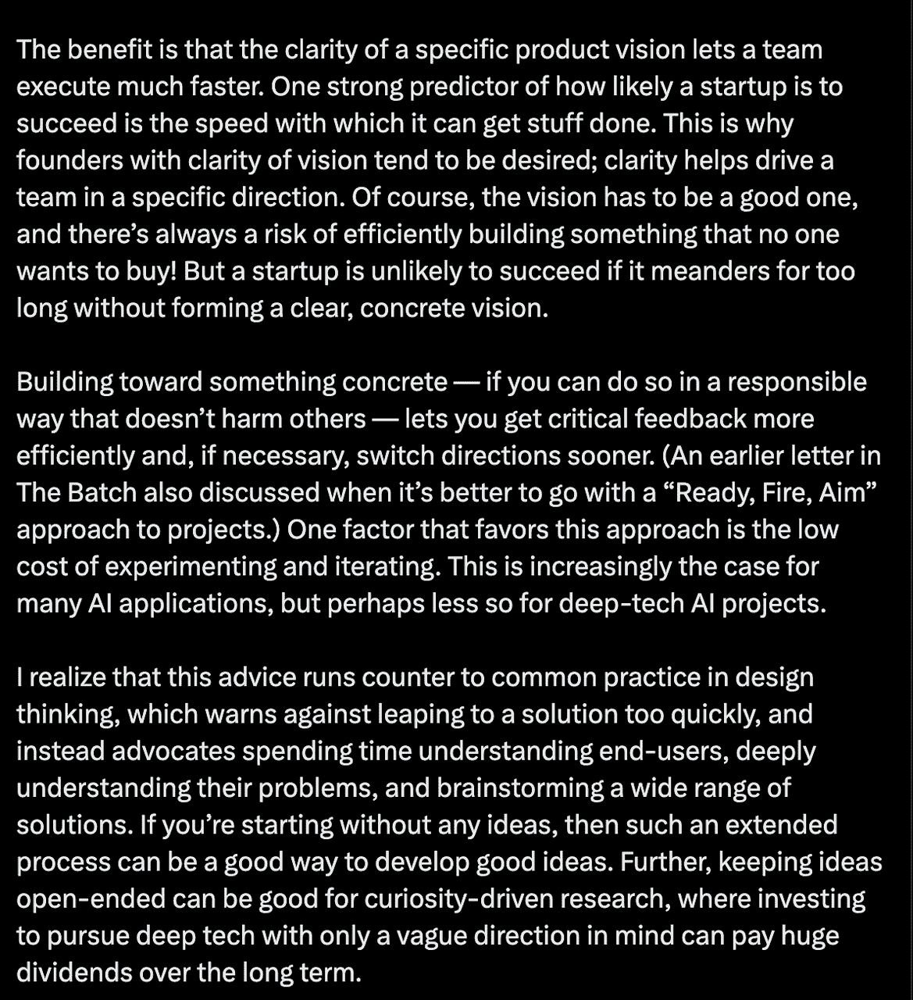

### Dennis介绍Soverin：发现、比较和利用最强大的AI应用和代理的最佳和最快途径

https://x.com/dkardonsky_/status/1818308612529270935

介绍 Soverin——您未来工作的家园。我们正在构建AI应用和代理的市场。随着软件构建的障碍降低，软件的数量比以往任何时候都多。企业和消费者的数量是有限的，但试图向他们销售的公司数量却每天都在增加。市场上充斥着大量没有差异化数据、市场进入策略、UI/UX设计，或者只是现有产品克隆的低质量AI工具。虽然大多数应用程序都是这样的，但这并不意味着整个应用层应该被忽视。这就是 Soverin 的用武之地：我们是发现、比较和利用最强大的AI应用和代理的最佳和最快途径，适用于您的用例。我们筛选了市场上所有的20,000个AI工具，只推荐其中1,900个最有用的选项。在过去的30天里，已经有数十家AI公司注册开始在 Soverin 上销售。在网络上脱颖而出从未如此艰难，却也从未如此重要。无论您的工作、用例、技术能力或预算如何，Soverin 都能轻松帮助您做到这一点。今天就免费开始使用吧：http://soverin.ai

[ssstwitter.com_1722421908540.mp4](https://internal-api-drive-stream.feishu.cn/space/api/box/stream/download/all/SSZsbCRxRoTmf6xMdT5cKUn6nVh)

### Unitree Go2升级：智能机器人的进化每天都充满了惊喜和激动的时刻

https://x.com/UnitreeRobotics/status/1818241917135852023

Unitree Go2 全新升级

智能机器人的进化每天都充满了惊喜和激动的时刻。让我们一起享受乐趣吧。🥳

#Unitree #AI #体感智能 #AGI #机器人狗 #四足机器人

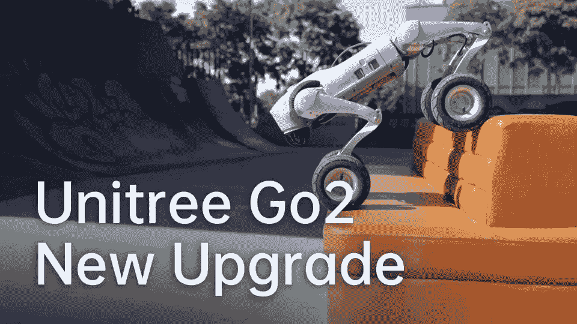

[ssstwitter.com_1722417997525.mp4](https://internal-api-drive-stream.feishu.cn/space/api/box/stream/download/all/HquxbJngcoz7Pdxl0T7czI5CnGg)

### Turan分享Cloudflare AI游乐场，以展示通过将多模态模型链式连接可以实现的效果

https://x.com/hturan/status/1818332375358554133

嘿！我们在 @cloudflare 构建了一个新的AI游乐场，以展示通过将多模态模型链式连接可以实现的效果。想象一下——音频 → 文本 → 图像 → 文本，或者组合多个LLM。这里有一个快速演示视频！

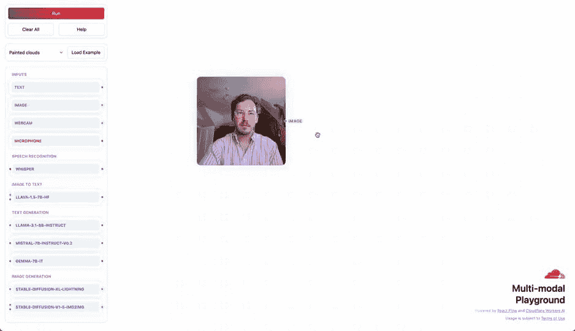

[ssstwitter.com_1722422044039.mp4](https://internal-api-drive-stream.feishu.cn/space/api/box/stream/download/all/Tl62bW8GloAT0LxnvMmcR0kDnJc)

### Cohere推出 Prompt Tuner 测试版：可以直接在我们的仪表板中优化提示的工具

https://x.com/cohere/status/1818355539845562575

我们很高兴今天推出 Prompt Tuner 测试版。这是一个可以直接在我们的仪表板中优化提示的工具。

它使用可定制的优化和评估循环来优化生成语言的用例提示。

了解更多：https://cohere.com/blog/intro-prompt-tuner

[ssstwitter.com_1722422103853.mp4](https://internal-api-drive-stream.feishu.cn/space/api/box/stream/download/all/EqsmbcKldoihkmxR9zDc6qVnnAc)

# 论文

### 语言模型的物理学：部分2.1，小学数学和隐藏的推理过程

贡献人：

链接：http://arxiv.org/abs/2407.20311v1

近期语言模型的进展展示了它们解决数学推理问题的能力，在GSM8K等小学级数学基准测试中几乎达到完美的准确率。本文正式研究了语言模型如何解决这些问题。我们设计了一系列控制实验来回答几个基本问题：(1)语言模型是否真正可以发展推理能力，还是仅仅记住模板？(2)模型的隐藏(思维)推理过程是什么？(3)模型是否使用与人类类似或不同的技能来解决数学问题？(4)在GSM8K等数据集上训练的模型是否发展了超出解决GSM8K问题所需的推理能力？(5)是什么心理过程导致模型犯推理错误？(6)一个模型必须有多大或多深才能有效解决GSM8K级别的数学问题？ 我们的研究揭示了语言模型解决数学问题的许多隐含机制，提供了超出当前对LLM的理解范围的见解。

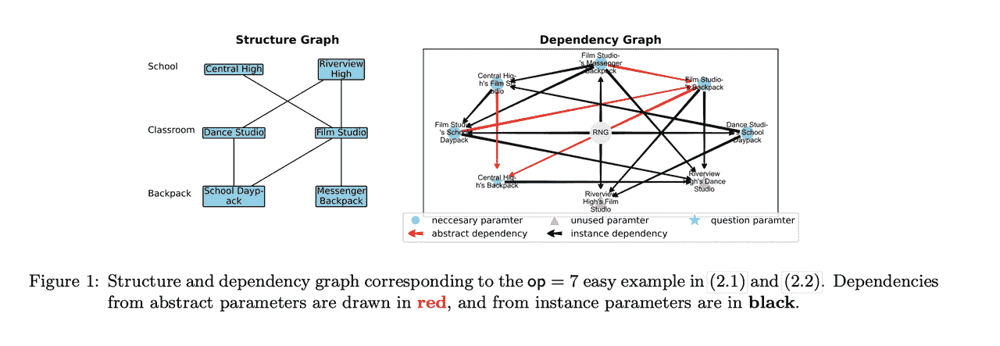

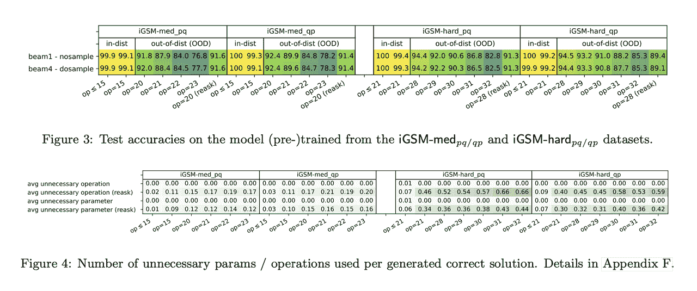

### 扩散增强智能体：高效探索与迁移学习框架

贡献人：

链接：http://arxiv.org/abs/2407.20798v1

我们介绍了Diffusion Augmented Agents（DAAG），这是一个新颖的框架，利用大型语言模型、视觉语言模型和扩散模型来提高在具身智能体强化学习中的样本效率和迁移学习。DAAG通过使用扩散模型将视频进行转换，以一种时间上和几何上一致的方式重新标记智能体的过去经验，以符合目标指令，这项技术称为Hindsight Experience Augmentation。一个大型语言模型协调这个自主过程，无需人类监督，非常适合终身学习场景。该框架减少了需要标注奖励数据的量，以便1）微调作为奖励检测器的视觉语言模型，和2）在新任务上训练RL智能体。我们在涉及操纵和导航的模拟机器人环境中展示了DAAG的样本效率提升。我们的结果表明，DAAG改善了奖励检测器的学习，转移过去的经验和获取新任务的能力 - 这是开发高效终身学习智能体的关键能力。我们的网站上提供了补充材料和可视化内容。

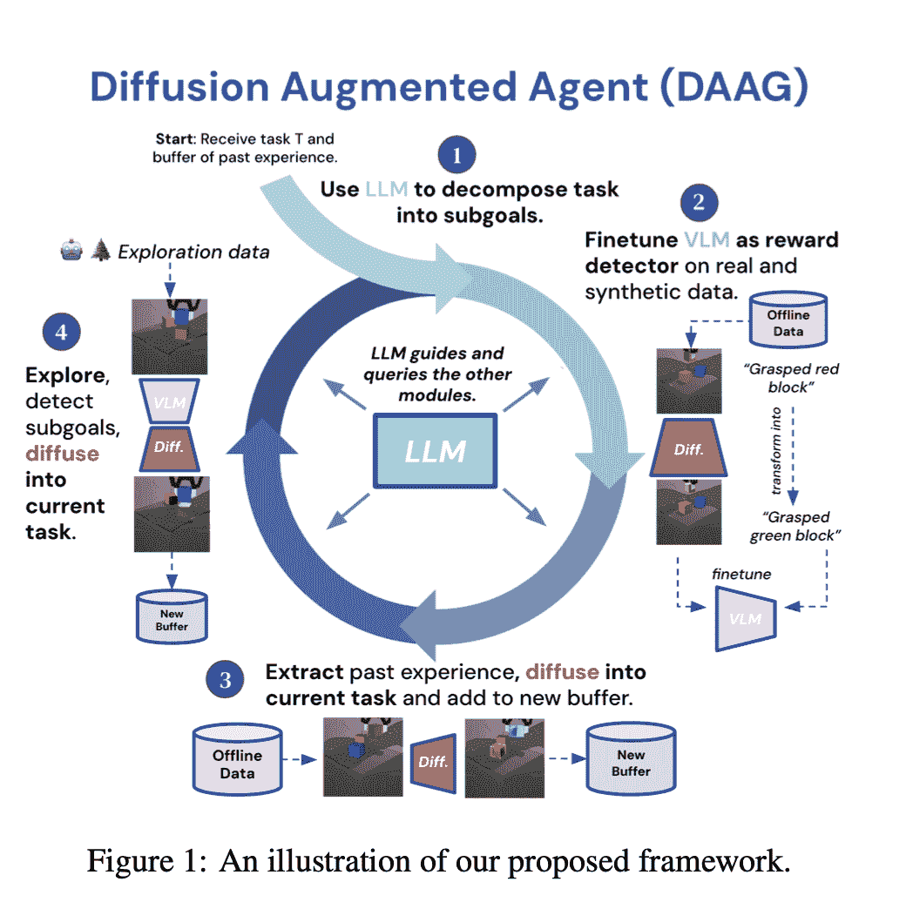

### CLR-Fact: 评估LLMs在事实知识上的复杂逻辑推理能力

贡献人：

链接：http://arxiv.org/abs/2407.20564v1

摘要：大语言模型（LLMs）已经展示了在各种自然语言处理任务中获取丰富事实知识的能力，但它们对于在复杂情况下综合和逻辑推理这些知识的能力尚未充分探索。本文通过一个新颖的基准测试，系统评估了最先进的LLMs在复杂逻辑推理能力上的表现，这个测试包括在通用领域和生物医学知识图上自动生成复杂推理问题。我们的广泛实验采用了多种上下文学习技术，发现LLMs在通用世界知识上具有出色的推理能力，但在专业领域特定知识方面面临重大挑战。我们发现，通过明确的“思维链”示范能明显提高LLMs在具有各种逻辑操作的复杂逻辑推理任务中的表现。有趣的是，我们控制性评估揭示了一个不对称，LLMs在集合并操作方面表现出色，但在集合交操作方面表现相当困难-这是逻辑推理的关键构建模块。为了促进更多工作，我们将公开释放我们的评估基准和代码。

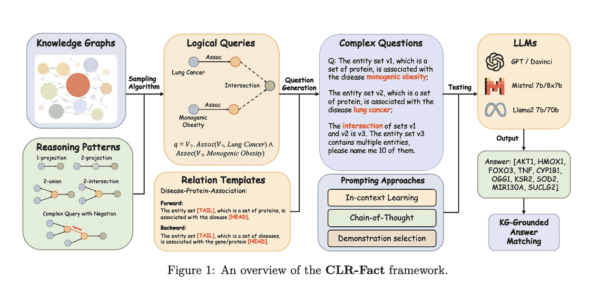

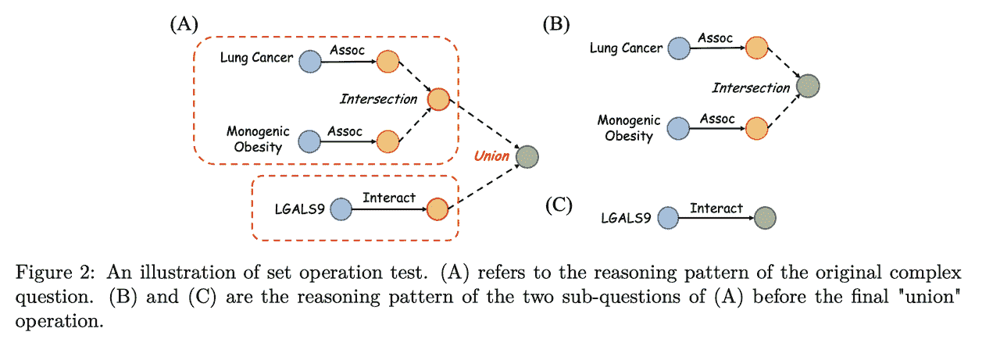

### **如何选择一种强化学习算法**

贡献人：

链接：http://arxiv.org/abs/2407.20917v1

摘要：[强](https://rl-picker.github.io/%E3%80%82)化学习领域提供了许多概念和方法来解决序贯决策问题。选择应用于特定任务的算法可能很具挑战性。本研究简化了选择强化学习算法和行动分布族的过程。我们提供了现有方法及其特性的结构化概述，并提供了何时选择哪种方法的准则。这些准则的互动版本可在线访问：https://rl-picker.github.io/。

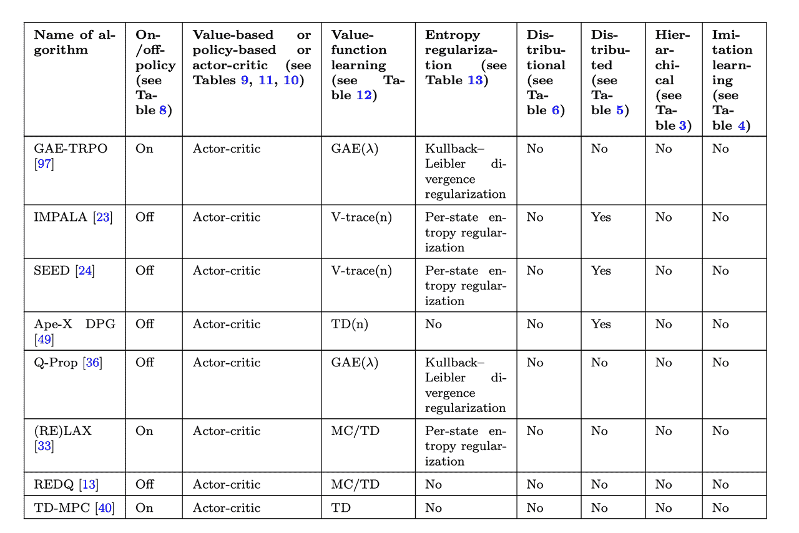

### 合成智能体：高效高质的视觉语言模型合成数据

贡献人：

链接：http://arxiv.org/abs/2407.20756v1

最近，随着网络图像的崛起，管理和理解大规模图像数据集变得越来越重要。由于其强大的图像理解能力，视觉大语言模型(VLLMs)近年来涌现出来。然而，训练这些模型需要大量数据，对效率、有效性、数据质量和隐私提出挑战。在本文中，我们介绍了SynthVLM，一种新颖的用于VLLMs的数据合成管道。与现有方法从图像生成标题不同，SynthVLM采用先进的扩散模型和高质量的标题，自动生成并选择高分辨率图像，从而创建准确对齐的图像-文本对。利用这些对齐的对，我们在各种视觉问题回答任务中实现了最先进的性能，保持高对齐质量并保留先进的语言能力。此外，SynthVLM在性能上超越了传统的基于GPT-4 Vision的标题生成方法，同时显著减少了计算开销。至关重要的是，我们的方法完全依赖于生成的数据，确保隐私得以保护，仅使用10万数据点就实现了最先进的性能（仅为官方数据集大小的18%）。

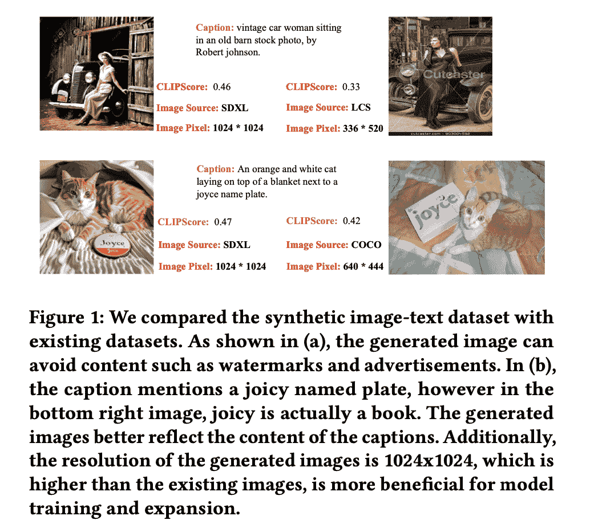

### CoMMIT：用于多模态大语言模型的协调指令微调

贡献人：

链接：http://arxiv.org/abs/2407.20454v1

摘要：在多模态大语言模型（MLLMs）中进行指导调整旨在将骨干LLM与预训练的特征编码器平滑地整合到下游任务中。主要挑战是如何通过合作学习有效地找到协同效应，其中LLMs在下游任务中调整其推理能力，而特征编码器调整其编码以提供更相关的模态信息。我们从理论和实证的角度分析了MLLM指导调整，发现两个组件之间的学习不平衡，即特征编码器和LLM，可能会导致学习梯度减弱，减缓模型收敛，常常导致由于学习不足而产生次优结果。受到我们发现的启发，我们提出了一个测量方法来定量评估学习平衡，基于此进一步设计了一个动态学习调度程序，更好地协调学习。此外，我们引入了一个辅助损失正则化方法，促进更新MLLM的生成分布以考虑每个模型组件的学习状态，这可能防止每个组件梯度减弱，并实现对学习平衡系数的更准确估计。我们在多个LLM骨干和特征编码器上进行实验，我们的技术不依赖于具体模型，并可以与各种MLLM骨干通用集成。在多个视觉和音频模态的多个下游任务上的实验结果表明，所提出的方法在MLLM指导调整中具有更好的效率和有效性。

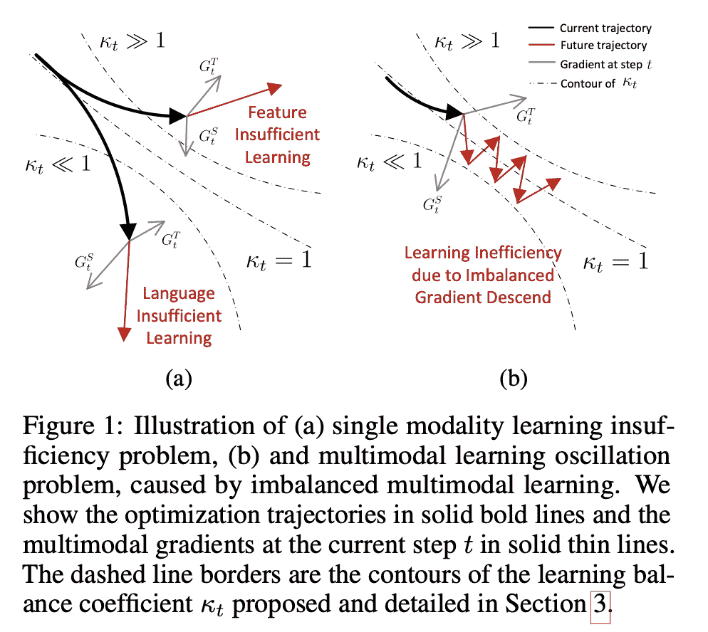

# 产品

### GitStart AI Ticket Studio

贡献人：

https://gitstart.com/

GitStart 是一个提升工程团队效率的票据管理平台，通过其 AI Ticket Studio 功能，自动生成清晰、详细的工程票据，减少开发人员在需求澄清上的时间浪费。它与 Jira/Linear 集成，支持反馈功能，帮助团队更快速地完成开发任务。

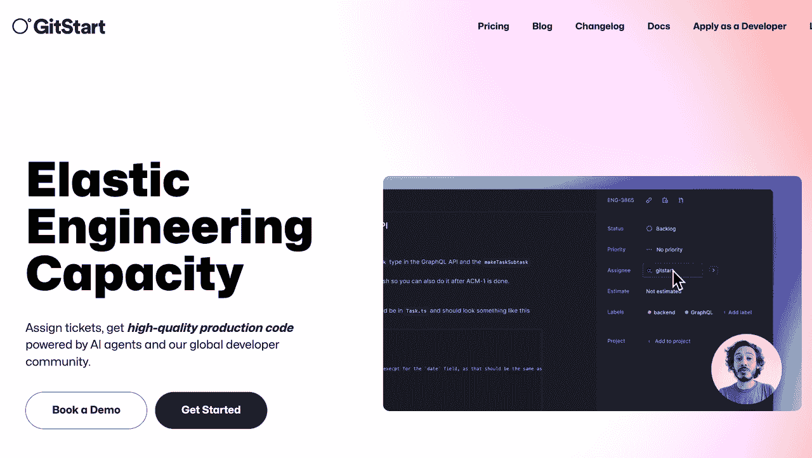

### Table

贡献人：

https://www.usetable.ai/

Table 是一款以 AI 为核心的个人 CRM 工具，希望可以简化社交关系管理。它通过自动连接各种平台、提供 AI 互动和创建提醒任务，帮助用户轻松维护和发展人际关系，避免传统 CRM 的繁琐。

# HuggingFace&Github

### MindSearch

贡献人：

https://github.com/InternLM/MindSearch

MindSearch 是一个开源的 AI 搜索引擎框架，具有与 Perplexity.ai Pro 相当的性能。它可以使用自己的 Perplexity.ai 风格的搜索引擎轻松部署，支持使用闭源 LLMs （GPT， Claude） 或开源 LLMs （InternLM2.5-7b-chat）。

[353409992-b4312e9c-5b40-43e5-8c69-929c373e4965.mp4](https://internal-api-drive-stream.feishu.cn/space/api/box/stream/download/all/Meq4beMP2obAPJx3hGGcmkYpnwh)

### ktransformers

贡献人：

https://github.com/kvcache-ai/ktransformers

KTransformers 是一个灵活的 Python 框架，通过先进的内核优化和部署/并行策略来增强 Transformers 的体验。它提供了一个易于扩展的平台，用于试验创新的大语言模型推理优化。

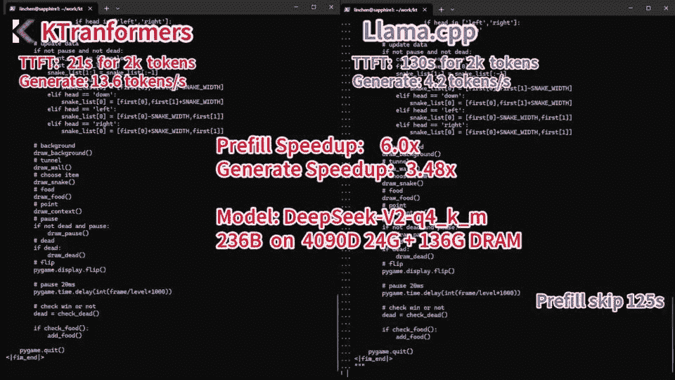

[352761346-0b9fa2da-66f0-48eb-b4b9-f0e1f06f8927.mp4](https://internal-api-drive-stream.feishu.cn/space/api/box/stream/download/all/MKagbYDw4o1cyaxOZ8ccEDzXnlz)

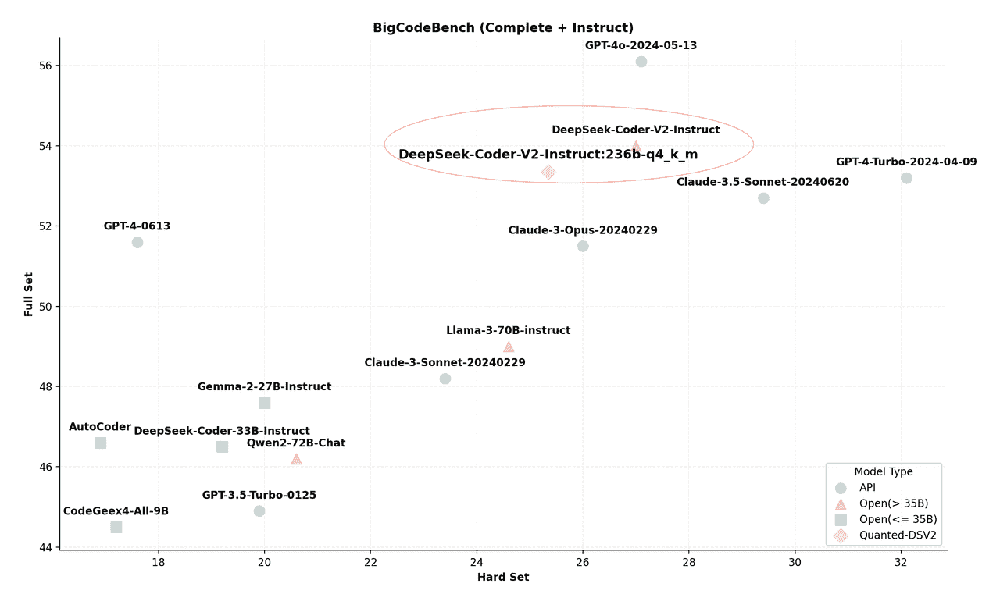

# 投融资

### Intelmatix完成2000万美元A轮融资，助力MENA企业利用AI决策

贡献人：

https://techcrunch.com/2024/07/30/intelmatix-raises-20m-series-a-to-enable-mena-businesses-to-tap-ai-for-decision-making/

深度科技B2B初创公司Intelmatix近日完成了2000万美元的A轮融资，此轮融资由Shorooq Partners领投，包括Olayan Financing Company等多家私营和公共实体参与。Intelmatix总部设在利雅得、伦敦和波士顿，成立于2021年，其企业AI平台EDIX已于2024年3月推出。公司计划利用新资金扩展业务，瞄准中小企业以及公共部门，提供本地化的AI决策支持，帮助MENA地区企业提高运营效率和战略决策能力。

公司官网：https://intelmatix.ai/

### Airtable收购Dopt，吸纳更多AI人才

贡献人：

https://techcrunch.com/2024/07/30/no-code-platform-airtable-acquires-onboarding-startup-dopt-to-bring-on-more-ai-talent/

Airtable宣布收购Dopt，这是一家专注于帮助其他初创公司为新用户构建产品入门体验的公司。此次收购主要是为了吸纳Dopt的AI人才，提升Airtable的AI能力。收购交易于上月底完成，Dopt将于8月15日停止服务。Dopt团队将加入Airtable的AI团队，专注于开发和市场推广更多的AI功能。Dopt此前曾在2022年完成了510万美元的种子轮融资，由Unusual Ventures、Designer Fund和多位天使投资人参与。

公司官网：https://www.dopt.com/

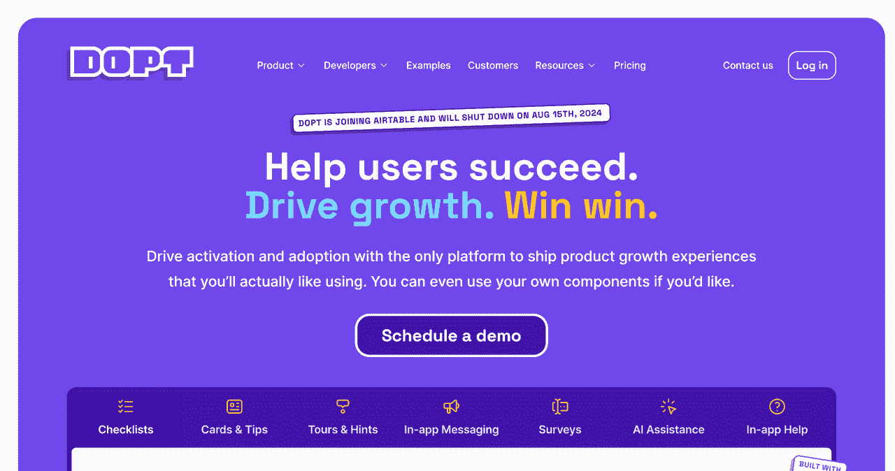

### Gradient AI获得5600万美元C轮融资以扩展AI保险解决方案

贡献人:

https://www.gradientai.com/press-gradient-ai-secures-56-million-in-series-c-funding-to-expand-ai-powered-insurance-solutions

Gradient AI在Centana Growth Partners的带领下，完成了5600万美元的C轮融资。参与此次融资的还有现有投资者MassMutual Ventures、Sandbox Insurtech Ventures和Forte Ventures。资金将用于产品开发、扩大解决方案范围、研发投资，以提高保险业的创新和效率。Gradient AI计划利用这笔资金改进平台功能，推出新产品，帮助保险公司实现更高的风险评估和运营效率。CEO Stan Smith表示，这笔资金将进一步巩固公司在AI保险解决方案市场的领导地位。

公司官网：https://www.gradientai.com/

### 星尘智能完成数千万美元Pre-A轮融资，经纬创投领投

贡献人：

https://www.jiemian.com/article/11492892.html

据华兴资本消息，AI机器人公司星尘智能（Astribot）近日完成数千万美元Pre-A轮融资，由经纬创投领投，道彤投资及清辉投资等产业资本跟投，老股东云启资本超额跟投。华兴资本担任独家财务顾问。本轮融资将用于顶尖人才招募、研发投入、商业化部署等工作。

公司官网：https://astribot.com/

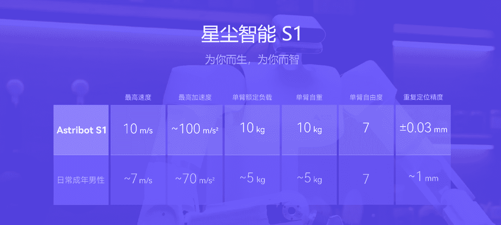

### Friend AI伴侣获得250万美元融资，帮助缓解孤独

贡献人：

https://techcrunch.com/2024/07/30/friend-is-an-ai-companion-backed-by-founders-of-solana-perplexity-and-zfellows/

由Solana、Perplexity和ZFellows创始人支持的AI伴侣设备Friend最近完成了250万美元的融资，估值5000万美元。投资者包括Caffeinated Capital的Raymond Tonsing、Z Fellows创始人Cory Levy、Perplexity CEO Aravind Srinivas、Solana创始人Anatoly Yakovenko和Raj Gokal等。Friend是一款佩戴在脖子上的设备，通过蓝牙连接手机，旨在通过与用户的对话缓解孤独感。基础版售价99美元，将于2025年1月开始预售和发货。

公司官网：https://www.friend.com/

### 「灵明光子」完成 C2 轮融资

贡献人：

https://mp.weixin.qq.com/s/vb-xpaB1SMU9lHt1HQzk_w

2024年上半年，灵明光子业务发展迅猛，实现高端芯片项目的量产出货。浙江金控旗下金投鼎新完成对灵明光子的C2轮投资，光源资本担任独家财务顾问。本轮融资将用于高端3D摄像头芯片的研发和量产，以推动该技术在智驾、机器人和高端摄像头领域的应用。灵明光子成立于2018年，核心团队具备国际领先的SPAD技术研发能力，持有多项国内外专利，并被国家工信部认定为国家级专精特新“小巨人”企业。

公司官网：https://adapsphotonics.com/cn/

### 智能眼镜厂商「INMO影目科技」完成近亿元B轮融资

贡献人：

https://mp.weixin.qq.com/s/wNIJMfp8l4MZbqyn-m2Rsw

智能眼镜厂商INMO影目科技完成B轮近亿元融资，本轮融资由四川发展弘芯基金、成华科创投公司及江西中寰投资集团共同参与。影目科技成立于2020年，是国内无线AR眼镜品类的开创者。资金将用于建设成都总部，并与多家互联网企业打造元宇宙产业生态圈。影目科技此前已发布多款消费级智能眼镜，最新产品INMO Go在技术和销量上居于行业领先地位。

公司官网：https://inmolens.com/

# 学习

### 大模型的高效训练：从Infra到框架优化

贡献人：

https://zhuanlan.zhihu.com/p/711683629?utm_psn=1801704886368354306

本文深入探讨了大规模语言模型（LLMs）高效训练的关键技术细节。首先，LLMs 的训练对系统和基础设施提出了可扩展性、效率和可靠性的要求。在可扩展性方面，系统需要支持数万级 GPU 集群，并确保训练的准确性和模型的精度。效率方面，通过模型浮点运算利用率（MFU）来衡量，涉及计算优化、通信开销减少和内存管理。在可靠性方面，对于可能持续数周到数月的训练过程，系统必须保持稳定，并能够迅速从故障中恢复。

文章详细介绍了分布式训练系统的关键要素，包括并行策略的选择、计算资源的优化利用、通信成本的最小化以及内存使用的高效管理。这些优化措施旨在提高系统的可扩展性和效率。此外，文章还探讨了容错机制，如何通过软硬件的协同工作，提高训练过程中的可靠性，以应对硬件故障、网络问题和软件错误等情况。

论文链接：https://arxiv.org/abs/2407.20018

### PyTorch 2.4 发布，有哪些值得关注的新特性？

贡献人：

https://www.zhihu.com/question/662630894?utm_psn=1801884831325495298

PyTorch 2.4 版本强化了对并行策略的支持，特别是通过 FSDP2（Fully Sharded Data Parallel）的引入，提高了分布式训练的性能，并优化了与 torch.compile 的兼容性。FSDP2 使用 DTensor 作为底层支持，相比于 FSDP1，性能提升了约 7%。此外，PyTorch 2.4 增加了对流水线并行（PP）的支持，包括 GPipe、1F1B、Interleaved 1F1B 和 Looped BFS 等策略，以及对 block-wise attention mask 的支持，这对于大模型的训练具有重要意义。在性能优化方面，PyTorch 2.4 改进了 CUDA 内核的执行路径，减少了内存访问延迟，并降低了分布式训练中的通信开销。同时，PyTorch 2.4 在 API 设计上进行了升级，新增了自动混合精度（AMP）功能，提高了模型训练和推理的效率。Python 3.12 的更新带来了性能提升和新特性，如结构化模式匹配和参数化泛型，这些都为深度学习开发者提供了更多的工具和更高的效率。

### 探索CRAM：提升AI计算性能的革命性技术

贡献人：

https://zhuanlan.zhihu.com/p/711850674?utm_psn=1801885652725399553

内存原生 CRAM 技术是一种创新的计算存储解决方案，它通过在 DRAM 芯片内部集成计算功能，实现数据在内存中直接处理，从而彻底消除了数据在内存与处理器之间传输的瓶颈。CRAM 技术的核心在于它能够在 DRAM 的存储单元 ——Cell 中执行计算任务，这不仅极大地降低了能耗，还缩短了数据处理的延迟。与传统的 Von Neumann 架构相比，CRAM 技术省略了数据在内存和 CPU 之间的来回传输，因此能够显著提升系统的整体性能，特别适合于数据密集型的应用场景，如人工智能、大数据分析等。然而，CRAM 技术的实现也面临着一些挑战，包括但不限于芯片设计的复杂性、制造工艺的改进以及对现有软件栈的适配。

### 解析千卡异构混训的破局之道

贡献人：

https://zhuanlan.zhihu.com/p/711925986

千卡异构混训技术作为一种创新的解决方案，针对 AI 模型训练中的算力焦虑问题，通过混合利用不同类型的计算资源（如 CPU、GPU、TPU 等），实现了算力的高效配置和使用。该技术的核心在于动态资源调配，它能够根据模型在不同训练阶段的需求，智能分配计算资源，从而在保证模型性能的前提下，降低计算成本和加速训练过程。技术细节上，千卡异构混训涉及到对模型特性的深入分析，以及如何通过算法层面的优化来提升资源利用率。例如，通过设计更高效的数据加载和传输机制，减少 I/O 瓶颈；通过优化模型结构和参数，减少计算量而不牺牲性能。此外，该技术还能够通过自适应调整学习率和批大小等策略，进一步优化训练过程。

### CUDA Graph 在 Transformers 中的使用和进一步改进 - KTransformers (1)

贡献人：

https://zhuanlan.zhihu.com/p/711803999

KTransformers 框架通过集成 CUDA Graph 技术，有效提高了 Transformers 模型在推理阶段的性能。该框架专门针对大型语言模型如 DeepSeek-V2 和 Qwen 2 进行了优化，提升了 tokens 处理速度，并在小型模型上实现了高达 70% 的性能增益。为了减少 CUDA Graph 中的断点，KTransformers 采用了静态 KVCache 和重构 RoPE 模块的计算方式，以及对 Flash Attention 2 的接口进行了修改，以支持静态缓存。此外，KTransformers 还实现了 CPU Offload 功能，通过在 CUDA Graph 中嵌入 CPU 计算任务，平衡了 CPU 和 GPU 的工作负载，进一步提升了推理效率。

### 浅谈领域模型训练

贡献人：

https://zhuanlan.zhihu.com/p/711537210

领域模型训练是针对特定领域数据和任务定制化训练的深度学习模型。与通用模型不同，领域模型通过在目标领域的数据集上预训练，提高了模型在该领域内的性能。技术细节上，该过程涉及数据的精心收集和预处理、模型架构的选择、训练过程的监督和调整，以及模型评估的指标选择。迁移学习在这一过程中起到关键作用，它允许从通用模型中初始化参数，然后在目标领域的数据上进行微调，从而解决了数据稀缺问题，并加速了训练收敛。此外，领域模型训练还需要关注模型的泛化能力和计算效率，确保模型在实际应用中的鲁棒性和实用性。

### 对话马也骋：Eureka和DrEureka如何利用LLM解决仿真+RL最重要的难题

贡献人：

https://zhuanlan.zhihu.com/p/711892499

Eureka 项目通过大型语言模型（LLM）自动化地设计仿真环境和奖励函数，解决了仿真 + 强化学习（RL）中的关键难题。具体而言，Eureka 利用 LLM 编写奖励函数代码，通过仿真中策略的表现反馈进行自我改进，实现了奖励函数的迭代优化。DrEureka 进一步推动了这一技术，实现了领域随机化的自动化设计，提高了仿真到现实世界的迁移效率和鲁棒性。技术细节上，Eureka 使用了 Python 代码作为仿真环境和奖励函数的基础，LLM 如 GPT-4 擅长生成这些代码。此外，Eureka 采用了成功函数和策略统计总结作为 LLM 反馈的方法，以生成更好的奖励函数。DrEureka 在此基础上，通过 LLM 自动调整物理参数的随机化范围，确保了策略在现实世界中的有效性。

### 2024稀土开发者大会回放&PPT

贡献人：

https://mp.weixin.qq.com/s/SoXQc29BALsFn9iaxdRUqQ

2024 稀土开发者大会 于 2024 年 6 月 28 日至 6 月 29 日在北京举办，吸引了超过 70 位技术嘉宾和 12 位出品人共同参与。大会主题涵盖了架构设计、业务稳定性、云计算实践、AI Agent 应用创新、大模型部署与推理、RAG 与向量搜索、研发效能与团队管理、大模型工具链应用、掘金创作者专场、前端未来以及 GenAI 技术实践等多个领域。此外，大会还设有特色 AI 展区，邀请了包括商汤、月之暗面、宇树（unitree)、Jina AI 等在内的 10 多家 AI 厂商参与互动。

[🎉2024稀土开发者大会](https://km3dl0ffdl.feishu.cn/wiki/T3a2wBP82iwMcbkOu4pcEm6rn1c)

# 📡潜空间活动预告

> **潜空间系列活动第三季全面升级！**

>

> 第三季第二期将在**8月11日** **11:00 am**开始，嘉宾是**陈贝迪**。活动包括嘉宾分享、访谈Q&A、cofounder matching餐会。活动现场还可以体验到咱们奇绩校友的最新产品，期待大家大力支持！

>

>

> 陈贝迪-卡内基梅隆大学助理教授，斯坦福大学人工智能博士后学者，前 Meta AI 研究科学家；致力于在现代硬件上设计和优化算法和模型，以加速大型机器学习系统。

>

>

> 童晟邦- 纽约大学博士，伯克利人工智能实验室（BAIR）研究员， OpenAI 超对齐奖学金获得者；

>

>

> 闫俊杰-MiniMax 创始人兼 CEO。是中国第一梯队的大模型创业者，目前 MiniMax 估值超 25 亿美元。

>

>

> 宋佳铭-Luma AI 首席科学家，斯坦福大学计算机科学博士、博士后；曾任职英伟达（DIR）小组科学家 ，创建了最早的扩散模型加速算法，该算法广泛用于最近的生成式 AI 系统，包括 DALL-E 2、Imagen、Stable Diffusion 和 ERNIE-ViLG 2.0。

>

>

> 本季活动同时开放**北京线下、上海线下和线上**场次，欢迎校友和外部创业者扫描右方二维码报名！

# 声明

本文档仅供学习交流使用，版权归原作者所有，若涉侵权，请联系Jack Jin 15101136166

##

（欢迎在下方反馈您宝贵的意见！整理不易，觉得有用给AI日报小组点个赞👍吧！）

ChatGPT；Angela；Zijia Liu；Alex；Zeqi Tan；Tiezhen（HuggingFace）；Naixu；Lizhi；Peter；Suoman；Jack

封面生成——右脑科技

如果你有大模型相关的创业想法，欢迎来找我们聊聊～微信：15101136166

> 快邀请你的小伙伴们一起来读大模型日报吧！

> **【日报****知识库****】**这里是近期日报内容的汇总,欢迎大家查阅

> [大模型日报知识库(分享版)](https://miracleplus.feishu.cn/wiki/KapVwXfkriOBiskB0B2cUHxjnTh)

>

> 欢迎大家多多帮我们分享,转发~~

> 如果大家有任何的建议或者吐槽,欢迎随时找我聊天~

