# 奇绩大模型日报（7月 30日）

> 来源：[https://miracleplus.feishu.cn/docx/DpcWdC9VzoBqe6xxvoScNbJkncg](https://miracleplus.feishu.cn/docx/DpcWdC9VzoBqe6xxvoScNbJkncg)

# 资讯

### Vidu全球上线 首发实测：多镜头切换强到爆，30秒生成大片

贡献人：

https://mp.weixin.qq.com/s/WOfudWJFdHC4fMTAd4P9vQ

Vidu以其多镜头切换和动画风格生成能力而受到关注。Vidu 能在短时间内（30 秒）生成高质量（1080P）的 4 秒至 8 秒视频片段，支持写实和动画两种风格，并且能够生成包含数字和英文文字的画面。它具备高动态性、高逼真度和高一致性，特别适合二次元内容创作。Vidu 提供免费版和三种不同价格的收费版，以及年度订阅优惠，满足不同用户的需求。实测表明，Vidu 在语义理解、动态运动表现和多镜头切换方面表现出色，尤其在动漫风格的内容创作上，展现了高度的风格一致性和优化。虽然在处理大幅度运动或专业场景时可能会出现失误，但整体来看，Vidu 在日常场景的应用中已经足够稳定和高效，为内容创作者提供了强大的工具，节省了后期制作时间。此外，Vidu 还能够复制真人照片和二次元角色，实现图生视频的角色一致性，为动画、游戏等行业带来了新的价值。

web端访问：www.vidu.studio

### 中美人形机器人落地进展大比拼

贡献人：

https://mp.weixin.qq.com/s/3bD-aif25yE4ipJ5pGfS4A

2024 年中美人形机器人发展呈现出明显分工。美国企业如特斯拉、Figure AI 等，聚焦技术创新，提升机器人的协调能力、语言理解和底层逻辑能力。而中国企业如宇树科技、优必选等，则以价格优势和市场渗透为主，其产品如宇树的 G1 人形机器人和四足机器人，已经实现了商业化销售，在全球市场上占据了领先地位。日本虽然在机器人核心零部件工艺上有优势，但由于高昂的生产成本和相对保守的市场策略，其人形机器人产业发展较慢。中国的供应链优势和市场资金支持，使得人形机器人的成本持续下降，特斯拉的 Optimus 人形机器人就在中国实现了成本控制。

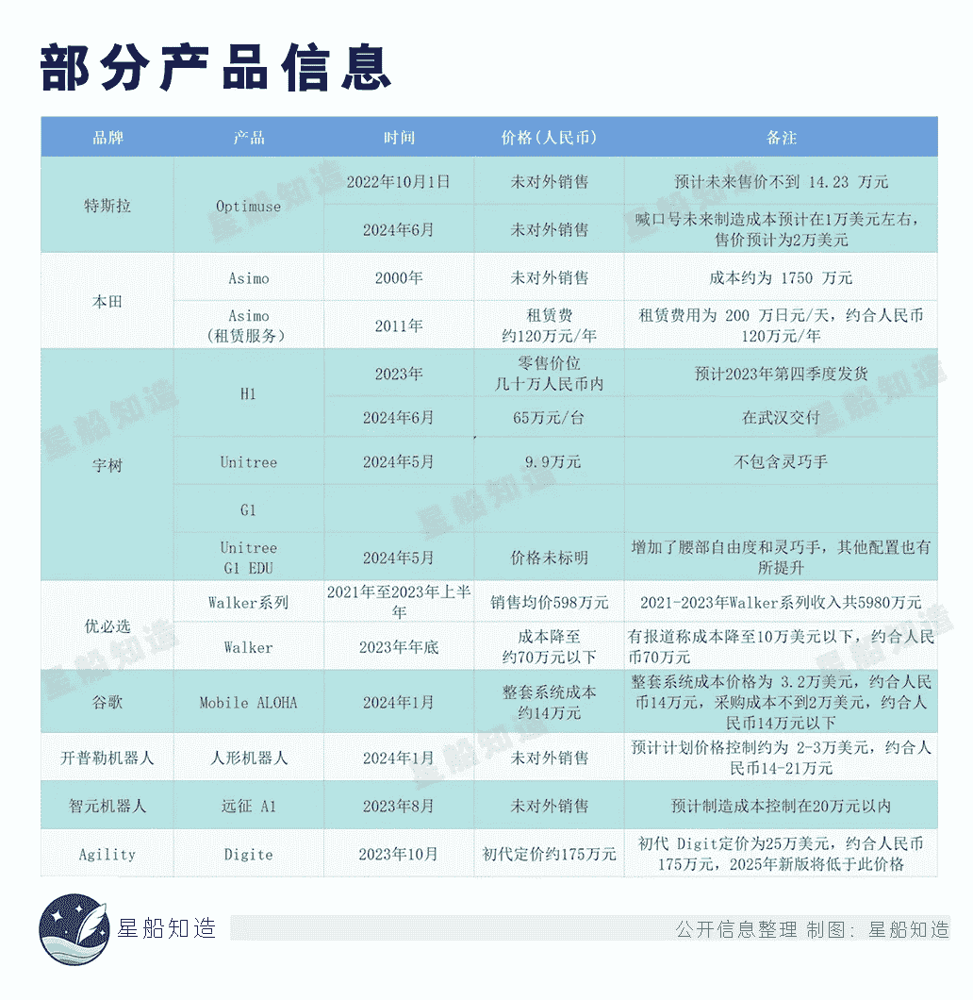

### Tenstorrent挑战HBM的高价位霸权

贡献人：

https://mp.weixin.qq.com/s/A-irGkdi6Hp4PrdkbhWlRg

AI 大模型训练对算力和带宽的需求日益迫切，而 HBM 作为提供高带宽的关键存储器，其昂贵的成本成为了 AI 硬件发展的瓶颈。尽管市场对 HBM 的需求持续增长，但其高昂的价格和有限的供应导致了对成本更优惠解决方案的探索。"硅仙人" 吉姆・凯勒等行业专家正致力于开发不依赖 HBM 的 AI 芯片，以降低成本和提高效率。Tenstorrent 公司的 Grayskull 和 Wormhole 处理器便是通过采用标准 DRAM 而非 HBM，成功实现了性能与成本的平衡。同时，Groq 的 LPU 芯片和 NEO Semiconductor 的三维 DRAM 技术也分别通过使用 SRAM 和结合神经元电路，展现了不同于 HBM 的 AI 处理能力。

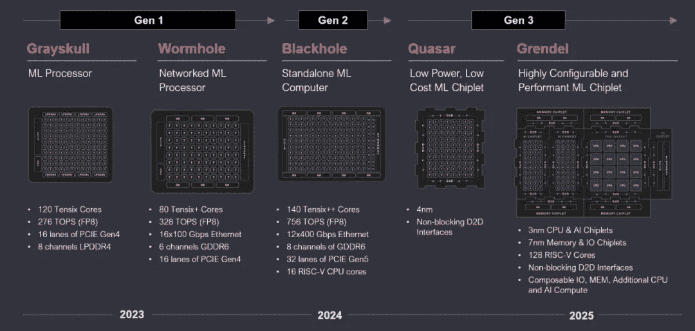

### 扎克伯格给黄仁勋送上皮衣，预告Llama4颠覆AI形态：SIGGRAPH对话全纪录

贡献人：

https://mp.weixin.qq.com/s/svLOUNamPjfu2bLYv0S9Ow

在 SIGGRAPH 会议上，黄仁勋与扎克伯格探讨了 AI 技术的未来，特别是生成式 AI 在社交媒体、推荐系统及个性化内容创作中的应用。他们强调了开源的重要性，认为开源策略能够促进行业生态系统的发展，并为公司带来经济效益。此外，他们就 AI 模型的规模和定制化进行了讨论，预示了智能眼镜和 VR/MR 头显将成为新一代计算平台的趋势。扎克伯格还分享了他对元宇宙的愿景，以及 Meta 在 AI 领域的最新进展。最后，他们通过互相赠送皮衣来象征性地结束了这场对话。整个

### 苹果表示，他们在训练 Apple Intelligence 模型时采取了“负责任”的方法。

贡献人：

https://techcrunch.com/2024/07/29/apple-says-it-took-a-responsible-approach-to-training-its-apple-intelligence-models/

苹果公布技术论文，强调在开发苹果智能模型时采取负责任的数据使用策略。论文揭示了使用公开数据、已许可数据和自家网络爬虫 Applebot 收集的信息进行模型训练，确保未涉及私人用户数据。苹果还透露了与多家出版商签订协议，使用其新闻档案和开源代码进行模型训练，并采用了人工反馈和合成数据来优化模型性能。尽管苹果在论文中没有透露过多细节，但这是为了避免竞争和法律风险。同时，苹果允许网站管理员阻止数据收集，但个别创作者的隐私保护问题仍未完全解决。目前，生成式 AI 模型的训练方式正在遭遇法庭审查，苹果试图在这一背景下塑造自己为一个道德的 AI 技术参与者。

# 推特

### Meta Segment Anything Model 2: 第一个用于图像和视频实时、可提示对象分割的统一模型

https://x.com/AIatMeta/status/1818055906179105010

介绍 Meta Segment Anything Model 2 (SAM 2)——第一个用于图像和视频实时、可提示对象分割的统一模型。

SAM 2 今天以 Apache 2.0 许可证发布，任何人都可以使用它来构建自己的体验。

详情 ➡️ https://go.fb.me/p749s5

[ssstwitter.com_1722293866801.mp4](https://internal-api-drive-stream.feishu.cn/space/api/box/stream/download/all/MWU6byg7RoWBjRxDaOZck1HYnCb)

### Gen-3 Alpha图像到视频功能：允许使用任何图像作为视频生成的第一帧

https://x.com/runwayml/status/1817963062646722880

今天我们发布了Gen-3 Alpha图像到视频功能。这次更新允许您使用任何图像作为视频生成的第一帧，可以单独使用，也可以配合文字提示以获得额外指导。图像到视频是一个重大更新，它极大地改善了您生成内容的艺术控制和一致性。更多详情请见下文。

[ssstwitter.com_1722273963025.mp4](https://internal-api-drive-stream.feishu.cn/space/api/box/stream/download/all/GYQnbu9S1oTuHhx5pPLcZZzNnog)

### Karpathy转发AI视频：任何人都将能够创作出美丽的视频

https://x.com/karpathy/status/1818141090790375462

Andrej Karpathy:

今早在r/aivideo上看到的，美丽且略微萦绕在我脑海中。AI生成的视频，歌词是人类+AI合作创作，来自YouTube上的@endlesstaverns。

任何人都将能够创作出美丽的视频。未来已经到来，只是分布不均且不必要地复杂。

引用 Olivia Moore:

看到AI视频在过去几个月里取得的进步真是令人惊叹

这里对阴影和光线的处理感觉像是设立了一个新标准👇

（来自@endlesstaverns，使用Runway Gen-3 + Suno制作）

[ssstwitter.com_1722332548276.mp4](https://internal-api-drive-stream.feishu.cn/space/api/box/stream/download/all/OD1nbBAHmot11pxAhvJcZce4nwc)

### Adam分享：利用一个更大、更强大的模型来教导小型模型成为特定领域的专家

https://x.com/adamcohenhillel/status/1817971845200785683

所以你实际上可以通过利用一个更大、更强大的模型来教导它，从而训练一个小型模型成为特定领域的专家！

我制作了一个简单的Colab笔记本（开源的），用于在由巨大的Llama-3-405B模型生成的特定知识上微调llama-3-8b模型 👇

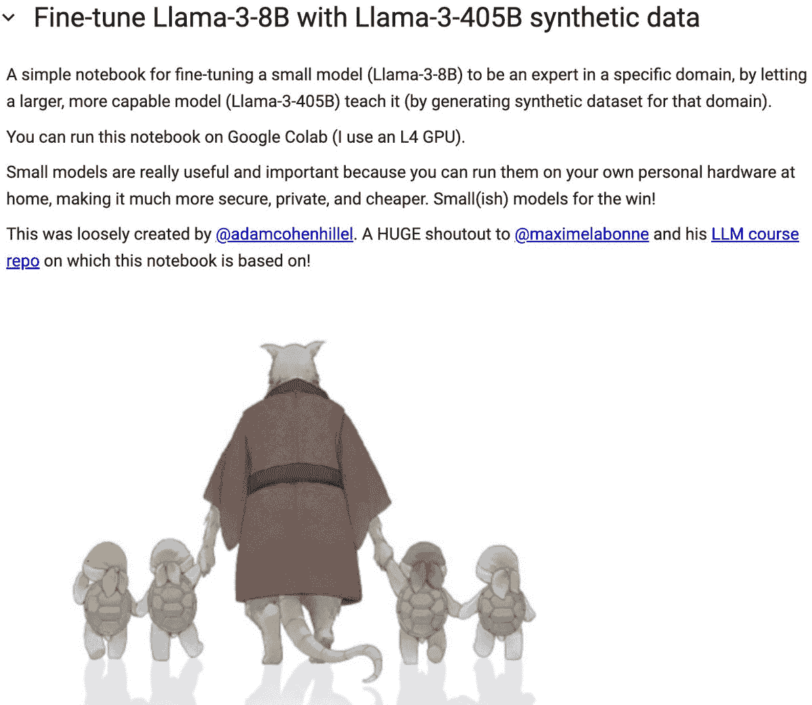

### Saboo分享教程：使用开源的Llama 3.1 405B模型，无代码通过RAG构建一个自定义AI聊天机器人与任何Github仓库对话

https://x.com/Saboo_Shubham_/status/1818111127286579448

使用开源的Llama 3.1 405B模型，通过RAG（检索增强生成）技术构建一个自定义AI聊天机器人，可以与任何GitHub仓库进行对话，无需编写任何Python代码。

[ssstwitter.com_1722332678285.mp4](https://internal-api-drive-stream.feishu.cn/space/api/box/stream/download/all/Um0WbmhwQoh2m5xHnm8cgrVrnmh)

# 论文

### **Survey and Taxonomy：数据中心智能在基于Tr**ansformer的时间序列预测中的作用

贡献人：

链接：http://arxiv.org/abs/2407.19784v1

随着不断改进人工智能性能的过程，研究人员也开始关注数据中心人工智能的涌现概念，强调数据在系统化机器学习训练中的重要作用。随着模型的发展，Transformer架构的出现成为其中之一，它在自然语言处理（NLP）、计算机视觉（CV）和时间序列预测（TSF）等多个领域具有高水平的能力。然而，它的性能在很大程度上取决于输入数据的预处理和输出数据的评估，因此未来的研究应采取数据中心的方法。我们认为，数据中心人工智能对于高效训练人工智能模型至关重要，尤其是基于Transformer的TSF模型。然而，在Transformer TSF和数据中心人工智能整合方面存在差距。该调查旨在通过基于提出的分类法的广泛文献回顾来确定这一差距。我们从数据中心人工智能的角度审查以往的研究工作，旨在为基于Transformer架构和数据中心人工智能的未来发展奠定基础。

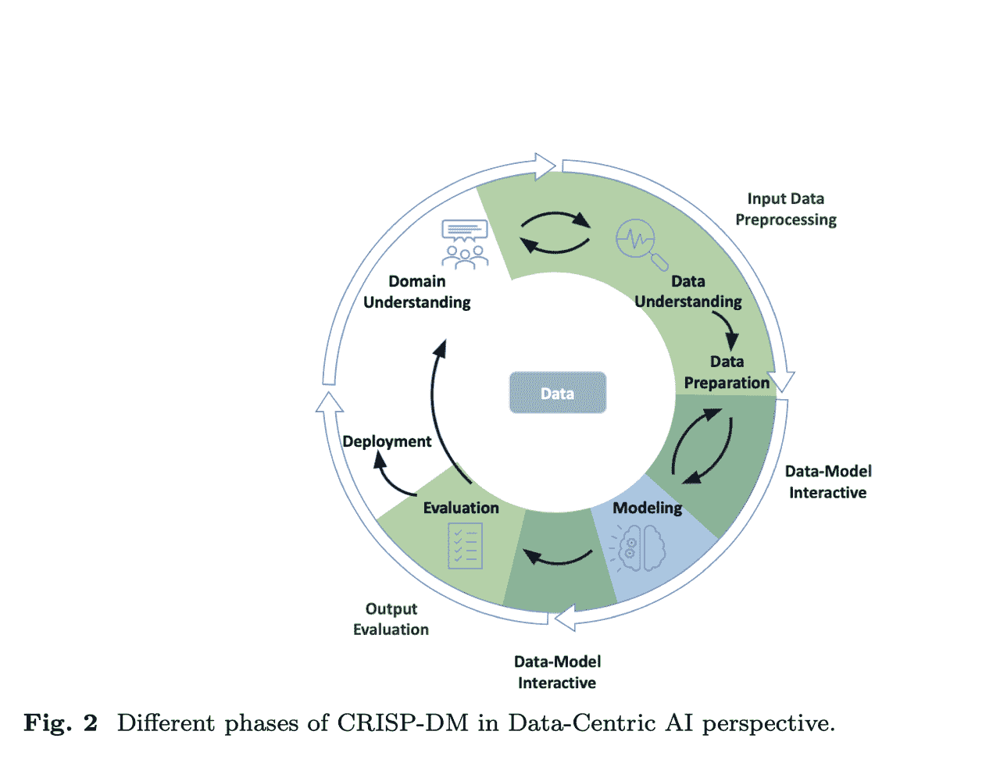

### BEExAI：评估Explainable AI的基准

贡献人：

链接：http://arxiv.org/abs/2407.19897v1

最近在可解释性方面的研究催生了许多旨在增进我们对黑盒机器学习模型输出理解的事后归因方法。然而，评估解释质量缺乏统一方法，以及针对事后归因方法量化指标衡量有效性的方法学共识。此外，随着越来越复杂的深度学习模型在各种数据应用中的发展，对解释质量和正确性的可靠测量方式变得至关重要。我们提出了BEExAI，一个基准工具，允许对不同事后XAI方法进行大规模比较，采用一组选定的评估指标。

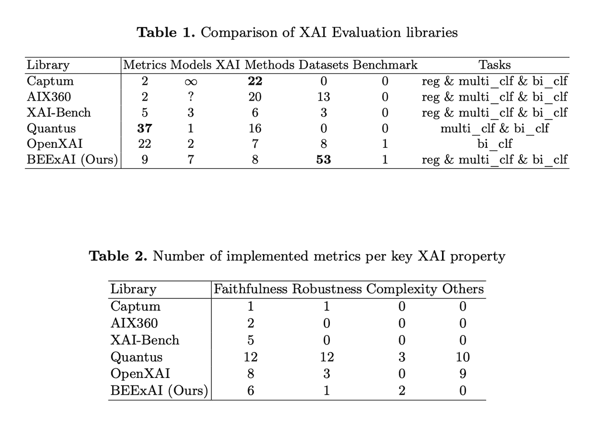

### xAI-Drop: 不使用无法解释的内容

贡献人：

链接：http://arxiv.org/abs/2407.20067v1

图神经网络(GNNs)已经成为从图结构数据中学习的主导范式，提供了从社交网络分析到生物信息学等广泛的应用。尽管它们具有多样性，GNNs面临着过度平滑、泛化能力不足和解释性差等挑战，这些挑战限制了它们在关键应用中的广泛采用和可靠性。丢弃已经成为一个有效的范式，可以在训练过程中减少噪声，提高GNNs的鲁棒性。然而，现有方法通常依赖于随机或基于启发式的选择标准，缺乏一个原则性的方法来识别和排除对模型中的噪声和过度复杂性有贡献的节点。在这项工作中，我们认为解释能力应该是模型在整个训练阶段鲁棒性的关键指标。为此，我们引入了xAI-Drop，这是一种新的基于拓扑级别的丢弃正则化器，利用解释能力来指示应该从GNN传播机制中排除的嘈杂网络元素。对各种真实世界数据集的实证评估表明，我们的方法在准确性上优于当前的最先进的丢弃方法，有效减少了过度平滑，并改善了解释质量。

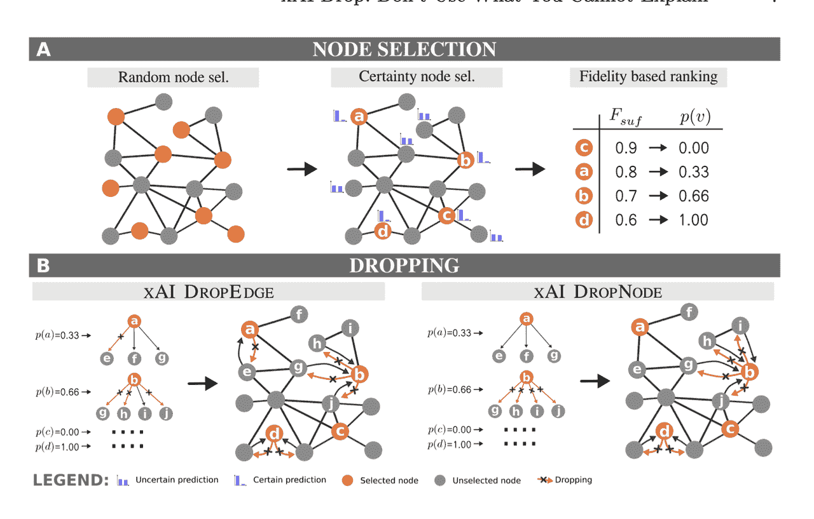

### **Unknown Cluster Numbe**r的非结构化数据中的自适应自监督鲁棒聚类

贡献人：

链接：http://arxiv.org/abs/2407.20119v1

摘要：我们介绍了一种针对无结构数据的新型自监督深度聚类方法，不需要先验知识来确定聚类数，称为自适应自监督稳健聚类（ASRC）。ASRC 自适应地学习图结构和边权重，以捕获局部和全局结构信息。通过增强的图自编码器与对比学习技术，ASRC 能够学习友好于聚类的特征表示。 ASRC 进一步利用鲁棒连续聚类 (RCC) 自适应地生成用于负采样的原型，可以进一步促进正例间的一致性，并扩大正例和负例之间的差距。ASRC通过将RCC应用于学习到的特征表示及其一致的图结构和边权重，获得最终的聚类结果。在七个基准数据集上进行的广泛实验表明了ASRC的有效性，显示其优于其他热门聚类模型的性能。值得注意的是，ASRC甚至胜过那些依赖聚类数先验知识的方法，突显了其在应对无结构数据聚类挑战中的有效性。

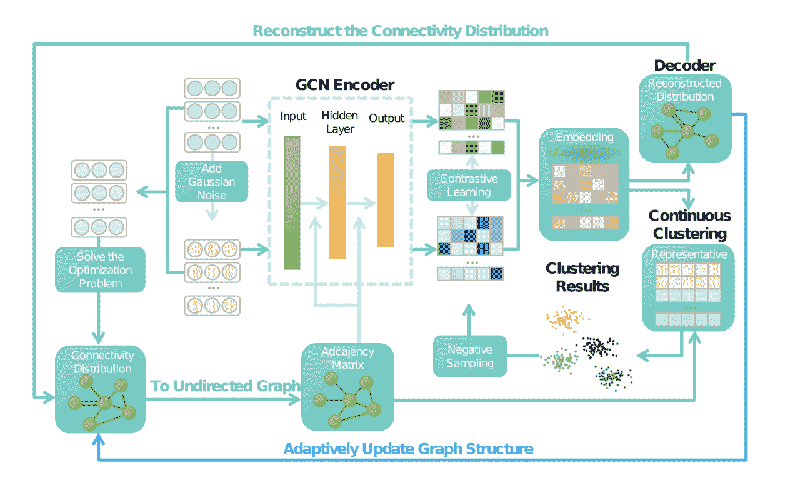

### **使用LLMs生成易读内容的探索**

贡献人：

链接：http://arxiv.org/abs/2407.20046v1

确保文本可访问性和可理解性是关键目标，特别是对于认知障碍和智力障碍的个体，他们在访问各种介质的信息时面临挑战，比如网页、报纸、行政任务或健康文件。Easy to Read和Plain Language等倡议旨在简化复杂文本；然而，标准化这些准则仍然具有挑战性，并常常涉及手动处理。本研究探讨了利用人工智能（AI）和自然语言处理（NLP）方法系统地简化西班牙文本为易读格式的初步调查，重点是利用大语言模型（LLMs）简化文本，特别是生成易读内容。该研究贡献了一套西班牙语平行语料库，适用于易读格式，可作为训练和测试文本简化系统的宝贵资源。此外，利用LLMs和收集的语料库进行了几项文本简化实验，包括对Llama2模型进行微调和测试，以生成易读内容。还进行了定性评估，由易读内容文本适应专家指导，评估自动简化的文本。这项研究有助于提升认知障碍个体的文本可访问性，突出了在负责任管理能源使用的同时利用LLMs的有前景的策略。

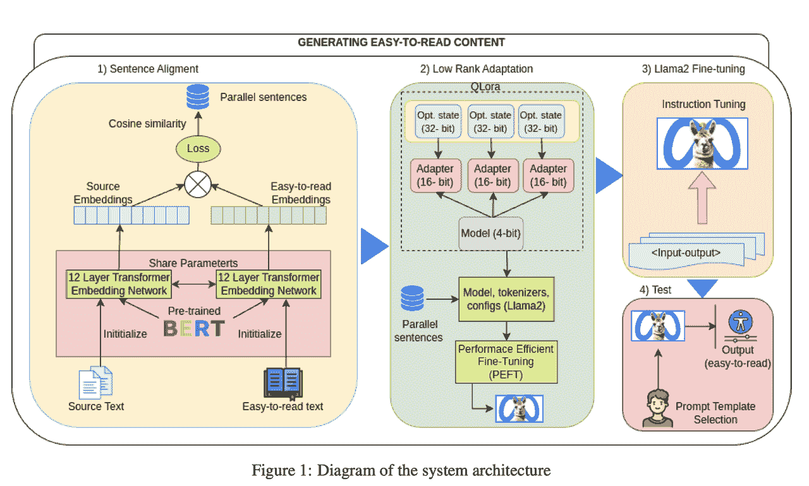

### 利用“stairs”辅助greedy 生成加速大语言模型推理

贡献人：

链接：http://arxiv.org/abs/2407.19947v1

大型语言模型(LLMs)以其卓越的预测能力而闻名，但需要大量资源来运行。随着它们在受欢迎程度的飙升，即使对所需资源有轻微减少也可能对环境产生影响。另一方面，更小的模型需要更少资源，但可能会牺牲准确性。在这项工作中，我们提出了“楼梯辅助贪婪生成”的实现。这是一种改进的辅助生成方法，利用了较小模型的快速生成，较大模型的批量预测和“楼梯”验证，以实现预测生成的加速。结果显示，在文本生成任务中，与独立的大型LLM预测相比，推断时间减少了9.58%至17.24%，而准确性没有损失。

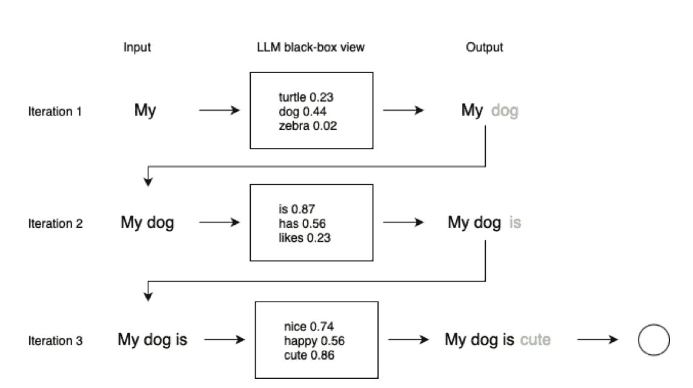

### **M**eta-Rewarding Language Models:：LLM-as-a-Meta-Judge的自我改进对齐

贡献人：

链接：http://arxiv.org/abs/2407.19594v1

大型语言模型 (LLMs) 在许多领域迅速超越了人类知识。虽然改进这些模型传统上依赖昂贵的人类数据，但最近的自奖励机制(Yuan等，2024)表明，LLMs 可以通过判断自己的响应而不是依赖于人类标注者来改进。然而，现有方法主要集中在改进模型响应而不是判断能力，导致在迭代训练中迅速饱和。为解决这一问题，我们引入了一个新颖的元奖励步骤到自我改进过程中，其中模型判断其自身的判断并利用该反馈来优化其判断能力。令人惊讶的是，这种无监督方法改善了模型判断和遵循指令的能力，如在AlpacaEval 2中Llama-3-8B-Instruct的胜率从22.9%提高到39.4%，在Arena-Hard中从20.6%提高到29.1%。这些结果强烈暗示了无需人类监督的自我改进模型的潜力。

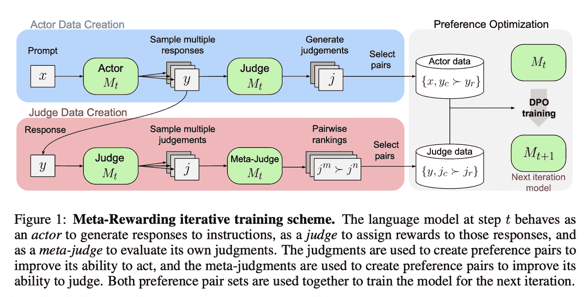

# 产品

### Beloga

贡献人：

https://www.beloga.xyz/

Beloga 是一款个人 AI 知识增强工具，帮助用户高效捕捉、整理和理解信息，特别关注神经多样性和包容性。它提供强大的搜索功能和个性化体验，适合知识工作者和研究人员使用，未来还计划扩展更多集成功能。

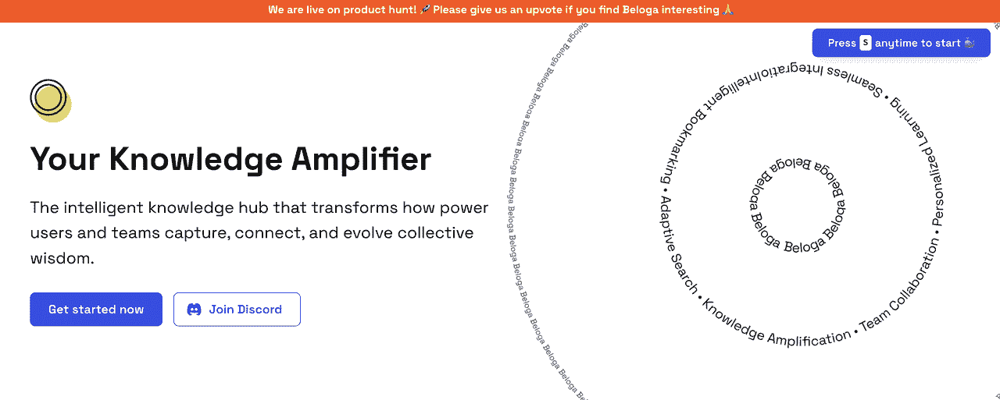

### Last24.ai

贡献人：

https://last24.ai/

Last24.ai 是一个人工智能搜索引擎，通过思维导图形式快速总结最新的新闻，帮助用户轻松获取重要信息。它从多个新闻来源提取内容，支持个性化编辑，并提供深入链接，适合希望快速了解新闻的视觉学习者。

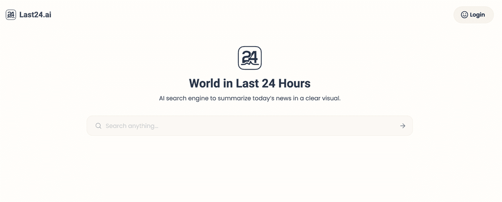

# HuggingFace&Github

### **Wren Engine**

贡献人：

https://github.com/Canner/wren-engine

Wren Engine 是一个为大型语言模型（LLMs）设计的语义引擎，旨在与可组合数据系统兼容。它具备可嵌入性和互操作性，允许用户通过 API 重用语义上下文，并连接本地和云数据源。

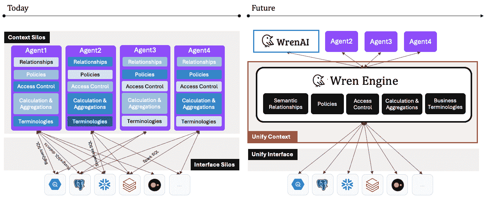

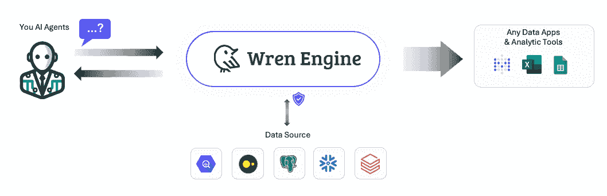

### Table LLM

贡献人：

https://github.com/RUCKBReasoning/TableLLM

TableLLM 可以有效地处理表格数据操作的任务。它包含两种不同规模的模型：TableLLM-7B 和 TableLLM-13B。TableLLM 根据不同的场景生成代码解决方案或直接文本答案来处理表格数据操作任务。

# 投融资

### Canva收购Leonardo.ai以增强其生成式AI能力

贡献人：

https://techcrunch.com/2024/07/29/canva-acquires-leonardo-ai-to-boost-its-generative-ai-efforts/

Canva收购了生成式AI内容和研究初创公司Leonardo.ai，以加深其在AI技术堆栈上的投资。此次交易的财务条款未披露，但Canva联合创始人兼首席产品官Cameron Adams表示，交易包括现金和股票。Leonardo.ai的全部120名员工将加入Canva，包括高管团队。Leonardo.ai此前获得了超过3880万美元的资本投资，投资方包括Smash Capital、Blackbird、Side Stage Ventures、TIRTA Ventures、Gaorong Capital和Samsung Next。此次收购旨在帮助Leonardo.ai扩大平台并加深用户增长，特别是在API业务和基础模型研发方面的投资。

公司官网：https://leonardo.ai/

### 前Squad和Twitter高管筹集700万美元打造硬件AI助手

贡献人：

https://techcrunch.com/2024/07/29/former-squad-and-twitter-execs-raise-7m-to-build-a-hardware-ai-assistant/

前Squad和Twitter高管创立的Bee AI筹集了700万美元，以开发其可穿戴的AI助手，该助手通过聆听用户对话来学习。此次融资由Exor领投，包括之前筹集的150万美元种子资金，参与者还有Greycroft、New Wave VC、Banana Capital和投资人Brian Bedol。Bee AI的设备和应用程序旨在通过云手机镜像用户的手机，执行通知提醒、写邮件和购物建议等任务，并计划在黑色星期五前接受预订，售价49美元，每月订阅费用为19美元。

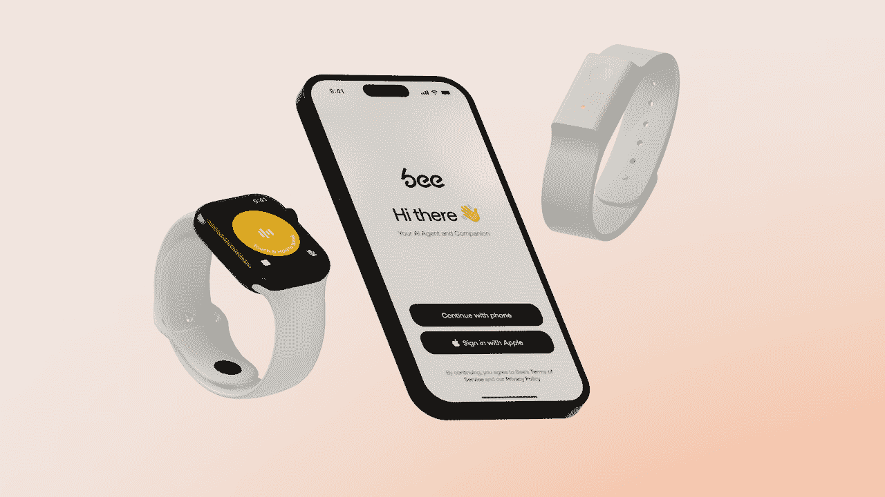

### IntelePeer获1.4亿美元融资，用AI Agent增强客户服务

贡献人：

https://intelepeer.ai/news-press/intelepeer-secures-140-million-strategic-growth-investment-to-drive-the-development-of-ai-agents-for-improved-customer-experiences

IntelePeer宣布获得由Savant Growth LLC和VantagePoint Capital Partners牵头的1.4亿美元战略增长投资和债务融资，目标是通过AI和自动化技术重塑联络中心并改善客户体验。此次融资将用于扩展AI代理产品组合，并加强产品开发、销售和营销团队。投资还包括Vector Capital的新成立的直接信贷策略Vector Velocity的债务融资部分。IntelePeer计划通过此投资继续推动其在AI业务上的快速增长，进一步实现客户自助服务自动化的愿景。

公司官网：https://intelepeer.ai/

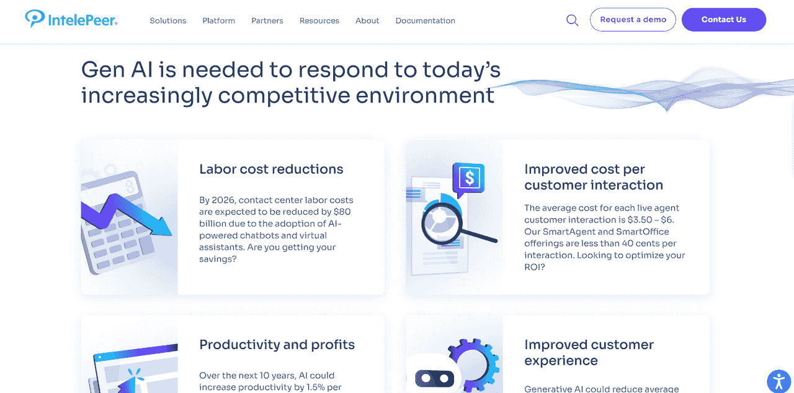

# 学习

### 探索混合专家（MoE）模型预训练：开源项目实操

贡献人：

https://zhuanlan.zhihu.com/p/708804769

MoE 模型通过结构优化，实现了在推理时仅激活部分专家层，从而降低了计算成本。具体实现包括：调整输入形状并添加抖动噪声以增强模型鲁棒性；使用门控网络计算专家权重，并通过 softmax 函数选择 top-k 个专家层进行计算；创建专家掩码以便索引；循环计算每个专家层的输出并累加到最终隐藏状态；最后恢复形状并返回结果。例如，Mixtral 8X7B 模型在每次推理时只使用两个专家层，实际计算的参数量远小于总参数量。实验结果显示，MoE 模型在激活参数更少的情况下，能够在训练效果上超过 Dense 模型。DeepSeek MoE 模型通过增加专家层数量至 64 个并引入 share expert 机制，进一步提升了模型效率和效果。

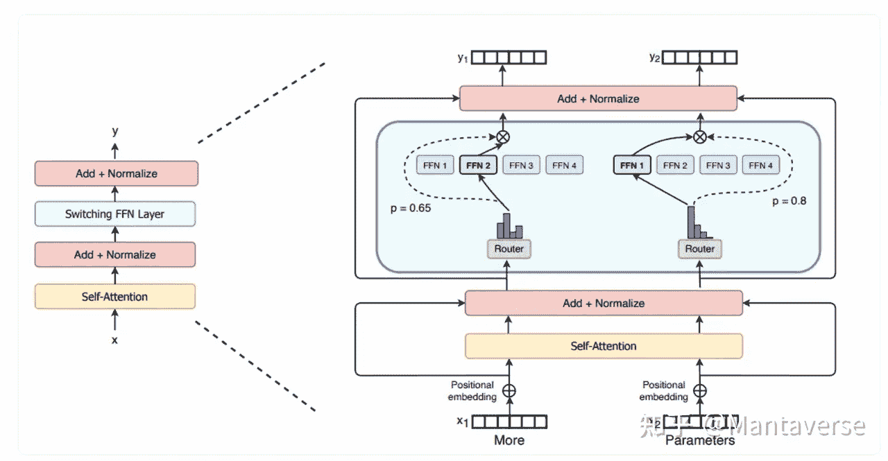

### NaplesPU或NPU技术开发文档合成全部

贡献人：

https://zhuanlan.zhihu.com/p/711324957?utm_psn=1801516909289684993

文章深入浅出地阐述了 NPU 的技术细节，包括其架构设计、编程模型、性能优化以及实际应用。NPU 的数据流架构通过优化数据传输和处理，实现了高效的并行计算。编程模型中，NPU 的指令集和编译器协同工作，确保了计算任务的高效执行。性能优化部分，文档详细介绍了如何通过调试工具和编程技巧，充分发挥 NPU 的性能潜力。此外，文档还探讨了 NPU 在实际应用中的挑战与应对策略，以及未来技术发展的方向。

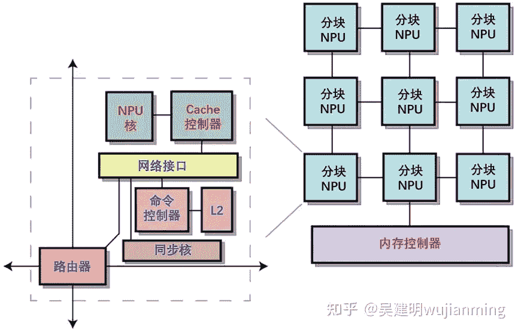

### 算能端侧 AI 盒子 Stable Diffusion 一秒一张图：AirBox BM1684X

贡献人：

https://zhuanlan.zhihu.com/p/711640323?utm_psn=1801516600261742592

算能端侧 AI 盒子 AirBox BM1684X 是一款集成了 Tensor Computing Processor BM1684X 的 AI 计算设备，能够在低功耗（约 20～30 瓦）的条件下快速生成图像。该设备支持多种数据类型的推理，包括 FP32、BF16、FP16 和 INT8，配备了 32 路视频硬件解码和 12 路视频硬件编码能力。AirBox BM1684X 具备 PCIe3 x16 接口，双千兆以太网口，并支持最大 16GB 的 DDR4 4266 内存。硬件设计上，该设备优化了供电接口、散热方式，增加了 USB 接口以便扩展，并且提供了两种调试方式：TTY 和 千兆网络。在软件层面，AirBox BM1684X 预装了 Ubuntu Server 20.04 系统，并集成了 Sophon SDK，方便开发者部署 AI 应用。此外，设备内置了 Docker，并且支持高速的软件源，如清华源。

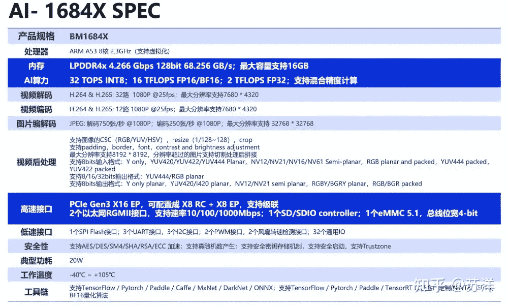

### SGLang：LLM推理引擎发展新方向

贡献人：

https://zhuanlan.zhihu.com/p/711378550?utm_psn=1801272975619657729

SGLang 作为新一代 LLM 推理引擎，在 vLLM 的基础上进行了显著改进，它支持更复杂的 LLM 应用场景，如多轮对话和与外部环境的交互。SGLang 引入了 LM Programs 概念，允许多个 LLM 调用，并支持结构化输入和输出，提高了任务质量和整体性能。技术上，SGLang 采用了编译器设计，优化了 KV 缓存的重用，通过 RadixAttention 技术提高了前缀搜索和缓存感知调度的效率。此外，SGLang 通过压缩有限状态机实现了高效的约束解码，并通过 API 推测执行减少了多调用的延迟和成本。性能测试显示，SGLang 在不使用特定优化的前提下，相比 vLLM 有明显加速，甚至在某些案例中超越了 TRT-LLM。

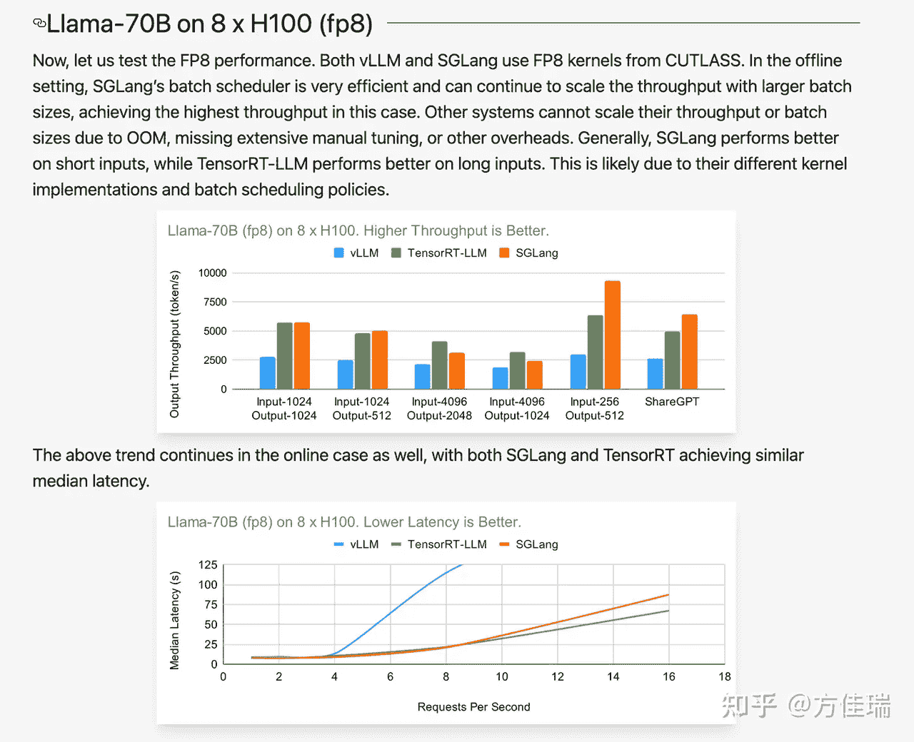

### Context is Everything: 为什么最大序列长度很重要

贡献人：

https://www.cerebras.net/chip/context-is-everything-why-maximum-sequence-length-matters/

Cerebras 的文章详细阐述了序列长度在自然语言理解（NLU）中的重要性，并介绍了其 Wafer-Scale Engine（WSE）如何通过处理高达 50,000 个词素的长序列，显著提升 NLU 模型的性能。WSE 芯片拥有 850,000 个处理元素，每个元素都有本地内存，通过高速通信网络相互连接，使得密集注意力机制在长序列处理上具备高效率。与传统 GPU 相比，Cerebras 的技术可以在不牺牲准确性的前提下，显著增加序列长度，这对于提高模型如 GPT-2 在长文本理解和生成上的准确性至关重要。文章还指出，之前的解决方案如 Longformer、SMITH 和 Linformer 等，通过稀疏化、层次化或近似注意力机制来减少计算复杂度，但这些方法可能会限制模型学习数据的真实模式。Cerebras 的技术不仅在 NLU 领域有应用，还在药物发现和基因组学等领域展现出巨大的潜力，因为它能够处理长链接的生物数据，为科学研究提供新的视角。通过 weight streaming 特性，Cerebras 的系统能够有效地处理长序列，为研究人员提供了一种新的工具，以探索和解决复杂的科学问题。

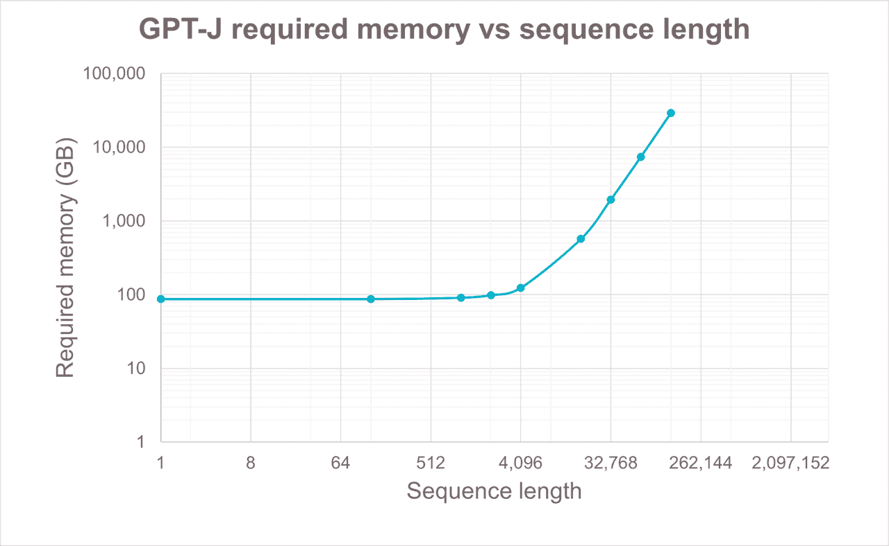

### 大模型训练：Megatron-Kwai中的内存优化

贡献人：

https://zhuanlan.zhihu.com/p/710296768

Megatron-Kwai 是一个针对大规模模型训练优化的框架，它在 Megatron 的基础上进行了改进。文章首先分析了大模型训练过程中的内存瓶颈问题，然后详细介绍了 Megatron-Kwai 如何通过优化内存使用来解决这一问题。具体优化措施包括：减少模型参数的副本数量、使用更高效的数据类型、采用内存池技术以及优化内存分配策略。这些优化不仅减少了内存消耗，还提高了训练速度和模型的加速比例。

### 使用ChatTTS和LLM让deeplearning.ai课程说上流畅中文

贡献人：

https://mp.weixin.qq.com/s/Ud6yY4amOGmuYeQ7Jz0Eyw

本文详细介绍了如何利用 ChatTTS 和 LLM 技术将 deeplearning.ai 的 ChatGPT Prompt Engineering for Developers 课程翻译成流畅的中文普通话。作者首先下载了视频和字幕文件，并通过 LLama3 和反思策略对字幕进行翻译。在这一过程中，作者强调了保持字幕格式和内容的准确性，以及如何通过反思机制不断优化翻译质量。接着，文章展示了如何使用 ChatTTS 将翻译后的字幕转换为自然流畅的普通话音频，并解决了在不同硬件环境下的音频生成和保存问题。此外，文章还讲解了如何调整音频长度以匹配视频字幕时间，并通过 FFmpeg 将字幕、音频和视频最终合并。

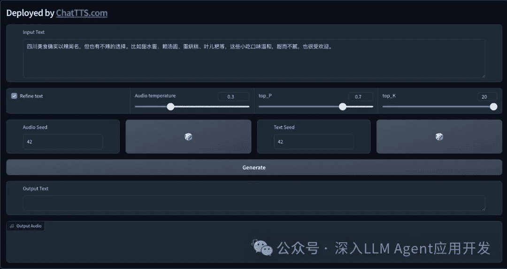

### An Open Course on LLMs, Led by Practitioners

贡献人：

https://hamel.dev/blog/posts/course/

Mastering LLMs 是一门针对大型语言模型（LLMs）的免费调查课程，由 25 位以上的行业专家授课，他们在信息检索、机器学习、推荐系统、MLOps 和数据科学等领域具有专业知识。课程内容超过 40 小时，包括工作坊和讲座，涵盖评估、检索增强生成（RAG）、微调等主题，适合技术个体贡献者（ICs），如工程师和数据科学家。课程提供了按主题分类的内容组织、章节摘要、笔记、幻灯片和资源，以帮助学生导航和深入学习。建议学生在学习过程中参考相关资料，并将所学应用于个人项目。

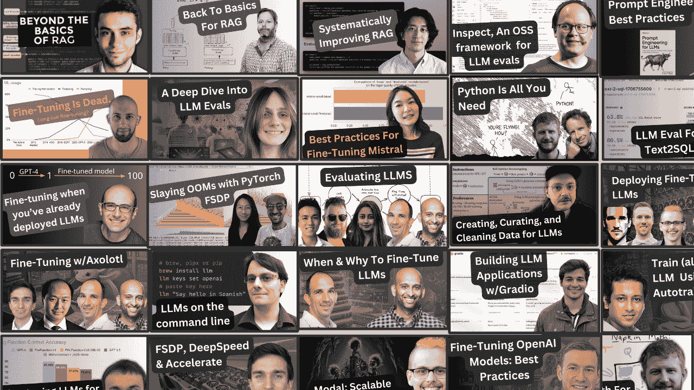

# 📡潜空间活动预告

> **潜空间系列活动第三季全面升级！**

>

> 第三季第二期将在**8月11日** **11:00 am**开始，嘉宾是**陈贝迪**。活动包括嘉宾分享、访谈Q&A、cofounder matching餐会。活动现场还可以体验到咱们奇绩校友的最新产品，期待大家大力支持！

>

>

> 陈贝迪-卡内基梅隆大学助理教授，斯坦福大学人工智能博士后学者，前 Meta AI 研究科学家；致力于在现代硬件上设计和优化算法和模型，以加速大型机器学习系统。

>

>

> 童晟邦- 纽约大学博士，伯克利人工智能实验室（BAIR）研究员， OpenAI 超对齐奖学金获得者；

>

>

> 闫俊杰-MiniMax 创始人兼 CEO。是中国第一梯队的大模型创业者，目前 MiniMax 估值超 25 亿美元。

>

>

> 宋佳铭-Luma AI 首席科学家，斯坦福大学计算机科学博士、博士后；曾任职英伟达（DIR）小组科学家 ，创建了最早的扩散模型加速算法，该算法广泛用于最近的生成式 AI 系统，包括 DALL-E 2、Imagen、Stable Diffusion 和 ERNIE-ViLG 2.0。

>

>

> 本季活动同时开放**北京线下、上海线下和线上**场次，欢迎校友和外部创业者扫描右方二维码报名！

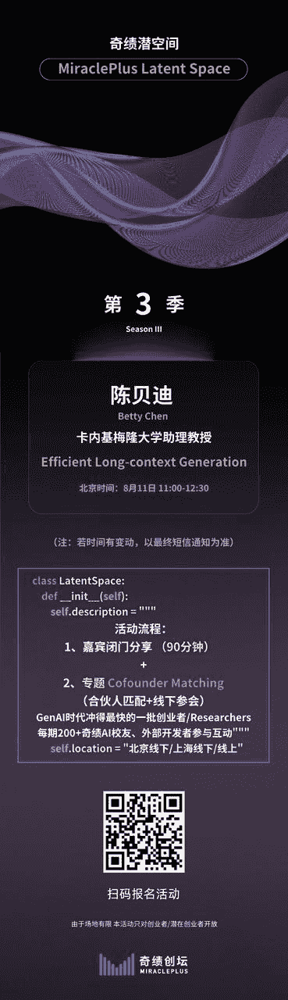

# 声明

本文档仅供学习交流使用，版权归原作者所有，若涉侵权，请联系Jack Jin 15101136166

##

（欢迎在下方反馈您宝贵的意见！整理不易，觉得有用给AI日报小组点个赞👍吧！）

ChatGPT；Angela；Zijia Liu；Alex；Zeqi Tan；Tiezhen（HuggingFace）；Naixu；Lizhi；Peter；Suoman；Jack

封面生成——右脑科技

如果你有大模型相关的创业想法，欢迎来找我们聊聊～微信：15101136166

> 快邀请你的小伙伴们一起来读大模型日报吧！

> **【日报****知识库****】**这里是近期日报内容的汇总,欢迎大家查阅

> [大模型日报知识库(分享版)](https://miracleplus.feishu.cn/wiki/KapVwXfkriOBiskB0B2cUHxjnTh)

>

> 欢迎大家多多帮我们分享,转发~~

> 如果大家有任何的建议或者吐槽,欢迎随时找我聊天~

