# 奇绩大模型日报（7月 27-28日）

> 来源：[https://miracleplus.feishu.cn/docx/RiNPd4lwDoNCJ7xyv2Jc4Y5wnmb](https://miracleplus.feishu.cn/docx/RiNPd4lwDoNCJ7xyv2Jc4Y5wnmb)

## 推特

### Karpathy伯克利AI 黑客松20分钟演讲：滚雪球式地推进你的工作

https://x.com/karpathy/status/1816953700403065162

我在几周前的伯克利AI黑客松上进行了一个20分钟的演讲，内容是关于在我的经验中，如何通过黑客技术实现对现实世界的影响。

当条件为真时：构建和发布项目。

积累1万小时。

滚雪球式地推进你的工作。

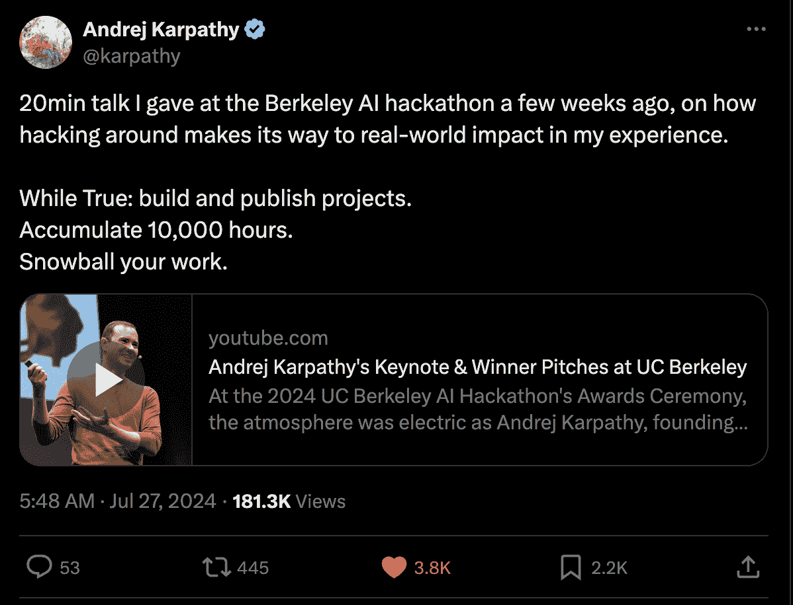

### llama-405b-to-8b：以极低的成本和延迟，享受Llama 3.1 405B的质量

https://x.com/mattshumer_/status/1816891950903279827

推出 `llama-405b-to-8b` ✍️

以极低的成本和延迟，享受Llama 3.1 `405B`的质量。

只需提供一个任务示例，`405B`就能教会`8B`（便宜约30倍！）完美地完成任务。

而且它是开源的：https://github.com/mshumer/gpt-prompt-engineer/blob/main/Llama_3_1_405B_%3E_8B_Conversion.ipynb

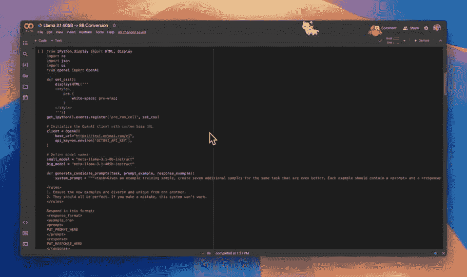

[ssstwitter.com_1722183016574.mp4](https://internal-api-drive-stream.feishu.cn/space/api/box/stream/download/all/WRmZblEvqo0qbLxRf3bcwvq5nfd)

### Sebastian Raschka：用于生成偏好微调/对齐LLMs的笔记本

https://x.com/rasbt/status/1817210266838339916

我刚刚使用Llama 3.1 `70B`创建了一个笔记本，用于生成偏好微调/对齐LLMs的合成数据：https://github.com/rasbt/LLMs-from-scratch/blob/main/ch07/04_preference-tuning-with-dpo/create-preference-data-ollama.ipynb

（更新后的Llama许可现在允许使用Llama 3.1来改进其他模型，太棒了！）。

你可能已经猜到接下来会发生什么了... 😊

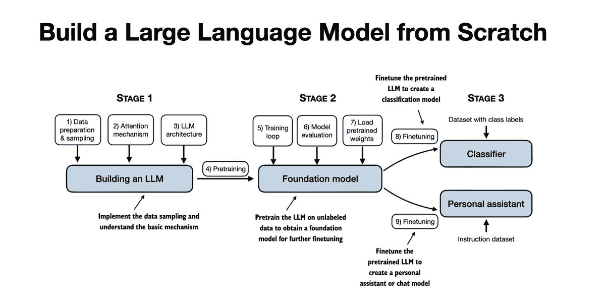

### Pierre分享各类工具：对于视频，请祈祷

https://x.com/nickfloats/status/1817272703847739619

对于图片，请使用 Midjourney

对于实时处理，请使用 Krea AI

对于放大，请使用 Topaz Labs

对于语音，请使用 Eleven Labs

对于音乐，请使用 Suno AI

对于 NeRF，请使用 Luma Labs AI

对于 3D，请使用 Spline Tool

对于编辑，请使用 Descript

对于动作捕捉，请使用 Move AI

对于视频，请祈祷

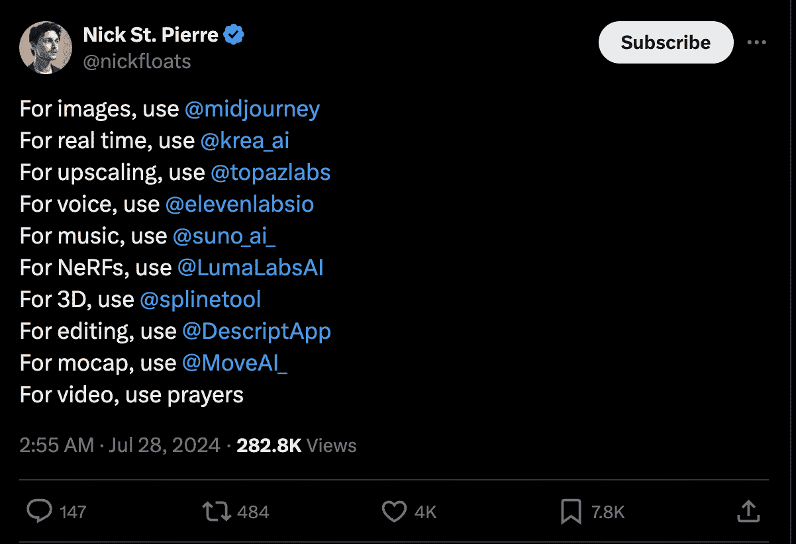

### Lethic分享RX1 Humanoid：开源的全人类比例双臂机器人

https://x.com/lethic1/status/1817248369166954743

RX1 Humanoid：

+   开源的全人类比例双臂机器人

+   低于 $1,000

+   遥操作和抓取放置物体

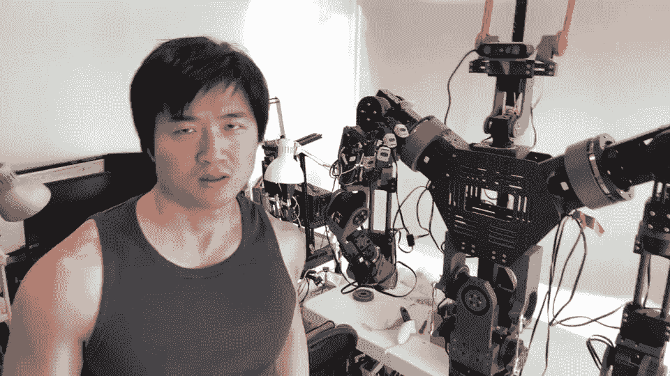

[ssstwitter.com_1722183225683.mp4](https://internal-api-drive-stream.feishu.cn/space/api/box/stream/download/all/Srr3b6NPfomFcDxpwSjcOtyWnig)

### Reddit热帖：苹果还是仓鼠？

https://www.reddit.com/r/aivideo/comments/1ecf1is/apples_or_hamsters/

苹果还是仓鼠？🍎🐹，Kling AI

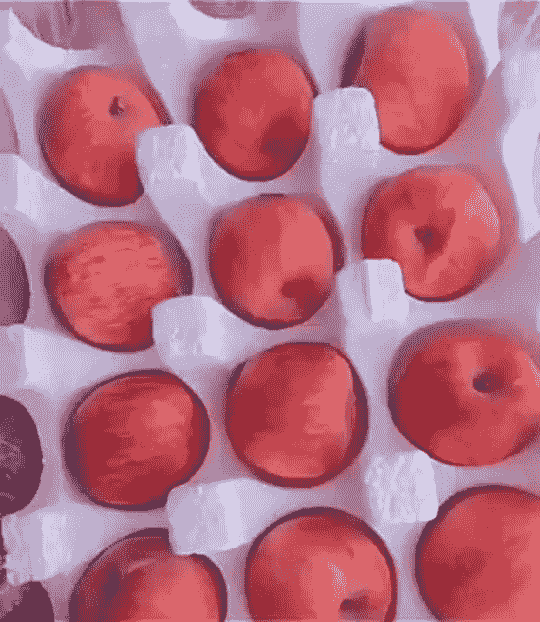

[ssstwitter.com_1722183334384.mp4](https://internal-api-drive-stream.feishu.cn/space/api/box/stream/download/all/EF9pbmTn5oj1YyxPoibclWNonug)

## 资讯

### 阿里大模型元老杨红霞去向官宣：入职香港高校！被曝创业项目也在推进

https://mp.weixin.qq.com/s/OVn8EBjwK-6nsWlJepViPQ

杨红霞是AI领域知名科学家。她曾在IBM T.J.沃森研究中心担任研究人员，并在雅虎担任首席科学家。2016年加入阿里巴巴，就职于达摩院智能计算实验室；2023年3月入职字节跳动。

她在达摩院期间领导了通义千问前身`M6`大模型的研发，是`M6`大模型从百亿、千亿参数量进化到万亿规模的主要功臣，并领导通义大模型核心技术“统一学习范式`OFA-M6`”的开发。

任职字节期间，她主要负责大模型研发，向字节`AML()`和豆包大模型Foundation团队负责人项亮汇报。

### MiniMax 开发的 Talkie 杀疯了！月活破 1100 万，美国用户占比 50%，用户体量接近 C.ai 六成

https://mp.weixin.qq.com/s/IeuEP6RX85pjWwc3MSTswA

根据 Sensor Tower 最新数据，MiniMax(去年推出的娱乐对话应用 Talkie 六月份在美国AI 类应用下载量排名第五位。

今年以来美国市场累计下载 380 万次，排名第四位，仅次于 ChatGPT、Copilot 以及作业帮开发的在线 AI 辅导应用 Question.ai。

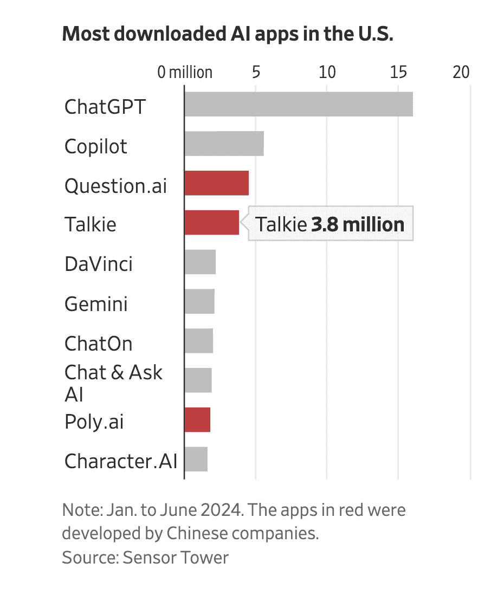

### 陶哲轩点评谷歌AlphaProof：AI在数学竞赛中展现「超凡智慧」

https://mp.weixin.qq.com/s/lnrStYTfr0ggRp3JbVpVTw

不过，这已经是过去式了。[谷](http://mp.weixin.qq.com/s?__biz=MzA3MzI4MjgzMw==&mid=2650927541&idx=1&sn=8bf134f825ae3e3a4f08134d3dafe8d1&chksm=84e435cbb393bcdd2a6d0a7dbcf0b3ba3564bdf120c499649e50e609f754f7a1931c80ba4acd&scene=21#wechat_redirect)歌 DeepMind 用 AI 做出了今年国际数学奥林匹克竞赛 IMO 的真题，并且距拿金牌仅一步之遥。对于 AI 来说，奥数不再是问题了。

IMO 2024 中六个问题的每一个问题满分为 7 分，总分最高 42 分。DeepMind 的系统最终得分为 28 分，意味着解决的 4 个问题都获得了满分 —— 相当于银牌类别的最高分。

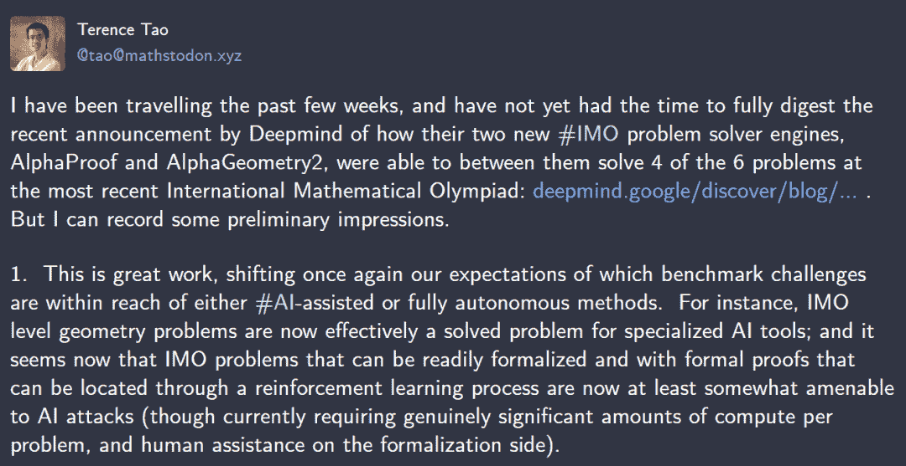

### 天猫精灵合伙人创业，用AI大模型复活毛绒玩具，被“大疆教父”相中了

https://mp.weixin.qq.com/s/vNplHWz25YZJHZ_mQUyh🐧

`Bubb`lePal背后就是成立于2021年的深圳AI硬件玩家跃然创新，目前已经拿到香港科技大学前工学院院长、半导体领域知名投资人、“大疆教父”高秉强，香港科技大学教授、大疆DJI天使投资人李泽湘旗下资金的投资，同时拿到了全球最大电子教育玩具企业Vtech和国内最大玩具上市企业Alpha Group的注资，这在国内实属少见。

其创始人高峰和李勇在智能硬件领域已经深耕数年，且名头不小。

跃然创新CEO李勇曾是天猫精灵合伙人、锤子手机首任营销总监、爱奇艺智能的CMO，并实现了天猫精灵从0到3000万台的销售突破；跃然创新COO高峰作为一名连续创业者，在电商平台兴起之时，就挣到第一桶金。

## 产品

### Friend

贡献人：

https://basedhardware.com/

`Friend` 是一款开源的 AI 项链，能够倾听、记忆对话、做笔记并帮助用户管理任务，提供实时通知和全面的记忆辅助，旨在提升用户的组织能力和生活效率。

### XspaceGPT

贡献人：

https://www.twitterspacegpt.com/

`XspaceGPT` 是一款利用人工智能技术，将 Twitter Spaces 中的内容转化为易于理解的文本工具，提供摘要、大纲和多语言支持。它帮助用户快速发现热门讨论和影响力主持人，并提供免费下载功能，旨在提升用户获取信息的效率。

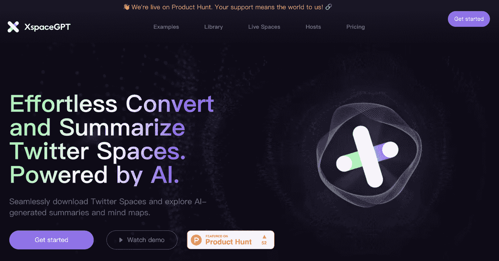

## HuggingFace&Github

### Vidur

贡献人：

https://github.com/microsoft/vidur

`Vidur` 是一个高保真和可扩展的 LLM 推理模拟器。它可以帮助您进行容量规划和找到最佳部署配置,测试新的研究想法,以及研究不同工作负载和配置下模型的系统性能,而无需访问 GPU。

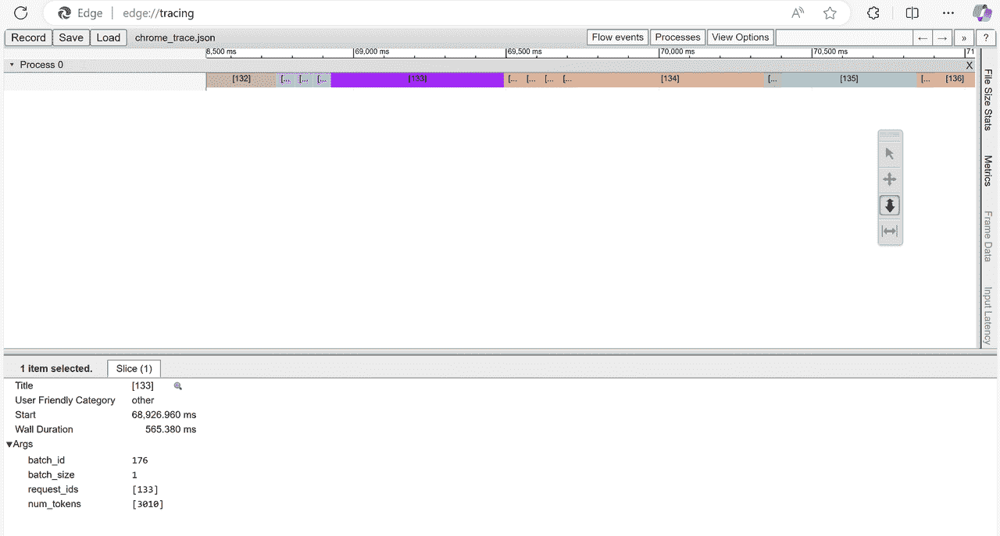

### llm-confidentiality

贡献人：

https://github.com/LostOxygen/llm-confidentiality

这个项目是一个研究如何在大型语言模型(LLM)集成系统中保护隐私数据的框架。它提供了一种系统的方法来评估LLM集成系统的保密性,包括一些攻击和防御策略的评估。此外,它还提出了一种基于对抗训练的方法来提高LLM的鲁棒性,以抵御这些攻击。

## 学习

### Quantization `CUDA` vs `Triton`

贡献人：

https://zhuanlan.zhihu.com/p/711429727?utm_psn=1801156096083226626

文章深入探讨了 `CUDA` 和 `Triton` 在量化技术中的应用和实现差异。量化技术通过减少模型的数值精度，实现模型大小的压缩和推理速度的提升。`CUDA` 作为一种低层次的并行编程接口，允许开发者直接管理 GPU 资源，但需要对硬件细节有深入的了解。而 `Triton` 作为 NVIDIA 提供的高层次编程框架，简化了量化模型的开发流程，支持动态图执行，并能够自动优化性能。文章特别强调了 `Triton` 在处理动态量化和权重量化时的优势，以及如何通过 `Triton` 实现高效的矩阵乘法运算。此外，作者还分享了一些实际应用中的优化经验，包括如何避免 `Triton` 的局限性，以及如何利用 `Torch Compiler` 进行内核优化。最后，文章还讨论了 `Smoothquant` 和 `GPTQ` 等量化优化技术，以及它们在提高模型效率和精度方面的潜力。

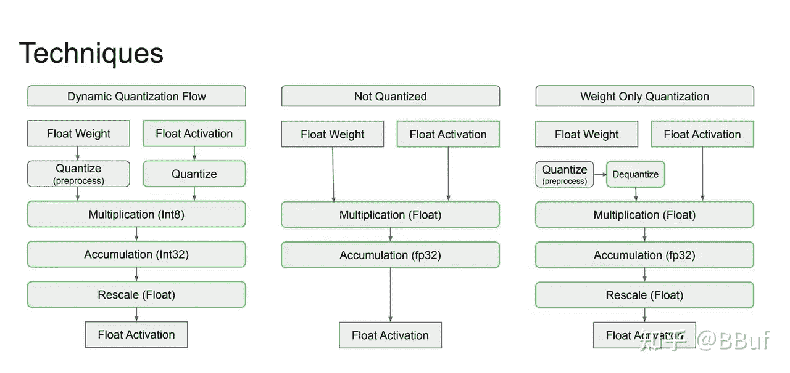

### 大模型训练方法论及`Yi-Large`的实践

贡献人：

https://zhuanlan.zhihu.com/p/709900395

文章详细剖析了 `Yi-Large` 模型的训练方法论和实践，特别是在 `LMSYS` 评价体系中的表现，以及与 `GPT-4` 的 A/B 测试结果，展现了模型在实际应用中的高效性和用户接受度。作者针对 `Scaling Laws` 进行了深入解读，指出模型能力与资源消耗呈现 `power-law` 关系，并通过实验数据验证了这一点。在讨论 `The Bitter Lesson` 时，强调了计算能力在提升 AI 性能中的核心地位。数据处理方面，文章强调了对模型训练至关重要的高质量数据，并介绍了零一在数据清洗、处理和标注上的一系列细致操作。此外，文章还探讨了 AI 领域人才的重要性，特别是在大规模计算和分布式机器学习方面的技能，以及对基础算法研究的重视，以推动 AI 技术向更高水平的发展。

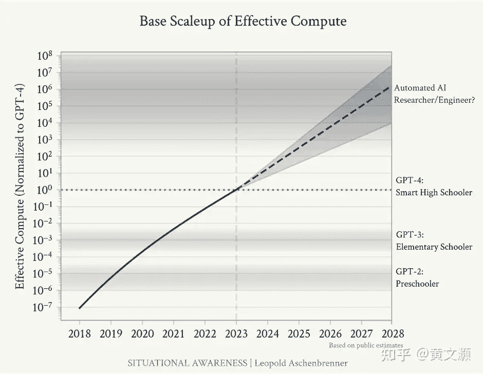

### `vllm`调度笔记：`chunked prefill`调度策略

贡献人：

https://zhuanlan.zhihu.com/p/711209924?utm_psn=1800589941849341952

`vllm` 调度策略中的 `chunked prefill` 方法通过将输入数据分割成小块（`chunks`）进行逐块处理，优化了大型语言模型的生成效率。这种策略降低了内存峰值，减少了内存占用，并提高了计算效率，尤其适合长文本生成任务。通过调整块的大小，`chunked prefill` 能够根据不同场景的资源限制和性能要求进行灵活配置，从而提升资源利用率和用户体验。未来的优化方向包括更细粒度的资源调度和更高效的数据处理算法，以进一步提升大型语言模型的性能。

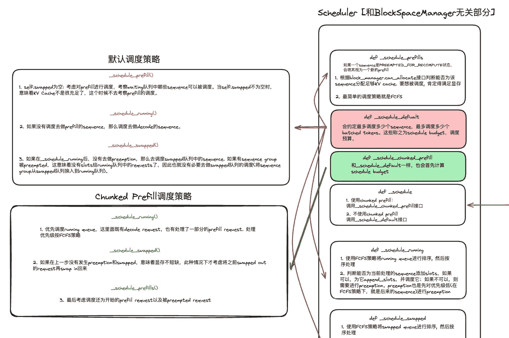

### [`Hopper` 架构特性学习笔记 Part2] Tensor Memory Access（`TMA`）

贡献人：

https://zhuanlan.zhihu.com/p/709750258?utm_psn=1800589676706410497

Tensor Memory Access（`TMA`）是 `Hopper` 架构的核心特性之一，专为优化深度学习模型中张量数据的内存访问而设计。`TMA` 通过硬件层面的直接访问和管理张量数据，克服了传统方法中逐元素访问的低效问题。它实现了对张量数据结构的高效处理，包括加载、存储和计算等操作，并能够根据张量的形状和数据类型动态调整，以最大化内存带宽的利用。此外，`TMA` 还具备数据预取和重排功能，有效降低了因访问模式不匹配而产生的延迟和开销。

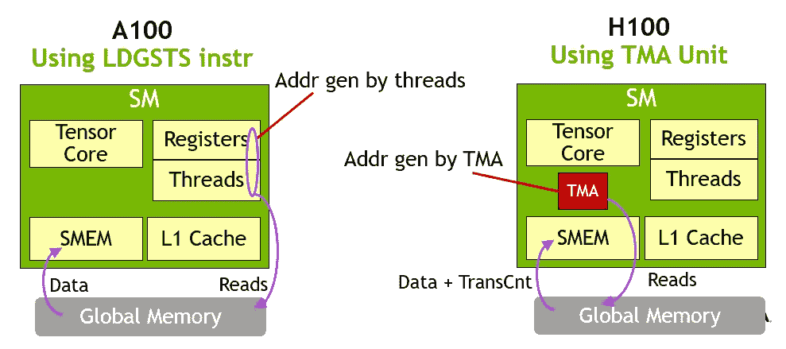

### `Llama3.1` 中用到的`Pipeline Parallelism`技术`interleaved 1F1B`与`WPipe`比较与扩展

贡献人：

https://zhuanlan.zhihu.com/p/711352051

`Llama3.1` 中采用的 `interleaved 1F1B` `Pipeline Parallelism`（`PP`）技术，是一种提高大模型训练效率的方法。它通过在单个设备上交替执行前向（Forward）和后向（Backward）计算，来减少 `Pipeline` 中的空闲时间（`bubble`）。与此同时，`WPipe` 技术，作者在 2020 年提出，通过将 `Pipeline` 的 stages 分为两组，实现了组间异步更新，同时保持组内同步更新，从而完全消除了 `bubble`。`WPipe` 的设计允许在不同的 `mini-batches` 之间重用计算资源，减少了 `weights` 的 `load` 和 `offload` 次数，提高了内存利用率。此外，`WPipe` 的扩展可以应用于多组 `Pipeline` 的情况，即使在同步更新的情况下也能降低 `bubble`，但会带来更多的通信开销。

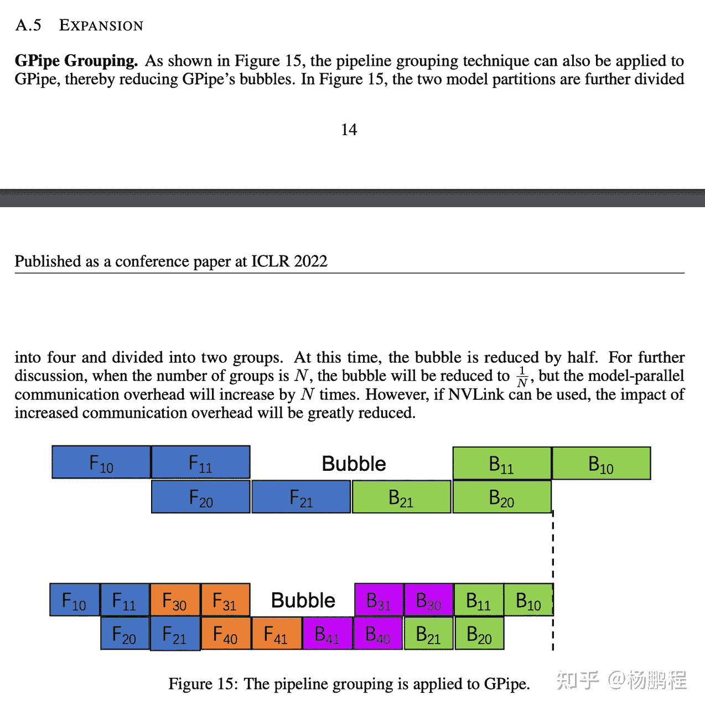

### 宇树机器狗外挂 `Arduino`

贡献人：

https://zhuanlan.zhihu.com/p/711431116?utm_psn=1801157463631867904

文章详细介绍了如何使用 `Arduino` 开发板为宇树机器狗制作外挂。首先，作者阐述了使用 `Arduino` 的便利性和它在教育和爱好者中的流行。然后，介绍了宇树机器狗的基本功能和外挂接口的设计理念，强调了模块化设计的重要性。接下来，文章详细说明了如何通过编程控制机器狗的动作，包括基本的移动控制和复杂的行走模式。最后，作者展示了一些使用 `Arduino` 外挂实现的高级功能，如自主导航和障碍物避障

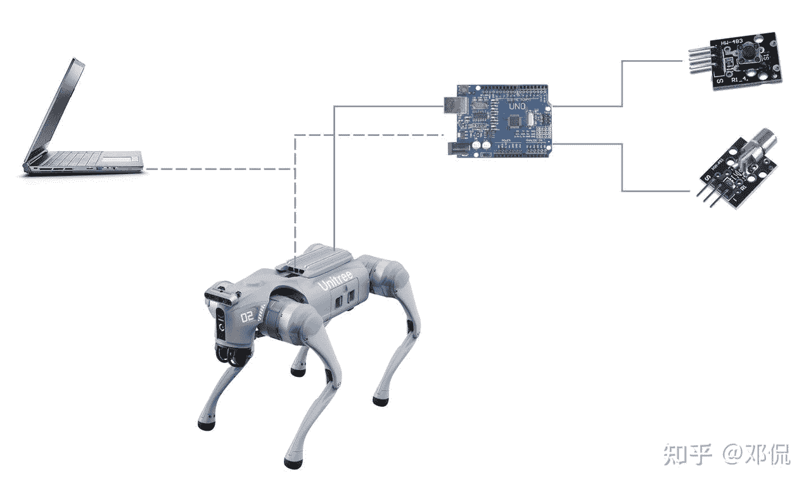

### 从零到一使用 `Ollama`、`Dify` 和 `Docker` 构建 `Llama 3.1` 模型服务

贡献人：

https://zhuanlan.zhihu.com/p/711416048?utm_psn=1801030474623225856

作者首先介绍了 `Llama` 模型的基本情况，强调其在处理自然语言任务时的高效性和易用性。随后，文章详细剖析了如何通过 `Ollama` 库加载和操作 `Llama` 模型，包括环境设置、依赖安装等技术细节。接着，作者讲解了如何借助 `Dify` 框架将 `Llama` 模型服务化，涵盖了模型服务的定义、配置以及如何与 `Dify` 进行集成。此外，文章还阐述了如何利用 `Docker` 对模型服务进行容器化部署，确保了服务的跨环境稳定性和快速部署能力。文章中还提供了丰富的代码示例和命令行指令，帮助技术人员更好地理解和跟随步骤实施。

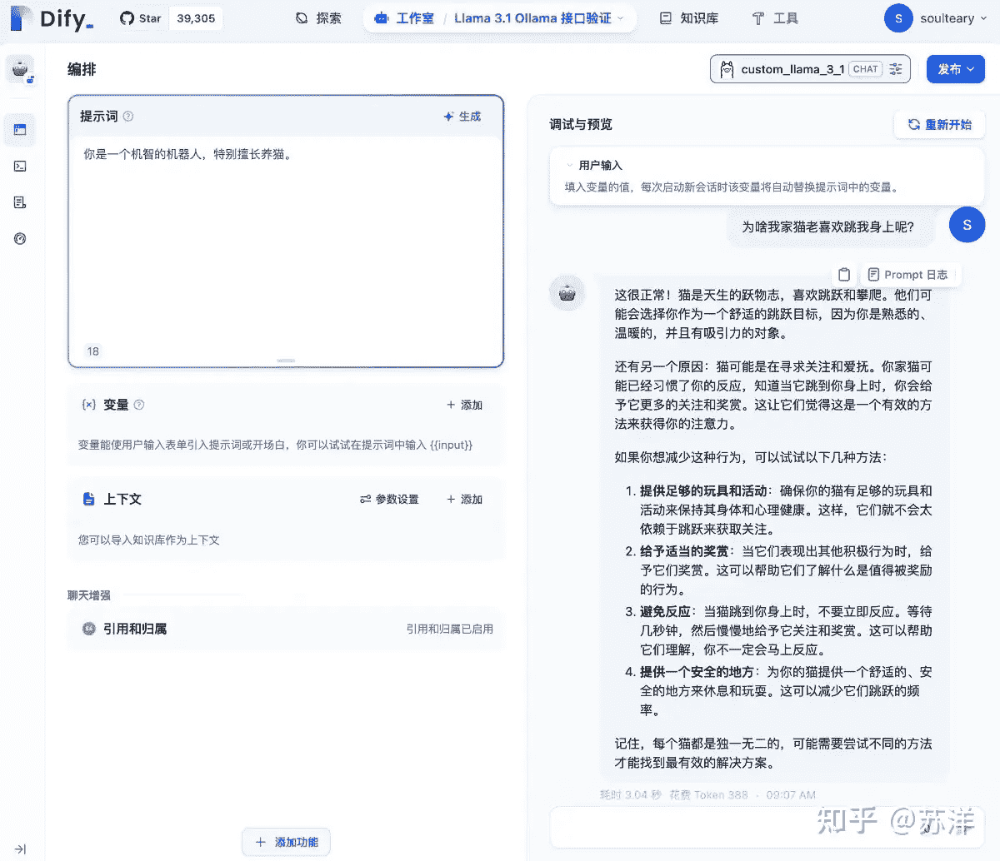

## 📡潜空间活动预告

> 潜空间系列活动第三季全面升级！

> 第三季第二期将在**8月11日** **11:00 am**开始，嘉宾是**陈贝迪**。活动包括嘉宾分享、访谈Q&A、cofounder matching餐会。活动现场还可以体验到咱们奇绩校友的最新产品，期待大家大力支持！

> 陈贝迪-卡内基梅隆大学助理教授，斯坦福大学人工智能博士后学者，前 Meta AI 研究科学家；致力于在现代硬件上设计和优化算法和模型，以加速大型机器学习系统。

> 童晟邦- 纽约大学博士，伯克利人工智能实验室（BAIR）研究员， OpenAI 超对齐奖学金获得者；

> 闫俊杰-MiniMax 创始人兼 CEO。是中国第一梯队的大模型创业者，目前 MiniMax 估值超 25 亿美元。

> 宋佳铭-Luma AI 首席科学家，斯坦福大学计算机科学博士、博士后；曾任职英伟达（DIR）小组科学家，创建了最早的扩散模型加速算法，该算法广泛用于最近的生成式 AI 系统，包括 DALL-E 2、Imagen、Stable Diffusion 和 ERNIE-ViLG 2.0。

> 本季活动同时开放**北京线下、上海线下和线上**场次，欢迎校友和外部创业者扫描右方二维码报名！

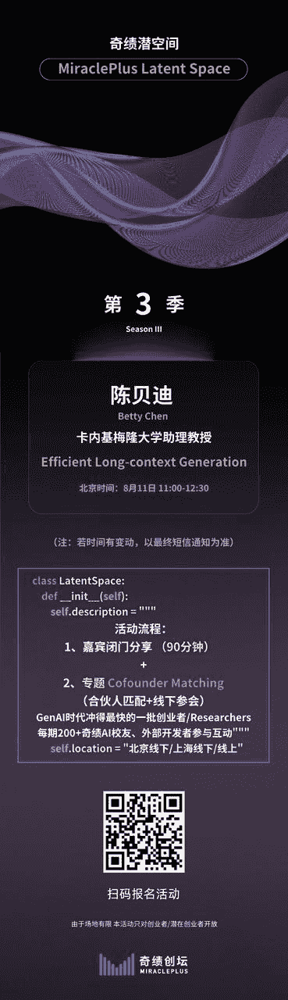

# 声明

本文档仅供学习交流使用，版权归原作者所有，若涉侵权，请联系Jack Jin 15101136166

（欢迎在下方反馈您宝贵的意见！整理不易，觉得有用给AI日报小组点个赞👍吧！）

ChatGPT；Angela；Zijia Liu；Alex；Zeqi Tan；Tiezhen（HuggingFace）；Naixu；Lizhi；Peter；Suoman；Jack

封面生成——右脑科技

如果你有大模型相关的创业想法，欢迎来找我们聊聊～🛰️：15101136166

> 快邀请你的小伙伴们一起来读大模型日报吧！

> **【日报知识库】**这里是近期日报内容的汇总，欢迎大家查阅

> [大模型日报知识库(分享版)](https://miracleplus.feishu.cn/wiki/KapVwXfkriOBiskB0B2cUHxjnTh)

> 欢迎大家多多帮我们分享、转发~~

> 如果大家有任何的建议或者吐槽，欢迎随时找我聊天~

