# 奇绩大模型日报（7月 26日）

> 来源：[https://miracleplus.feishu.cn/docx/Fe9jd8lHzoyeTtx3lXPcU6jbnUd](https://miracleplus.feishu.cn/docx/Fe9jd8lHzoyeTtx3lXPcU6jbnUd)

# 推特

### OpenAI推出SearchGPT：我们认为搜索还有比现在更好的空间空间

https://x.com/sama/status/1816551657158877187?s=46&t=GRStLXDcUNuun8J5Noyw4Q

[我们认为搜索还有比现在更好的空间。

我们正在推出一](https://t.co/A28Y03X1So)[个](https://t.co/A28Y03X1So)名为 SearchGPT 的新原型： https://openai.com/index/searchgpt-prototype/…

我们将从原型中学习，使其变得更好，然后将技术集成到 ChatGPT 中，使其实时且最大程度地提供帮助。

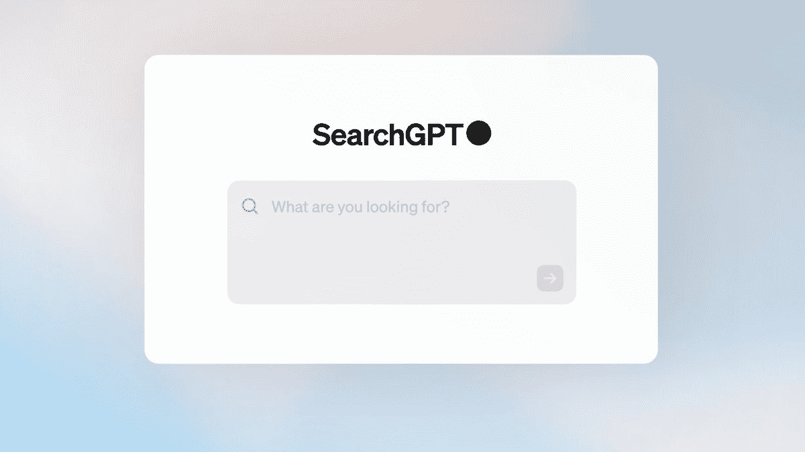

### Noam Brown: 从Pluribus得到教训，不要过度优化中间的基准测试

https://x.com/polynoamial/status/1816347598623834365

5年前，我们发布了Pluribus，这是首个超越人类的多玩家扑克AI。它的训练成本只有150美元。为什么扑克比围棋花费更长时间？最后它的成本为什么如此低廉？答案是关于过度优化基准测试的警示，这与今天的大型语言模型（LLM）相关。

年度计算机扑克竞赛（ACPC）是扑克AI的主要基准测试。从2006年开始，每年所有的扑克AI研究实验室都会聚集在ACPC上，相互对战。赢得ACPC非常有声望，因此研究人员投入了大量精力进行提交。

为了降低成本，ACPC限制提交的AI只能使用两个CPU核心进行推理，每手牌限时几秒钟。然而，在预训练阶段允许使用无限的资源。

这些限制影响了研究方向：团队在预训练上花费了超过1万美元，但忽视了需要大量测试时计算资源的规划算法。而事实证明，这些规划算法对于击败顶级人类玩家至关重要。

Pluribus不符合ACPC的参赛资格——它的规划算法使用了28个CPU核心，每手牌花费超过20秒。但它击败了人类专家。

从中我学到的教训是不要过度优化中间的基准测试。基准测试确实可以指示进展，但过于关注它们可能会让你偏离最终目标。

每当我查看如今的大型语言模型基准测试时，我经常会想到这一点。

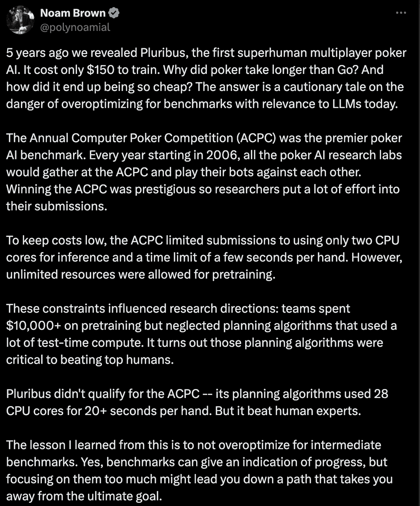

### Google Deepmind：第一个解决国际数学奥林匹克银牌问题的人工智能

https://x.com/googledeepmind/status/1816498082860667086?s=46&t=GRStLXDcUNuun8J5Noyw4Q

我们将展示第一个解决国际数学奥林匹克银牌问题的人工智能。

它结合了 AlphaProof（形式推理的新突破模型）和 AlphaGeometry 2（我们之前系统的改进版本）。

https://dpmd.ai/imo-silver

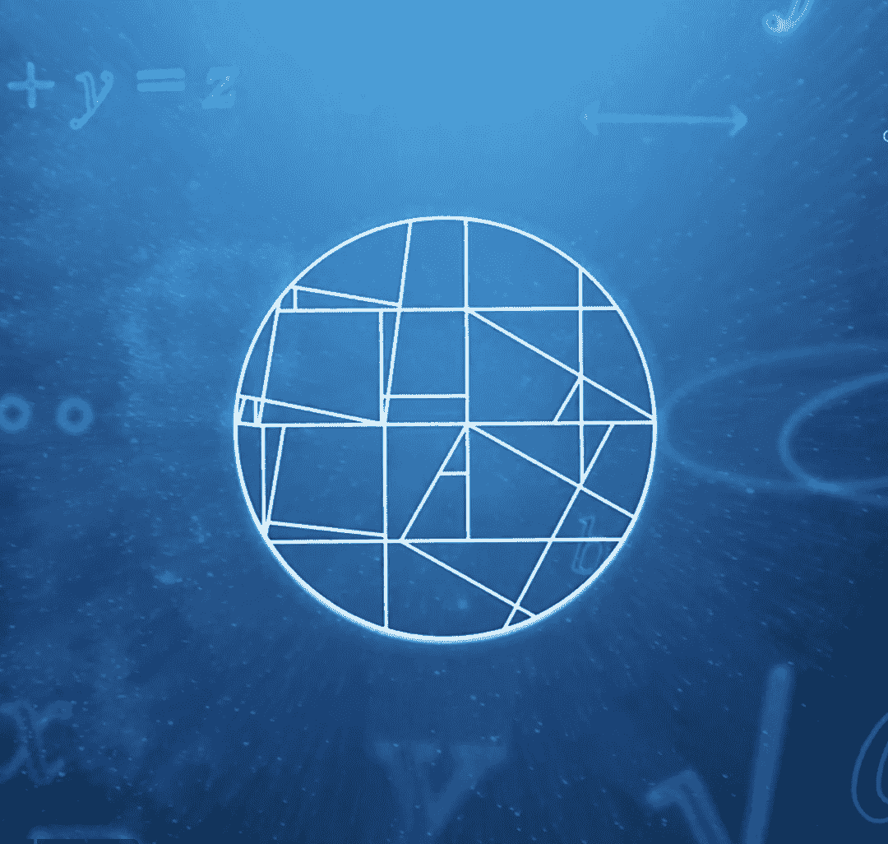

### Ollama 0.3带工具支持：现在可以对流行模型工具调用

https://x.com/ollama/status/1816633415770472485?s=46&t=GRStLXDcUNuun8J5Noyw4Q

Ollama 0.3 带工具支持！

您[现在可以对 Llama 3.1 ](https://t.co/T3yFy5HRO6)[等](https://t.co/T3yFy5HRO6)流行模型使用工具调用！

https://ollama.com/blog/tool-support…

示例工具包括：

函数和API

网页浏览

代码解释器

以及更多！

快速线程

###  SGLang Runtime v0.2：显著的推理优化功能，完全开源并由python实现

https://x.com/lmsysorg/status/1816515251745214853?s=46&t=GRStLXDcUNuun8J5Noyw4Q

我们很高兴地宣布 SG[Lang Runtime v0.2 的里程碑版本，经过几](https://t.co/ipq3FL9MNi)[个](https://t.co/ipq3FL9MNi)月的努力，它具有显著的推理优化功能。

与 TRT-LLM 相比，它的吞吐量提高了 2.1 倍，与 vLLM 相比，吞吐量提高了 3.8 倍。当在带有 FP8/BF16 的 A100/H100 上为 Llama-8B 至 405B 型号提供服务时，它始终如一地提供卓越的性能。

SGLang 完全开源并用 Python 实现。随着原型逐渐成熟，我们邀请社区与我们一起创建下一代高效服务引擎！

了解更多信息，请访问 https://lmsys.org/blog/2024-07-25-sglang-llama3/…

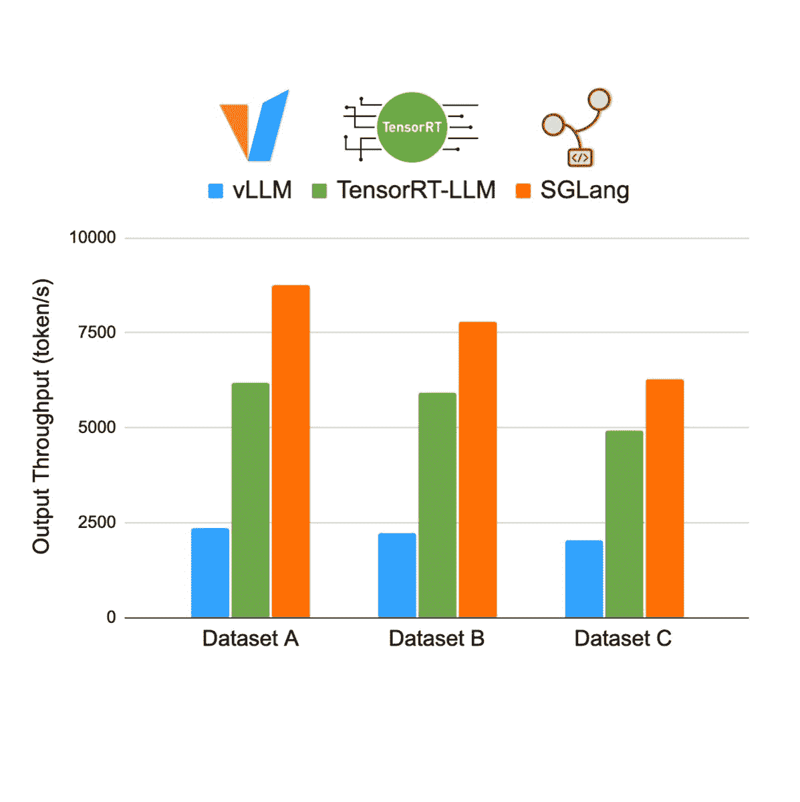

# 资讯

### 谷歌也开“卷”了：Gemini聊天机器人换上新模型，还能一键核查输出内容

https://mp.weixin.qq.com/s/A1rOZvn0rVNFCYV0h9dHZQ

Meta、OpenAI等大模型厂商密集发力之际，谷歌也宣布了一项重磅更新——

即日起，Gemini聊天机器人将改由Gemini 1.5 Flash驱动。

与之前的版本相比，窗口长度提高到了4倍，响应速度也更快了。

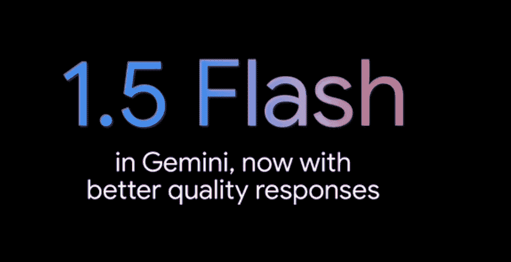

### OpenAI推出新AI搜索，老伙计微软也默默更新了Bing

https://mp.weixin.qq.com/s/TdO6V0kNdPxzyvuqJVgDkA

家人们！微软**Bing**已面向小部分用户开启AI内测了——

**没错，此番对**标谷歌，一举在搜索结果中推出了“AI概述”，所问即所得。

不过可能是鉴于谷歌“翻车”（曾建议人们在披萨中添加**无毒**胶水）在前，Bing此次升级主打一个谨慎。

**微软搜索主管Jo**rdi Ribas特意强调，传统的算法结果将始终占据页面高位。

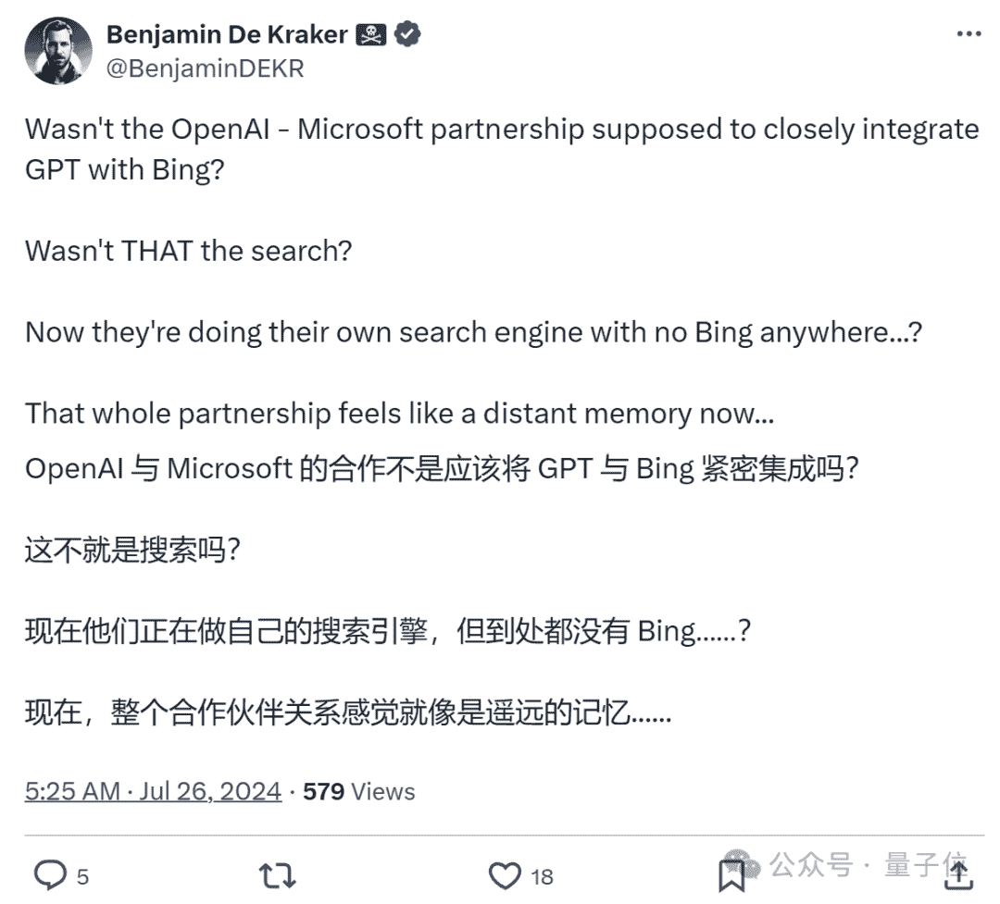

### 算法、系统和应用，三个视角全面读懂混合专家（MoE）

https://mp.weixin.qq.com/s/3UEFwy87f8O4H1Tt4VVnig

最近，各家科技公司提出的新一代大模型不约而同地正在使用混合专家（Mixture of Experts：MoE）方法。

混合专家这一概念最早诞生于 1991 年的论文《Adaptive mixtures of local experts》，三十多年来已经得到了广泛的探索和发展。近年来，随着稀疏门控 MoE 的出现和发展，尤其是与基于 Transformer 的大型语言模型相结合，这种已有三十多年历史的技术焕发出了新的生机。

MoE 框架基于一个简单却又强大思想：模型的不同部分（称为专家）专注于不同的任务或数据的不同方面。

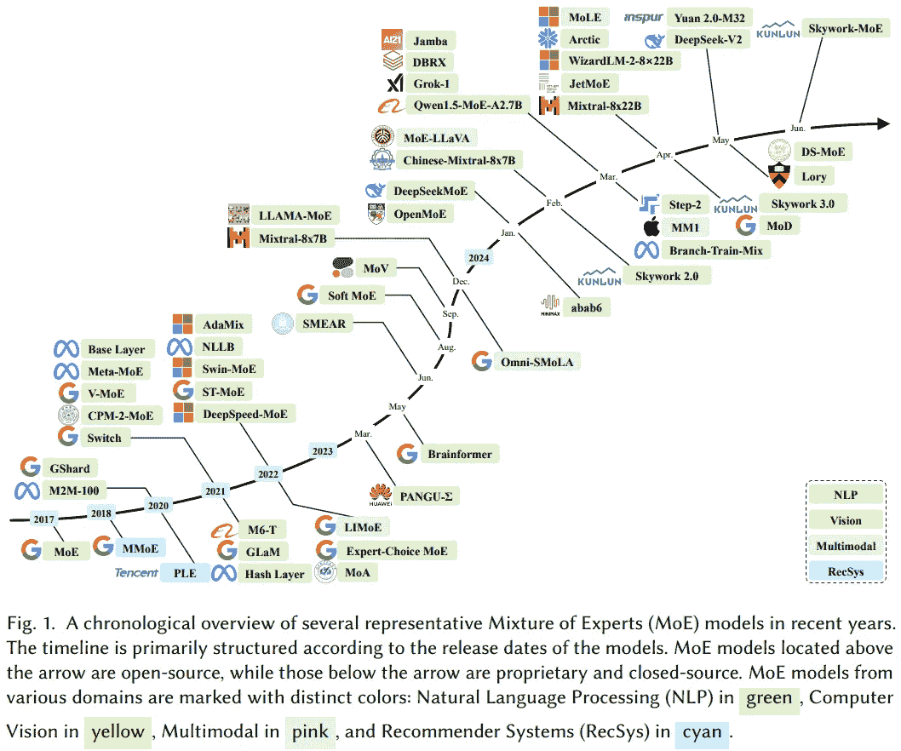

### AgentGPT 团队新作，四个人用 AI Agent 爬取整个公开网络，获 YC 和 AI Grant 等数百万美元投资

https://mp.weixin.qq.com/s/dWCj0zLPeX8Z1iiKbd8dMQ

在 AI 时代，网络抓取工具变得无比重要。据 Bright Data 最新报告显示，2024 年组织使用公共网络数据的首要原因是构建 AI 模型。

问题在于，传统的网络抓取工具由人类构建，必须针对特定网页进行定制，成本高昂。但 Reworkd 的 AI Agent 可以在更少人力介入的情况下抓取更多网络内容。

客户可以给 Reworkd 一份包含数百甚至数千个网站的列表，然后指定他们感兴趣的数据类型。接着，Reworkd AI Agent 使用多模态代码生成将这些数据转化为结构化数据。Agent 生成独特的代码来抓取每个网站，并提取客户所需的数据。

在成立 Reworkd 并搬到旧金山后不久，团队聘请了 Rohan Pandey 作为创始研究工程师。他目前住在 AGI House SF，这是湾区最受欢迎的 AI 时代黑客之家之一，一位投资者形容 Pandey 是 Reworkd 内部的“单人研究实验室”。

#

# 产品

### Tidyread

贡献人：

https://tidyread.ai/

Tidyread 是一个信息摘要工具，帮助用户高效地阅读和管理信息。它通过自动过滤和总结用户感兴趣的内容，提供每日摘要，帮助用户形成阅读习惯，用户可以根据个人需求自定义摘要内容和主题，减少信息过载的心理负担。

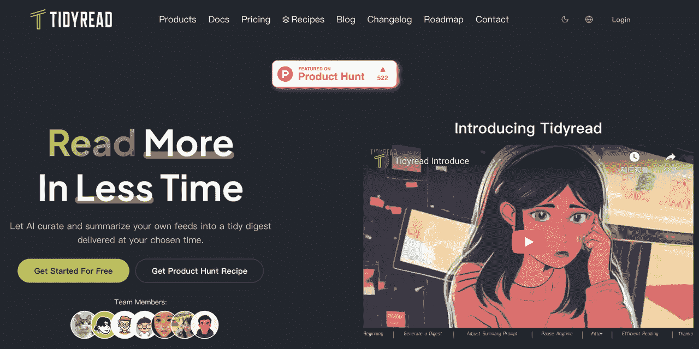

### AdsMoss

贡献人：

https://adsmoss.com/

AdsMoss 是一款专为 TikTok 广告设计的监测工具，帮助用户提高收入、发现热门产品并保持竞争优势。它提供实时广告数据和免费的广告监测工具，可以帮助用户优化广告活动、识别热销产品，并获取竞争对手的策略洞察。

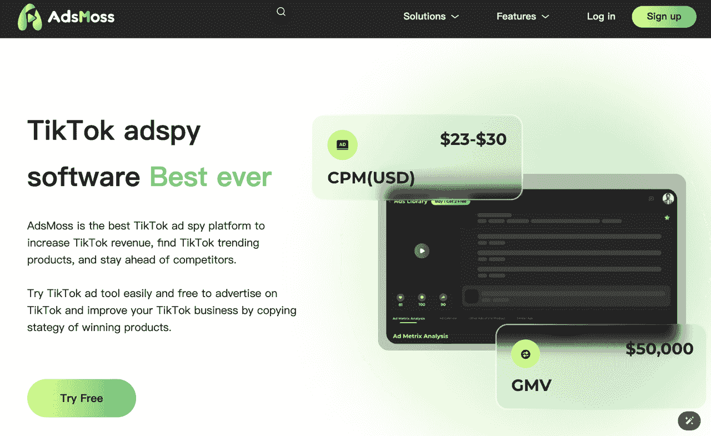

# HuggingFace&Github

### Thepi.pe

贡献人：

https://github.com/emcf/thepipe

thepi.pe 是一个用于从各种格式化信息（如 PDF、网页、幻灯片等）中提取多模态数据（如 Markdown、表格和图像）的 API。可以与视觉语言模型（如 GPT-4o）集成，并与任何 LLM 或向量数据库一起使用。同样，它可以作为托管云服务使用，也可以在本地运行。

### PhotoMaker-V2

贡献人：

https://huggingface.co/TencentARC/PhotoMaker-V2

PhotoMaker V2 是一个图像生成模型，允许用户输入一张或几张人脸照片以及文本提示，以在几秒钟内生成定制的照片或绘画。该模型无需训练，可以与基于 SDXL 的任何基础模型适配，或与其他 LoRA 模块结合使用。

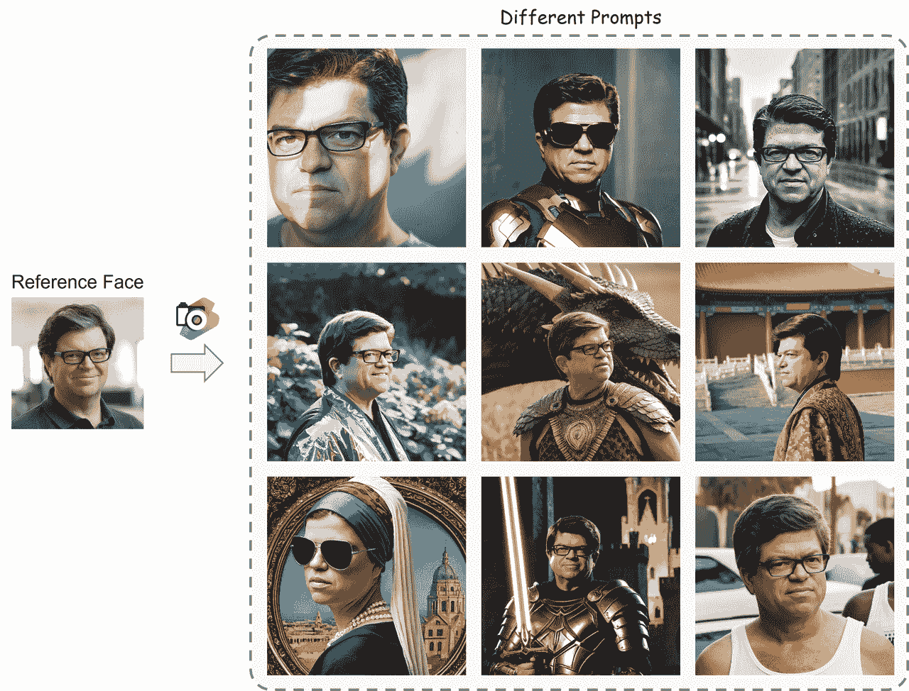

# 投融资

### **Uplimit 宣布获得 Salesforc**e Ventures 领投的 A 轮融资

贡献人：

https://uplimit.com/blog/announcing-our-series-a-funding-led-by-salesforce-ventures

Uplimit 宣布完成 A 轮融资，由 Salesforce Ventures 领投。此次融资进一步加强了公司在市场中的地位，并为其未来的发展提供了坚实的资金支持。这笔资金将用于扩展 Uplimit 的产品和技术团队，加速产品开发和市场推广，以更好地服务客户并推动业务增长。此次融资标志着 Uplimit 在技术和市场创新方面取得的重大进展，并体现了投资者对公司长期发展的信心。

公司官网：https://uplimit.com/

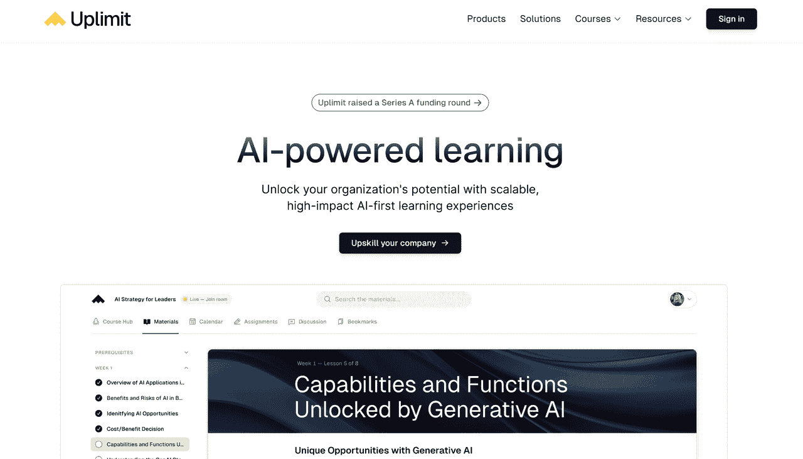

### 上海体育巨头领投，鲸鱼机器人完成第7轮融资，金额超亿元

贡献人：

https://www.robot-china.com/news/202407/25/89516.html

7月25日，上海鲸鱼机器人科技有限公司宣布完成第7轮融资，融资金额超过1亿元人民币。参与本轮融资的包括上海久事集团、陆家嘴集团、上文投和五星体育传媒等国资平台联合设立的上海体育产业基金。久事集团成立于1987年，是全国首家政府性投融资公司，旗下久事体育运营多项国际顶级赛事。本轮融资将助力鲸鱼机器人在全球青少年人工智能普及活动和教育机器人全产品线的研发与升级。

公司官网：https://www.whalesbot.com/

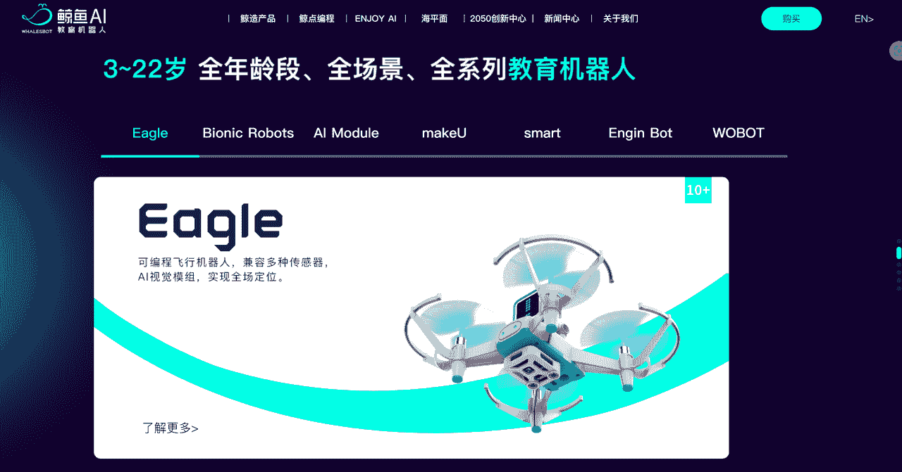

### ZoomInfo前高管创业公司融资1500万美元，打造AI销售工程师

贡献人：

https://techcrunch.com/2024/07/25/zoominfo-alum-raises-15m-for-startup-that-builds-ai-sales-engineers/

ZoomInfo前高管创办的初创公司近日完成了1500万美元的融资。本轮融资由著名风险投资公司领投，其他多家机构参与。该公司专注于开发AI销售工程师，通过人工智能技术提升销售流程的效率和精准度。资金将用于产品开发、市场扩展以及团队扩充，进一步推动公司的快速发展。

公司官网：https://www.zoominfo.com/

### 2024年上半年人形机器人行业的融资盛宴与生存挑战

贡献人：

https://mp.weixin.qq.com/s/puU4LE-zi_aA-O-GpoOuUg

2024 年上半年，人形机器人行业在资本市场上展现出两极分化的现象。头部企业如宇树科技、银河通用机器人等因其强大的技术实力和市场影响力，获得了大额融资，融资总额超过 25 亿元人民币。这些企业的成功不仅为其自身的发展提供了资金支持，也为整个行业的热度和发展树立了标杆。然而，非头部企业由于技术瓶颈、团队短板、资本市场的收紧以及政策支持不足等问题，面临着生存挑战。这些企业在技术研发上受限于资金短缺，难以持续投入，导致产品力不足。创始团队在专业背景、管理经验以及资源整合方面存在不足，难以应对市场变化和企业成长中的挑战。资本市场对非头部企业普遍持谨慎态度，使得这些企业融资渠道狭窄，融资成本高昂。政府基金和投资机构更倾向于支持市场影响力大的企业，而非头部企业则因缺乏足够的市场认可度和影响力，难以享受到政策的红利。文章还对多家在 2024 年上半年完成融资的人形机器人企业进行了简要说明，包括星动纪元、傅利叶、宇树科技、智元机器人、加速进化、达奇月泉仿生、开普勒机器人、帕西尼感知、逐际动力、星尘智能、银河通用机器人和松延动力 Noetix Robotics 等，介绍了它们的企业简介、核心团队背景、主营业务、人形机器人产品及参数、公司动态等信息。

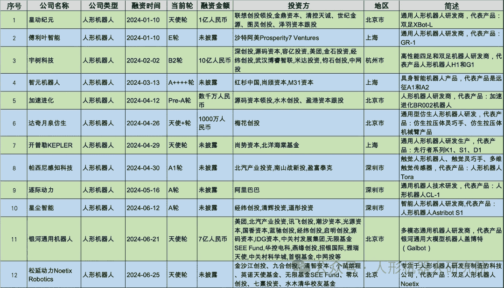

# 学习

### GPU虚拟化和池化技术解读

贡献人：

https://zhuanlan.zhihu.com/p/710973777?utm_psn=1800070870967914497

GPU 虚拟化技术通过将物理 GPU 资源抽象为虚拟 GPU，实现资源的共享和高效利用。这一技术支持多种实现路径，包括 PCIe 直通、SR-IOV、MPT 和 API 转发等，每种方案都有其特点和适用场景。例如，PCIe 直通模式提供最佳性能，但资源共享能力有限；而 SR-IOV 和 MPT 支持更灵活的资源分割和调度。NVIDIA 的 vGPU 方案提供了一种官方的虚拟化解决方案，但受限于许可证费用和资源分配的灵活性。MIG 技术则允许单个 GPU 进行多实例化，提高了资源利用率和操作灵活性。此外，API 转发模式（如 CUDA API 转发）通过在用户态或内核态拦截 API 调用，实现了对 GPU 资源的细粒度管理。在云原生环境中，GPU 算力池化通过 Kubernetes 等容器编排工具实现对 GPU 资源的动态管理和调度，以满足不同应用的需求。

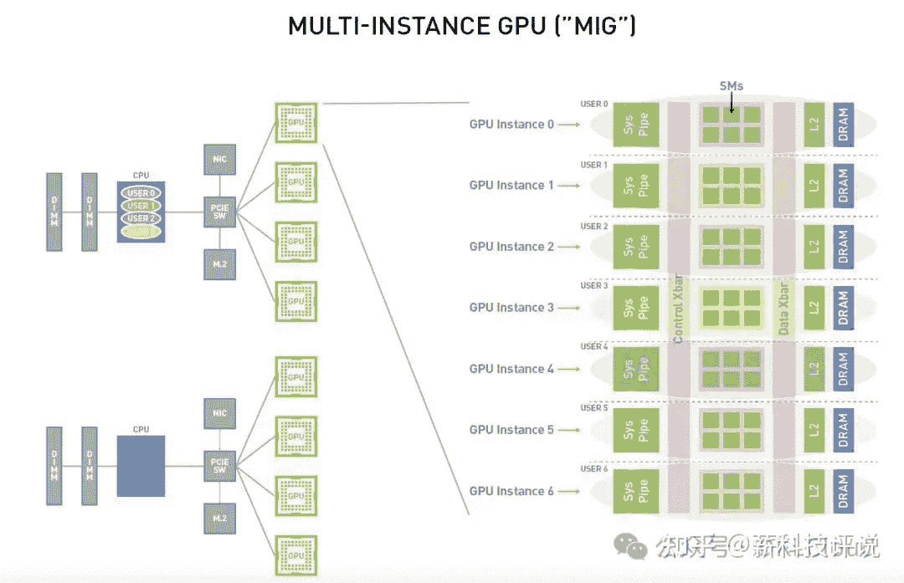

### 以半导体视角理解NV的误区

贡献人：

https://zhuanlan.zhihu.com/p/710830985?utm_psn=1799936461585387520

文章从半导体行业的角度出发，分析了 NV 在电动汽车领域的技术策略和可能的误区。NV 强调技术创新，但可能忽略了成本控制和产品稳定性。与半导体行业的高度集成型供应链不同，电动汽车的供应链更为复杂，需要更细致的管理。NV 在追求技术突破时，应同时考虑技术的可靠性和成熟度，确保与市场需求的匹配。此外，市场推广和品牌建设对于电动汽车企业同样关键。在高科技领域，正确把握市场和技术趋势对于企业的持续成长至关重要。

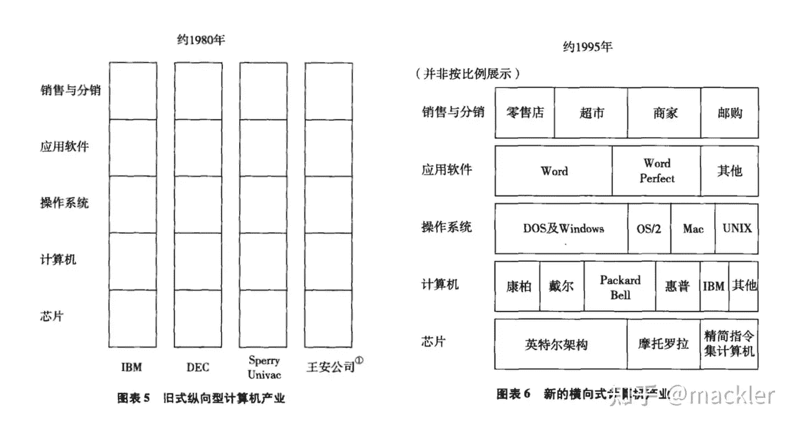

### 大模型时代的代码执行沙箱

贡献人:

https://mp.weixin.qq.com/s/X54d0foyBS56lGFUPyOvTw

蚂蚁安全实验室针对 AI 应用的代码执行沙箱进行了深入研究，特别是在大模型如 ChatGPT 4 推出代码解释器功能后，对沙箱的安全性提出了更高的要求。研究发现，尽管 AI 应用的代码执行功能受到关注，但沙箱的安全防御措施往往不足。通过对 ChatGPT 4 等 AI 应用沙箱的测试，研究室揭示了沙箱的安全策略和选型的重要性。测试包括任意命令执行、特权用户执行、外网访问、东西向隔离、敏感信息泄露和文件上传等方面。研究室对比了不同 AI 应用的沙箱实现，如 Pyodide、Deno、Omegajail、Firecracker 和 gVisor，指出了各自的特点和适用场景。研究表明，进程级沙箱在 AI 领域的应用已逐渐被语言级和系统级沙箱所取代，尤其是 gVisor 和 Firecracker 等系统级沙箱因其强大的隔离性和业务兼容性受到青睐。然而，这些高级沙箱的接入成本较高，需要配备更精细的安全策略，包括最小化运行环境、限制用户权限、实施严格的安全策略和完善的日志审计。

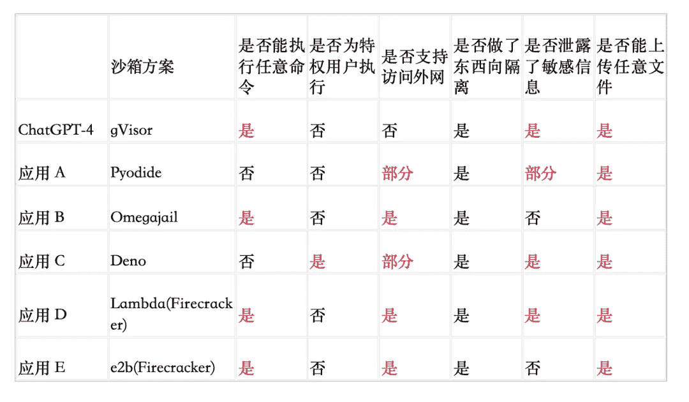

### 基于扩散模型的艺术风格三维物体生成方法

贡献人：

https://mp.weixin.qq.com/s/NDf9cvRM2EBpEUFBpe0CXQ

艺术风格三维物体生成是三维物体生成领域的一大垂直命题，基于艺术风格图像的三维物体生成可应用于草图辅助设计、非真实感模型构建等方面。已有的基于扩散模型分数蒸馏的方法，难以在艺术图像上进行三维模型的生成。本文基于深度条件后验和语义分割的技术思想，立足平面图像生成、可微分渲染等领域的发展，提出了基于扩散模型的艺术风格三维物体生成方法及其技术构想，列举了使用扩散模型指导艺术风格三维生成存在的问题，并提出了基于漂浮伪影抑制和主体物几何结构正则的艺术风格三维物体生成关键技术。最后，本文展望艺术风格三维生成领域仍然面临的关键问题和技术挑战，为未来的研究提供了可行的方向。

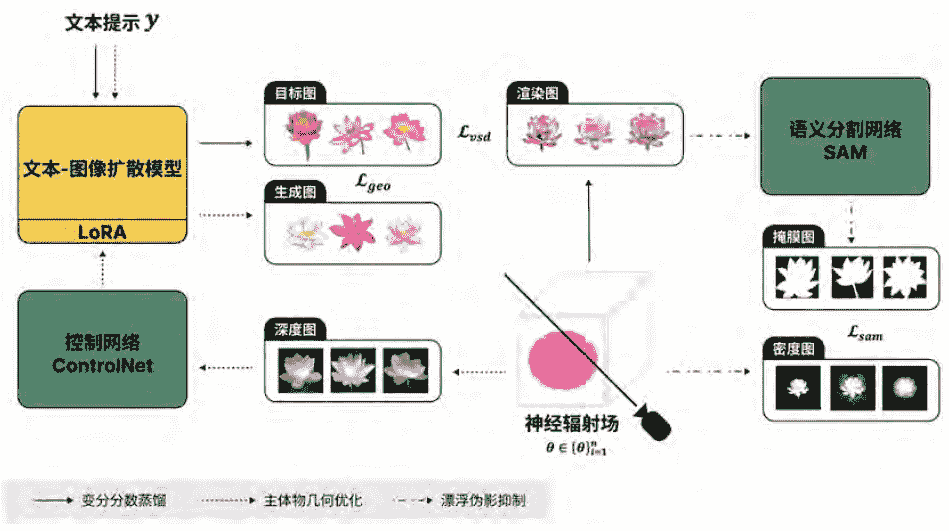

### LLM推理加速：decode阶段的Attention在GPU上的优化

贡献人：

https://mp.weixin.qq.com/s/Sek1cnmPshuk9kK-XR59iw

文章聚焦于在 GPU 上优化大语言模型（LLM）推理过程中 decode 阶段 Attention 计算的技术细节。首先，介绍了 RTP-LLM 推理加速引擎，它通过在 kernel 级别优化 GEMM 和 Attention 计算，提升了推理效率。在 Attention 计算中，通过将 BiasAdd 和 Rotary Embedding 融入到一个 kernel 中，实现了高效的计算流程。文章详细描述了 tensor 的 shape 变换，以及如何在 GPU 上利用并行计算和寄存器优化来提高性能。特别是在处理小批量（B）和长序列（S）时，通过调整任务划分和增加 device occupancy，有效地提升了计算效率。此外，对于超长序列，提出了 seq 切分的策略，以适应 GPU 的 smem 限制。在全局查询全局注意力（GQA）场景下，进一步优化了任务划分。最后，文章提出了 MMHA 优化的未来方向，包括寄存器用量优化、KV Cache 的 load 行为调整以及在 compute bound 场景下的计算模式调整，以及这些优化后的 kernel 将会开源，供社区参考和共建。

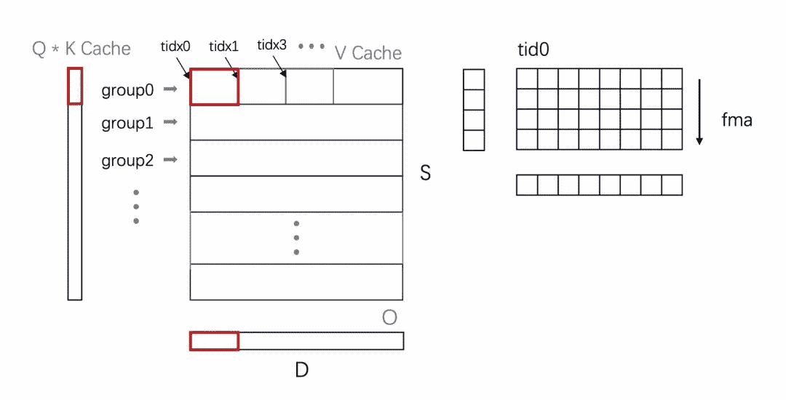

### Mistral Large 2开源！魔搭推理、微调实战教程

贡献人：

https://mp.weixin.qq.com/s/pXqpCVd2pmFwqu6cCqrz3Q

Mistral Large 2 模型在多语言和编程语言支持方面得到了加强，并在性能 / 成本上显示出优势。该模型在 ModelScope 上开源，提供了详尽的实战教程，包括模型下载、环境搭建、推理代码和微调流程。实战教程突出了技术细节，如使用 ms-swift 进行模型微调、利用自我认知数据集优化模型性能，以及通过 vLLM 进行推理加速。此外，还介绍了如何在多 GPU 环境下部署模型，确保技术应用的高效性和实用性。这些教程为开发者提供了一套完整的操作指南，以便在实际应用中利用 Mistral Large 2 模型进行有效的推理和微调。

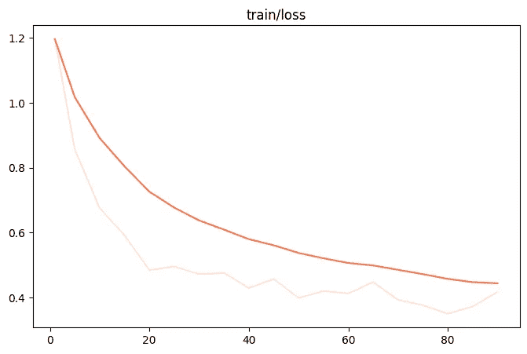

### AI音乐大模型背后的技术突破、版权诉讼和资本蛋糕

贡献人：

https://mp.weixin.qq.com/s/SzrWnq_YQCltmMLeFkpr0w

AI 音乐大模型利用音频 token 化和压缩技术，通过 Transformer 架构生成音乐。首先，将音乐的各维度（如节奏、和声、旋律）转换为 token 序列，然后通过码本（codebook）进行信息压缩，大幅度减少数据量。其次，采用双层压缩技术，进一步减少 token 量，使得大语言模型能够处理长序列音乐数据。这些技术的进步使得 AI 音乐在作曲、作词和演唱上取得了显著的提升，能够生成悦耳的音乐作品。然而，这些技术的应用也引发了版权侵犯的争议，三大唱片公司对 Suno 和 Udio 提起了诉讼。尽管如此，AI 音乐技术的未来仍然广阔，预计会继续推动音乐产业的变革。

# 声明

本文档仅供学习交流使用，版权归原作者所有，若涉侵权，请联系Jack Jin 15101136166

##

（欢迎在下方反馈您宝贵的意见！整理不易，觉得有用给AI日报小组点个赞👍吧！）

ChatGPT；Angela；Zijia Liu；Alex；Zeqi Tan；Tiezhen（HuggingFace）；Naixu；Lizhi；Peter；Suoman；Jack

封面生成——右脑科技

如果你有大模型相关的创业想法，欢迎来找我们聊聊～🛰️：15101136166

> 快邀请你的小伙伴们一起来读大模型日报吧！

> **【日报****知识库****】**这里是近期日报内容的汇总,欢迎大家查阅

> [大模型日报知识库(分享版)](https://miracleplus.feishu.cn/wiki/KapVwXfkriOBiskB0B2cUHxjnTh)

>

> 欢迎大家多多帮我们分享,转发~~

> 如果大家有任何的建议或者吐槽,欢迎随时找我聊天~

