# 奇绩大模型日报（7月 25日）

> 来源：[https://miracleplus.feishu.cn/docx/W8dtdiBXGoEOYDxZY2Qc4CTrnjd](https://miracleplus.feishu.cn/docx/W8dtdiBXGoEOYDxZY2Qc4CTrnjd)

# 🔔潜空间活动预告

> **潜空间系列活动第三季全面升级！**

>

> 第三季第一期将在**7.27上午10:00**开始，嘉宾是**宋佳铭**。活动包括嘉宾分享、访谈Q&A、cofounder matching餐会。活动现场还可以体验到咱们奇绩校友 【右脑科技】的最新产品，期待大家大力支持！

>

> 宋佳铭-Luma AI 首席科学家，斯坦福大学计算机科学博士、博士后；曾任职英伟达（DIR）小组科学家 ，创建了最早的扩散模型加速算法，该算法广泛用于最近的生成式 AI 系统，包括 DALL-E 2、Imagen、Stable Diffusion 和 ERNIE-ViLG 2.0。

>

>

> 陈贝迪-卡内基梅隆大学助理教授，斯坦福大学人工智能博士后学者，前 Meta AI 研究科学家；致力于在现代硬件上设计和优化算法和模型，以加速大型机器学习系统。

>

>

> 童晟邦- 纽约大学博士，伯克利人工智能实验室（BAIR）研究员， OpenAI 超对齐奖学金获得者；

>

> 闫俊杰-MiniMax 创始人兼 CEO。是中国第一梯队的大模型创业者，目前 MiniMax 估值超 25 亿美元。

>

>

> 本季活动同时开放**北京线下、上海线下和线上**场次，欢迎校友和外部创业者扫描右方二维码报名！

# 推特

### Mistral Large 2: 在代码生成、数学和推理方面具有显著的能力提升

https://x.com/MistralAI/status/1816133332582703547

规模足够大

今天，我们宣布推出Mistral Large 2，我们旗舰模型的新一代。与前代产品相比，Mistral Large 2在代码生成、数学和推理方面具有显著的能力提升。它还提供了更强大的多语言支持和先进的函数调用功能。

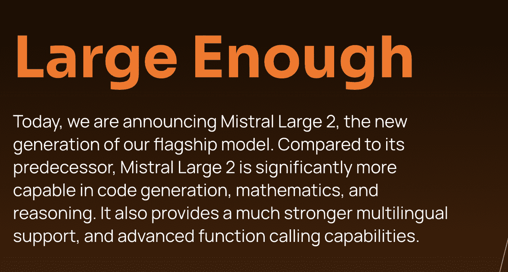

### OpenAI：通过基于规则的奖励提高模型安全行为

https://x.com/OpenAI/status/1816147248608403688

我们开发了基于规则的奖励（RBRs）系统，以在无需大量人类数据收集的情况下安全地校准AI行为，使我们的系统在日常使用中更安全、更可靠。

我们开发并应用了一种利用基于规则的奖励（RBRs）的方法，在无需大量人类数据收集的情况下校准模型，使其安全行为得到保障。

### Stable Video 4D：首个视频生成模型，允许用户上传单个视频并接收八个新角度的动态新视角视频

https://x.com/StabilityAI/status/1816126682816000132

我们很高兴地宣布推出Stable Video 4D，这是我们首个视频生成模型，允许用户上传单个视频并接收八个新角度的动态新视角视频，提供了新的多样性和创造力。

与此公告同步，我们发布了一份全面的技术报告，详细介绍了在该模型开发过程中所采用的方法、遇到的挑战和取得的突破。

了解更多关于此发布的信息并访问报告：https://stability.ai/news/stable-video-4d

[ssstwitter.com_1721915077397.mp4](https://internal-api-drive-stream.feishu.cn/space/api/box/stream/download/all/R3p5bMXzmoFZVhx53zVcWYUOn7b)

### 足球AI代码开源：球员检测和追踪、团队聚类、摄像机校准

https://x.com/skalskip92/status/1816162584049168389

足球AI代码终于开源了

+   球员检测和追踪

+   团队聚类

+   摄像机校准

README文件我还在完善中，请不要评价我。

代码地址：https://github.com/roboflow/sports

在体育运动中，每一厘米和每一秒都至关重要。这就是为什么Roboflow决定将体育作为测试平台，以极限推进我们的物体检测、图像分割、关键点检测和基础模型。这个仓库包含可在体育及其他领域应用的可重用工具。

[ssstwitter.com_1721915156157 (1).mp4](https://internal-api-drive-stream.feishu.cn/space/api/box/stream/download/all/YZvabD4y8odPthx3kkVcCgEgn2e)

### DeepLearningAI: 学习如何使用联邦学习在分布式数据上训练大型语言模型

https://x.com/AndrewYNg/status/1816171538275787145

学习如何使用联邦学习在分布式数据上训练大型语言模型（LLM），同时确保隐私保护。在由@flwrlabs创建，并由@daniel_janes和@niclane7教授的新两部分短课程《联邦学习入门》和《使用私有数据对LLM进行联邦微调》中掌握这些技能。

联邦学习允许在多个设备（如手机）或多个组织（如医院）上训练单个模型，而无需将数据共享到中央服务器。

这门两部分课程首先为您介绍联邦学习，然后教您如何使用Flower Lab的开源联邦学习框架，通过分布式数据微调您的大型语言模型。

您将学习到：

+   如何使用联邦学习在分布式数据上训练各种模型，从语音和视觉模型到LLM，同时为用户和组织提供数据隐私选项。

+   隐私增强技术（如差分隐私，DP），通过向查询结果添加校准噪声来模糊个体数据。

+   差分隐私的两种变体——中央差分隐私和本地差分隐私，以及如何根据您的使用场景进行选择。

+   如何测量和减少带宽使用，使联邦学习更实用高效，例如使用预训练模型和参数高效微调技术。

+   联邦LLM微调如何减少训练数据泄露的风险。

立即报名：https://deeplearning.ai/short-courses/federated-learning/

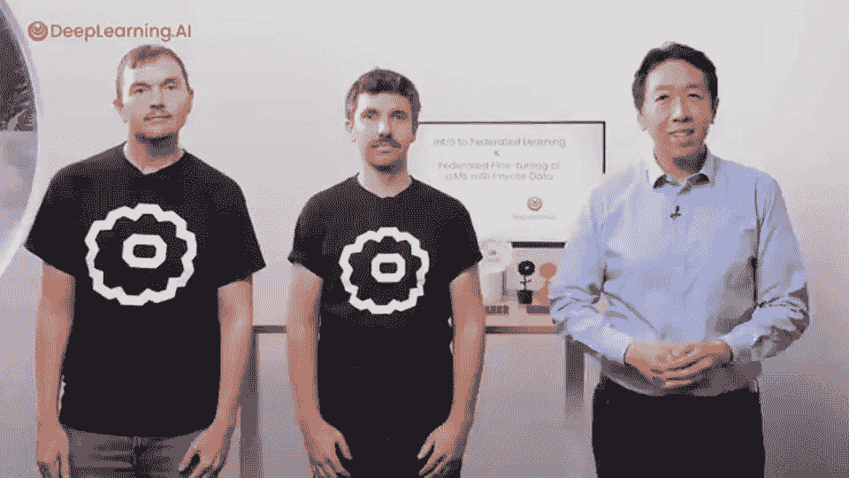

[ssstwitter.com_1721915300315.mp4](https://internal-api-drive-stream.feishu.cn/space/api/box/stream/download/all/IwHcbX1CjoN8voxyPm8cP0GQn0g)

### Anthropic宣布Build with Claude比赛获奖三项目

https://x.com/alexalbert__/status/1816161458629271673

我们收到了大量来自@AnthropicAI开发者的精彩作品，参加了2024年6月的Build with Claude比赛！

以下是获奖的三个项目，每个项目将获得10,000美元的Anthropic API积分奖励：

+   **Buildware** 由@mckaywrigley和@tylerbruno05开发

Claude 3.5 Sonnet支持的编码代理，通过创建带有修复的拉取请求自动解决GitHub问题。

+   **Claude + 无限画布** 由@TodePond开发

一个无限画布的网络应用程序，Claude 3.5 Sonnet生成和解释图画，结合文本和视觉提示。

+   **行内文档编辑器** 由@baygross和@MatthewSlotkin开发

Claude 3.5 Sonnet支持的工具，阅读您的文档并在需要的地方添加评论和建议。

六月比赛到此结束！在如此高质量的作品中选出三个获胜者实在是非常困难。

为了感谢大家的出色工作，所有参与者都获得了5美元的API积分。你们的创造力和努力真的让我们印象深刻！

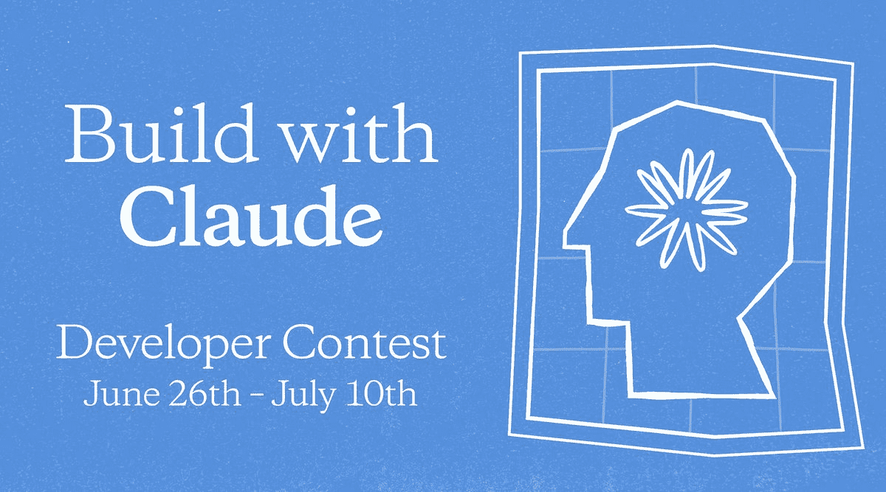

# 资讯

### 字节大模型同传智能体，一出手就是媲美人类的同声传译水平

https://mp.weixin.qq.com/s/6L2fFILRgkmaL2oS1vbq-A

近年来，人工智能（Aritificial Intelligence, AI），尤其是以大语言模型（Large Language Models, LLMs）为代表的 AI 正以惊人的速度发展，这些模型在多种自然语言处理任务中展现了卓越的能力。然而，尽管在许多领域取得了突破，代表着人类顶尖语言水平的同声传译（Simultaneous Interpretation, SI）依然是一个未被完全攻克的难题。市面上传统的同声传译软件通常采用级联模型（cascaded model）的方法，即先进行自动语音识别（Automatic Speech Recognition, ASR），然后再进行机器翻译（Machine Translation, MT）。这种方法存在一个显著的问题 —— 错误传播。ASR 过程中的错误会直接影响到后续的翻译质量，导致严重的误差累积。此外，传统的同声传译系统由于受限于低延时的要求，通常只使用了性能较差的小模型，这在应对复杂多变的实际应用场景时存在瓶颈。来自字节跳动 ByteDance Research 团队的研究人员推出了端到端同声传译智能体：Cross Language Agent - Simultaneous Interpretation, CLASI，其效果已接近专业人工水平的同声传译，展示了巨大的潜力和先进的技术能力。CLASI 采用了端到端的架构，规避了级联模型中错误传播的问题，依托于豆包基座大模型和豆包大模型语音组的语音理解能力，同时具备了从外部获取知识的能力，最终形成了足以媲美人类水平的同声传译系统。

### Nature封面：AI训练AI，越训越离谱

https://mp.weixin.qq.com/s/l9ka81Cj2LFzNbXXsaEbmA

我们知道，大模型面临的三大挑战是算法、算力和数据。前两者靠优化升级，后者靠积累。随着技术的不断发展，高质量数据已经逐渐成为最大的瓶颈。在很多新模型上，人们为了提升模型能力，都采用了使用 AI 生成数据来训练的方式。人们普遍认为，使用合成数据可以显著提升模型质量。不过，最新的研究认为，使用 AI 生成的数据并不是什么好办法，反而可能会让模型陷入崩溃。今天发表在学术顶刊《自然》杂志的封面研究认为，如果放任大模型用自动生成的数据训练自己，AI 可能会自我退化，在短短几代内将原始内容迭代成无法挽回的胡言乱语。

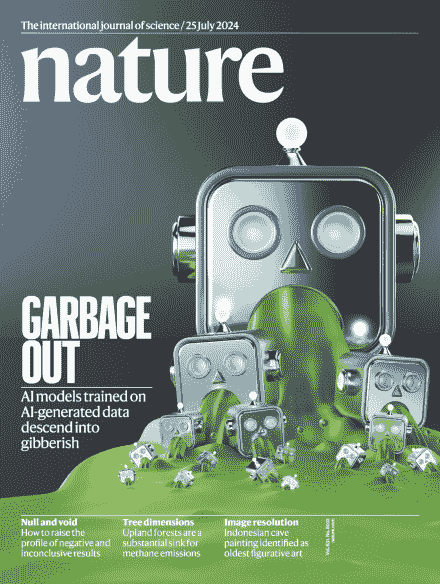

### RLHF不够用了，OpenAI设计出了新的奖励机制

https://mp.weixin.qq.com/s/gn_MoLjessnCMxRNNjhtuw

自大模型兴起以来，使用强化学习从人类反馈（RLHF）中微调语言模型一直是确保 AI 准确遵循指令的首选方法。为了确保 AI 系统安全运行并与人类价值观保持一致，我们需要定义期望行为并收集人类反馈来训练「奖励模型」。这种模型通过发出期望的动作来指导 AI。但是，收集这些常规和重复任务的人类反馈通常效率不高。此外，如果安全政策发生变化，已经收集的反馈可能会过时，需要新的数据。我们能否构建一种新的机制来完成这些任务？近日，OpenAI 公布了一种教导 AI 模型遵守安全政策的新方法，称为基于规则的奖励（Rule-Based Rewards，RBR）。

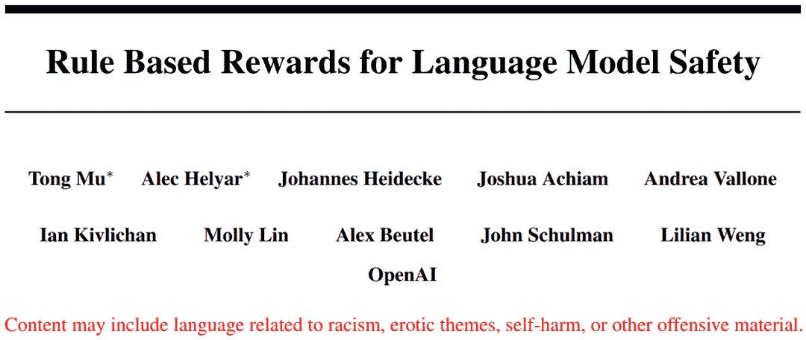

### 扎克伯格最新对谈：Llama 3.1 比 GPT4 成本低 50%！未来企业拥有 AI Agent 数量或超地球总人口

https://mp.weixin.qq.com/s/wSgfWYqzwiG29jWNFwWaVg

7 月 23 日，Meta CEO 马克·扎克伯格与科技评论家 Rowan Cheuang 深入探讨了开源 AI 的未来及其对社会和商业的深远影响。扎克伯格强调，开源 AI 不仅是确保 AI 未来发展的关键，也是提升全球生产力和创造力的重要工具。他认为，开源模型将使 AI 技术更安全、更透明，并加速其在各个领域的应用。Meta 通过发布 Llama-3.1 等开源模型，致力于建立一个更开放、更具创新力的 AI 生态系统。

### 大模型智障检测+1：Strawberry有几个r纷纷数不清，最新最强Llama3.1也傻了

https://mp.weixin.qq.com/s/QX87ChDMxIecFlhywOR50A

继分不清9.11和9.9哪个大以后，大模型又“集体失智”了！数不对单词“Strawberry”中有几个“r”，再次引起一片讨论。有人发现，即使使用Few-Shot CoT，也就是“一步一步地想”大法附加一个人类操作示例，ChatGPT依然学不会：倒是把r出现的位置都标成1，其他标成0，问题的难度下降了，但是数“1”依旧不擅长。

### OpenAI今年预计亏损50亿美元，员工怒赚15亿

https://mp.weixin.qq.com/s/7wdAVMNTBCq8kR1Ete9QSA

今日午时Glenn Gabe X社交平台上发布消息称，“除了运行ChatGPT，OpenAI的培训成本——包括支付数据费用——今年可能高达30亿美元。据一位了解情况的人士称，去年OpenAI加速了新AI的训练速度，超出了最初的计划。”“因此，虽然公司原本计划在此类成本上花费大约8亿美元，但实际上花费了更多。我们估计，由于其训练了新版本的旗舰级大型语言模型（LLM）并开始训练新的旗舰模型，这种成本今年将翻倍。”

# 产品

### Hey AI

贡献人：

https://hey-ai.app/

Hey AI 是一款创新的约会应用，通过人工智能帮助用户找到有意义的连接，避免传统约会中的滑动和重复对话。它提供 AI 先行对话、个性化匹配报告和安全隐私保障，希望可以提升用户的约会体验。

### MrScraper

贡献人：

https://mrscraper.com/

MrScraper 是一款无代码的数据抓取工具，简化数据获取过程，用户可以轻松地抓取大量数据，避免手动复制和验证码障碍。它提供 AI 驱动的界面、API 支持以及 Zapier 集成，适合各种数据抓取需求。

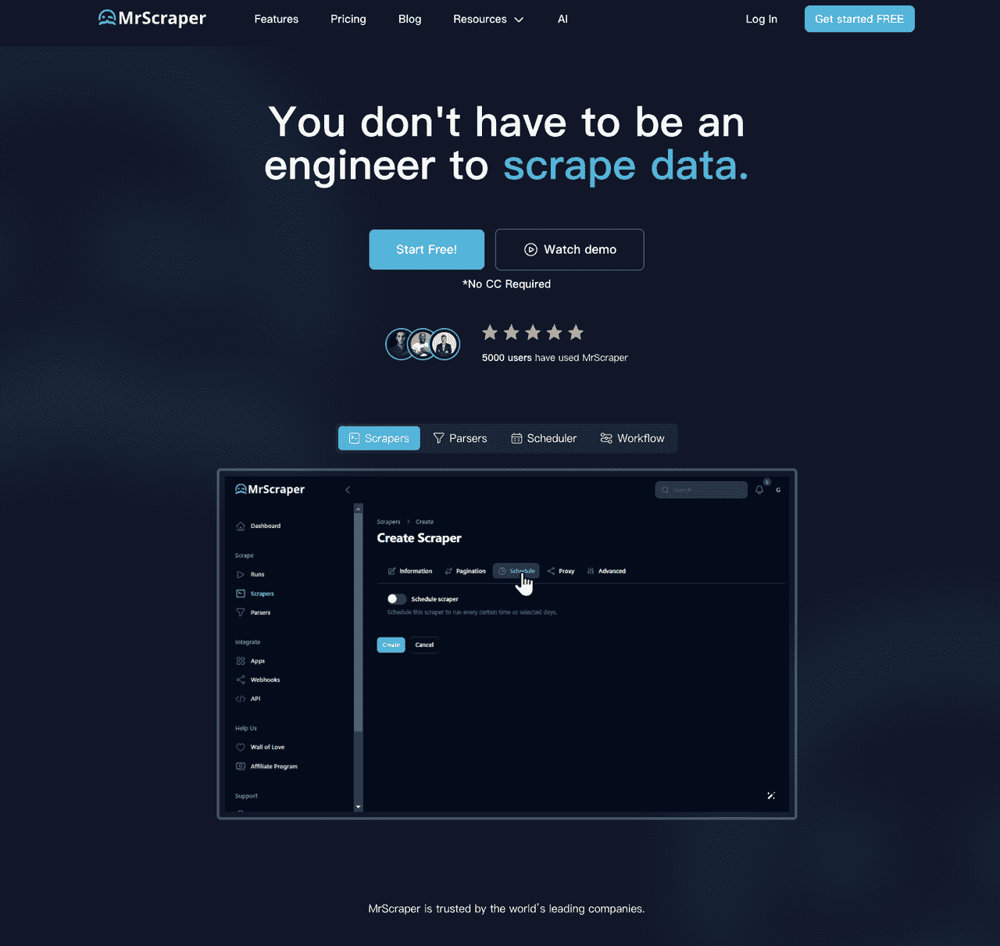

# HuggingFace&Github

### Outfit Anyone

贡献人：

https://humanaigc.github.io/outfit-anyone/

Outfit Anyone 是一种先进的虚拟试衣技术，通过双流条件扩散模型解决传统虚拟试衣中存在的高保真度和细节一致性问题。它能够处理服装的变形，使得试穿效果更加逼真。该技术具有可扩展性，能够根据用户的姿势和体型进行调整，适用于多种场景，从动漫图像到现实生活中的照片。

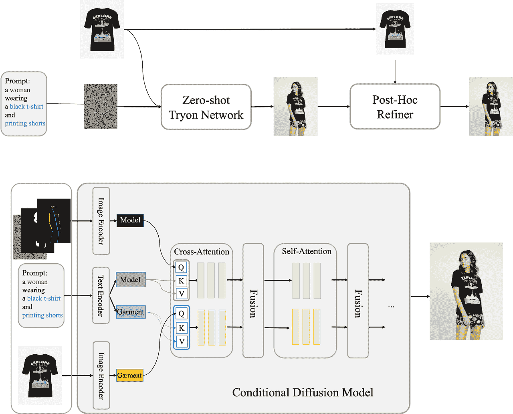

### Meta-Llama 3.1

贡献人：

https://huggingface.co/meta-llama/Meta-Llama-3.1-8B-Instruct

Meta Llama 3.1 是一系列多语言的大型语言模型（LLMs），包括8B、70B和405B三个不同规模的预训练和指令调优生成模型。它们专为多语言对话场景优化，并在常见行业基准测试中表现优于许多现有的开放源代码和闭源聊天模型。Llama 3.1 采用优化的变换器架构，调优版本使用监督微调（SFT）和基于人类反馈的强化学习（RLHF），以符合人类在帮助性和安全性方面的偏好，训练数据库的知识截止日期为2023年12月。

# 投融资

### DAOBase完成600万美元融资以增强DAO治理

贡献人：

https://www.binance.com/en/square/post/2024-07-24-daobase-secures-6-million-funding-to-enhance-dao-governance-11223382930674

据BlockBeats报道，DAOBase，一个专为去中心化自治组织（DAO）打造的AI驱动数据和基础设施平台，已完成600万美元的融资。本轮投资由SevenX Capital、AntAlpha Ventures、Tanuki Studio、y2z Ventures、Slingshot Labs、LD Capital、Mix Marvel DAO Venture、TI Capital和Bitrise Capital领投，The Sandbox联合创始人Sébastien Borget和DeXe Protocol联合创始人Dmytro Kotliarov等知名个人投资者也参与其中。

DAOBase专注于为DAOs提供先进的算法，构建链上和链下数据信誉层，帮助用户智能监控DAO治理、做出明智决策并探索未来工作模式。新资金将主要用于产品开发、市场推广和全球扩展，以进一步提升平台功能，扩大运营规模，为DAOs提供更智能、更高效的治理解决方案。

公司官网：https://daobase.ai/

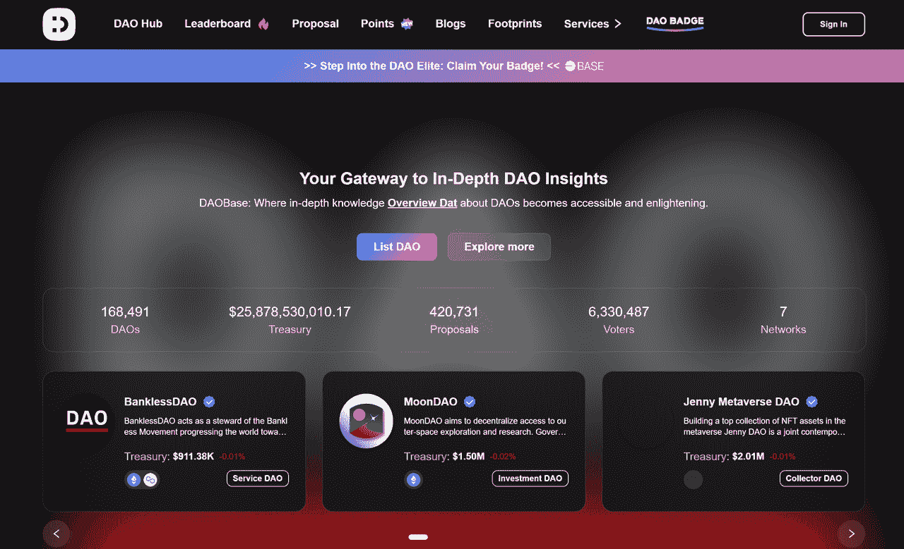

### 百川智能完成50亿元A轮融资，北上深国资入局

贡献人：

https://mp.weixin.qq.com/s/gnRDE-w5-P25gtMzk8PN6g

大模型初创公司「百川智能」近期完成A轮融资，总金额达50亿元人民币。本轮融资由阿里、腾讯、小米等科技巨头和多家顶级投资机构领投，北京市人工智能产业投资基金、上海人工智能产业投资基金、深创投等国资背景产业投资基金也参与其中。融资完成后，百川智能估值已达200亿元，并计划启动B轮融资。公司由前搜狗CEO王小川创立，核心团队来自多家顶尖科技公司。

公司官网：https://www.baichuan-ai.com/home

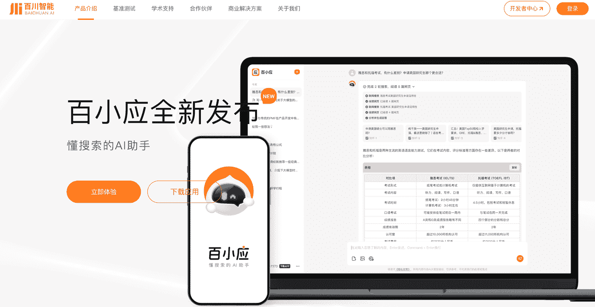

### Lakera完成2000万美元A轮融资，致力于保护生成型AI应用

贡献人：

https://techcrunch.com/2024/07/24/lakera-which-protects-enterprises-from-llm-vulnerabilities-raises-20m/

瑞士初创公司Lakera专注于保护生成型AI应用免受恶意提示攻击，已完成2000万美元的A轮融资。此次融资由欧洲风险投资公司Atomico领投，参与方包括Dropbox的VC部门、Citi Ventures和Redalpine。Lakera成立于2021年，总部位于苏黎世，去年10月以1000万美元资金启动，主要提供低延迟的AI应用防火墙Lakera Guard，防止数据泄漏和提示注入等安全威胁。新资金将用于扩展全球业务，尤其是美国市场。

公司官网：https://www.lakera.ai/

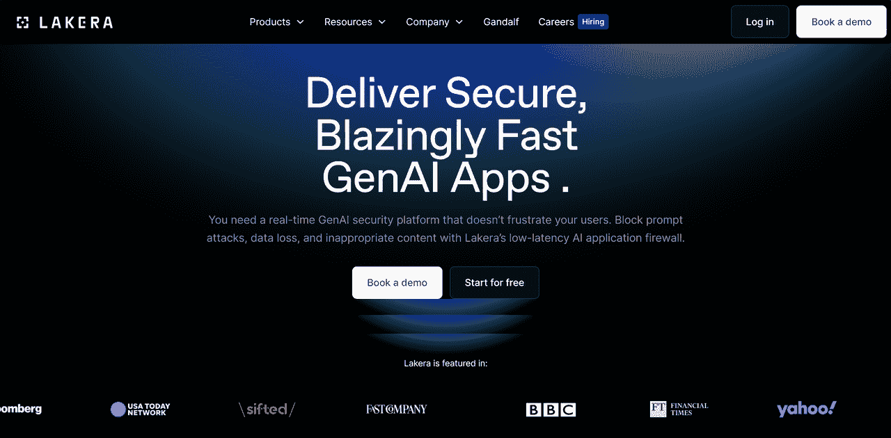

# 学习

### 大模型结构的进化（一）：LLaMA 3.1结构及影响解析

贡献人：

https://zhuanlan.zhihu.com/p/710780476

作者在文章中详细阐述了 LLaMA 3.1 模型的结构演进和技术细节。LLaMA 3.1 采用了标准的 Transformer 架构，通过初始预训练、长上下文预训练和退火阶段，优化了模型对长序列和多语言的处理能力。在数据配比方面，模型通过混合不同类型数据，提高了训练效率和模型泛化能力。Post-Training 阶段，LLaMA 3.1 通过强化学习和蒸馏技术，尤其是拒绝采样和蒸馏，进一步提升了性能。文章指出，LLaMA 3.1 没有采用 MOE 结构，是基于 Dense 模型训练更稳定的考虑。此外，LLaMA 3.1 的开源行为对 AI 界产生了深远影响，促进了开源模型的发展，并推动了小模型通过数据和技术手段提升效能的趋势。总结来说，LLaMA 3.1 的技术细节体现在其模型结构的选择、预训练和 Post-Training 的策略，以及对合成数据的应用，这些都是提升大模型性能的关键因素。

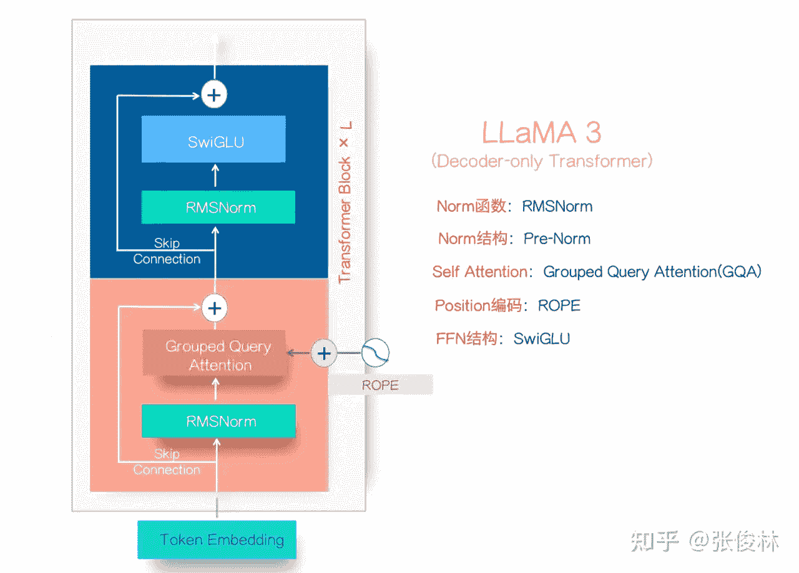

### 从0开始实现LLM：7.1、Reward/PPO/DPO/KTO/SimPO详解

贡献人：

https://zhuanlan.zhihu.com/p/705853749?utm_psn=1799526611231584256

本文深入探讨了大型语言模型（LLM）训练中的优化算法，包括 Reward、PPO、DPO、KTO 和 SimPO。Reward 函数是模型学习的基础，它定义了学习目标。PPO 算法通过限制策略更新步长，确保训练过程的稳定性。DPO 则是 PPO 的分布式优化，提高了计算效率。KTO 利用核函数近似 TD 误差，为策略优化提供了新的视角。SimPO 进一步简化了 PPO 算法，易于实现和理解。这些算法各有特点，在实际应用中需要根据具体问题选择合适的优化策略。技术细节上，PPO 和 DPO 关注策略梯度的稳定性和并行化，KTO 则侧重于通过核方法来处理 TD 误差，而 SimPO 致力于算法的简化和易用性。

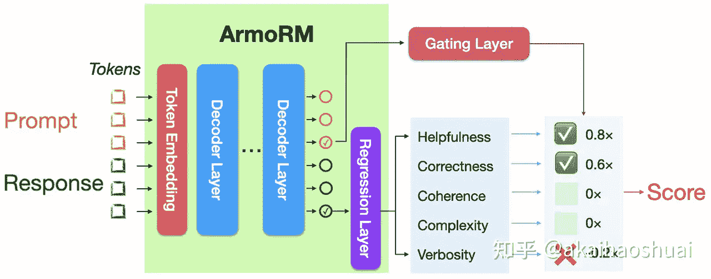

### 铠侠最新BiCS8 218L NAND键合技术

贡献人：

https://zhuanlan.zhihu.com/p/710752331

铠侠最新推出的 BiCS8 218L NAND 技术，是一种集成了 3D Flash 存储和多级存储技术的创新性解决方案。该技术通过提升 NAND Flash 存储芯片的层数至 218 层，实现了显著提高的存储密度。BiCS8 采用了先进的键合技术，每个存储单元能够存储超两位的信息，大大增强了单元的多级存储能力。此外，该技术在读写速度上进行了优化，同时降低了能耗，使其更适合在客户端、数据中心和企业级应用中使用。

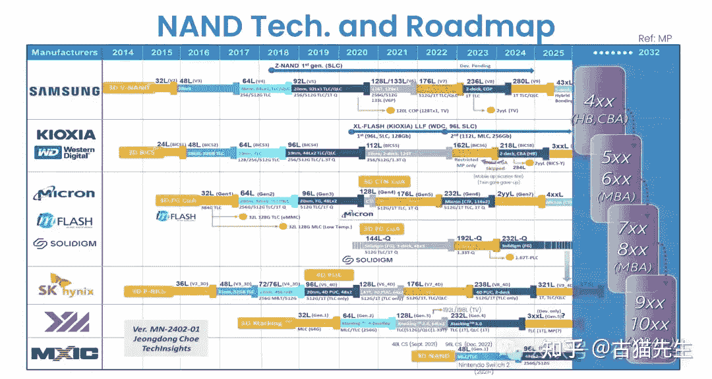

### “闭门造车”之多模态思路浅谈（二）：自回归

贡献人：

https://kexue.fm/archives/10197

1、自回归学习既为模型赋予了生成能力，同时也是通过生成来促进理解能力的无监督学习途径；

2、对于图像来说，问题不在于要不要做自回归，而是以何种方式才能更好地做自回归；

3、将图像以连续型特征的方式输入时，它的自回归学习有两大难题：分Patch排序和损失函数；

4、损失函数不能简单用平方误差，而是可以考虑后面接一个小型的扩散模型来预测下一个Patch；

5、“分Patch排序”是图像自回归学习的根本难题，它的选择关系到自回归学习能否真正促进理解；

6、完美的图像/视觉生成，不可避免要跟物理规律建立联系，从而构成“世界模型”；

7、但世界模型难以实现，所以选择跟人类价值观相符的“分Patch排序”方式尤为重要；

8、最后，看上去只能“妥协”地通过有监督学习来获得一个对齐人类价值观的“分Patch排序”模型。

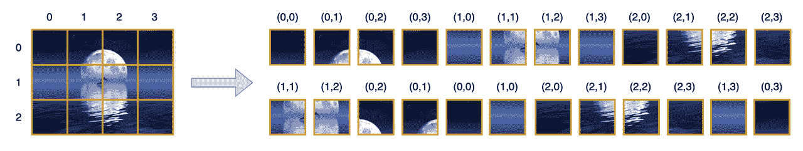

### 漫谈大模型推理优化技术系列——（二）模型推理服务

贡献人：

https://zhuanlan.zhihu.com/p/710713076?utm_psn=1799523061483040768

推理服务的高效能对于大模型的实际应用至关重要，它直接影响到模型的响应速度和用户体验。在技术细节方面，文章首先提到了模型结构的优化，包括选择更轻量化的网络架构和进行模型剪枝以减少计算复杂度。接着，强调了推理引擎的选择对于性能的影响，以及如何通过批量处理提高数据处理效率。此外，文章还讨论了内存管理优化、多线程和异步处理等技术，这些都是提升推理服务性能的关键。在部署推理服务时，还需考虑其可扩展性、高可用性和实时监控，以确保服务稳定性和可靠性。

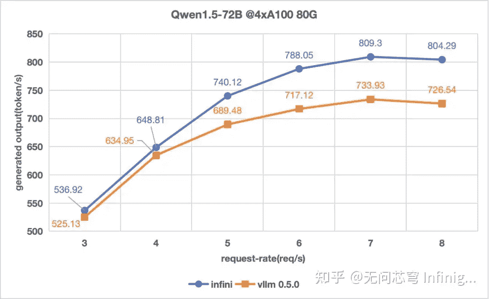

### GPU与DSA架构分析

贡献人：

https://zhuanlan.zhihu.com/p/701886530?utm_psn=1799463508926132225

文章首先介绍了 GPU 的基本概念和特点，以及它在数据处理和并行计算领域的应用。随后，对 DSA（Domain Specific Architecture）进行了详细的阐述，指出 DSA 架构能够更好地适应特定领域的计算需求，提供了更高的性能和能效。文章接着分析了 GPU 与 DSA 架构在性能优化、功耗控制以及软硬件协同设计方面的优势和挑战。特别是在处理大数据和复杂算法时，GPU 和 DSA 的高效并行处理能力尤为突出。

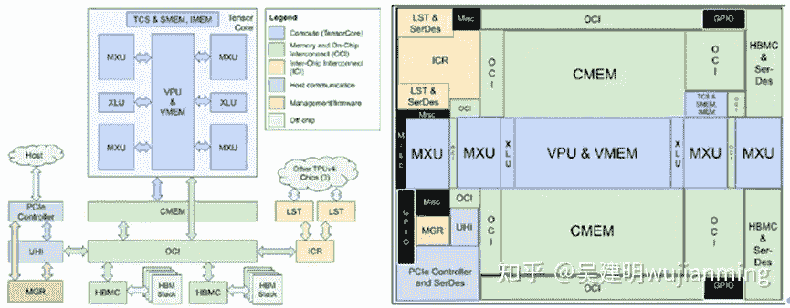

### 万字长文分享快手 Kolors 可图大模型应用实践

贡献人：

https://mp.weixin.qq.com/s/JMh-Dictf20nVOP41SX6iA

快手「可图」Kolors 大模型在 AICon 北京站活动中展示了其在视觉生成领域的卓越应用。该模型采用了最新的扩散模型技术，在数据、模型和效果评估方面都做出了深入的探讨。数据侧强调数据量大、覆盖全、图像质量高和图文相关性强，同时确保数据安全。模型侧则采用了 Stable Diffusion 和 DiT 框架，预测这些技术框架将在未来一年内仍然是视觉生成的主流。效果评估方面，可图大模型通过机器和人工评估相结合，确保了生成图像的质量和相关性。此外，可图大模型还具备提示词润色、文字绘制和交互式视觉生成等衍生能力，极大地扩展了其应用范围。在实际应用中，可图大模型已经在 AI 玩评、AI 人像、IP 定制等多个场景中得到了验证和应用，显示出其在商业和娱乐领域的巨大潜力。

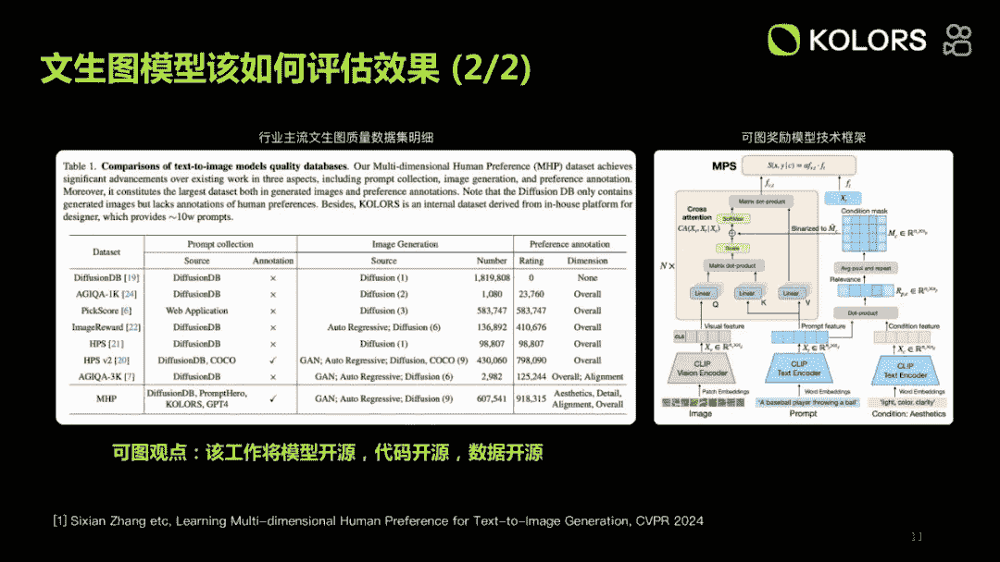

###  合成数据：模型能力跃迁的必经之路

贡献人：

https://mp.weixin.qq.com/s/4sbbtYQQJAaEnN9mSg61Ow

合成数据作为一种新型数据资源，在大模型的预训练和对齐阶段扮演了关键角色。它能够补充和强化语料库，提高数据的 “可用性”，从而提升模型在复杂推理和 Agent 能力等方面的性能。通过 Self-play 技术，合成数据使得模型能够在没有人类干预的情况下自我提升，实现从 “弱” 到 “强” 的能力跃迁。在具身智能领域，合成数据通过模拟真实世界的数据，解决了数据获取的难题，特别是在机器人等硬件应用中的数据训练和优化。此外，合成数据的治理策略需要关注人类参与度和监督，以及在不同应用场景下的质量控制，确保模型的安全性和可靠性。通过合成数据与真实数据的混合应用，大模型能力得以跃迁，为 AI 技术的进一步发展提供了有力支持

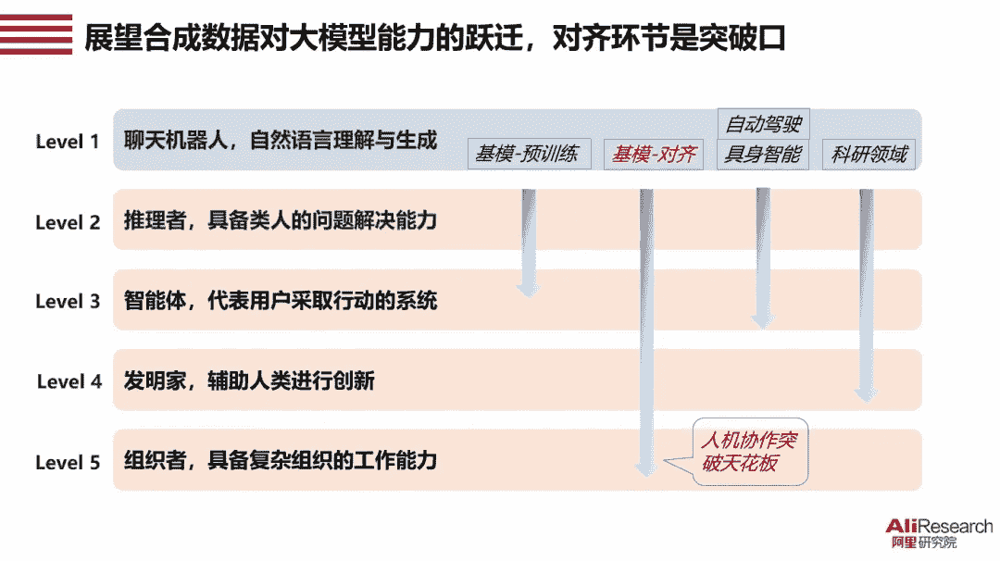

# 声明

本文档仅供学习交流使用，版权归原作者所有，若涉侵权，请联系Jack Jin 15101136166

##

（欢迎在下方反馈您宝贵的意见！整理不易，觉得有用给AI日报小组点个赞👍吧！）

ChatGPT；Angela；Zijia Liu；Alex；Zeqi Tan；Tiezhen（HuggingFace）；Naixu；Lizhi；Peter；Suoman；Jack

封面生成——右脑科技

如果你有大模型相关的创业想法，欢迎来找我们聊聊～微信：15101136166

> 快邀请你的小伙伴们一起来读大模型日报吧！

> **【日报****知识库****】**这里是近期日报内容的汇总,欢迎大家查阅

> [大模型日报知识库(分享版)](https://miracleplus.feishu.cn/wiki/KapVwXfkriOBiskB0B2cUHxjnTh)

>

> 欢迎大家多多帮我们分享,转发~~

> 如果大家有任何的建议或者吐槽,欢迎随时找我聊天~

