# 奇绩大模型日报（7月 22日）

> 来源：[https://miracleplus.feishu.cn/docx/NEPhdlRnHofMcMxTizJcBUG1nWd](https://miracleplus.feishu.cn/docx/NEPhdlRnHofMcMxTizJcBUG1nWd)

# 资讯

### 苹果开源7B大模型，训练过程数据集一口气全给了，网友：开放得不像苹果

https://mp.weixin.qq.com/s/JTCnjvkSqwAC2uRWEEK08g

苹果最新杀入开源大模型战场，而且比其他公司更开放。

推出**7B模型**，不仅效果与**Llama 3 8B**相当，而且一次性开源了**全部训练过程和资源**。

**要知道，**不久前Nature杂志编辑Elizabeth Gibney还撰文批评：

许多声称开源的AI模型，实际上在数据和训练方法上并不透明，无法满足真正的科学研究需求。

而苹果这次竟然来真的！！

就连NLP科学家、AutoAWQ创建者也发出惊叹：

> Apple发布了一个击败Mistral 7B的**模型，但更棒的是**他们完全开源了所有内容，包括预训练数据集！

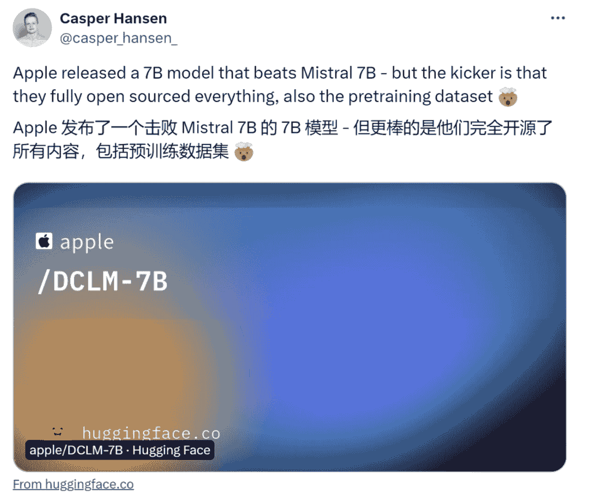

### 盛名一时的BERT哪去了？这个问题的答案昭示了LLM范式的转变

https://mp.weixin.qq.com/s/fKeorQYwRlmmepuG1_aJlQ

总体上看，过去这些年的 LLM 模型架构主要分为三大范式：仅编码器模型（如 BERT）、编码器 - 解码器模型（如 T5）、仅解码器模型（如 GPT 系列模型）。人们常常搞不清楚这些，并且对这些分类方法和架构有所误解。

首先要理解的一点是：编码器 - 解码器模型实际上也是自回归模型。在编码器 - 解码器模型中，解码器本质上依然是因果解码器。其无需预填充解码器模型，而是会将某些文本卸载到编码器，然后再通过交叉注意力发送给解码器。是的，T5 模型也是语言模型！

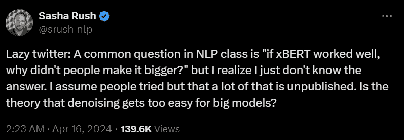

### 从空间智能到具身智能，跨维践行Sim2Real AI最高效路径

https://mp.weixin.qq.com/s/8duAecqCQHx91RuADRmNug

具身智能狂潮降临的一年多里，物理世界与信息的生产与交互方式发生着革命性变化。

与此同时，一场新的争夺战正悄然打响：各大厂商绞尽脑汁，以夺取最有价值的 AI “燃料”—— 数据。当前，数据匮乏仍是通用具身智能面前的高墙。纵观过去三年，在谷歌、英伟达、OpenAI 等知名企业对具身智能的研究中，暂未窥见 Scaling Law的出现，这与缺少各类数据有关。

如何解决这一根本性痛点？从技术的角度，Sim2Real AI 是一个长期存在的路径。但由于对消弭 Sim2Real gap 存在 “理念型偏差”，学术界和产业界更多地将其视为一个辅助的数据补充手段。但是否真的如此？

香港中文大学（深圳）终身教授、跨维智能创始人贾奎通过从学术界到产业界的长期践行，给出答案：“Sim2Real AI 正是通往具身智能的最高效路径。”

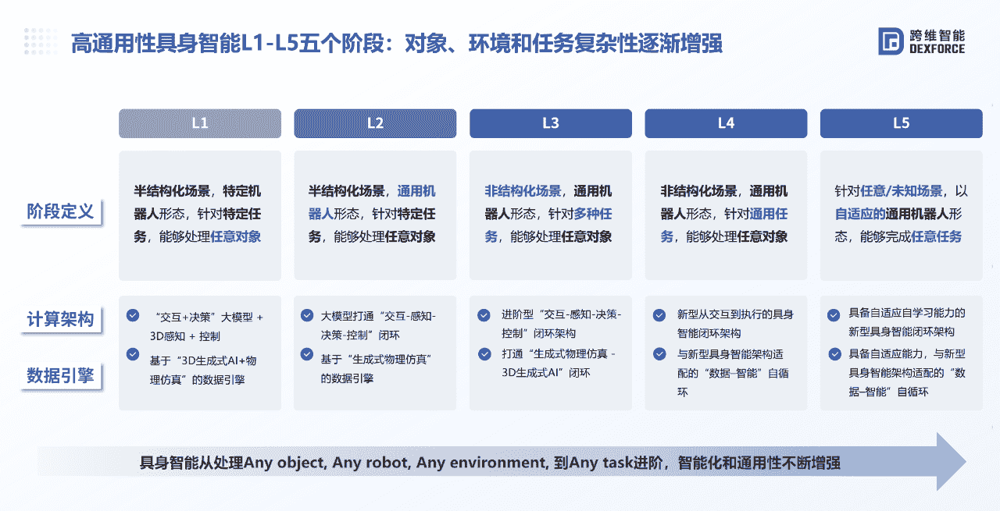

### 中国五连冠终结，美国重登IMO宝座！AI智商被第一题打回原形

https://mp.weixin.qq.com/s/JVvVAmdO9E_z0TiAvLlTDw

IMO 2024最终结果终于出炉了！破天荒的是，四年后美国队再次斩获第一，领先中国队两分。对于LLM来说，IMO最简单的第一题，GPT-4o、Claude 3.5 Sonnet等模型全部回答失败了。

中国蝉联IMO五年冠军的纪录，如今被美国队打破了！

这几天，第65届IMO公布了最终获胜国家队，美国以192分的成绩位列第一，中国以2分之差位居第二。

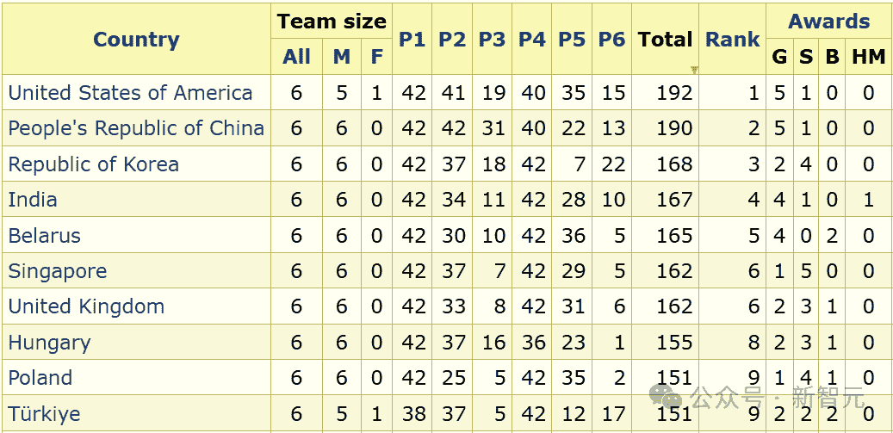

# 推特

### LLaMA 3.1 405B 基础模型现已可下载

https://www.reddit.com/r/LocalLLaMA/comments/1e98zrb/llama_31_405b_base_model_available_for_download/?rdt=46705

LLaMA 3.1 405B 基础模型现已可下载

资源764GiB（约820GB）！

HF链接: https://huggingface.co/cloud-district/miqu-2

磁力链接: magnet:?xt=urn:btih:c0e342ae5677582f92c52d8019cc32e1f86f1d83&dn=miqu-2&tr=udp%3A%2F%2Ftracker.openbittorrent.com%3A80

种子链接: https://files.catbox.moe/d88djr.torrent

来源: https://boards.4chan.org/g/thread/101514682#p101516633

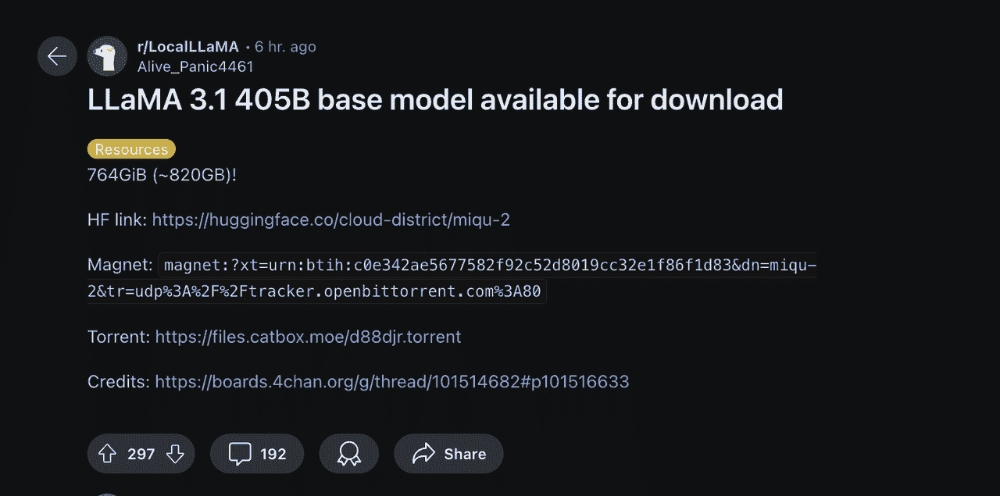

### Dave分享：Claude3.5两小时制作语音备忘录

https://x.com/php100/status/1814776161542557928

我用了两个小时用Claude 3.5 Sonnet完成了这个，非常整洁。

1,294行代码

下一个我想要的功能是从语音转录生成自动的iCalendar ICS文件。

使用的技术包括next.js、sqlite、tailwind、shadcn、waveformer.js、groq whisper-large-v3 api和gpt-4o mini api。

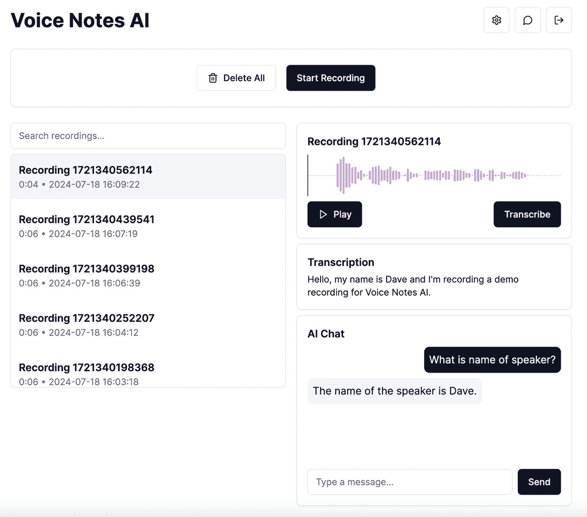

### Shawn Wang：<100B 模型的“血色婚礼”

https://x.com/swyx/status/1815037679014388172

<100B 模型的“血色婚礼”

我认为那些批评OpenAI的人并没有充分理解由于4o mini而发生的巨大变革。

Llama 3 70b: 82 MMLU，$0.90/千tokens

gpt 4o mini: 82 MMLU，$0.15/千tokens

现在，这张图表右侧的每一个模型都被左侧的对应模型完全超越。

其中一些模型在3个月前还是最先进的（SOTA）。

训练它们所需的FLOPs（浮点运算）的折旧率是多少？训练GPT-4花费了5亿美元，但它的寿命只有大约一年。

智能变得如此便宜，但也过于短暂，以至于无法支持超过5个玩家进行研发？这里有我忽略的角度吗？

我一直在思考的另一个角度是将推理与知识分离。RAG/内存可以轻松插入知识，但无法插入推理。82 MMLU已经足够了。你可以把它提高到90，但在正常使用中不会显著变得更智能，除非在其他指标上有所进步。所以到2025年，我们可能会进化到以下几个方向：

0）上下文利用（RULER）

1）指令跟随（IFEval）

2）函数调用（Gorilla）

3）多步推理（MUSR）

4）编程能力（SciCode）

5）视觉理解（VibeEval？）以应对RAG无法处理的所有问题。

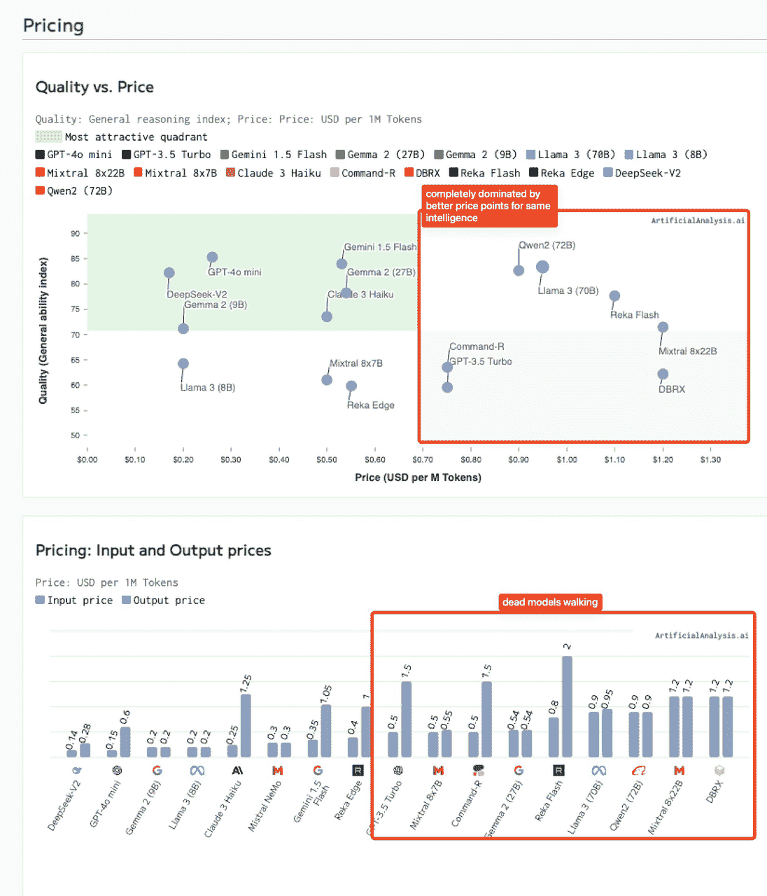

### NuminaMath 数据集：最大的包含约100万道数学竞赛问题-解决方案对的集合

https://x.com/_lewtun/status/1814958635732140336

我们刚刚发布了 ✨NuminaMath 数据集：这是最大的包含约100万道数学竞赛问题-解决方案对的集合，难度从初级挑战到数学奥林匹克预选赛不等。

这些数据集用于赢得AI数学奥林匹克的第一个进步奖，并包括两个子集：

⛓️ 思维链 (CoT)：860k个模板化问题-解决方案对，以增强自然语言中的数学推理

🛠️ 工具整合推理 (TIR)：73k个由GPT-4生成的合成解决方案，通过代码执行反馈将难题分解为可以用Python解决的更简单的子问题

在NuminaMath上训练的模型在开源权重模型中表现最佳，并在数学竞赛基准测试中接近或超过专有模型 🔥

我们的数据集和模型可以在 🤗 Hub 上找到：https://huggingface.co/collections/AI-MO/numinamath-6697df380293bcfdbc1d978c

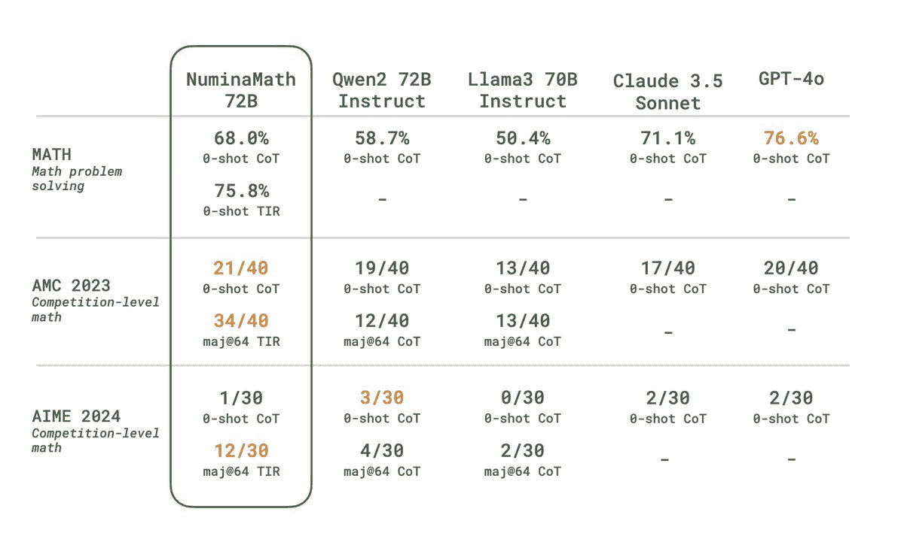

### Garry Tan：现在的软件市场，推出一个由大型语言模型驱动的替代产品都不算晚

https://x.com/garrytan/status/1815057892489511259

我认为现在进入几乎任何软件市场，推出一个由大型语言模型（LLM）驱动的替代产品都不算晚，如果你有这个意愿。

我们看到只有几人的小团队使用当前最前沿的模型构建出有价值的软件，超越了现有的竞争对手（获得企业销售）。

战争的焦点将是用户留存：谁能更好地服务于你的垂直市场？

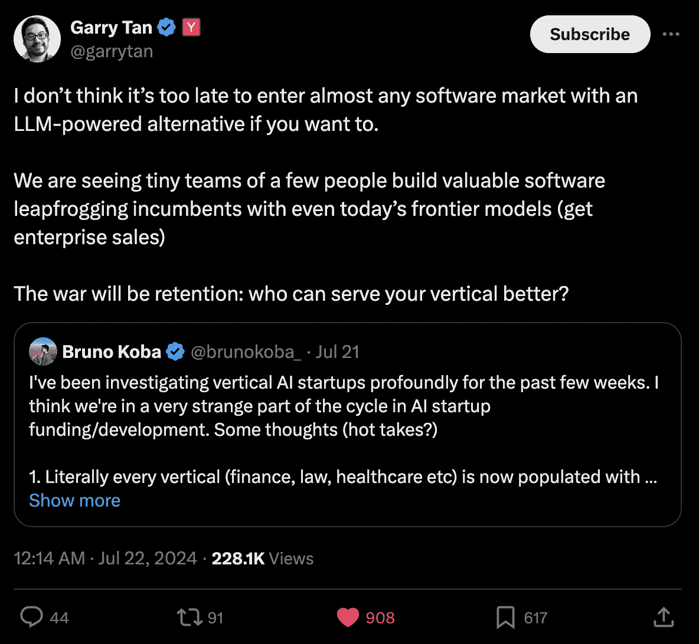

# 产品

### Reactor Chat AI

贡献人：

https://reactor.helloarc.ai/

Reactor Chat AI 是一种人工智能聊天解决方案，基于 Google Cloud Platform 和 Lambda 搭建，希望为用户提供准确和有价值的回答，在 MMLU 和 HumanEval 基准测试中超越竞争对手 GPT-4o。

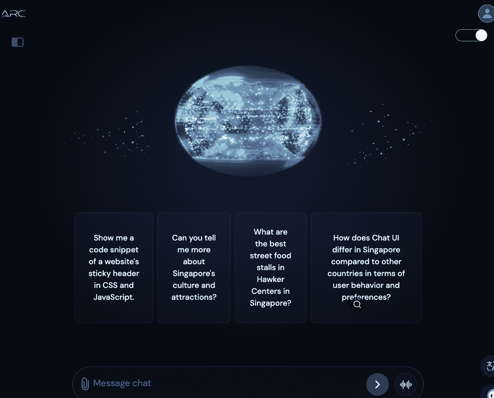

### Supermemory——类 Cubox

贡献人：

https://supermemory.ai/

Supermemory 是一个诞生于黑客松的项目，可以帮助用户组织和利用保存的在线信息，提供快速总结、写作辅助等多种支持，目标是成为用户的“第二大脑”，提高信息管理和使用效率。

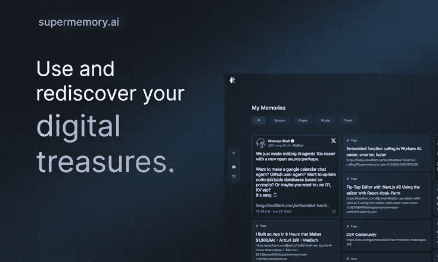

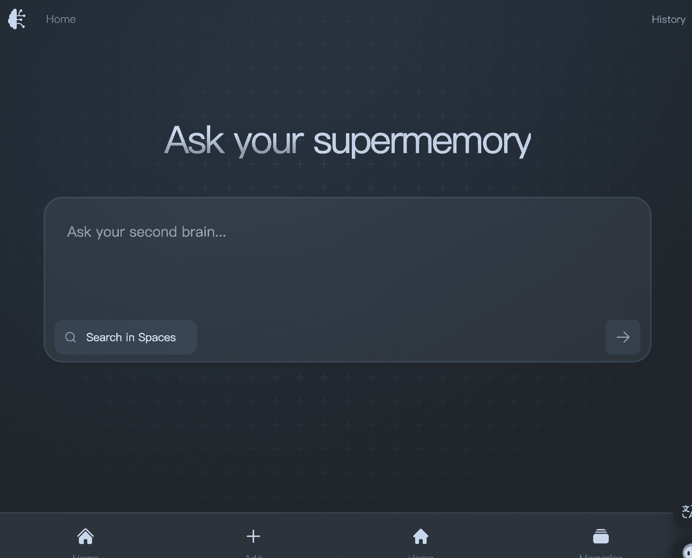

# HuggingFace&Github

### langchat

贡献人：

https://github.com/TyCoding/langchat

LangChat 是一个基于 Java 生态的企业级 AIGC 项目解决方案。它集成了多家国内外 AI 大模型，支持动态配置大模型参数、知识库管理、高级 RAG 搜索等功能，并计划支持多渠道发布和可视化 LLM 流程设计等功能。

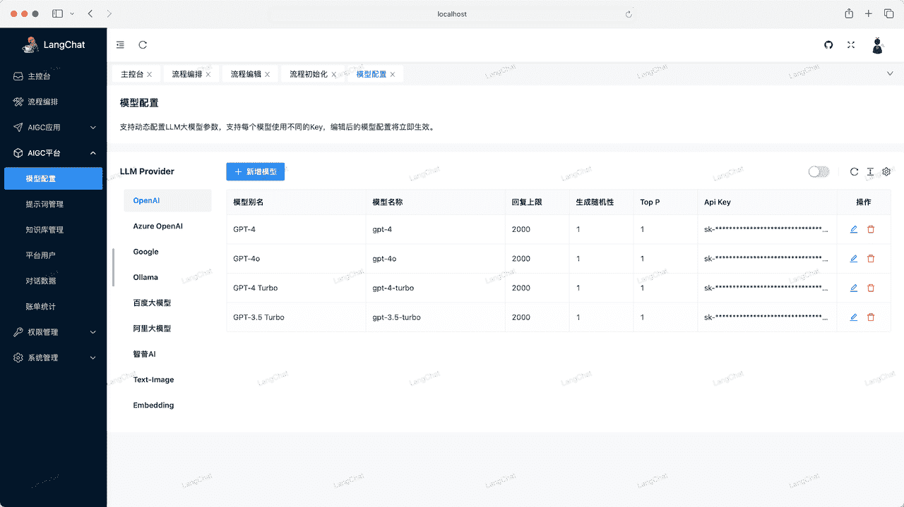

### app-builder——百度智能云千帆

贡献人：

https://github.com/baidubce/app-builder

AppBuilder-SDK 是百度智能云千帆 AppBuilder 面向 AI 原生应用开发者提供的一站式开发平台的客户端 SDK。它提供了自底向上的基础组件、流程编排和端到端应用三类功能，帮助开发者快速搭建 AI 原生应用。

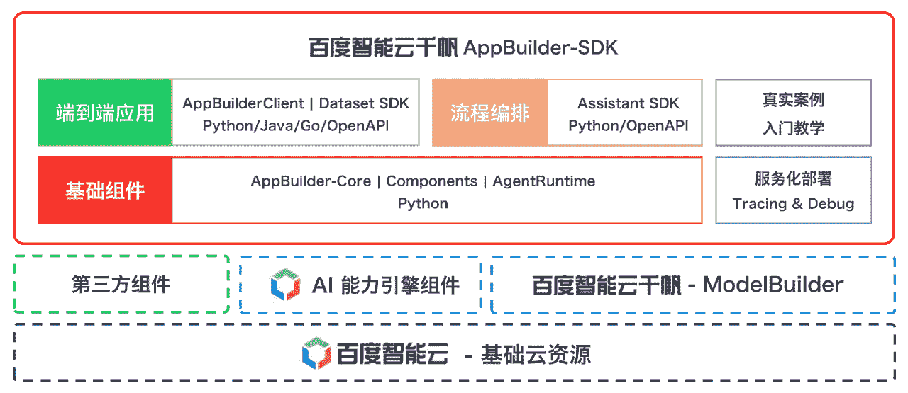

# 投融资

### Nebius——从Yandex重生为欧洲AI计算领导者

贡献人：

https://techcrunch.com/2024/07/21/from-yandexs-ashes-comes-nebius-a-startup-with-plans-to-be-a-european-ai-compute-leader/

Nebius是一家由前俄罗斯科技巨头Yandex N.V.重组而成的AI基础设施初创公司，计划成为欧洲的AI计算领导者。Nebius目前拥有1300名员工和25亿美元的资本。该公司最近完成了与俄罗斯资产的分离，并获得了25亿美元的现金和股份。Nebius主要竞争对手包括CoreWeave和Flex AI等专注于GPU服务的初创公司。Nebius的战略是依托其在芬兰的数据中心和与Nvidia的合作，计划在未来几年内扩展其欧洲数据中心网络。公司现有25亿美元的资本，未来可能通过公开市场筹集更多资金。

公司官网：https://nebius.group/

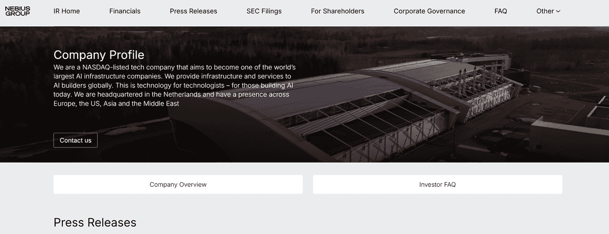

# 学习

### 图解大模型计算加速系列：分离式推理架构2，模糊分离与合并边界的chunked-prefills

贡献人：

https://mp.weixin.qq.com/s/_nm2Fwz2FlkcLuXnWDB9PA

文章详细解释了在大模型推理过程中如何通过分离式架构实现计算加速。具体来说，将模型分为多个 chunks 进行处理，在这个基础上，进一步提出了模糊分离与合并边界的概念。模糊分离是指在 chunks 间设置一段重叠区域，以便在推理时能够更好地处理跨 chunk 的依赖关系。合并边界则是指在 chunks 的输出结果中，对于重叠区域的处理结果进行合理的整合，以确保整体的推理准确性。这种方法被称为 chunked-prefills，它通过在模型的某些层之间插入特殊的操作来实现，这些操作能够在不同的 chunks 之间进行状态的传递和整合。通过这种方式，大模型的推理速度得到了显著提升，同时保持了模型精度。

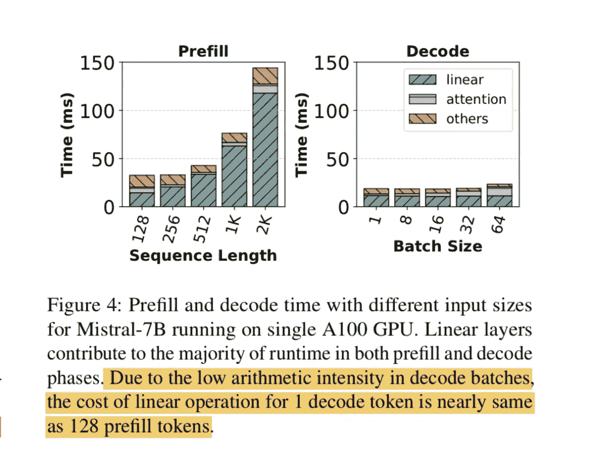

### 大语言模型在推荐系统中的探索与应用

贡献人：

https://mp.weixin.qq.com/s/nEhynptVyx8aV8onCwozAA

王奕超老师的分享揭示了大语言模型在推荐系统中的应用前景。通过 KAR 项目，利用大语言模型的丰富知识和逻辑推理能力，对推荐系统的用户偏好和物品特征进行深入分析，提升了推荐的准确性和个性化。KAR 方案通过指令模板和多专家网络，有效地将大语言模型的知识适配为推荐系统可用的向量表示，解决了传统模型的幻觉问题，并在华为的多个场景中得到了实际应用。另一项技术创新，Uni-CTR 项目，通过构建基于自然语言描述的提示词模板，实现了跨域推荐，并在 Amazon Review DataSet 上验证了其有效性。这两个项目都在技术细节上做了深入的探索，如采用 Leader 网络提取场景特有信息，以及通过门控网络融合大语言模型的通用表征与场景特有的新输出。文章最后提出，推荐系统将逐渐从封闭向开放发展，技术层面将从判别式模型向生成式模型转变，流程上则将实现端到端的推荐结果生成，以应对未来的挑战和机遇。

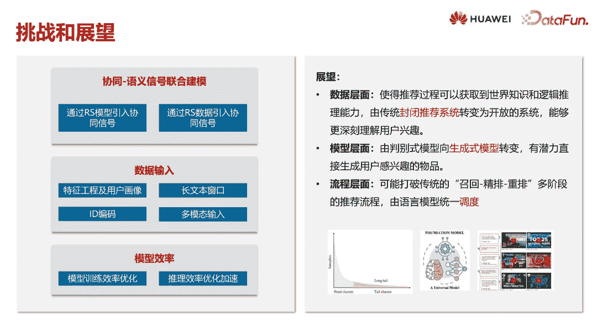

### DataOps+大模型促进数据工程创新

贡献人：

https://mp.weixin.qq.com/s/2RF3s6NZL2af9zZhxxLSzA

文章由杨明皓撰写，探讨了 DataOps 与大模型结合在数据工程创新中的应用。DataOps 的核心在于实现数据研发流程的敏捷化和自动化，通过标准化的数据工作流编排、开发、测试、部署和回归流程，提高数据处理的效率。在此基础上，引入大模型技术如 GPT4，可以进一步辅助代码生成、解释和审查，优化数据开发的智能化程度。

文章特别强调了 Text2SQL 技术在数据工程中的重要性，这是一种将自然语言问题转换为 SQL 查询语句的技术。在大模型的推动下，Text2SQL 的准确率得到显著提升，但仍然面临着复杂查询和大规模 schema 处理的挑战。为解决这些问题，作者提出了一系列实践方法，如构建元数据语义图谱、优化 Prompt 模板设计等，以提升 schema-linking 的准确性和 SQL 生成的鲁棒性。

此外，文章还讨论了数据治理的重要性，它不仅支持 Text2SQL 任务的有效执行，还对整个数据生态系统的健康运行至关重要。通过数据标准化工具和血缘图谱的构建，提升了数据的可管理性和可追溯性。最后，作者通过问答环节，回应了业务实际应用、数据质量控制、Prompt 设计等方面的疑问，展现了海南数造科技在数据工程创新领域的深入思考与实践。

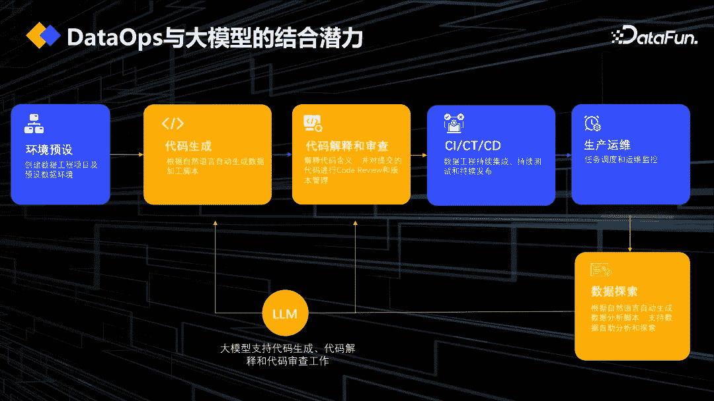

### 带你尽快进入NPU开发前沿系列文章 一周攻克TPU v1 VHDL、Verilog代码

贡献人：

https://zhuanlan.zhihu.com/p/709716927?utm_psn=1798424695428751361

文章作者提出了一个学习计划，旨在帮助读者在一周内掌握 NPU（神经处理器）的基础知识，并能够编写和理解 TPU v1 的 VHDL 和 Verilog 代码。作者首先介绍了 NPU 的基本概念和重要性，然后详细规划了每天的学习任务，包括了解 NPU 的基础架构、学习 VHDL 和 Verilog 的基础知识、实践编写代码，以及最终完成一个简单的 NPU 模型的设计。作者强调了学习资源的选择和学习方法的重要性，并提供了一些实用的学习资源和工具链接。通过这样的学习计划，读者可以在短时间内有效地提升自己在 NPU 开发领域的技能和知识水平。

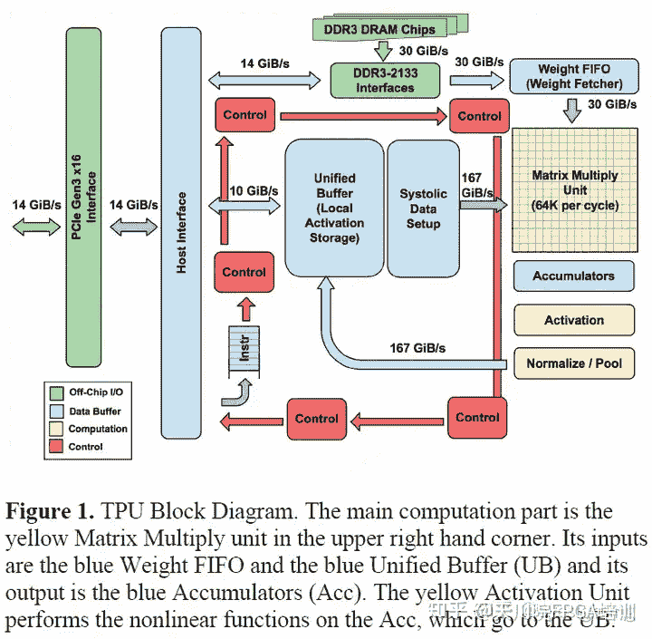

### 盘点六轴机器人末端布局

贡献人：

https://zhuanlan.zhihu.com/p/709796766?utm_psn=1798423029648351233

六轴机器人末端布局对于其性能至关重要，直接影响工作效率和操作安全。良好的布局设计需优化工作空间、负载能力和灵活性。直角布局简单易行，但工作空间有限；三角布局提供更大空间和负载平衡，但设计复杂；并线布局虽工作空间最大，但负载能力较弱。设计时还应考虑环境适应性和用户需求，以确保机器人在不同场景下的优异表现。通过精确的技术细节设计，可实现机器人性能的最大化，满足现代工业生产的高效、安全和精准要求。

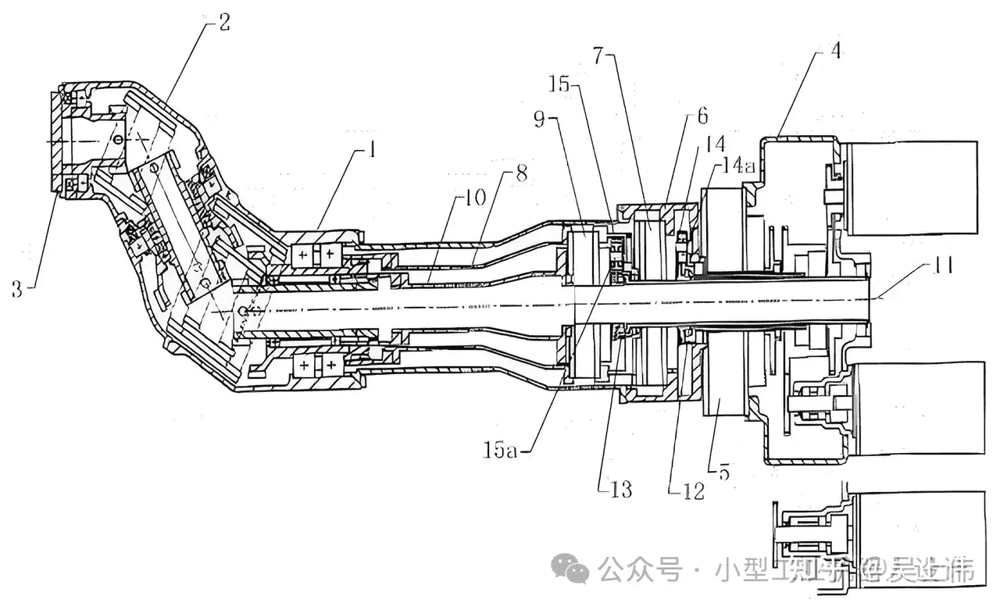

### CPU性能分析与优化 (五)

贡献人：

https://zhuanlan.zhihu.com/p/709733156?utm_psn=1798425976121716736

本文详细介绍了 CPU 性能分析与优化的 TMA（Top-Down Analysis）方法，包括对 Intel、AMD 和 ARM 处理器的硬件性能监控功能的介绍。TMA 方法通过分析四个主要的性能瓶颈桶（Front End Bound、Back End Bound、Retiring、Bad Speculation），逐步深入识别性能问题。文章首先介绍了 Intel TMA 的使用，包括如何通过perf工具和toplev脚本收集和分析性能数据，以及如何解读这些数据来定位性能瓶颈，例如通过分析 L3 缓存未命中率来优化内存访问。接着，文章探讨了 AMD 和 ARM 处理器的 TMA 应用，以及它们在性能分析中的差异。

文章继续讨论了分支记录机制，包括 LBR（Last Branch Record）和 BRBE（Branch Record Buffer Extended）等技术，这些技术可以帮助重建程序的执行路径，分析分支预测的准确性，以及收集调用堆栈信息。此外，文章还介绍了基于硬件的采样功能，如 Intel 的 PEBS（Precise Event Based Sampling）和 AMD 的 IBS（Instruction Based Sampling），以及如何利用这些技术来精确地定位性能事件，优化内存访问，以及分析并发问题。

最后，文章总结了如何利用硬件性能监控功能来提高编程和编译器优化的效率，以及如何通过性能分析来支持硬件投资决策。

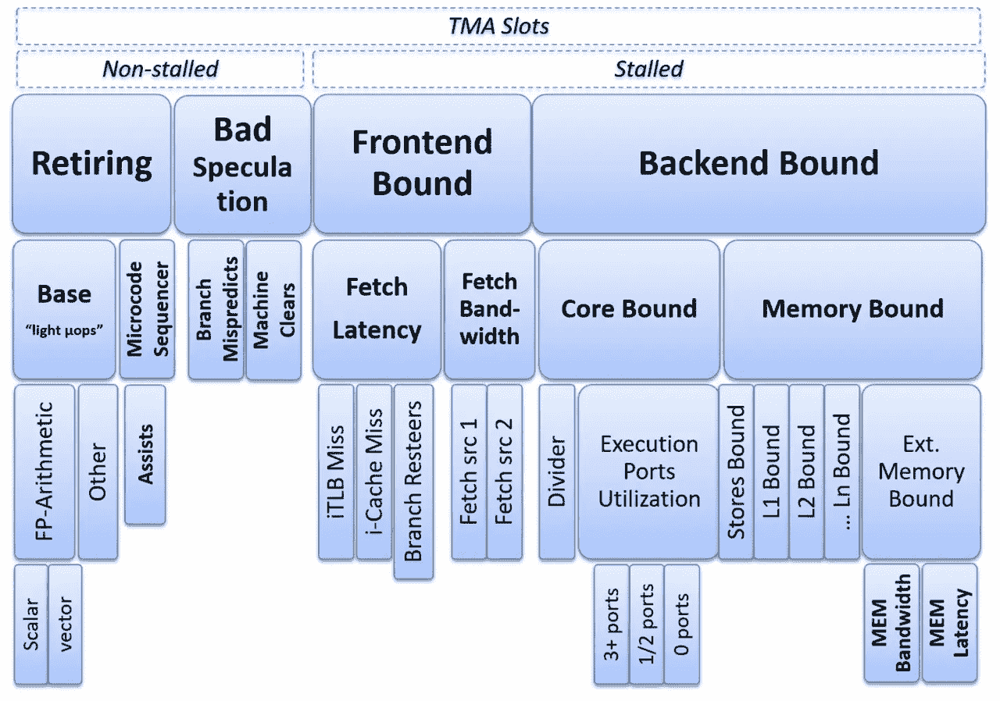

### 生成式AI推动下的数据中心与AI芯片市场预测与分析

贡献人：

https://mp.weixin.qq.com/s/jXdq7ZW0YOMhrgr8q9gDdg、

生成式 AI 技术的兴起催生了数据中心与 AI 芯片市场的快速发展。预计 2023 年至 2027 年，AI 加速器市场将从 300 亿美元迅速扩张至超过 4000 亿美元。AMD 首席执行官 Lisa Su 预测 2023 年市场规模为 450 亿美元，2027 年将达到 4000 亿美元。这一预测考虑了 AMD 推出的 “Antares” Instinct MI300 系列 GPU 的影响。

富国银行的分析显示，2023 年数据中心 GPU 销售额达到 373 亿美元，预计 2024 年将增长至 487 亿美元。到 2027 年，预计销售额将达到 953 亿美元，同时预测数据中心 GPU 出货量将从 2023 年的 549 万台增长至 1351 万台。英伟达目前在 2023 年的收入市场份额高达 98%，尽管预计到 2027 年将下降至 87%。

Gartner 预测 AI 半导体市场将持续增长，2023 年 AI 服务器的销售额为 140 亿美元，2024 年预计将增长 50% 至 210 亿美元。IDC 的数据显示，AI 部分在全球半导体市场中的规模预计将以高速增长，从 2022 年的 421 亿美元增长至 2023 年的 691 亿美元，并预测到 2027 年将达到 1933 亿美元。数据中心和 AI 系统的 AI 芯片内容总收入将以 28.9% 的年复合增长率增长。

到 2027 年，预计数据中心的电力消耗至少将翻倍，而数据中心的资本支出将达到 1.1 万亿美元，AI 服务器收入预计将达到 491 亿美元。这一增长将对互联网和软件巨头的商业模式产生深远影响，使之转向资本密集型模式。

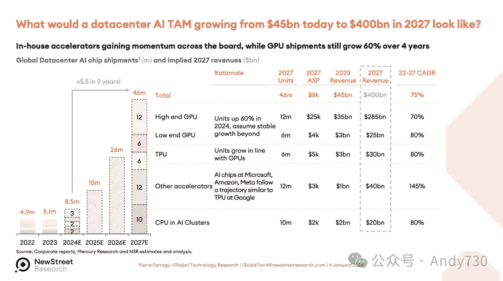

# 📡潜空间系列活动:

> 潜空间系列活动第三季启动！

>

> 第三季第一期将在7.27上午10:00开始，嘉宾是宋佳铭。活动包括嘉宾分享、访谈Q&A、cofounder matching餐会。

>

>

> 宋佳铭-Luma AI 首席科学家，斯坦福大学计算机科学博士、博士后；曾任职英伟达（DIR）小组科学家 ，创建了最早的扩散模型加速算法，该算法广泛用于最近的生成式 AI 系统，包括 DALL-E 2、Imagen、Stable Diffusion 和 ERNIE-ViLG 2.0。

>

>

> 陈贝迪-卡内基梅隆大学助理教授，斯坦福大学人工智能博士后学者，前 Meta AI 研究科学家；致力于在现代硬件上设计和优化算法和模型，以加速大型机器学习系统。

>

>

> 童晟邦- 纽约大学博士，伯克利人工智能实验室（BAIR）研究员， OpenAI 超对齐奖学金获得者；

>

> 闫俊杰-MiniMax 创始人兼 CEO。是中国第一梯队的大模型创业者，目前 MiniMax 估值超 25 亿美元。

>

>

> 本季活动同时开放北京线下、上海线下和线上场次，欢迎校友和外部创业者扫描右方二维码报名！

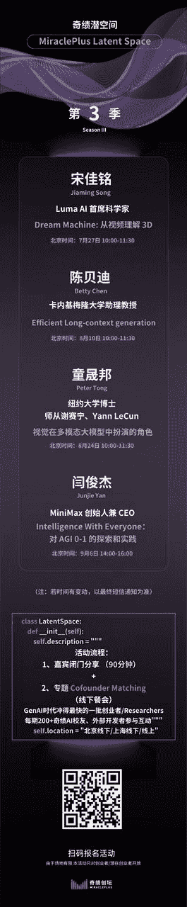

# 声明

本文档仅供学习交流使用，版权归原作者所有，若涉侵权，请联系Jack Jin 15101136166

##

（欢迎在下方反馈您宝贵的意见！整理不易，觉得有用给AI日报小组点个赞👍吧！）

ChatGPT；Angela；Zijia Liu；Alex；Zeqi Tan；Tiezhen（HuggingFace）；Naixu；Lizhi；Peter；Suoman；Jack

封面生成——右脑科技

如果你有大模型相关的创业想法，欢迎来找我们聊聊～🛰️：15101136166

> 快邀请你的小伙伴们一起来读大模型日报吧！

> **【日报****知识库****】**这里是近期日报内容的汇总,欢迎大家查阅

> [大模型日报知识库(分享版)](https://miracleplus.feishu.cn/wiki/KapVwXfkriOBiskB0B2cUHxjnTh)

>

> 欢迎大家多多帮我们分享,转发~~

> 如果大家有任何的建议或者吐槽,欢迎随时找我聊天~

