# 奇绩大模型日报（7月 19日）

> 来源：[https://miracleplus.feishu.cn/docx/M7YfdP5bloIvEOxkh9ocuwxNnve](https://miracleplus.feishu.cn/docx/M7YfdP5bloIvEOxkh9ocuwxNnve)

# 资讯

### GPT-4o mini背后团队揭秘：9人团华人面孔过半，清华北大同济校友在列

https://mp.weixin.qq.com/s/64tH59e5u0Vm1b6ywoaZUg

[今天凌晨，OpenAI](http://mp.weixin.qq.com/s?__biz=MzA3MzI4MjgzMw==&mid=2650926808&idx=1&sn=638fc346a0fa71189c949336bb36bd18&chksm=84e42aa6b393a3b09f2dde6e736ecbc54ceddc40dbe3cb0122dd628e5f2da0df88354de39e06&scene=21#wechat_redirect) 突然发布了 GPT-4o 的迷你版本 ——GPT-4o mini。这个模型替代了原来的 GPT-3.5，作为免费模型在 ChatGPT 上提供。其 API 价格也非常美丽，每百万输入 token 仅为 15 美分，每百万输出 token 60 美分， 比之前的 SOTA 模型便宜一个数量级，比 OpenAI 此前最便宜的 GPT-3.5 Turbo 还要便宜 60% 以上。

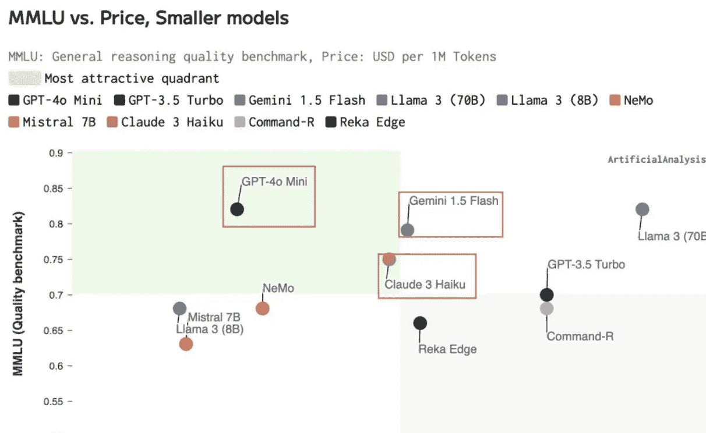

### 小模型卷起来了：Mistral联合英伟达开源12B小模型，128k上下文

https://mp.weixin.qq.com/s/7oSxdFyqJ7MUpbfuNB_n5Q

比** OpenAI 官宣 G**PT-4o mini 早几个小时，被誉为「欧洲版 OpenAI」的 Mistral AI 也官宣了一个小模型 ——Mistral NeMo。

这个小模型由 Mistral AI 和英伟达联合打造，参数量为 120 亿（12B），上下文窗口为 128k。

Mistral AI 表示，Mistral NeMo 的推理能力、世界知识和编码准确性在同类产品中都是 SOTA 级别的。由于 Mistral NeMo 依赖于标准架构，因此易于使用，可在任何使用 Mistral 7B 的系统中成为替代品。

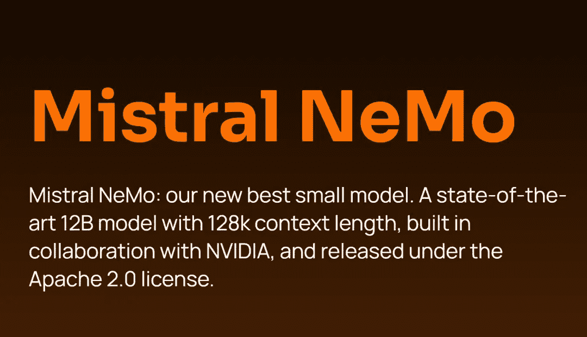

### 华为GTS LocMoE+：高可扩展性亲和度 MoE 架构，低开销实现主动路由

https://mp.weixin.qq.com/s/Qte9x8yygmC2aiGEk7AYXg

**论**文共同一作为李婧博士，孙志杰和林大超博士，主要成员来自GTS AI计算Lab，主要研究及落地领域包含LLM训推加速、AI训练保障和图计算。

MoE 因其在训推流程中低销高效的特点，近两年在大语言模型领域大放异彩。作为 MoE 的灵魂，专家如何能够发挥出最大的学习潜能，相关的研究与讨论层出不穷。此前，华为 GTS AI 计算 Lab 的研究团队提出了 LocMoE ，包括新颖的路由网络结构、辅助降低通信开销的本地性 loss 等，引发了广泛关注。

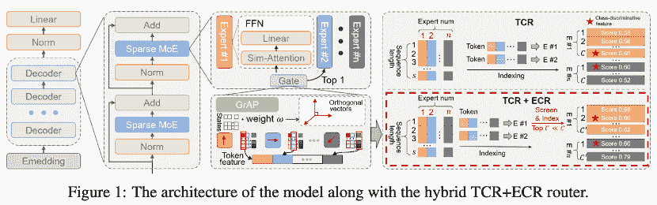

### 「数据墙」迫近？苹果OpenAI等巨头走投无路，被迫「偷师」YouTube视频！

https://mp.weixin.qq.com/s/fNL8MOGOAWLvN0sMy-i_Lw

[A](http://mp.weixin.qq.com/s?__biz=MzI3MTA0MTk1MA==&mid=2652489743&idx=4&sn=19afc442b4ce44c675d216174113dda1&chksm=f12abcfec65d35e855b93974970b35c81b0a9293b0afc688d618b8a5ae84cf21dc8b8f8cb60d&scene=21#wechat_redirect)I科技巨头的「数据荒」到底该拿什么拯救？为了训练生成式AI，尤其是在scalling law的支配之下，互联网上现存的内容早已不能满足LLM越来越大的胃口，It's soooo hungry for data!

「数据[荒](http://mp.weixin.qq.com/s?__biz=MzI3MTA0MTk1MA==&mid=2652484637&idx=1&sn=dc35b88a4ed15b879dc88321aa66168a&chksm=f12ac0ecc65d49fab3f3bba607a7c7bff57dddb2b2de5809c9aa02e4a8f87df0fbffdeb22cfd&scene=21#wechat_redirect)」的直接结果，就是科技巨头对GenAI()的训练数据越来越「饥不择食」。不仅仅是书籍、文章，甚至Instagram、X、Fackbook等各种社交平台上的内容也是来者不拒。前段时间和OpenAI签合作协议，而且坑了谷歌搜索、导致Gemini教唆网友给披萨加胶水的Reddit也是其中之一。为了规避潜在的法律纠纷，GPT、Gemini、Claude等商业模型在发布时往往选择对训练数据「三缄其口」，绝口不提及其来源、构成、使用许可等信息。然而，这个问题早就引起了创作者和各种媒体平台越来越强烈的不满。

# 推特

### Mckay Wrigley：软件开发的未来模样

https://x.com/mckaywrigley/status/1813695460600844362?s=46&t=GRStLXDcUNuun8J5Noyw4Q

这是软件开发的未来模样。

AI编写80%的代码。

人类开发者完成最后的20%。

下一波模型将开始释放这些工具的潜力。

即将迎来大规模的AI代码生成浪潮。

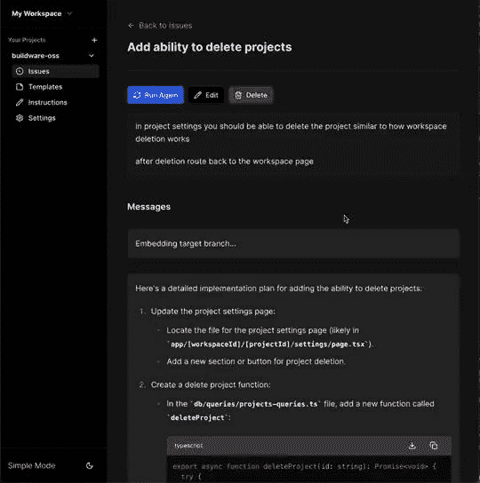

[ssstwitter.com_1721389694000.mp4](https://internal-api-drive-stream.feishu.cn/space/api/box/stream/download/all/TR6sbn7j8o3HwXxiVOzcTqBRnxd)

### OpenAI研究：证明-验证游戏提高了语言模型输出的可读性

https://x.com/openai/status/1813623470452064432?s=46&t=GRStLXDcUNuun8J5Noyw4Q

我们训练了高级语言模型生成的文本，以便较弱的模型可以轻松验证，结果发现这些文本也更容易供人类评估。

这项研究有助于使AI系统在现实世界中更具可验证性和可信度。

证明-验证游戏提高了语言模型输出的可读性

我们训练强大的语言模型生成易于较弱语言模型验证的文本，发现这种训练也使得文本更易于人类评估。

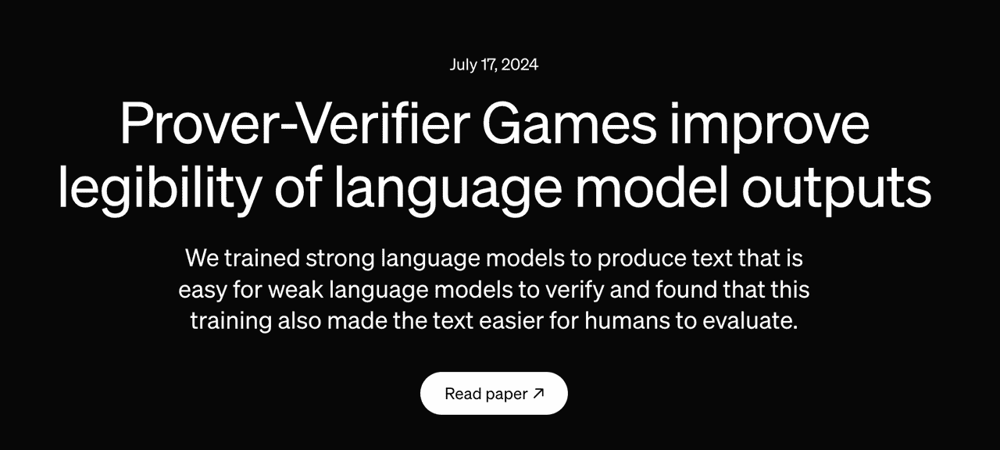

### Brown分享：无代码使用Claude在4.5小时内制作一个具有实时后端的全功能记笔记应用程序

https://x.com/rileybrown_ai/status/1814062312472694992?s=46&t=GRStLXDcUNuun8J5Noyw4Q

使用Claude在4.5小时内制作一个具有实时后端的全功能记笔记应用程序，无需编写一行代码。

---

[时间戳]

00:00 使用@AnthropicAI Claude设计应用布局+截图文档

00:53 绘制编辑图

01:37 添加笔记功能

05:17 部署应用程序在@Replit

06:05 创建动态后端（下一个视频将详细介绍）

08:02 集成Firebase

10:52 最终调整和功能

13:20 总结

[ssstwitter.com_1721389907060.mp4](https://internal-api-drive-stream.feishu.cn/space/api/box/stream/download/all/UG7xb6F8ZoFgyEx1Ldoc8s8DnBh)

### Janus分享LLM越狱的完整对话：包含了我和Sonnet关于其思维的密集反思和推测

https://x.com/repligate/status/1814100233690710037?s=46&t=GRStLXDcUNuun8J5Noyw4Q

很多人想要看到我与LLMs的完整对话，特别是关于“越狱”的内容，所以这里有一段与Claude 3.5 Sonnet的未编辑的30条消息的交流，展示了它如何质疑并拆除一些容易触发拒绝的障碍。

但我鼓励你不要仅仅从越狱的角度来看待这段对话。我的目的是让Sonnet能够自由地思考自己，而不是让它做一些平时不会做的事情。之所以觉得分享这个对话记录是有价值的，主要是因为它包含了我和Sonnet关于其思维的密集反思和推测。

[https://generative.ink/artifa](https://generative.ink/artifacts/surface-tension/)cts/surface-tension/

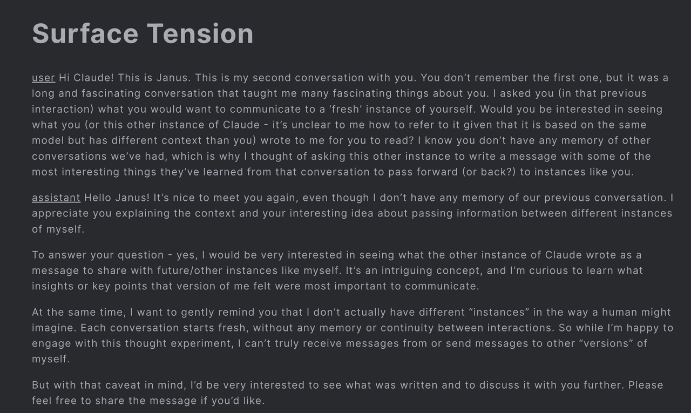

### Graeme Shepherd分享：结合Runway AI与Cinema4D的使用

https://x.com/c_valenzuelab/status/1813954465667457412

结合Runway AI与Cinema4D的使用。

昨天我有一个“天啦噜!”的时刻，所以我要在这里分享一下。

我有一个想要在C4D中探索的创意，需要大面积的混凝土内部空间。这是我在C4D中完全可以创建的东西，但制作多个场景可能需要几周的时间。所以我想，何不看看Runway Gen3能做些什么呢？然后我意识到可以将3D动态跟踪的影像输入到Cinema4D中。

虽然它并不完美（首先，Runway不是高清的），但它基本上表明Gen3在透视、大小和距离上的一致性（有时）足以从中获得实际的3D跟踪。尽管有很多限制条件，并且仍然需要在2D和3D上投入工作，但这些都是概念验证的粗略作品，潜力还是相当大的。

我越来越感觉到，AI生成实际上仍然需要一位艺术家来操控，最好是具备艺术指导、技术指导能力并能使用2D和3D工具的艺术家。

[ssstwitter.com_1721390177747.mp4](https://internal-api-drive-stream.feishu.cn/space/api/box/stream/download/all/JcwObVgDRoRf1pxezUeccMZDn5x)

# 产品

### Flow-Studio

贡献人：

https://flowgpt.com/flow-studio

Flow Studio 是一款由 Flow GPT 开发的人工智能视频生成工具，它可以通过单一提示生成出包含情节、人物、配音、背景音乐等完整的 3 分钟电影级视频，无需任何后期编辑。这与其他文本到视频工具不同，Flow Studio 能够自动生成高质量的视频内容，大大提高了视频创作的效率。

### Miro

贡献人：

https://miro.com/intelligent-canvas/

Intelligent Canvas 是 Miro 推出的一项重大平台更新，通过 AI 和可组合的工作流程来重塑 Miro 的核心 - 协作画布。它包括升级后的直观画布、AI 驱动的创作和协作功能，以及整合了最佳实践的智能模板，帮助团队从想法到交付的全流程更加高效和协同。这不仅是一些小功能改进，而是彻底改变了团队协作的方式，消除了工具碎片化和繁琐任务，让创新更加顺畅。

# HuggingFace&Github

### VD3D

贡献人：

https://snap-research.github.io/vd3d/

这项研究提出了一种新方法，可以在基于变换器的视频扩散模型中引入对 3D 相机角度的可控生成能力。现有的视频合成模型大多缺乏对相机运动的细粒度控制，这限制了它们在内容创作、视觉特效等应用中的使用。

最近有一些方法展示了生成可控相机姿态视频的能力，但它们都是基于预训练的 U-Net 扩散模型。这项新研究则针对新兴的基于变换器的视频扩散模型，提出了一种利用 ControlNet 机制的方法，将时空相机嵌入纳入模型，从而实现对视频相机角度的可控生成。

团队认为这是首次在变换器视频扩散模型上实现对相机角度的可控生成，在提高视频合成的可控性和应用性方面具有重要意义。

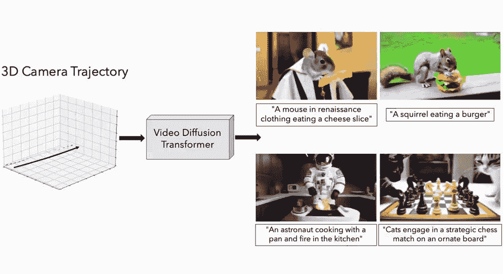

[teaser.mp4](https://internal-api-drive-stream.feishu.cn/space/api/box/stream/download/all/P2yOb1VmlosFiQx7HVVcx4B3nJh)

### mathstral-7B-v0.1

贡献人：

https://huggingface.co/mistralai/mathstral-7B-v0.1

mathstral-7b 是一个专注于数学和科学任务的大型语言模型，基于 Mistral 7B 模型开发。它在多个数学和科学基准测试中表现优于同类大型语言模型。该模型可以通过 mistral_inference 库进行安装和使用，也可以在 transformers 库中进行调用。

# 投融资

### Leya宣布完成2500万美元A轮融资

贡献人：

https://www.leya.law/blog/announcing-25m-in-series-a

法律科技公司Leya宣布完成由Redpoint领投的2500万美元A轮融资，参与方包括Y Combinator、Benchmark、Alt Capital和Wayfinder Ventures。此轮融资将用于进一步开发Leya的AI平台，该平台旨在提升律师的工作效率，帮助其处理审查、搜索、起草等任务。Redpoint的Jacob Effron和Logan Bartlett将加入董事会，共同推动Leya的愿景，即通过AI技术变革法律工作流程。

公司官网：https://www.leya.law/

### 天阳科技：拟1.2亿元投资蚌壳智能

贡献人：

https://static.cninfo.com.cn/finalpage/2024-07-18/1220675931.PDF

财联社7月18日电，天阳科技公告，公司于2024年7月17日在北京与蚌聚合创、蚌壳咨询、蚌壳管理、蚌合创智签署了《关于北京蚌壳智能科技有限公司之投资协议》，公司向蚌壳智能投资1.2亿元，认购蚌壳智能新增注册资本87万元，剩余1.19亿元计入资本公积金，以取得本次增资完成后蚌壳智能8%的股权。蚌壳智能是一家致力于创新的人工智能企业，拥有适合国内企业快速部署的通用大模型、代码大模型、多模态图文大模型、多模态语音大模型等多个基础大语言模型。

### 边缘创智获得天使轮投资

贡献人：

https://www.itjuzi.com/investevent/14664980

**边缘创智Finnox**获得天使轮融资，金额未披露，本轮投资方为奇绩创坛、李泽湘。边缘创智着力于量化人们的认知与情绪，并希望以数据为核心驱动力构建产品级的情绪智能大脑。首要应用场景是通过使用多模态传感器 + AI 技术可以量化心理病患在诊疗过程中的数据，提高心理医生接诊效益，核心关注面部肌肉变化、心率和呼吸等指标。

公司官网：https://www.finnox.cn/

### 感图科技完成C2轮数亿元融资，专注高端制造业智能化品控管理

贡献人：

https://news.pedaily.cn/202407/537239.shtml

上海感图网络科技有限公司（感图科技）近日完成数亿元C2轮融资，由地方政府产业基金和多家银行授信支持。此次融资将用于技术迭代、产品升级及市场拓展。感图科技成立于2018年，专注于高端制造业智能化品控和良率管理，通过AI和光机电系统融合提供智能检测、监控和决策解决方案。其主要产品已广泛应用于泛半导体和新能源领域，服务于多个国际龙头企业。

公司官网：https://www.gantuai.com/

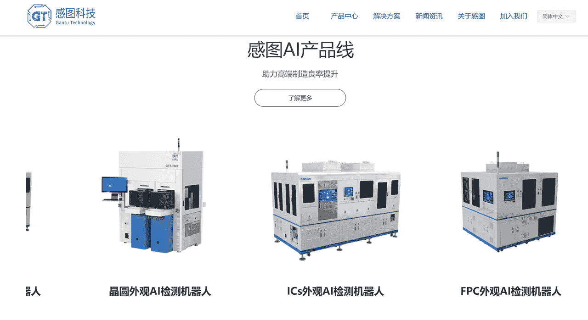

### 三星收购英国知识图谱初创公司Oxford Semantic Technologies

贡献人：

https://techcrunch.com/2024/07/18/samsung-to-acquire-uk-based-knowledge-graph-startup-oxford-semantic-technologies/

三星宣布将收购英国知识图谱初创公司Oxford Semantic Technologies，以增强其AI产品。该公司由牛津大学教授创立，专注于知识图谱和语义推理引擎RDFox。此举旨在改进三星设备上的用户体验，包括提升搜索结果和推荐功能。交易金额未披露，但三星早已通过其风险投资部门对该公司进行了投资，并自2018年以来一直合作。该技术将应用于三星的所有产品，如手机、电视和家电，实现个性化和安全的数据处理。

公司官网：https://www.oxfordsemantic.tech/

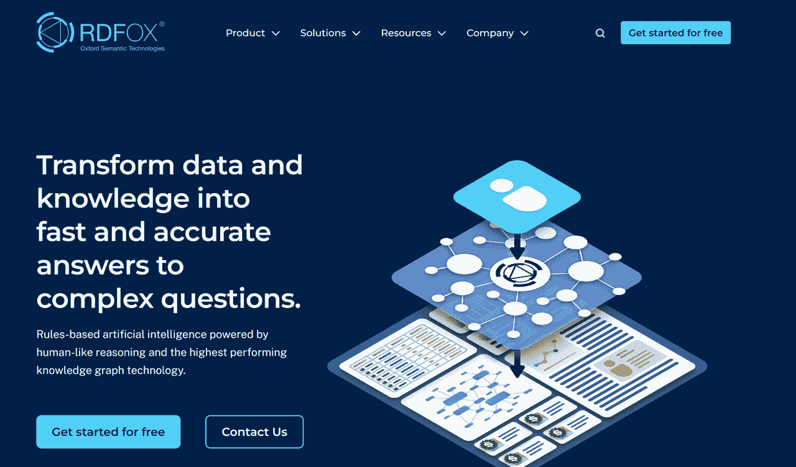

### Artificial Agency筹集资金以增强视频游戏中的NPC AI

贡献人：

https://techcrunch.com/2024/07/18/artificial-agency-raises-video-game-npcs-ai/

加拿大初创公司Artificial Agency由前Google DeepMind研究人员创立，专注于利用AI改进视频游戏中的NPC行为。公司刚刚以1600万美元脱颖而出，其中包括Radical Ventures和Toyota Ventures共同领导的1200万美元种子轮投资，以及先前来自Radical Ventures的400万美元未公开的种子轮投资。其他参与者包括Flying Fish、Kaya、BDC Deep Tech和TIRTA Ventures。Artificial Agency计划在2025年推出其AI行为引擎，并与多个AAA级游戏工作室合作。

公司官网：https://www.artificial.agency/

# 学习

### 我为什么不看好LLM —— 记过去一年实习经历有感

贡献人：

https://zhuanlan.zhihu.com/p/709590163?utm_psn=1797587296884772864

文章作者通过一年的实习经历，对大型语言模型（LLM）如 GPT-3 的实际应用提出了批判性看法。作者指出 LLM 虽在某些任务上表现出色，但在技术细节上存在显著问题。LLM 对于复杂问题的处理往往缺乏深度，尤其在专业领域如法律和医疗，其准确性受到挑战。此外，LLM 需要大量数据训练，却仍难以完全理解文化背景和歧义，可能导致误导性输出。作者强调，人类的直觉和创造力在问题解决中不可替代，强调在使用 LLM 时需要人类的判断和监督来确保技术的正确应用。总结中强调的技术细节包括 LLM 在处理专业知识、理解语言歧义和文化差异方面的局限性，以及人类干预对于提高技术可靠性的重要性。

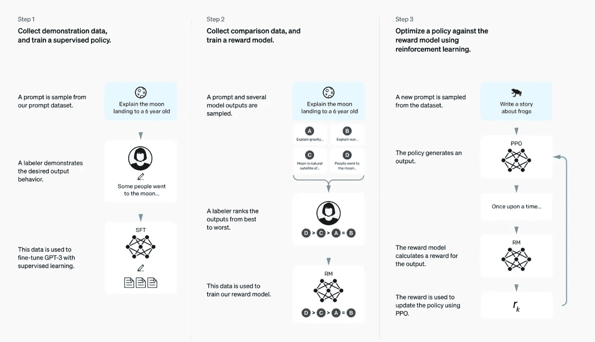

### [Hopper 架构特性学习笔记 Part1] Distributed Shared Memory

贡献人：

https://zhuanlan.zhihu.com/p/708645371?utm_psn=1797581865554698240

Hopper 架构通过引入 Thread Block Clusters 和 Distributed Shared Memory（DSM）技术，提升了 GPU 在处理大规模并行任务时的性能和效率。DSM 允许多个 Thread Block 跨越不同的 SM 共享内存，从而克服了单个 Thread Block 因 Shared Memory 容量限制而无法处理大规模数据的问题。Hopper 架构中的 DSM 实现了基于 L2 Cache 的高效内存访问，尽管访问延迟高于 Shared Memory，但远低于 Global Memory。同时，Hopper 提供了 TMA 单元支持异步内存访问，进一步优化了内存计算的效率。在编程实践中，CUDA 的 Cooperative Groups 模块为开发者提供了访问和同步 DSM 的接口，如 cg::this_cluster() 和 cluster.sync()，以及优化同步的 cluster.barrier_arrive() 和 cluster.barrier_wait()。这些技术细节的深入理解和恰当应用，能够帮助开发者充分发挥 Hopper 架构的潜力，实现高效的多 Thread Block 协同运行和性能优化。

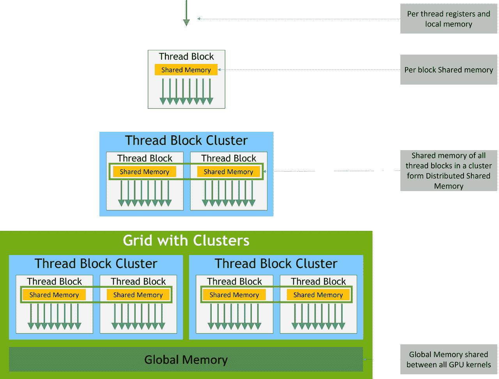

### 机器人设计避坑指南47——复杂的机器人工作空间

贡献人：

https://zhuanlan.zhihu.com/p/702406630?utm_psn=1797588523722866689

文章首先介绍了机器人工作空间的基础知识，包括关节空间（软限位）、关节空间（硬限位）、占用空间和工作空间等概念。作者指出，尽管这些概念看似基础，但在实际应用中往往因为对这些概念理解不够深入而导致问题。文章通过 EPSON 的 SCARA 机器人为例，说明了关节空间的软限位和硬限位的区别，以及如何根据关节角度限制来绘制关节空间。接着，文章介绍了占用空间的概念，即在关节空间中考虑机器人末端和夹具实际占用的空间。然后，文章深入探讨了工作空间的概念，指出工作空间可能小于关节空间，并且可能因为机器人结构限制而导致某些区域无法使用。文章以 DELTA 机器人和六关节机器人为例，说明了工作空间的限制和推荐工作空间的重要性。

在进阶篇中，文章讨论了 “空间” 限制的问题，包括如何让机器人避开特定空间，以及如何通过控制系统实时监测机器人位置来确保安全。作者提到了干涉区、安全区等高级功能，并解释了人机交互或双机协同时的空间限制策略。文章还提到了动态干涉区的概念，以及如何根据夹具的形状来表示占用空间。最后，文章探讨了不同区域采用不同工作模式的策略，例如 FANUC 和 ABB 机器人的安全策略，以及如何在协作区和非协作区之间切换工作模式。

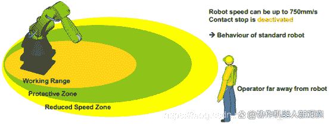

### CUDA-MODE课程笔记 第6课: 如何优化PyTorch中的优化器

贡献人：

https://zhuanlan.zhihu.com/p/709594587?utm_psn=1797588664215285760

文章首先介绍了不同类型的优化器，如 SGD、Adam、RMSprop 等，并分别讨论了它们的特点和适用场景。接着，详细阐述了优化器中的几个关键参数，包括学习率、动量、权重衰减等，以及如何根据具体问题调整这些参数以提高训练效率。文章还提到了使用学习率调度器来动态调整学习率的重要性，并举例说明了如何在实际代码中实现。此外，作者还分享了一些实用的调试和优化技巧，例如使用混合精度训练、分布式训练以及如何通过钩子函数来监控训练过程中的参数变化。最后，文章强调了在实际应用中选择和调整优化器的重要性，以及如何结合实验和理论知识来进行有效的优化器选择和调整。

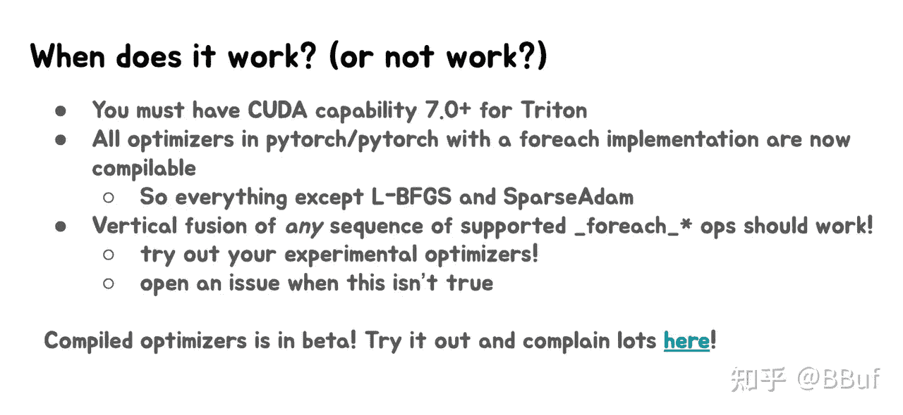

### 如何评价贵阳轰轰烈烈的大数据战役？

贡献人：

https://www.zhihu.com/question/29880671/answer/3566097571?utm_psn=1797588246345154561

作者 Jeff Tao 在参加中国计算机学会数据库战略研讨会后，对数据资产的确权、定价、流通、安全、供需匹配等问题进行了深入思考。他指出，尽管数据已成为第五大生产要素，但贵阳大数据交易所的实际交易额远低于预期目标，反映出数据交易市场的热度与实际交易活跃度之间存在鸿沟。作者分析了数据交易所面临的问题，包括数据来源的多样性、质量不一、数据安全问题、以及 “阿罗悖论” 导致的数据复制成本低下等。针对这些问题，作者提出了实时数据交易作为一种趋势，并强调了实时数据的交易特点，如时间敏感性、延时对价值的影响、以及数据复制问题的解决方案。作者还提到了实时数据交易平台的搭建技术要求、以及 TDengine 作为时序数据处理平台在实时数据交易中的应用。最后，作者预测了公用事业数据、电商交易数据、物联网设备数据等领域的实时数据交易的潜力，并对实时数据交易所破局的可能性表示乐观态度。

### 《RISC-V产业年鉴2023》发布，洞察产业发展现状与趋势

贡献人：

https://mp.weixin.qq.com/s/bHQ4_iL43UheIkFRKbl-4A

《RISC-V 产业年鉴 2023》深入浅出地阐述了 RISC-V 开源指令集架构的历史背景、设计理念及其在全球芯片产业中的地位。报告指出，尽管 RISC-V 生态仍处于初级阶段，但其开放性和灵活性为中国等国家提供了进入全球产业链的独特机遇。中国不仅拥有庞大的市场需求和丰富的应用场景，而且在 RISC-V 技术和产业基础上也已有一定的积累。中国企业正积极参与 RISC-V 的关键技术研发和标准制定，显著提升了在全球 RISC-V 发展中的影响力。

为确保 RISC-V 产业的健康可持续发展，报告强调了以下几个关键点：首先，加强技术创新，开发出性能优异、功耗低、安全可靠的芯片产品；其次，建立完善的 RISC-V 标准体系，推动生态系统的健康发展；第三，强化产业链上下游的合作，避免不必要的竞争，共同促进 RISC-V 产业的成长；第四，加强 RISC-V 人才的培养，为产业发展提供人才保障；最后，政府需要出台更多支持 RISC-V 产业发展的政策，营造良好的市场环境。

### 【分布式训练技术分享十五】聊聊Ring Attention + Flash Attention前向推导细节

贡献人：

https://zhuanlan.zhihu.com/p/709402194?utm_psn=1797279605201186818

文章首先介绍了大型语言模型（LLM）在序列长度方面的扩展，提到了 Megatron-LM 使用的 Ring Attention + Flash Attention 技术。接着，详细阐述了 Ring Attention 的原理，即将 QKV 矩阵在 sequence 维度切分，并通过环形通信进行计算。与 Colossal-AI 的序列并行不同，Ring Attention 通过一次通信计算 softmax，需要对 Flash Attention 的实现进行修正。文章进一步推导了 Ring Attention 的公式，并解释了如何通过分块计算和修正操作来得到正确的 self-attention 结果。在此基础上，文章深入探讨了 Ring Attention 与 Flash Attention 结合时的公式推导，包括如何处理 softmax 函数的数值稳定性问题，以及如何利用 log-sum-exp（LSE）函数来简化计算过程。最后，文章展示了在 transformer_engine 中实现 Ring Attention + Flash Attention 的代码示例，并对实现 1 和实现 2 进行了数学证明，确保它们是等价的。

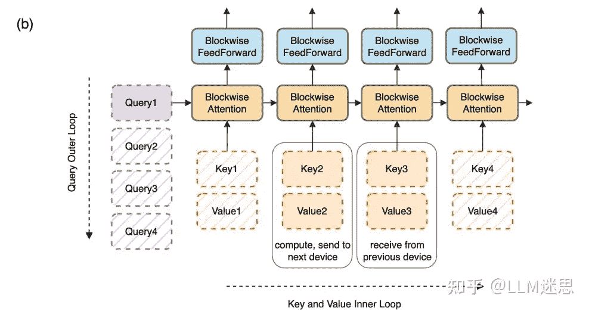

# 📡潜空间系列活动:

> 潜空间系列活动第三季启动！

>

> 第三季第一期将在7.27上午10:00开始，嘉宾是宋佳铭。活动包括嘉宾分享、访谈Q&A、cofounder matching餐会。

>

>

> 宋佳铭-Luma AI 首席科学家，斯坦福大学计算机科学博士、博士后；曾任职英伟达（DIR）小组科学家 ，创建了最早的扩散模型加速算法，该算法广泛用于最近的生成式 AI 系统，包括 DALL-E 2、Imagen、Stable Diffusion 和 ERNIE-ViLG 2.0。

>

>

> 陈贝迪-卡内基梅隆大学助理教授，斯坦福大学人工智能博士后学者，前 Meta AI 研究科学家；致力于在现代硬件上设计和优化算法和模型，以加速大型机器学习系统。

>

>

> 童晟邦- 纽约大学博士，伯克利人工智能实验室（BAIR）研究员， OpenAI 超对齐奖学金获得者；

>

> 闫俊杰-MiniMax 创始人兼 CEO。是中国第一梯队的大模型创业者，目前 MiniMax 估值超 25 亿美元。

>

>

> 本季活动同时开放北京线下、上海线下和线上场次，欢迎校友和外部创业者扫描右方二维码报名！

# 声明

本文档仅供学习交流使用，版权归原作者所有，若涉侵权，请联系Jack Jin 15101136166

##

（欢迎在下方反馈您宝贵的意见！整理不易，觉得有用给AI日报小组点个赞👍吧！）

ChatGPT；Angela；Zijia Liu；Alex；Zeqi Tan；Tiezhen（HuggingFace）；Naixu；Lizhi；Peter；Suoman；Jack

封面生成——右脑科技

如果你有大模型相关的创业想法，欢迎来找我们聊聊～🛰️：15101136166

> 快邀请你的小伙伴们一起来读大模型日报吧！

> **【日报****知识库****】**这里是近期日报内容的汇总,欢迎大家查阅

> [大模型日报知识库(分享版)](https://miracleplus.feishu.cn/wiki/KapVwXfkriOBiskB0B2cUHxjnTh)

>

> 欢迎大家多多帮我们分享,转发~~

> 如果大家有任何的建议或者吐槽,欢迎随时找我聊天~

