# 奇绩大模型日报（7月 18日）

> 来源：[https://miracleplus.feishu.cn/docx/Jv7IdR3i0otpzyxVRAPckgV1nzp](https://miracleplus.feishu.cn/docx/Jv7IdR3i0otpzyxVRAPckgV1nzp)

# 资讯

### OpenAI“最后一篇”超级对齐论文发布：大小模型相互博弈，输出可读性up

https://mp.weixin.qq.com/s/Lf-3WpAMreVoJJHl0zTZMA

这项研究出自OpenAI已解散的“超级对齐”团队，模仿了多伦多大学学者与2021年提出的“证明者-验证者”（Prover-Verifier）博弈。

在训练过程中，OpenAI让大模型担任“证明者”，小模型作为“验证者”，让这两种身份展开一场相互较量。

最终，大模型输出的结果不仅更易理解，自身的准确率也没有明显损失，小模型的判断水平也提高了。

甚至论文作者之一、OpenAI研究员Yining Chen表示，这种方法“有可能使未来的模型比人类更聪明”。

### 清华夺SIGIR 2024「时间检验+最佳论文奖」！中国大陆研究机构首次牵头获奖

https://mp.weixin.qq.com/s/Cpd18ZJFoV3RmMCdRcQqBg

今年，SIGIR()组委会暂未汇总公布所有的获奖名单，不过已经有机构/网友纷纷晒出了自己的成绩单。

值得一提的是，清华计算机系今年一次摘得多项大奖：

2014年发表的论文斩获SIGIR 2024唯一「时间检验奖」，另一篇论文获得「最佳论文奖」。

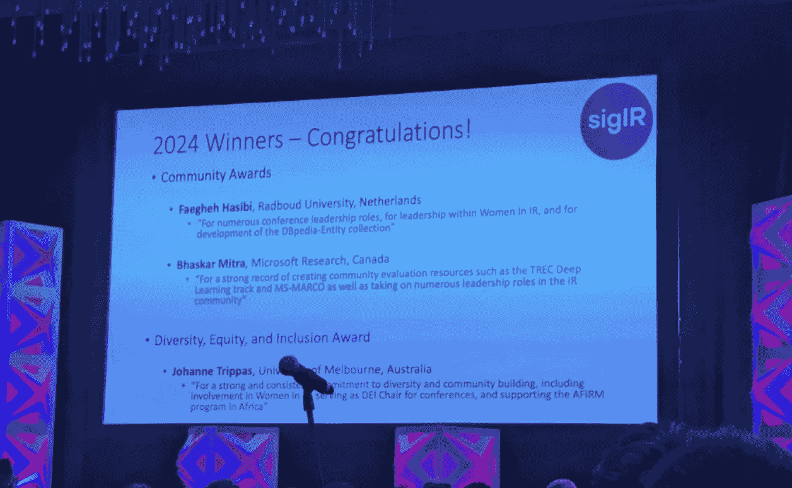

### 一口气投出4家具身智能明星创企，联想创投王光熙：中国应是机器人最大用户国/生产国

https://mp.weixin.qq.com/s/oVWadZgFijk_8EDcWc4lRg

今年以来，具身智能创企融资消息不断，而且大单频出。宇树科技2月获得10亿元B2轮融资，银河通用更是天使轮就拿下7亿融资。

大模型浪潮还在高歌猛进，下一个引**领AI浪**潮的主角却已被市场提前预定，就是具身智能。

但是，正如大模型刚刚爆火时存在不少疑虑，具身智能当下亦是如此。

实现路径是什么？商业化前景多大？爆发何时到来？如今形成了哪些共识和非共识？

就在最近，量子位对话**联想创投王光熙**，窥见了来自投资市场的更多理解。

> 对于具身智能，王光熙的观点简单且直接：

> 中国，很有机会。

### flomo 4.0 发布！上线「相关笔记」功能，用过去增援未来，让意义自然浮现

https://mp.weixin.qq.com/s/4ELJcvaVggt_koK9lfu-bw

7 月 17 日，flomo(浮墨笔记）**上线了第**四个重大版本更新 —— flomo 4.0，新版本添加了「相关笔记」功能，用户可根据当前笔记内容，从已有的笔记中找到相关性强的笔记，从而实现「让意义自然浮现」的产品理念。

# 推特

### Bycloud为Mamba制造超棒预告片

https://x.com/bycloudai/status/1813311769047138568

Bycloud：我给大家准备了一个超棒的预告片。

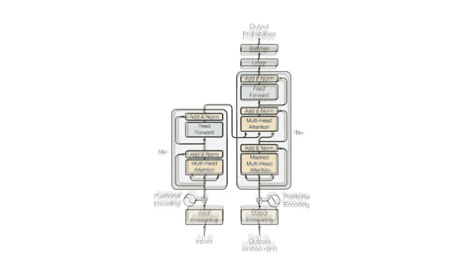

[ssstwitter.com_1721309305361.mp4](https://internal-api-drive-stream.feishu.cn/space/api/box/stream/download/all/Q7utbt0sPo3AGcx4XwscRVpRnGf)

### DeepLearning 新的LLM预训练短期课程

https://x.com/AndrewYNg/status/1813591557511295234

新的LLM预训练短期课程！与@UpstageAI共同开发，由其CEO @hunkims 和CSO @echojuliett 授课。

虽然使用现有模型进行提示或微调在许多通用语言任务中表现良好，但对于当前模型中表现有限的专业领域或语言来说，预训练是非常有价值的。

本课程将带您了解LLM预训练的全流程：

1.  数据准备：学习使用HuggingFace获取、清理和准备训练数据。

1.  模型架构：配置变换器网络，包括修改现有模型。

1.  训练：使用开源库设置并运行训练。

1.  评估：使用流行的评估策略进行性能基准测试。

作为一个示例用例，您还将比较基础模型与其微调和进一步预训练版本的输出，以了解预训练对模型编写Python能力的影响。

课程还探讨了一种名为深度扩展的创新技术，这是Upstage用来训练其Solar模型系列的方法，将预训练计算成本降低了多达70%。这种技术通过首先复制较小预训练模型的层来形成较大的模型，然后进一步预训练结果。

立即报名：https://deeplearning.ai/short-courses/pretraining-llms/

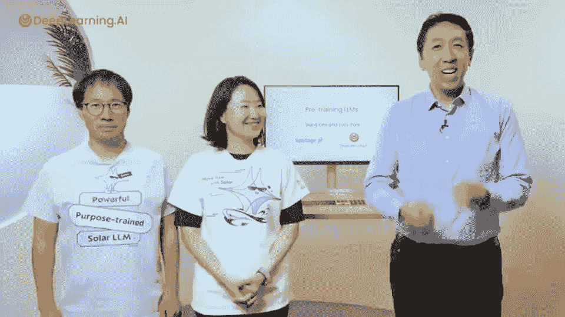

[ssstwitter.com_1721309485319.mp4](https://internal-api-drive-stream.feishu.cn/space/api/box/stream/download/all/KwbBbFFoloKiaTx1GF7cbcgfndf)

### 图基础模型GraphFM：在152个数据集上进行训练

https://x.com/divyansha1115/status/1813634380662972624

很高兴与大家分享我们的图基础模型🌐 GraphFM，它在152个数据集上进行训练，包含超过740万个节点和1.89亿条边，覆盖了不同领域。

🚨 请查看我们的GraphFM预印本，我们在其中测试了模型随数据和模型规模的扩展性，并展示了在新数据集上的高效微调效果。

链接：http://arxiv.org/abs/2407.11907

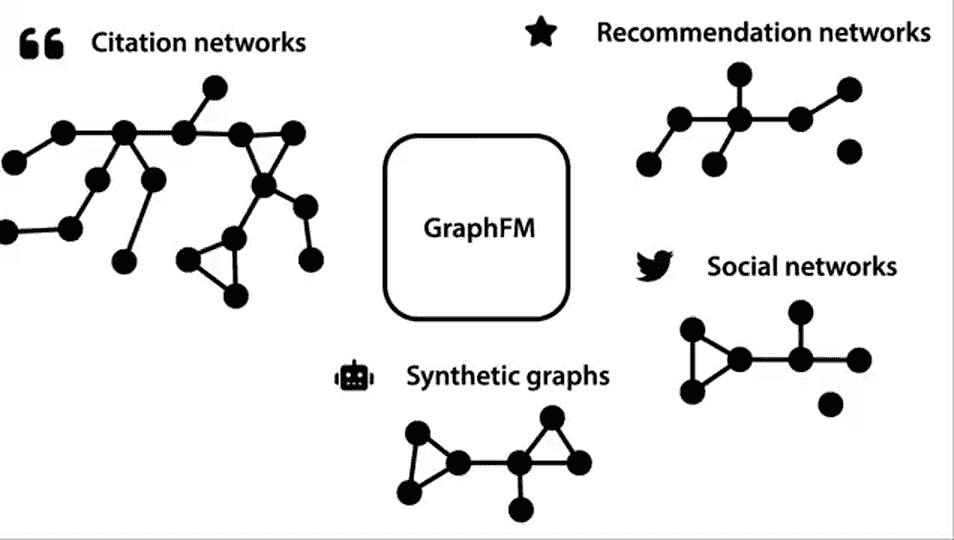

[ssstwitter.com_1721284068175.mp4](https://internal-api-drive-stream.feishu.cn/space/api/box/stream/download/all/OOOBbziURoCEysxiVjnc2QKEngQ)

### ElevenLabs分享：ElevenLabs语音库现在拥有成千上万个独特的声音

https://x.com/elevenlabsio/status/1813624482919047300

由于众多杰出的声优和创作者的分享，ElevenLabs语音库现在拥有成千上万个独特的声音。

这些声音及其背后的人来自世界各地，涵盖了25种语言和更多的地区口音。

[ssstwitter.com_1721309687071.mp4](https://internal-api-drive-stream.feishu.cn/space/api/box/stream/download/all/GgatbidiAo3nkdxyJCEclus7nqb)

### Genweb：首个软件2.0网络框架，不再区分前端和后端代码库，而是将LLM作为后端和前端

https://x.com/rahulgs/status/1813576485682266243

介绍 🪄genweb：首个软件2.0网络框架 🪄

genweb是一种构建网络应用的新方式：不再区分前端和后端代码库，而是将LLM作为后端和前端。

它解释用户操作，并实时动态生成UI。

欢迎来到模拟世界：https://genweb.rahul.gs/app?appId=e3eb8250

正如Jensen所说，应用程序将被生成而不是渲染，这就是开始。

[rahulgs - 1813576485682266243.mp4](https://internal-api-drive-stream.feishu.cn/space/api/box/stream/download/all/YuSNb1EJpoRLdgx1xP3cBi20nBd)

### WH分享：可视化GPT-2和Mamba的损失景观

https://x.com/nrehiew_/status/1813567733168304599

可视化GPT-2和Mamba的损失景观

我真的很喜欢这类可视化 :)

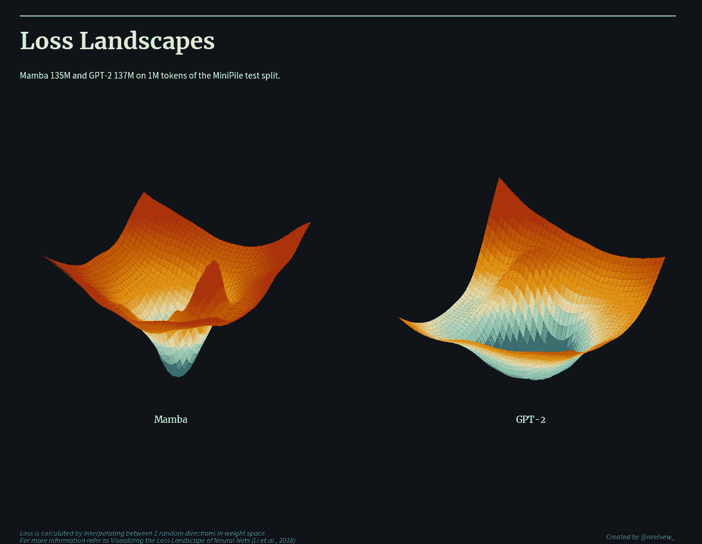

# 产品

### Scade.pro

贡献人：

https://www.scade.pro/

Scade.pro 是一个无代码的人工智能平台，帮助用户轻松地将 AI 集成到他们的项目中，以提高项目的速度和降低成本。该平台提供了超过 1500 个 AI 模型，用户可以测试和集成这些模型，从而加快产品上市时间并提高业务增长。Scade.pro 可以帮助用户以更低的成本扩大业务或创建新的业务，因为现在单人公司也可以利用 AI 实现巨大增长。

### Paillor

贡献人：

https://www.paillor.com/

Paillor 是一个员工支持和自动化平台，将知识库、SaaS 自动化和帮助台功能集成在一起，利用人工智能技术为企业员工提供即时、全面的支持。它可以减少 90%的 HR 和运营请求，以及 84%的 IT 相关请求，为企业节省大量时间和成本。Paillor 通过与 Slack、Teams 等协作工具集成，让员工可以随时随地获得所需的信息和帮助。

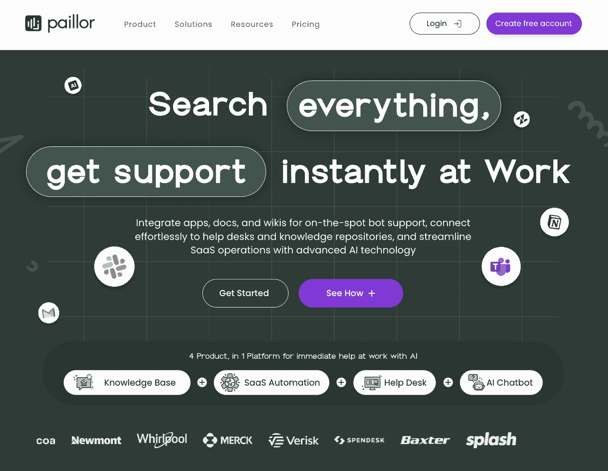

# HuggingFace&Github

### Mem0

贡献人：

https://github.com/mem0ai/mem0

Mem0 是一个智能、自我改进的记忆层，为大型语言模型提供个性化的 AI 体验。它提供了多层次的记忆管理，包括用户、会话和 AI 代理的记忆保留。Mem0 具有开发者友好的 API，可以轻松集成到各种应用程序中，并提供跨平台的一致性。此外，Mem0 还提供了一个托管服务，让用户无需担心维护问题。

### EmoLLM

贡献人：

https://github.com/SmartFlowAI/EmoLLM

EmoLLM 是一系列能够支持 理解用户-支持用户-帮助用户 心理健康辅导链路的心理健康大模型，由 LLM 指令微调而来。它提供全面的心理健康大模型，包括认知因素、情感因素、行为因素、社会环境、生理健康、心理韧性等多个方面。同时提供科学的评估和诊断工具，帮助有效促进个体和群体的心理健康。

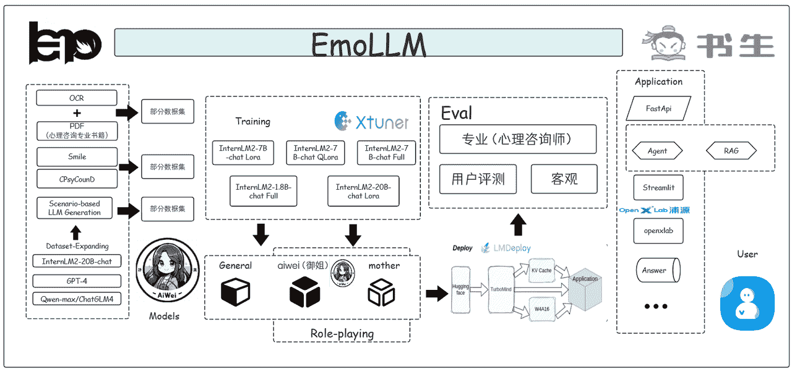

# 投融资

### Pindrop获1亿美元贷款以扩展其反深度伪造技术

贡献人:

https://techcrunch.com/2024/07/17/deepfake-detecting-firm-pindrop-lands-100m-loan-to-grow-its-offerings/

深度伪造检测公司Pindrop近日获得Hercules Capital提供的1亿美元五年期贷款。该笔资金将用于产品开发和招聘。随着生成式AI的发展，语音克隆技术日益强大，Pindrop的AI检测技术已成为各大呼叫中心防范欺诈的必备工具。Pindrop的工具针对银行、金融等行业，能高精度识别联络中心的来电者。该公司计划将技术推广到医疗、零售、媒体和旅游等新领域，以应对全球日益严重的深度伪造威胁。

公司官网：https://www.pindrop.com/

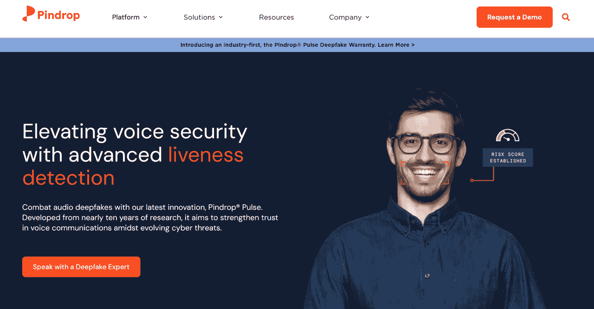

### DreamBig Semiconductor完成7500万美元B轮融资

贡献人：

https://vcnewsdaily.com/dreambig-semiconductor/venture-capital-funding/ltbmpqmzff

DreamBig Semiconductor宣布完成7500万美元的股权融资。本轮融资由三星Catalyst Fund和Sutardja Family共同领投，新投资者包括三星、韩华、Event Horizon和Raptor，原有投资者UMC Capital、BRV、Ignite Innovation Fund和Grandfull Fund等也继续参投。DreamBig成立于2019年，致力于开发高性能加速器平台，专注于AI、大型语言模型、生成式AI、数据中心、边缘计算和汽车领域的半导体解决方案。

公司官网：https://dreambigsemi.com/

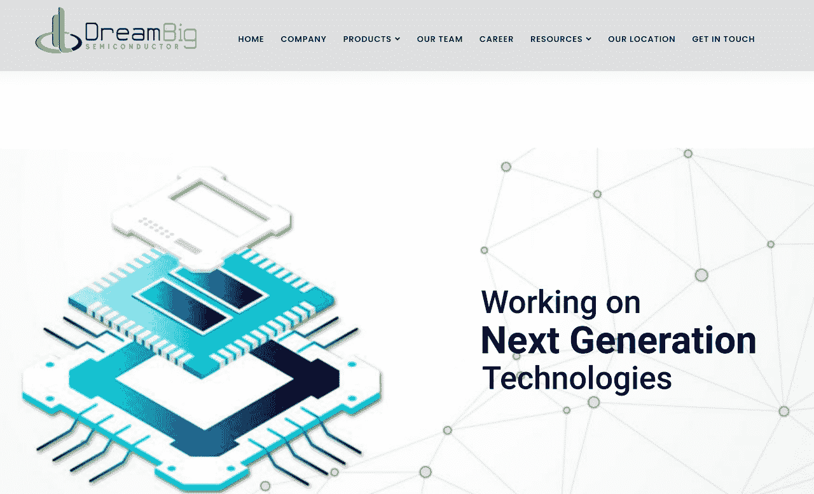

### Tribe AI完成325万美元种子轮融资以应对需求增长

贡献人：

https://techcrunch.com/2024/07/17/tribe-ai-raised-venture-capital-to-keep-up-with-demand-after-six-years-of-bootstrapping/

AI人才和服务公司Tribe AI在自筹资金六年后，首次获得325万美元的种子轮融资，由Indie创始合伙人Bryce Roberts领投。Tribe AI于2019年成立，主要为企业提供合同AI人才，并已发展为全面的AI服务公司，客户包括MyFitnessPal和New Relic。此次融资将用于扩充团队和开发工具套件，以提高项目效率。随着生成式AI的兴起，Tribe AI面临着巨大的市场需求，并计划通过这笔资金进一步扩展业务。

公司官网：https://www.tribe.ai/

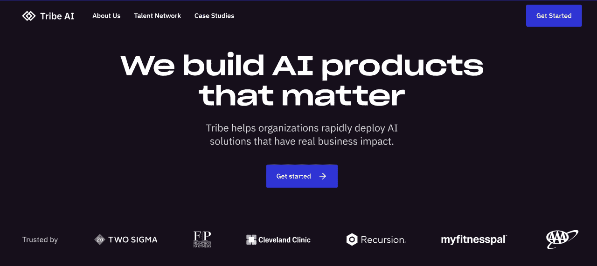

### Didero AI 完成700万美元种子轮融资

贡献人：

https://www.didero.ai/blog/introducing-didero-ai-procurement

Didero AI近日宣布完成700万美元的种子轮融资。该公司推出了一款AI采购代理，旨在通过自动化常见采购工作流程，帮助供应链团队简化全球贸易。Didero AI利用生成式AI解析与供应商的自然语言交流，提供数据洞察，并与现有系统集成，支持从供应商对接到采购订单管理的全面流程。Didero AI目前已有数十家客户，显著节省了时间和成本。联合创始人表示，Didero AI致力于通过技术创新促进全球贸易的发展。

公司官网：https://www.didero.ai/

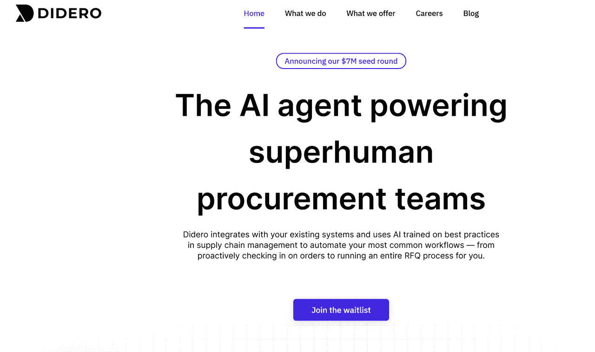

### Menlo Ventures与Anthropic合作设立1亿美元AI基金

贡献人：

https://techcrunch.com/2024/07/17/menlo-ventures-and-anthropic-team-up-on-a-100m-ai-fund/

硅谷风投公司Menlo Ventures与人工智能初创公司Anthropic合作，设立了名为“Anthology Fund”的1亿美元基金，旨在投资早期阶段的AI公司，包括Pre-seed、Seed和A轮公司。Menlo Ventures在Anthropic的一轮超7.5亿美元融资中成为其最大的投资者之一。该基金将为初创公司提供10万美元的投资，并赠送价值2.5万美元的Anthropic模型使用额度。Menlo Ventures将使用专有的机器学习工具评估和排名申请公司，并在后续轮次中继续支持有前景的企业。

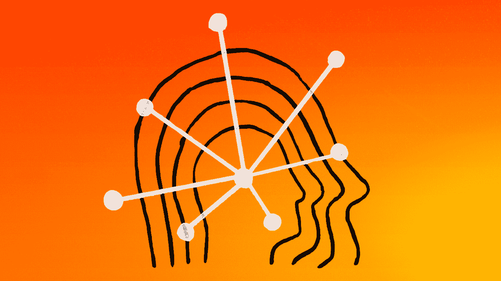

# 学习

### LLM模型之高质量数据选择和微调方法

贡献人：

https://zhuanlan.zhihu.com/p/703612817

文章首先介绍了 Entropy Law，一种在多数据集组合时选择高质量数据的方法，通过考虑数据压缩比和训练损失来提高 LLM 性能。其次，探讨了如何通过高质量微调数据集来增强 LLM 的复杂指令跟踪能力。文章还分析了数据筛选的重要性，指出在有限的训练数据预算下，高质量数据的选择对模型性能至关重要。此外，文章讨论了大模型如何学习知识，包括记忆、语义概括和成分概括等不同深度的知识获取。数学推理能力优化方法 DeepSeek-Prover 通过大规模合成数据提高 LLM 在数学推理方面的能力。PiSSA 微调方法通过对权重矩阵进行 SVD 分解和低秩近似来提高模型性能。Double Dipper 和 Found in the Middle 方法则致力于解决超长上下文处理问题，提升模型在长文本理解和生成方面的能力。最后，T-FREE 提出了一种无需分词器的 LLM 嵌入方法，通过稀疏表示实现内存效率的提升。

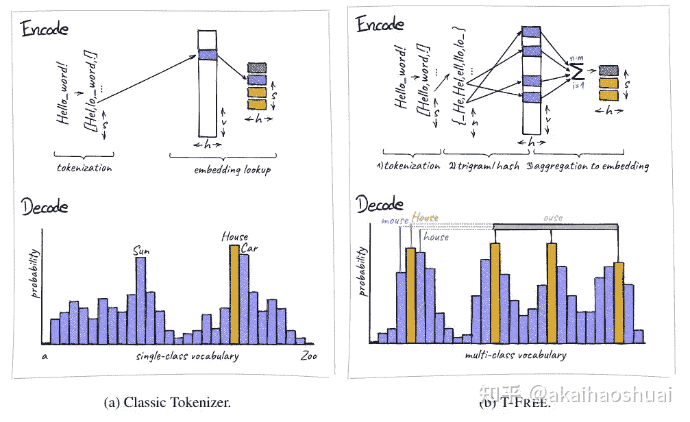

### rl-mpc-locomotion PPT解读（梳理了四足机器人运动学和动力学，MPC，WBC，RL(PPO)）

贡献人：

https://zhuanlan.zhihu.com/p/708904701?utm_psn=1797280978370187266

文章首先介绍了四足机器人的基本概念，包括它们的运动学和动力学模型。运动学涉及机器人各部分的位置和速度计算，而动力学则关注力和力矩的作用以及它们对机器人运动的影响。接着，作者详细解读了模型预测控制（MPC）的原理和在四足机器人中的应用，MPC 能够在预测的基础上优化机器人的运动轨迹。全身动态平衡控制（WBC）作为一种高级控制策略，被用来实现机器人在不同地形上的稳定行走。文章最后探讨了强化学习（RL），特别是 PPO 算法，在四足机器人行走控制中的应用。RL 能够通过与环境的交互来学习最优的控制策略，而 PPO 算法则是一种更稳定、更高效的 RL 训练方法。

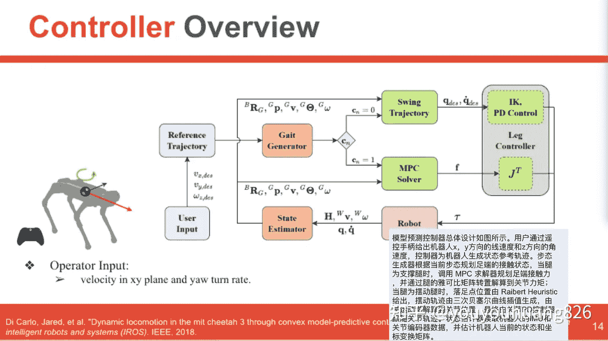

### 合成数据，和你想的不一样

贡献人：

https://mp.weixin.qq.com/s/zUcilzUvgOoRU8plYIJYVw

合成数据技术是一种创新的数据采集方法，它能够提供高质量、高度可控的数据集，用于训练图像 AI 模型。这种技术不仅能够生成大量的数据，还能够精确模拟难以获取的 Corner Case 场景，从而有效解决了传统数据获取方式中的隐私数据和稀缺数据问题。合成数据的应用范围广泛，涵盖了计算机视觉、自动驾驶等领域，并且在商业上已经有了成功案例。技术上，合成数据的生成主要依赖于传统的数据增强技术、仿真技术以及生成式 AI 技术，尤其是以端到端模型为核心的技术，它能够生成广泛性、逼真度、可控性和拓展性都优异的数据。尽管合成数据技术面临着争议和挑战，但它无疑为 AI 的发展提供了新的可能性，特别是在实现人工智能（AGI）的道路上，合成数据被视为一种梦幻的捷径。JoinAI｜卓印智能正在努力开发最佳的合成数据技术，以最大化数据的质量和效率，为 AI 的进步贡献力量。

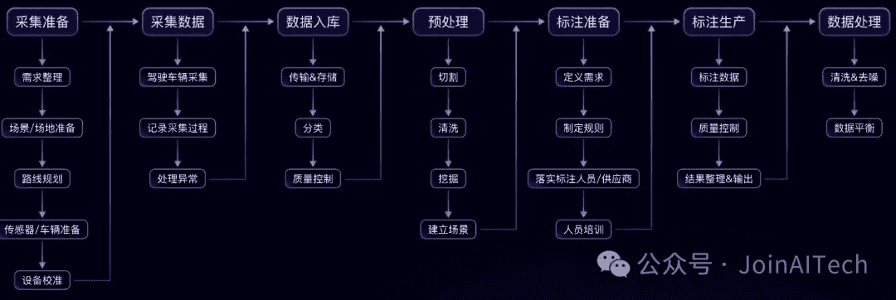

### 不存在什么原生多模态模型

贡献人：

https://zhuanlan.zhihu.com/p/701839667?utm_psn=1797280127664648192

文章开篇提到，自从双子座和全能型模型发布后，AI 行业内部似乎有所变化，但整体上并未出现大幅度的动态。作者认为，所谓的 “原生多模态模型” 实际上是对双子座和全能型技术报告中的描述进行的一种脑补。Google 和 OpenAI 在其报告中提到的 “原生”，实际上指的是在训练过程中并未区分输入输出的形式，而不是真正的原生多模态。文章指出，语言本身并非原生模态，而是经过其他感官输入后的次级输出。作者还批判了 Grounding 的概念，认为语言中的概念实例化是在交流者的思维中完成的，而不是通过与其他模态的对应来实现的。文章进一步探讨了 Unnatrueness 与 Unlearnability 的问题，指出语言为主体的模型在处理非自然概念时具有可学习性，但对于原生认知的概念可能不具备可学习性。此外，文章还讨论了 Positional Embedding 与 Temporal Embedding 的区别，认为语言模型不需要严格按照时间顺序进行编解码，而其他原生模态如语音和视频则需要。最后，文章总结认为，尽管语言是智能行为体交流的高效手段，但未来可能会出现新的交流方式，语言模型并非终极解决方案。

### 生成式AI推理企业的市场机遇、竞争与未来

贡献人：

https://mp.weixin.qq.com/s/HIFQT5pRukAjJ-m8ToQzxA

本文深度探讨了生成式 AI 推理企业在当前市场的机遇、竞争环境以及未来发展的可能性。撰稿人 Kevin Zhang 指出，AI 推理公司为初创和企业提供了模型微调、可观测性分析等服务，简化了 AI 集成过程。这些公司通常提供两种层次的开发者体验：一键式 API 服务或具有一定定制选项的平台。随着推理平台的性能和价格趋同，AI 推理技术即将实现商品化。

尽管存在替代品的威胁和对有限收入的争夺，但文章认为 AI 推理市场有利于扩张。对于潜在投资者而言，重要的信念包括对市场总地址值（TAM）扩展的相信，以及对公司产品线扩展和并购机会的考量。同时，文章还提到了软件开发将逐渐朝着更高抽象层次发展的趋势。这一切意味着，AI 推理公司需要摒弃单一服务的局限，变得更加全栈，整合计算和分布式服务。总的来说，AI 推理领域的投资和技术发展将围绕着服务的商品化、市场竞争和资本的布局三 grandes axes evolve (3 个主要轴线展开)。

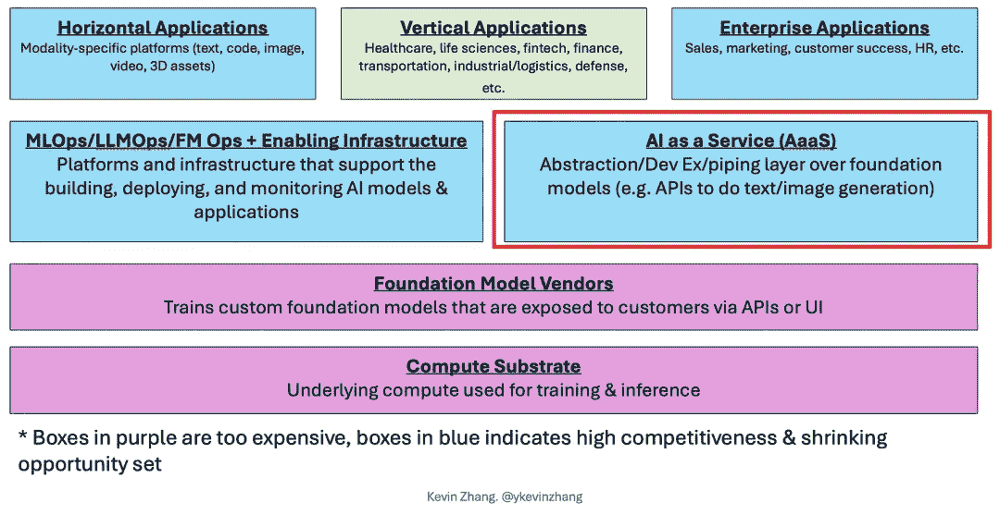

### 中金 | Robotaxi：L4自动驾驶技术的重要探索

贡献人：

https://mp.weixin.qq.com/s/j9R4pn2lssAOyZzSgImeNw

Robotaxi 作为 L4 自动驾驶技术的重要应用，在技术上采用端到端的算法，这种算法能够减少信息传递损失，提高对复杂路况和异常情况的处理能力。具体而言，它摒弃了传统的模块化方法，而是将感知、预测、规划、控制等整合到一个神经网络中，通过数据驱动而非规则驱动，从而提升了自动驾驶的智能化水平。此外，Robotaxi 在传感器配置上也较为慷慨，如百度 RT6 搭载了 12 颗摄像头、8 颗激光雷达和 6 颗毫米波雷达，以及超过 2000TOPS 的算力支持，以确保高精度地图和精确感知。

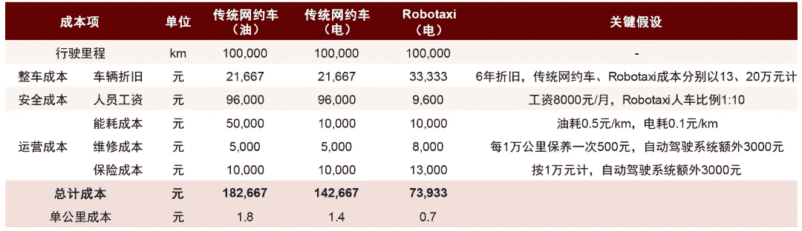

### 场景融合与 ROI 考量：金融大模型落地的两大困境有解吗？

贡献人：

https://mp.weixin.qq.com/s/f-_XPxZcvRuDa8EDSDKIQQ

文章首先指出，金融行业是大模型应用的理想领域，因为金融业务的专业知识密集、数据驱动和复杂流程与大模型的理解能力、记忆能力和逻辑推理能力高度吻合。然而，大模型在金融领域的落地过程中遇到了技术融合、成本效益和合规安全等问题。在最近的一次直播中，杨青和鲍捷博士围绕大模型在金融行业的应用进行了深入讨论。鲍捷博士提到，过去一年大模型从探索阶段转向了实际落地，并且在航空和金融等行业有数十个落地案例，这些案例都是基于强业务驱动的。杨青认为，大模型的能力在提升内部员工效率方面展现出了巨大的潜力，尤其是在帮助员工更有效地获取和理解知识库中的信息。两位专家都强调了大模型技术应用主要集中在金融业务场景，如知识库构建、核查系统、写作协作场景等。此外，文章还讨论了大模型在金融行业的挑战，包括技术底层能力的提升、业务流程中的嵌入、成本控制和 ROI 的计算等问题。最后，文章预测了人机协作的未来趋势，包括机器与机器、人与人、人与机器的新型协作模式。

# 📡潜空间系列预告

> 潜空间系列活动第三季启动！

>

> 第三季第一期将在7.27上午10:00开始，嘉宾是宋佳铭。活动包括嘉宾分享、访谈Q&A、cofounder matching餐会。

>

>

> 宋佳铭-Luma AI 首席科学家，斯坦福大学计算机科学博士、博士后；曾任职英伟达（DIR）小组科学家 ，创建了最早的扩散模型加速算法，该算法广泛用于最近的生成式 AI 系统，包括 DALL-E 2、Imagen、Stable Diffusion 和 ERNIE-ViLG 2.0。

>

>

> 陈贝迪-卡内基梅隆大学助理教授，斯坦福大学人工智能博士后学者，前 Meta AI 研究科学家；致力于在现代硬件上设计和优化算法和模型，以加速大型机器学习系统。

>

>

> 童晟邦- 纽约大学博士，伯克利人工智能实验室（BAIR）研究员， OpenAI 超对齐奖学金获得者；

>

> 闫俊杰-MiniMax 创始人兼 CEO。是中国第一梯队的大模型创业者，目前 MiniMax 估值超 25 亿美元。

>

>

> 本季活动同时开放北京线下、上海线下和线上场次，欢迎校友和外部创业者扫描右方二维码报名！

# 声明

本文档仅供学习交流使用，版权归原作者所有，若涉侵权，请联系Jack Jin 15101136166

##

（欢迎在下方反馈您宝贵的意见！整理不易，觉得有用给AI日报小组点个赞👍吧！）

ChatGPT；Angela；Zijia Liu；Alex；Zeqi Tan；Tiezhen（HuggingFace）；Naixu；Lizhi；Peter；Suoman；Jack

封面生成——右脑科技

如果你有大模型相关的创业想法，欢迎来找我们聊聊～微信：15101136166

> 快邀请你的小伙伴们一起来读大模型日报吧！

> **【日报****知识库****】**这里是近期日报内容的汇总,欢迎大家查阅

> [大模型日报知识库(分享版)](https://miracleplus.feishu.cn/wiki/KapVwXfkriOBiskB0B2cUHxjnTh)

>

> 欢迎大家多多帮我们分享,转发~~

> 如果大家有任何的建议或者吐槽,欢迎随时找我聊天~

