# 奇绩大模型日报（7月 17日）

> 来源：[https://miracleplus.feishu.cn/docx/XGM2dn44forYoaxIzbZcZmACnBh](https://miracleplus.feishu.cn/docx/XGM2dn44forYoaxIzbZcZmACnBh)

## 资讯

### Mistral AI两连发：7B数学推理专用、Mamba2架构代码大模型

https://mp.weixin.qq.com/s/fFB0A0vv_2Deb0rWd4tagw

昨天，AI圈竟然被「9.11和9.9谁大」这样简单的问题攻陷了，包括OpenAI GPT-4o、Google Gemini等在内的大语言模型都翻了车。这让我们看到，大语言模型在处理一些数字问题时并不能像人类那样理解并给出正确的答案。

对于数字以及复杂的数学问题，专用模型更术业有专攻。今天，法国大模型独角兽 Mistral AI发布了一个专注于数学推理和科学发现的7B大模型「Mathstral」，来解决需要复杂、多步骤逻辑推理的高级数学问题。该模型基于 Mistral 7B 构建，支持的上下文窗口长度为32k，遵循的开源协议为Apache 2.0 license。Mathstral在构建时追求出色的性能与速度权衡，这是 Mistral AI积极推广的一种开发理念，尤其是微调功能。

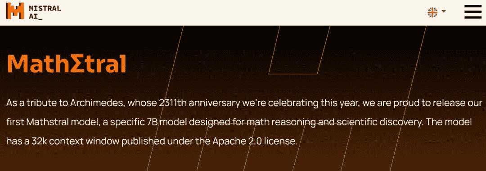

### 无损加速最高5x，EAGLE-2让RTX 3060的生成速度超过A100

https://mp.weixin.qq.com/s/TbBYdJWVE-FCajytzjyDzw

自回归解码已经成为了大语言模型（LLMs）的事实标准，大语言模型每次前向计算需要访问它全部的参数，但只能得到一个token，导致其生成昂贵且缓慢。今日，一篇题为《EAGLE-2: Faster Inference of Language Models with Dynamic Draft Trees》的论文提出了动态草稿树投机采样，依据草稿模型的置信度动态调整草稿树的结构，最高可以将大语言模型的推理速度提高5倍，同时不改变大语言模型的输出分布，确保无损。

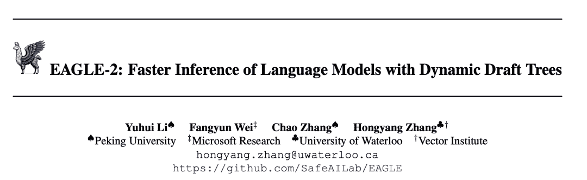

### 快手开源LivePortrait，GitHub 6.6K Star，实现表情姿态极速迁移

https://mp.weixin.qq.com/s/JrKF_7To8PEggEfw7W09ew

**近日，快手可灵大模型团队**开源了名为`LivePortrait`的可控人像视频生成框架，该框架能够准确、实时地将驱动视频的表情、姿态迁移到静态或动态人像视频上，生成极具表现力的视频结果。

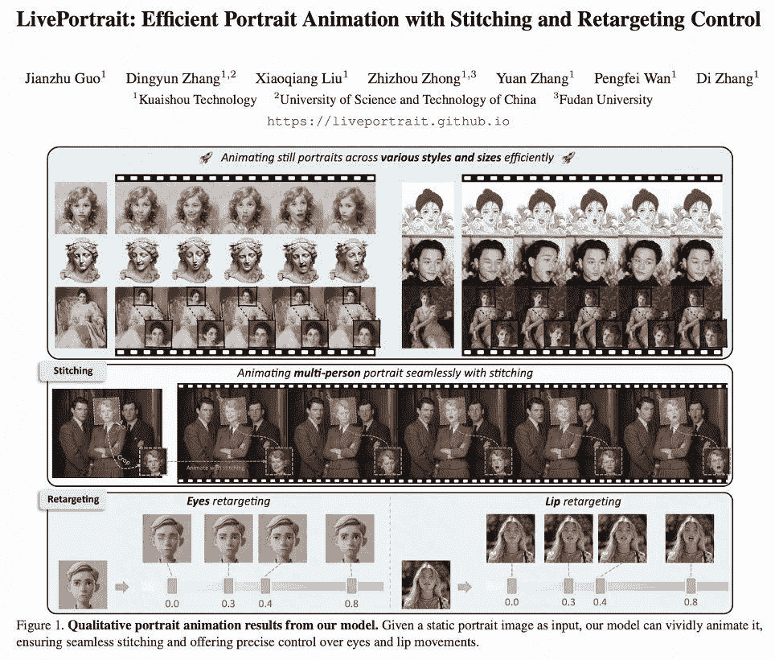

### 哈佛华人创业者创办的 AI 搜索平台 Exa 获英伟达、YC 以及 Lightspeed 1700 万美元融资

https://mp.weixin.qq.com/s/QGwMo8KHCSKH7ZU2HR_sMA

致力于开发 AI 原生搜索引擎的初创公司 Exa 宣布，完成由 `Lightspeed()` 领投的 1700 万美元 A 轮融资，其他投资者还包括 Nvidia 风险投资部门 NVentures 和 `Y Combinator()`。

据悉，Exa 目标是为 AI 平台提供高效、准确的信息检索服务。此前，Exa 已筹集了 500 万美元的种子轮融资，总融资额达到 2200 万美元。

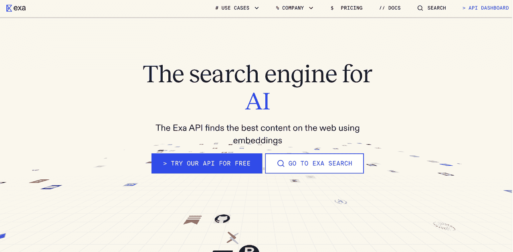

## 推特

### Karpathy创业！Eureka Labs，AI+教育

https://x.com/karpathy/status/1813263734707790301

⚡️ 很高兴分享，我正在创办一家名为 Eureka Labs 的AI+教育公司。

公告如下：

---

我们是 Eureka Labs，正在打造一种新的AI原生学校。

我们如何能够实现理想的学习新知识的体验？例如，在学习物理的过程中，可以想象与费曼一起学习高质量的课程材料，他会在每一步都指导你。不幸的是，那些深深爱好某个学科、教学出色、无限耐心并精通世界所有语言的专家非常稀缺，不可能按需亲自辅导我们80亿人。

然而，随着生成型AI的最新进展，这种学习体验变得可行。教师仍然设计课程材料，但这些材料由优化为帮助指导学生的AI助教支持、利用和扩展。这种教师+AI的共生关系可以在一个通用平台上运行整个课程体系。如果我们成功了，任何人都能轻松学到任何知识，教育的覆盖面（大量的人学习某些东西）和广度（一个人学习大量学科，超越目前可能的范围）都会扩大。

我们的第一个产品将是世界上显而易见的最佳AI课程，`LLM101n`。这是一个本科级别的课程，指导学生培训自己的AI，非常类似于AI助教的缩小版。课程材料将在线提供，但我们还计划运行数字和实体的学员群体一起学习。

今天，我们正专注于构建`LLM101n`，但我们期待着未来，AI将成为提升人类潜力的关键技术。你想学习什么？

---

@EurekaLabsAI

是我20年来对AI和教育的热情的结晶。我对教育的兴趣从在YouTube上制作魔方教程到在斯坦福开设`CS231n`课程，再到最近的Zero-to-Hero AI系列课程。而我在AI方面的工作则从斯坦福的学术研究到特斯拉的实际产品，再到OpenAI的AGI研究。到目前为止，我将两者结合的工作只是兼职的，作为我“真正工作”的副业，所以我非常兴奋能够全职并专业地投入其中，建立一些伟大的东西。

虽然现在还处于早期阶段，但我想宣布这家公司，这样我可以公开构建而不是保守一个并不是秘密的秘密。回复中有更多信息的链接！

### Llama 3 Groq Tool Use 8B和70B模型：Llama 3的开源工具使用完全微调版本

https://x.com/RickLamers/status/1813341037198204962

我已经领导一个秘密项目好几个月了……现在终于可以公开了！

🛠️ 我很自豪地宣布Llama 3 Groq Tool Use 8B和70B模型🔥

这是Llama 3的开源工具使用完全微调版本，在BFCL排行榜上位居第一，击败了所有其他模型，包括专有模型如Claude Sonnet 3.5、GPT-4 Turbo、GPT-4o和Gemini 1.5 Pro。

这几个月来，我和Groq的优秀同事们以及Glaive的合作伙伴们都为此付出了艰苦努力。

该模型仅在合成数据上进行训练。这是一个强大的完全微调版本，而不是LoRA。是的，我们使用LMSYS描述的稳健去重技术进行了严格的过拟合检查，它们在SFT合成数据上的得分仅为5.6%，在合成DPO数据上的得分为1.3%。

现在可以通过Groq API以极快的速度使用，8B模型的速度为1050 tok/s，70B模型的速度为330 tok/s，或者从Hugging Face下载开源权重，开始探索和 tinkering。

查看完整的博客文章以获取更多详细信息，所有链接请见下方回复。

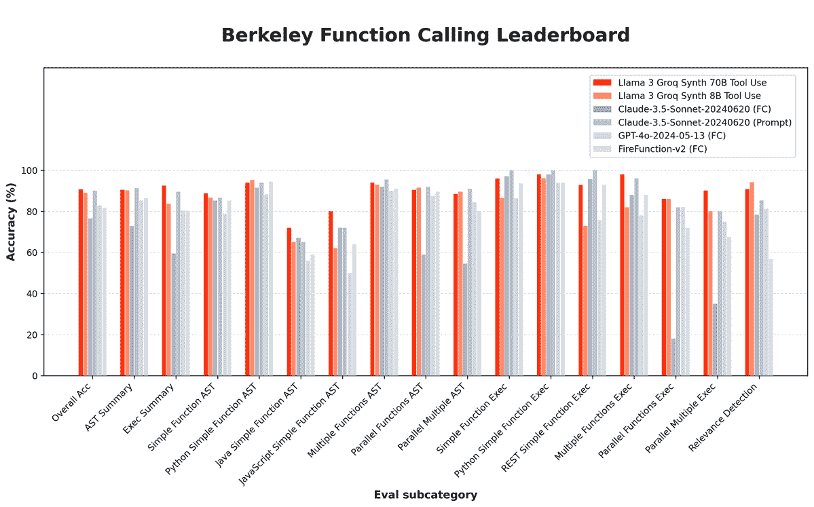

### 手写简单AI数学：线性层 - 练习10

https://x.com/ProfTomYeh/status/1813497648164532676

凯蒂手写解决了线性层 - 练习10 ✍️

我们正在试点一系列短视频，向高中生展示如何手写简单的AI数学，揭开黑箱的神秘面纱！

我们非常感谢您的反馈和建议！

这个演示视频由凯蒂·罗伯逊制作。我很荣幸在洛杉矶的ISEF上见到她。她将前往加州理工学院学习计算机科学和数学。

https://linkedin.com/in/katie-robertson-482622214/

如果您有兴趣了解更多关于线性层的知识，您可以观看完整的教程视频，由我的博士生莫赫森娜制作，该视频涵盖了所有25个练习。

https://by-hand.ai/v/w3

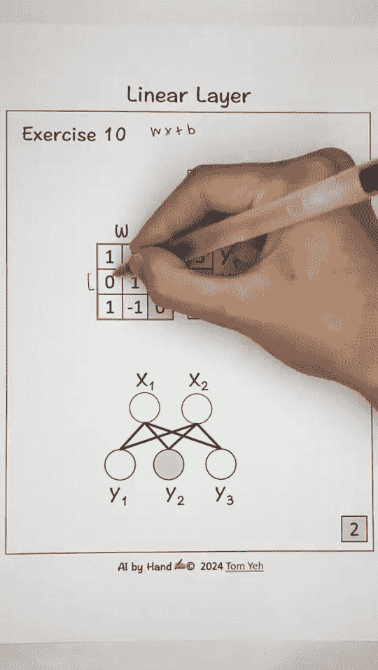

[ssstwitter.com_1721218466375.mp4](https://internal-api-drive-stream.feishu.cn/space/api/box/stream/download/all/WOvVbIJtVo4s68xLhewcOd7Tnpg)

### Maxime Labonne宣布新书：《LLM工程师手册》

https://x.com/maximelabonne/status/1813510236176601204

非常自豪地宣布我的新书：《LLM工程师手册》👷

我认为我们与@iusztinpaul和Alex Vesa一起创建了一本特别的书，专注于最佳工程实践、可重复的管道和端到端的部署。基本上是当前生态系统中缺乏的一切。

我们的目标很简单：提供构建LLM应用程序所需的所有知识，全部在一本书中。

感谢Paul和Alex的超顺利合作！这两位在GitHub上创建了出色的LLM双胞胎课程(https://github.com/decodingml/llm-twin-course)，这是一个学习LLMOps的绝佳资源。

我在网上的所有内容都是免费的，但如果你想支持这项工作，请预购我们的书。这对我们在亚马逊上的曝光度有很大帮助。

📙 预购链接: https://a.co/d/62LuMFC

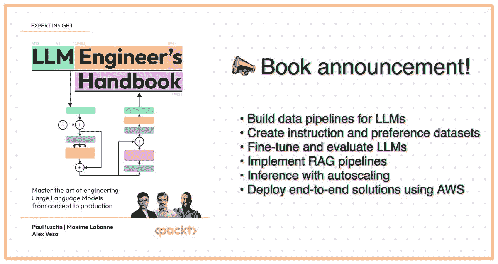

### SmolLM：一系列新的SOTA模型，包括135M、360M和1.7B，完美适用于设备端部署

https://x.com/xenovacom/status/1813258097185448377

介绍SmolLM：一系列新的SOTA模型，包括135M、360M和1.7B，完美适用于设备端部署！🔥

我们还上传了这些模型的ONNX权重，这意味着它们可以通过🤗 `Transformers.js`和`WebGPU`加速在您的浏览器中本地运行！⚡️

试试看（还有博客文章）！👇

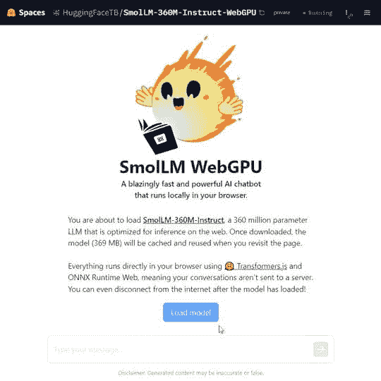

[ssstwitter.com_1721174198995.mp4](https://internal-api-drive-stream.feishu.cn/space/api/box/stream/download/all/IuANbdzn5oGB7Jxhvi2cudAEn7d)

## 产品

### Riffo.ai

贡献人：

https://riffo.ai/

Riffo.ai 是一款 AI 驱动的本地文件管理工具，帮助用户轻松组织和重命名各种文件。它使用 AI 技术自动分析文件内容并生成有意义的文件名，无需用户手动操作。该工具支持多种文件格式，包括图片、文档和 PDF 等。其设计简洁易用，内置于菜单栏中方便快速访问，能大幅提高文件管理效率，节省用户大量时间。

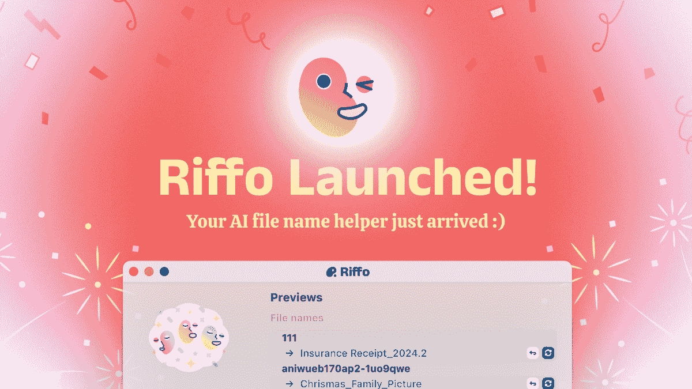

### Blaze

贡献人：

https://www.withblaze.app/

Blaze 是一款使用人工智能和自动化来帮助企业更有效地进行外展营销的产品。希望解决电子邮件营销效果下降的问题，通过在社交媒体平台上识别高意向潜在客户，并向他们发送个性化的消息序列来提高转化率。Blaze 的主要功能包括：使用 AI 信号发现潜在客户、在 Twitter 和 LinkedIn 上发送个性化 DM 序列、利用 AI 自动回复，以及与热门话题和买家帖子互动来建立品牌知名度等。

## HuggingFace&Github

### `Praison AI`

贡献人：

https://github.com/MervinPraison/PraisonAI

`PraisonAI` 是一个基于 `AutoGen` 和 `CrewAI` 等框架的低代码解决方案，目的是简化构建和管理多智能体 LLM 系统的过程，重点关注简单性、定制性和高效的人机协作。

主要功能点：

1. 提供简单易用的命令行界面，支持自动生成和运行多智能体系统。

1. 支持自定义智能体和工具，提高系统的灵活性和可扩展性。

1. 提供丰富的用户界面，包括多智能体界面、聊天界面和代码界面。

1. 支持 100 多种 LLM 模型，满足不同应用场景的需求。

1. 提供 Python SDK，方便开发者在自己的项目中集成 `PraisonAI`。

### `OpsPilot`

贡献人：

https://github.com/WeOps-Lab/OpsPilot

`OpsPilot` 是 WeOps 团队开源的一个基于深度学习与 LLM 技术的智能运维助理，以运维大脑的形态，联动各类运维系统，提供智能化运维的能力支撑。主要支持以 Web、企业🛰️等通道， 为用户提供以 智能问答、ChatOps、智能引导三个方向的延展能力。

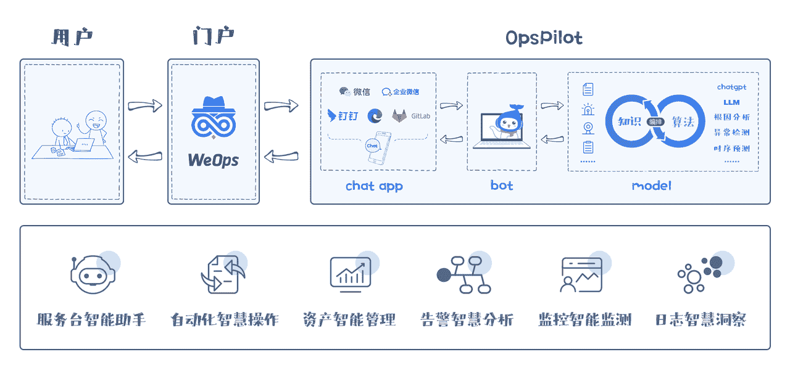

## 投融资

### **星海图获得新一轮融资**

https://new.qq.com/rain/a/20240717A02I2Z00

**星海图**是一家具身智能机器人研发商，公司从具身本体、端到端算法、场景落地解决方案全栈自研。专注于打造“一脑多型”具身智能机器人。星海图发生工商变更，新增北京机器人产业发展投资基金（有限合伙）为股东，同时注册资本由约65.3万人民币增至约69.5万人民币。

公司官网：https://www.galaxea.ai/

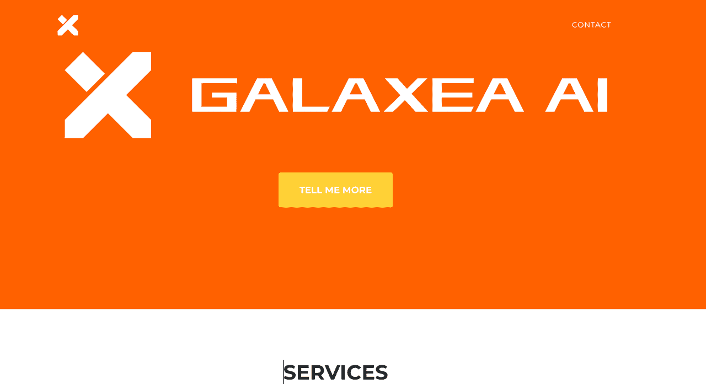

### World Labs获得新一轮融资

https://www.ft.com/content/0b210299-4659-4055-8d81-5a493e85432f

World Labs是一家空间智能初创公司，由斯坦福大学教授李飞飞等联合创办，致力于利用类人视觉数据处理技术，让 AI 可以实现高级推理。近日获悉，从今年4月成立至今，World Labs已经进行了两轮融资，投资方包括顶级科技投资者Andreessen Horowitz和AI基金Radical Ventures。据了解，其最新一轮的融资金额可能达到约1亿美元。World Labs估值已经赶超10亿美元。

### Anysphere获OpenAI支持，完成4亿美元新一轮融资

https://quantisnow.com/insight/openaibacked-startup-anysphere-raises-400m-in-new-funding-round-5609925

Anysphere，一家由OpenAI支持的初创公司，成功完成了4亿美元的新一轮融资。本轮融资将用于扩展其AI驱动的平台，进一步推进其技术发展和市场拓展。此次大规模融资显示出投资者对Anysphere在AI领域前景的高度信心和认可。

公司官网：https://anysphere.inc/

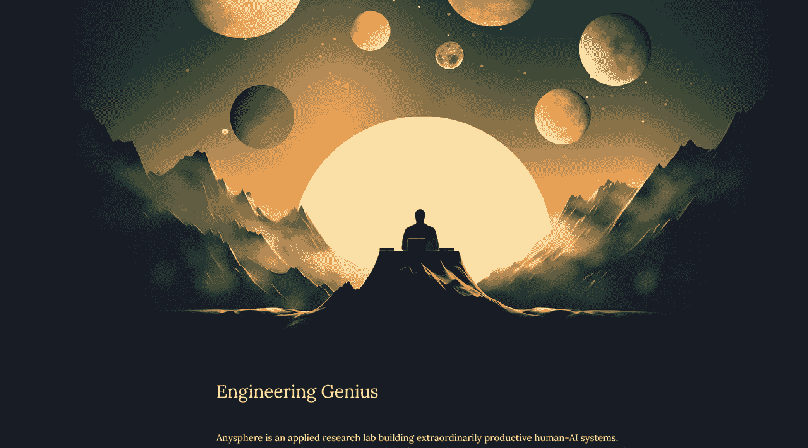

### Exa获得1700万美元融资，由Lightspeed、NVIDIA和Y Combinator领投

https://techcrunch.com/2024/07/16/exa-raises-17m-lightspeed-nvidia-ycombinator-google-ai-models/

Exa是一家致力于为AI创建搜索引擎的初创公司，近日完成了由Lightspeed Venture Partners、NVIDIA和Y Combinator领投的1700万美元A轮融资，使其总融资额达到2200万美元。Exa的技术利用向量数据库和嵌入来训练AI模型，使其能够预测下一个链接，而不是传统的单词和句子。这项融资将支持Exa进一步发展其面向AI平台的搜索工具，并扩展其开发者用户群。

公司官网：https://exa.ai/

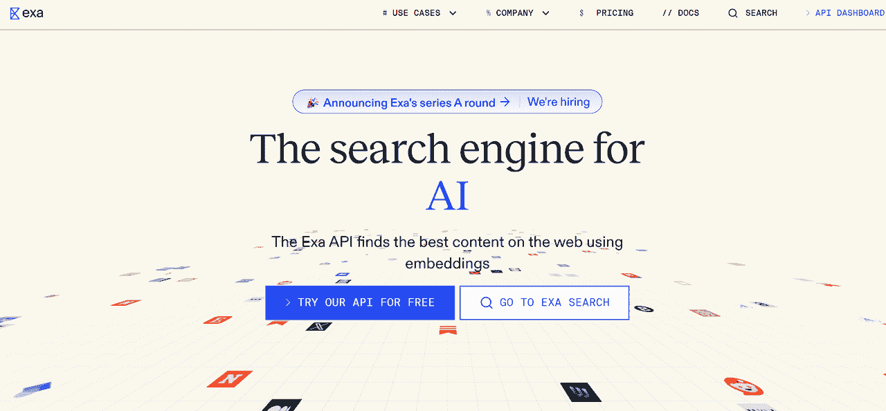

### Adaptive完成1900万美元A轮融资以利用AI和自动化变革建筑金融

https://www.prnewswire.com/news-releases/adaptive-closes-19m-series-a-to-transform-construction-finance-with-ai-and-automation-302196928.html

Adaptive，一家金融自动化平台，宣布完成1900万美元A轮融资，主要投资方为Emergence Capital，Andreessen Horowitz、Definition、Exponent等公司也参与了投资。此次融资使Adaptive的总融资额达到2640万美元。资金将用于扩展其AI驱动的财务管理平台，专为中小型建筑公司设计，提供端到端的财务管理解决方案，包括预算、现金流分析、费用追踪等。Adaptive计划利用这笔资金扩大全球团队规模，并提升其平台的功能和用户覆盖范围。

公司官网：https://www.adaptive.build/

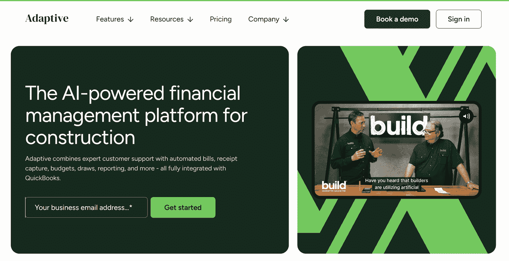

### Mira完成由BITKRAFT Ventures和Framework Ventures领投的900万美元种子轮融资

https://www.prnewswire.com/news-releases/mira-closes-9m-seed-round-led-by-bitkraft-ventures--framework-ventures-302197520.html

Mira，一家去中心化AI基础设施平台，宣布完成由BITKRAFT Ventures和Framework Ventures领投的900万美元种子轮融资，其他投资者包括Accel、Crucible、Folius Ventures等。Mira计划利用这笔资金扩大全球团队规模，并支持Mira网络及其首批生态系统应用的开发，包括为加密领域设计的AI助手Klok。Mira的平台通过SDK套件简化了AI基础设施的复杂性，帮助开发者在不放弃数据主权的情况下，轻松创建和维护复杂的AI产品。

公司官网：https://mira.network/

### Vectara获得2500万美元A轮融资以推进Retrieval-Augmented Generation的可信度

https://www.businesswire.com/news/home/20240716489550/en/Vectara-Secures-25-Million-Series-A-Funding-to-Advance-the-Trustworthiness-of-Retrieval-Augmented-Generation-with-New-Mockingbird-LLM

Vectara在FPV Ventures和Race Capital的领投下完成了2500万美元的A轮融资，其他投资者包括Alumni Ventures、WVV Capital、Samsung Next等。本轮融资加上去年的2850万美元种子轮融资，总融资额达5350万美元。资金将用于推动内部创新、扩展市场资源，并扩大澳大利亚和EMEA地区的业务。同时，Vectara推出了新的Mockingbird LLM，专为RAG应用设计，以减少幻觉并改善结构化输出，特别适用于医疗、法律、金融等受监管行业。FPV Ventures的联合创始人Pegah Ebrahimi将加入Vectara董事会。

公司官网：https://vectara.com/

# 学习

## 由GQA性能数据异常引发的对MHA，GQA，MQA 在GPU上的感性分析

贡献人：

https://zhuanlan.zhihu.com/p/708776013?utm_psn=1796548467562270720

本文深入探讨了 MHA、GQA 和 MQA 在 NVIDIA A100 GPU 上的性能特性。通过对 vLLM 官方版本进行基准测试，作者使用 Nsight Compute 工具分析了这些注意力机制的计算和内存使用情况。MHA 的 V2 版本通过对 KV 长度进行分区，提高了在小批次下的并行度。然而，GQA 和 MQA 虽然减少了 KV 缓存大小，但性能提升受限于 L2 缓存带宽，而不是 HBM 带宽，这导致它们的性能提升不及预期。GQA 在 L2 缓存上的重复加载 KV 缓存使得其在 L2 缓存带宽上受限，而 MQA 同样因为 L2 缓存带宽限制而未能实现更大的性能提升。作者提出了优化策略，包括减少 `Q head` 维度上的并行度，以及探讨了 `block id` 重复使用对性能的影响。

## Vortex GPGPU Tutorials 资料汇总

贡献人：

https://zhuanlan.zhihu.com/p/553169070?utm_psn=1796606964299595776

Vortex GPGPU 项目是一个基于 RISC-V 架构的开源 GPGPU 解决方案，旨在扩展 ISA 以支持通用计算任务。该项目的微架构设计包括了 wavefront spawn、thread mask control、barrier 同步等特性，支持 SIMT 并行计算模型。硬件设计采用多核集群结构，每个核心具备类似于 NVIDIA SM 的功能，能够调度和执行 wavefront。代码结构详细划分了 `fetch`、`decode`、`issue`、`execute` 和 `commit` 等流水线阶段，每个阶段都有专门的数据结构和功能单元，如 `GPR`、`FPU` 和 `LSU`。在 `execute` 阶段，`ALU` 单元支持 SIMD 计算，而 `shared memory` 设计为多银行，以提高并行访问性能。此外，Vortex 还提供了 `OpenCL` 软件栈支持，以及详细的 Slides 和论文资源，供开发者学习和研究。

## scale up域的拓扑

贡献人：

https://zhuanlan.zhihu.com/p/708991795?utm_psn=1796846669574324224

文章详细阐述了 Scale Up 域的拓扑结构，包括目前 NV 在 GPU 异构互联上定义的 die 间和三套网络松耦合的组网机制：`die2die`、`ScaleUp`、`ScaleOut` 和 `FrontEnd`。在 Scale Up 网络中，提到了多种拓扑结构，如 1:1 收敛的 `FatTree`、`Torus Ring`、`2D Mesh`、`DragonFly` 等，并指出 Nvidia 当前采用 `FatTree` 结构，未来可能会演进到 `DragonFly`。网页还强调了在设计 Ethernet Scale Up 网络时需要考虑的问题，包括延迟、动态路由、租户隔离能力、`RDMA` 语义的不完善、`Fabric` 的多路径转发和拥塞控制、大规模内存池化等。

文章进一步对比了 `Load/Store/Atomic` 和 `RDMA` 语义的特点，指出 `Load/Store/Atomic` 在 IOPS 和数据粒度方面优于 `RDMA`，但在系统可维护性和测试性方面不如 `RDMA`。同时，讨论了 `CLOS` 网络的起源和发展，以及 `Fat-Tree` 和 `Spine-Leaf` 架构的优缺点。网页还特别提到了 Nvidia、华为、AMD、Intel 和 Microsoft 等公司在 GPU 互联和网络架构方面的技术和产品，如 Nvidia 的 `NVL72`、华为的 `910B`、AMD 的 `MI300X`、Intel 的 `Gaudi3` 和 Microsoft 的 `Maia100` 等。

## 从传统分布式到大模型分布式

贡献人：

https://zhuanlan.zhihu.com/p/709203083?utm_psn=1796688514928234496

文章首先介绍了传统分布式系统的基本概念和局限性，指出随着数据量的激增和模型复杂度的提升，传统的分布式架构在处理大模型时面临着内存、带宽和计算能力的瓶颈。随后，文章详细阐述了大模型分布式系统的定义，以及它如何通过特殊的硬件和软件优化来克服上述问题。文章特别强调了大模型分布式系统在并行计算、内存管理和通信机制上的创新点，例如使用模型并行、数据并行和流水线并行等技术。此外，文章还分析了大模型训练过程中的一些实际问题，如模型切片、参数同步和梯度传播等，并提供了相应的解决策略。最后，文章展望了大模型分布式系统未来的发展趋势，包括更高效的资源利用、更智能的调度策略和更加普及的应用场景。

## 大模型Infra这些年，从黑铁时代到黄金时代再到白银时代

贡献人:

https://zhuanlan.zhihu.com/p/708594043?utm_psn=1796688870890414080

文章首先描述了大模型 Infra 的 “黑铁时代”，这一时期的 Infra 庞大、耗能、成本高昂，且不易维护。随后，随着技术的进步，进入了 “黄金时代”，Infra 得到了极大的简化和性能提升，例如通过模型压缩技术减少了模型的大小，提高了运行效率。然而，尽管如此，当前的大模型 Infra 仍然面临着成本、效率和可扩展性的挑战，因此被称为 “白银时代”。文章指出，未来的发展方向可能包括更高效的模型架构、更先进的硬件设计以及更智能的系统软件，以实现大模型 Infra 的再次突破。

## 对LLM如何平衡内外部知识的一些思考-RAG，LLM，LLM内外部知识冲突，知识融合，Agent Memory

贡献人：

https://zhuanlan.zhihu.com/p/708644813

文章揭示了如何通过 `Retrieval-Augmented Generation（RAG）` 技术优化大型语言模型（`LLM`）的知识使用，提升其输出的准确性和可解释性。`RAG` 通过将外部知识 `ources` 整合到 `LLM` 的生成过程中，可以更好地处理特定领域的知识更新和实时信息。技术细节包括：`RAG` 通过 `Encoder` 将外部知识编码为向量与 `LLM` 相结合，或者直接将检索结果作为 `Prompt` 输入 `LLM`；与长上下文 `LLM` 相比，`RAG` 更加注重对文档的召回和细粒度处理；适应性 `RAG`（`Adaptive RAG`）试图在模型的内部和外部知识间找到平衡，但现有方法在处理知识冲突和融合时存在不足。文章最终提出了 `CtrlA` 方法，通过内部表示中的 `Honesty` 和 `Confidence` 探针，有效地控制了模型的知识使用和输出，提升了 `RAG` 在多个数据集上的性能。这一技术进展对于 `LLM` 在实际应用中的准确性和可靠性提出了新的期望和标准。

## 从硬件配置的角度剖析聊聊WAIC发布的开源公版人形机器人青龙

贡献人：

https://mp.weixin.qq.com/s/v189_W6Xvd_tQTigw9itwQ

青龙是一款全球首款全尺寸通用人形机器人，拥有 43 个主动自由度，最大关节峰值扭矩达 396Nm，算力支持 400Tops。其硬件配置包括头部的双目相机、胸腔前方的激光雷达、以及身体各部位的补盲和环视相机，确保全方位的感知能力。上身采用无框力矩电机与谐波减速器，下身则采用轴向磁通电机与行星减速器，为机器人的动态稳定和精确控制提供保障。灵巧手具备 19 个自由度，能够执行复杂的操作。整体基于 `EtherCAT` 总线的底层驱动，确保了实时性和精确控制。

## 智能革命：50家公司，26张图，看完具身智能现状

贡献人：

https://mp.weixin.qq.com/s/uhF93dP8on_KuuQVqmfkhA

文章列举了全球 50 家具身智能创业公司，这些公司代表了智能革命的最前沿，但并非按照排名顺序展示。作者将具身智能的定义分为五个层次：`L1` 为基于规则的控制任务；`L2` 为基于语言或视觉的感知规划加上基于规则的控制；`L3` 则在 `L2` 的基础上使用神经网络进行控制；`L4` 是端到端的神经网络，涵盖感知、规划和控制；`L5` 是跨终端的端到端神经网络。

# 声明

本文档仅供学习交流使用，版权归原作者所有，若涉侵权，请联系Jack Jin 15101136166

##

（欢迎在下方反馈您宝贵的意见！整理不易，觉得有用给AI日报小组点个赞👍吧！）

ChatGPT；Angela；Zijia Liu；Alex；Zeqi Tan；Tiezhen（HuggingFace）；Naixu；Lizhi；Peter；Suoman；Jack

封面生成——右脑科技

如果你有大模型相关的创业想法，欢迎来找我们聊聊～🛰️：15101136166

> 快邀请你的小伙伴们一起来读大模型日报吧！

> **【日报知识库】**这里是近期日报内容的汇总,欢迎大家查阅

> [大模型日报知识库(分享版)](https://miracleplus.feishu.cn/wiki/KapVwXfkriOBiskB0B2cUHxjnTh)

>

> 欢迎大家多多帮我们分享,转发~~

> 如果大家有任何的建议或者吐槽,欢迎随时找我聊天~

