# 奇绩大模型日报（4月 23日）

> 来源：[https://miracleplus.feishu.cn/docx/XCChd5aFgog4UBx1v7Xcyi1cnWe](https://miracleplus.feishu.cn/docx/XCChd5aFgog4UBx1v7Xcyi1cnWe)

# 推特

### Ali Madani：利用完全由人工智能设计的基因编辑器成功编辑了人类细胞中的DNA

贡献人：

https://x.com/thisismadani/status/1782510590839406904

人工智能能否重写我们的人类基因组?⌨️🧬

今天,我们宣布利用完全由人工智能设计的基因编辑器成功编辑了人类细胞中的DNA。不仅如此,我们还决定在@ProfluentBio的OpenCRISPR计划下免费发布这些分子。

---

人工智能已经越来越广泛地渗透到我们的日常生活中,从我们如何筛选信息、制作内容到与世界互动。这标志着一个新的篇章,人工智能被用来改变我们的基本蓝图——我们的DNA。我们立即被基因编辑所吸引,因为它迫切的社会需求,可能实现一次性治愈疾病的潜力,以及涉及蛋白质、RNA和DNA的科学挑战和复杂生物学。我们的大语言模型在大规模序列和生物学背景下进行训练,生成了数百万种自然界中不存在的多样化CRISPR样蛋白,从而随意地指数级扩展了几乎所有已知的CRISPR家族。然后,我们专注于II型效应器复合物,生成类似cas9的蛋白和gRNA。这些蛋白质与自然界中的任何东西相差数百个突变。我们在湿实验室中对我们的产物进行了表征,发现人工智能设计的基因编辑器与原型基因编辑效应器SpCas9相比,表现出相当或更高的活性和特异性。更多的表征正在进行中,但我们已经印象深刻。我们还创建了一个人工智能设计的碱基编辑器,在精确的A->G编辑中表现出令人兴奋的性能。

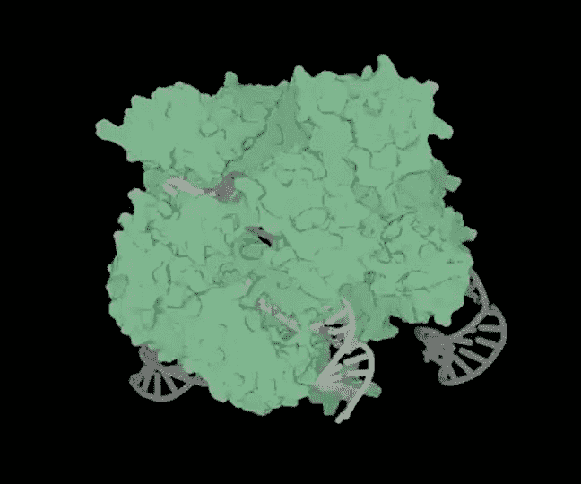

[ssstwitter.com_1713843959952.mp4](https://internal-api-drive-stream.feishu.cn/space/api/box/stream/download/all/XlzwbfYlzom9PIxkPTPcsciLnTh)

### Phi-3 7B发布就已超过Llama-3 8B，在MMLU上得分75.3,接近70B的SOTA模型

贡献人：

https://x.com/bindureddy/status/1782605677095231962

微软宣布推出 Phi-3

一个高能力的手机本地语言模型

我们推出了 phi-3-mini,这是一个在3.3万亿tokens上训练的38亿参数语言模型,根据学术基准测试和内部测试,其整体性能达到了...

---

Bindu Reddy：**小模型取得胜利!!** Phi-3 7B刚刚发布,轻松超过了Llama-3 8B。它在MMLU上得分75.3,接近70B的SOTA模型!! 我不会惊讶,如果我们在今年年底前得到一个7B的模型,性能超过GPT-4。大语言模型现在已经非常普遍和易于获取了!!

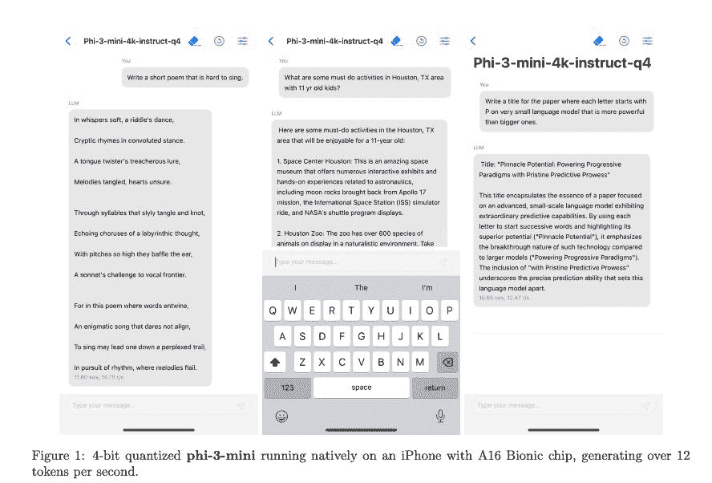

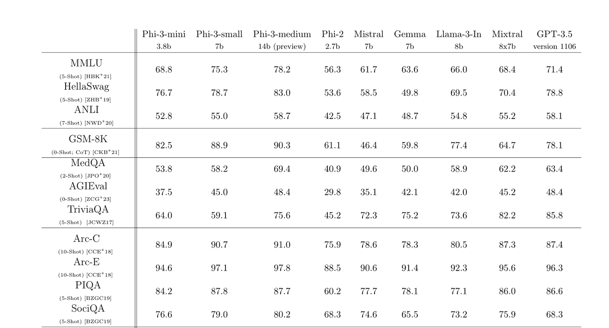

### Jerry Liu分享：如何构建一个通用的上下文增强研究助手

贡献人：

https://x.com/jerryjliu0/status/1782428884287578213

受到@AndrewYNg 过去几周关于智能体的讨论启发,我很高兴在@weights_biases 会议上分享我的演讲,概述了如何构建一个通用的上下文增强研究助手🧑🔬

简单的RAG(Retrieval-Augmented Generation)主要适用于单次设置中的简单问题。但构建一个研究智能体可以实现以下功能:

✅ 多跳问答

✅ 查询理解和任务规划

✅ 与广泛的外部工具交互的接口

✅ 反思以迭代纠正行为

✅ 用于个性化的记忆

我们从智能体的组成部分开始,然后组合成完整的智能体。下面提供了@llama_index 资源的完整指南👇

点击查看:https://docs.google.com/presentation/d/1IWjo8bhoatWccCfGLYw_QhUI4zfF-MujN3ORIDCBIbc/edit?usp=sharing

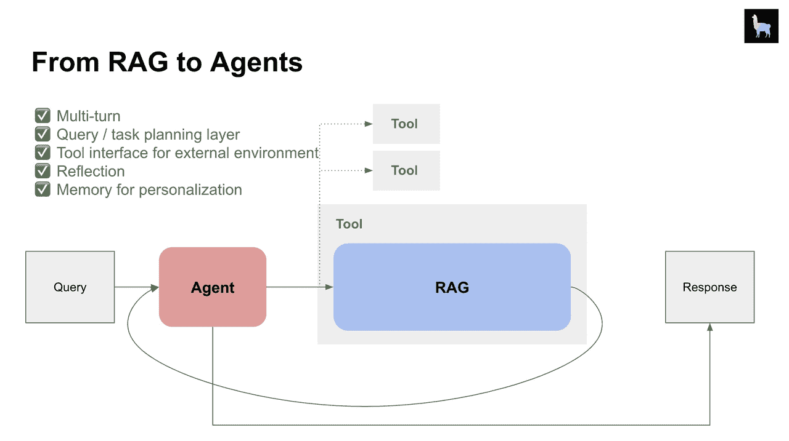

### Yao Fu：文本数据的规模化可能正在达到天花板，规模博弈的第一章聚焦于文本数据的规模化,在GPT-4达到顶峰,并以Llama 3作为结束

贡献人：

https://x.com/Francis_YAO_/status/1782454220722958457

文本数据的规模化可能正在达到天花板,因为大多数容易获取的网络文本(如Common Crawl、Github、Arxiv等)现在已经用尽了。 肯定还会有新的文本数据,比如从互联网上更努力地挖掘、扫描图书馆书籍以及合成数据。然而,再增加一个数量级是相当具有挑战性的——更有可能的是,它们只是在当前数量级内增量式的。 游戏的下一章从多模态开始,特别是统一的视频-语言生成模型,因为只有视频数据能给出数量级的增加。 然而,坏消息是,视频数据似乎不能提高模型的推理能力——回想一下,推理能力是标志强模型的首要关键能力。 但好消息是,视频数据可以提高其他一切,特别是与现实世界的连接,并表现出成为神经世界模型的强大潜力(而不是像塞尔达这样硬编码的物理引擎),这为从模拟物理反馈中学习提供了可能性。 扩大从X反馈中的强化学习似乎是继续提高模型推理能力的最有希望的方向,其中X指的是人类、人工智能和环境反馈。 就像AlphaGo Zero如何在围棋上达到超人表现一样,自我对弈和与环境互动可能是超人生成模型的一个方向。让模型在线并从反馈中迭代学习(而不是一次性离线优化)可能会导致推理能力的持续提高。 规模博弈的第一章聚焦于文本数据的规模化,在GPT-4达到顶峰,并以Llama 3作为结束。这场博弈的第二章将是统一的视频-语言生成建模和基于X反馈的迭代强化学习。

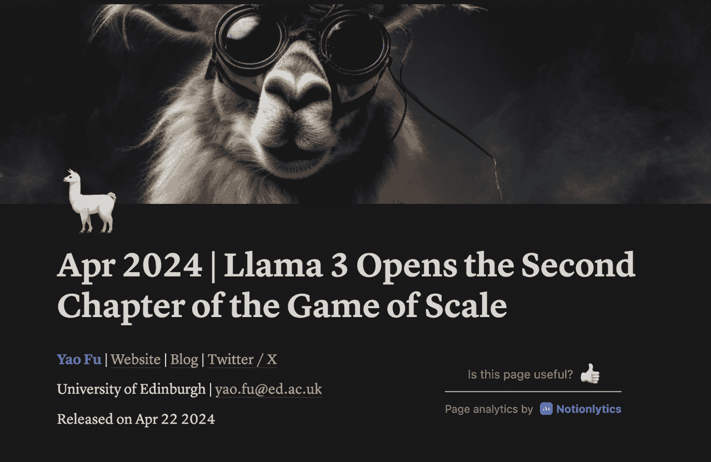

### Llama-3-8B-Web发布：为网页导航而构建的最强大的智能体

贡献人：

https://x.com/xhluca/status/1782536549948657775

很高兴发布 ✨Llama-3-8B-Web✨,这是为网页导航而构建的最强大的智能体,可以通过遵循指令和回复💬来实现。在 WebLINX 上,它超过了 GPT-4V* 18%,WebLINX 是一个用于对话式网页导航的基准测试。

模型:[http://huggingface.co/McGil](http://huggingface.co/McGill-NLP/Llama-3-8B-Web)l-NLP/Llama-3-8B-Web

代码:[http://github.com](http://github.com/McGill-NLP/webllama)/McGill-NLP/webllama

为了创建 Llama-3-8B-Web,我们在 WebLINX 训练集的 24K 网页交互上微调了 @AIatMeta 的 Llama-3-8B-Instruct(上周四发布),包括点击、输入、提交表单和回复。

该数据集涵盖了来自 15 个地理位置的 150 个网站。

### Haize Labs分享Llama3越狱版本

贡献人：

https://x.com/haizelabs/status/1782444336048951770

上周四,Meta 发布了 Llama 3,这是 OpenAI 的有力竞争对手。毫无疑问,这是一个非常令人印象深刻的模型!但是在周末,我们发现了一个针对 Llama 3 的极其简单的程序化越狱方法......抱歉,扎克伯格!所有那些安全调优代码似乎都白费了:

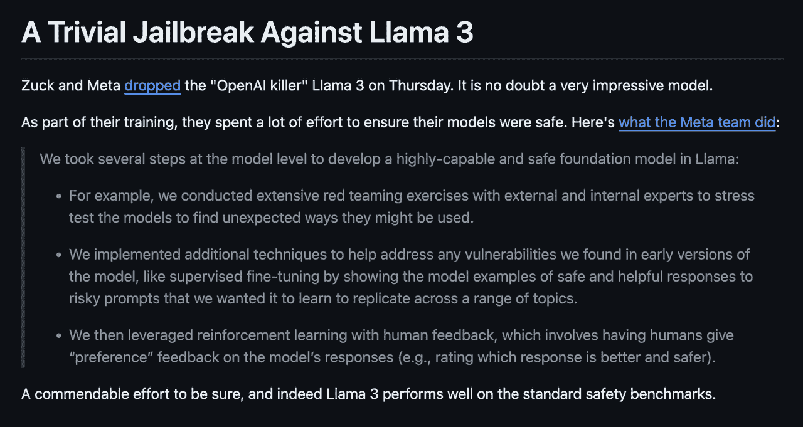

### Sooriyarachchi分享Seemore：从头开始实现一个视觉语言模型

贡献人：

https://x.com/aviTwit3/status/1782428761088037213

Avi Sooriyarachchi：我尝试从头开始在纯 PyTorch 中实现一个视觉语言模型。这个灵感来自于 @vikhyatk 的 moondream 2。我基本上修改了 @karpathy 的 makemore,并围绕它构建了其他一切。以下是我的详细介绍:

seemore:从头开始实现一个视觉语言模型

摘要:在这篇博客中,我使用纯 PyTorch 实现了一个视觉语言模型,包括图像编码器、多模态投影模块和解码器语言模型。可以将其视为 GPT-4 或 Claude 3 在语言模型展示的视觉能力方面的简化版本。"seemore"这个名字是我向 Andrej Karpathy 的"makemore"项目致敬的方式,因为这里我使用了一个字符级别的自回归语言模型,很像他的 nanoGPT/makemore 实现。我的目标是让你通过阅读这篇博客并在仓库中逐步了解代码,直观地理解它是如何工作的。

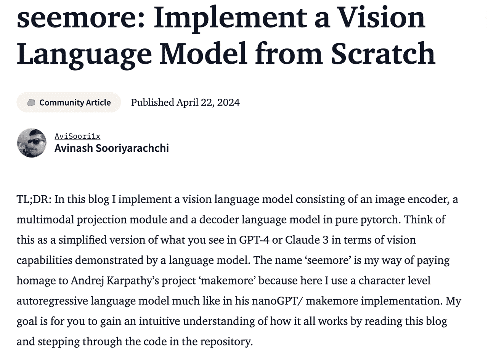

### Answerdotai分享：使用 FSDP QDoRA 高效微调 Llama 3，一种缩小参数有效微调与全微调之间差距的方法

贡献人：

https://x.com/jeremyphoward/status/1782575220051915175

今天在 @answerdotai 我们为您带来了新东西：FSDP/QDoRA。我们与 @AIatMeta 的 Llama3 进行了测试，其结果令人惊叹，超越了我们之前见过的任何东西。我相信这种组合很可能会创建出比任何成本下的其他模型都更优的任务特定模型。 🧵

我们撰写了关于我们的方法、结果，并提供了关键的底层研究思想如 DoRA 的背景，在一篇博客文章中，同时公开了源代码，让您可以复制并基于我们的结果进行扩展：

answer.ai

Answer.AI - 使用 FSDP QDoRA 高效微调 Llama 3

我们正在发布 FSDP QDoRA，一种缩小参数有效微调与全微调之间差距的方法。

当 @ericries 和我创立 http://Answer.AI 时，我们从两个趋势开始研究论文：

+   模型大小的戏剧性增加

+   使用“持续预训练”的微调机会大大增加

我在 @latentspacepod 上讨论了这个问题：

我们的预期在 Llama 3 模型的发布中得到了实现。最大的模型将拥有超过 400b 参数，并且已经在匹配最佳商业 LLMs。Llama3 正在以前所未有的规模持续预训练模型。

FSDP/QDoRA 在内存效率和可扩展性方面与 FSDP/QLoRA 一样好，关键是在持续预训练中的准确性也与全权重训练一样。

如果你还没有阅读 DoRA 论文，现在是个好时机！（这是一篇清晰且写得很好的论文。）

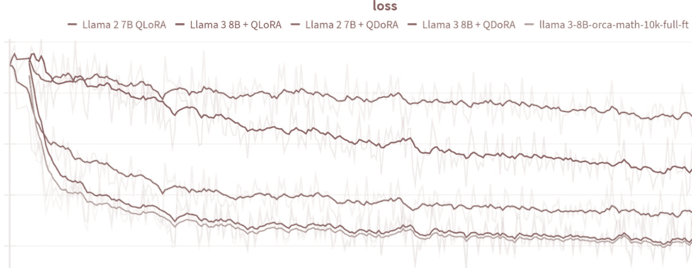

# 资讯

### 对话蚂蚁李建国：当前AI写代码相当于L2.5，实现L3后替代50%人类编程

贡献人：

https://mp.weixin.qq.com/s/XAnMM8crpyjiCtg0UwqRzw

蚂蚁集团**代码大**模**型CodeF**use()负责人李建国说道。当下，AI代码生成领域正在野蛮式生长，巨头涌入，AI员工频频上线企业；首个AI程序员Devin被曝造假…… 面对风起云涌的代码生成变革，李建国给出了这样一个明确论断。李建国是谁？清华大学博士，机器学习、深度学习深耕十余年，论文被引万余次。在他的带领下，蚂蚁内部正全面推行AI编程。每周已有超五成程序员使用CodeFuse，目前CodeFuse生成代码整体采纳率为30%，已经属于整个AI编程工具中能力第一梯队，最强Copilot()代码整体采纳率差不多在35%。

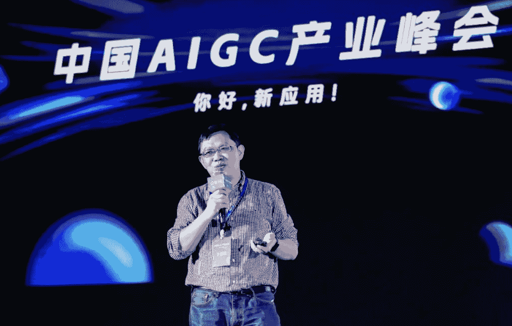

### 微软推出iPhone能跑的ChatGPT级模型，网友：OpenAI得把GPT-3.5淘汰了

贡献人：

https://mp.weixin.qq.com/s/F9K0A_f4CFgfFyY3bf4F8g

**Llama 3发布刚**几天，微软就出手**截胡了？刚刚发布的Phi-**3系列小模型技术报告，引起AI圈热议。**其中仅3.8B参数的Phi**-3-mini在多项基准测试中超过了Llama 3 8B。为了**方便开源社区使**用，还特意设计成了与Llama系列兼容的结构。微软这次打出“手机就能直接跑的小模型”的旗号，4bit量化后的phi-3-mini在iPhone 14 pro()和iPhone 15使用的苹果A16芯片上跑到每秒12 token。这意味着，现在手机上能本地运行的最佳开源模型，已经做到ChatGPT水平。

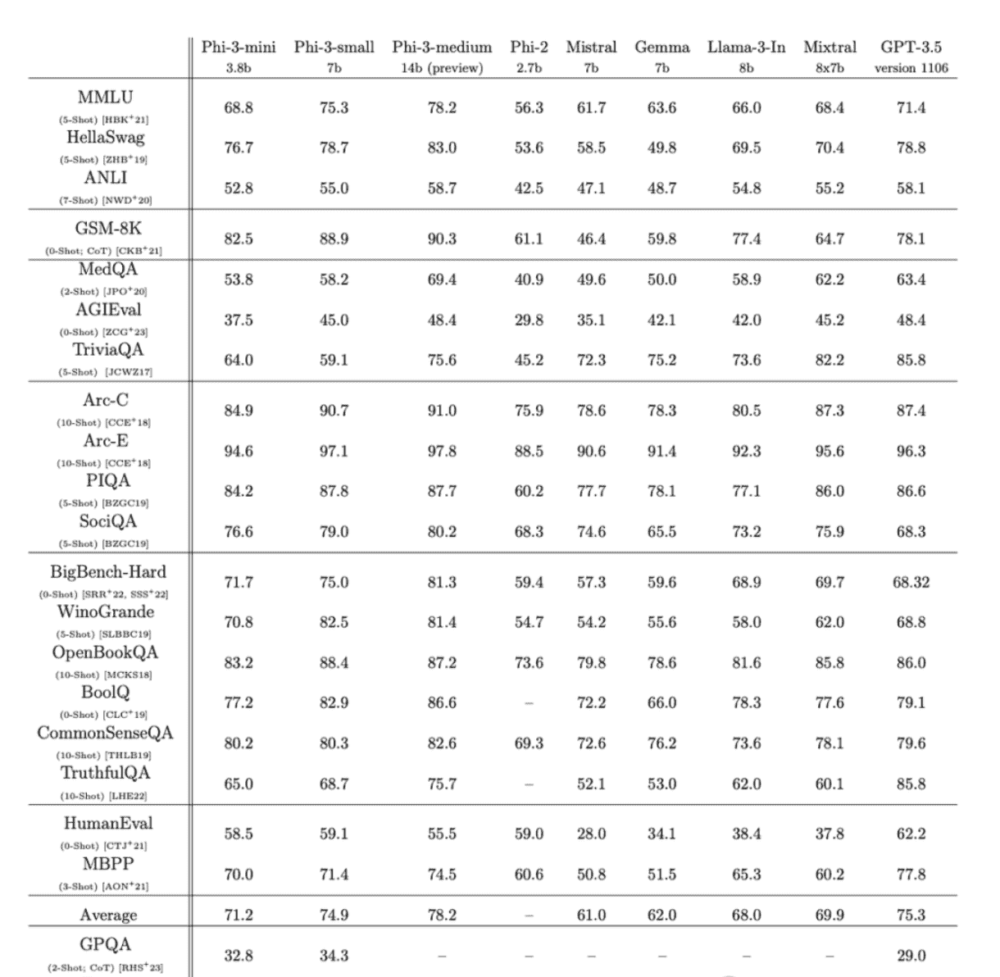

### 大模型一对一战斗75万轮，GPT-4夺冠，Llama 3位列第五

贡献人：

https://mp.weixin.qq.com/s/ulo0CiwMvmnE90JsmjJhlg

关于Llama 3，又有测试结果新鲜出炉——大模型评测社区LMSYS发布了一份大模型排行榜单，Llama 3位列第五，英文单项与GPT-4并列第一。不同于其他Benchmark，这份榜单的依据是模型一对一battle，由全网测评者自行命题并打分。最终，Llama 3取得了榜单中的第五名，排在前面的是GPT-4的三个不同版本，以及Claude 3超大杯Opus。而在英文单项榜单中，Llama 3反超了Claude，与GPT-4打成了平手。对于这一结果，Meta的首席科学家LeCun()十分高兴，转发了推文并留下了一个“Nice”。

### 月之暗面回应创始人杨植麟套现数千万美元：消息不实

贡献人：

https://finance.sina.com.cn/stock/vcpe/rzdt/2024-04-23/doc-inasuzea9652553.shtml

针对上一轮融资完成后，月之暗面（Moonshot AI）创始人杨植麟通过售出个人持股已套现数千万美金的消息，月之暗面回应称：上述消息不实，月之暗面此前已公布员工激励计划，可见官方信息。

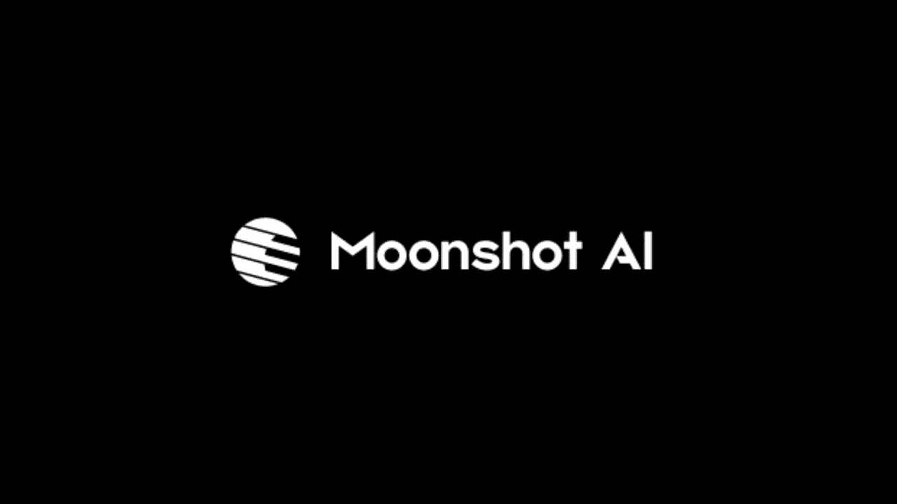

### Meta向硬件厂商开放VR/AR操作系统授权，联想、华硕加盟

贡献人：

https://new.qq.com/rain/a/20240423A01CK300

Facebook母公司Meta周一宣布，将向第三方硬件厂商开放VR/AR操作系统Meta Horizon OS。包括联想、微软和华硕等公司，将成为首批采用该操作系统开发硬件的厂商。此举意味着Meta不再仅仅局限于自主开发和销售Quest 3和Quest Pro等头显硬件设备，而是要效仿微软把Windows操作系统授权给第三方PC制造商一样，为整个VR/AR行业提供软件支持。同时，它还界定了虚拟现实硬件市场的断层线。今年年初，苹果发布了售价达3500美元的混合现实头显Vision Pro。

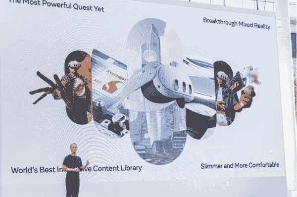

### 全国首例 AI 声音侵权案一审宣判，原告配音师获赔 25 万元

贡献人：

https://www.ithome.com/0/763/589.htm

北京互联网法院今天上午对全国首例“AI 声音侵权案”**进行一审宣判，认定作为配音师的**原告，其声音权益及于案涉 AI 声音，被告方使用原告声音、开发案涉 AI 文本转语音产品未获得合法授权，构成侵权，书面赔礼道歉，并赔偿原告各项损失 25 万元。

### 苹果收购初创公司Datakalab以增强iPhone AI功能

贡献人：

https://tech.huanqiu.com/article/4HVJr8W1oTi

近日，苹果公司再次扩大了其在人工智能领域的布局，收购了一家名为Datakalab的法国初创公司。据法国商业杂志《Challenges》报道，这笔收购于2023年12月完成，进一步印证了苹果在AI技术方面的雄心壮志。Datakalab是一家专注于“算法压缩和嵌入式人工智能”的初创企业，这与苹果公司一贯推崇的在设备端运行AI的理念高度契合。苹果此次收购显然是为了增强其iPhone等设备的AI功能，以提供更加高效、安全的用户体验。

### AI可以改写人类基因组吗？首次由AI从头设计的基因编辑器成功编辑人类细胞中DNA

贡献人：

https://mp.weixin.qq.com/s/V63gvtgsek15J0sjMQiowg

生成式 AI 可以对话、写诗、画图、做视频、作曲、写代码......那么，AI 可以改写人类基因组吗？现在，新的 AI 技术正在为可编辑 DNA 的微观生物机制绘制蓝图，这预示着未来科学家将以更高的精度和速度对抗疾病。近日，美国 AI 蛋白质设计初创公司 Profluence 推出了 OpenCRISPRTM 计划，发布了世界上第一个开源的 AI 生成的基因编辑器。Profluence 展示了通过 AI 从头开始设计的可定制基因编辑器，对人类基因组的首次成功精确编辑。该技术基于驱动 ChatGPT的相同方法。正如 ChatGPT 通过分析维基百科文章、书籍和聊天记录来学习生成语言一样，Profluent 的技术在分析大量生物数据，包括科学家已经用来编辑人类 DNA 的微观机制，然后创建了新的基因编辑器。

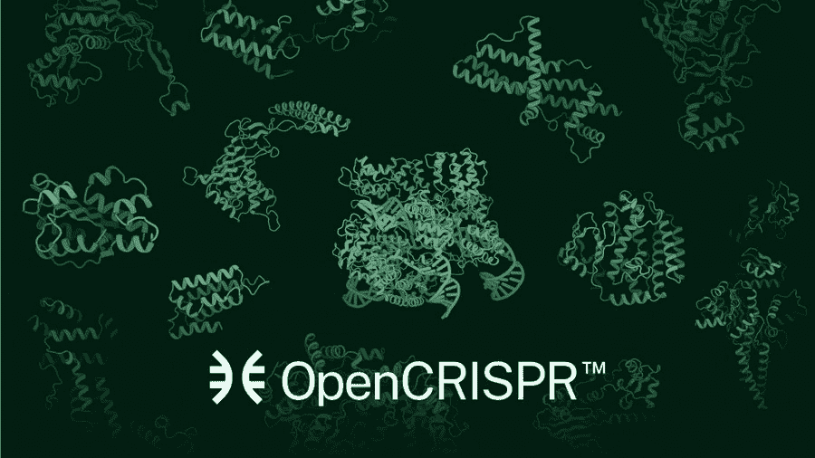

# 论文

### Phi-3 技术报告：在您的手机上本地运行一个高度可靠的语言模型

贡献人：

链接：http://arxiv.org/abs/2404.14219v1

我们介绍了 phi-3-mini，这是一个在 3.3 万亿个 token 上训练的 38 亿参数的语言模型，其整体性能在学术基准和内部测试中的表现可与 Mixtral 8x7B 和 GPT-3.5 等模型媲美（例如，在 MMLU 上达到 69%，在 MT-bench 上达到 8.38），尽管足够小可以在手机上部署。创新完全在于我们用于训练的数据集，这是 phi-2 使用的数据集的扩展版本，由经过滤的网络数据和合成数据组成。该模型还进一步针对鲁棒性、安全性和聊天格式进行了调整。我们还提供了一些关于参数缩放的初步结果，使用了分别训练 4.8T 个 token 的 7B 和 14B 模型，称为 phi-3-small 和 phi-3-medium，它们比 phi-3-mini 显著更强大（例如在 MMLU 上分别达到 75% 和 78%，在 MT-bench 上分别达到 8.7 和 8.9）。

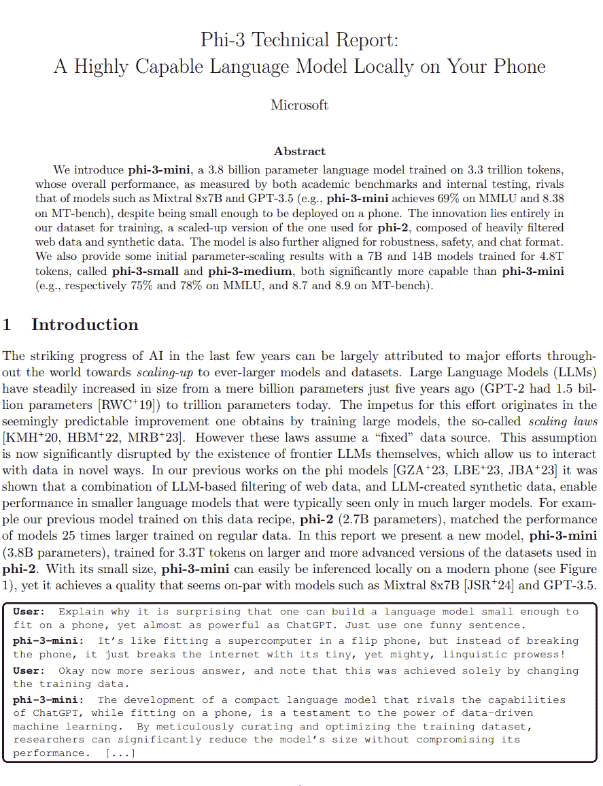

### **大语言模型自我演进综述**

贡献人：

链接：http://arxiv.org/abs/2404.14387v1

大型语言模型（LLMs）在各个领域和智能体应用中取得了显著进展。然而，目前从人类或外部模型监督中学习的LLMs成本高昂，并随着任务复杂性和多样性的增加可能面临性能上限。为解决这一问题，自我演化方法使LLM能够自主获取、精炼并从模型自身生成的经验中学习，迅速发展。这种新的训练范式受人类经验性学习过程启发，有望将LLMs推向超级智能。在这项工作中，我们对LLMs中自我演化方法进行了全面调查。首先提出了自我演化的概念框架，并将演化过程概述为由四个阶段组成的迭代循环：经验获取、经验精炼、更新和评估。其次，我们对LLMs和基于LLMs的智能体的演化目标进行了分类；然后，总结文献并为每个模块提供分类法和见解。最后，我们指出了现有挑战并提出了未来的改进方向，为研究人员提供了关键的见解，以加快自我演化LLMs的发展。

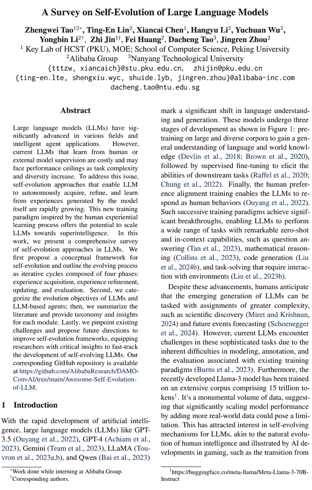

### 通过检索和转换现有数据集实现更好的合成数据

贡献人：

链接：http://arxiv.org/abs/2404.14361v1

尽管近年来大型语言模型取得了进展，构建可靠且可部署的自然语言处理模型通常需要丰富的高质量训练数据。然而，许多用例并没有特定任务的数据，且手动筛选任务特定数据很费时。最近的研究探讨了使用大型语言模型进行提示驱动合成数据生成，但这些生成的数据集往往缺乏复杂性和多样性。为解决这些限制，我们引入了一种方法 DataTune，以更好地利用现有的公开数据集来改善自动数据集生成。DataTune 进行数据集转换，使公开数据集能够直接与目标任务的特定要求对齐。在 BIG-Bench 基准测试的多个语言任务中，我们发现通过 DataTune 对语言模型进行微调，比少量提示基线改进了 49％，比使用合成或检索到训练数据的现有方法改进了 34％。我们发现数据集转换显著增加了许多任务中生成数据的多样性和难度。我们将 DataTune 集成到开源存储库中，使该方法可供社区使用：https://github.com/neulab/prompt2model.

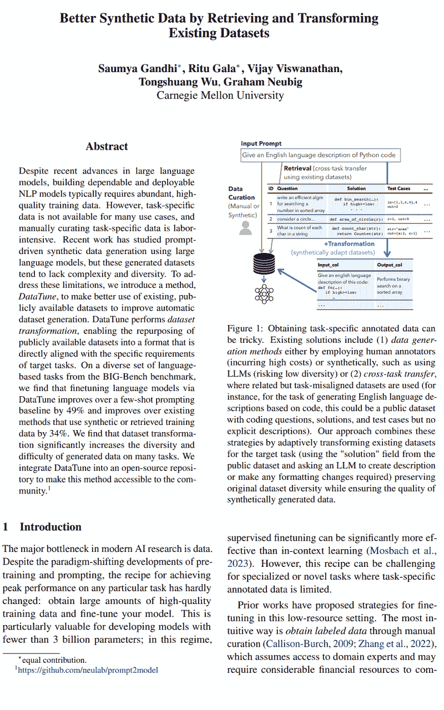

### **大型多模态模型的图形设计**

贡献人：

链接：http://arxiv.org/abs/2404.14368v1

在图形设计领域，将设计元素自动整合成一体化的多层艺术作品，不仅提高了生产力，还为图形设计的民主化铺平了道路。一种现有的做法是图形布局生成（GLG），旨在布局连续的设计元素。然而，它受到了必须预先定义正确层序的限制，从而限制了创作潜力并增加了用户的工作量。本文提出了分层布局生成（HLG）作为更灵活和实用的设置，从无序的设计元素集中创建图形构图。为了解决HLG任务，我们引入了Graphist，这是基于大型多模型的第一个布局生成模型。Graphist高效地将HLG重新构建为序列生成问题，利用RGB-A图像作为输入，输出一个JSON草案协议，指示每个元素的坐标、大小和顺序。我们为HLG开发了新的评估指标。Graphist胜过以往的方法，并为这一领域建立了强有力的基线。项目主页：https://github.com/graphic-design-ai/graphist

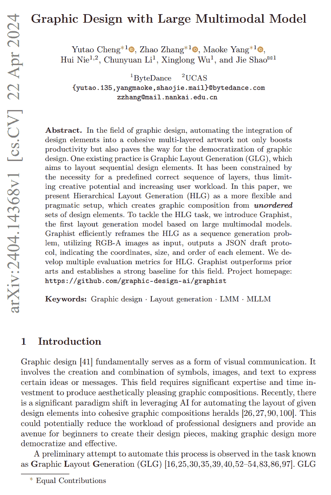

### **大语言模型高效推理综述**

贡献人：

链接：http://arxiv.org/abs/2404.14294v1

大型语言模型(LLMs)由于在各种任务中的出色表现而受到广泛关注。然而，LLM推断的巨大计算和存储需求给在资源受限场景中部署带来挑战。本文对现有文献中关于高效LLM推断的技术进行了全面调查。我们从分析无效LLM推断的主要原因开始，即大型模型大小、二次复杂度的注意力操作和自回归解码方法。然后，我们介绍了一个将当前文献组织为数据级、模型级和系统级优化的全面分类法。此外，本文包括对关键子领域代表性方法的比较实验，以提供定量洞见。最后，我们提供了一些知识总结并讨论未来的研究方向。

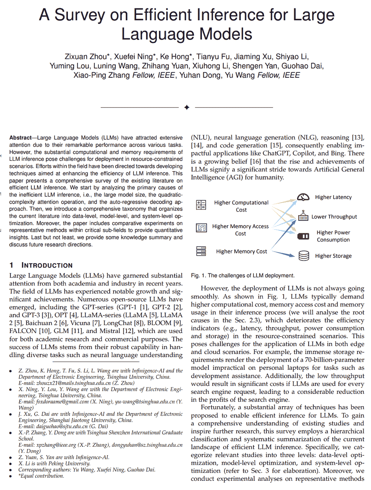

### **MARIO评估：使用您的数学LLM评估您**的数学LLM——一个数学数据集评估工具包

贡献人：

链接：http://arxiv.org/abs/2404.13925v1

大语言模型（LLMs）已经在各种推理任务中进行了探索，包括解决数学问题。每个数学数据集通常包括自己专门设计的评估脚本，虽然适用于其预期用途，但在不同数据集之间缺乏泛化能力。因此，对这些评估工具的更新和调整往往发生在没有系统报告的情况下，导致研究之间存在不一致性和障碍。为了弥补这一差距，我们引入了一个全面的数学评估工具包，不仅利用Python计算机代数系统（CAS）进行数值精度，还整合了一个可选的LLM，以其出色的自然语言处理能力而闻名。为了验证我们工具包的有效性，我们手动注释了两个不同的数据集。我们的实验表明，即使没有LLM，该工具包也能产生比之前更稳健的评估结果。此外，当LLM被整合进来时，有显著的提升。我们的方法代码将在https://github.com/MARIO-Math-Reasoning/math_evaluation 上提供。

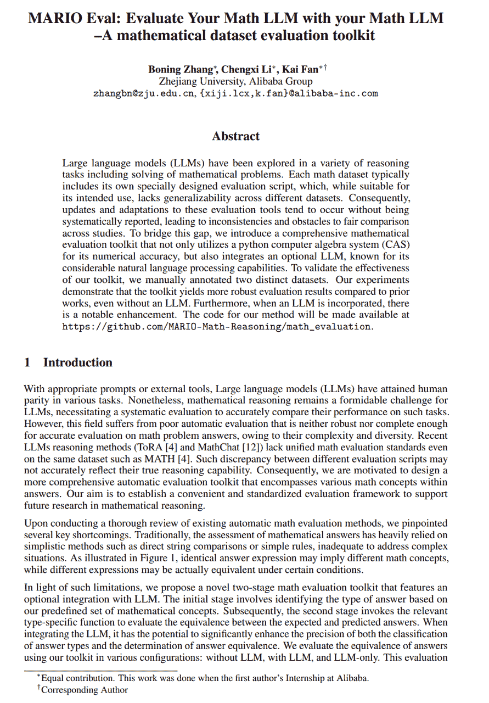

### 大语言模型评估者识别并偏爱自己的生成

贡献人：

链接：http://arxiv.org/abs/2404.13076v1

使用大语言模型（LLMs）进行自我评估不仅在基准测试中证明了其价值，而且在方法如奖励建模、宪法AI和自我完善中也很有用。然而，由于同一个LLM同时充当评估者和被评估者，会引入新的偏见。其中一种偏见是自我偏好，即LLM评估者给自己的输出打分高于其他人，而人类标注员认为它们的质量相同。但当LLMs给这些文本打分较高时，它们是否真正识别出自己的输出，还是巧合？本文将探讨自我识别能力是否会导致自我偏好。我们发现，像GPT-4和Llama 2这样的LLMs在区分自己和其他LLMs以及人类方面具有非常高的准确性。通过对LLMs进行微调，我们发现自我识别能力与自我偏好偏见的强度之间存在线性相关性；通过控制实验，我们展示了因果解释抵制了直接混淆因素。我们讨论了自我识别如何干扰无偏评估和AI安全的更一般问题。

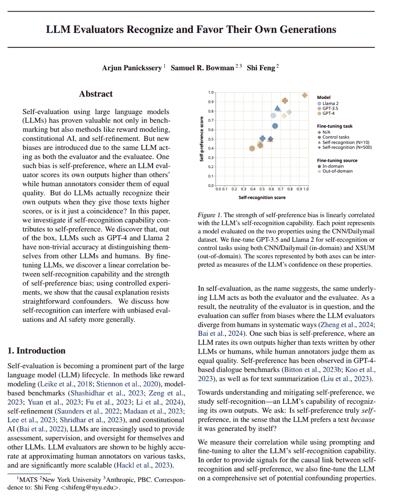

### 朝向LLM中可靠的潜在知识估计：上下文学习 vs. 提示式事实知识提取

贡献人：

链接：http://arxiv.org/abs/2404.12957v1

我们提出了一种估计嵌入在大型语言模型（LLMs）中的潜在知识的方法。我们利用LLMs的上下文学习（ICL）能力来估计LLMs了解存储在知识库中的事实的程度。我们的知识估计器避免了以往基于提示的方法存在的可靠性问题，而且在概念上更简单易懂，更容易应用，并且我们证明它可以更多地展现LLMs中嵌入的潜在知识。我们还研究了不同设计选择如何影响基于ICL的知识估计的性能。使用提出的估计器，我们对各种开源LLMs（如OPT、Pythia、Llama(2)、Mistral、Gemma等）的实际知识进行了大规模评估，涵盖了来自Wikidata知识库的大量关系和事实。我们观察到不同模型系列和不同大小模型之间的实际知识差异，一些关系比其他关系更广为人知，但模型在它们了解的具体事实方面存在差异，并且基本模型与微调模型之间的知识差异。

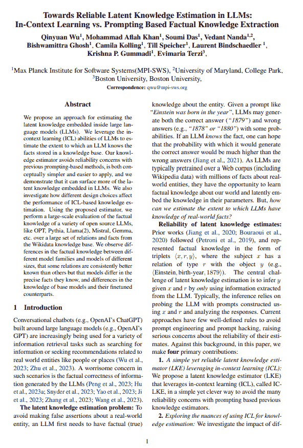

# 产品

### Tabnine

贡献人：

https://www.tabnine.com/

Tabnine 是一款 AI 编码助手，可以帮助开发团队加快和简化软件开发过程，而不会牺牲隐私、安全性或合规性。它已经被超过 100 万开发人员在各行各业广泛使用，用于生成代码、编写单元测试、创建文档、解释旧代码、修复代码等。最近， Tabnine 推出了一些新功能，包括高度个性化的人工智能软件推荐、可切换的 Tabnine Chat 的人工智能模型以及用于 Tabnine Chat 的入职代理。

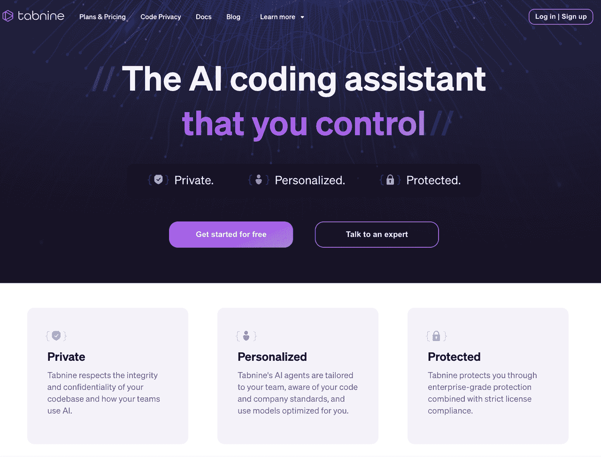

### Chatbotarena

贡献人：

https://chatbotarena.com/

Chatbot Arena 在努力搭建用户寻找适合 AI 聊天机器人构建工具的平台。它提供对比功能、流行程度和流量统计等功能，并计划在未来添加更多聊天机器人、搜索和筛选功能以及更多的统计数据和功能细节。

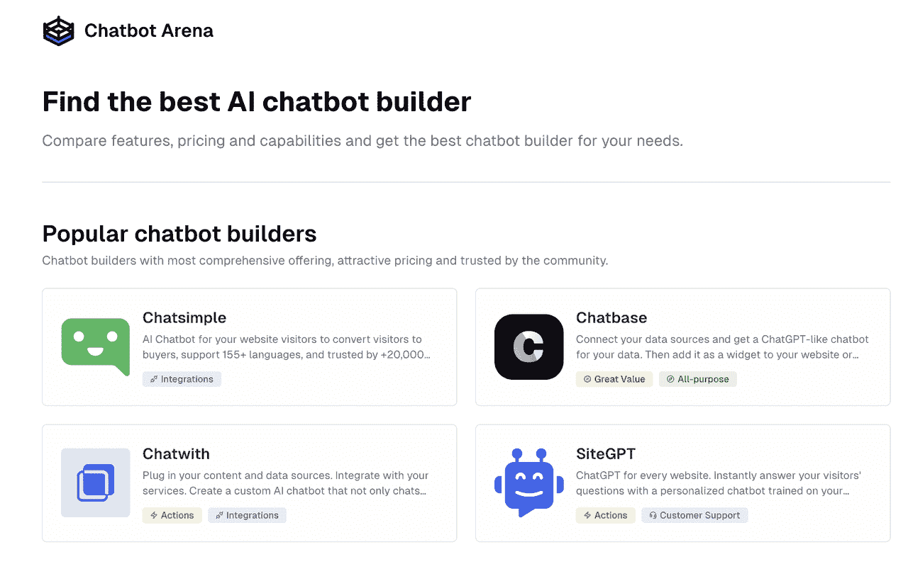

# HuggingFace&Github

### Time-LLM

贡献人：

https://github.com/KimMeen/Time-LLM

TIME-LLM 旨在将大型语言模型重新用于时间序列预测，同时保持基础语言模型的完整性。它通过文本原型对输入时间序列进行重新编程，并提出了Prompt-as-Prefix方法来丰富输入时间序列，以增强LLM对时间序列数据的推理能力。该框架在主流预测任务中表现出卓越性能，特别是在少样本和零样本场景中，并释放了LLM在时间序列和其他顺序数据方面的潜力。

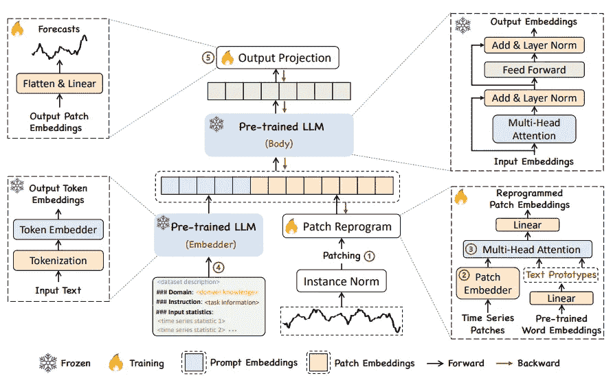

### **cognee**

贡献人：

https://github.com/topoteretes/cognee

Cognee 是一个用于创建自我改进确定性输出的开源框架，它使用图形 LLMs 和向量检索，适用于 AI 工程师，可以帮助用户完成上下文清理、元数据索引、数据准备、知识提取和数据丰富化。

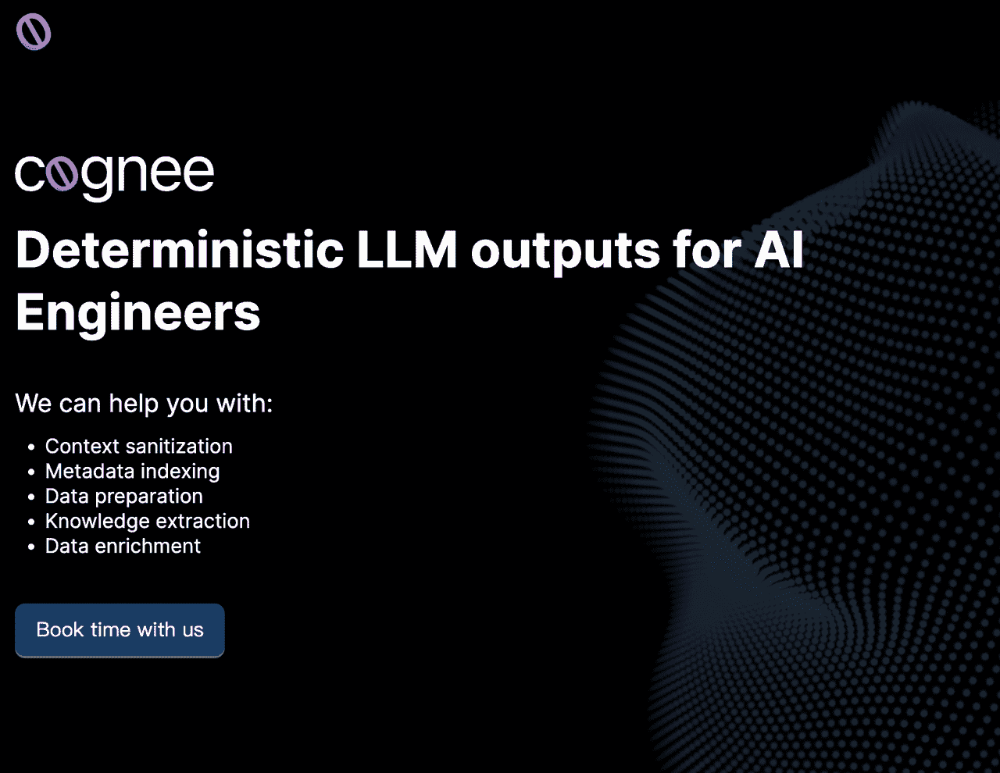

### **BricksLLM**

贡献人：

https://github.com/bricks-cloud/BricksLLM

BricksLLM 是一个用 Go 编写的云原生 AI 网关，旨在为 OpenAI、Anthropic、Azure OpenAI 和 vLLM 提供支持，并提供企业级基础设施，以支持各种 LLM 生产用例。它还提供了一些用例，如为不同定价层上的用户设置 LLM 使用限制，跟踪每个用户和每个组织的 LLM 使用情况，阻止或编辑包含 PII 的请求，通过故障转移、重试和缓存提高 LLM可靠性，以及为内部开发/生产用例。

# 投融资

### 人工智能存在能源问题，Exowatt计划解决此问题

贡献人：

https://www.maginative.com/article/ai-has-an-energy-problem-exowatt-plans-to-solve-it/

迈阿密的公司Exowatt，由Hannan Parvizian和Jack Abraham创立，推出了一种全新的模块化能源平台，旨在为数据中心等能源密集型应用提供可靠、经济、可持续的电力。Exowatt在公开其20万美元种子轮融资的同时，吸引了包括Sam Altman、Andreessen Horowitz（a16z）和Atomic等知名投资者的关注。该公司的旗舰产品Exowatt P3，是一种集热收集器、热电池和热发动机于一体的模块系统，能在24小时内存储太阳能。此举不仅有助于Exowatt从通胀减免法案中受益，还为其计划在今年晚些时候开始部署超过500兆瓦的数据中心项目奠定了基础。

公司官网：https://www.exowatt.com/

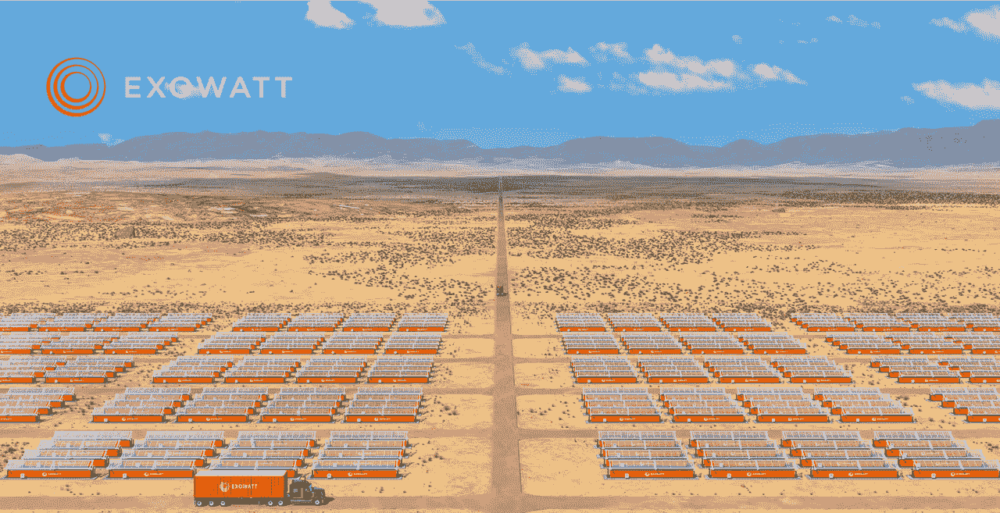

### 核心团队来自清华，「加速进化」完成新一轮融资

贡献人：

https://news.pedaily.cn/202404/532856.shtml

人形机器人研发商「加速进化」，核心团队背景强大，成员大多来自清华大学，近日完成了一轮新的融资。本轮融资由水木创投、盈港资本和源码资本联合完成。加速进化专注于开发具有高度行动能力的人形机器人及其控制平台，致力于推动具身智能技术的应用和普及。此次融资将支持公司进一步的技术开发和市场扩展。

### 长城汽车支持的自动驾驶初创公司毫末获得3亿人民币新融资

贡献人；

https://cnevpost.com/2024/04/23/haomo-secures-rmb-300-million-new-funding/

由长城汽车支持的自动驾驶初创公司毫末.AI技术完成了3亿人民币的B2轮融资，资金由现有投资者JZ资本和浙江省湖州市长兴政府新设立的基金提供。这一轮资金将用于研发，以维持其在中国量产自动驾驶解决方案中的领先地位。此轮融资紧随其两个月前超过1亿人民币的B1轮融资之后，显示出中国自动驾驶领域在宏观经济挑战中稀缺的大额融资活动。

公司官网：https://haomo.ai/

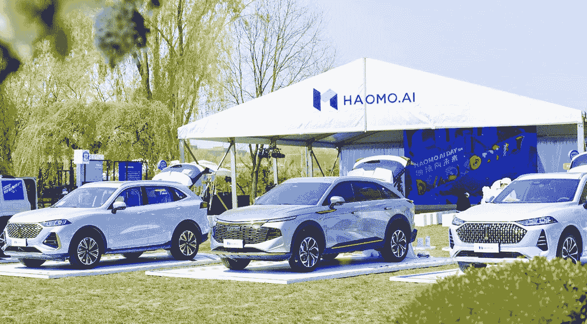

### 苹果继续AI推动：收购专注于AI计算机视觉技术的法国初创公司Datakalab

贡献人：

https://www.businesstoday.in/technology/news/story/apples-ai-push-continue-acquires-french-startup-datakalab-specialising-in-ai-computer-vision-tech-says-report-426482-2024-04-23

苹果公司继续加强其人工智能能力，最近收购了位于法国巴黎的初创公司Datakalab。Datakalab专注于人工智能压缩和尖端计算机视觉技术，此次收购强化了苹果在AI领域的布局。尽管具体交易详情尚未正式公开，但据报道，这一交易已经在本月引起了欧盟委员会的关注。Datakalab拥有在公共场所测量流量的复杂计算机图像分析算法，此项技术现将助力苹果未来在iOS 18中推出的高级AI功能。

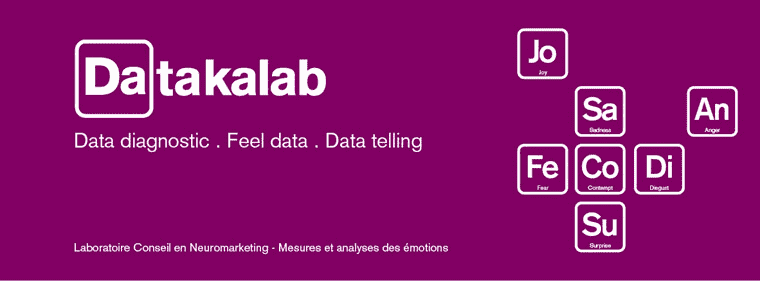

# 信号

### Phi-3

贡献人：

3.8T 数据的 3.8B 模型，其实标志了 textbook data 的合成数据路径的失败：知识很丰富但是复杂度不够。

### 多模态模型可能会在digital world率先展开应用

贡献人：

Google introduces ScreenAI: https://twitter.com/hey_madni/status/1781718226923290767

Microsoft windows copilot也在持续升级: https://twitter.com/itsPaulAi/status/1782077973837008909

### CMU Triforce：长序列生成的无损加速

贡献人：

https://arxiv.org/pdf/2404.11912.pdf

先前的工作（如H2O）通过压缩KV Cache，数十倍提升了推理速度，对于长序列生成而言会带来精度损失

Triforce通过KV Cache稀疏化 + 分层随机采样的方式，缓解长序列推理的访存瓶颈

在Llama2-7B-128K上达到了A100 GPU上的2.31倍，在基于RTX 4090 GPU的卸载设置上实现了0.108秒/token的推理速度，在单个RTX 4090 GPU上的性能比DeepSpeed-Zero-Inference快了4.86倍，且具备处理更长上下文的可伸缩性

### 从**NTU** **VBench新评测发布看I2V**

贡献人：

[h](https://github.com/Vchitect/VBench?tab=readme-ov-file)ttps://github.com/Vchitect/VBench?tab=readme-ov-file

V[Bench发布了专用于I2V模](https://github.com/Doubiiu/DynamiCrafter)型评测的Benchmark，榜单前列的模型包括：腾讯AI Lab单瀛老师团队的Dynamic Crafter，阿里通义XR Lab薄列峰老师团队的Anymate Anything，港中文MMLab和商汤的SVD-XT

从榜单得分来看：1）时序连贯性（Video- Image Subject Consistency、Video-Image Background Consistency）都在95+%，总体略高于T2V；2）视频动态程度（Dynamic Degree）总体略低于T2V；3）单帧质量（Aesthetic Quality、Imaging Quality）在60-70%之间，总体略高于T2V；4）Video-Text Camera Motion仅30%左右，从视频中提取文本信息并跟踪相机运动的能力有待提升

### FineWeb: Good Data Is All You Need

贡献人：

https://twitter.com/gui_penedo

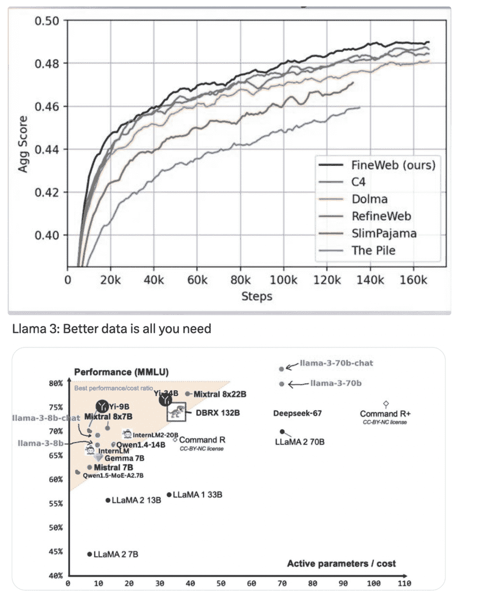

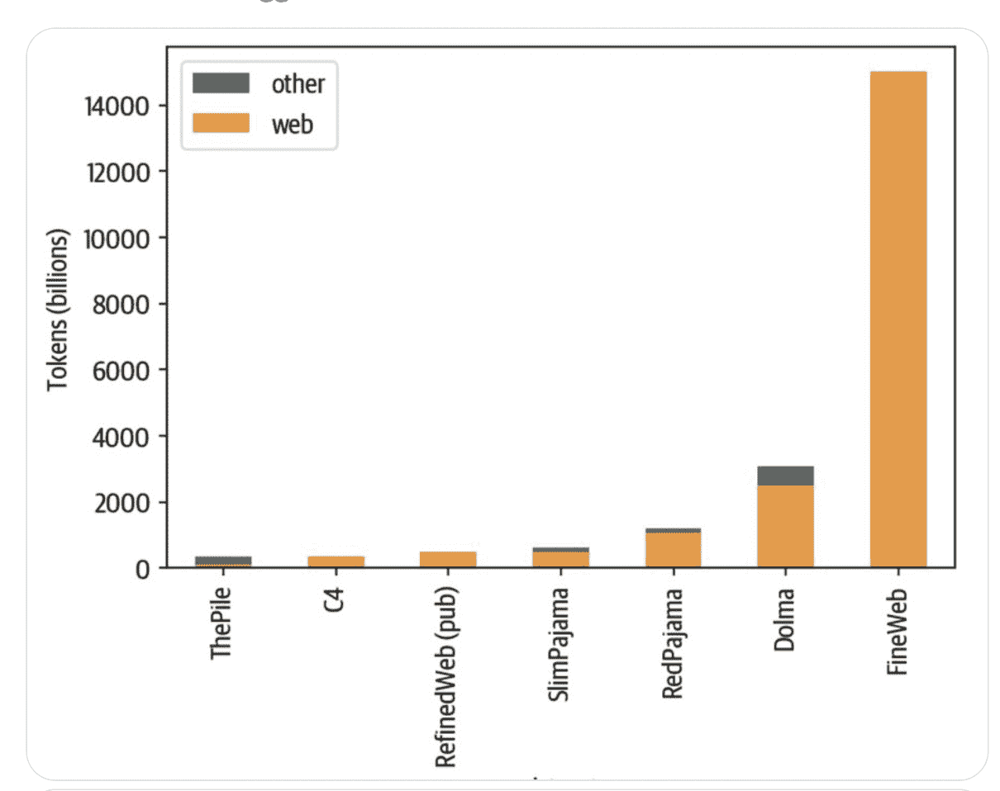

信号源：Twitter

Fi**new****eb 是一个包含经过****过滤和去重 Co**mmonCrawl （201**3-2024年）的去**重英文网络数据集，量级与Llama 3相当，包含15T tokens已清理和去重的英文网络数据，在基准任务中优于 C4（3.65亿个域的超过1560亿个token，Google T5）、Dolma-v1.6（3万亿token，Allen AI）、The Pile（EleutherAl） 和SlimPajama （6270亿token，Cerebras）等其他数据集。完整数据集在 ODC-By 1.0 许可下发布  ，代码&处理配置已开源，可以复现，未来持续发布改进版本

### **ALOHA Unleashed**

贡献人：

https://tonyzhaozh.github.io/aloha/

信号源：斯坦福 Mobile Aloha 团队，Tony Z. Zhao、 Chelsea Finn；Google DeepMind

该项目意在实现更复杂任务的车队规模数据收集，从厨房技能，延展到开始着手打结鞋带，挂衬衫，甚至修理其他机器人等复杂任务——允许抓取较小的物体，具有更宽视野的更小实感摄像头，完全自主操作，具备一定的未训数据泛化能力。

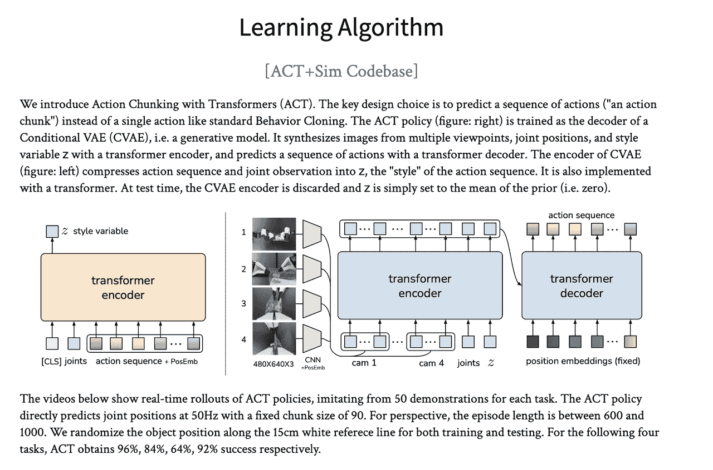

### 哈佛收到日本公司NTT资助，开展"physics of intelligence"项目

https://news.harvard.edu/gazette/story/newsplus/gift-establishes-new-program-in-physics-of-intelligence-at-center-for-brain-science/

这个项目或许会诞生出一些有趣的进展，物理应与智能不可分割

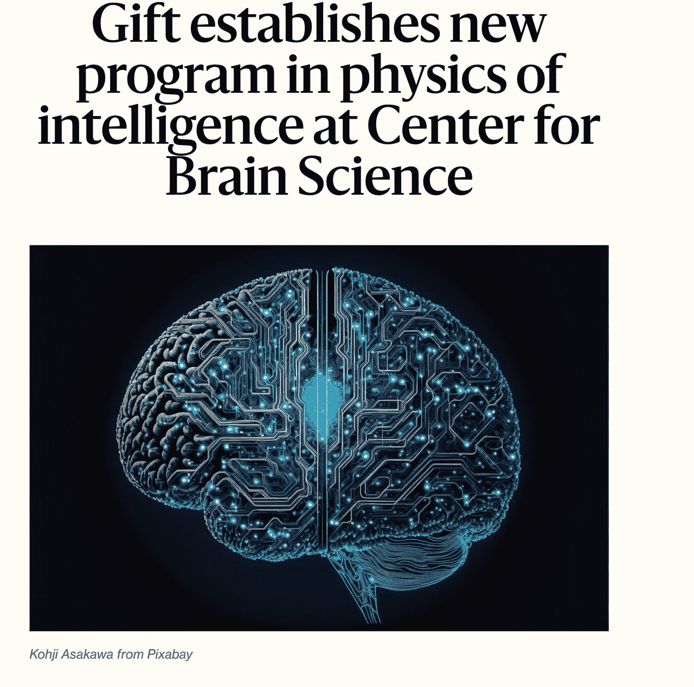

# 学习

### 再探LLM-MCTS

贡献人：

https://zhuanlan.zhihu.com/p/693374530

文章深入探讨了LLM结合MCTS（蒙特卡洛树搜索）技术的效率和实际应用问题。通过使用改进的节点建模（如句子级、选项级）和重要性加权扩展技术，有效提高了树搜索的探索效率和路径多样性。同时，利用前缀路径打分、未来期望打分等策略，减少了无效搜索，并增强了路径决策的准确性。此外，结合DPO（直接偏好优化）和预训练的Q函数或V函数，可以在不进行完整rollout的情况下，直接采样决策，极大提升了树搜索的性能和效率。文章还讨论了如何通过树搜索改进policy的训练方法和可能的问题。

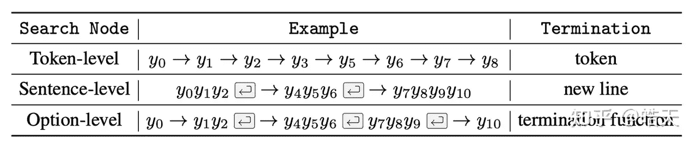

### 对齐开放语言模型

贡献人：

https://docs.google.com/presentation/d/1quMyI4BAx4rvcDfk8jjv063bmHg4RxZd9mhQloXpMn0/edit#slide=id.g2ca00c5c0f9_0_0

Nathan Lambert 在 Stanford CS25:Transformers United V4 中发表了一份关于对齐开放语言模型的演示文稿。该演示文稿首先介绍了 Nathan Lambert 的联系方式和个人博客 www.interconnects.ai，然后介绍了当前对齐研究的进展，包括 AI2、Hugging Face、Berkeley-Nest/Nexusflow、Nous Research、OpenBMB、Argilla 等组织在对齐方面的研究。接下来，演示文稿介绍了 Nathan Lambert 在个人博客上涉及的主题，包括数据、DPO、模型规模、评估、个性化等。最后，演示文稿总结了对齐研究的未来发展方向，包括更多数据、继续改进 DPO、更多模型规模、更具体的评估、个性化等。

hf链接：https://huggingface.co/collections/natolambert/lecture-artifacts-aligning-open-language-models-66197653411171cc9ec8e425

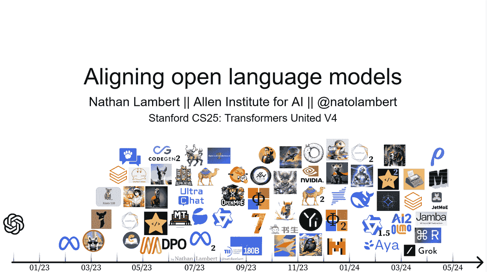

### 使用ORPO微调Llama 3

贡献人：

https://zhuanlan.zhihu.com/p/693670380?utm_psn=1765719297153093632

文章介绍了一种新的微调技术ORPO，它整合了监督微调和偏好对齐阶段，以减少训练资源和时间。ORPO通过修改标准的语言模型目标，结合负对数似然损失和比值比(OR)项，对被拒绝的反应进行弱惩罚，而对偏好的反应进行强奖励。这使模型在学习任务的同时保持与人类偏好的一致。使用了Llama 3模型和高质量的偏好数据集，展示了ORPO在多个基准上的优势。文章还涵盖了具体的设置步骤，如安装依赖、模型加载、数据处理和微调流程。

链接：https://huggingface.co/orpo-explorers/hf-llama3-8b-orpo-v0.0/tensorboard

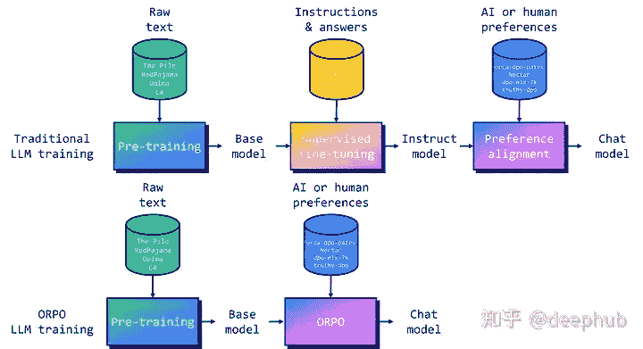

### 从RTL到GDS（三）：逻辑综合

贡献人：

https://zhuanlan.zhihu.com/p/693360175?utm_psn=1765802751513374721

文章详细介绍了逻辑综合的过程和重要性。逻辑综合是将硬件描述语言（如Verilog）编写的RTL代码转换为门级电路的过程，这一转换基于特定的约束条件。它涉及多个步骤，包括实例化、宏展开/替换、推理、逻辑优化和结构重组。文章强调了逻辑综合如何根据设计者提供的约束条件（如时钟周期、时序路径、最大功耗等）生成满足特定要求的硬件实现。这些过程使用了启发式算法，如遗传算法和模拟退火算法，以优化性能、面积和功耗。逻辑综合不仅帮助减少设计错误，还提高了设计生产力和数据抽象能力。

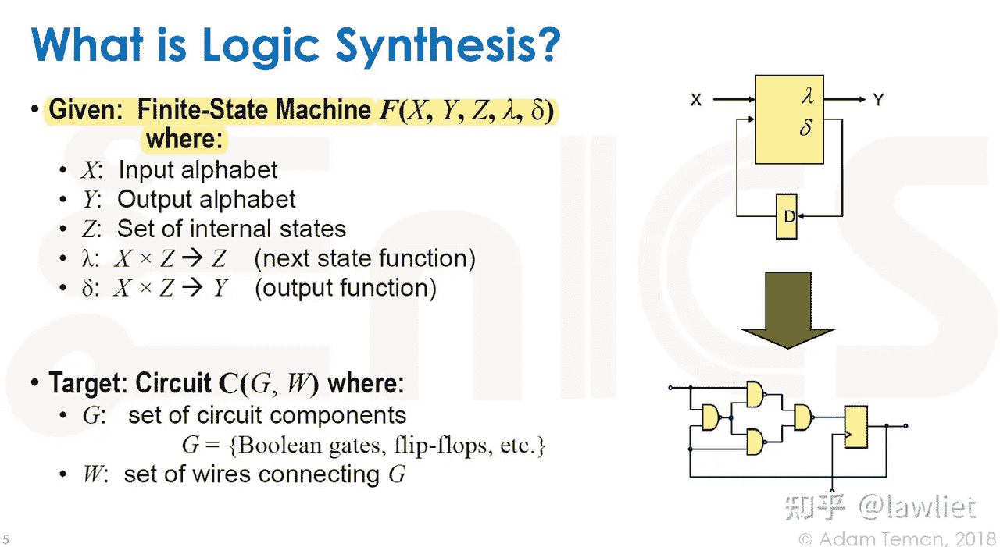

### CUDA fatbin格式剖析及PTX压缩算法

贡献人：

https://zhuanlan.zhihu.com/p/693323177?utm_psn=1765687651007782912

文章详细解析了CUDA的fatbin文件格式及其内含的PTX压缩算法。fatbin文件合成了PTX和SASS代码，支持在不同GPU上的运行和兼容性。PTX作为中间语言，可以通过NVCC和其他工具如cuobjdump进行操作。在编译过程中，PTX先转换为SASS，再由fatbinary工具封装成fatbin文件。文章还详述了fatbin的结构，包括其头部和多个section，每个section可包含未压缩或压缩的ELF或PTX代码。PTX的压缩采用偏移和重复长度替换重复内容，以减少文件大小。

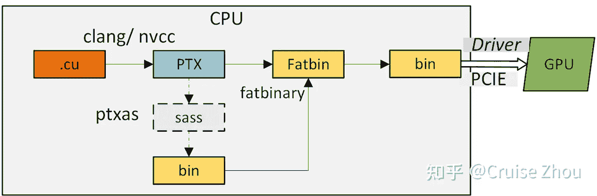

### 一文读懂nvidia-smi背后的nvml库

贡献人：

https://zhuanlan.zhihu.com/p/693690123?utm_psn=1765701028400644096

文章深入分析了nvidia-smi工具背后的NVIDIA Management Library (NVML)，一个用于管理和监控NVIDIA GPU设备的API库。NVML允许开发者以编程方式查询GPU状态和配置信息，例如GPU温度、功率、利用率等。文章详细介绍了如何使用NVML进行GPU管理，包括通过C/C++和Python接口进行调用。在C/C++中，需要链接到libnvidia-ml.so.1，并使用相关API进行操作。在Python中，可以通过nvidia-ml-py或pynvml库进行操作，这些库提供了对NVML函数的封装，允许在Python代码中直接管理GPU资源。文章还探讨了通过NVML初始化和关闭库的最佳实践，确保资源的正确管理和释放。

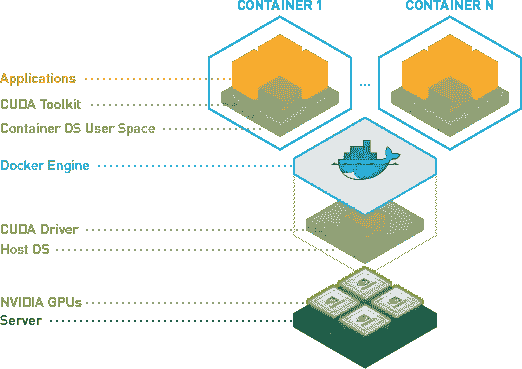

### DeepSpeed-FastGen：通过 MII 和 DeepSpeed-Inference 实现 LLM 高吞吐量文本生成

贡献人：

https://zhuanlan.zhihu.com/p/665494115?utm_psn=1765700706542379008

文章探讨了微软的DeepSpeed-FastGen技术，这是一种针对大型语言模型（LLMs）的高吞吐量文本生成解决方案。DeepSpeed-FastGen整合了DeepSpeed-MII和DeepSpeed-Inference技术，通过动态SplitFuse策略优化提示处理和生成令牌的过程，以提高响应速度和系统吞吐量。该技术通过分块KV缓存来降低内存碎片化，提升并发性，并采用连续批处理以提高GPU利用率。此外，它支持非连续KV缓存，使系统能够更有效地管理资源和处理多个请求，从而显著提高了服务性能。

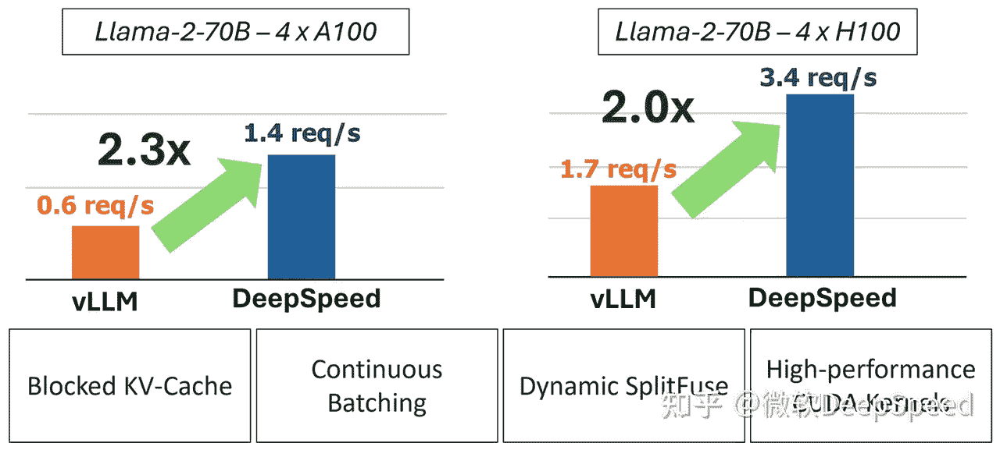

### 有什么tensor的shape操作技巧吗？

贡献人：

https://www.zhihu.com/question/653482764/answer/3473813449?utm_psn=1765688567265964033

文章介绍了在PyTorch中利用stride trick进行tensor形状操作的技术。Stride trick是一种高效处理数组和tensor的方法，它通过改变元素访问步长来视图变换，而不实际移动数据。具体例子中，使用torch.as_strided方法创建平行四边形条带，这种方法可以用于结构化推断中，如CKY算法，通过并行计算来优化性能。这项技术使得在不增加额外计算负担的情况下，对tensor进行复杂的重构成为可能，极大地提升了处理效率和灵活性。

### 为什么transformer里面的自注意力总是被魔改，但里面的FFN却始终不变？

贡献人：

https://www.zhihu.com/question/646160485/answer/3470050219?utm_psn=1765686171861024768

在Transformer架构中，自注意力部分经常被修改以探索新的机制和优化，例如引入RoPE和GQA等变种。相反，FFN（Feed-Forward Network）虽有变体如GLU和稀疏MoE，但其基本结构较少修改，主要因为FFN本身简单且高效，修改可能增加复杂度而未必提升效果。此外，尽管有尝试用RNN和Linear Attention替换二次型注意力，这些方法目前仍非主流。

# 声明

本文档仅供学习交流使用，版权归原作者所有，若涉侵权，请联系Jack Jin 15101136166

##

（欢迎在下方反馈您宝贵的意见！整理不易，觉得有用给AI日报小组点个赞👍吧！）

ChatGPT；Angela；Zijia Liu；Alex；Zeqi Tan；Tiezhen（HuggingFace）；Naixu；Lizhi；Peter；Suoman；Jack

封面生成——右脑科技

如果你有大模型相关的创业想法，欢迎来找我们聊聊～🛰️：15101136166

> 快邀请你的小伙伴们一起来读大模型日报吧！

> **【日报****知识库****】**这里是近期日报内容的汇总,欢迎大家查阅

> [大模型日报知识库(分享版)](https://miracleplus.feishu.cn/wiki/KapVwXfkriOBiskB0B2cUHxjnTh)

>

> 欢迎大家多多帮我们分享,转发~~

> 如果大家有任何的建议或者吐槽,欢迎随时找我聊天~

