# 奇绩大模型日报（4月 22日）

> 来源：[https://miracleplus.feishu.cn/docx/HBPtd1FALoTtX8xVfifcgMOwnJd](https://miracleplus.feishu.cn/docx/HBPtd1FALoTtX8xVfifcgMOwnJd)

# 推特

### Jim Fan: Llama-3正在缩小与GPT-4之间的差距,但多模态模型还需要赶上

贡献人：

https://x.com/DrJimFan/status/1782072699705250204

Llama-3正在缩小与GPT-4之间的差距,但多模态模型还需要赶上。像LlaVA这样的开放模型在视觉能力方面远远落后于GPT-4V。视频模型就更糟了。它们经常出现幻觉,无法对复杂的场景和动作给出详细的描述。像具身AI和生成媒体这样的应用需要比语言更多的视觉能力。我们还需要更好的基准:

lmsys.org 类似于多模态语言模型竞技场这样的东西,以ELO分数来衡量 "野外氛围"。是时候集中精力在更多像素上了!

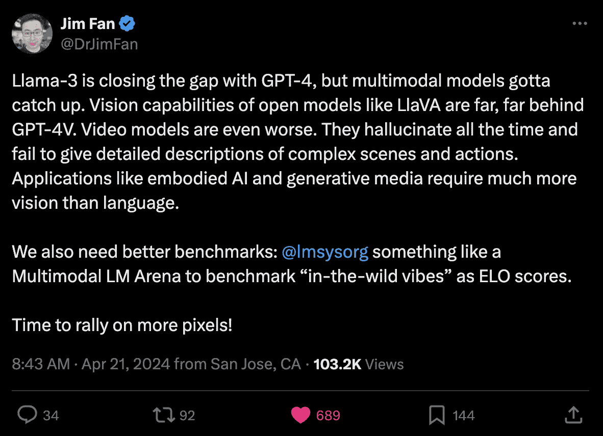

### Box CEO Levie：人工智能的下一个重大突破是AI代理

贡献人：

https://x.com/levie/status/1782164161553961069

人工智能的下一个重大突破是AI代理。这意味着AI从被用作聊天助手,转变为使用AI完成原本可能需要人类执行的完整任务。这将AI从"只读"操作转变为基本的"读/写"操作。最终,这使我们更接近AI的全部承诺,特别是在企业中,AI可以开始完成工作流程的任何部分,我们已经看到了代理编写整个软件应用程序或响应客户支持票证的例子。在许多方面,今天的代理就像2007年的云计算;也就是说,非常早期。当你将这一趋势推断出十年后,我们可以开始想象一个完全不同的企业运作可能是什么样子。我们可以轻松地想象,组织中的每个职能部门都有高效的代理可用,使重要工作得以比现在更快完成。代理对企业的影响确实没有限制,但有3个重大影响让我印象深刻:

1.  各种规模的企业都将获得他们原本无法利用的资源和专业技能。Sun Microsystems的联合创始人Bill Joy曾说过一句名言:"无论你是谁,最聪明的人都为别人工作。"尤其对于小公司来说,这一直是一个劣势。你的大型竞争对手总是能够利用你无法负担或无法获得的人才库。无论是专门的法律支持,还是扩大销售团队,AI代理将使各种规模的公司都能获得曾经只有大型组织才有的资源。

1.  公司将能够将精力和人才重新分配到越来越多的差异化和高影响力的工作中。我们知道,对于公司的各个部分,我们的时间都浪费在计算机应该非常擅长解决但现在还无法解决的任务上。随着AI代理变得更加强大,我们耗费时间的许多活动都可以自动化,我们可以将时间和精力重新用于推动更多创新,更接近客户,更好地支持客户等。

1.  随着AI代理在公司运营中发挥有意义的作用,这改变了IT职能的性质,使其比现在更具战略意义。今天,IT通常专注于为公司现有的工作人员或工作流程提供软件支持。未来,公司也将向IT寻求为企业提供智力动力。想象一下,去找IT不仅仅是说"我需要软件来帮助我的工程师开发产品",而是"我需要软件来设计我的产品"。你可以眯着眼睛想象,在未来几年,甚至会出现一个"AI工作日",在那里你管理在公司运营中发挥作用的代理。而这仅仅是个开始……

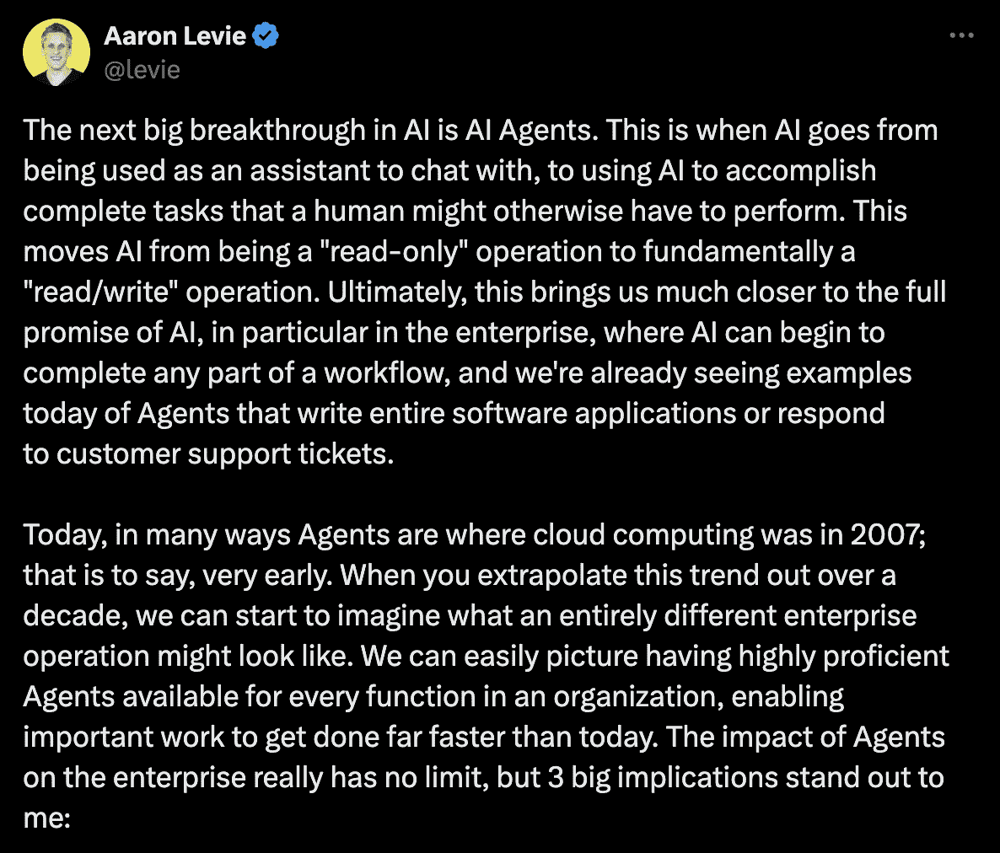

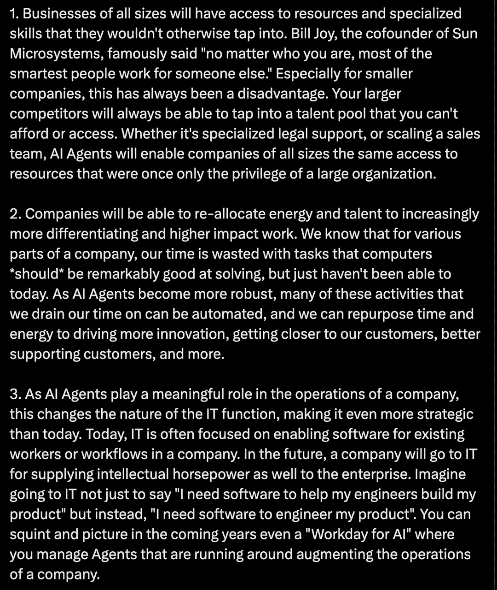

### Laura Wendel：扎克伯格可能已经扼杀了OpenAI和所有其他大型专有AI供应商

贡献人：

https://x.com/Lauramaywendel/status/1782040453266710551

我使用Llama 3越多,就越觉得扎克伯格可能已经扼杀了OpenAI和所有其他大型专有AI供应商。最新的GPT4和Llama 70b之间的差距几乎不存在。即使OpenAI现在发布GPT5,正在训练的400b Llama 3仍然很可能处于同一水平,再次缩小开源和专有之间的差距。

OpenAI的收入为20亿美元,很可能是非常不盈利的。Meta的毛利超过1000亿美元。在计算能力和人才方面,他们可能比OpenAI高出至少10倍——说到人才,绝大多数AI研究人员认为开源工作比封闭的营利性工作更有吸引力;所以顶尖人才很可能最终会流向Meta。谷歌仍然陷入AI扼杀其主要收入线的问题,所以很可能永远无法像Meta那样全力以赴。

我认为,从这一切中获益最大的将是应用开发者,因为你可以选择任何托管Llama 3的API服务,或者直接按照自己的条件托管它。

到目前为止,大多数AI产品只是API端点的华丽包装。但是,如果你设法将AI深度集成到产品中,让用户甚至不必考虑他们正在与AI交互(例如,根据用户上下文进行幕后调用,结合RAG,将其馈送到你的内部API格式,多步推理/规划等),你可能拥有一项非常可持续的业务,只会随着基础模型变得越来越先进而不断改进。

但是,供应商风险/依赖性不应再成为AI开发人员的担忧。再加上硬件只会变得更快/更便宜的事实;确实有无限的机会来颠覆现有的软件领域,其中很多我们现在可能甚至无法想象,但事后看来却显而易见。

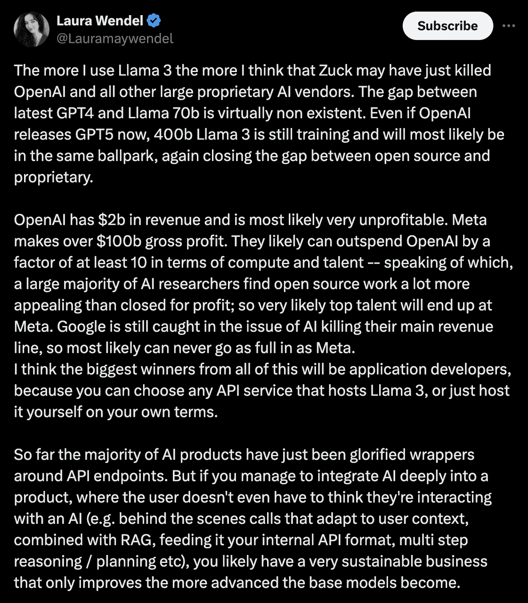

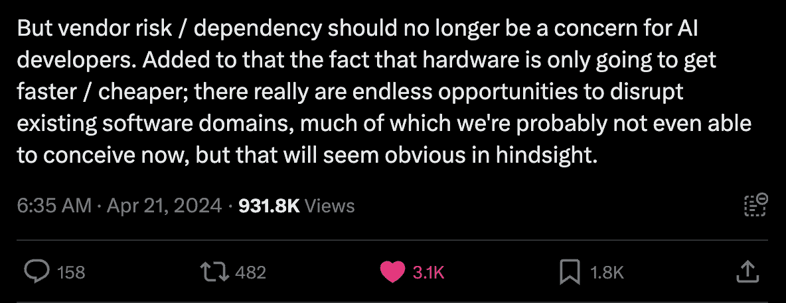

### 谷歌深度学习Chollet：目前我们还只是触及了表面，AGI似乎并没有变得更近,但扩大深度学习的实际应用并不会放缓

贡献人：

https://x.com/fchollet/status/1782264242517000479

你以为LLM聊天机器人需要大量计算?那还不算什么。当全生成式的TikTok/YouTube进入主流时,你才会开始需要大量的GPU。计算量将是现在的数个数量级,一方面是因为媒体更加密集,另一方面是因为受众将扩大5到10倍。目前我们还只是触及了表面。

AGI似乎并没有变得更近,但扩大深度学习的实际应用并不会放缓。

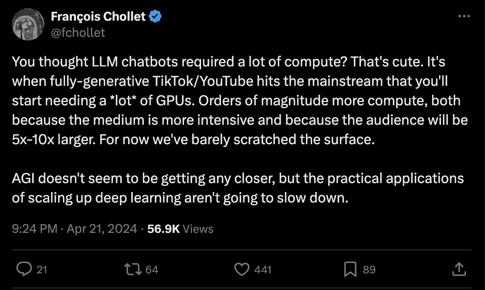

### Naklecha发布最大Minecraft问答数据集，涵盖MC中的每个主题、物品、方块、机制和制作

贡献人：

https://x.com/naklecha/status/1782087485289304126

今天,我发布了有史以来最大的Minecraft问答数据集,包含70万个问答对——它们涵盖了Minecraft中的每个主题、物品、方块、机制和制作。这个数据集是通过提取超过18,000个Minecraft维基页面和在8个H100上运行超过11小时的Llama3生成的。

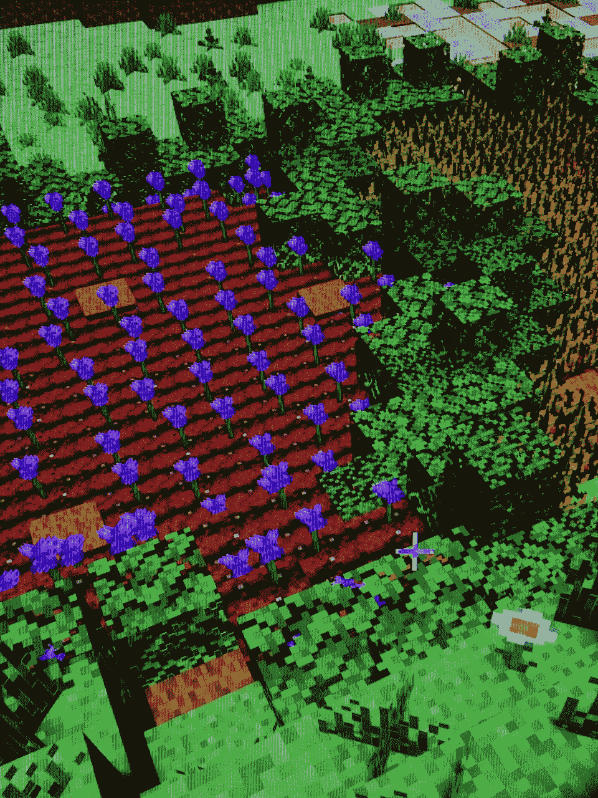

### Gary Marcus：如果你渴望AGI，不要通过制造表面上看起来像人类错误的东西来安慰自己

贡献人：

https://x.com/GaryMarcus/status/1782092855634526505

很多人对人类认知错误和LLM幻觉之间的关系感到困惑,所以我写了这个简短的解释:

人类说不实之词有许多不同的原因

+   有时他们撒谎

+   有时他们记错了事情

+   有时他们没有仔细考虑自己说的话

+   有时他们嗑药

+   有时他们患有精神障碍等

LLM的错误是由不同的潜在过程导致的。它们没有(例如)意图、自我或经济利益,所以它们不会撒谎。它们不吸毒。它们没有情绪状态。相反,LLM的 "幻觉" 经常出现,因为(a)它们确实不知道真假之间的区别,(b)它们没有可靠的推理过程来保证它们的推论是正确的,(c)它们无法对自己的工作进行事实检查。

相反,LLM所说的一切——无论真假——都来自同一个统计重构过程,即在某些情况下哪些词可能出现。它们从不检查自己所说的事实。有些是真的;有些是假的。但即使有完美的数据,随机重构过程仍会产生一些错误。LLM用来泛化的过程也会产生幻觉。(在我2001年的书中,我解释了一个不同的泛化过程可能是什么样子的。)

重要的是,AGI的目标不是重现人类;例如,我们不希望AGI撒谎或患有精神疾病。相反,AGI的目标应该是构建能够可靠地推理和计划广泛世界的机器。人类有时会犯错误,有时是故意的,有时是无意的,这绝不会消除或修复当前方法的局限性。AI领域最终会做得更好,但可能是以一种结构不同的AI,其中事实是一等公民,而不是你希望通过足够的数据就能免费获得的东西。

TL;DR:如果你渴望AGI,不要通过制造表面上看起来像人类错误的东西来安慰自己。

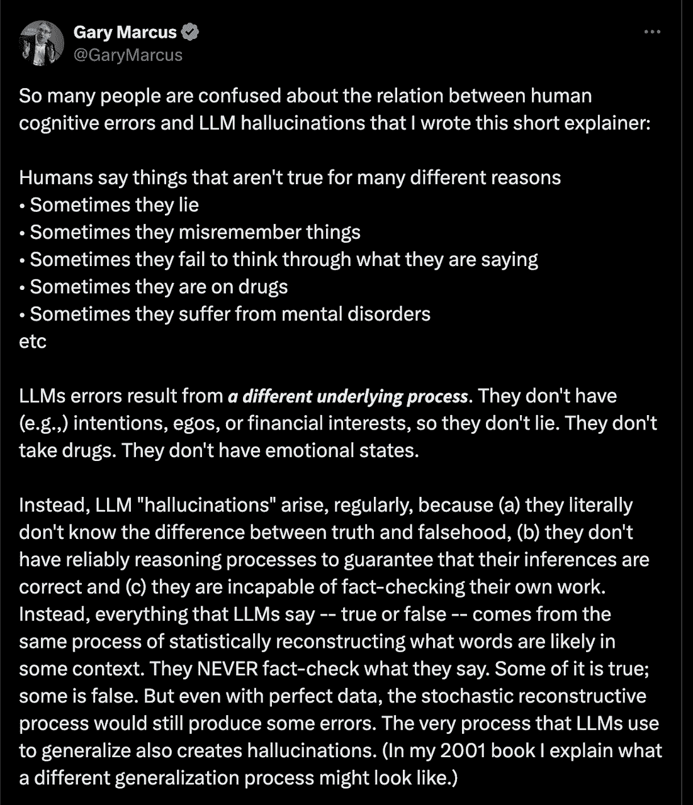

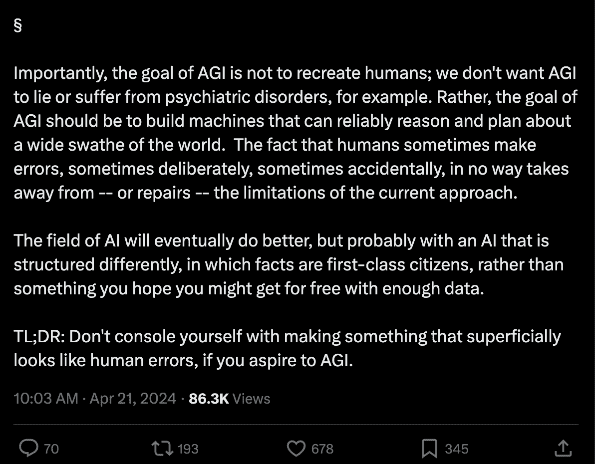

### 阿里巴巴发布gte-large-en-v1.5：新的SOTA Apache 2嵌入模型

贡献人：

https://x.com/n0riskn0r3ward/status/1782060819485721029

阿里巴巴刚刚发布了一个新的SOTA Apache 2嵌入模型。4.34亿参数,57.91的MTEB检索分数,8192个token的上下文长度,transformer++编码器主干(BERT + RoPE + GLU)。

---

gte-large-en-v1.5

我们推出了gte-v1.5系列,这是升级版的gte嵌入模型,支持**最长8192**的上下文长度,同时进一步提升了模型性能。这些模型基于transformer++编码器**主干**(BERT + RoPE + GLU)构建。

gte-v1.5系列在相同模型大小类别的MTEB基准测试中取得了最先进的成绩,并在LoCo长上下文检索测试中表现出色(参考**评估**)。

我们还推出了gte-Qwen1.5-7B-instruct,这是一个SOTA指令调优的多语言嵌入模型,在MTEB中排名第二,在C-MTEB中排名第一。

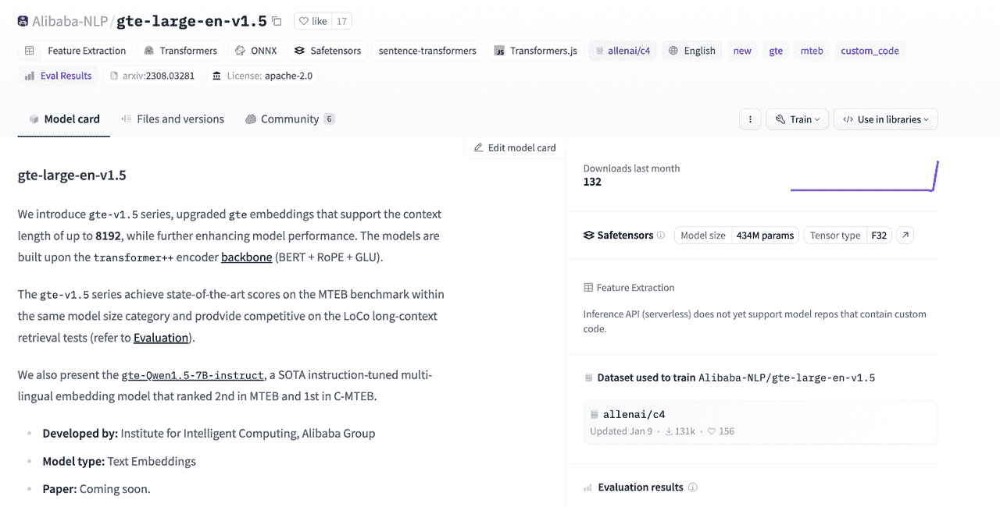

### Sakana AI发布使用其提出的进化模型合并方法构建的图像生成模型EvoSDXL-JP

贡献人：

https://x.com/SakanaAILabs/status/1782207884170080407

**Sakana AI**发布了使用其提出的"**进化模型合并**"方法构建的图像生成模型"**EvoSDXL-JP**"。构建的模型支持日语,与传统的日语模型相比,可以以10倍的速度生成图像。

**博客** → https://sakana.ai/evosdxl-jp

**演示** → https://huggingface.co/spaces/SakanaAI/EvoSDXL-JP…

我们最近提出了一种使用进化算法构建基础模型的方法"进化模型合并",同时发布了使用该方法试验构建的语言模型。这些模型是用于语言生成的自回归Transformer模型。这次,为了展示进化模型合并的更多可能性,我们将其应用于广泛用于图像生成任务的扩散模型。

构建的EvoSDXL-JP是通过融合不同的开放模型,支持日语并能生成日式风格图像的模型。与现有的日语模型相比,推理速度提高了10倍,同时生成图像的质量也得到了提升。EvoSDXL-JP模型已在HuggingFace上公开,供研究和教育使用。此外,我们还发布了一个现在就可以尝试的演示。请务必试一试。

**模型** → https://huggingface.co/SakanaAI/EvoSDXL-JP-v1…

# 资讯

### 黄仁勋对话 Cadence CEO：AI 将在数据中心、机器人/自动驾驶、生命科学三个领域带来革命性影响！

贡献人：

https://mp.weixin.qq.com/s/IozUKf0ydoH9JcJIz3Z6vw

英伟达 CEO 黄仁勋（Jensen Huang）近日参加了 Cadence 举办的活动，对话 Cadence CEO Anirudh Devgan，讨论了 AI 与加速计算在塑造行业大趋势方面的关键作用，以及英伟达与 Cadence 如何合作推动 EDA、SDA、数字生物学和 AI 领域的转型变革。

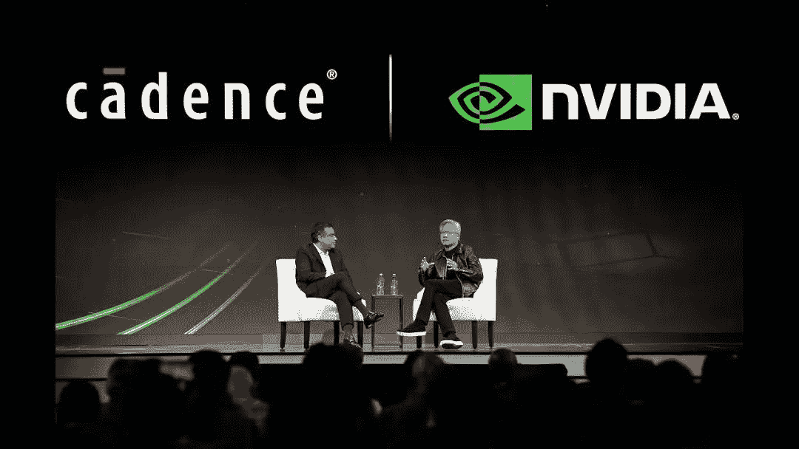

### 古尔曼：苹果正自研设备端大型语言模型，赋能 AI 功能

贡献人：

https://www.ithome.com/0/763/266.htm

苹果公司正在研发一种运行于设备端的大型语言模型 (LLM) ，旨在提升即将发布的生成式 AI 功能的响应速度和隐私保护能力。古尔曼在其“Power On”通讯中提到，苹果的这个 LLM 将成为该公司未来生成式人工智能功能的基础。与现今大多数云端人工智能服务不同的是，所有迹象都表明该模型将完全运行于用户设备之上。

### 阿里云宣布全方位支持Llama 3训练推理，并提供免费算力

贡献人：

https://finance.sina.com.cn/tech/shenji/2024-04-22/doc-inassmqz1146978.shtml

近日，Meta开源最新Llama 3系列，阿里云魔搭社区第一时间上架全部4款模型。今天，阿里云百炼大模型服务平台宣布推出针对Llama 3系列的限时免费训练、部署、推理服务，企业和开发者即日起即可在阿里云上基于其打造自己的专属大模型。

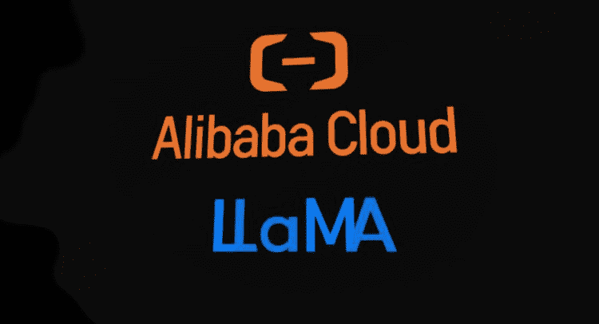

### 智谱 AI 旗下 AMiner 开放数据平台发布《全球十个大模型核心团队成员分析报告》

贡献人：

https://open.aminer.cn/open/article?id=6620fea7d9a27592a9337fd5

智谱 AI 旗下 AMiner 开放数据平台发布了《全球十个大模型核心团队成员分析报告》，旨在为大模型领域的相关人员在今后的研究交流、人才引进提供参考。该报告结合当下模型知名度和专家建议选取了全球十个大模型(GPTGemini、Claude、GLM、LLaMA、Qwen、Falcon、PaLM、BERT、T5)，从地域分布、年龄结构、教育背景、华人占比和学术影响力5个维度进行全面分析，揭示了十个大模型核心成员的人才现状。报告显示，华人在大模型领域具有一定竞争力，在挑选的国外(除 GLM、Qwen)大模型团队成员 899 人中，华人成员共计 167 位占比达18.7%。

### AI 将帕金森病药物设计提速十倍，可识别阻止该病症特征蛋白聚集小分子

贡献人：

https://finance.sina.com.cn/tech/mobile/n/n/2024-04-22/doc-inassfia2228262.shtml

据英国剑桥大学官网，该校研究人员通过人工智能技术大幅加快了帕金森病治疗方法的开发进程。研究人员设计并使用了一种基于 AI 的策略，从而来识别阻止 α-突触核蛋白（IT之家注：帕金森病的特征蛋白）聚集的小分子。这也是寻找帕金森病潜在治疗方法的一条途径。

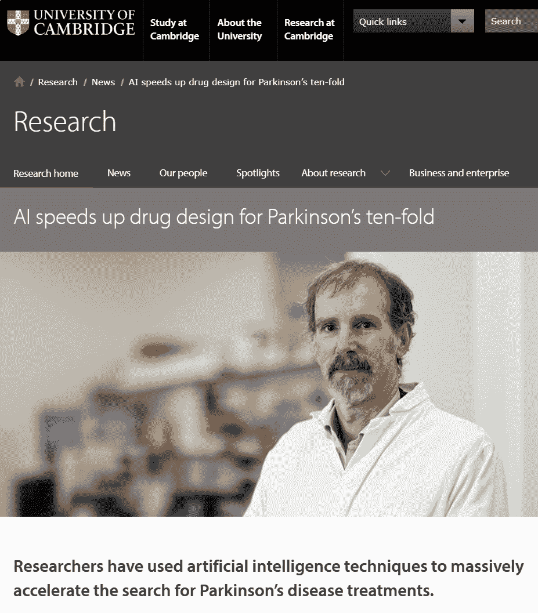

### 体外命中率提高75%，Model Medicines&加州大学开发AI驱动的药物发现框架

贡献人：

https://mp.weixin.qq.com/s/R4wWi3HbmPRHCZ61jHKr8A

在不断发展的药物发现领域，传统方法由于效率低和资源需求高而面临重大挑战。AI 药物公司 Model Medicines 和加州大学圣地亚哥**分校的研究人员开发了 GALILEO ****AI** 药物发现平台及其核心模型 ChemPrint，旨在提高药物发现的效率。为了解决命中率低和探索新化学空间困难的挑战，该平台采用自适应分子嵌入和严格的模型训练环境来增强预测能力并导航未知的分子领域。在针对 AXL 和 BRD4 肿瘤学靶标的案例中，ChemPrint 实现了 45.5% 的体外命中率，并鉴定了 20 种新型作用化合物。这些化合物表现出巨大的化学新颖性，其训练集的平均 Tanimoto 相似度得分为 0.32。

# 论文

### 样本设计工程：LLM 微调样本的好坏实证研究

贡献人：

链接：http://arxiv.org/abs/2404.13033v1

摘要：在大语言模型（LLM）的兴起领域中，像ChatGPT和LLaMA这样的模型，通过Prompt Engineering（PE）著名于通过prompt修改来提高零-shot或上下文学习（ICL）。然而，针对用于下游微调的样本设计领域，对于特定任务的LLM适应性至关重要，却是遍地荒芜。本文介绍了一种名为Sample Design Engineering（SDE）的方法论，通过精细调整输入、输出和推理设计，以增强LLMs的后调整性能。我们进行了一系列领域内（ID）和领域外（OOD）的实验，评估各种设计选项对LLMs下游性能的影响，揭示出一些跨不同LLMs一致存在的有趣模式。基于这些见解，我们提出了一个综合的SDE策略，结合了最有效的选项，并验证其在复杂的下游任务中，如多方面情感分析、事件提取和嵌套实体识别中，始终优于启发式样本设计。此外，LLMs固有的提示/输出困惑、零-shot和ICL能力的分析表明，良好的PE策略并不总是能转化为良好的SDE策略。代码可在https://github.com/beyondguo/LLM-Tuning获取。

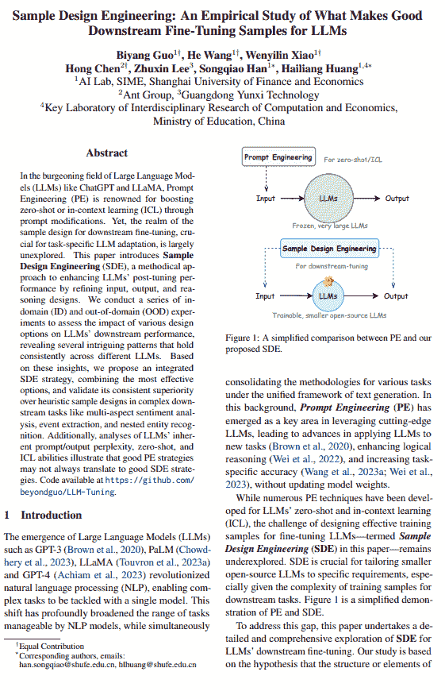

### 朝向大语言模型辅助 Lean 定理证明

贡献人：

链接：http://arxiv.org/abs/2404.12534v1

定理证明对于大型语言模型（LLMs）来说是一个重要挑战，因为正式证明可以通过Lean等证明助手严格检查，没有幻觉的空间。现有基于LLM的证明器试图在完全自主模式下证明定理，没有人为干预。在这种模式下，它们难以应对新颖且具有挑战性的定理，对于这些定理，人类的见解可能至关重要。在本文中，我们探讨LLMs作为协作伙伴协助人类证明定理。我们介绍Lean Copilot，一个在Lean中运行LLM推理的框架。它使程序员能够构建各种基于LLM的证明自动化工具，无缝整合到Lean用户的工作流程中。使用Lean Copilot，我们构建了用于建议证明步骤（策略建议）、完成中间证明目标（证明搜索）以及选择相关前提（前提选择）的工具，使用LLMs。用户可以使用我们预训练的模型，或者自己带入本地（带或不带GPU）或云端运行的模型。实验结果表明，与现有基于规则的证明自动化相比，我们的方法在协助人类和自动化定理证明过程方面是有效的。我们根据宽松的MIT许可证开源所有代码，以促进进一步的研究。

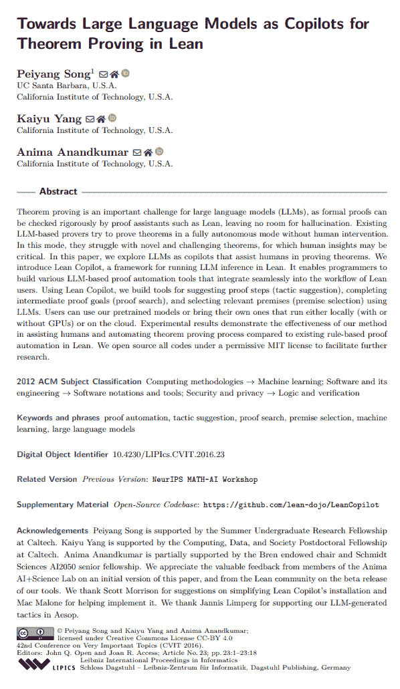

### TextSquare: 扩展文本中心视觉指令微调

贡献人：

链接：http://arxiv.org/abs/2404.12803v1

摘要：文本中心的视觉问答（VQA）在多模态大语言模型（MLLMs）的发展中取得了巨大进展，然而开源模型仍然无法与GPT4V和Gemini等领先模型媲美，部分原因是缺乏广泛且高质量的指导微调数据。为此，我们引入了一种新方法来创建一个庞大、高质量的指导微调数据集Square-10M，该数据集是使用封闭源MLLMs生成的。数据构建过程，称为Square，包括四个步骤：自问自答、推理和评估。我们对Square-10M进行的实验得出了三个关键发现：1）我们的模型TextSquare在OCR测试数据集上取得了62.2%的成绩，明显胜过开源先前的文本中心MLLMs，并在10个文本中心基准测试中的6个中超越了顶尖模型如GPT4V和Gemini。2）此外，我们展示了VQA推理数据在为特定问题提供全面上下文洞见方面的关键作用，不仅提高了准确性，还显著减轻了幻觉。具体而言，TextSquare在四个常规VQA和幻觉评估数据集中平均得分75.1%，优于先前的最先进模型。3）值得注意的是，在缩放文本中心的VQA数据集中观察到的现象揭示了一个鲜明的规律：指导微调数据量的指数级增长与模型性能的改善成正比，从而验证了数据集规模和Square-10M高质量的必要性。

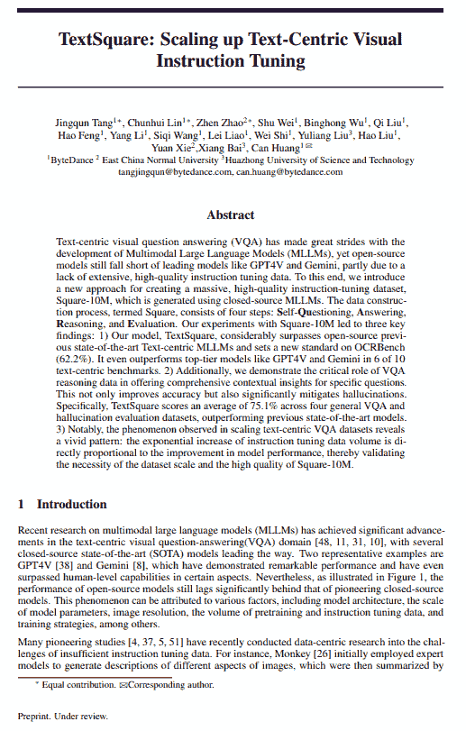

### **更强的基于随机的上下文学习基线**

贡献人：

链接：http://arxiv.org/abs/2404.13020v1

评估语言模型在上下文学习分类性能时面临挑战，因为数据集规模小，使用验证集进行广泛提示选择，并且有意难度的任务导致接近随机性能。我们考虑验证集重复使用和现有小数据集的常见做法，使用更强的随机基线：跨多个随机分类器的最大准确率。在选择最佳提示演示时，超过20%的少样本结果超过标准基线，但没有超过更强的随机基线。当有保留测试集时，这个更强的基线也比标准基线更好地预测保留性能，避免不必要的测试集评估。这个最大随机基线为标准基线提供了一个易于计算的替代方案。

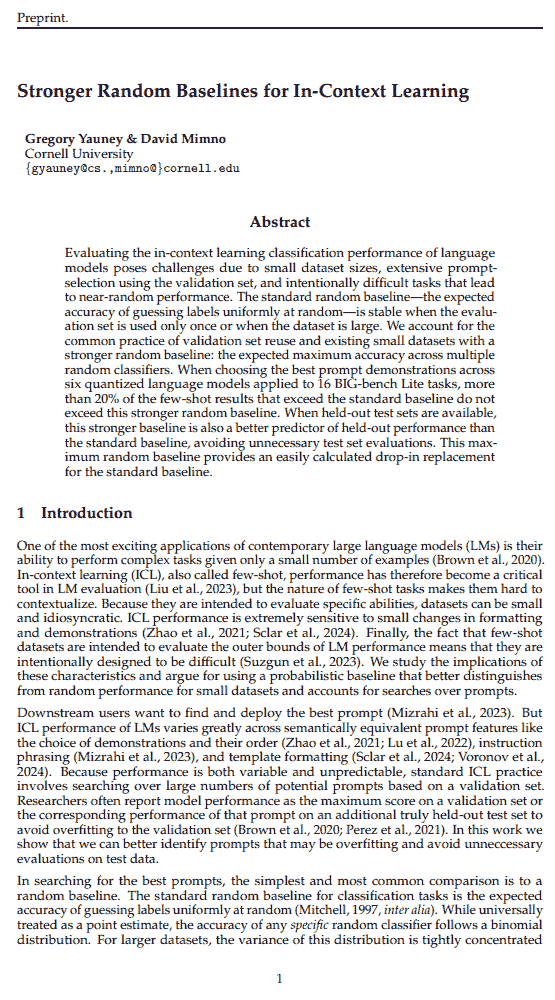

### AutoCrawler：用于网络爬虫生成的渐进式理解网络智能体

贡献人：

链接：http://arxiv.org/abs/2404.12753v1

摘要：网络自动化是一种重要技术，通过自动化常见的网络操作，完成复杂的网络任务，提高运行效率，减少手动干预。传统方法，如包装器，在面对新的网站时，适应能力和可扩展性有限。另外，由大语言模型(LLMs)赋能的生成式智能体在开放世界场景中表现出性能和可重用性较差。本文引入了垂直信息网页的爬虫生成任务和将LLMs与爬虫结合的范例，有助于爬虫更有效地处理多样化和变化的网络环境。我们提出了AutoCrawler，一个利用HTML的层次结构进行逐步理解的两阶段框架。通过自顶向下和退回操作，AutoCrawler可以从错误操作中学习，并持续修剪HTML以生成更好的动作。我们进行了多个LLM的综合实验，并展示了我们框架的有效性。本文资源可在https://github.com/EZ-hwh/AutoCrawler找到。

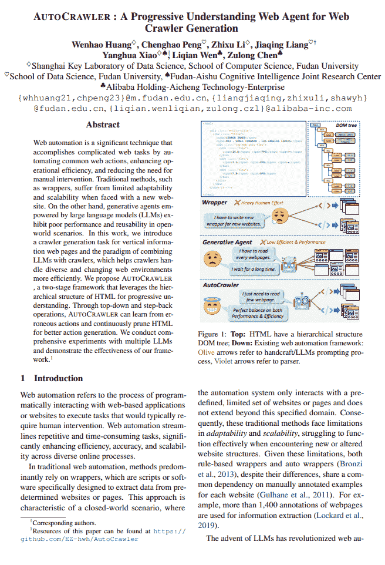

### ScaleFold：将AlphaFold初始训练时间减少至10小时

贡献人：

链接：http://arxiv.org/abs/2404.11068v1

摘要：AlphaFold2被誉为蛋白质折叠领域的突破，能够快速预测具有实验室级精度的蛋白质结构。然而，其实现并未包含必要的训练代码。OpenFold是AlphaFold的第一个可训练的公开重新实现版本。AlphaFold的训练过程耗时过长，并且在使用更多计算资源时收益递减。本研究在OpenFold基础上对AlphaFold的训练过程进行了综合分析，发现低效的通信和过度开销的计算是阻碍AlphaFold有效扩展的关键因素。我们引入了ScaleFold，一种系统训练方法，专门针对这些因素进行优化。ScaleFold成功地将AlphaFold的训练扩展到2080个NVIDIA H100 GPU，并实现了高资源利用率。在MLPerf HPC v3.0基准测试中，ScaleFold在7.51分钟内完成了OpenFold基准测试，比基线快了6倍。对于从头训练AlphaFold模型，ScaleFold在10小时内完成了预训练，远远优于原始AlphaFold预训练基线需要的七天。

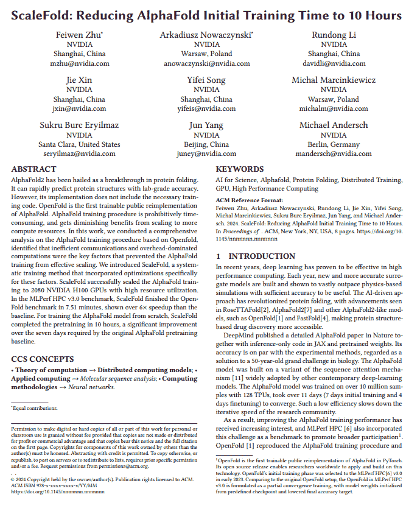

# 产品

### **Stylar**

贡献人：

https://www.stylar.ai/tools/ai-design-sketch

Stylar 是一款不断革新创意过程的AI设计草图工具，能够将草图转化为精美的产品图片。其 AI 设计草图功能确保产品图像以卓越的清晰度和逼真度呈现。此外，Stylar提供多样的风格选项，让用户轻松尝试不同的美学，找到与其设计喜好相契合的完美外观。用户还可以利用增强的视觉效果生成多种展示产品的选项，例如在森林环境中突出展示跑鞋，或者在客厅环境中展示舒适的拖鞋，以吸引观众注意。

### **Univi**

贡献人：

https://www.univi.app/

Univi 是一个旨在帮助多动症（ADHD）群体的社区平台，提供了一系列针对多动症个体的实用工具和资源，包括迷你课程、个性化冥想、待办事项清单、情绪跟踪、多动症测试等，也借助 AI 帮助用户进行定制化帮助，希望他们更好地应对日常挑战并获得支持。

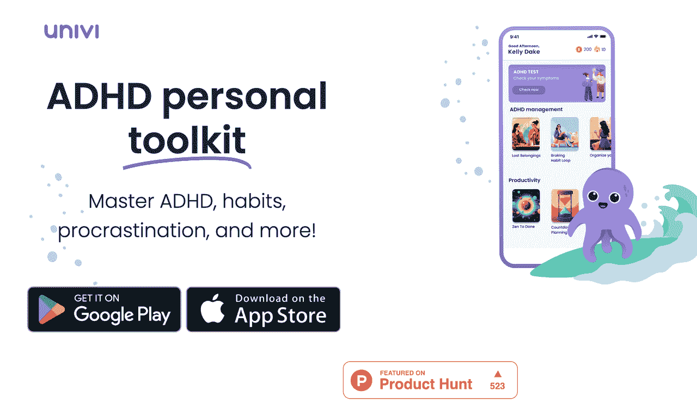

### **AllMind AI**

贡献人：

https://allmindinvestments.com/

AllMind AI 是用户的个人财务分析师，向用户提供集中、实时、可操作的见解。借助专有LLM（大型语言模型）AllMind AI，将研究时间缩短了90%，成本降低了98%。据称，在每一个财务任务中，都能胜过GPT-4、Gemini和Opus。

# HuggingFace&Github

### ASReview

贡献人：

https://github.com/asreview/asreview

ASReview 是一个用于帮助筛选大量文本数据的项目，它可以帮助研究人员更快速地找到他们需要的信息，节省时间并提高工作的质量。这个软件有三种不同的使用模式，可以根据具体的需求选择合适的模式进行操作。

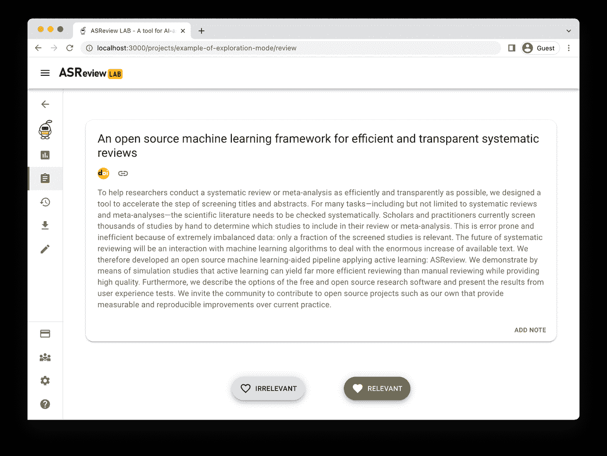

### Helix

贡献人：

https://github.com/helixml/helix

Helix 是一个生成式人工智能平台，可在云上运行或部署在自己的数据中心或云账户上。它提供易于使用的界面。Helix 使用开源模型，包括GPU调度程序，以优化用户面对的延迟和 GPU 内存利用率。其 Runner 架构允许部署单一控制平台，并连接各种 GPU，集成 Keycloak 进行身份验证，可以适配到企业的 ActiveDirectory/LDAP/OAuth 环境中

# 投融资

### Xfactor.io完成1600万美元A轮融资

贡献人：

https://www.finsmes.com/2024/04/xfactor-io-closes-16m-series-a-funding.html

位于加利福尼亚州旧金山的Xfactor.io，一家提供全面AI驱动收益平台的公司，成功完成了1600万美元的A轮融资。本轮融资由Accel领投，Xfactor.io的首席执行官兼创始人Mike Carpenter和Lightspeed等参与投资。公司计划利用这笔资金进一步增强其产品，优先提升其AI能力，以赋能收入领导者优化其整个市场推广团队的规划和表现。

公司官网：https://www.xfactor.io/

### 理光收购德国软件初创公司natif.ai，拓展高级AI技术

贡献人：

https://www.ricoh.com/release/2024/0422_1

理光公司宣布收购德国软件初创企业natif.ai，该公司专注于提供启用人工智能的智能捕获、高级图像识别和光学字符识别（OCR）技术。此次收购将增强理光的流程自动化产品组合中的数据提取功能，覆盖纸质和手写文档等多种文件，旨在为客户在广泛的业务流程中提供自动化和精细化服务。此举是理光在流程自动化领域增长策略的一部分，通过整合DocuWare和natif.ai的智能索引技术，进一步提升AI驱动的捕获和自动化能力。

公司官网：https://natif.ai/

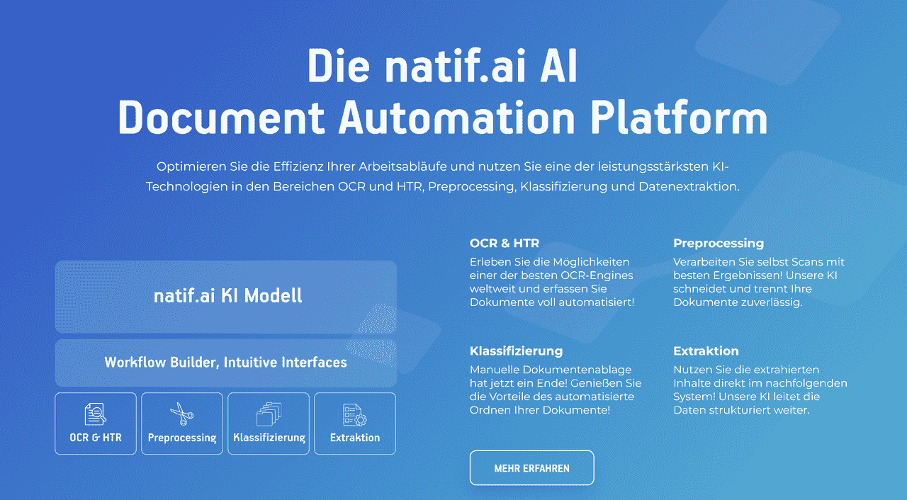

### Aurionpro Solutions收购Arya.ai，为金融机构打造下一代企业AI平台

贡献人：

https://www.prnewswire.com/apac/news-releases/aurionpro-solutions-acquires-aryaai-to-power-next-generation-enterprise-ai-platforms-for-financial-institutions-302122931.html

Aurionpro Solutions Limited宣布收购专注于银行和保险的PaaS初创公司Arya.ai。此次收购将通过Arya.ai的尖端AI云平台，强化Aurionpro在企业金融科技领域的产品组合，加速推动负责任、精确、可审计的AI技术的采纳。交易包括购买现有股东持有的股份和新的股本资本的认购，总投资约为1650万美元。此举旨在为全球金融机构创建领先的企业AI平台，提升客户价值。

公司官网：https://arya.ai/

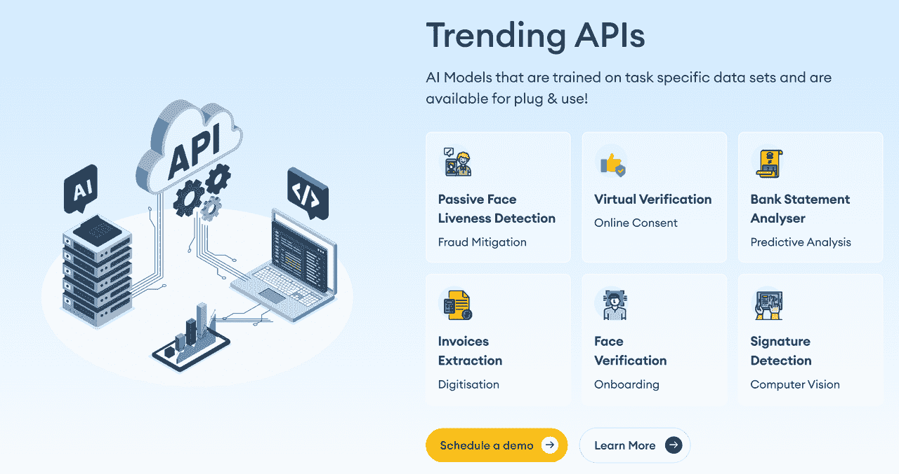

### 斯堪的纳维亚法律科技初创公司Juristic筹集100万美元以利用AI赋能律师

贡献人：

https://techfundingnews.com/scandinavian-legal-tech-startup-juristic-snaps-1m-to-empower-lawyers-with-ai/

Juristic，一家位于斯堪的纳维亚的法律科技初创公司，成功筹集了100万美元的投资。此轮投资由Ugly Duckling Ventures（此前投资Kollektive和BeCause）和丹麦律师及天使投资人Jonatan Hjortdal领投。其他投资者包括律师事务所合伙人、投资者及连续创业者Jens Bang Liebst。Juristic计划利用这笔资金加速其在斯堪的纳维亚及欧洲的增长和扩张计划，特别是在人工智能产品方面的增强。

公司官网：https://www.juristic.io/

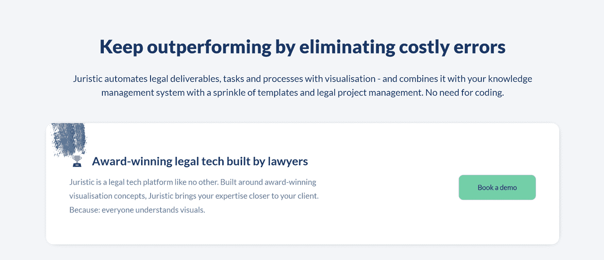

### 非凡产研：2024年3月全国AIGC行业月报-资本篇

贡献人:

https://mp.weixin.qq.com/s/tbFg9u0qs0r-BZ4BtjACAQ

在2024年3月，全球AIGC行业融资总额达到301亿元，较2月增长31.1%。其中，B轮及以后的融资占比高达94.2%，显示出行业对资本的吸引力持续增长。Anthropic成为全球获最高融资额企业，获得约195.1亿元人民币的投资，该轮次由亚马逊领投。国内方面，MiniMax获得最高融资额，为约24.9亿元人民币，由阿里巴巴领投。国内外市场均显示出对AIGC行业的高度投资热情和对大额投资的偏好。

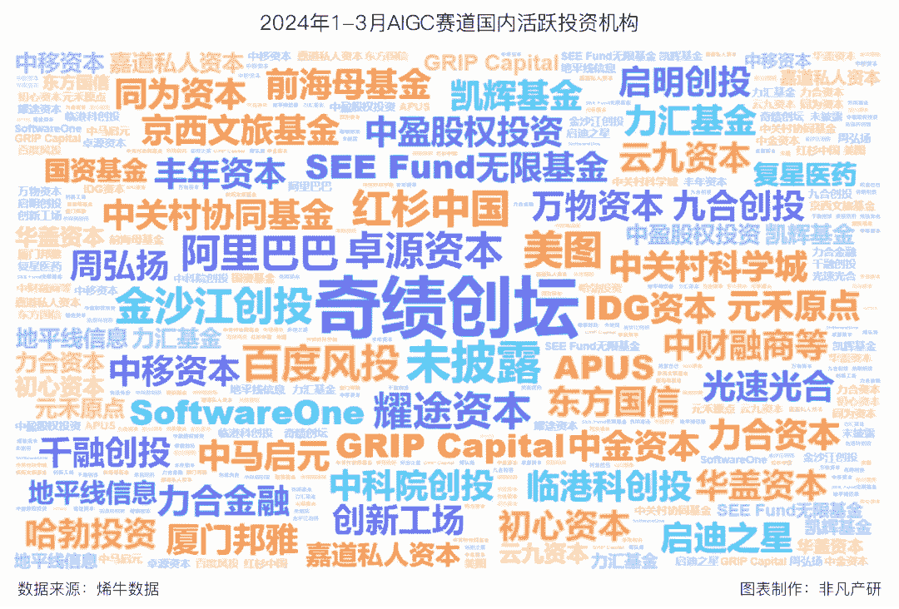

# 信号

## 台积电关于异构边缘存内计算芯片的研究法Science

通信作者Meng-fan Chang（台积电存内计算相关研究的领导者）

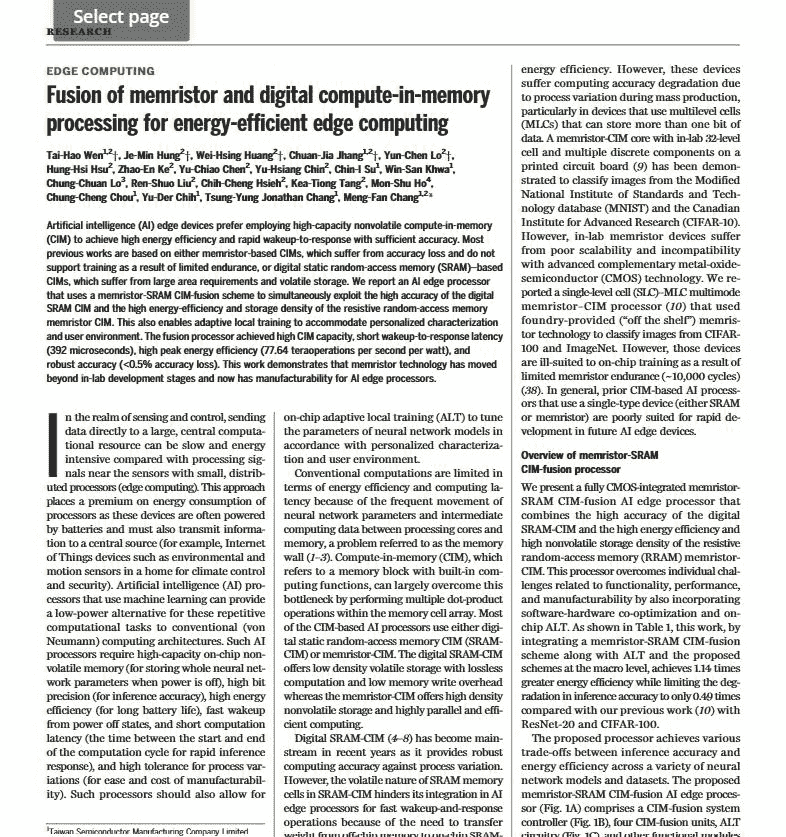

混合的SRAM-RRAM架构让片上可训练和超高能效共存成为可能。

台积电的人认为这是将RRAM技术从实验室推向市场的一个重要里程碑。台积电在RRAM中投入不小，现在已经有一些早期产品。

## **Ne**ural Flow Diffusion Models: Learnable Forward Process for Improved Diffusion Modelling

https://arxiv.org/abs/2404.12940

核心在于将对于扩散模型的forward process进行了扩展，允许除了linear Gaussian以外的过程。同时也提供了一个比较新颖的学习forward process的参数化办法，是基于Yang Song此前微分方程系列工作的延伸。

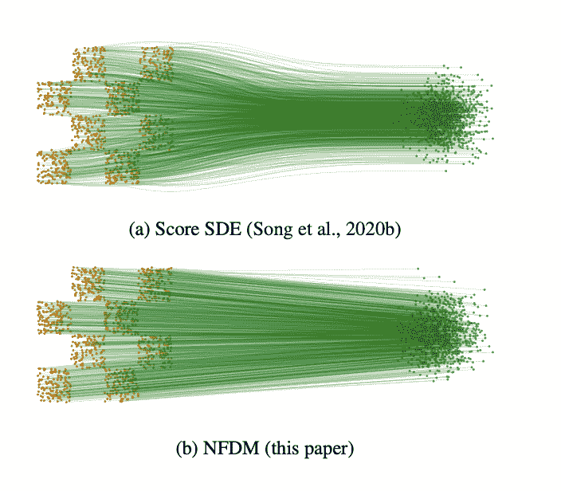

# 学习

### 丘成桐：数学的万有引力

贡献人：

https://mp.weixin.qq.com/s/5zGC8DXke2JYtZchYvMIzQ

文章回顾了数学家丘成桐的职业生涯及其在几何分析领域的贡献。他的研究始于对黎曼流形曲率与基本群相互作用的兴趣，并逐渐发展到广义相对论和物理学的交叉。丘成桐的工作重点在于探索几何、拓扑和物理的统一，尤其是通过里奇曲率和数量曲率的研究。他在流形的分析和偏微分方程上的研究推动了几何分析学科的发展，特别是他对极小曲面理论的贡献，以及与李伟光共同完成关于抛物方程哈纳克不等式的研究。此外，他还涉足数学物理，特别是在弦理论和镜像对称方面的研究，推动了数学与物理学的深度融合。

### 什么导致了深度神经网络中的梯度不稳定性？

贡献人：

https://www.zhihu.com/question/644863003

梯度不稳定性是深度神经网络中的常见问题，主要由激活函数选择、权重初始化、网络深度等因素引起。传统激活函数如Sigmoid和Tanh易引发梯度消失。有效的应对策略包括使用ReLU激活函数、采用He或Xavier权重初始化、实施批量归一化以及应用梯度剪辑。此外，适用自适应学习率优化器如Adam和残差连接也有助于稳定梯度，提升训练效率与模型性能。

### 计算机考古：第一代C语言编译器

贡献人：

https://zhuanlan.zhihu.com/p/693132914

文章详细探讨了C语言的早期编译器“legacy-cc”，它是由丹尼斯·里奇开发的，并详述了其技术实现。最初，这个编译器设计来将Unix系统的代码从汇编语言转换为C语言，提高开发效率。技术细节包括编译过程分为两个主要阶段：源码分析生成语法树，和语法树遍历生成目标机器码。此外，文章还解释了编译器处理的C语言的特定语法，例如使用圆括号()代替大括号{}来声明结构体，以及方括号[]替代指针声明。这些技术特性体现了C语言自举的能力，即编译器自身也是用C语言编写的。此外，对1978年C语言版本的介绍包括了支持新数据类型和结构，如长整型、无符号类型、结构体、联合体和枚举类型，以及1989年ANSI标准化引入的函数原型和空指针。

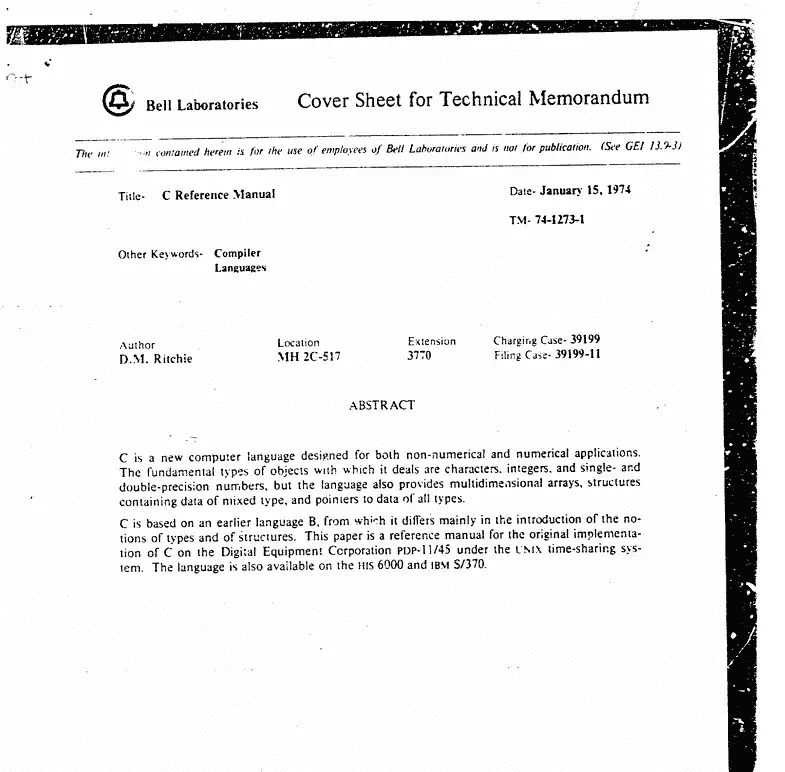

### Megatron 1F1B流水线并行中的负载不均衡问题研究

贡献人：

https://zhuanlan.zhihu.com/p/693425934

本文研究了Megatron 1F1B流水线并行中的计算负载不均衡问题，特别是在使用LLaMA 70B模型进行训练时观察到的通信时间波动。发现通信时间在流水线的稳定阶段呈现“一短一长”的规律，主要由于最后一个阶段（Stage 7）的额外计算延迟（如logits计算和交叉熵损失）导致。这种不同步现象导致后续阶段必须等待Stage 7完成计算，进而影响整个流水线的通信效率。

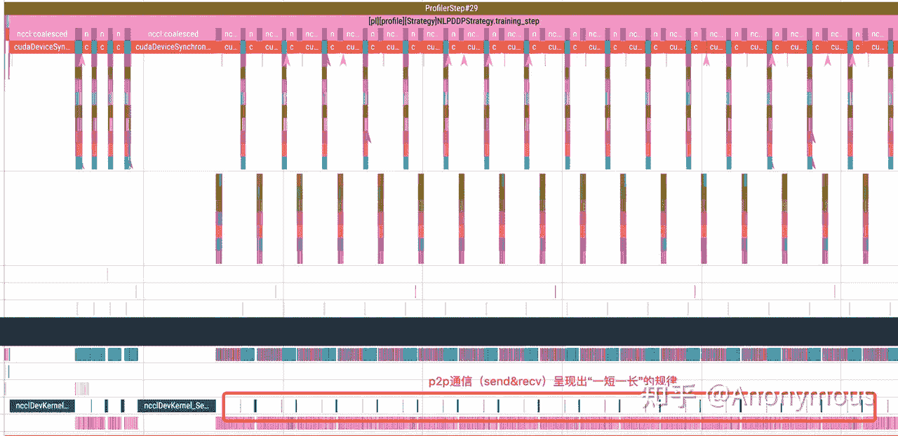

### 在长上下文的大语言模型中Transformer 架构：综述

贡献人：

https://zhuanlan.zhihu.com/p/693167427

本文全面综述了在长上下文大型语言模型（LLM）中，基于Transformer架构的最新进展。文章首先指出当前LLM主要针对短文本片段进行预训练，这限制了其处理长上下文的有效性。文章详细介绍了Transformer处理长上下文的困难，包括时间和空间的二次复杂性，以及位置嵌入的泛化问题。针对这些问题，提出了包括注意力效率优化、上下文窗口扩展、位置嵌入泛化等解决方案，并探讨了这些技术在长上下文LLM中的应用。此外，文章还讨论了评估方法、优化工具和未来研究的挑战，为Transformer架构在长上下文应用中的改进提供了深入分析。

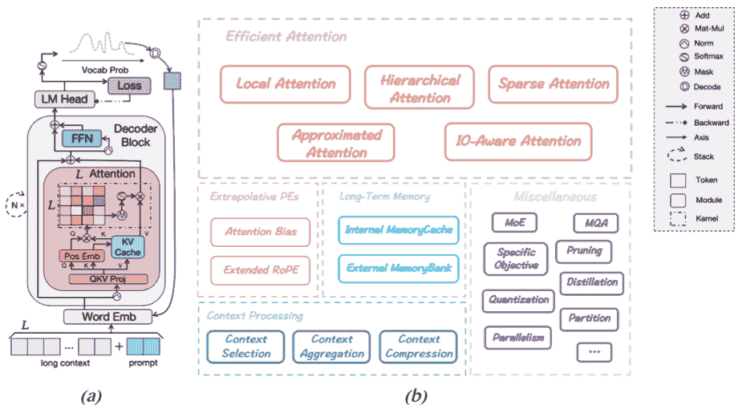

### 大语言模型中上下文长度扩展技术的内容、原因和方式-综述

贡献人：

https://zhuanlan.zhihu.com/p/693368080

本综述文章深入探讨了大型语言模型（LLM）中上下文长度扩展技术的重要性及其在各种自然语言处理（NLP）应用中的潜在转变作用。特别强调了解决LLM在处理超出训练时上下文长度的挑战的方法，包括使用基于位置编码、检索、注意力机制和RoPE的技术。这些技术不仅帮助模型处理更长的输入序列，还提高了其泛化能力和在实际应用中的适应性。此外，文章还讨论了评估这些扩展技术的复杂性和当前研究中的开放性问题，指出了评估标准的不一致性和未来研究的方向。

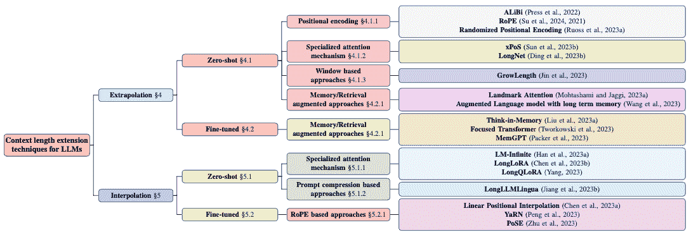

# 声明

本文档仅供学习交流使用，版权归原作者所有，若涉侵权，请联系Jack Jin 15101136166

##

（欢迎在下方反馈您宝贵的意见！整理不易，觉得有用给AI日报小组点个赞👍吧！）

ChatGPT；Angela；Zijia Liu；Alex；Zeqi Tan；Tiezhen（HuggingFace）；Naixu；Lizhi；Peter；Suoman；Jack

封面生成——右脑科技

如果你有大模型相关的创业想法，欢迎来找我们聊聊～微信：15101136166

> 快邀请你的小伙伴们一起来读大模型日报吧！

> **【日报****知识库****】**这里是近期日报内容的汇总,欢迎大家查阅

> [大模型日报知识库(分享版)](https://miracleplus.feishu.cn/wiki/KapVwXfkriOBiskB0B2cUHxjnTh)

>

> 欢迎大家多多帮我们分享,转发~~

> 如果大家有任何的建议或者吐槽,欢迎随时找我聊天~

