# 奇绩大模型日报（4月 20-21日）

> 来源：[https://miracleplus.feishu.cn/docx/G1kidG9KYoivwZxvQm2c4VD6nJe](https://miracleplus.feishu.cn/docx/G1kidG9KYoivwZxvQm2c4VD6nJe)

## 推特

### Zuck在Dwarkesh的采访中谈AI：从现在开始，进展将是渐进式的

贡献人：

https://x.com/8teAPi/status/1781480713394737238

**概要**: AI寒冬已至。Zuck是一个现实主义者,他认为从现在开始,进展将是渐进式的。2025年前不会有通用人工智能(AGI)出现。

1. Zuck基本上是一个现实世界的增长悲观主义者。他认为能源的瓶颈很快就会出现,需要几十年才能解决。因此,AI的增长将受到现实世界限制的制约。

> "我实际上认为在我们达到那个目标之前,你会遇到能源限制。我不认为有人建造了千兆瓦级的单一训练集群。你会遇到这些在现实世界中最终会变得更慢的事情。"

> "我只是认为有所有这些物理限制使得这不太可能发生。我只是没看到这会成为现实。我认为我们将有时间来适应一点。"

1. 如果模型本身就是产品,Zuck会停止开源。

> "也许模型最终更像是产品本身。我认为这时候,是否开源就是一个更棘手的经济考量了。"

1. 相信他们很快就能从英伟达GPU转向定制芯片。

> "当我们能够将其转移到我们自己的芯片上时,我们现在能够仅将更昂贵的英伟达GPU用于训练。希望在某个时候,我们自己会有芯片,可以用它来首先训练一些更简单的东西,然后最终训练这些非常大的模型。"

**观点**

总的来说,我对这次采访的负面程度感到惊讶。

A) 能源 - Zuck对支持计算增长所需的现实世界增长持悲观态度。与此同时,过去十年来,单位能耗的原始计算能力每2年翻一番。Jensen也意识到了这一点,很难相信他没有想到一些前进的道路,在那里他必须继续这个坡度。

在 http://x.ai 上,发布公告写道:"在 xAI,我们把最大限度地提高每瓦特的有效计算作为我们努力的重点。"

因此,能效(包括算法和其他方面)显然是各公司将关注的领域。与此同时,Zuck 计划很快停止使用英伟达芯片,基本上认为拥有最先进计算集群份额的 AI 价值将下降。

B)对AGI持负面看法

从根本上说,Zuck

> 不相信模型,即AI本身,会成为产品。

> 产品是背景、每个用户的友谊网络图、审核、记忆、基础设施。

> 这使他可以自由发布开源模型,因为他已经完成了面向用户的其余部分。

一个真正的AGI

> 一个小模型长期学习并陪伴用户

> 同时保持自己的状态

> 有一套它能做什么或不能做什么的规则

> 而不是频繁地从中央服务器更新

> 这对Meta的业务将是不利的

> 会导致他们重新评估自己正在做的事情

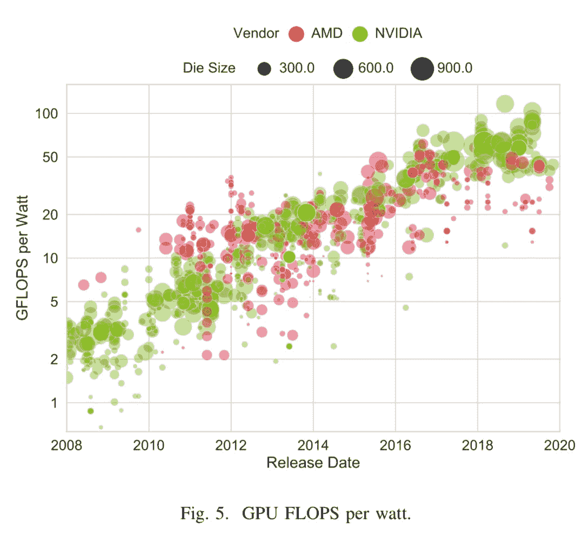

### Jim Fan评价：不会AI寒冬，在物理世界中具身化的智能将成为创造经济价值的强大动力

https://x.com/DrJimFan/status/1781726400854269977

AI寒冬?不会。即使GPT-5达到瓶颈,机器人技术还没有开始大规模应用。在物理世界中具身化的智能将成为创造经济价值的强大动力。友情提醒大家,大语言模型(LLM)并非AI的全部。它只是一个更大拼图中的一块。

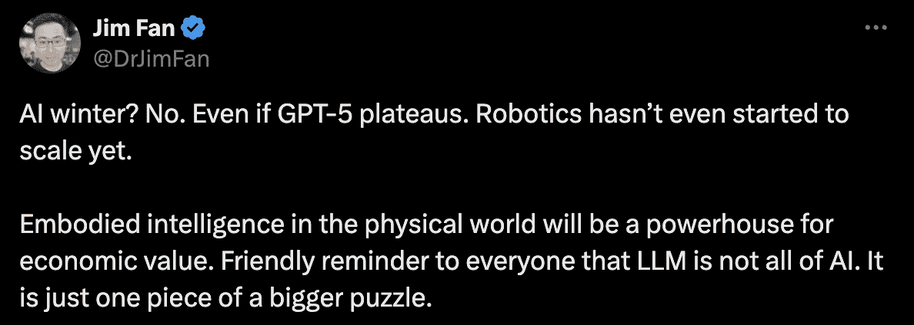

### Karpathy分享llm.c更新：用约2000行干净的C/CUDA代码编写的单文件现在可以在GPU上训练 GPT-2(124M),速度与PyTorch相当

贡献人：

https://x.com/karpathy/status/1781387674978533427

🔥`llm.c`更新:我们用约2000行干净的C/CUDA代码编写的单文件现在可以在GPU上训练 `GPT-2(124M)`,速度与`PyTorch`相当(`fp32`,还没有`flash attention`)。

https://github.com/karpathy/llm.c/blob/master/`train_gpt2.cu`

在我的`A100上,`llm.c`的每次迭代耗时78ms,`PyTorch`为80ms。请记住,这是`fp32`精度,还没有使用`flash attention`,并且`PyTorch`版本略有些旧(`2.1.0`)。

+ 它直接用C/CUDA实现了训练循环和反向传播。

+ 它可以即时编译和运行。不再需要"点击运行后等待数十秒,原因不明",也不需要堆砌大量难以理解的抽象来构建一个宇宙。

+ 它消除了对Python解释器和深度学习库的需求。

+ 它在开始时一次性分配所有内存。

+ 这非常酷。

怎么做到的:

要实现这一点,我们编写了许多自定义CUDA内核,手动完成这些工作(而不是使用`aten`/`PyTorch`的`Tensor`操作和`torch.compile`等)有点像用汇编语言编程。你会花大量时间查看更多的汇编代码(CUDA PTX/SASS)。但这也意味着我们可以对代码进行超优化,并可能探索`torch.compile`难以实现的优化,这太棒了。以下是最近几天完成的一些优化示例:

+ 在反向传播中,我们巧妙地控制内存消耗,只使用传播梯度所需的几个缓冲区,节省了内存。

+ 一个融合的分类器内核完成最后一层前向传递、损失计算,并启动反向传递。

+ 对所有相关内核进行了许多改进,包括在注意力模块中通过精心限制自回归掩码内的执行来获得性能提升。

+ 使用`cuBLAS(Lt)`进行所有繁重的矩阵乘法,并融合偏置累加。

非常感谢两位从互联网某处出现并帮助这个开源项目的CUDA专家,`ngc92`和`ademeure`。我们在`Github`、`CUDAMODE`的`Discord`和我的"`NN Zero to Hero`"上讨论。

下一步:

+ 进一步优化我们的`fp32`内核,尤其是切换到`flash attention`。

+ 混合精度训练(从`fp16`开始)。

+ 多GPU训练(从`DDP`开始)。

+ 设置数据和评估,以进行适当的`GPT-2`训练

+ 🚀 复现`GPT-2(1.6B)`的训练过程

+ 更现代的架构等(`Llama 3`?)

+ 编写文档、制作视频,练习从零开始构建这一切。

图1:赏心悦目的内容:内核的时间分布图(一层)。`NVIDIA cutlass`内核的计算吞吐量很高,占用了大部分运行时间 => 不错。

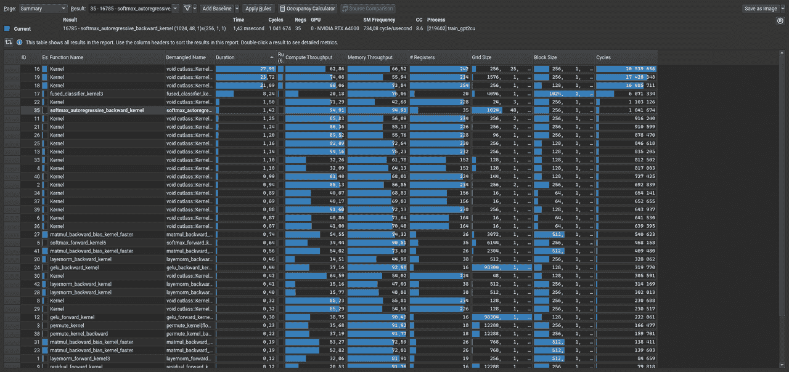

### Meta Jason Liu分享：对规划代理的三步思考

贡献人：

https://x.com/jxnlco/status/1781811260511719551

这是我对规划代理的三步思考:

https://youtube.com/watch?v=W31UMLHcqc4…

1. 使用推荐系统,根据请求预测必要的工具。

1. 基于请求、检索到的工具及其描述,生成执行计划(有向无环图`DAG`)。通过对话反复优化计划。

1. 微调模型,使其能够根据输入和工具预测最终计划,使用成功运行的计划示例,并根据需要实现单个边。目标是创建一个独立于确定性执行的概率性计划构建过程,生成用于检索和少样本示例的产物,最终实现单次输出预测。

这个三步流程的核心思想是:首先通过推荐系统智能选择合适的工具,然后生成初步的执行计划,通过与用户的交互对话来迭代优化计划。在积累了足够的成功执行计划样本后,就可以训练机器学习模型来根据输入直接预测最优的执行计划,实现端到端的自动化。这种方法把计划的生成和执行解耦,利用检索和少样本学习等技术,最终达到单次预测输出的目标。

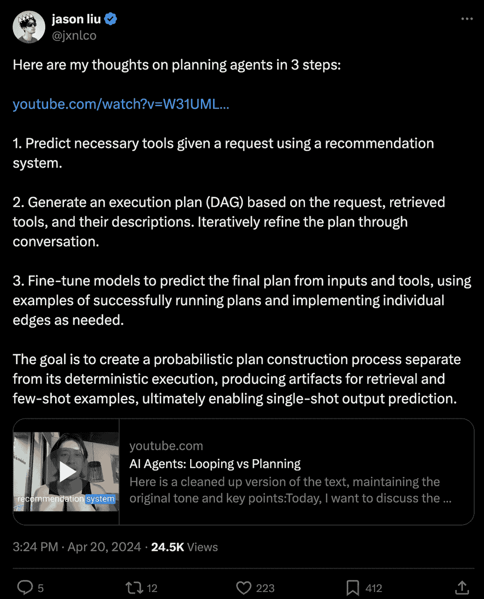

### Perplexity CEO Aravind：关于Llama 3最印象深刻的是，将知识和推理能力很好地压缩到密集8B/70B模型中，而不是扩展MoE

贡献人：

https://x.com/AravSrinivas/status/1781730552607039747

关于Llama 3最让我印象深刻的是:当其他人都在扩展稀疏的混合专家模型(`MoE`s)时,他们是如何将如此多的知识和推理能力很好地压缩到一个密集的`8B`和`70B`模型中的。这并不意味着拥有大量`GPU`不重要。考虑到为了获得正确的数据组合需要运行多少次迭代,`GPU`可能更加重要。但这绝对告诉你,机构可以拥有很多`GPU`,但使用效率低下。我真的很期待更大、上下文更长的`Llama 3`模型。

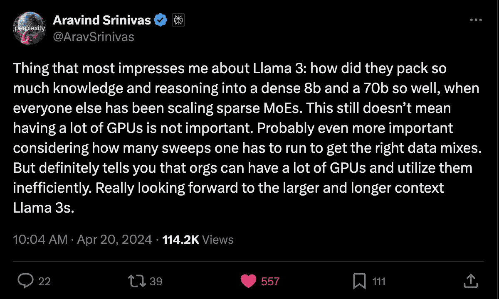

### Ng分享：Llama 3 70B 模型从 M1 Max 笔记本传输到手机

贡献人：

https://x.com/localghost/status/1781847388879220742

`Llama 3 70B` 模型从我的 `M1 Max` 笔记本传输到我的手机

使用 `mlx` 实现了大约 7.6 token/s 的速度。相当于在家里拥有你自己的小型 `GPT-4`

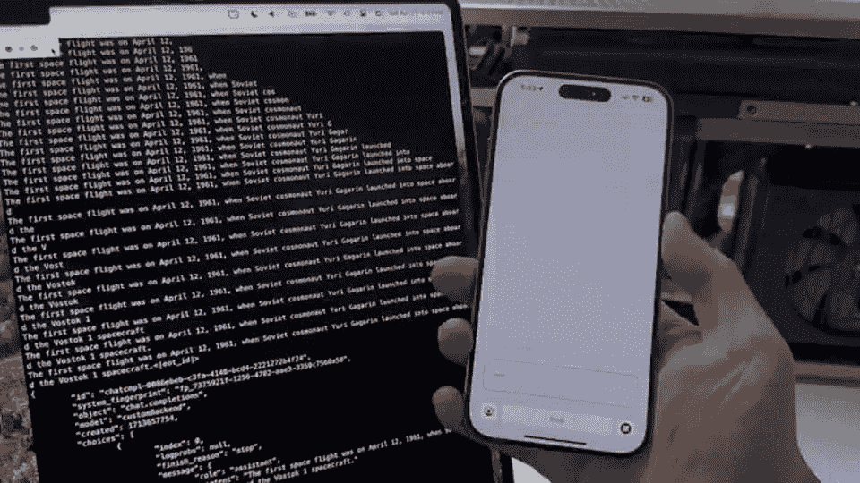

[ssstwitter.com_1713690200324.mp4](https://internal-api-drive-stream.feishu.cn/space/api/box/stream/download/all/CS7GbaxVPovFXQxk2KBcCg6Wnjh)

### Anton：Meta 发布接近 GPT-4 级别的模型确实在压低 token 的价格，因为任何人都可以拿到权重并优化运行时

贡献人：

https://x.com/abacaj/status/1781443464246559180

Meta 发布接近 `GPT-4` 级别的模型确实在压低 `token` 的价格,因为任何人都可以拿到权重并优化运行时,例如 `groq`、`togetherapi`、`fireworks` 等。这对 `OpenAI` 肯定不利。

我认为训练强大的模型更难,需要更大的前期投入。它仍然需要通过严格的测试/研究来完成,但也掺杂了一些运气和 `YOLO`(舍我其谁)的尝试。这与优化运行时有点不同。

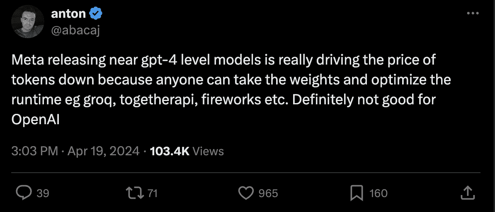

### HuggingFace发布FineWeb：15万亿token的高质量网络数据

贡献人：

https://x.com/gui_penedo/status/1781953413938557276

我们刚刚发布了🍷`FineWeb`:15万亿`token`的高质量网络数据。

我们对2013年至2024年间所有的`CommonCrawl`数据进行了过滤和去重。

在`FineWeb`上训练的模型性能优于`RefinedWeb`、`C4`、`DolmaV1.6`、`The Pile`和`SlimPajama`!

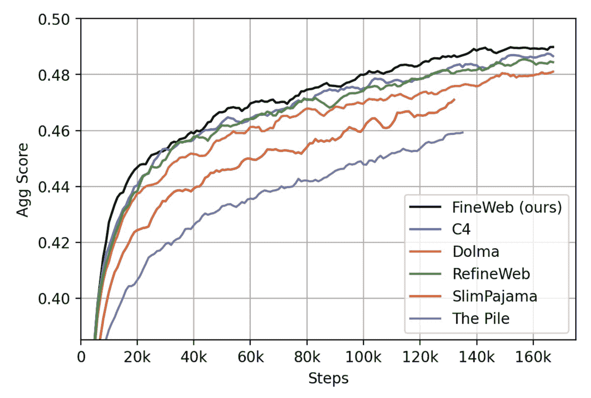

## 资讯

### 再见，AI意识先驱：Daniel Dennett

贡献人：

https://mp.weixin.qq.com/s/q_NHqYVQeap93k2JQ5d-lg

丹尼特在哲学领域做出了重大的贡献，被称为“进化论四骑士”之一，是近二十年来西方新无神论运动的领军人物。他的巨作《意识的解释》被认为是心智哲学甚至当代哲学中最重要的著作之一，全方位地对意识现象做了探索。而他对于“意识”独树一帜的见解，正是源自他与计算机和人工智能颇深的渊源，广泛吸收了来自神经科学、心理学、人工智能等领域的信息。与此同时，他的思想和言论也深刻地影响着人们对人工智能、意识和思想的理解。

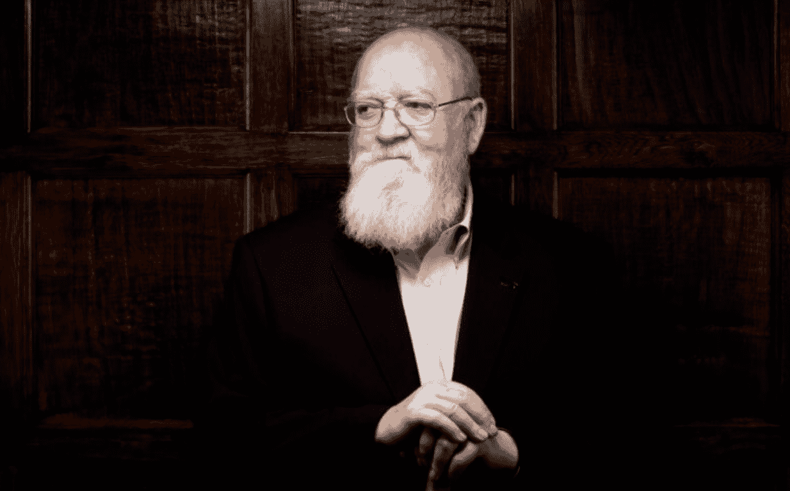

### 史上首次！AI驱动战机成功与人类飞行员空中「狗斗」

贡献人：

https://mp.weixin.qq.com/s/EAKZPDc1MJnG6fXd3F2DpQ

AI 操纵的战斗机又一次进化了！近日，美国 `DARPA` 透露称，去年 9 月一架由 `F-16` 改装而成的 AI 验证机，有史以来首次成功地在视距内与人类飞行员进行空中缠斗（俗称狗斗），让我们看到了人工智能在空战领域的应用前景。该验证机代号为 `X-62A VISTA`，是一架 `F-16D（Block 30）`双座飞机，人类飞行员同样驾驶一架 `F-16` 战斗机。在对抗中，`DARPA` 称，虽然 `X-62A VISTA` 上的人类飞行员可以接管 AI 系统，但在任何时候都不需要激活安全开关。从视频中可以看到，两架战斗机展示了「高视角机头对机头交战」，逼近时相对速度达到 1200 英里 / 时（约 1931 公里 / 时），两机最近时相距仅为约 610 米。对抗过程中验证了 AI 驾驶战机的防御机动、攻击时缠斗等战斗技能，不过遗憾的是 `DARPA` 没有透露哪架飞机赢得此次战斗。对此，有人表示终于嗅到了「终结者」的味道。

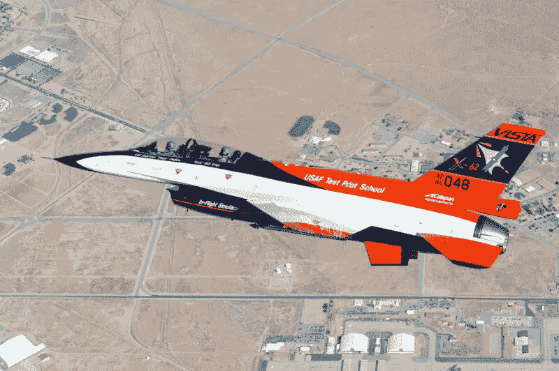

### 星海图高继扬：人形机器人不是具身智能的唯一答案

贡献人：

https://mp.weixin.qq.com/s/onUEdlmvwrjzJ5sWuobAqQ

具身智能已经成为人工智能领域最值得期待的一大赛道之一。现在，智能机器人已经可以自主实现咖啡拉花、搬箱子、叠被子，甚至能够像人与人一样通过自然语言交互，**理解人类的意图并做出调整。**国内外众多科技公司正在推动机器人变得更加“智能”，希望它最终可以完成各种任务，能与环境交互感知，拥有自主规划、决策、行动、执行能力。但以终为始，什么样的路径才有可能推动具身智能产品抵达如此高度的智能？星海图 CEO 高继扬(提出了他们的路径想法：对现阶段的具身智能产品而言，代表智能的 “大脑” 比代表执行的 “身体” 更为重要。如果要抵达具身智能的终局，需要针对具体场景推出合适的产品，完成商业闭环，从而得到更多来自物理世界的数据，最终不断提高机器人的 “智能” 程度。

### 刚刚，a16z 提拔了一位华人女性合伙人负责 12.5 亿美元 AI 基础设施基金！她还是 ElevenLabs 投资人

贡献人：

https://mp.weixin.qq.com/s/sqnQCEWUTj3yp2GybgJxwg

Jennifer Li 于 2018 年加入 `a16z`，本周升任为 `a16z` 第 27 位普通合伙人，在 30 岁出头就达到了这一职业里程碑，将在 `a16z` 新成立的 12.5 亿美元 `AI` 基础设施基金扮演关键角色，该基金由资深普通合伙人 `Martin Casado`管理。据悉，Jennifer Li 在中国北方长大，后移居美国攻读更高学位，拥有卡内基梅隆大学软件工程硕士学位和伦斯勒理工学院技术管理硕士学位。

### 上海交通大学人工智能学院来了！还将与华为、科大讯飞、商汤科技等9家单位进行校企合作

贡献人：

https://www.cls.cn/detail/1653079

今日，上海交通大学人工智能学院揭牌成立。上海交大已经成为AI创业者们的“摇篮”，部分头部AI企业创始人均来自于此。上海交大还与华为、科大讯飞、商汤科技、云从科技、云天励飞、壁仞科技、第四范式等9家机构签署战略合作协议。

### 大模型一定就比小模型好？谷歌的这项研究说不一定

贡献人：

https://mp.weixin.qq.com/s/qmVEhCRlpwC6EnALGuGAhA

在这个大模型不断创造新成就的时代，我们通常对机器学习模型有一个直观认知：越大越好。但事实果真如此吗？近日，`Google Research` 一个团队基于隐扩散模型（`LDM`）进行了大量实验研究，得出了一个结论：更大并不总是更好（`Bigger is not Always Better`），尤其是在预算有限时。近段时间，隐扩散模型和广义上的扩散模型取得的成就不可谓不耀眼。这些模型在处理了大规模高质量数据之后，可以非常出色地完成多种不同任务，包括图像合成与编辑、视频创建、音频生成和 3D 合成。尽管这些模型可以解决多种多样的问题，但要想在真实世界应用中大规模使用它们，还需要克服一大障碍：采样效率低。该团队通过实验研究了规模大小的变化对 `LDM` 的性能和效率的影响，其中关注重点是理解 `LDM` 的规模扩展性质对采样效率的影响。他们使用有限的预算从头开始训练了 12 个文生图 `LDM`，参数量从 `39M` 到 `5B` 不等。

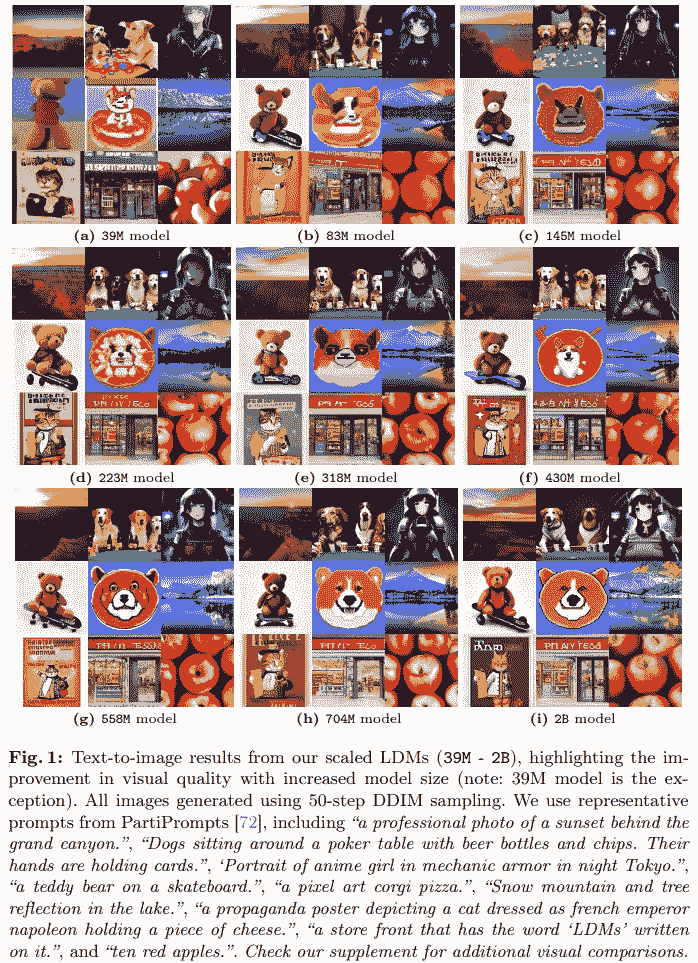

### 字节提出新一代数据集COCONut，比COCO粒度分割更密集

贡献人：

https://mp.weixin.qq.com/s/_yqdnpKl03EYMgdKKwoABg

随着人工智能的发展，语言模型和生成模型获得了大量的成功并且在设计模型的过程中，模型的参数量也越来越大。对于细粒度理解任务，模型参数量也同样在增加。然而目前现有的数据集存在规模和精度的矛盾，例如 `SA-1B` 数据集中 99.1% 的 mask 都是机器生成的，但没有赋予语义的标签，而其他一些公开数据集也同样存在精度问题并且这些数据集的规模一般都比较小。近期，字节跳动提出了新一代细粒度理解的数据集，针对当代深度学习模型的设计需求，给总量为 383K 的图片进行了全景分割的人工标注，最后达到了 5.18M 张 mask，是至今最大规模的带人工标签的全景分割理解数据集，命名为 `COCONut`。该成果已入选 `CVPR2024`。

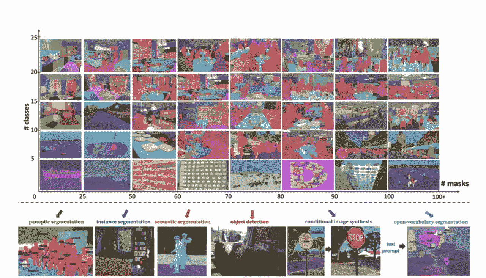

# 跳舞时飞扬的裙摆，AI也能高度还原了，南洋理工提出动态人体渲染新范式

贡献人：

`https://mp.weixin.qq.com/s/QKuR2BzCFSBQ0epP2b4ZWQ`

在日常活动中，人的运动经常引起衣服的附属运动 (secondary motion of clothes) 并因此产生不同的衣服褶皱，而这需要对人体及衣服的几何、运动（人体姿态及速度动力学等）及外观同时进行动态建模。由于此过程涉及复杂的人与衣服的非刚体物理交互，导致传统三维表征往往难以应对。近年从视频序列中学习动态数字人渲染已取得了极大的进展，现有方法往往把渲染视为从人体姿态到图像的神经映射，采用 「运动编码器—运动特征—外观解码器」的范式。而该范式基于图像损失做监督，过于关注每一帧图像重建而缺少对运动连续性的建模，因此对复杂运动如 「人体运动及衣服附属运动」难以有效建模。为解决这一问题，来自新加坡南洋理工大学 `S-Lab` 团队提出运动—外观联合学习的动态人体重建新范式，并提出了基于人体表面的三平面运动表征 (surface-based triplane)，把运动物理建模和外观建模统一在一个框架中，为提升动态人体渲染质量开辟了新的思路。该新范式可有效对衣服附属运动建模，并可用于从快速运动的视频（如跳舞）中学习动态人体重建，以及渲染运动相关的阴影。在渲染效率上比三维体素渲染方法快 9 倍，LPIPS 图像质量提高约 19 个百分点。

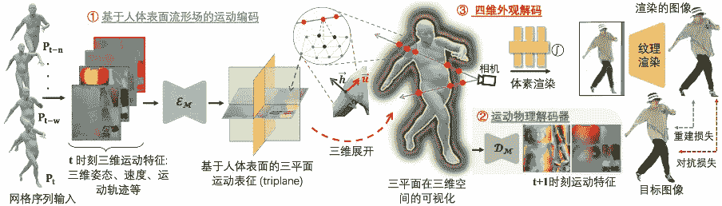

## 产品

### Grimo AI

贡献人：

`https://go.grimo.ai/`

Grimo AI 是一个尖端的知识引擎，它将 `Obsidian`、`GitHub` 和 `Quora` 的优点结合到一个产品中。使用 Grimo AI，用户可以在一个地方构建、搜索和组织知识，通过强大的模糊搜索将社区共享的见解直接分叉到存储库中，导入并提炼来自 `YouTube` 和 `Twitter` 的内容，并享受极简主义的纯文本体验，专为实现终极生产力而设计。

### Parny

贡献人：

`https://parny.io/`

Parny 旨在帮助 IT 和技术团队更高效地管理紧急信号，并确保处理紧急情况尽可能顺利和协作的 SaaS 服务。它提供了将所有监控工具的警报整合到一个简化的仪表板中、在警报触发时立即向值班人员发起实时电话、利用 AI 提供快速解决方案建议、使用独特的 `#SocialOps` 界面促进团队协作，以及通过全面的分析获得有价值的见解来提高运营效率等功能。

### Open Agent Studio

贡献人：

`https://www.openagent.studio`

Open Agent Studio 是一款桌面应用程序，旨在解决当前RPA（机器人流程自动化）工具中存在的基本障碍。该产品提供了一些新颖的功能和技术突破，包括引入了强大的新型RPA概念，如“语义目标”；`Agent Recorder` 可记录鼠标点击/移动和按键操作，以便使用准确的语义目标重新构建自动化图形；`Live Agents` 可以自动化常见流程，并根据屏幕上下文智能地建议自动化任务；`Prompt To No-Code Graph` 可以将开放式自动化提示转换为自定义无代码图形等。此外，Open Agent Studio 还介绍了一些关键的技术突破，包括语义目标的使用、自己的多模态模型`Atlas-2`、与浏览器的`Websocket`服务器集成等。

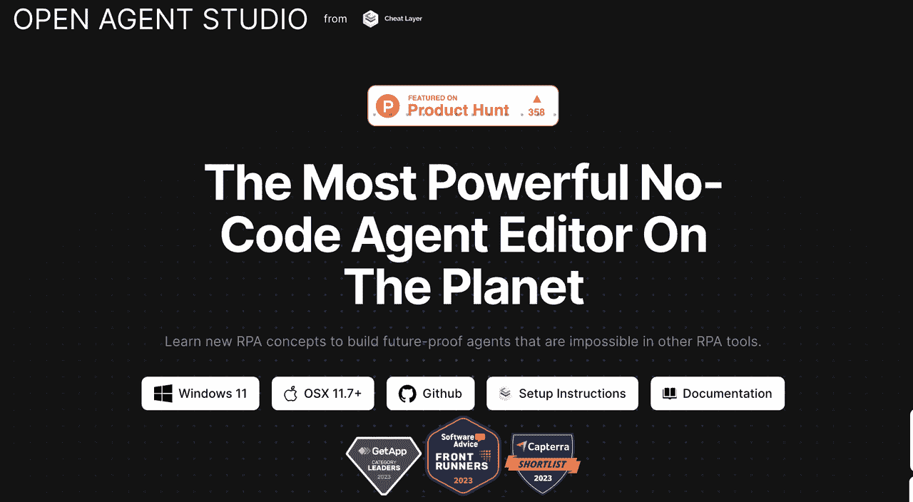

## HuggingFace&Github

### Firecrawl

贡献人：

`https://github.com/mendableai/firecrawl`

`https://www.firecrawl.dev/?ref=github`

Firecrawl 是一个 API 服务，它可以接收一个 URL，然后对其进行爬取，并将其转换为干净的 `markdown` 格式。它会爬取所有可访问的子页面，并为每个页面提供干净的 `markdown` 格式。不需要网站地图。用户可以使用其托管版本的易用API，也可以选择自行托管后端。如果想要使用该API，需要在Firecrawl上注册并获取一个API密钥。可以使用API密钥来提交爬取作业，并检查爬取作业的状态和结果。

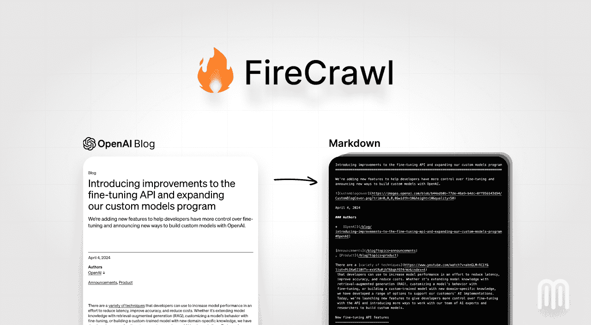

### Flyte

贡献人：

`https://github.com/flyteorg/flyte`

Flyte是一个开源编排器，有助于构建生产级数据和 ML 管道。它专为可扩展性和可重复性而构建，利用 `Kubernetes` 作为其底层平台。借助Flyte，用户团队可以使用`Python` SDK构建管道，并将其无缝部署在云和本地环境中，从而实现分布式处理和高效的资源利用。Flyte还支持使用`Python`或其他语言编写代码，并利用强大的类型引擎。用户可以在本地或远程集群上轻松执行其模型。

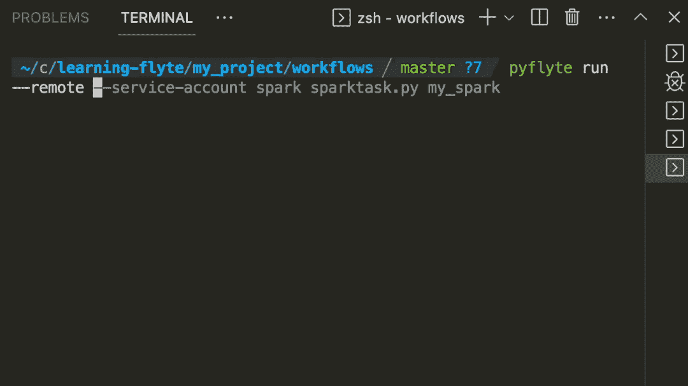

### `rtp-llm`

贡献人：

`https://github.com/alibaba/rtp-llm`

`rtp-llm` 是阿里巴巴大模型预测团队开发的 LLM 推理加速引擎。`rtp-llm` 在阿里巴巴内部被广泛使用，支持了包括淘宝、天猫、闲鱼、菜鸟、高德、饿了么、AE、Lazada 等多个部门的大模型推理业务。

## 投融资

## 学习

### 如何看待 Meta 发布 `Llama3`，并将推出 400B+ 版本？

贡献人：

`https://www.zhihu.com/question/653373334/answer/3471466524`

`LLaMa3`的技术细节中，最显著的是模型不采用MoE架构而维持Dense架构，即使在其400B+的版本中。此外，`LLaMa3`没有推出多模态版本，目前只提供纯文本模型。`8B`的小型模型在15T token的数据训练下依然有效，显示出比预期的Chinchilla Scaling Laws更好的性能。`LLaMa3`的数据处理策略中，使用`LLaMa2`作为数据质量分类器，以优化数据清洗，确保高质量的训练数据。这种方法对模型的整体表现和推理效率有显著影响。

### Llama3 微调项目实践与教程（`XTuner` 版）

贡献人：

`https://mp.weixin.qq.com/s/sKet1R4k_Xwmfo6D_x17Rw`

文章详细描述了`XTuner`团队如何高效地微调`Llama 3`模型。`XTuner`团队首先对模型进行了性能测试，使用2个`A100` 80G GPU全量微调8K上下文的`Llama 3 8B`模型，并展示了不同GPU配置下的训练效率。此外，团队也提供了详尽的步骤指南，从环境配置、模型下载到实际训练和部署，包括使用`conda`环境和必要的库安装，以及如何利用`XTuner`工具进行模型微调。

在实操中，`XTuner`团队利用自己开发的脚本来生成个性化训练数据，并通过修改配置文件来适配`Llama 3`模型的微调需求。通过这种方式，他们成功实现了模型的个性化自我认知训练，最终在Web Demo中展示了模型的交互效果。整个过程中，`XTuner`团队展现了在复杂的AI模型部署和微调中的专业能力和实操经验。

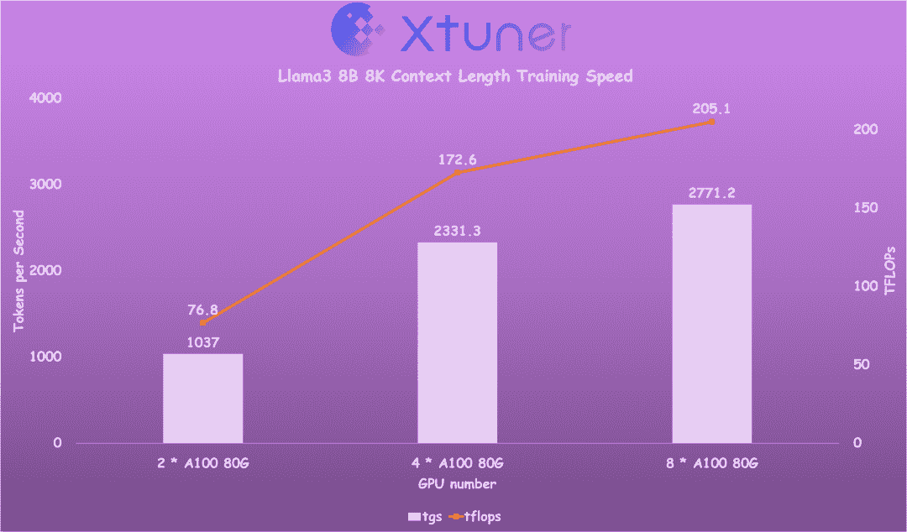

### Llama 3开源！魔搭社区 推理，部署，微调和评估 教程

贡献人：

`https://mp.weixin.qq.com/s/hiRtM4jrGyFF_utCE1-LCA`

文章详细介绍了Meta `Llama 3`模型的环境配置与安装过程。要求`Python 3.10`或以上、`PyTorch 1.12`及以上（推荐`2.0`以上版本），及`CUDA 11.4`以上。安装步骤包括从`ModelScope`社区下载模型，并使用`Python`库进行配置。提供了示例代码，用于加载模型并执行基本的聊天应答推理，确保用户能快速开始体验`Llama 3`模型的功能。

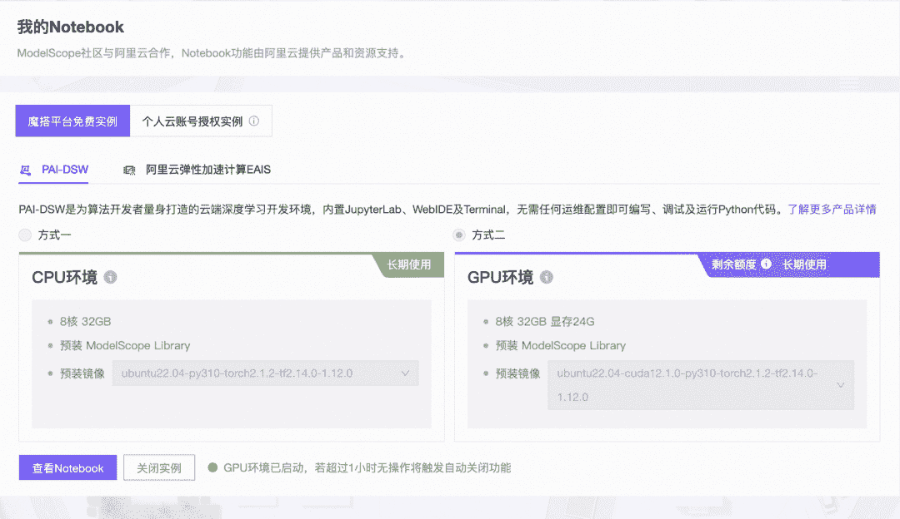

### 搞懂 `CUDA` Shared Memory 上的 bank conflicts 和向量化指令（`LDS.128` / `float4`）的访存特点

贡献人：

`https://zhuanlan.zhihu.com/p/690052715`

文章深入探讨了`CUDA`中shared memory的bank conflicts和向量化指令的访存特性。在优化如`GEMM`这类算子时，利用shared memory的广播机制并避免bank conflicts至关重要。文章解释了如何使用`LDS.64`或`LDS.128`指令来优化内存访问，通过一次性访问8或16个bytes来提高效率。详细讨论了不同的访存指令如`float2`、`float4`在shared memory中如何影响bank conflicts的产生，以及如何通过组织线程和数据访问模式来最小化这些冲突，优化内存访问性能。文章通过实例和测试总结出使用这些指令时的访存特点，帮助开发者更好地理解和应用这些高级特性。

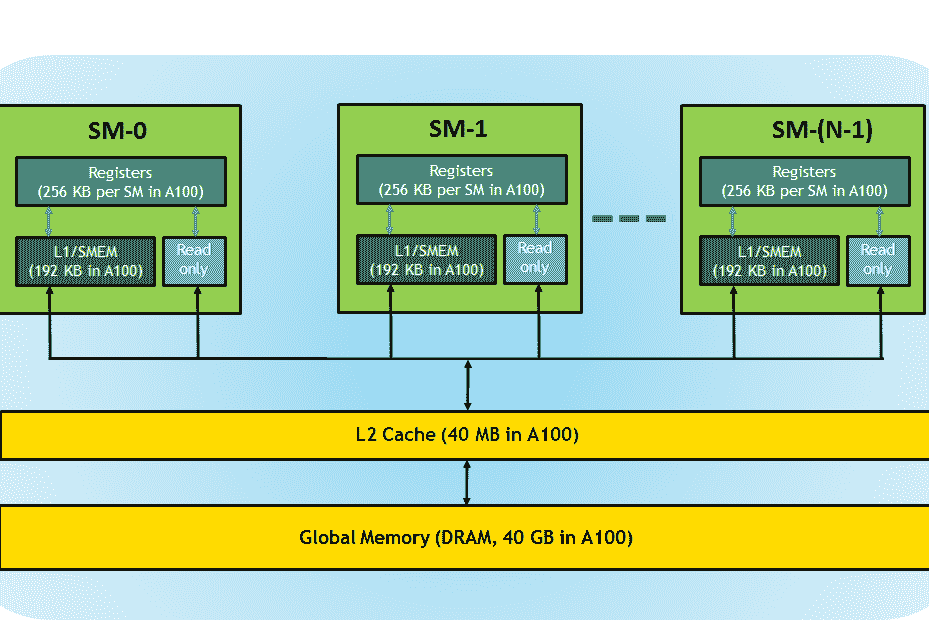

### Diffusion模型推理过程中的`Cache`

贡献人：

`https://zhuanlan.zhihu.com/p/689685429?utm_psn=1764794438206042112`

文章探讨了Diffusion模型在推理过程中使用缓存（`Cache`）技术来提高效率。主要内容涉及两种优化方法：减少迭代次数和系统级加速，特别是通过缓存相似信息来实现。文章特别介绍了Adobe的`Nirvana`系统，这是一个大规模分布式并行推理服务系统，它通过合并重复计算部分来优化性能。此外，`Nirvana`系统还利用`CLIP embedding`的特点，通过检索和重用缓存中的中间噪声状态，来减少必要的去噪步骤，从而减少GPU计算需求、端到端延迟，并节约成本。文章还提到了一个重要的数据库工具，`DiffusionDB`，用于存储和检索图像生成模型的提示词。

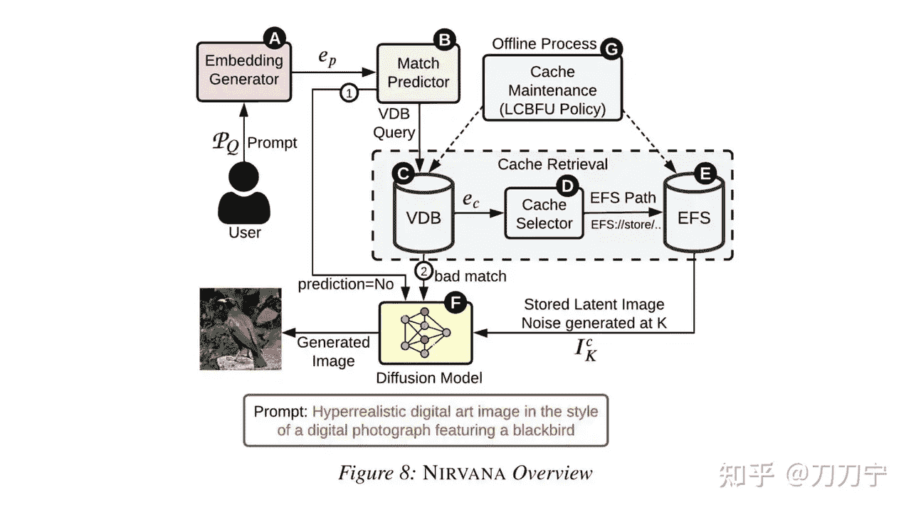

### 视觉变换器的视觉指南

贡献人：

`https://blog.mdturp.ch/posts/2024-04-05-visual_guide_to_vision_transformer.html`

这篇文章通过视觉和简单的解释，详细介绍了视觉变换器（`Vision Transformers`，`ViTs`）的关键组成部分。`ViTs`是一类在图像分类任务上取得最先进性能的深度学习模型，将最初为自然语言处理设计的变换器架构应用于图像数据。文中步骤包括：将图像划分为等大小的块、将图像块展平成向量、创建补丁嵌入、添加分类标记和位置嵌入向量，并详细说明了这些向量是如何通过多头注意力机制处理，最终预测分类概率的。此外，还讨论了模型的训练过程，使用交叉熵损失函数通过反向传播和梯度下降进行训练。

## 声明

本文档仅供学习交流使用，版权归原作者所有，若涉侵权，请联系Jack Jin 15101136166

（欢迎在下方反馈您宝贵的意见！整理不易，觉得有用给AI日报小组点个赞👍吧！）

ChatGPT；Angela；Zijia Liu；Alex；Zeqi Tan；Tiezhen（HuggingFace）；Naixu；Lizhi；Peter；Suoman；Jack

封面生成——右脑科技

如果你有大模型相关的创业想法，欢迎来找我们聊聊～🛰️：15101136166

> 快邀请你的小伙伴们一起来读大模型日报吧！

> 【日报知识库】这里是近期日报内容的汇总,欢迎大家查阅

> [大模型日报知识库(分享版)](https://miracleplus.feishu.cn/wiki/KapVwXfkriOBiskB0B2cUHxjnTh)

>

> 欢迎大家多多帮我们分享,转发~~

> 如果大家有任何的建议或者吐槽,欢迎随时找我聊天~

