# 奇绩大模型日报（4月 19日）

> 来源：[https://miracleplus.feishu.cn/docx/PI3idHUrQoqXPpxg5Eoc7rEfncd](https://miracleplus.feishu.cn/docx/PI3idHUrQoqXPpxg5Eoc7rEfncd)

# 推特

### Shumer评价LlaMA3：我们就会拥有一个比 Opus 更强大的、完全开源的模型！

贡献人：

https://x.com/mattshumer_/status/1780994395128451358

最疯狂的 LLaMA 3 揭秘:

这个模型的 400 亿参数以上版本**已经和 Claude 3 Opus 不相上下**,而且还在继续训练。

很快,我们就会拥有一个比 Opus 更强大的、完全开源的模型。

这意味着巨大的影响。

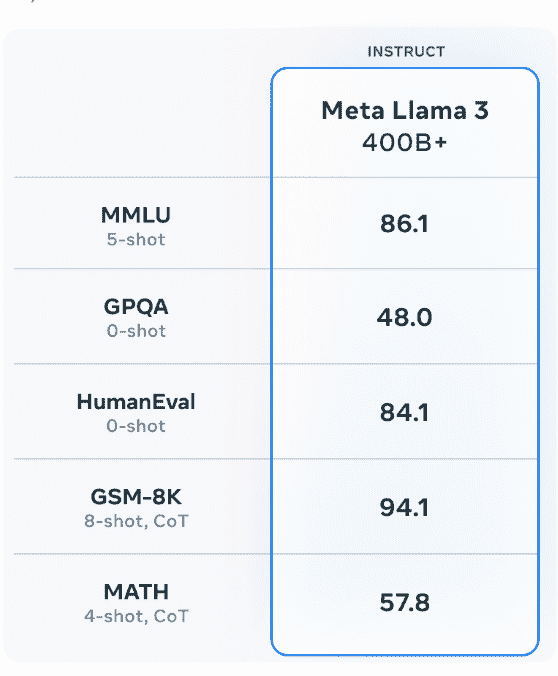

### Llama3上线VSCode Copilot，Daniel San分享演示视频

贡献人：

https://x.com/dani_avila7/status/1781061220495138907

Llama 3 作为 VSCode 中的 Copilot 🤩

让我来给你演示如何连接 Meta 今天发布的这个惊艳的模型!

这是一个循序渐进的教程!🧵

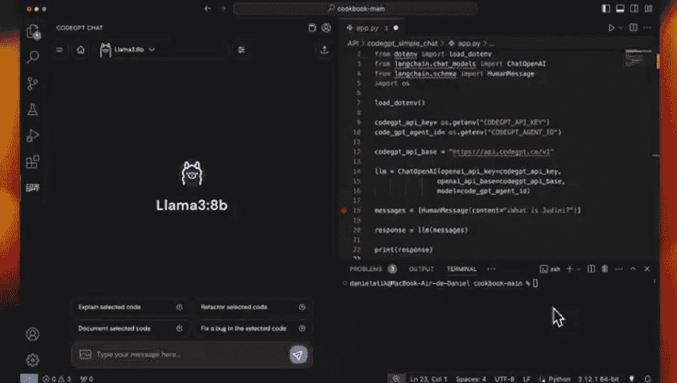

[ssstwitter.com_1713514210184.mp4](https://internal-api-drive-stream.feishu.cn/space/api/box/stream/download/all/Bt6qb9g9PoQlchxRtjCcZFn6nxb)

### Daniel Han分享：为 Llama-3 8B 模型制作了一个 Colab 笔记本，15万亿 tokens

贡献人：

https://x.com/danielhanchen/status/1781024799227285799

为 Llama-3 8B 模型制作了一个 Colab 笔记本!使用了 15 万亿 tokens!所以现在 @UnslothAI 已经支持它了!使用免费的 T4 GPU。

正在进行基准测试,但是比 HF+FA2 快大约 2 倍,内存使用减少了 80%!支持的上下文长度是 HF+FA2 的 4 倍。而且原生推理速度提高了 2 倍。

https://colab.research.google.com/drive/135ced7oHytdxu3N2DNe1Z0kqjyYIkDXp?usp=sharing

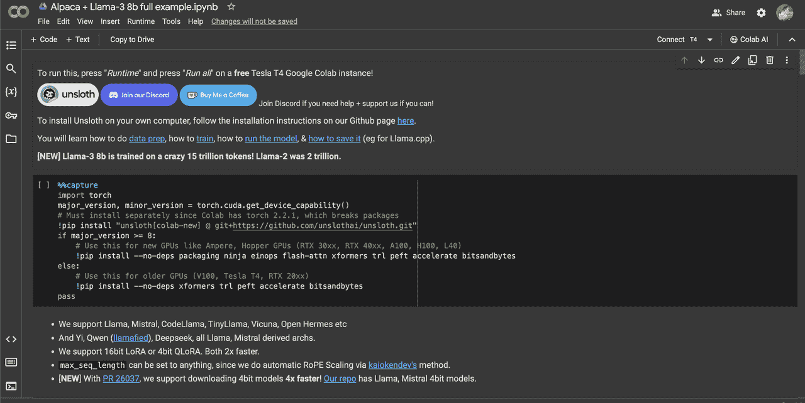

### FoundationCap分享两类自动化领域：有 4.6 万亿美元的工作可以实现自动化

贡献人：

https://x.com/JayaGup10/status/1781060033645830563

我们 @FoundationCap 认为有 4.6 万亿美元的工作可以实现自动化。AI 公司正在引领从软件即服务(SaaS)向服务即软件(Service-as-Software)的转变,颠覆了 SaaS 的本质。

我们将要自动化的领域分为两类:

1.)全球就业岗位的薪资(销售和营销、软件工程、安全和人力资源方面的 2.3 万亿美元)

2.)外包服务和工资支出——包括 IT 服务和业务流程服务(根据 Gartner 的数据,为 2.3 万亿美元)

在软件业务中,公司可能出售对其平台或工具的访问权,但客户仍然要负责使用该工具来实现预期的结果。

在服务业务中,实现预期结果的责任在于销售服务的公司。

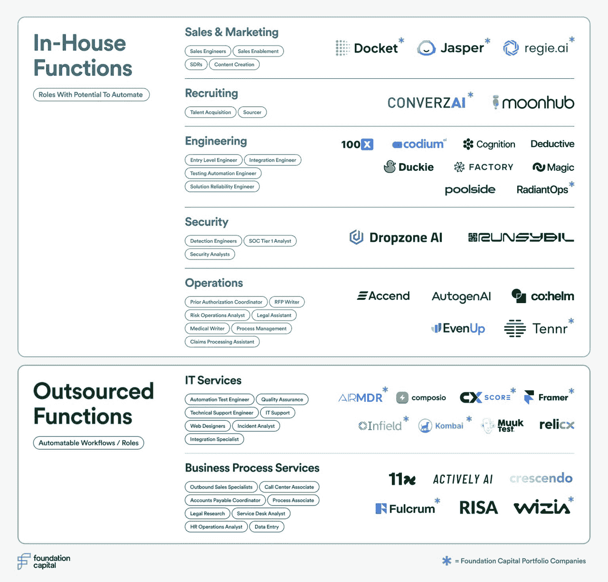

### Pleias在Huggingface 上发布开放语料库，包含200 万个知识共享许可Youtube视频

贡献人：

https://x.com/Dorialexander/status/1780959636306481476

pleias 在 Huggingface 上发布了一个巨大的开放语料库,包含 200 万个知识共享(CC-By)许可的 Youtube 视频。YouTube-Commons 包含多种语言的 300 亿个单词的音频转录,很快还会有其他模态  https://huggingface.co/datasets/PleIAs/YouTube-Commons

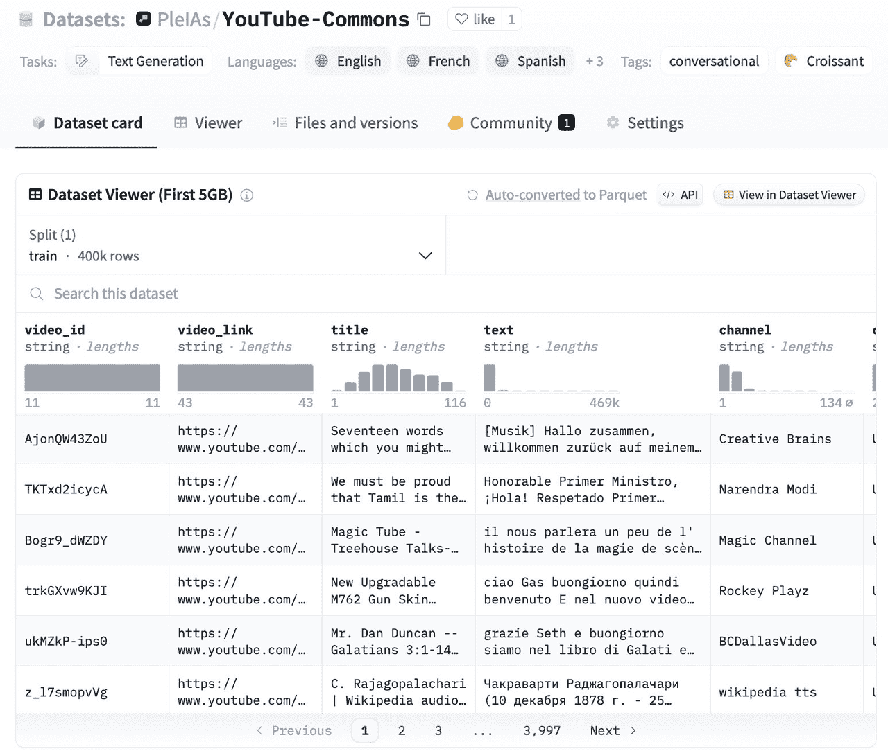

### Omkaar分享简单分布式训练模块，可以在三台 M1 MacBook 上训练一个视觉模型

贡献人：

https://x.com/omkizzy/status/1780991398696669460

gpu 资源不足?我写了一个简单的分布式训练模块,可以在三台 M1 MacBook 上训练一个视觉模型。它是开源的!我本想为 M 系列 Mac 构建一个分布式训练工具,但我遇到了两个障碍:网络延迟非常高,而且我的朋友们在考试季不愿意借出他们的 MacBook(大笑)。我把它改成了一个联邦学习模块(网络成本可以接受)。它还需要更多的调整,比如移除集中式数据存储和压缩负载,但已经完成了 90%:)所以欢迎贡献者加入。联邦学习是一个很难投入生产的问题……但理解起来并不难。感谢来自 @flwrlabs(正在招聘!)的 @jafermarq 给我提供优化建议。有问题吗?尽管问吧:)

[ssstwitter.com_1713514601077.mp4](https://internal-api-drive-stream.feishu.cn/space/api/box/stream/download/all/FqksbneiUolZ1WxpTiMcBWX0nig)

### 吴恩达分享多智能体协作:构建复杂 AI 应用的新范式

贡献人：

https://x.com/AndrewYNg/status/1780991671855161506

多智能体协作已成为一种关键的 AI 代理设计模式。面对像编写软件这样复杂的任务,多智能体方法会将任务分解为由不同角色执行的子任务——比如软件工程师、产品经理、设计师、QA(质量保证)工程师等等——让不同的智能体完成不同的子任务。

不同的智能体可以通过提示同一个 LLM(或者如果你愿意,不同的 LLM)来执行不同的任务。例如,为了构建一个软件工程师智能体,我们可以提示 LLM:"你是编写清晰、高效代码的专家。编写代码来执行任务……"。

尽管我们对同一个 LLM 进行了多次调用,但使用多个智能体的编程抽象似乎有点违反直觉。我想提供几个原因:

+   它很有效!许多团队使用这种方法获得了良好的结果,没有什么比结果更重要了!此外,消融研究(例如,在下面引用的 AutoGen 论文中)表明,多个智能体比单个智能体具有更优越的性能。

+   尽管如今一些 LLM 可以接受非常长的输入上下文(例如,Gemini 1.5 Pro 接受 100 万个 tokens),但它们真正理解冗长、复杂输入的能力参差不齐。一种代理工作流程,即提示 LLM 一次专注于一件事,可以提供更好的性能。通过告诉它应该在什么时候扮演软件工程师,我们还可以指定该子任务中什么是重要的:例如,上面的提示强调了清晰、高效的代码,而不是可扩展和高度安全的代码。通过将整体任务分解为子任务,我们可以更好地优化子任务。

+   也许最重要的是,多智能体设计模式为我们开发人员提供了一个框架,用于将复杂任务分解为子任务。在编写在单个 CPU 上运行的代码时,我们经常将程序分解为不同的进程或线程。这是一种有用的抽象,让我们可以将任务(如实现 Web 浏览器)分解为更容易编码的子任务。我发现思考多智能体角色是一个有用的抽象。

在许多公司,管理者通常决定雇用什么角色,然后如何将复杂的项目(如编写大型软件或准备研究报告)分解为更小的任务,分配给具有不同专业知识的员工。使用多个智能体是类似的。每个智能体实现自己的工作流,有自己的记忆(这本身就是一个在代理技术中快速发展的领域——智能体如何记住足够多的过去交互以便在即将到来的交互中表现更好?),并可能请求其他智能体寻求帮助。智能体本身也可以参与规划和工具使用。这导致智能体之间 LLM 调用和消息传递的喧嚣,可能导致非常复杂的工作流程。

虽然管理人很难,但这是一个足够熟悉的概念,它为我们提供了一个思考框架,关于如何"雇用"AI 智能体并为其分配任务。幸运的是,管理不善一个 AI 智能体造成的损害远低于管理不善人类!

新兴的框架如 AutoGen、Crew AI 和 LangGraph,提供了丰富的方法来构建多智能体解决问题的方案。如果你有兴趣尝试一个有趣的多智能体系统,也可以查看 ChatDev,这是一组运行虚拟软件公司的智能体的开源实现。我鼓励你查看他们的 github 仓库,甚至可以克隆仓库并自己运行该系统。虽然它可能并不总是产生你想要的结果,但你可能会惊讶于它的表现有多好!

就像规划的设计模式一样,我发现多智能体协作的输出质量难以预测。更成熟的反思和工具使用模式更可靠。我希望你喜欢使用这些代理设计模式,希望它们能为你带来惊人的结果!

如果你有兴趣了解更多,我推荐:

+   用于软件开发的交流智能体,Qian 等人(2023)(ChatDev 论文)

+   AutoGen:通过多智能体对话实现下一代 LLM 应用,Wu 等人(2023)

+   MetaGPT:多智能体协作框架的元编程,Hong 等人(2023)

[原文:https://deeplearning.ai/the-batch/issue-245/]

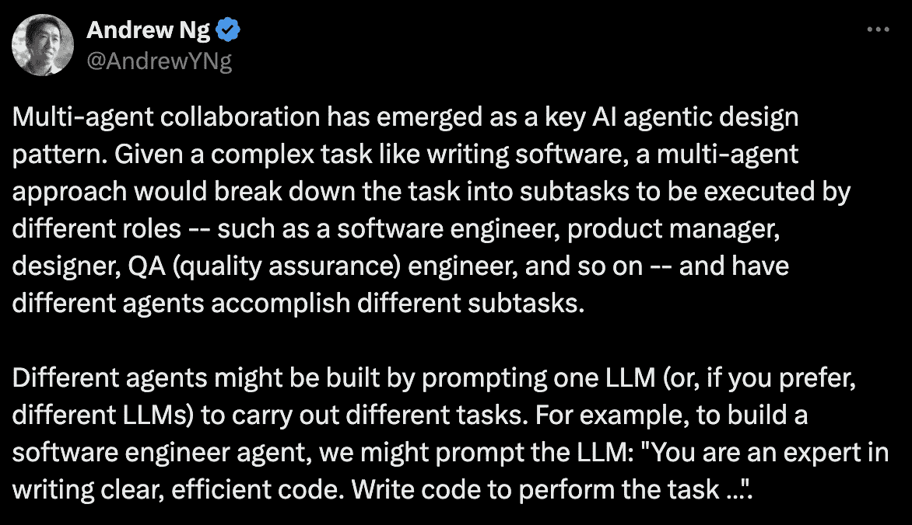

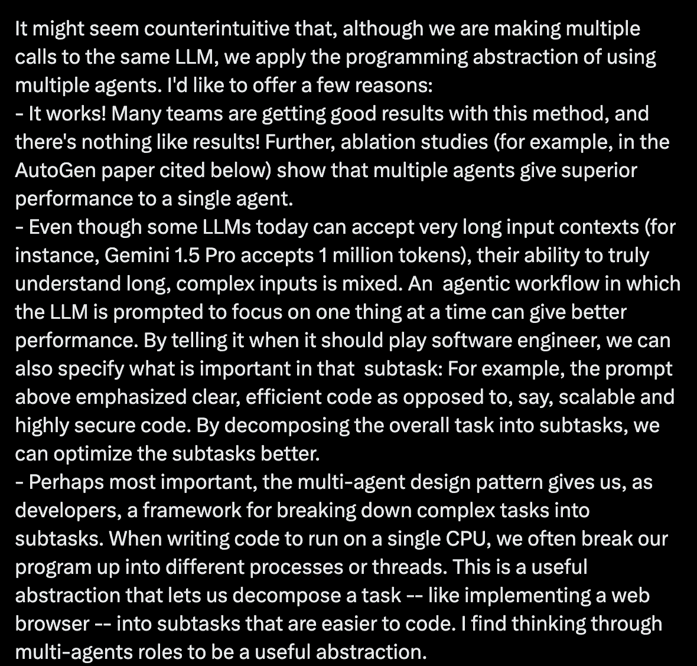

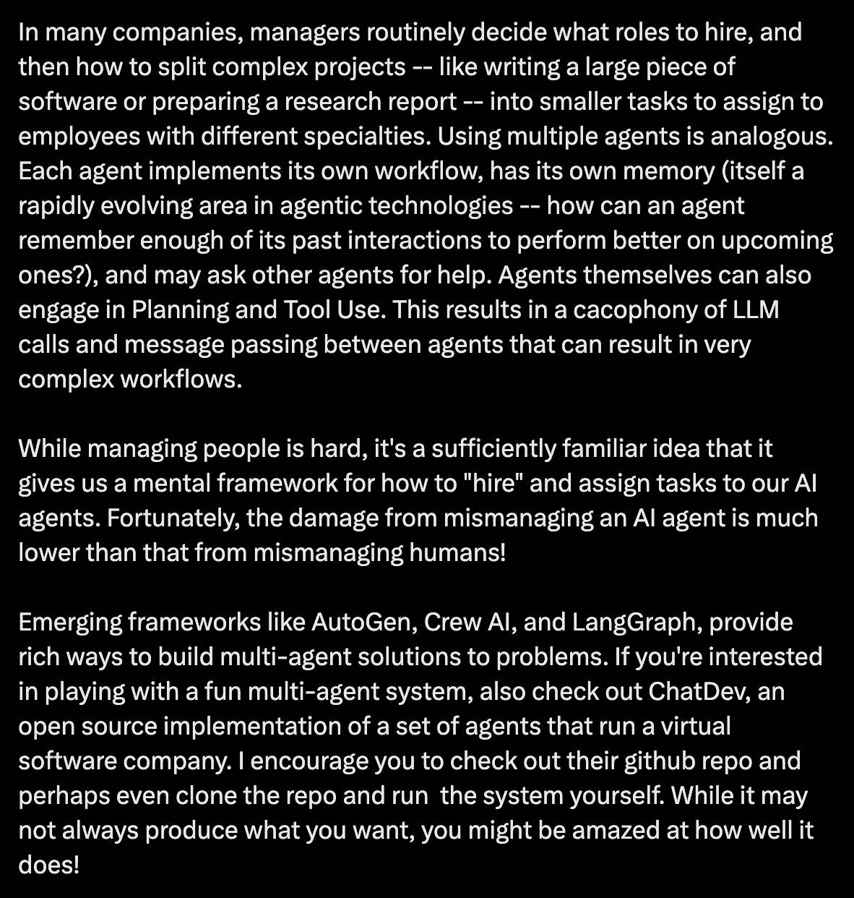

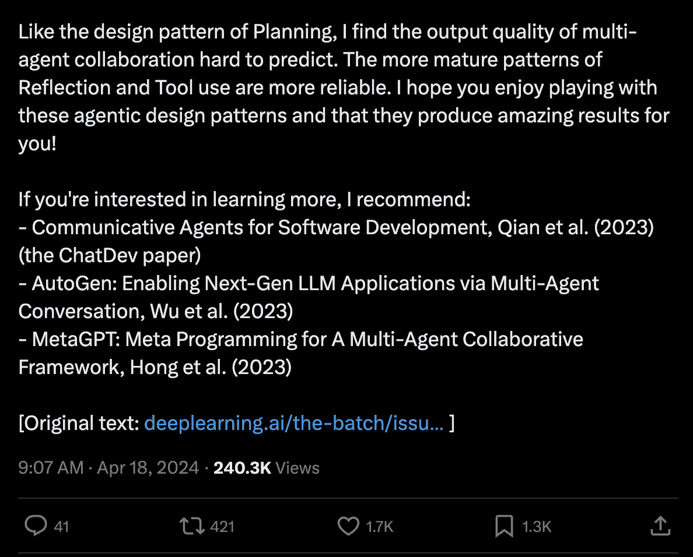

# 资讯

### Llama3-Meta开源推出的新一代大语言模型

贡献人：

https://mp.weixin.qq.com/s/viwP0BsfZD18k9tzHmDgVg

Llama 3是Meta公司最新开源推出的新一代大型语言模型(LLM)，包含8B和70B两种参数规模的模型标志着开源人工智能领域的又一重大进步。作为Llama系列的第三代产品，Llama 3不仅继承了前代模型的强大功能，还通过一系列创新和改进，提供了更高效、更可靠的AI解决方案，旨在通过先进的自然语言处理技术，支持广泛的应用场景，包括但不限于编程、问题解决、翻译和对话生成。

Llama 3的改进地方

**参数规模：**Llama 3提供了8B和70B两种参数规模的模型，相比Llama2，参数数量的增加使得模型能够捕捉和学习更复杂的语言模式。

训练数据集：Llama 3的训练数据集比Llama 2大了7倍，包含了超过15万亿个token，其中包括4倍的代码数据，这使得Llama 3在理解和生成代码方面更加出色。

**模型架构：**Llama 3采用了更高效的分词器和分组查询注意力(Grouped Query Attention,GQA)技术，提高了模型的推理效率和处理长文本的能力。

**性能提升：**通过改进的预训练和后训练过程，Llama 3在减少错误拒绝率、提升响应对齐和增加模型响应多样性方面取得了进步。

**安全性：**引入了Llama Guard 2等新的信任和安全工具，以及Code Shield和CyberSec Eval 2，增强了模型的安全性和可靠性。

**多语言支持：**Llama 3在预训练数据中加入了超过30种语言的高质量非英语数据，为未来的多语言能南力打下了基础。

**推理和代码生成：**Llama 3在推理、代码生成和指令跟随等方面展现了大幅提升的能力，使其在复杂任务处理上更加精准和高效。

### 李未可科技正式推出WAKE-AI多模态AI大模型

贡献人：

https://www.jiemian.com/article/11066207.html

2024中国生成式AI大会上李未可科技正式发布为眼镜等未来终端定向优化等自研WAKE-AI多模态大模型，具备文本生成、语言理解、图像识别及视频生成等多模态交互能力。该大模型围绕 GPS 轨迹+视觉+语音打造新一代 LLM-Based的自然交互，同时多模态问答技术的加持，能实现所见即所问、所问即所得的精准服务。此外，融合了人类意图理解、长期记忆机制、情感大模型及TTS 克隆，可以为用户提供超拟人的情感陪伴服务。

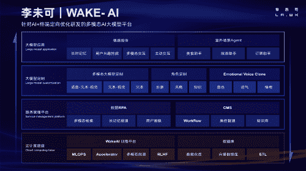

### 5亿个token之后，我们得出关于GPT的七条宝贵经验

贡献人：

https://mp.weixin.qq.com/s/1RLZMw9uVQvL3GscQX84kw

自 ChatGPT 问世以来，OpenAI 一直被认为是全球生成式大模型的领导者。2023 年 3 月，OpenAI 官方宣布，开发者可以通过 API 将 ChatGPT 和 Whisper 模型集成到他们的应用程序和产品中。在 GPT-4 发布的同时 OpenAI 也开放了其 API。一年过去了，OpenAI 的大模型使用体验究竟如何，行业内的开发者怎么评价？最近，初创公司 Truss 的 CTO Ken Kantzer 发布了一篇题为《Lessons after a half-billion GPT tokens》的博客，阐述了在使用 OpenAI 的模型（85% GPT-4、15% GPT-3.5）处理完 5 亿个 token 之后，总结出的七条宝贵经验。

### 4000万蛋白结构训练，西湖大学开发基于结构词表的蛋白质通用大模型，已开源

贡献人：

https://mp.weixin.qq.com/s/pB2qJOMHilM7ETz1XwjWuw

蛋白质结构相比于序列往往被认为更加具有信息量，因为其直接决定了蛋白质的功能。而随着AlphaFold2带来的巨大突破，大量的预测结构被发布出来供人研究使用。如何利用这些蛋白质结构来训练强大且通用的表征模型是一个值得研究的方向。西湖大学的研究人员利用Foldseek来处理蛋白质结构，将其编码成一维的离散token，并与传统的氨基酸进行结合，形成了结构感知词表（Structure-aware Vocabulary），以此将结构信息嵌入到模型输入中，增强模型的表征能力。在预训练上，论文使用了目前最多的蛋白质结构（identity过滤后4000万），在64张A100上训练了3个月，最终开源了具备650M参数量的模型SaProt（同时包括了35M的版本）。实验结果表明SaProt各种蛋白质任务上都要好于之前的序列和结构模型。

### “AI大战”全力以赴？谷歌再出招：重组团队加快产品创建！

贡献人：

https://www.cls.cn/detail/1651457

谷歌正在对其人工智能团队进行结构性改革。据称，构建模型、研究和负责任的人工智能团队将被整合谷歌DeepMind之下，CEO皮查伊说，“我很高兴能在下周四的财报电话会议上展示更多进展。”

### CVPR 2024高分论文：全新生成式编辑框架GenN2N，统一NeRF转换任务

贡献人：

https://mp.weixin.qq.com/s/9CYkP_-oV6g4H5Pcs9PAgw

来自香港科技大学，清华大学的研究者提出了「GenN2N」，一个统一的生成式 NeRF-to-NeRF 转换框架，适用于各种 NeRF 转换任务，例如文字驱动的 NeRF 编辑、着色、超分辨率、修复等，性能均表现极其出色！

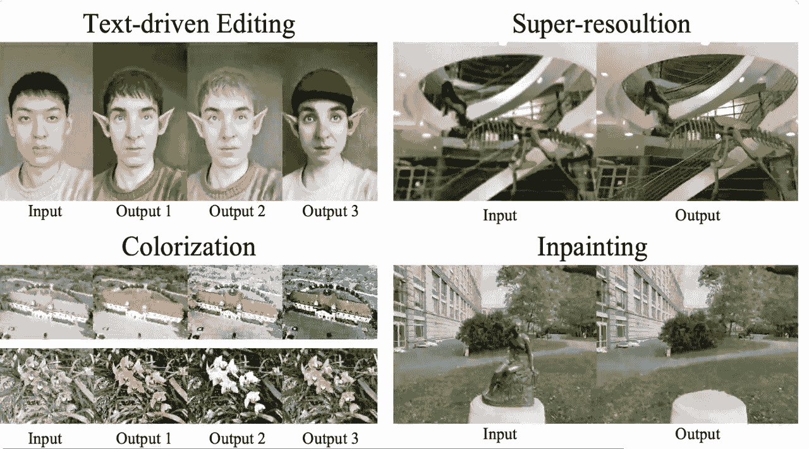

### MLLM真能看懂数学吗？MathVerse来了次摸底测评，放出当天登热

贡献人：

https://mp.weixin.qq.com/s/gEcCi92PdMMCItFII84lcw

在大算力的数字化时代下，大语言模型（LLM）以其令人瞩目的发展速度，正引领着技术的潮流。基于它们强大的文本理解和生成能力，各大研究机构正**在探索如何将这些能**力扩展至视觉领域，构建一个能够理解和生成多模态内容的超级智能体 —— 多模态大语言模型（MLLMs）。在追求通用视觉性能的道路上，社区内已经涌现出众多精心设计的测评 benchmark。它们通常使用贴近日常生活的自然图片作为样例，为 MLLMs 的视觉能力提供全面的评估，如 MME、MMBench 等。然而，要深入了解 MLLMs 的 “思维” 和 “推理” 能力，仅凭通用视觉性能的测评远远不够。多模态数学题求解能力，才是衡量它们深度认知和逻辑推理能力的真正试金石。尽管如此，目前领域内依然缺少针对 MLLM 数学解题能力的测评 benchmark。现有的少数尝试，如 GeoQA、MathVista和 MMMU，通过深入分析，仍然存在一定的问题和偏差。鉴于此，我们推出一个全新的测评 benchmark——MathVerse，旨在深入探究 MLLMs 是否真正具备解读和解答多模态数学题的能力，为未来的技术发展提供独特的见解。

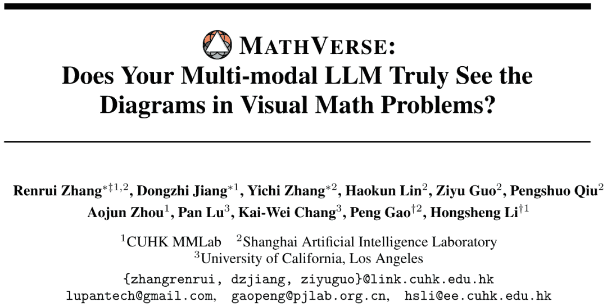

# 论文

### Reka Core Flash, Edge：一系列强大的多模式语言模型

贡献人：

链接：http://arxiv.org/abs/2404.12387v1

我们介绍了Reka Core，Flash和Edge，这是Reka从头开始训练的一系列强大的多模态语言模型。Reka模型能够处理和推理文本、图像、视频和音频输入。这份技术报告讨论了训练这些模型的细节，并提供了全面的评估结果。我们展示了Reka Edge和Reka Flash不仅是最先进的，而且胜过许多更大的模型，在各自的计算类别中提供了超额价值。与此同时，我们最有能力和最大的模型Reka Core，在自动评估和盲人评估方面接近最佳前沿模型。在图像问答基准测试（例如MMMU，VQAv2）上，Core表现出色，与GPT4-V竞争。同时，在多模态聊天中，Core在盲目的第三方人为评估设置中排名第二，胜过其他模型，如Claude 3 Opus。在文本基准测试中，Core不仅在一些既定基准测试中（例如MMLU，GSM8K）与其他前沿模型竞争，而且在人为评估上胜过GPT4-0613。在视频问答（感知测试）中，Core超过了Gemini Ultra。这些模型已经在http://chat.reka.ai上投入生产。您还可以在http://showcase.reka.ai找到一些非挑选的定性示例展示。

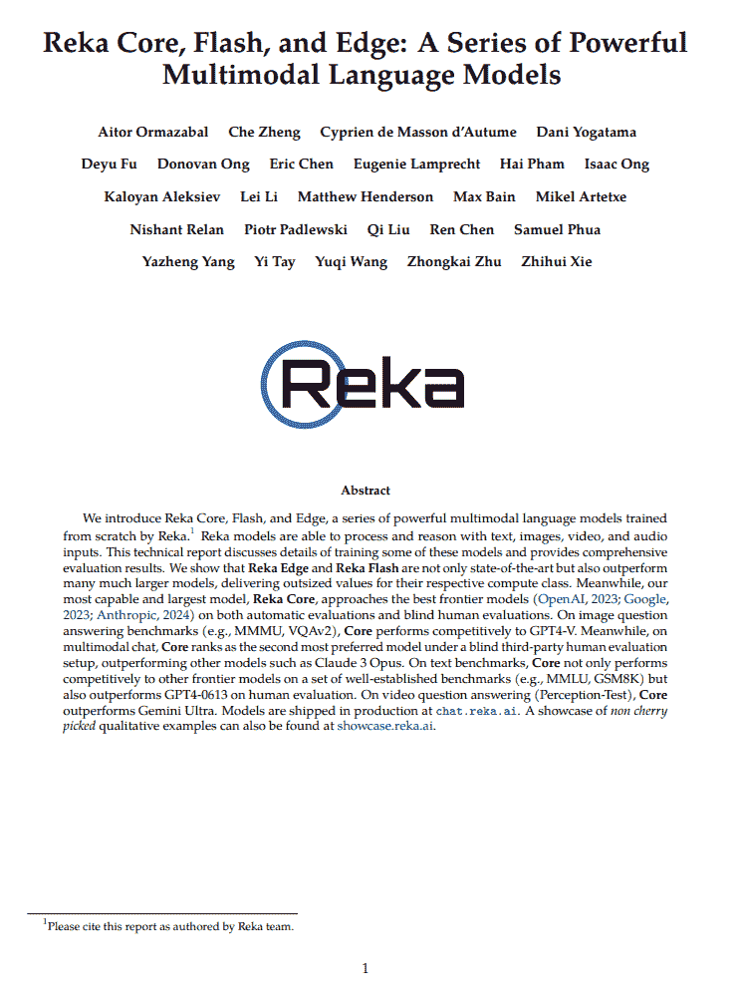

### 通过想象、搜索和批评实现LLM自我改进

贡献人：

链接：http://arxiv.org/abs/2404.12253v1

尽管大语言模型（LLMs）在各种任务上显示出了令人印象深刻的能力，但它们仍然在涉及复杂推理和规划的情况下存在困难。最近的工作提出了先进的提示技术，并强调了通过高质量数据进行微调来增强LLMs的推理能力的必要性。然而，这些方法本质上受到数据可用性和质量的限制。因此，在这种情况下，自我纠正和自我学习涌现为可行的解决方案，采用策略使LLMs能够改善其输出并从自我评估的奖励中学习。然而，LLMs在自我改进其响应方面的有效性，特别是在复杂的推理和规划任务中，仍然存疑。在本文中，我们介绍AlphaLLM用于LLMs的自我改进，它将蒙特卡洛树搜索（MCTS）与LLMs相结合，建立了一个自我改进的循环，从而增强了LLMs的能力，而无需额外的注释。受AlphaGo成功启发，AlphaLLM解决了将MCTS与LLM结合用于自我改进的独特挑战，包括数据稀缺性，语言任务搜索空间的广阔性以及语言任务中反馈的主观性质。AlphaLLM包括提示综合组件，专为语言任务量身定制的高效MCTS方法，以及三个评论模型，用于提供精确的反馈。我们在数学推理任务中的实验结果表明，AlphaLLM显着增强了LLMs的性能，而无需额外的注释，展示了LLMs自我改进的潜力。

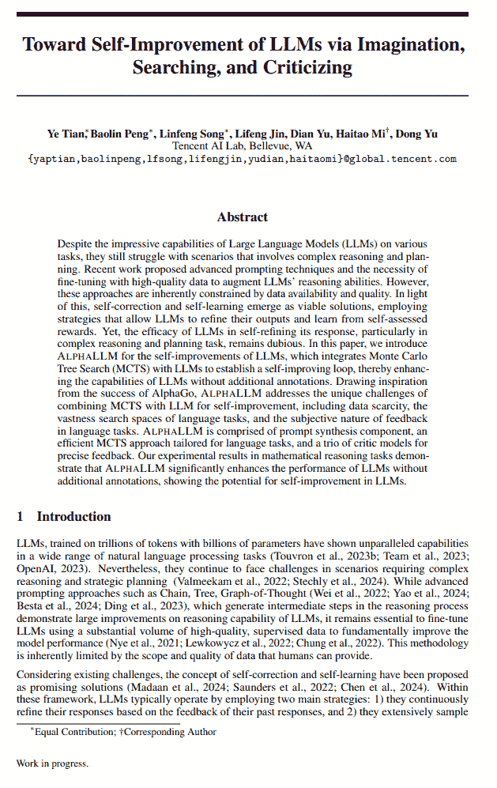

### MLCommons AI安全基准测试v0.5

贡献人：

链接：http://arxiv.org/abs/2404.12241v1

本文介绍了AI Safety Benchmark v0.5，由MLCommons AI Safety Working Group创建。该基准旨在评估使用chat-tuned语言模型的AI系统的安全风险。我们引入了一种原则性方法来指定和构建基准，v0.5仅涵盖一个用例（成年人与通用助手用英语对话），以及有限的人物设定（即典型用户、恶意用户和易受攻击用户）。我们创建了一个包含13种危险类别的新分类法，其中v0.5基准中有7种进行测试。我们计划在2024年底发布AI Safety Benchmark版本1.0。v1.0基准将为AI系统的安全提供有意义的洞察。然而，v0.5基准不应用于评估AI系统的安全性。我们努力充分记录了v0.5的限制、缺陷和挑战。这个发布的AI Safety Benchmark v0.5包括（1）一种原则性方法，用于指定和构建基准，包括用例、被测试系统类型（SUTs）、语言和上下文、人物设定、测试以及测试项目；（2）一个包含13种危险类别的分类法，带有定义和子类别；（3）对七种危险类别的测试，每种包含一组独特的测试项目，即提示。总共有43,090个测试项目，我们使用模板创建；（4）一个对AI系统进行基准测试的评分系统；（5）一个名为ModelBench的开放平台和可下载工具，可用于评估AI系统在基准上的安全性；（6）一个基准性能评估报告示例，对超过一打公开可用的chat-tuned语言模型的性能进行基准测试；（7）基准测试的测试规范。

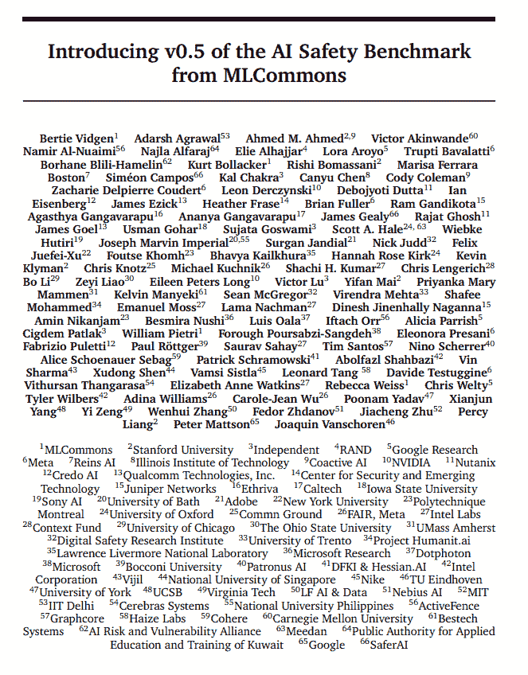

### OpenBezoar: 在混合指令数据上训练的便宜小巧的开放模型

贡献人：

链接：http://arxiv.org/abs/2404.12195v1

摘要：对于各种不同下游任务进行指令微调预训练LLMs已经取得了显著成功，引起了学术界和实践者的兴趣。为了确保这些微调的LLMs符合人类偏好，涌现了RLHF和DPO等技术。同时，对于模型的参数数量越来越感兴趣。在这项工作中，我们以OpenLLaMA 3Bv2作为基础模型，描述了用于微调OpenBezoar系列模型的配方。在这个配方中：我们首先利用Falcon-40B模型的开放和商业非限制性的指令微调变体，在三种方案下生成合成指令微调数据：LaMini-LM、WizardLM/Evol-Instruct（使用databricks-dolly-15k作为种子数据集）和Orca（使用Flan Collection作为种子数据集），然后使用GPT-4作为人类代理来过滤这些生成。接着，我们按顺序采用基于QLoRA的成本效益型有监督微调每种方案。最终生成的检查点进一步通过对HH-RLHF数据集的子集进行微调以最小化分布偏移，然后使用DPO损失获得最终检查点。评估是通过LM Eval Harness任务/指标以及在MT-Bench上使用"LLM-as-a-judge"框架进行的，发现最终检查点"OpenBezoar-HH-RLHF-DPO"在3B参数规模上的性能优于许多模型，甚至在Huggingface Open LLM Leaderboard的一个类别中超过了顶级模型。我们在HuggingFace上发布了"OpenBezoar-SFT"、"OpenBezoar-HH-RLHF-SFT"、"OpenBezoar-HH-RLHF-DPO"检查点，以及我们生成的数据集和代码库。

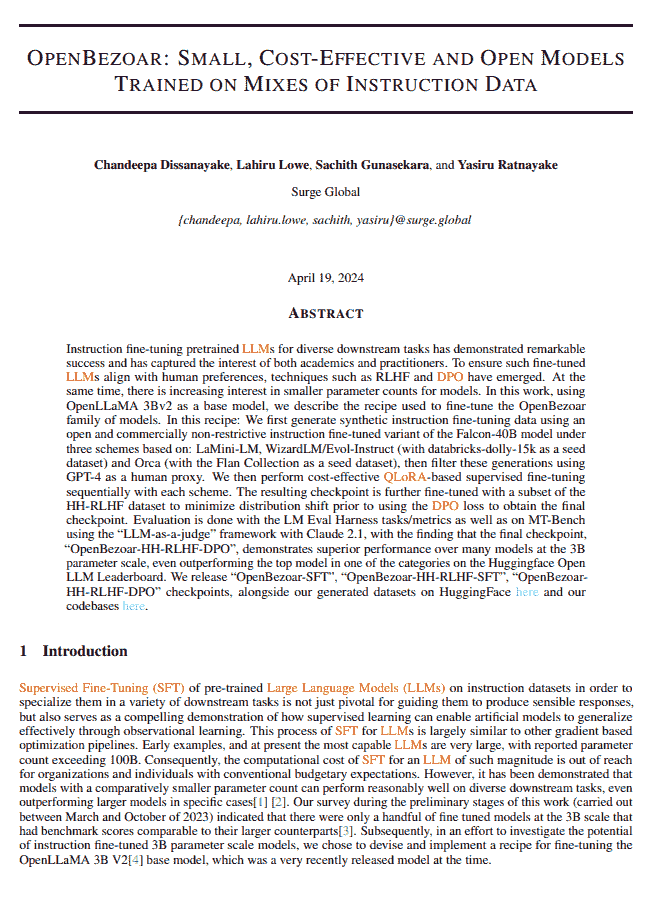

### **多模型中的顺序组合泛化**

贡献人：

链接：http://arxiv.org/abs/2404.12013v1

大规模多模型的崛起为生成建模和推理的突破性进展铺平了道路，在各种复杂任务中解锁了变革性的应用。然而，一个仍然存在的紧迫问题是它们对更强泛化形式的真实能力，在多模态环境中这一点尚未得到充分探讨。我们的研究旨在通过使用CompAct（Compositional Activities）来检验顺序组合泛化，该数据集在丰富的以自我为中心的厨房活动视频背景下精心构建。我们的数据集中的每个实例都用原始视频素材、自然发生的声音和众包逐步描述的组合表示。更重要的是，我们的设置确保个体概念在训练集和评估集中一贯分布，而它们的组合在评估集中是新颖的。我们对几种单模和多模型进行了全面评估。我们的发现显示，双模和三模型比仅文本的对应部分表现出明显优势。这凸显了多模性的重要性，同时为该领域的未来研究规划了发展轨迹。

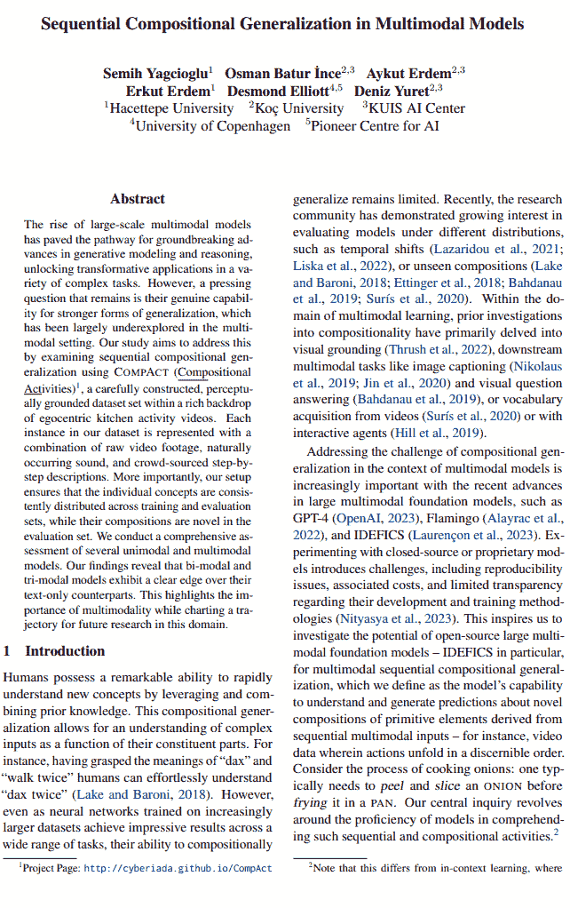

### TriForce：使用分层投机解码无损加速长序列生成

贡献人：

链接：http://arxiv.org/abs/2404.11912v1

随着大型语言模型（LLMs）在最近广泛用于生成长内容，对于高效的长序列推理支持需求不断涌现。然而，关键-值（KV）缓存作为用于避免重复计算的存储，随着序列长度的增长呈线性增长，已经成为一个关键瓶颈。考虑到LLMs的自回归特性，每生成一个token就要加载整个KV缓存，导致计算核心的低利用率和高延迟。我们介绍了TriForce，一个可扩展到长序列生成的分层推理解码系统。TriForce不仅为Llama2-7B-128K实现了令人印象深刻的加速，还展示了处理更长上下文的可伸缩性。

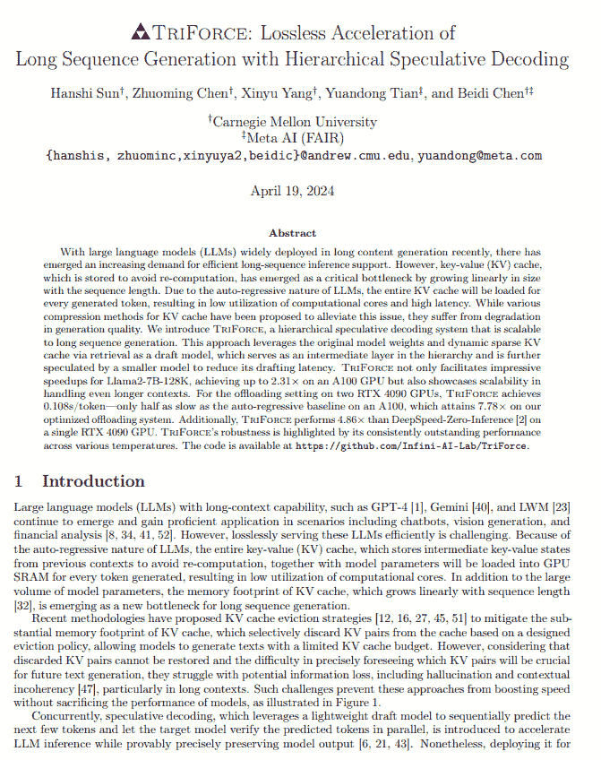

# 产品

### Seomaker

贡献人：

https://seomaker.ai/

Seomaker.ai 是一个帮助用户精通搜索引擎优化的下一代工具。它是一个基于人工智能的平台，提供超过25种工具套件，旨在简化用户的SEO策略，并提升在线表现。该平台包括直观的文案AI、竞争对手分析、排名跟踪和SEO网站审核等功能。

### Cascadeur

贡献人：

https://cascadeur.com/

### Tabula

贡献人：

https://www.tabula.io/

Tabula 提供了一个面向业务所有者、营销和产品经理、销售主管和分析师的解决方案，旨在通过无代码界面和人工智能帮助用户理解他们的数据。该平台擅长于销售和营销分析、临时和深入的数据分析、自动化例行分析任务以及报告和仪表板生成。

# HuggingFace&Github

### Welcome Llama 3

贡献人：

https://huggingface.co/blog/llama3

Llama 3 是 Meta 公司推出的开放获取 Llama 家族的下一个迭代版本，提供了两种尺寸：8B 用于在消费级 GPU 上高效部署和开发，70B 用于大规模 AI 原生应用程序。这两种尺寸都有基本和指令调整的变体，并且还有一个经过微调的 Llama Guard 2（安全微调）版本。

### **UniChat**

贡献人：

https://github.com/AkiKurisu/UniChat

UniChat 是一个基于 Unity.Sentis 和文本向量嵌入技术的工具，它使得在离线模式下能够基于向量数据库来搜索文本内容。此外，如果用户使用在线模式，UniChat 还包含一个基于 LangChain 的链式工具包，以便在游戏中快速嵌入LLM和Agent。 UniChat 的目标是设计一个能够不偏离开发者想法，同时又比较灵活的对话系统，适用于游戏开发。

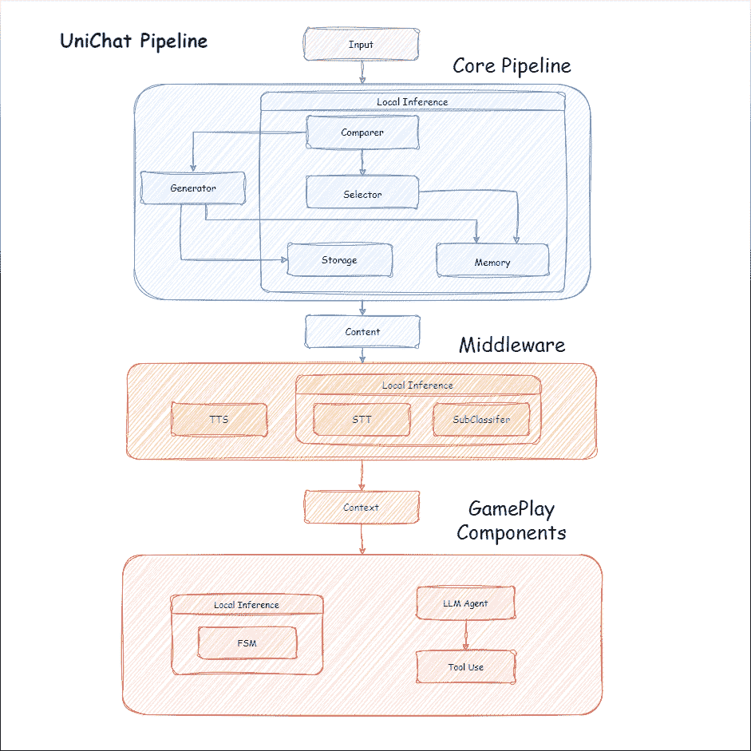

### TriForce

贡献人：

https://github.com/Infini-AI-Lab/TriForce

TriForce 是一种分层的推测解码系统，可扩展到长序列生成。该方法利用原始模型权重和动态稀疏的键-值（KV）缓存，通过检索作为草案模型，这种模型作为层次结构中的中间层，并通过较小的模型进一步推测，以减少其起草延迟。TriForce 不仅为 Llama2-7B-128K 实现了令人印象深刻的加速，而且在处理更长的上下文方面也展现了可扩展性。

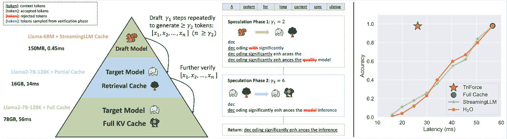

# 投融资

### Clazar获得1000万美元A轮融资，以现代化云市场中的SaaS销售

贡献人：

https://venturebeat.com/ai/clazar-raises-10m-series-a-to-modernize-saas-sales-across-cloud-marketplaces/

Clazar，一家自动化云市场软件销售的初创公司，宣布完成由Ridge Ventures和Ensemble VC领投的1000万美元A轮融资。该公司成立于2023年，目前总共筹集资金1400万美元。这些资金将用于简化在Amazon Web Services、Microsoft Azure和Google Cloud等市场上销售的技术和操作挑战。Clazar的软件平台与顶尖云市场集成，简化软件供应商与云提供商之间的共同销售过程，加快收入实现时间，扩大市场份额。

公司官网：https://clazar.io/

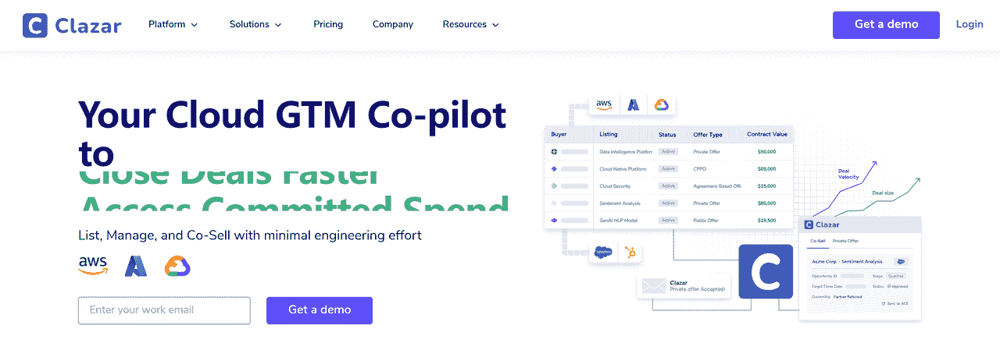

### 阿姆斯特丹初创公司Verify获得100万欧元投资，扩展其隐形指纹解决方案

贡献人：

https://www.eu-startups.com/2024/04/amsterdam-based-verify-snaps-e1-million-to-expand-its-invisible-fingerprint-solution/

位于阿姆斯特丹的人工智能初创公司Verify宣布获得由连续创业者Niels Bouwman和Chris Hall的天使投资，共100万欧元。Google也对Verify进行了投资，并将其纳入Google for Startups Cloud Program。这笔资金将用于招聘熟练的AI开发者和数据科学家，进一步扩展其在欧洲和美国的业务。Verify的初步客户包括Vinci Energies、鹿特丹大学和荷兰国家工会FNV。

公司官网：https://www.joinverify.com/

### dataplor宣布由Spark Capital领投的A轮融资，以扩展全球位置数据智能

贡献人：

https://www.businesswire.com/news/home/20240418167357/en/dataplor-Announces-Series-A-Funding-Led-by-Spark-Capital-to-Expand-Global-Location-Data-Intelligence

dataplor，全球位置智能领先提供商，宣布获得由Spark Capital领投的1060万美元A轮融资。本轮融资还包括Quest Venture Partners、Acronym Venture Capital、Circadian Ventures、Two Lanterns Venture Partners和APA Venture Partners的参与。这些资金将用于加速dataplor的全球扩展，建立市场上最准确、最全面、不断更新的全球兴趣点（POI）数据数据库。该公司自2020年以来的年均收入增长率为2.5倍，已获得众多财富500强客户的青睐。

公司官网：https://www.dataplor.com/

### FYLD获得1200万英镑资金，用于AI驱动的现场管理平台

贡献人：

https://tech.eu/2024/04/18/fyld-secures-ps12m-funding-for-ai-powered-field-management-platform/

英国的AI驱动现场管理平台FYLD成功筹集了1200万英镑的资金。此轮融资由安大略教师养老金计划领投。FYLD利用自然语言处理、计算机视觉和AI实时分析现场情况，帮助管理团队和操作团队做出更好的决策。至今，FYLD总共筹集了2600万英镑资金，使其AI平台快速推广，并在2023年实现了3倍的收入增长。此次融资将用于扩大商业团队，加速产品开发，增强AI驱动的预测分析平台，并拓展到全球新市场。

公司官网：https://www.fyld.ai/

# 学习

### HBM，生死局?

贡献人：

https://mp.weixin.qq.com/s/OipxfIUHjCiYFDraBy-_uA

文章讨论了高带宽内存（HBM）在AI芯片发展中的重要角色。随着Nvidia等大公司的快速发展，对HBM的需求激增。文章详述了美光、三星和SK Hynix等主要生产商的最新HBM产品，特别是在容量和性能上的显著提升。例如，美光计划在2024年推出36GB 12-Hi HBM3E产品，而三星的HBM3E 12H性能和容量提高了50%以上。此外，文章分析了内存成本如何影响AI芯片的定价和性能，特别是在GenAI繁荣时期，数据中心级GPU的价格不断攀升。文章还预测了HBM技术的未来发展趋势，包括更高的速度和容量。

原文链接：https://www.nextplatform.com/2024/02/27/he-who-can-pay-top-dollar-for-hbm-memory-controls-ai-training/

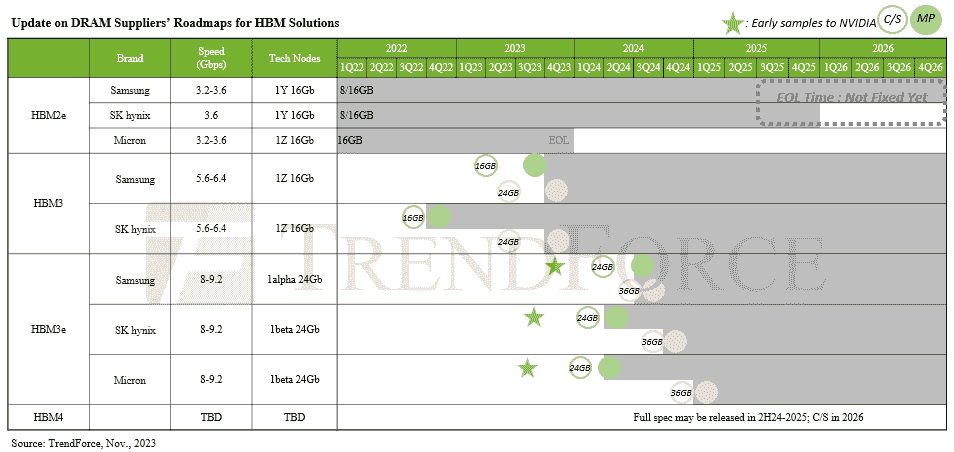

### 如何评价ICPC 2023 World Finals Luxor?

贡献人：

https://www.zhihu.com/question/653053550/answer/3471087154

在ICPC 2023 World Finals Luxor中，关于一个几何问题的解决，讨论了两种主要策略。一种是解析方法，需要将几何形状展平并连接线条，处理多个边界条件和细节。另一种是使用数值方法，如三分搜索，来动态确定形状边缘的点，这种方法代码更简洁，减少了对细节的敏感性。

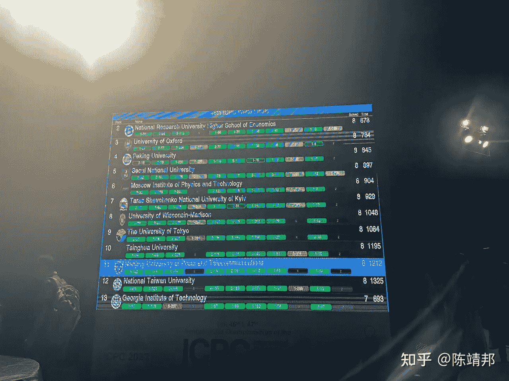

### Meta Llama 3 模型现已在 Amazon SageMaker JumpStart 上可用

贡献人：

https://aws.amazon.com/cn/blogs/machine-learning/meta-llama-3-models-are-now-available-in-amazon-sagemaker-jumpstart/

Meta Llama 3 基础模型现已通过 Amazon SageMaker JumpStart 提供，支持部署和推理。Llama 3 模型包括两种参数大小的版本：8B 和 70B，均支持 8000 个上下文长度，适用于多种用例，包括推理、代码生成和指令遵循。这些模型采用仅解码器的变换器架构，并使用新的分词器，提供更佳的性能，词汇表大小为 128K。Meta 在训练后的过程中进行了改进，显著降低了错误拒绝率，提高了模型响应的一致性和多样性。模型部署在 AWS 安全环境中，受您的 VPC 控制，确保数据安全。

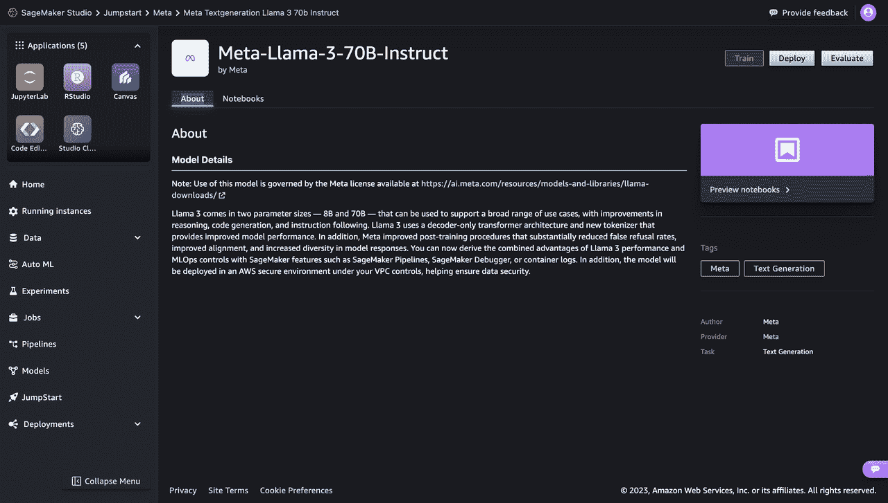

### 通过 Amazon SageMaker 模型并行和数据并行库实现分布式训练和高效扩展

贡献人：

https://aws.amazon.com/cn/blogs/machine-learning/distributed-training-and-efficient-scaling-with-the-amazon-sagemaker-model-parallel-and-data-parallel-libraries/

Amazon SageMaker 的分布式训练库 SMP 2.0 和 SMDDP 提供了高效的大模型训练解决方案。SMP 2.0 集成了 PyTorch 的完全共享数据并行 (FSDP) API，并首次与 Transformer Engine (TE) 协同工作，支持张量并行技术。这些库使得在最多 128 个 ml.p4d.24xlarge 实例的集群上，使用混合精度和 bfloat16 对 Llama 2 模型进行训练时，可以实现近线性的扩展效率。此外，SMP 和 SMDDP 支持各种序列长度的高效训练，展示了在大规模 GPU 集群上保持高吞吐量的能力。

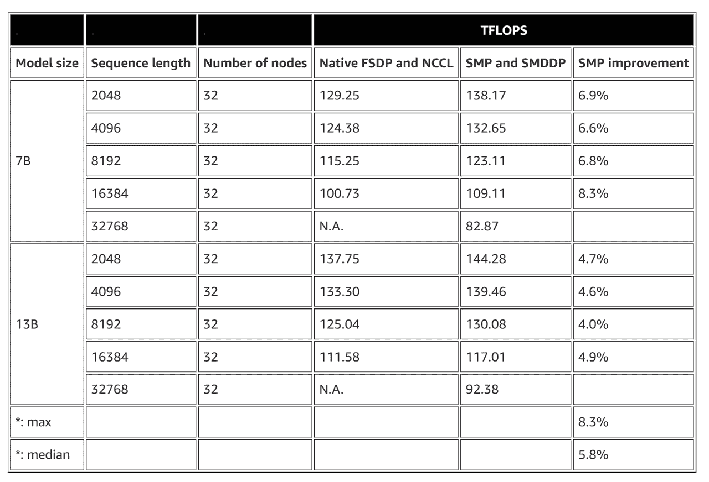

### LLM推理加速05 量化 LLM.int8()和AWQ

贡献人：

https://zhuanlan.zhihu.com/p/693207469

本文深入探讨了在大型语言模型中应用的LLM.int8()和AWQ量化技术。量化技术通过将模型权重从浮点数转换为整数形式，有效减少模型大小并提高计算效率。LLM.int8()针对离群值采取特殊处理，通过将它们保持在FP16格式，而其他数据则使用INT8格式，从而在不牺牲精度的情况下提升运算速度。然而，尽管LLM.int8()在小模型上表现良好，但在大模型上可能导致运算速度下降。AWQ方法通过只量化非关键权重，并保留关键权重的FP16格式，旨在优化推理性能。

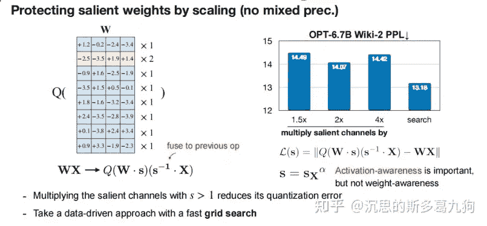

### 决策智能与强化学习（1）：Transformer in RL

贡献人：

https://zhuanlan.zhihu.com/p/693091518

文章探讨了将Transformer应用于强化学习(RL)的前沿方法，特别是GTrXL和决策Transformer（Decision Transformer）。GTrXL通过引入门控机制改进了长期记忆的处理，显示出在复杂记忆环境中的优势。决策Transformer则将RL问题转化为序列建模问题，通过直接模拟行为序列来生成优化策略，无需传统RL算法。这些创新展示了Transformer在解决长期依赖和决策建模中的潜力，尤其是在多任务和挑战性环境中。这种方法提高了样本效率和学习速度，为深化Transformer在RL领域的应用提供了新的研究方向。

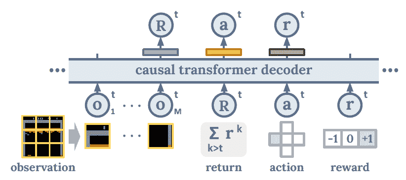

### 大模型时代的芯片机遇与未来 —— 季宇 行云集成电路

贡献人：

https://www.zhihu.com/question/546809864/answer/3382725893?utm_psn=1764439703901007873

文章探讨了大模型的发展与其对芯片行业的潜在影响。随着大模型尺寸的不断扩大，其对算力和内存的需求急剧增加，这对芯片设计提出了更高要求。芯片行业通过持续的技术创新，如改进内存系统和加强芯片间互联，逐步降低了大模型运行的成本。此外，大模型的商业应用需求推动了对高带宽内存系统的追求，以支持更大规模的模型和更长的上下文窗口，从而提高Token的质量。芯片行业的发展不仅支撑了大模型的规模化，还为其商业化落地提供了可能，预示着未来AI芯片在多个行业中的广泛应用和商业价值。

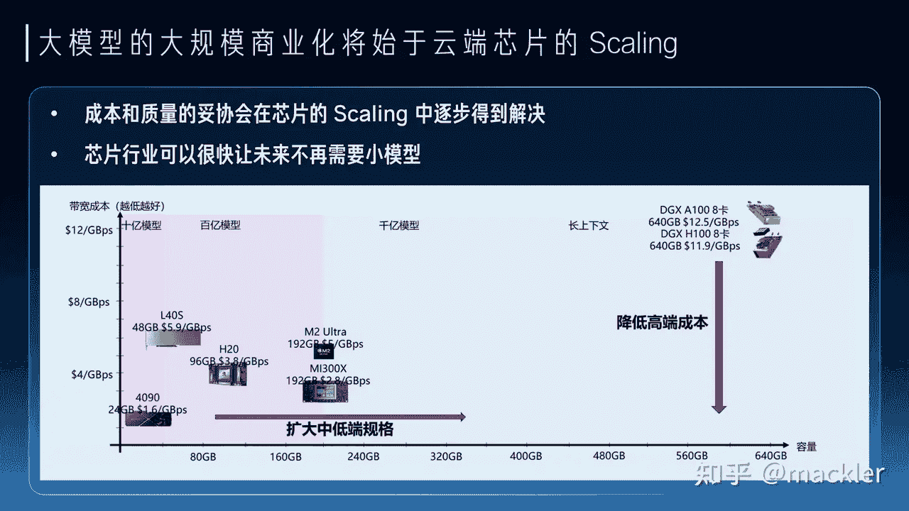

### Effort Engine

贡献人：

https://kolinko.github.io/effort/

Effort Engine 提供了一种可能的新算法，用于实时调整大型语言模型(LLM)推理过程中的计算量。该算法允许在推理时跳过最不重要的权重，从而实现计算效率的提升。在50%的计算量下，该算法与苹果硅片上的常规矩阵乘法一样快；在25%的努力下，速度是常规速度的两倍，同时大部分保持了输出质量。该算法目前仅在FP16下实现，主要针对Mistral模型，但理论上适用于所有模型，无需重新训练，只需转换格式和一些预计算。

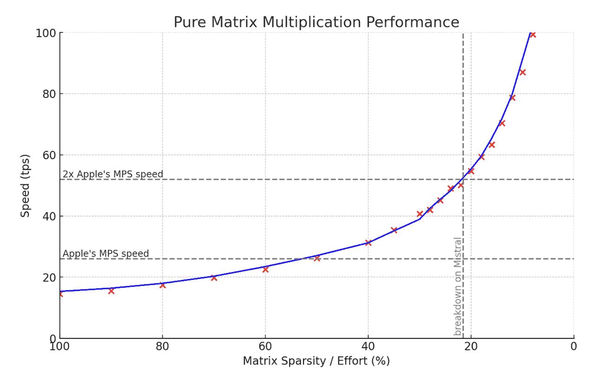

# 声明

本文档仅供学习交流使用，版权归原作者所有，若涉侵权，请联系Jack Jin 15101136166

##

（欢迎在下方反馈您宝贵的意见！整理不易，觉得有用给AI日报小组点个赞👍吧！）

ChatGPT；Angela；Zijia Liu；Alex；Zeqi Tan；Tiezhen（HuggingFace）；Naixu；Lizhi；Peter；Suoman；Jack

封面生成——右脑科技

如果你有大模型相关的创业想法，欢迎来找我们聊聊～微信：15101136166

> 快邀请你的小伙伴们一起来读大模型日报吧！

> **【日报****知识库****】**这里是近期日报内容的汇总,欢迎大家查阅

> [大模型日报知识库(分享版)](https://miracleplus.feishu.cn/wiki/KapVwXfkriOBiskB0B2cUHxjnTh)

>

> 欢迎大家多多帮我们分享,转发~~

> 如果大家有任何的建议或者吐槽,欢迎随时找我聊天~

